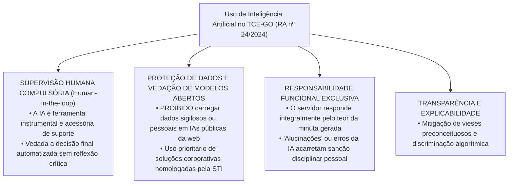
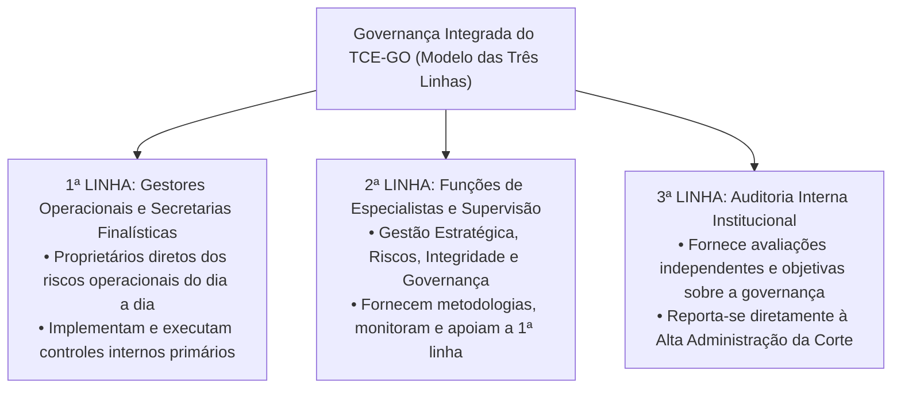

# 06 - Estrutura Organizacional e Políticas Institucionais do TCE-GO

> **Matéria:** Legislação Institucional  
> **Cargos:** A01 – Técnico de Controle Externo (Adm) / B02 – Técnico de Controle Externo (TI)  
> **Arquivo:** `06_politicas_institucionais_e_resolucoes_normativas.md`  
> **Atos Normativos:** Resoluções Administrativas (RA) e Resoluções Normativas (RN) do TCE-GO de 2024 e 2025

---

## 📌 Ementa / Itens do Edital
- Políticas institucionais do Tribunal de Contas do Estado de Goiás e resoluções normativas relacionadas à organização, funcionamento e gestão institucional:
    - **Resolução Administrativa nº 14/2025:** Define a estrutura organizacional do TCE-GO com as respectivas competências das secretarias, diretorias técnicas e unidades auxiliares;
    - **Resolução Administrativa nº 17/2024:** Dispõe sobre a Política de Segurança da Informação (PSI) do TCE-GO, pilares de confidencialidade, integridade, disponibilidade, autenticidade e legalidade (CIDA+L), classificação de ativos e deveres dos usuários;
    - **Resolução Normativa nº 5/2024:** Regulamenta o tratamento e a proteção de dados pessoais no âmbito do TCE-GO à luz da Lei Geral de Proteção de Dados (Lei nº 13.709/2018 - LGPD), bases legais do controle externo, atribuições do Encarregado (DPO), Comitê de Privacidade e Relatório de Impacto à Proteção de Dados Pessoais (RIPD);
    - **Resolução Administrativa nº 24/2024:** Dispõe sobre as diretrizes, princípios éticos e governança para o uso de ferramentas de Inteligência Artificial (IA) no TCE-GO (supervisão humana indelegável *Human-in-the-loop*, vedação de dados sigilosos em IAs públicas e responsabilidade pessoal do operador);
    - **Resolução Administrativa nº 5/2024:** Dispõe sobre a Política de Gestão de Pessoas do TCE-GO (gestão por competências, capacitação continuada na ESCOEX, avaliação de desempenho, saúde ocupacional e regras de teletrabalho);
    - **Resolução Administrativa nº 19/2024:** Dispõe sobre a Política de Comunicação Institucional (transparência pública, linguagem simples/cidadã, centralização na Assessoria de Comunicação e relacionamento com a mídia);
    - **Resolução Administrativa nº 15/2024:** Dispõe sobre o Sistema de Planejamento e Gestão Institucional do TCE-GO (planejamento estratégico plurianual, governança pública, gestão de riscos no Modelo das Três Linhas e monitoramento de indicadores de desempenho).

---

## 🧭 Sumário

1. [Estrutura Organizacional e Competências Técnicas (RA nº 14/2025)](#1-estrutura-organizacional-e-competencias-tecnicas-ra-no-142025)
    1. [Macroestrutura Superior e Órgãos Deliberativos](#11-macroestrutura-superior-e-orgaos-deliberativos)
    2. [Secretarias de Controle Externo e Unidades de Apoio Estratégico](#12-secretarias-de-controle-externo-e-unidades-de-apoio-estrategico)
    3. [Teste 172](#Teste-172)
2. [Política de Segurança da Informação - PSI (RA nº 17/2024)](#2-politica-de-seguranca-da-informacao-psi-ra-no-172024)
    1. [Pilares Basilares: CIDA+L e Destinatários da Norma](#21-pilares-basilares-cidal-e-destinatarios-da-norma)
    2. [Classificação da Informação e Controles Operacionais de TI](#22-classificacao-da-informacao-e-controles-operacionais-de-ti)
    3. [Tratamento de Incidentes Cibernéticos e Rastreabilidade](#23-tratamento-de-incidentes-ciberneticos-e-rastreabilidade)
    4. [Teste 173](#Teste-173)
    5. [Teste 174](#Teste-174)
3. [Tratamento e Proteção de Dados Pessoais - LGPD (RN nº 5/2024)](#3-tratamento-e-protecao-de-dados-pessoais-lgpd-rn-no-52024)
    1. [Aplicação da LGPD ao Controle Externo: Dispensabilidade do Consentimento](#31-aplicacao-da-lgpd-ao-controle-externo-dispensabilidade-do-consentimento)
    2. [Governança de Privacidade: Controlador, Operador, DPO e Comitê](#32-governanca-de-privacidade-controlador-operador-dpo-e-comite)
    3. [Minimização, Anonimização e Relatório de Impacto (RIPD)](#33-minimizacao-anonimizacao-e-relatorio-de-impacto-ripd)
    4. [Teste 175](#Teste-175)
    5. [Teste 176](#Teste-176)
4. [Governança e Uso de Inteligência Artificial no TCE-GO (RA nº 24/2024)](#4-governanca-e-uso-de-inteligencia-artificial-no-tce-go-ra-no-242024)
    1. [Princípio da Supervisão Humana Compulsória (*Human-in-the-loop*)](#41-principio-da-supervisao-humana-compulsoria-human-in-the-loop)
    2. [Proibição Estrita de Dados Sigilosos em Modelos Abertos](#42-proibicao-estrita-de-dados-sigilosos-em-modelos-abertos)
    3. [Responsabilidade Funcional Exclusiva do Servidor Operador](#43-responsabilidade-funcional-exclusiva-do-servidor-operador)
    4. [Teste 177](#Teste-177)
    5. [Teste 178](#Teste-178)
5. [Gestão de Pessoas, Comunicação e Planejamento Integrado](#5-gestao-de-pessoas-comunicacao-e-planejamento-integrado)
    1. [Política de Gestão de Pessoas e Teletrabalho (RA nº 5/2024)](#51-politica-de-gestao-de-pessoas-e-teletrabalho-ra-no-52024)
    2. [Política de Comunicação Institucional e Linguagem Simples (RA nº 19/2024)](#52-politica-de-comunicacao-institucional-e-linguagem-simples-ra-no-192024)
    3. [Planejamento Institucional e o Modelo das Três Linhas do IIA (RA nº 15/2024)](#53-planejamento-institucional-e-o-modelo-das-tres-linhas-do-iia-ra-no-152024)
    4. [Teste 179](#Teste-179)
    5. [Teste 180](#Teste-180)
    6. [Teste 181](#Teste-181)
6. [Fontes Oficiais e Referências Bibliográficas](#6-fontes-oficiais-e-referencias-bibliograficas)

---

## 1. Estrutura Organizacional e Competências Técnicas (RA nº 14/2025)

### 1.1 Macroestrutura Superior e Órgãos Deliberativos
A **Resolução Administrativa nº 14/2025** atualizou e consolidou a estrutura organizacional do Tribunal de Contas do Estado de Goiás, organizando a Corte em níveis funcionais e hierárquicos bem delineados:

- **Órgãos Deliberativos Colegiados Superiores:**
    - **Tribunal Pleno:** Composto pelos 7 Conselheiros e presença obrigatória do Procurador-Geral de Contas. Competência constitucional privativa para emissão de parecer prévio sobre as contas do Governador, apreciação de consultas em tese, deliberação recursal e eleição de dirigentes;
    - **Primeira e Segunda Câmaras Deliberativas:** Compostas por 3 Conselheiros cada, com competência para julgamento ordinário de contas de ordenadores, registro de atos de pessoal/aposentadorias e auditorias temáticas.
- **Órgãos de Direção Superior:**
    - **Presidência:** Direção executiva, administração geral, ordenação de despesas e representação institucional;
    - **Vice-Presidência:** Substituição regimental e supervisão de projetos institucionais;
    - **Corregedoria-Geral:** Órgão correicional permanente, responsável pela fiscalização de prazos processuais e disciplina funcional.
- **Órgãos Especiais e Vinculados:**
    - **Ministério Público de Contas (MPC-GO):** Atuação ministerial autônoma com intervenção obrigatória em todos os processos;
    - **Ouvidoria:** Canal de transparência ativa, acesso à informação (LAI) e acolhimento de denúncias de controle social;
    - **Escola Superior de Controle Externo (ESCOEX / Escola de Contas):** Centro de excelência responsável pela capacitação, pós-graduação e formação continuada de servidores da Corte e de gestores municipais e estaduais de Goiás.

### 1.2 Secretarias de Controle Externo e Unidades de Apoio Estratégico
As atividades finalísticas e corporativas do Tribunal são executadas por secretarias especializadas:

- **Secretarias Técnicas de Controle Externo:**
    - *Secretaria de Fiscalização de Contas e Orçamento:* Instrução das contas anuais do Governador e acompanhamento da Lei de Responsabilidade Fiscal (LRF);
    - *Secretaria de Fiscalização de Obras Públicas e Meio Ambiente:* Auditorias de engenharia, medições físicas, editais de infraestrutura e sustentabilidade;
    - *Secretaria de Fiscalização de Pessoal e Previdência:* Exame de admissões em concurso público e registro de aposentadorias, pensões e reformas;
    - *Secretaria de Fiscalização de Licitações, Contratos e Parcerias:* Controle de editais, contratos administrativos, consórcios e termos celebrados com Organizações Sociais (OSs);
    - *Secretaria de Avaliação de Políticas Públicas e Desempenho:* Auditorias operacionais para mensurar eficácia, eficiência e efetividade de programas sociais e de saúde/educação.
- **Secretarias de Apoio Corporativo:**
    - *Secretaria de Tecnologia da Informação (STI):* Gestão de infraestrutura de TI, governança de dados, inteligência artificial, segurança cibernética e sustentação de sistemas processuais;
    - *Secretaria-Geral:* Suporte direto ao Pleno e às Câmaras no processamento de pautas, atas e acórdãos;
    - *Secretaria de Gestão Estratégica:* Planejamento institucional, mapa de riscos e acompanhamento de metas globais;
    - *Diretoria de Gestão de Pessoas (DGP):* Gestão funcional, folha de pagamento, saúde ocupacional e desenvolvimento por competências.

---

### Teste 172
**(FGV – TRT-24 – Analista Judiciario Area Apoio Especializado Tecnologia da Informacao – 2025)**
A Portaria 252/2020 do Conselho Nacional de Justiça dispõe sobre o Modelo de Governança e Gestão da Plataforma Digital do Poder Judiciário (PDPJ-Br). A respeito das atribuições que competem ao Comitê Gestor Nacional do PDPJ-Br, que exerce a supervisão geral da Plataforma, avalie as afirmativas a seguir. I. Homologar e propor ajustes aos projetos de desenvolvimento de microsserviços sugeridos pela Gerência Executiva e pelos Comitês Gestores dos tribunais. II. Propor à Presidência, mediante sugestão do Comitê Gestor Nacional da PDPJ, a política de tecnologia da informação a ser seguida pela PDPJ-Br. III. Propor normas regulamentadoras à Comissão Permanente de Tecnologia da Informação e Infraestrutura do Conselho Nacional de Justiça. Está correto o que se afirma em

* **A)** I, apenas.
* **B)** II, apenas.
* **C)** III, apenas.
* **D)** I e III, apenas.
* **E)** II e III, apenas.

---

> **Comentário Detalhado:**
>
> - **A)** **Incorreta.** A opção incorre em restrição indevida ao limitar o escopo conceitual ao afirmar que "I, apenas". De acordo com a teoria estudada em *3.1 Aplicação da LGPD ao Controle Externo: Dispensabilidade do Consentimento*, artigo 7º, III da LGPD: Execução de políticas públicas e exercício de competências institucionais de fiscalização e controle externo atribuídas pela Constituição Federal e Estadual.
> - **B)** **Incorreta.** A opção incorre em restrição indevida ao limitar o escopo conceitual ao afirmar que "II, apenas". De acordo com a teoria estudada em *1.2 Secretarias de Controle Externo e Unidades de Apoio Estratégico*, *Secretaria de Tecnologia da Informação (STI):* Gestão de infraestrutura de TI, governança de dados, inteligência artificial, segurança cibernética e sustentação de sistemas processuais.
> - **C)** **Incorreta.** A opção incorre em restrição indevida ao limitar o escopo conceitual ao afirmar que "III, apenas". De acordo com a teoria estudada em *1.1 Macroestrutura Superior e Órgãos Deliberativos*, presidência: Direção executiva, administração geral, ordenação de despesas e representação institucional.
> - **D)** **Correta.** Conforme fundamentado na seção *3.2 Governança de Privacidade: Controlador, Operador, DPO e Comitê* deste guia, comitê de Privacidade e Proteção de Dados: Órgão multidisciplinar permanente encarregado de propor normas, aprovar o inventário de dados e auditar a conformidade da instituição com a LGPD. Dessa forma, está plenamente correta a assertiva da banca (FGV – TRT-24/2025) ao estabelecer que "I e III, apenas".
> - **E)** **Incorreta.** A opção incorre em restrição indevida ao limitar o escopo conceitual ao afirmar que "II e III, apenas". De acordo com a teoria estudada em *1.1 Macroestrutura Superior e Órgãos Deliberativos*, vice-Presidência: Substituição regimental e supervisão de projetos institucionais.
>
> **Gabarito: D**

---

## 2. Política de Segurança da Informação - PSI (RA nº 17/2024)

### 2.1 Pilares Basilares: CIDA+L e Destinatários da Norma
A **Resolução Administrativa nº 17/2024** estabelece a Política de Segurança da Informação (PSI) do TCE-GO, estruturada sobre cinco pilares fundamentais (**CIDA+L**):

$$\text{CIDA+L} = \text{Confidencialidade} + \text{Integridade} + \text{Disponibilidade} + \text{Autenticidade} + \text{Legalidade}$$

1. **Confidencialidade:** Garantia de que a informação corporativa e processual não estará disponível nem será revelada a indivíduos, entidades ou processos não autorizados;
2. **Integridade:** Salvaguarda da precisão, completude e integridade lógica dos ativos de informação e de seus métodos de processamento, impedindo alterações não autorizadas;
3. **Disponibilidade:** Propriedade de a informação e os sistemas corporativos estarem perfeitamente acessíveis e utilizáveis sob demanda por pessoas autorizadas;
4. **Autenticidade:** Garantia incontestável da identidade de quem produziu, assinou eletronicamente, transmitiu ou modificou determinado dado público ou administrativo;
5. **Legalidade:** Asseguramento de que o manuseio de dados obedece integralmente ao ordenamento constitucional e às normas legais vigentes.

- **Destinatários da PSI:** A PSI vincula expressamente **todos os usuários** de ativos de tecnologia do Tribunal. Isso engloba Conselheiros, Conselheiros Substitutos, Procuradores de Contas, servidores ocupantes de cargos efetivos e em comissão, servidores cedidos de outros órgãos, estagiários, residentes jurídicos e técnicos, bem como **empregados de empresas contratadas e terceirizadas**.

> 📌 **NOTA EXPLICATIVA / ABRANGÊNCIA DA PSI:** A Política de Segurança da Informação do TCE-GO não é um regulamento restrito aos servidores do setor de TI. Ela vincula universalmente qualquer pessoa que utilize computadores, contas de e-mail institucional, rede sem fio ou bases de dados da Corte de Contas goiana.

### 2.2 Classificação da Informação e Controles Operacionais de TI
A informação produzida ou sob guarda do TCE-GO é categorizada em quatro níveis de confidencialidade:

- **Pública:** Disponível para livre acesso da sociedade e dos jurisdicionados (acórdãos públicos, pautas, relatórios finais e portarias normativas);
- **Interna:** Informações de uso corporativo ordinário interno, que não devem ser divulgadas publicamente sem justificativa;
- **Confidencial:** Informações protegidas por sigilo bancário, fiscal, comercial ou referente a processos disciplinares e denúncias com apuração preliminar pendente;
- **Secreta ou Ultrassecreta:** Informações sensíveis de segurança de Estado e investigações especiais sob regime restritivo formal da Lei de Acesso à Informação.

**Controles Obrigatórios impostos aos Usuários:**

- Utilização obrigatória de autenticação multifator (**MFA**) em todos os acessos remotos e contas corporativas;
- Proibição absoluta de compartilhamento de credenciais de acesso, logins ou senhas entre colegas de trabalho (as credenciais são estritamente pessoais e intransferíveis);
- Bloqueio imediato da tela da estação de trabalho sempre que o usuário se afastar de sua mesa (*mesa e tela limpas*);
- Conexão obrigatória via Rede Virtual Privada (**VPN**) institucional criptografada para execução de atividades em regime de teletrabalho.

### 2.3 Tratamento de Incidentes Cibernéticos e Rastreabilidade
A infraestrutura do TCE-GO conta com a **Equipe de Tratamento de Incidentes de Redes (ETIR)**.

- Qualquer usuário que identificar comportamento anômalo em sistemas, tentativas de invasão, *phishing* ou perda de dados tem o dever imediato de notificar a equipe de segurança da STI;
- O Tribunal mantém trilhas de auditoria eletrônica e logs de acesso detalhados para garantir a rastreabilidade absoluta de qualquer modificação ou consulta indevida em processos de controle externo.

---

### Teste 173
**(FGV – TJ-AP – Analista Judiciario Apoio Especializado Tecnologia da Informacao Seguranca da Informacao – 2023)**
Um órgão público realiza tratamento dos dados pessoais dos seus servidores para implementar o módulo de autenticação de usuários de seus sistemas de informação e para prevenir ataques de softwares maliciosos na sua rede interna. Nesse cenário, é correto afirmar que:

* **A)** o órgão público deve recorrer à base legal do legítimo interesse adotando medidas para garantir a transparência do tratamento dos dados dos seus funcionários;
* **B)** o órgão público deve anonimizar os dados dos funcionários para poder usar no módulo de autenticação;
* **C)** a Autoridade Nacional de Proteção de Dados deverá autorizar o tratamento dos dados sensíveis dos funcionários do órgão público;
* **D)** o registro de um incidente de segurança é requisito para justificar o tratamento dos dados do servidor para o módulo de segurança;
* **E)** cada funcionário deve manifestar seu consentimento concordando com o tratamento de seus dados pessoais para serem usados pelo módulo de autenticação.

---

> **Comentário Detalhado:**
>
> - **A)** **Correta.** Conforme fundamentado na seção *3.3 Minimização, Anonimização e Relatório de Impacto (RIPD)* deste guia, relatório de Impacto à Proteção de Dados Pessoais (RIPD): Documento elaborado pelo setor de governança antes da implantação de novos sistemas ou processos que envolvam tratamento massivo de dados sensíveis, mapeando riscos de vazamento e indicando medidas mitigadoras. Dessa forma, está plenamente correta a assertiva da banca (FGV – TJ-AP/2023) ao estabelecer que "o órgão público deve recorrer à base legal do legítimo interesse adotando medidas para garantir a transparência do...".
> - **B)** **Incorreta.** A opção apresenta proposição em desacordo com os fundamentos teóricos e técnicos do tópico ao afirmar que "o órgão público deve anonimizar os dados dos funcionários para poder usar no módulo de autenticação". De acordo com a teoria estudada em *3.1 Aplicação da LGPD ao Controle Externo: Dispensabilidade do Consentimento*, o direito de eliminação de dados não se aplica quando o tratamento for amparado no cumprimento de obrigação legal de fiscalização e guarda de documentos públicos (Art. 16 da LGPD).
> - **C)** **Incorreta.** A opção apresenta proposição em desacordo com os fundamentos teóricos e técnicos do tópico ao afirmar que "a Autoridade Nacional de Proteção de Dados deverá autorizar o tratamento dos dados sensíveis dos funcionários do...". De acordo com a teoria estudada em *3.2 Governança de Privacidade: Controlador, Operador, DPO e Comitê*, encarregado pelo Tratamento de Dados Pessoais (DPO): Servidor formalmente designado pelo Presidente do Tribunal, responsável por atuar como canal oficial de comunicação entre o TCE-GO, os titulares dos dados e a Autoridade Nacional de Proteção de Dados (ANPD).
> - **D)** **Incorreta.** A opção apresenta proposição em desacordo com os fundamentos teóricos e técnicos do tópico ao afirmar que "o registro de um incidente de segurança é requisito para justificar o tratamento dos dados do servidor para o...". De acordo com a teoria estudada em *2.3 Tratamento de Incidentes Cibernéticos e Rastreabilidade*, qualquer usuário que identificar comportamento anômalo em sistemas, tentativas de invasão, *phishing* ou perda de dados tem o dever imediato de notificar a equipe de segurança da STI.
> - **E)** **Incorreta.** A opção apresenta proposição em desacordo com os fundamentos teóricos e técnicos do tópico ao afirmar que "cada funcionário deve manifestar seu consentimento concordando com o tratamento de seus dados pessoais para serem...". De acordo com a teoria estudada em *3.1 Aplicação da LGPD ao Controle Externo: Dispensabilidade do Consentimento*, a Resolução Normativa nº 5/2024 disciplina o tratamento de dados pessoais no âmbito do TCE-GO em harmonia com a Lei Geral de Proteção de Dados Pessoais (Lei Federal nº 13.709/2018 - LGPD).
>
> **Gabarito: A**

---

### Teste 174
**(FCC – TRT-15 – Analista Judiciario Tecnologia da Informacao – 2015)**
A política de segurança define os direitos e as responsabilidades de cada um em relação à segurança dos recursos computacionais que utiliza e as penalidades às quais está sujeito, caso não a cumpra. É considerada como um importante mecanismo de segurança, tanto para as instituições quanto para os usuários, pois com ela é possível deixar claro o comportamento esperado de cada um. Desta forma, casos de mau comportamento, que estejam previstos na política, podem ser tratados de forma adequada pelas partes envolvidas. A política de segurança pode conter outras políticas específicas, como: I. Política de senhas: define as regras sobre o uso de senhas nos recursos computacionais, como tamanho mínimo e máximo, regra de formação e periodicidade de troca. II. Política de privacidade: define como são tratadas as informações institucionais, ou seja, se elas podem ser repassadas a terceiros. III. Política de confidencialidade: define como são tratadas as informações pessoais, sejam elas de clientes, usuários ou funcionários. IV. Política de uso aceitável − PUA ou Acceptable Use Policy − AUP: também chamada de "Termo de Uso" ou "Termo de Serviço", define as regras de uso dos recursos computacionais, os direitos e as responsabilidades de quem os utiliza e as situações que são consideradas abusivas. Está correto o que consta APENAS em

* **A)** I e IV.
* **B)** II e III.
* **C)** III e IV.
* **D)** I, II e III.
* **E)** II e IV.

---

> **Comentário Detalhado:**
>
> - **A)** **Correta.** Conforme fundamentado na seção *2.2 Classificação da Informação e Controles Operacionais de TI* deste guia, interna: Informações de uso corporativo ordinário interno, que não devem ser divulgadas publicamente sem justificativa. Dessa forma, está plenamente correta a assertiva da banca (FCC – TRT-15/2015) ao estabelecer que "I e IV".
> - **B)** **Incorreta.** A opção apresenta proposição em desacordo com os fundamentos teóricos e técnicos do tópico ao afirmar que "II e III". De acordo com a teoria estudada em *3.1 Aplicação da LGPD ao Controle Externo: Dispensabilidade do Consentimento*, artigo 7º, III da LGPD: Execução de políticas públicas e exercício de competências institucionais de fiscalização e controle externo atribuídas pela Constituição Federal e Estadual.
> - **C)** **Incorreta.** A opção apresenta proposição em desacordo com os fundamentos teóricos e técnicos do tópico ao afirmar que "III e IV". De acordo com a teoria estudada em *4.2 Proibição Estrita de Dados Sigilosos em Modelos Abertos*, uso de Soluções Corporativas Homologadas: O desenvolvimento e uso de inteligência artificial no Tribunal deve ocorrer prioritariamente dentro do ecossistema tecnológico corporativo mantido e monitorado pela Secretaria de Tecnologia da Informação (STI), sob acordos estritos de confidencialidade e segurança de dados.
> - **D)** **Incorreta.** A opção apresenta proposição em desacordo com os fundamentos teóricos e técnicos do tópico ao afirmar que "I, II e III". De acordo com a teoria estudada em *2.3 Tratamento de Incidentes Cibernéticos e Rastreabilidade*, qualquer usuário que identificar comportamento anômalo em sistemas, tentativas de invasão, *phishing* ou perda de dados tem o dever imediato de notificar a equipe de segurança da STI.
> - **E)** **Incorreta.** A opção apresenta proposição em desacordo com os fundamentos teóricos e técnicos do tópico ao afirmar que "II e IV". De acordo com a teoria estudada em *4.3 Responsabilidade Funcional Exclusiva do Servidor Operador*, questões de concurso podem tentar enganar o candidato sugerindo que "o servidor que utilizar inteligência artificial homologada pelo Tribunal fica isento de responsabilidade disciplinar caso a minuta traga jurisprudência forjada pelo modelo".
>
> **Gabarito: A**

---

## 3. Tratamento e Proteção de Dados Pessoais - LGPD (RN nº 5/2024)

### 3.1 Aplicação da LGPD ao Controle Externo: Dispensabilidade do Consentimento
A **Resolução Normativa nº 5/2024** disciplina o tratamento de dados pessoais no âmbito do TCE-GO em harmonia com a Lei Geral de Proteção de Dados Pessoais (Lei Federal nº 13.709/2018 - LGPD):

- **Bases Legais Autônomas no Controle Externo:** O Tribunal de Contas trata dados pessoais (incluindo dados de ordenadores de despesas, servidores, licitantes e terceiros envolvidos em auditorias) com amparo nas seguintes hipóteses legais expressas:
    - **Artigo 7º, II da LGPD:** Cumprimento de obrigação legal ou regulatória pelo controlador;
    - **Artigo 7º, III da LGPD:** Execução de políticas públicas e exercício de competências institucionais de fiscalização e controle externo atribuídas pela Constituição Federal e Estadual.
- **Inexigibilidade de Consentimento:** O TCE-GO **NÃO depende de consentimento** do titular de dados para requisitar, tratar, cruzar e analisar folhas de pagamento, extratos bancários de contas públicas ou contratos administrativos em processos de fiscalização. O dever republicano de prestar contas e a missão constitucional de controle prevalecem sobre o interesse individual de ocultar registros financeiros públicos.

> 🚨 **ALERTA DE PROVA / PEGADINHA FCC:** É frequente a banca FCC tentar confundir o candidato afirmando que um gestor público auditado tem o direito de exigir que o Tribunal de Contas apague seus dados com base na LGPD. Essa assertiva está **INCORRETA**. O direito de eliminação de dados não se aplica quando o tratamento for amparado no cumprimento de obrigação legal de fiscalização e guarda de documentos públicos (Art. 16 da LGPD).

### 3.2 Governança de Privacidade: Controlador, Operador, DPO e Comitê
A governança de dados pessoais no TCE-GO é estruturada com clareza funcional:

- **Controlador:** O próprio **Tribunal de Contas do Estado de Goiás**, pessoa jurídica de direito público a quem competem as decisões sobre o tratamento de dados;
- **Operador:** As pessoas físicas ou jurídicas terceirizadas que realizam o tratamento de dados em nome e sob as ordens do TCE-GO (ex.: provedores de computação em nuvem, empresas de desenvolvimento de software);
- **Encarregado pelo Tratamento de Dados Pessoais (DPO):** Servidor formalmente designado pelo Presidente do Tribunal, responsável por atuar como canal oficial de comunicação entre o TCE-GO, os titulares dos dados e a Autoridade Nacional de Proteção de Dados (ANPD);
- **Comitê de Privacidade e Proteção de Dados:** Órgão multidisciplinar permanente encarregado de propor normas, aprovar o inventário de dados e auditar a conformidade da instituição com a LGPD.

### 3.3 Minimização, Anonimização e Relatório de Impacto (RIPD)
- **Princípio da Minimização da Coleta:** As auditorias e sistemas do Tribunal devem coletar apenas os dados pessoais estritamente necessários e pertinentes à finalidade da fiscalização;
- **Anonimização e Pseudonimização:** Nas decisões, relatórios e acórdãos disponibilizados em portais de transparência pública, os dados pessoais sensíveis ou desnecessários ao controle social (como CPF completo, endereço residencial privado e dados médicos) devem ser tarjados ou pseudonimizados;
- **Relatório de Impacto à Proteção de Dados Pessoais (RIPD):** Documento elaborado pelo setor de governança antes da implantação de novos sistemas ou processos que envolvam tratamento massivo de dados sensíveis, mapeando riscos de vazamento e indicando medidas mitigadoras.

---

### Teste 175
**(FGV – TJ-SC – Analista Administrativo – 2026)**
No que diz respeito às políticas institucionais de privacidade e ao tratamento de dados pessoais no âmbito do Poder Judiciário, analise as afirmativas a seguir. I. O tratamento de dados pessoais realizado para fins de atividades jurisdicionais é isento de medidas de segurança e conformidade, as quais devem ser aplicadas exclusivamente às atividades administrativas dos tribunais. II. Os tribunais devem designar um Encarregado pelo Tratamento de Dados Pessoais (DPO) para atuar como canal de comunicação entre o órgão, os titulares dos dados e a Autoridade Nacional de Proteção de Dados (ANPD). III. No Poder Judiciário, a responsabilidade pela segurança da informação e pela preservação da confidencialidade dos dados é atribuída exclusivamente aos servidores das unidades de Tecnologia da Informação (TI). Está correto o que se afirma, apenas, em

* **A)** I.
* **B)** II.
* **C)** III.
* **D)** I e II.
* **E)** II e III.

---

> **Comentário Detalhado:**
>
> - **A)** **Incorreta.** A opção apresenta proposição em desacordo com os fundamentos teóricos e técnicos do tópico ao afirmar que "I". De acordo com a teoria estudada em *3.2 Governança de Privacidade: Controlador, Operador, DPO e Comitê*, comitê de Privacidade e Proteção de Dados: Órgão multidisciplinar permanente encarregado de propor normas, aprovar o inventário de dados e auditar a conformidade da instituição com a LGPD.
> - **B)** **Correta.** Conforme fundamentado na seção *3.2 Governança de Privacidade: Controlador, Operador, DPO e Comitê* deste guia, encarregado pelo Tratamento de Dados Pessoais (DPO): Servidor formalmente designado pelo Presidente do Tribunal, responsável por atuar como canal oficial de comunicação entre o TCE-GO, os titulares dos dados e a Autoridade Nacional de Proteção de Dados (ANPD). Dessa forma, está plenamente correta a assertiva da banca (FGV – TJ-SC/2026) ao estabelecer que "II".
> - **C)** **Incorreta.** A opção apresenta proposição em desacordo com os fundamentos teóricos e técnicos do tópico ao afirmar que "III". De acordo com a teoria estudada em *3.1 Aplicação da LGPD ao Controle Externo: Dispensabilidade do Consentimento*, artigo 7º, III da LGPD: Execução de políticas públicas e exercício de competências institucionais de fiscalização e controle externo atribuídas pela Constituição Federal e Estadual.
> - **D)** **Incorreta.** A opção apresenta proposição em desacordo com os fundamentos teóricos e técnicos do tópico ao afirmar que "I e II". De acordo com a teoria estudada em *3.3 Minimização, Anonimização e Relatório de Impacto (RIPD)*, relatório de Impacto à Proteção de Dados Pessoais (RIPD): Documento elaborado pelo setor de governança antes da implantação de novos sistemas ou processos que envolvam tratamento massivo de dados sensíveis, mapeando riscos de vazamento e indicando medidas mitigadoras.
> - **E)** **Incorreta.** A opção apresenta proposição em desacordo com os fundamentos teóricos e técnicos do tópico ao afirmar que "II e III". De acordo com a teoria estudada em *3.1 Aplicação da LGPD ao Controle Externo: Dispensabilidade do Consentimento*, a Resolução Normativa nº 5/2024 disciplina o tratamento de dados pessoais no âmbito do TCE-GO em harmonia com a Lei Geral de Proteção de Dados Pessoais (Lei Federal nº 13.709/2018 - LGPD).
>
> **Gabarito: B**

---

### Teste 176
**(FGV – TJ-AP – Analista Judiciario Apoio Especializado Tecnologia da Informacao Banco de Dados – 2023)**
De acordo com a Resolução CNJ nº 396/2021, que institui a Estratégia Nacional de Segurança Cibernética do Poder Judiciário (ENSEC-PJ), no seu Art. 18, estabelece que a Rede de Cooperação do Judiciário na área de segurança cibernética tem o seguinte objetivo:

* **A)** evitar ambiente colaborativo com outros órgãos do Poder Judiciário, de forma a manter em segredo quaisquer ameaças e eventuais ataques ou incidentes cibernéticos;
* **B)** estimular o compartilhamento de informações sobre incidentes e vulnerabilidades cibernéticas, exceto as do âmbito do Poder Judiciário;
* **C)** realizar exercícios cibernéticos com a participação de entes restritos ao Poder Judiciário, no intuito de evitar vazamento de dados sensíveis;
* **D)** fortalecer o Centro de Prevenção, Tratamento e Resposta a Incidentes Cibernéticos (CPTRIC-PJ) do CNJ;
* **E)** desestimular a estrutura judiciária quanto ao aprimoramento de investigações de crimes cibernéticos.

---

> **Comentário Detalhado:**
>
> - **A)** **Incorreta.** A opção apresenta proposição em desacordo com os fundamentos teóricos e técnicos do tópico ao afirmar que "evitar ambiente colaborativo com outros órgãos do Poder Judiciário, de forma a manter em segredo quaisquer ameaças...". De acordo com a teoria estudada em *2.3 Tratamento de Incidentes Cibernéticos e Rastreabilidade*, a infraestrutura do TCE-GO conta com a Equipe de Tratamento de Incidentes de Redes (ETIR).
> - **B)** **Incorreta.** A opção apresenta proposição em desacordo com os fundamentos teóricos e técnicos do tópico ao afirmar que "estimular o compartilhamento de informações sobre incidentes e vulnerabilidades cibernéticas, exceto as do âmbito...". De acordo com a teoria estudada em *2.3 Tratamento de Incidentes Cibernéticos e Rastreabilidade*, o Tribunal mantém trilhas de auditoria eletrônica e logs de acesso detalhados para garantir a rastreabilidade absoluta de qualquer modificação ou consulta indevida em processos de controle externo.
> - **C)** **Incorreta.** A opção apresenta proposição em desacordo com os fundamentos teóricos e técnicos do tópico ao afirmar que "realizar exercícios cibernéticos com a participação de entes restritos ao Poder Judiciário, no intuito de evitar...". De acordo com a teoria estudada em *3.3 Minimização, Anonimização e Relatório de Impacto (RIPD)*, relatório de Impacto à Proteção de Dados Pessoais (RIPD): Documento elaborado pelo setor de governança antes da implantação de novos sistemas ou processos que envolvam tratamento massivo de dados sensíveis, mapeando riscos de vazamento e indicando medidas mitigadoras.
> - **D)** **Correta.** Conforme fundamentado na seção *2.3 Tratamento de Incidentes Cibernéticos e Rastreabilidade* deste guia, qualquer usuário que identificar comportamento anômalo em sistemas, tentativas de invasão, *phishing* ou perda de dados tem o dever imediato de notificar a equipe de segurança da STI. Dessa forma, está plenamente correta a assertiva da banca (FGV – TJ-AP/2023) ao estabelecer que "fortalecer o Centro de Prevenção, Tratamento e Resposta a Incidentes Cibernéticos (CPTRIC-PJ) do CNJ".
> - **E)** **Incorreta.** A opção apresenta proposição em desacordo com os fundamentos teóricos e técnicos do tópico ao afirmar que "desestimular a estrutura judiciária quanto ao aprimoramento de investigações de crimes cibernéticos". De acordo com a teoria estudada em *2.2 Classificação da Informação e Controles Operacionais de TI*, secreta ou Ultrassecreta: Informações sensíveis de segurança de Estado e investigações especiais sob regime restritivo formal da Lei de Acesso à Informação.
>
> **Gabarito: D**

---

## 4. Governança e Uso de Inteligência Artificial no TCE-GO (RA nº 24/2024)

### 4.1 Princípio da Supervisão Humana Compulsória (*Human-in-the-loop*)
A **Resolução Administrativa nº 24/2024** estabelece as diretrizes éticas e de governança para o uso de ferramentas de Inteligência Artificial (IA) no âmbito do TCE-GO:

- **Ferramenta de Suporte Cognitivo:** Os sistemas de IA (generativa, preditiva ou de processamento de linguagem natural) atuam exclusivamente como instrumentos complementares para potencializar a produtividade e a análise de dados pelo corpo técnico;
- **Vedação de Decisão Automatizada:** É expressamente proibida a prolação de pareceres técnicos, relatórios de auditoria ou votos decisórios gerados de forma puramente automatizada sem a supervisão e validação crítica de um servidor público (*Human-in-the-loop*). O juízo técnico de mérito e discricionariedade é monopólio da inteligência e discernimento humanos.

### 4.2 Proibição Estrita de Dados Sigilosos em Modelos Abertos
A norma impõe restrições operacionais categóricas à segurança da informação:

- **Proibição de Upload de Dados em IAs Públicas:** É terminantemente **vedado carregar ou inserir documentos sigilosos, segredos de justiça, dados bancários, fiscais ou dados pessoais protegidos pela LGPD em ferramentas públicas gratuitas de IA generativa** disponíveis na internet (como chatbots abertos sem salvaguardas contratuais corporativas de privacidade);
- **Uso de Soluções Corporativas Homologadas:** O desenvolvimento e uso de inteligência artificial no Tribunal deve ocorrer prioritariamente dentro do ecossistema tecnológico corporativo mantido e monitorado pela Secretaria de Tecnologia da Informação (STI), sob acordos estritos de confidencialidade e segurança de dados.

### 4.3 Responsabilidade Funcional Exclusiva do Servidor Operador
O servidor que utilizar ferramentas de IA para redigir peças processuais, despachos, resumos de auditoria ou minutas de instrução assume **responsabilidade pessoal e funcional integral pelo conteúdo**:

- O servidor tem a obrigação inescusável de conferir a veracidade dos fatos narrados, a exatidão das referências normativas e a autenticidade dos precedentes jurisprudenciais citados;
- A alegação de "alucinação algorítmica" ou falha da inteligência artificial **NÃO isenta o servidor de culpa funcional**, respondendo ele administrativamente perante a Corregedoria-Geral por negligência ou erro grosseiro.

> 🚨 **ALERTA DE PROVA / PEGADINHA FCC:** Questões de concurso podem tentar enganar o candidato sugerindo que "o servidor que utilizar inteligência artificial homologada pelo Tribunal fica isento de responsabilidade disciplinar caso a minuta traga jurisprudência forjada pelo modelo". A assertiva está **TOTALMENTE ERRADA**. A responsabilidade pelo texto assinado é sempre **pessoal e indelegável do servidor**, que deve checar minuciosamente cada citação!

---

### Teste 177
**(FGV – TJ-DFT – Analista Judiciario Suporte Em Tecnologia da Informacao – 2022)**
A Estratégia Nacional de Segurança da Informação e Cibernética do Poder Judiciário (ENSEC-PJ) foi instituída com o objetivo de incrementar a segurança cibernética nos órgãos do Poder Judiciário, abrangendo aspectos essenciais da segurança da informação e definindo objetivos para fortalecer o espaço cibernético do Poder Judiciário, assim como divulgar ações para os órgãos em seu âmbito de atuação. Um dos objetivos da ENSEC-PJ, instituída pela Resolução CNJ nº 396/2021, é:

* **A)** estabelecer modelo centralizado de governança cibernética nacional;
* **B)** permitir a manutenção e a continuidade dos serviços, ou o seu restabelecimento em menor tempo possível;
* **C)** fortalecer as ações de governança cibernética;
* **D)** realizar prática em gestão de incidentes e efetivar o aprimoramento contínuo do processo;
* **E)** estabelecer rede de cooperação do Judiciário para a segurança cibernética.

---

> **Comentário Detalhado:**
>
> - **A)** **Incorreta.** A opção apresenta proposição em desacordo com os fundamentos teóricos e técnicos do tópico ao afirmar que "estabelecer modelo centralizado de governança cibernética nacional". De acordo com a teoria estudada em *3.2 Governança de Privacidade: Controlador, Operador, DPO e Comitê*, encarregado pelo Tratamento de Dados Pessoais (DPO): Servidor formalmente designado pelo Presidente do Tribunal, responsável por atuar como canal oficial de comunicação entre o TCE-GO, os titulares dos dados e a Autoridade Nacional de Proteção de Dados (ANPD).
> - **B)** **Correta.** Conforme fundamentado na seção *1.2 Secretarias de Controle Externo e Unidades de Apoio Estratégico* deste guia, *Secretaria de Tecnologia da Informação (STI):* Gestão de infraestrutura de TI, governança de dados, inteligência artificial, segurança cibernética e sustentação de sistemas processuais. Dessa forma, está plenamente correta a assertiva da banca (FGV – TJ-DFT/2022) ao estabelecer que "permitir a manutenção e a continuidade dos serviços, ou o seu restabelecimento em menor tempo possível".
> - **C)** **Incorreta.** A opção apresenta proposição em desacordo com os fundamentos teóricos e técnicos do tópico ao afirmar que "fortalecer as ações de governança cibernética". De acordo com a teoria estudada em *4.1 Princípio da Supervisão Humana Compulsória (Human-in-the-loop)*, a Resolução Administrativa nº 24/2024 estabelece as diretrizes éticas e de governança para o uso de ferramentas de Inteligência Artificial (IA) no âmbito do TCE-GO.
> - **D)** **Incorreta.** A opção apresenta proposição em desacordo com os fundamentos teóricos e técnicos do tópico ao afirmar que "realizar prática em gestão de incidentes e efetivar o aprimoramento contínuo do processo". De acordo com a teoria estudada em *2.3 Tratamento de Incidentes Cibernéticos e Rastreabilidade*, qualquer usuário que identificar comportamento anômalo em sistemas, tentativas de invasão, *phishing* ou perda de dados tem o dever imediato de notificar a equipe de segurança da STI.
> - **E)** **Incorreta.** A opção apresenta proposição em desacordo com os fundamentos teóricos e técnicos do tópico ao afirmar que "estabelecer rede de cooperação do Judiciário para a segurança cibernética". De acordo com a teoria estudada em *2.1 Pilares Basilares: CIDA+L e Destinatários da Norma*, a Resolução Administrativa nº 17/2024 estabelece a Política de Segurança da Informação (PSI) do TCE-GO, estruturada sobre cinco pilares fundamentais (CIDA+L).
>
> **Gabarito: B**

---

### Teste 178
**(FGV – TJ-AP – Analista Judiciario Apoio Especializado Tecnologia da Informacao Seguranca da Informacao – 2023)**
A Estratégia Nacional de Segurança Cibernética do Poder Judiciário (ENSEC-PJ) define, em seu Art. 12, um modelo centralizado de governança nacional na segurança cibernética para os órgãos no âmbito do Poder Judiciário, à exceção do Supremo Tribunal Federal. Um dos objetivos desse modelo centralizado é:

* **A)** realizar exercícios cibernéticos com a participação de múltiplos entes;
* **B)** estabelecer norma sobre a definição dos requisitos metodológicos para a implementação da gestão de risco dos ativos da informação no Poder Judiciário;
* **C)** estabelecer rotinas de verificações de conformidade em segurança cibernética;
* **D)** elaborar a Política de Segurança da Informação e normas internas correlatas ao tema, observadas as normas de segurança da informação editadas pelo CNJ;
* **E)** promover ações de capacitação e profissionalização dos recursos humanos em temas relacionados à segurança da informação.

---

> **Comentário Detalhado:**
>
> - **A)** **Incorreta.** A opção apresenta proposição em desacordo com os fundamentos teóricos e técnicos do tópico ao afirmar que "realizar exercícios cibernéticos com a participação de múltiplos entes". De acordo com a teoria estudada em *2.3 Tratamento de Incidentes Cibernéticos e Rastreabilidade*, qualquer usuário que identificar comportamento anômalo em sistemas, tentativas de invasão, *phishing* ou perda de dados tem o dever imediato de notificar a equipe de segurança da STI.
> - **B)** **Incorreta.** A opção apresenta proposição em desacordo com os fundamentos teóricos e técnicos do tópico ao afirmar que "estabelecer norma sobre a definição dos requisitos metodológicos para a implementação da gestão de risco dos...". De acordo com a teoria estudada em *4.2 Proibição Estrita de Dados Sigilosos em Modelos Abertos*, a norma impõe restrições operacionais categóricas à segurança da informação.
> - **C)** **Correta.** Conforme fundamentado na seção *1.2 Secretarias de Controle Externo e Unidades de Apoio Estratégico* deste guia, *Secretaria de Tecnologia da Informação (STI):* Gestão de infraestrutura de TI, governança de dados, inteligência artificial, segurança cibernética e sustentação de sistemas processuais. Dessa forma, está plenamente correta a assertiva da banca (FGV – TJ-AP/2023) ao estabelecer que "estabelecer rotinas de verificações de conformidade em segurança cibernética".
> - **D)** **Incorreta.** A opção apresenta proposição em desacordo com os fundamentos teóricos e técnicos do tópico ao afirmar que "elaborar a Política de Segurança da Informação e normas internas correlatas ao tema, observadas as normas de...". De acordo com a teoria estudada em *3.2 Governança de Privacidade: Controlador, Operador, DPO e Comitê*, comitê de Privacidade e Proteção de Dados: Órgão multidisciplinar permanente encarregado de propor normas, aprovar o inventário de dados e auditar a conformidade da instituição com a LGPD.
> - **E)** **Incorreta.** A opção apresenta proposição em desacordo com os fundamentos teóricos e técnicos do tópico ao afirmar que "promover ações de capacitação e profissionalização dos recursos humanos em temas relacionados à segurança da...". De acordo com a teoria estudada em *4.2 Proibição Estrita de Dados Sigilosos em Modelos Abertos*, uso de Soluções Corporativas Homologadas: O desenvolvimento e uso de inteligência artificial no Tribunal deve ocorrer prioritariamente dentro do ecossistema tecnológico corporativo mantido e monitorado pela Secretaria de Tecnologia da Informação (STI), sob acordos estritos de confidencialidade e segurança de dados.
>
> **Gabarito: C**

---

## 5. Gestão de Pessoas, Comunicação e Planejamento Integrado

### 5.1 Política de Gestão de Pessoas e Teletrabalho (RA nº 5/2024)
A **Resolução Administrativa nº 5/2024** estrutura a moderna gestão de pessoas do Tribunal:

- **Gestão Estratégica por Competências:** Mapeamento continuado de Conhecimentos, Habilidades e Atitudes (CHA) para adequar o perfil técnico dos servidores às atribuições das secretarias;
- **Regime de Teletrabalho e Trabalho Híbrido:**
    - Caráter facultativo e condicionado à conveniência da administração pública;
    - Exige prévia pactuação de **Plano de Trabalho Individualizado com estipulação de metas superiores** às exigidas no regime exclusivamente presencial;
    - Não é admitido aos servidores que apresentem desempenho insatisfatório ou estejam cumprindo sanção disciplinar;
- **Papel da ESCOEX:** Planejamento e execução de programas de capacitação continuada e pós-graduações, com foco no controle externo e governança pública.

### 5.2 Política de Comunicação Institucional e Linguagem Simples (RA nº 19/2024)
A **Resolução Administrativa nº 19/2024** orienta a comunicação pública do TCE-GO:

- **Movimento da Linguagem Simples e Cidadã:** Determinação cogente de redigir atos, resumos de acórdãos, notícias e painéis de dados em linguagem direta, clara e acessível ao cidadão comum, extirpando expressões rebuscadas em latim ou formalismos jurídicos estéreis;
- **Centralização da Relação com a Imprensa:** O atendimento a jornalistas, comunicados oficiais e concessão de entrevistas em nome institucional do TCE-GO competem privativamente à **Assessoria de Comunicação (ASCOM)**, preservando a neutralidade e integridade da imagem da Corte.

### 5.3 Planejamento Institucional e o Modelo das Três Linhas do IIA (RA nº 15/2024)
A **Resolução Administrativa nº 15/2024** organiza o Sistema de Planejamento e Gestão de Riscos do TCE-GO, adotando o internacionalmente consagrado **Modelo das Três Linhas** do *Institute of Internal Auditors* (IIA):

- **1ª Linha:** Composta pelos secretários, diretores e chefes de divisões operacionais, que são os verdadeiros proprietários dos riscos em suas rotinas diárias;
- **2ª Linha:** Composta por órgãos de supervisão, riscos, integridade e governança corporativa, que dão suporte metodológico e monitoram os controles da 1ª linha;
- **3ª Linha:** Desempenhada pela **Auditoria Interna Institucional**, que possui independência funcional para auditar a eficácia da governança, dos controles internos e do gerenciamento de riscos de todo o Tribunal.

---

### Teste 179
**(FGV – TRT-24 – Analista Judiciario Area Apoio Especializado Tecnologia da Informacao – 2025)**
A Resolução 396/2021 do Conselho Nacional de Justiça institui a Estratégia Nacional de Segurança Cibernética do Poder Judiciário (ENSEC-PJ). A respeito dos objetivos da ENSEC-PJ, avalie as afirmativas a seguir. I. Baratear a execução das atividades do Judiciário no ambiente digital para reduzir o tempo de atendimento e recuperação de falhas. II. Aumentar a resiliência às ameaças cibernéticas por meio da gestão ativa de permissões de usuários de sistemas informatizados. III. Permitir a manutenção e a continuidade dos serviços, ou o seu restabelecimento em menor tempo possível. IV. Estabelecer governança de segurança cibernética e fortalecer a gestão e coordenação integrada de ações de segurança cibernética nos órgãos do Poder Judiciário. Está correto o que se afirma em

* **A)** I e II, apenas.
* **B)** II e III, apenas.
* **C)** III e IV, apenas.
* **D)** I, III e IV, apenas.
* **E)** II, III e IV, apenas.

---

> **Comentário Detalhado:**
>
> - **A)** **Incorreta.** A opção incorre em restrição indevida ao limitar o escopo conceitual ao afirmar que "I e II, apenas". De acordo com a teoria estudada em *1.2 Secretarias de Controle Externo e Unidades de Apoio Estratégico*, *Secretaria de Tecnologia da Informação (STI):* Gestão de infraestrutura de TI, governança de dados, inteligência artificial, segurança cibernética e sustentação de sistemas processuais.
> - **B)** **Incorreta.** A opção incorre em restrição indevida ao limitar o escopo conceitual ao afirmar que "II e III, apenas". De acordo com a teoria estudada em *5.1 Política de Gestão de Pessoas e Teletrabalho (RA nº 5/2024)*, papel da ESCOEX: Planejamento e execução de programas de capacitação continuada e pós-graduações, com foco no controle externo e governança pública.
> - **C)** **Correta.** Conforme fundamentado na seção *3.1 Aplicação da LGPD ao Controle Externo: Dispensabilidade do Consentimento* deste guia, artigo 7º, III da LGPD: Execução de políticas públicas e exercício de competências institucionais de fiscalização e controle externo atribuídas pela Constituição Federal e Estadual. Dessa forma, está plenamente correta a assertiva da banca (FGV – TRT-24/2025) ao estabelecer que "III e IV, apenas".
> - **D)** **Incorreta.** A opção incorre em restrição indevida ao limitar o escopo conceitual ao afirmar que "I, III e IV, apenas". De acordo com a teoria estudada em *1.2 Secretarias de Controle Externo e Unidades de Apoio Estratégico*, *Secretaria de Fiscalização de Obras Públicas e Meio Ambiente:* Auditorias de engenharia, medições físicas, editais de infraestrutura e sustentabilidade.
> - **E)** **Incorreta.** A opção incorre em restrição indevida ao limitar o escopo conceitual ao afirmar que "II, III e IV, apenas". De acordo com a teoria estudada em *2.2 Classificação da Informação e Controles Operacionais de TI*, conexão obrigatória via Rede Virtual Privada (VPN) institucional criptografada para execução de atividades em regime de teletrabalho.
>
> **Gabarito: C**

---

### Teste 180
**(FGV – TRT-13 – Analista Judiciario Tecnologia da Informacao – 2022)**
A Estratégia Nacional de Segurança Cibernética do Poder Judiciário (ENSEC-PJ) tem sua regulamentação instituída pela Resolução CNJ nº 396/2021 e pela Portaria CNJ nº 162/2021. Quanto às definições de eventos Cibernéticos do Poder Judiciário, assinale V para a afirmativa verdadeira e F para a falsa. I. Na Prevenção de Incidentes Cibernéticos do Poder Judiciário são princípios críticos que asseguram a construção de sistema de segurança cibernética eficaz: base de conhecimento de vírus, diagnóstico contínuo e automação. II. Na Investigação para Ilícitos Cibernéticos do Poder Judiciário o protocolo tem por finalidade estabelecer os procedimentos básicos para coleta e preservação de evidências e para comunicação obrigatória dos fatos penalmente relevantes ao Ministério Público e ao órgão de polícia judiciária com atribuição para o início da persecução penal. III. Considerando a Prevenção e Mitigação de Ameaças Cibernéticas e Confiança Digital, na etapa de recuperação espera-se que a organização conte com plano que preveja ações a serem executadas durante ou após um incidente e que incorpore as lições aprendidas, bem como que exista gerenciamento de comunicação com o público e um plano de recuperação de reputação após incidentes. As afirmativas são, respectivamente,

* **A)** F, V e V.
* **B)** F, F e V.
* **C)** V, F e F.
* **D)** V, V e F.
* **E)** V, F e V.

---

> **Comentário Detalhado:**
>
> - **A)** **Incorreta.** A opção apresenta proposição em desacordo com os fundamentos teóricos e técnicos do tópico ao afirmar que "F, V e V". De acordo com a teoria estudada em *5.3 Planejamento Institucional e o Modelo das Três Linhas do IIA (RA nº 15/2024)*, a Resolução Administrativa nº 15/2024 organiza o Sistema de Planejamento e Gestão de Riscos do TCE-GO, adotando o internacionalmente consagrado Modelo das Três Linhas do *Institute of Internal Auditors* (IIA).
> - **B)** **Incorreta.** A opção apresenta proposição em desacordo com os fundamentos teóricos e técnicos do tópico ao afirmar que "F, F e V". De acordo com a teoria estudada em *3.3 Minimização, Anonimização e Relatório de Impacto (RIPD)*, princípio da Minimização da Coleta: As auditorias e sistemas do Tribunal devem coletar apenas os dados pessoais estritamente necessários e pertinentes à finalidade da fiscalização.
> - **C)** **Correta.** Conforme fundamentado na seção *2.3 Tratamento de Incidentes Cibernéticos e Rastreabilidade* deste guia, qualquer usuário que identificar comportamento anômalo em sistemas, tentativas de invasão, *phishing* ou perda de dados tem o dever imediato de notificar a equipe de segurança da STI. Dessa forma, está plenamente correta a assertiva da banca (FGV – TRT-13/2022) ao estabelecer que "V, F e F".
> - **D)** **Incorreta.** A opção apresenta proposição em desacordo com os fundamentos teóricos e técnicos do tópico ao afirmar que "V, V e F". De acordo com a teoria estudada em *5.2 Política de Comunicação Institucional e Linguagem Simples (RA nº 19/2024)*, a Resolução Administrativa nº 19/2024 orienta a comunicação pública do TCE-GO.
> - **E)** **Incorreta.** A opção apresenta proposição em desacordo com os fundamentos teóricos e técnicos do tópico ao afirmar que "V, F e V". De acordo com a teoria estudada em *1.1 Macroestrutura Superior e Órgãos Deliberativos*, ministério Público de Contas (MPC-GO): Atuação ministerial autônoma com intervenção obrigatória em todos os processos.
>
> **Gabarito: C**

---

### Teste 181
**(FGV – TJ-RR – Analista Judiciario Gestao e Governanca de Tecnologia da Informacao – 2024)**
O Poder Judiciário adotou o modelo centralizado de governança na segurança cibernética, de acordo com a Resolução Nº 396 de 07/06/2021 que instituiu a Estratégia Nacional de Segurança Cibernética do Poder Judiciário (ENSEC-PJ). Nesse modelo, o órgão central que coordena as ações para viabilizar a governança na segurança cibernética é

* **A)** o Conselho Nacional de Justiça (CNJ).
* **B)** o Comitê Gestor de Segurança da Informação do Poder Judiciário (CGSI-PJ).
* **C)** o Centro de Prevenção, Tratamento e Resposta a Incidentes Cibernéticos do Poder Judiciário (CPTRIC-PJ).
* **D)** a Equipe de Tratamento e Resposta a Incidentes de Segurança Cibernética (ETIR).
* **E)** o Sistema de Gestão de Segurança da Informação do Poder Judiciário (SGSI-PJ).

---

> **Comentário Detalhado:**
>
> - **A)** **Correta.** Conforme fundamentado na seção *3.2 Governança de Privacidade: Controlador, Operador, DPO e Comitê* deste guia, encarregado pelo Tratamento de Dados Pessoais (DPO): Servidor formalmente designado pelo Presidente do Tribunal, responsável por atuar como canal oficial de comunicação entre o TCE-GO, os titulares dos dados e a Autoridade Nacional de Proteção de Dados (ANPD). Dessa forma, está plenamente correta a assertiva da banca (FGV – TJ-RR/2024) ao estabelecer que "o Conselho Nacional de Justiça (CNJ)".
> - **B)** **Incorreta.** A opção apresenta proposição em desacordo com os fundamentos teóricos e técnicos do tópico ao afirmar que "o Comitê Gestor de Segurança da Informação do Poder Judiciário (CGSI-PJ)". De acordo com a teoria estudada em *1.2 Secretarias de Controle Externo e Unidades de Apoio Estratégico*, *Secretaria de Tecnologia da Informação (STI):* Gestão de infraestrutura de TI, governança de dados, inteligência artificial, segurança cibernética e sustentação de sistemas processuais.
> - **C)** **Incorreta.** A opção apresenta proposição em desacordo com os fundamentos teóricos e técnicos do tópico ao afirmar que "o Centro de Prevenção, Tratamento e Resposta a Incidentes Cibernéticos do Poder Judiciário (CPTRIC-PJ)". De acordo com a teoria estudada em *2.3 Tratamento de Incidentes Cibernéticos e Rastreabilidade*, qualquer usuário que identificar comportamento anômalo em sistemas, tentativas de invasão, *phishing* ou perda de dados tem o dever imediato de notificar a equipe de segurança da STI.
> - **D)** **Incorreta.** A opção apresenta proposição em desacordo com os fundamentos teóricos e técnicos do tópico ao afirmar que "a Equipe de Tratamento e Resposta a Incidentes de Segurança Cibernética (ETIR)". De acordo com a teoria estudada em *2.3 Tratamento de Incidentes Cibernéticos e Rastreabilidade*, a infraestrutura do TCE-GO conta com a Equipe de Tratamento de Incidentes de Redes (ETIR).
> - **E)** **Incorreta.** A opção apresenta proposição em desacordo com os fundamentos teóricos e técnicos do tópico ao afirmar que "o Sistema de Gestão de Segurança da Informação do Poder Judiciário (SGSI-PJ)". De acordo com a teoria estudada em *5.3 Planejamento Institucional e o Modelo das Três Linhas do IIA (RA nº 15/2024)*, a Resolução Administrativa nº 15/2024 organiza o Sistema de Planejamento e Gestão de Riscos do TCE-GO, adotando o internacionalmente consagrado Modelo das Três Linhas do *Institute of Internal Auditors* (IIA).
>
> **Gabarito: A**

---

## 6. Fontes Oficiais e Referências Bibliográficas

* [Portal Institucional do TCE-GO - Tecnologia da Informação e Políticas Digitais](https://portal.tce.go.gov.br/tecnologia-da-informacao2) - Governança de TI, segurança da informação e diretrizes digitais do Tribunal.
* [Portal Institucional do TCE-GO - Plano de Fiscalização e Governança](https://portal.tce.go.gov.br/governanca-planejamento-e-gestao/planos-institucionais/plano-de-fiscalizacao) - Planejamento institucional e diretrizes de governança pública.
* [Portal Institucional do TCE-GO - TCE-Juris: Atos Normativos e Resoluções](https://portal.tce.go.gov.br/tce-juris/atos-normativos-do-tce-go) - Resoluções normativas sobre inteligência artificial, segurança e processo eletrônico.
* [Lei Complementar Estadual de Goiás nº 205/2025 - Política de IA (Casa Civil/GO)](https://legisla.casacivil.go.gov.br/pesquisa_legislacao/110694/lei-complementar-205) - Política Estadual de Fomento à Inovação em Inteligência Artificial no Estado de Goiás.
* [Lei Federal nº 13.709/2018 - LGPD (Planalto)](https://www.planalto.gov.br/ccivil_03/_ato2015-2018/2018/lei/l13709.htm) - Tratamento de dados pessoais pelo Poder Público e princípios de privacidade.
* MOTTA, Fabrício. **Governança Pública e Tribunais de Contas**. Belo Horizonte: Fórum, 2022. (Cap. 5 - Inovação Tecnológica e Governança de TI no Controle Externo).
* MARRARA, Thiago. **Processo Administrativo e Inovação Tecnológica**. São Paulo: Almedina, 2021. (Cap. 4 - Inteligência Artificial e Processo Eletrônico no Setor Público).
* BIONI, Bruno Ricardo. **Proteção de Dados Pessoais: A Função e os Limites do Consentimento**. 2. ed. Rio de Janeiro: Forense, 2021. (Cap. 3 - Dados Pessoais e Administração Pública).
