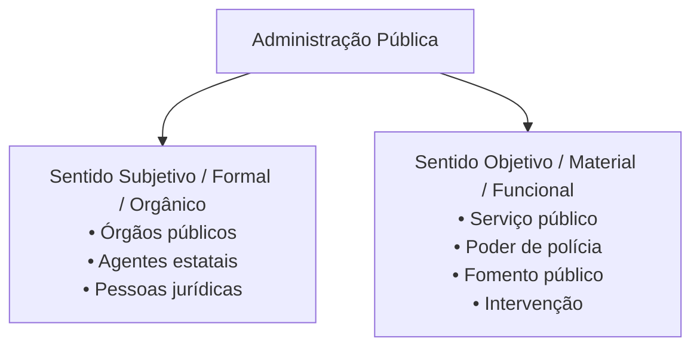
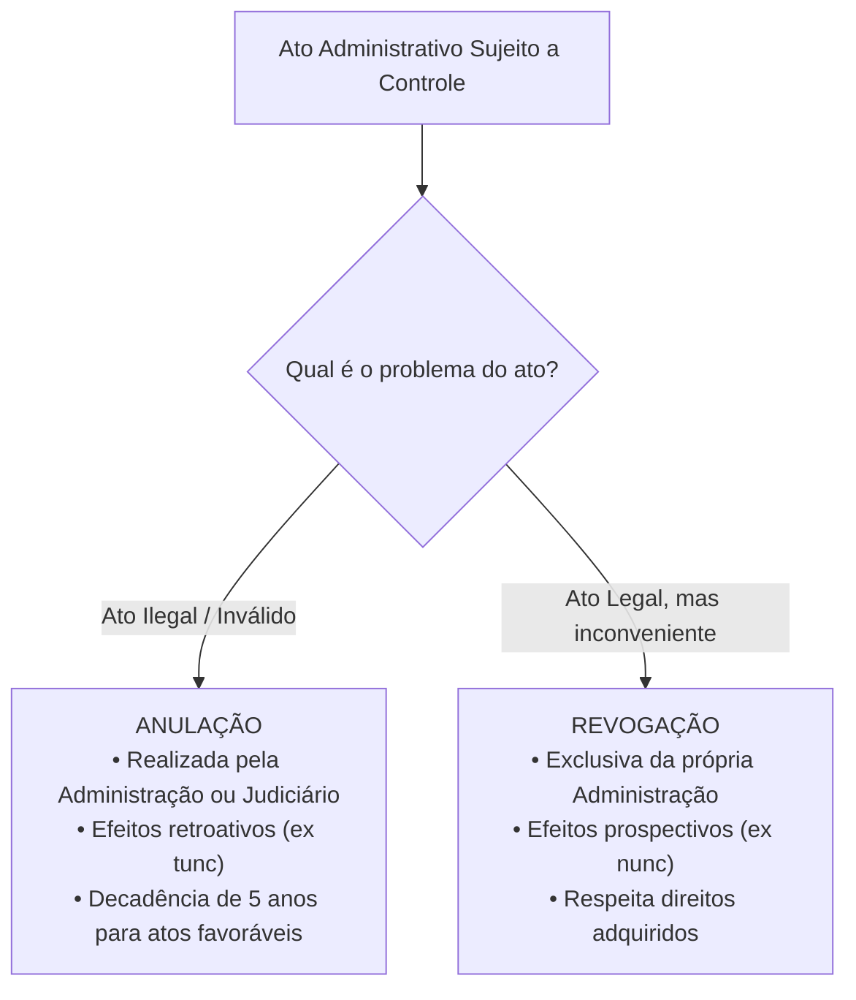

# 01 - Regime Jurídico Administrativo, Princípios e LINDB

> **Matéria:** Noções de Direito Administrativo  
> **Cargo:** A01 – Técnico de Controle Externo – Especialidade: Técnico Administrativo  
> **Arquivo:** `01_regime_juridico_principios_e_lindb.md`  
> **Status:** 🟢 Teoria Aprofundada + 5 Questões FCC Comentadas (A a E)

---

## 📌 Ementa Oficial do Edital
- Administração Pública: conceito, sentidos subjetivo/orgânico e objetivo/material.
- Regime jurídico-administrativo: supremacia e indisponibilidade do interesse público.
- Princípios constitucionais expressos: Legalidade, Impessoalidade, Moralidade, Publicidade e Eficiência (LIMPE - CF/88, art. 37, *caput*).
- Princípios administrativos implícitos/reconhecidos: Razoabilidade, Proporcionalidade, Segurança Jurídica, Continuidade dos Serviços Públicos, Autotutela (Súmulas 346 e 473 do STF) e Motivação.
- Lei de Introdução às normas do Direito Brasileiro (LINDB - Decreto-Lei nº 4.657/1942 com redação dada pela Lei nº 12.376/2010 e alterações da Lei nº 13.655/2018, artigos 20 a 30) e sua aplicação na Administração Pública.
- Responsabilização do agente público segundo o Decreto Federal nº 9.830/2019 e a LINDB (erro grosseiro e dolo).

---

## 🌳 Classificação Hierárquica do Conteúdo

```text
1. Fundamentos do Direito Administrativo, Principiologia e LINDB
├── 1.1 Conceito e Sentidos de Administração Pública
│   ├── Sentido Subjetivo, Formal ou Orgânico: Quem executa (órgãos, agentes e entidades)
│   └── Sentido Objetivo, Material ou Funcional: O que é executado (serviço público, polícia, fomento, intervenção)
├── 1.2 O Regime Jurídico-Administrativo (Bipolaridade Fundamental)
│   ├── Supremacia do Interesse Público: Prerrogativas públicas (autoexecutoriedade, presunção de legitimidade)
│   └── Indisponibilidade do Interesse Público: Sujeições públicas (licitação, concurso, legalidade estrita)
├── 1.3 Princípios Constitucionais Expressos (Art. 37, caput, CF/88 - LIMPE)
│   ├── Legalidade Administrativa: Subordinação estrita à lei vs. Autonomia privada (Art. 5º, II)
│   ├── Impessoalidade: Finalidade pública, isonomia e vedação à promoção pessoal (Art. 37, § 1º)
│   ├── Moralidade: Probidade, lealdade, boa-fé e Súmula Vinculante nº 13 (Antinepotismo)
│   ├── Publicidade: Transparência ativa/passiva, eficácia dos atos e exceções constitucionais
│   └── Eficiência (EC nº 19/1998): Produtividade, celeridade, avaliação periódica e economicidade
├── 1.4 Princípios Administrativos Implícitos e Regime Sumular
│   ├── Razoabilidade e Proporcionalidade: Adequação, necessidade e vedação de excesso
│   ├── Segurança Jurídica e Confiança Legítima: Vedação à aplicação retroativa de nova interpretação
│   ├── Autotutela (Súmulas 346 e 473 do STF): Anulação (ilegalidade, ex tunc) vs. Revogação (conveniência, ex nunc)
│   ├── Motivação e Teoria dos Motivos Determinantes: Vinculação da validade do ato aos motivos alegados
│   └── Continuidade dos Serviços Públicos: Dever de prestação ininterrupta e limites de suspensão
└── 1.5 O Direito Público Positivo da LINDB (Arts. 20 a 30 do DL 4.657/1942 e Decreto 9.830/2019)
    ├── Consequencialismo Jurídico (Art. 20): Vedação de decisões baseadas em valores jurídicos abstratos
    ├── Circunstâncias e Dificuldades Reais do Gestor (Art. 22): Ponderação prática pelos órgãos de controle
    ├── Responsabilização do Agente Público (Art. 28 da LINDB c/c Dec. 9.830/2019): Dolo ou Erro Grosseiro
    └── Modulação de Efeitos e Regime de Transição (Arts. 21 e 23): Segurança jurídica para novas orientações
```

---

## 📖 Teoria Aprofundada e Pontos Críticos

### 1. Sentidos de Administração Pública

A doutrina administrativista divide a Administração Pública sob dois prismas complementares:

| Critério | Sinônimos | Foco Central | Elementos Integrantes |
|---|---|---|---|
| **Subjetivo / Formal / Orgânico** | Subjetivo, Orgânico, Formal | **QUEM** exerce a atividade | Sujeitos de direito: órgãos públicos, agentes públicos e pessoas jurídicas (Administração Direta e Indireta). |
| **Objetivo / Material / Funcional** | Material, Funcional, Objetivo | **O QUE** é exercido | Atividades administrativas: polícia administrativa, serviço público, fomento público e intervenção estatal. |



---

### 2. A Bipolaridade do Regime Jurídico Administrativo

Formulada classicamente por Celso Antônio Bandeira de Mello, a estrutura do regime administrativo repousa em dois pilares:
1. **Supremacia do Interesse Público sobre o Privado:** Confere **prerrogativas** à Administração, colocando o poder público em posição de supremacia jurídica perante o particular para assegurar o interesse coletivo (ex.: presunção de veracidade dos atos, autoexecutoriedade, cláusulas exorbitantes nos contratos, desapropriação).
2. **Indisponibilidade do Interesse Público:** Estabelece **sujeições e limitações** à Administração. O administrador não é dono da coisa pública, mas mero curador; não pode dispor, renunciar ou transigir livremente sobre os interesses do povo (ex.: obrigatoriedade de concurso público, dever de licitar, prestação de contas, estrita legalidade).

---

### 3. Princípios Constitucionais Expressos (Art. 37, *caput*, CF/88)

- **Legalidade:** Enquanto o particular pode fazer tudo o que a lei não proíbe (art. 5º, II), a Administração Pública só pode fazer o que a **lei expressamente autoriza ou determina** (princípio da estrita subordinação legal).
- **Impessoalidade:** Possui tripla acepção na FCC:
  1. *Finalidade Pública:* O ato deve buscar sempre o interesse público, sob pena de desvio de poder/finalidade.
  2. *Isonomia / Não Discriminação:* Tratamento neutro e igualitário a todos os administrados.
  3. *Vedação à Promoção Pessoal (Art. 37, § 1º, CF/88):* A publicidade institucional de programas, obras e campanhas deve ter caráter estritamente educativo, informativo ou de orientação social, sendo **vedada a aposição de nomes, símbolos, slogans ou imagens de autoridades ou servidores**. A conduta é imputada ao órgão estatal, não à pessoa física (Teoria do Órgão / Imputação Volitiva).
- **Moralidade:** Exige honestidade, lealdade, probidade e boa-fé objetiva. O ato pode ser legal em sua forma, mas nulo se imoral em sua essência.
  - **Súmula Vinculante nº 13 (Antinepotismo):** Veda a nomeação de cônjuge, companheiro ou parente em linha reta, colateral ou por afinidade, até o **3º grau**, da autoridade nomeante ou de servidor da mesma pessoa jurídica com cargo de chefia. *Exceção consolidada pelo STF:* Não se aplica de forma automática aos **cargos políticos** (Ministros de Estado, Secretários Estaduais/Municipais), ressalvados os casos de manifesta falta de aptidão técnica ou fraude à lei.
- **Publicidade:** Os atos administrativos devem ser públicos e transparentes para viabilizar o controle social e surtir efeitos jurídicos. A publicidade é **requisito de eficácia**, não de validade. *Exceções constitucionais:* Segurança do Estado e da sociedade, e tutela da intimidade/vida privada.
- **Eficiência (EC nº 19/1998):** Busca a otimização de resultados, economicidade, presteza, celeridade na tramitação processual e avaliação periódica de desempenho dos servidores.

---

### 4. Princípios Implícitos e o Regime de Autotutela

#### 4.1 Autotutela Administrativa (Súmulas 346 e 473 do STF)
A Administração Pública tem o poder-dever de controlar seus próprios atos sem necessitar de autorização judicial prévia:

| Aspecto | Anulação de Ato | Revogação de Ato |
|---|---|---|
| **Motivo gerador** | **Ilegalidade / Ilegitimidade** (ato viciado) | **Inconveniência / Inoportunidade** (ato legal) |
| **Competência** | **Administração Pública** ou **Poder Judiciário** | **Exclusiva da Administração** (Judiciário não revoga ato do Executivo) |
| **Efeitos no tempo** | **Retroativos (*ex tunc*)** | **Prospectivos (*ex nunc*)** |
| **Prazo** | Prazo decadencial de **5 anos** para atos favoráveis (salvo má-fé) | Não há prazo pré-fixado, respeitado o direito adquirido |



#### 4.2 Teoria dos Motivos Determinantes
A validade do ato administrativo fica vinculada aos motivos declarados pela autoridade competente. Se a Administração fundamentar a demissão de um servidor temporário alegando falta de dotação orçamentária, mas restar comprovado que havia recursos abundantes, o ato de desligamento será nulo, mesmo que a motivação fosse originalmente facultativa.

---

### 5. A LINDB na Gestão e no Controle Externo (Arts. 20 a 30)

Com as alterações da Lei nº 13.655/2018, a LINDB passou a disciplinar diretamente o Direito Público e a atuação dos Tribunais de Contas:
1. **Art. 20 (Consequencialismo Prático):** Veda que decisões na esfera administrativa, controladora ou judicial imponham condenações ou anulações com base apenas em **valores jurídicos abstratos** (ex.: "interesse público", "moralidade") sem demonstrar as consequências práticas e os impactos reais da decisão.
2. **Art. 22 (Obstáculos Reais do Gestor):** Na fiscalização das contas públicas, o Tribunal de Contas deve considerar as condições fáticas de escassez, a urgência, as dificuldades estruturais e a complexidade da tomada de decisão enfrentada pelo administrador à época dos fatos.
3. **Art. 28 (Responsabilização por Dolo ou Erro Grosseiro):** O servidor público responderá pessoalmente perante o Tribunal de Contas por suas decisões ou opiniões técnicas apenas em caso de **dolo** ou **erro grosseiro**.
   - **Conceito de Erro Grosseiro (Decreto nº 9.830/2019, art. 12):** É aquele manifesto, evidente e inescusável praticado com culpa grave, caracterizado por ação ou omissão com elevado grau de negligência, imprudência ou imperícia, desprezando deveres elementares de cuidado que qualquer profissional com qualificação média adotaria.

> 🚨 **ALERTA DE PROVA / PEGADINHA FCC:**  
> A divergência razoável de interpretação jurídica ou jurisprudencial entre o auditor e o gestor **NÃO configura erro grosseiro**. Para que o Tribunal de Contas aplique multa pessoal ao agente público, é indispensável caracterizar culpa grave inescusável ou dolo.

---

## 🌐 Fontes Recomendadas na Internet
- [Constituição Federal de 1988 - Art. 37 (LIMPE)](https://www.planalto.gov.br/ccivil_03/constituicao/constituicao.htm#art37)
  - Texto constitucional com os princípios da administração e regras gerais de servidores.
- [Lei de Introdução às Normas do Direito Brasileiro (LINDB) - Arts. 20 a 30](https://www.planalto.gov.br/ccivil_03/decreto-lei/del4657compilado.htm)
  - Redação da Lei nº 13.655/2018 que tutela a segurança jurídica, o pragmatismo e a responsabilidade do agente.
- [Decreto Federal nº 9.830/2019 (Regulamentação da LINDB)](https://www.planalto.gov.br/ccivil_03/_ato2019-2022/2019/decreto/d9830.htm)
  - Regulamenta a aplicação dos arts. 20 a 30 da LINDB e conceitua dolo e erro grosseiro.
- [Súmula Vinculante nº 13 do STF (Antinepotismo)](https://portal.stf.jus.br/jurisprudencia/sumarios/sumulavinculante.asp?seq=13)
  - Texto e precedentes do STF que balizam a moralidade no provimento de cargos de confiança.
- [Lei Federal nº 9.784/1999 (Processo Administrativo)](https://www.planalto.gov.br/ccivil_03/leis/l9784.htm)
  - Consolidação dos princípios da autotutela, motivação e decadência administrativa (art. 54).

---

## 📝 Questões Comentadas no Padrão FCC (Justificadas de A a E)

### Questão 1 (FCC - Analista de Controle Externo / TCE-GO)
O Prefeito de determinado município goiano autorizou a realização de ampla campanha institucional informando a entrega de um novo hospital municipal. Na publicidade veiculada em emissoras de televisão e painéis digitais, foram inseridas a fotografia oficial do Chefe do Executivo, o slogan utilizado em sua campanha partidária e mensagens conclamando a população a reconhecer seu esforço pessoal na entrega da obra.

Diante do regramento constitucional aplicável à Administração Pública, a conduta descrita vulnerou diretamente o princípio da:

A) Publicidade, tendo em vista que é vedada a divulgação aos administrados de obras e serviços já concluídos pelo Poder Público.  
B) Impessoalidade, por caracterizar evidente promoção pessoal de agente político em informe institucional custeado com recursos públicos.  
C) Eficiência, unicamente em virtude de o gestor não ter anexado na peça publicitária a planilha detalhada com a economicidade da obra.  
D) Legalidade estrita, por inexistir autorização legislativa genérica permitindo a veiculação de qualquer informe por municípios.  
E) Autotutela, pois a publicidade de atos municipais depende de chancela prévia obrigatória do Tribunal de Contas competente.  

> **Gabarito: B**  
>  
> **Comentário Analítico Passo a Passo:**  
> 1. Fundamento Constitucional (CF/88, art. 37, § 1º):  
>    *"A publicidade dos atos, programas, obras, serviços e campanhas dos órgãos públicos deverá ter caráter educativo, informativo ou de orientação social, dela não podendo constar nomes, símbolos ou imagens que caracterizem promoção pessoal de autoridades ou servidores públicos."*  
> 2. Pelo princípio da impessoalidade e pela Teoria do Órgão, a atuação administrativa é imputada exclusivamente à pessoa jurídica de direito público (o Município), e nunca à figura física do governante.  
> 3. A utilização de imagens, nomes e símbolos de campanha do Prefeito custeada pelo erário caracteriza desvio de finalidade e promoção pessoal ilícita.  
>  
> **Análise das Alternativas:**  
> - **A) Incorreta:** A publicidade é permitida e estimulada, desde que mantenha caráter estritamente institucional, educativo ou de orientação social.  
> - **B) CORRETA:** Caracteriza violação frontal e direta ao princípio da impessoalidade (art. 37, § 1º, da CF/88), configurando ainda ato de improbidade administrativa.  
> - **C) Incorreta:** A irregularidade central é a personalização e promoção pessoal, e não a ausência de planilha econômica na peça visual.  
> - **D) Incorreta:** Municípios possuem autonomia e competência institucional para informar a sociedade sobre suas realizações, respeitados os limites constitucionais.  
> - **E) Incorreta:** O controle do Tribunal de Contas sobre publicidade é posterior/concomitante; não há autorização prévia censória de informes publicitários.

---

### Questão 2 (FCC - Auditor de Controle Externo / Adaptada)
Em processo de auditoria de conformidade instaurado no Tribunal de Contas, a equipe técnica propôs a aplicação de multa pecuniária e a imputação de débito pessoal a um Secretário de Estado em razão da contratação de serviços mediante interpretação jurídica que gerou dispêndio financeiro. Ficou demonstrado nos autos que, à época da decisão, a interpretação adotada pelo gestor era amplamente respaldada por respeitada doutrina e decisões de outros tribunais, inexistindo jurisprudência vinculante em sentido contrário, má-fé ou qualquer benefício pessoal auferido pelo agente.

À luz da Lei de Introdução às Normas do Direito Brasileiro (LINDB, art. 28) e do Decreto nº 9.830/2019:

A) O agente público responde de forma estritamente objetiva na esfera do controle externo, bastando a constatação de dano orçamentário.  
B) O gestor responde pessoalmente apenas em caso de dolo ou erro grosseiro, não caracterizando erro grosseiro a decisão balizada em interpretação plausível da lei em contexto de controvérsia jurisprudencial.  
C) A divergência interpretativa em relação à posição da unidade técnica de auditoria do Tribunal de Contas qualifica-se ipso facto como erro grosseiro.  
D) Os Tribunais de Contas estão isentos de considerar os obstáculos e as dificuldades reais do gestor previstos no art. 22 da LINDB.  
E) A responsabilidade do agente público somente pode ser afastada caso haja prévia consulta formal respondida pelo Tribunal com efeito vinculante.  

> **Gabarito: B**  
>  
> **Comentário Analítico Passo a Passo:**  
> 1. Art. 28 da LINDB: *"O agente público responderá pessoalmente por suas decisões ou opiniões técnicas em caso de dolo ou erro grosseiro."*  
> 2. O art. 12 do Decreto Federal nº 9.830/2019 e a jurisprudência fixada pelo STF (ADI 6.421) definem o erro grosseiro como a **culpa grave** (ação ou omissão com elevado grau de negligência, imprudência ou imperícia, inescusável para um gestor padrão).  
> 3. Decisão amparada em interpretação plausível e respaldada em corrente doutrinária razoável, em cenário de inexistência de súmula vinculante, constitui exercício regular da função interpretativa e afasta peremptoriamente a caracterização de erro grosseiro ou dolo.  
>  
> **Análise das Alternativas:**  
> - **A) Incorreta:** A responsabilidade pessoal sancionatória e reparatória no âmbito administrativo e de controle externo é **subjetiva** (exige comprovação de dolo ou culpa grave).  
> - **B) CORRETA:** Reflete a aplicação exata do art. 28 da LINDB e do art. 12 do Decreto 9.830/2019.  
> - **C) Incorreta:** A mera divergência de entendimentos teóricos ou jurídicos não constitui erro grosseiro.  
> - **D) Incorreta:** O art. 22 da LINDB vincula expressamente os órgãos de controle a avaliarem as circunstâncias práticas e os obstáculos reais do administrador.  
> - **E) Incorreta:** A consulta formal (art. 30) confere segurança jurídica adicional, mas não é requisito indispensável para afastar dolo ou erro grosseiro.

---

### Questão 3 (FCC - Técnico de Controle Externo / Administrativa)
Determinada autoridade administrativa do Poder Executivo estadual constatou que um ato de concessão de gratificação funcional a um grupo de servidores, praticado há dois anos, padecia de vício insanável de legalidade, por contrariar dispositivo expresso do regime jurídico único. Os servidores beneficiados não concorreram para o vício e agiram de boa-fé.

Considerando o princípio da autotutela e os enunciados das Súmulas 346 e 473 do Supremo Tribunal Federal:

A) A autoridade deve revogar o ato administrativo, produzindo efeitos a partir da decisão (efeitos *ex nunc*), sem necessidade de contraditório prévio.  
B) O ato é nulo e deve ser anulado pela própria Administração, produzindo a anulação efeitos retroativos (*ex tunc*), assegurados o contraditório e a ampla defesa.  
C) Somente o Poder Judiciário dispõe de competência constitucional para anular atos praticados pela Administração Pública estadual.  
D) A Administração decaiu do direito de anular o ato, haja vista ter decorrido o prazo bienal de prescrição administrativa geral.  
E) O ato tornou-se imutável por força do princípio da segurança jurídica, não podendo mais ser anulado nem mesmo pelo Poder Judiciário.  

> **Gabarito: B**  
>  
> **Comentário Analítico Passo a Passo:**  
> 1. Súmula 473/STF: *"A administração pode anular seus próprios atos, quando eivados de vícios que os tornam ilegais, porque deles não se originam direitos; ou revogá-los, por motivo de conveniência ou oportunidade..."*  
> 2. Vício de legalidade insanável enseja **anulação** (e não revogação, que só cabe para atos válidos e convenientes).  
> 3. A anulação produz efeitos retroativos (**ex tunc**), extirpando o ato desde sua origem.  
> 4. Como o ato produziu efeitos concretos favoráveis aos servidores, a Súmula Vinculante nº 3 e a Lei do Processo Administrativo exigem a concessão prévia de contraditório e ampla defesa aos interessados.  
> 5. O prazo decadencial para anular atos favoráveis praticados de boa-fé é de **5 anos** (art. 54 da Lei 9.784/99). Como transcorreram apenas 2 anos, a Administração está plenamente dentro do prazo.  
>  
> **Análise das Alternativas:**  
> - **A) Incorreta:** Ato ilegal não se revoga; anula-se. Revogação tem efeitos *ex nunc* sobre atos lícitos.  
> - **B) CORRETA:** Trata-se de anulação com eficácia retroativa (*ex tunc*), respeitando-se o devido processo legal em razão da repercussão no patrimônio jurídico dos beneficiários.  
> - **C) Incorreta:** Pela autotutela (Súmula 346), a Administração pode e deve declarar a nulidade de seus próprios atos diretamente.  
> - **D) Incorreta:** O prazo decadencial é de 5 anos, não 2 anos.  
> - **E) Incorreta:** Não houve consumação do prazo de decadência de 5 anos para consolidação da situação pelo princípio da confiança.

---

### Questão 4 (FCC - Analista Judiciário)
O Presidente de determinado órgão público estadual nomeou sua irmã para exercer o cargo em comissão de Diretora de Recursos Humanos do referido órgão. Instada a se manifestar sobre a legalidade da nomeação, a assessoria jurídica emitiu parecer favorável, sustentando que a vedação ao nepotismo atinge apenas parentes em linha reta (pais e filhos).

Conforme a jurisprudência pacificada do Supremo Tribunal Federal consolidada na **Súmula Vinculante nº 13**:

A) O parecer está correto, pois o parentesco colateral de segundo grau (irmãos) não se submete à vedação sumular do nepotismo.  
B) A nomeação é válida, contanto que a irmã possua formação superior em área correlata à gestão de pessoas.  
C) A nomeação é nula por violar a Súmula Vinculante nº 13, que veda expressamente a nomeação de parentes em linha reta, colateral ou por afinidade até o terceiro grau para cargos em comissão.  
D) A proibição do nepotismo limita-se unicamente ao cônjuge e companheiro, sendo permitida a nomeação de parentes consanguíneos de qualquer grau.  
E) A restrição sumular não se aplica aos cargos em comissão de direção e chefia, restringindo-se às funções de assessoramento.  

> **Gabarito: C**  
>  
> **Comentário Analítico Passo a Passo:**  
> 1. Texto da Súmula Vinculante nº 13 do STF:  
>    *"A nomeação de cônjuge, companheiro ou parente em linha reta, colateral ou por afinidade, até o terceiro grau, inclusive, da autoridade nomeante ou de servidor da mesma pessoa jurídica investido em cargo de direção, chefia ou assessoramento, para o exercício de cargo em comissão ou de confiança ou, ainda, de função gratificada na administração pública direta e indireta em qualquer dos poderes da União, dos Estados, do Distrito Federal e dos Municípios, compreendido o ajuste mediante designações recíprocas, viola a Constituição Federal."*  
> 2. Irmão é parente consanguíneo em linha colateral de **2º grau** (Pais $\rightarrow$ Irmão $= 2$ graus).  
> 3. Como a vedação estende-se até o **3º grau** (incluindo tios e sobrinhos), a nomeação de irmã para cargo em comissão de Direção é nula e inconstitucional por ofensa aos princípios da moralidade e impessoalidade.  
>  
> **Análise das Alternativas:**  
> - **A) Incorreta:** O parentesco colateral até o terceiro grau é expressamente abrangido pela súmula vinculante.  
> - **B) Incorreta:** Para cargos comissionados administrativos de livre nomeação e exoneração, a qualificação profissional não elide a proibição de parentesco.  
> - **C) CORRETA:** Nomeação nula com base direta na Súmula Vinculante nº 13.  
> - **D) Incorreta:** A súmula atinge cônjuge, companheiro e parentes consanguíneos e afins até 3º grau.  
> - **E) Incorreta:** Abrange expressamente cargos de direção, chefia e assessoramento.

---

### Questão 5 (FCC - Auditor de Controle Externo / Adaptada TCE-GO)
Determinada autarquia estadual concedeu, durante dez anos, com base em parecer normativo da Procuradoria-Geral do Estado, certa vantagem pecuniária a uma categoria de servidores. Posteriormente, a Procuradoria reviu seu entendimento histórico e fixou nova interpretação mais restritiva da lei, passando a considerar a vantagem indevida. A Administração resolveu então cobrar retroativamente de todos os servidores os valores recebidos ao longo dos últimos cinco anos.

Considerando o princípio da segurança jurídica, a disciplina do processo administrativo e o art. 24 da LINDB:

A) A Administração agiu com estrito acerto, pois o princípio da legalidade prevalece sobre qualquer consideração temporal ou de confiança legítima.  
B) É vedada a aplicação retroativa de nova interpretação jurídica para alcançar situações plenamente constituídas sob a vigência da orientação anterior.  
C) A repetição dos valores é plenamente legítima, cabendo aos servidores o ônus de demonstrar prejuízo individual desproporcional.  
D) Nova orientação jurídica retroage automaticamente caso seja mais benéfica aos cofres públicos estaduais.  
E) A segurança jurídica apenas protege os atos administrativos chancelados expressamente por sentença judicial transitada em julgado.  

> **Gabarito: B**  
>  
> **Comentário Analítico Passo a Passo:**  
> 1. Princípio da Segurança Jurídica e Proteção à Confiança Legítima:  
>    - Art. 2º, parágrafo único, inciso XIII, da Lei Federal nº 9.784/1999: veda expressamente a *"aplicação retroativa de nova interpretação"*.  
>    - Art. 24 da LINDB: *"A revisão, nas esferas administrativa, controladora ou judicial, quanto à validade de ato, contrato, ajuste, processo ou norma administrativa cuja produção já se houver consumado levará em conta as orientações gerais da época, sendo vedado que, com base em mudança posterior de orientação geral, se declarem inválidas situações plenamente constituídas."*  
> 2. O servidor que recebeu valores de boa-fé, com base em interpretação oficial emanada do órgão jurídico da Administração, não pode ser compelido a devolver as verbas percebidas, sob pena de intolerável insegurança jurídica.  
>  
> **Análise das Alternativas:**  
> - **A) Incorreta:** O princípio da legalidade atua de forma harmônica e equilibrada com a segurança jurídica e a boa-fé objetiva.  
> - **B) CORRETA:** A nova interpretação produz efeitos prospectivos (*ex nunc*); a retroatividade para cobrar valores recebidos de boa-fé é vedada pela LINDB e pela lei do processo administrativo.  
> - **C) Incorreta:** A Súmula 249 do TCU e a jurisprudência do STJ/STF dispensam a devolução de verbas alimentares recebidas de boa-fé com base em interpretação plausível do poder público.  
> - **D) Incorreta:** A conveniência fiscal do erário não autoriza a retroatividade de orientações prejudiciais aos administrados.  
> - **E) Incorreta:** A proteção à confiança legítima incide diretamente no âmbito dos atos e processos administrativos, independentemente de tutela jurisdicional prévia.
