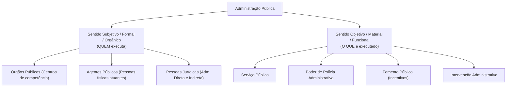
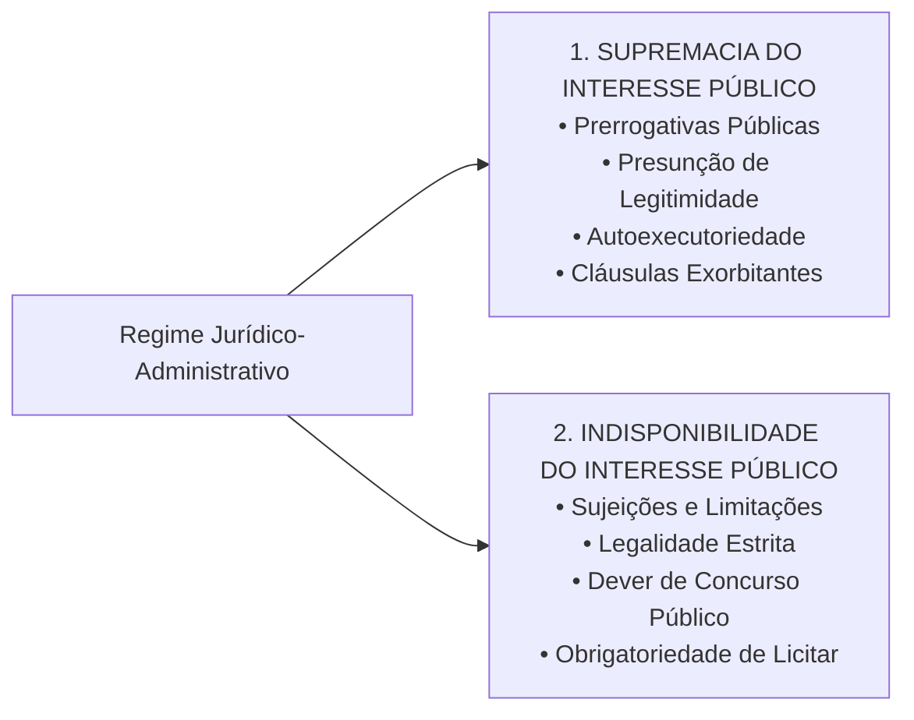
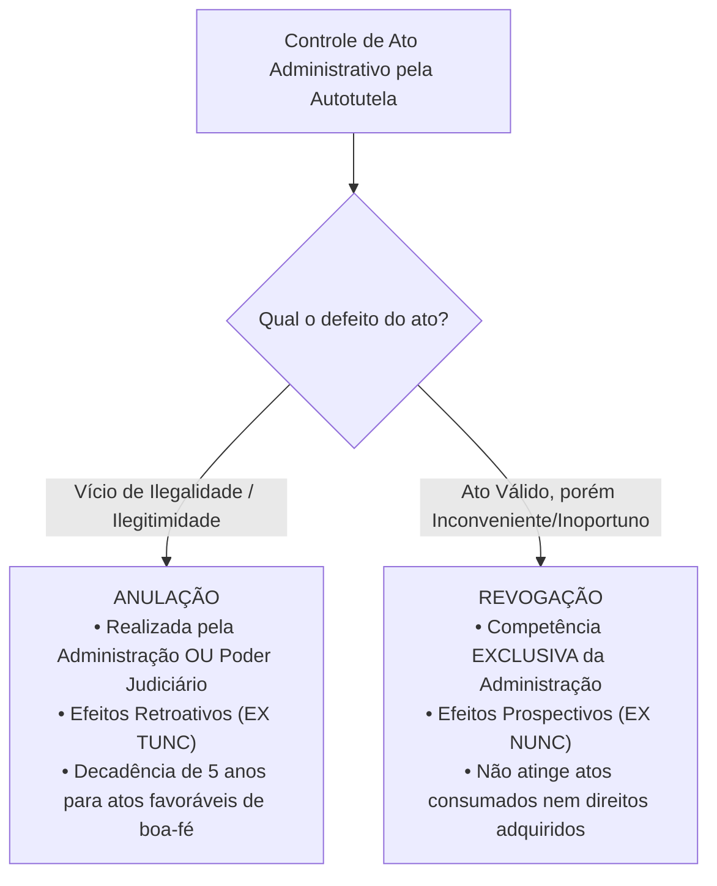

# 01 - Regime Jurídico Administrativo, Princípios e LINDB

> **Matéria:** Noções de Direito Administrativo  
> **Cargo:** A01 – Técnico de Controle Externo – Especialidade: Técnico Administrativo  
> **Arquivo:** `01_regime_juridico_principios_e_lindb.md`  

---

## 📌 Ementa / Itens do Edital
- Administração Pública: conceito, sentidos subjetivo/orgânico e objetivo/material
- Regime jurídico-administrativo: supremacia e indisponibilidade do interesse público
- Princípios constitucionais expressos: Legalidade, Impessoalidade, Moralidade, Publicidade e Eficiência (LIMPE - CF/88, art. 37, *caput*)
- Princípios administrativos implícitos/reconhecidos: Razoabilidade, Proporcionalidade, Segurança Jurídica, Continuidade dos Serviços Públicos, Autotutela (Súmulas 346 e 473 do STF) e Motivação
- Lei de Introdução às normas do Direito Brasileiro (LINDB - Decreto-Lei nº 4.657/1942 com redação dada pela Lei nº 12.376/2010 e alterações da Lei nº 13.655/2018, artigos 20 a 30) e sua aplicação na Administração Pública
- Responsabilização do agente público segundo o Decreto Federal nº 9.830/2019 e a LINDB (erro grosseiro e dolo)

---

---

## 🧭 Sumário

1. [Conceito e Sentidos de Administração Pública](#1-conceito-e-sentidos-de-administracao-publica)
    1. [Sentido Subjetivo, Formal ou Orgânico](#11-sentido-subjetivo-formal-ou-organico)
    2. [Sentido Objetivo, Material ou Funcional](#12-sentido-objetivo-material-ou-funcional)
    3. [Critérios Distintivos Adotados pela FCC](#13-criterios-distintivos-adotados-pela-fcc)
    4. [Teste 001](#Teste-001)
2. [O Regime Jurídico-Administrativo e sua Bipolaridade Fundamental](#2-o-regime-juridico-administrativo-e-sua-bipolaridade-fundamental)
    1. [Princípio da Supremacia do Interesse Público sobre o Privado](#21-principio-da-supremacia-do-interesse-publico-sobre-o-privado)
    2. [Princípio da Indisponibilidade do Interesse Público](#22-principio-da-indisponibilidade-do-interesse-publico)
    3. [Interesse Público Primário vs. Secundário](#23-interesse-publico-primario-vs-secundario)
    4. [Teste 002](#Teste-002)
3. [Princípios Constitucionais Expressos (Art. 37, caput, CF/88 - LIMPE)](#3-principios-constitucionais-expressos-art-37-caput-cf88-limpe)
    1. [Princípio da Legalidade Estrita](#31-principio-da-legalidade-estrita)
    2. [Princípio da Impessoalidade e a Vedação à Promoção Pessoal](#32-principio-da-impessoalidade-e-a-vedacao-a-promocao-pessoal)
    3. [Princípio da Moralidade e a Súmula Vinculante nº 13 (Antinepotismo)](#33-principio-da-moralidade-e-a-sumula-vinculante-no-13-antinepotismo)
    4. [Princípio da Publicidade e suas Exceções Constitucionais](#34-principio-da-publicidade-e-suas-excecoes-constitucionais)
    5. [Princípio da Eficiência (Emenda Constitucional nº 19/1998)](#35-principio-da-eficiencia-emenda-constitucional-no-191998)
    6. [Teste 003](#Teste-003)
    7. [Teste 004](#Teste-004)
    8. [Teste 005](#Teste-005)
    9. [Teste 006](#Teste-006)
4. [Princípios Administrativos Implícitos e Regime Sumular](#4-principios-administrativos-implicitos-e-regime-sumular)
    1. [Razoabilidade e Proporcionalidade](#41-razoabilidade-e-proporcionalidade)
    2. [Segurança Jurídica e Proteção à Confiança Legítima](#42-seguranca-juridica-e-protecao-a-confianca-legitima)
    3. [Princípio da Autotutela (Súmulas 346 e 473 do STF): Anulação vs. Revogação](#43-principio-da-autotutela-sumulas-346-e-473-do-stf-anulacao-vs-revogacao)
    4. [Princípio da Motivação e a Teoria dos Motivos Determinantes](#44-principio-da-motivacao-e-a-teoria-dos-motivos-determinantes)
    5. [Princípio da Continuidade dos Serviços Públicos](#45-principio-da-continuidade-dos-servicos-publicos)
    6. [Teste 007](#Teste-007)
    7. [Teste 008](#Teste-008)
    8. [Teste 009](#Teste-009)
5. [O Direito Público Positivo da LINDB (Arts. 20 a 30) e o Controle Externo](#5-o-direito-publico-positivo-da-lindb-arts-20-a-30-e-o-controle-externo)
    1. [Consequencialismo Jurídico e Vedação de Valores Abstratos (Art. 20)](#51-consequencialismo-juridico-e-vedacao-de-valores-abstratos-art-20)
    2. [Obstáculos Reais e Circunstâncias Práticas do Gestor (Art. 22)](#52-obstaculos-reais-e-circunstancias-praticas-do-gestor-art-22)
    3. [Responsabilização por Dolo ou Erro Grosseiro (Art. 28 da LINDB c/c Dec. 9.830/2019)](#53-responsabilizacao-por-dolo-ou-erro-grosseiro-art-28-da-lindb-cc-dec-98302019)
    4. [Segurança Jurídica, Transição e Vedação à Retroatividade (Arts. 23 e 24)](#54-seguranca-juridica-transicao-e-vedacao-a-retroatividade-arts-23-e-24)
    5. [Teste 010](#Teste-010)
    6. [Teste 011](#Teste-011)
6. [Fontes Recomendadas na Internet](#6-fontes-recomendadas-na-internet)

---

## 1. Conceito e Sentidos de Administração Pública

O Direito Administrativo brasileiro não se encontra codificado em um único diploma legal, fundando-se na Constituição da República de 1988, em leis esparsas e em construções doutrinárias e pretorianas consolidadas. O conceito de **Administração Pública** desdobra-se em dois sentidos complementares de fundamental relevância para as provas da Fundação Carlos Chagas (FCC):

### 1.1 Sentido Subjetivo, Formal ou Orgânico

Sob o enfoque **subjetivo, formal ou orgânico**, a Administração Pública define o complexo estrutural de **sujeitos de direito, órgãos e agentes** encarregados pelo ordenamento de exercer a função administrativa. 

- Responde à indagação: **"QUEM exerce a função administrativa?"**
- No ordenamento brasileiro, adota-se o critério estritamente formal: integram a Administração Pública em sentido subjetivo **exclusivamente os órgãos e entidades aos quais a lei confere tal condição** (União, Estados, DF, Municípios, suas autarquias, fundações públicas, empresas públicas e sociedades de economia mista). Particulares em colaboração com o poder público (concessionárias, permissionárias e organizações sociais) exercem atividade administrativa, mas **não integram a Administração Pública em sentido formal**.

### 1.2 Sentido Objetivo, Material ou Funcional

Sob o prisma **objetivo, material ou funcional**, a Administração Pública corresponde ao conjunto das **atividades e funções substantivas** tipicamente administrativas executadas pelo Estado.

- Responde à indagação: **"O QUE é executado pela máquina pública?"**
- Abrange classicamente quatro atividades administrativas basilares:
    1. **Serviço Público:** Prestação direta ou indireta de utilidades e comodidades materiais fruíveis individualmente pelos cidadãos (ex.: transporte coletivo, fornecimento de energia, saúde, saneamento básico).
    2. **Polícia Administrativa:** Restrições e condicionamentos impostos a direitos e liberdades individuais e ao uso da propriedade privada em prol do bem-estar coletivo (ex.: fiscalização sanitária, ambiental, trânsito e posturas urbanas).
    3. **Fomento Público:** Estímulo estatal protetivo à iniciativa privada de interesse social sem assunção direta da atividade (concessão de incentivos fiscais, subvenções econômicas e convênios com o terceiro setor).
    4. **Intervenção:** Atuação regulatória no domínio econômico ou sobre a propriedade privada (desapropriações, tombamentos, servidões administrativas).

### 1.3 Critérios Distintivos Adotados pela FCC

| Critério Distintivo | Sentido Subjetivo / Orgânico / Formal | Sentido Objetivo / Material / Funcional |
| :--- | :--- | :--- |
| **Pergunta-Guia** | *Quem realiza a atividade?* | *Qual atividade é realizada?* |
| **Composição** | Pessoas jurídicas, órgãos e agentes públicos da Administração Direta e Indireta | Serviços públicos, polícia administrativa, fomento e intervenção |
| **Grafia Típica** | Grafado com iniciais maiúsculas (**A**dministração **P**ública) | Grafado frequentemente com iniciais minúsculas (**a**dministração pública) |
| **Delegação a Particulares** | Não se transfere a entes delegatários privados | É transferido a concessionários e permissionários |

---

### Teste 001
**(FCC – TRT – Analista Judiciário - 2009)**  
Considere as afirmações abaixo, relativas ao conceito e sentidos da Administração Pública e de serviço público:

I. O conceito de serviço público é dinâmico e variável no tempo e no espaço, subordinado às contingências históricas e às necessidades da coletividade.  
II. Apenas as atividades de prestação material de serviços de utilidade pública direta constituem a Administração em sentido objetivo ou funcional.  
III. Em sentido estrito e subjetivo, integram a Administração Pública tão somente os órgãos e as entidades aos quais a lei atribui a função administrativa.

Está correto o que se afirma em:

* **A)** I e III, apenas.
* **B)** II, apenas.
* **C)** I e II, apenas.
* **D)** I, apenas.
* **E)** II e III, apenas.

---

> **Comentário Detalhado:**
>
> - **A)** **Correto**. O item I é exato, pois o conceito de serviço público é fluido e mutável conforme as demandas sociais e históricas. O item III é correto, pois no Brasil adotou-se o critério formal/subjetivo, segundo o qual a Administração em sentido subjetivo abrange estritamente os órgãos e entidades qualificados como tais pela ordem legal.
> - **B)** **Incorreto**. A afirmação II é incorreta, pois a Administração em sentido objetivo compreende o fomento, a polícia administrativa e a intervenção, além do serviço público.
> - **C)** **Incorreto**. O item II é falso pela restrição indevida do sentido objetivo.
> - **D)** **Incorreto**. O item III também está correto, tornando a opção D incompleta.
> - **E)** **Incorreto**. O item II é falso.
>
> **Gabarito: A**
## 2. O Regime Jurídico-Administrativo e sua Bipolaridade Fundamental

O **Regime Jurídico-Administrativo** é o conjunto harmônico de princípios e regras de Direito Público que colocam a Administração Pública em posição especial perante os administrados, conferindo-lhe prerrogativas extraordinárias, ao mesmo tempo em que lhe impõe severas restrições.

Conforme consagrado pela doutrina de Celso Antônio Bandeira de Mello, o regime administrativo estrutura-se sobre dois pilares axiológicos fundamentais (bipolaridade do direito administrativo):

### 2.1 Princípio da Supremacia do Interesse Público sobre o Privado

Fundamenta a concessão de **prerrogativas e privilégios estatais** (*poderes de império*). Em situações de conflito genuíno entre o interesse particular e o interesse coletivo, este último deve prevalecer:

- *Manifestações Práticas:* Presunção de legitimidade e veracidade dos atos administrativos; autoexecutoriedade das decisões do poder de polícia; cláusulas exorbitantes nos contratos administrativos (como rescisão unilateral e alteração unilateral do objeto); e intervenção do Estado na propriedade particular mediante desapropriação e requisição administrativa.

### 2.2 Princípio da Indisponibilidade do Interesse Público

Representa o contrapeso democrático às prerrogativas estatais, corporificando as **sujeições e limitações administrativas**. O administrador público não é o proprietário dos bens e interesses que gere; atua como mero curador e gestor fiduciário do patrimônio do povo.

- *Manifestações Práticas:* Submissão inafastável ao princípio da legalidade estrita; obrigatoriedade de realização de concurso público para provimento de cargos efetivos (art. 37, II, CF); dever inegociável de licitar para obras, compras e serviços (art. 37, XXI, CF); dever de prestar contas aos Tribunais de Contas; e impossibilidade de renúncia graciosa a receitas tributárias ou concessão arbitrária de privilégios a particulares.

### 2.3 Interesse Público Primário vs. Secundário

A jurisprudência do STF e do STJ acolhe expressamente a distinção doutrinária entre:

- **Interesse Público Primário:** É o interesse real da coletividade como um todo (justiça social, saúde pública, educação, segurança). É o único verdadeiramente supremo e indisponível.
- **Interesse Público Secundário:** É o interesse patrimonial e fazendário do próprio aparelho estatal como pessoa jurídica (arrecadar mais tributos, evitar condenações judiciais pecuniárias, economizar recursos a qualquer custo). 
> ⚠️ **Alerta FCC:** O interesse público secundário só é legítimo quando coincide plenamente com o interesse primário da sociedade. Caso o Estado viole direitos fundamentais de cidadãos apenas para auferir vantagem financeira aos cofres públicos, tal ato configura ilicitude e desvio de finalidade.

---

### Teste 002
**(FGV – TRT – Analista Judiciário - 2024)**  
Patrícia é proprietária de um imóvel urbano situado no Município Alfa. O Poder Público Municipal, com fundamento na supremacia do interesse público sobre o privado e na necessidade premente de ampliação da rede de saúde, decretou a utilidade pública do referido imóvel para fins de desapropriação. 

Considerando os princípios que informam o regime jurídico-administrativo e o instituto da desapropriação, assinale a afirmativa correta.

* **A)** A supremacia do interesse público justifica a prerrogativa expropriatória estatal, condicionada ao pagamento de justa e prévia indenização em dinheiro.
* **B)** A indisponibilidade do interesse público autoriza o Município a apossar-se imediatamente do imóvel sem a observância do devido processo legal expropriatório.
* **C)** A propriedade particular goza de tutela absoluta perante a Administração Pública, que não pode promover a desapropriação sem prévia anuência de Patrícia.
* **D)** A supremacia do interesse público afasta a necessidade de motivação do ato expropriatório, constituindo ato administrativo de discricionariedade pura.
* **E)** O princípio da legalidade impede a desapropriação de bens particulares por entidades municipais, prerrogativa privativa da União e dos Estados.

---

> **Comentário Detalhado:**
>
> - **A)** **Correto**. A desapropriação é a manifestação clássica da supremacia do interesse público sobre o privado, outorgando ao Estado a prerrogativa de adquirir compulsoriamente a propriedade privada, desde que atendidos os requisitos constitucionais de utilidade pública ou interesse social e paga a prévia e justa indenização em dinheiro (art. 5º, XXIV, CF/88).
> - **B)** **Incorreto**. A indisponibilidade vincula a Administração à estrita observância da legalidade e do devido processo legal, vedando o desapossamento arbitrário.
> - **C)** **Incorreto**. O direito de propriedade não é absoluto, devendo cumprir sua função social e submeter-se à desapropriação.
> - **D)** **Incorreto**. A desapropriação é ato formal e vinculado quanto à declaração de utilidade pública e motivação fática.
> - **E)** **Incorreto**. Os Municípios possuem competência expressa para desapropriar bens em seu território (Dec.-Lei nº 3.365/1941, art. 2º).
>
> **Gabarito: A**
## 3. Princípios Constitucionais Expressos (Art. 37, caput, CF/88 - LIMPE)

O art. 37, *caput*, da Constituição Federal estabelece os cinco princípios expressos de observância obrigatória pela Administração Pública direta e indireta de qualquer dos Poderes da União, dos Estados, do Distrito Federal e dos Municípios:

### 3.1 Princípio da Legalidade Estrita

Enquanto o particular goza da **autonomia da vontade** e da legalidade ampla, podendo fazer tudo o que a lei não proíba (art. 5º, II, CF/88), o administrador público rege-se pela **legalidade estrita**: só pode agir e praticar atos quando houver prévia e expressa autorização ou determinação em lei (*subordinação estrita à lei*). O ato administrativo sem amparo legal é nulo de pleno direito.

### 3.2 Princípio da Impessoalidade e a Vedação à Promoção Pessoal

O princípio da impessoalidade possui triplo desdobramento no âmbito dos concursos:

1. **Finalidade Pública:** Todo ato administrativo deve visar ao atendimento do interesse público genérico e à finalidade específica prevista na lei para a respectiva competência. A busca de vingança pessoal ou favorecimento a correligionários gera nulidade por *desvio de finalidade* (ou desvio de poder).
2. **Isonomia e Tratamento Neutro:** Proibição de concessão de privilégios ou perseguições arbitrárias. É a base axiológica do concurso público e da licitação.
3. **Vedação à Promoção Pessoal (Art. 37, § 1º, CF/88):** A publicidade dos atos, programas, obras, serviços e campanhas dos órgãos públicos deve possuir caráter estritamente educativo, informativo ou de orientação social, **dela não podendo constar nomes, símbolos, slogans ou imagens que caracterizem promoção pessoal de autoridades ou servidores públicos**.
    - *Teoria do Órgão (Imputação Volitiva):* Os atos praticados pelos agentes públicos são juridicamente imputados ao órgão ou pessoa jurídica estatal a que pertencem, e não à pessoa física do agente. Logo, quem realiza a obra é a "Secretaria de Saúde do Estado de Goiás", e não o "Secretário Fulano".

### 3.3 Princípio da Moralidade e a Súmula Vinculante nº 13 (Antinepotismo)

Exige conduta pautada pela boa-fé objetiva, honestidade, lealdade, decência e probidade. O ato administrativo pode atender rigorosamente à literalidade da lei, mas ser manifestamente nulo se contaminado por torpeza, favorecimento antiético ou imoralidade administrativa.

#### A Súmula Vinculante nº 13 do Supremo Tribunal Federal:
A moralidade e a impessoalidade fundamentam o teor da **Súmula Vinculante nº 13**, que proíbe o nepotismo no serviço público brasileiro:
> *"A nomeação de cônjuge, companheiro ou parente em linha reta, colateral ou por afinidade, até o terceiro grau, inclusive, da autoridade nomeante ou de servidor da mesma pessoa jurídica investido em cargo de direção, chefia ou assessoramento, para o exercício de cargo em comissão ou de confiança ou, ainda, de função gratificada na administração pública direta e indireta em qualquer dos poderes da União, dos Estados, do Distrito Federal e dos Municípios, compreendido o ajuste mediante designações recíprocas (nepotismo cruzado), viola a Constituição Federal."*

- **Graus de Parentesco Atingidos:**
    - *1º Grau:* Pais, mães, filhos, filhas (consanguíneos); sogro, sogra, genro, nora (afins).
    - *2º Grau:* Avós, netos, **irmãos** (consanguíneos); cunhados (afins).
    - *3º Grau:* Tios, sobrinhos (consanguíneos).
- **Ressalva Jurisprudencial Consolidada (Cargos Políticos):** O STF firmou tese de que a SV nº 13 **não incide de forma automática e absoluta sobre cargos de natureza política** (ex.: Ministros de Estado, Secretários Estaduais e Secretários Municipais). Contudo, a nomeação de parente para cargo político será considerada inválida pelo Judiciário/Tribunal de Contas se comprovada a manifesta ausência de qualificação técnica para a função ou caracterizado patente desvio de finalidade (fraude à lei).

### 3.4 Princípio da Publicidade e suas Exceções Constitucionais

A publicidade exige que a atuação estatal seja transparente, acessível e cognoscível aos cidadãos e órgãos de controle externo. 

- A publicação oficial é **requisito de eficácia** (aptidão para produzir efeitos jurídicos) e de **exigibilidade** dos atos administrativos que criam obrigações para terceiros ou geram despesas públicas; não é requisito de validade intrínseca do ato.
- **Exceções Constitucionais Estritas:** A própria CF/88 ressalva o sigilo apenas nas hipóteses de **segurança do Estado e da sociedade** e de proteção inafastável à **intimidade, honra e vida privada** das pessoas (art. 5º, incisos X, XXXIII e LX).

### 3.5 Princípio da Eficiência (Emenda Constitucional nº 19/1998)

Inserido formalmente no rol do art. 37 pela Reforma Administrativa (EC nº 19/1998), impõe à Administração o dever de obter o melhor rendimento funcional, presteza, perfeição técnica, celeridade na tramitação e economicidade, maximizando os resultados com o menor dispêndio possível de recursos públicos.

- *Desdobramentos Constitucionais Práticos:* Avaliação especial de desempenho para aquisição da estabilidade do servidor (art. 41, § 4º, CF); perda do cargo público por avaliação periódica de desempenho (art. 41, § 1º, III, CF); e fixação de metas de desempenho institucional mediante contratos de gestão (art. 37, § 8º, CF).

---

### Teste 003
**(FCC – TRT-9ª Região – Analista Judiciário - 2015)**  
A Administração pública está sujeita a princípios que conformam sua atuação. Para esse fim, é dizer, da sujeição aos princípios elencados no caput do art. 37 da Constituição Federal, o termo Administração abrange a Administração:

* **A)** direta, não estando sujeita aos mesmos princípios a Administração indireta nem o Judiciário, em virtude da separação dos poderes.
* **B)** pública direta e indireta, não abarcando os Poderes Judiciário e Legislativo no exercício atípico da função administrativa.
* **C)** pública direta e indireta de qualquer dos Poderes da União, dos Estados, do Distrito Federal e dos Municípios.
* **D)** pública direta e indireta dos Poderes Executivo e Judiciário, excluído o Legislativo em razão da fiscalização contábil.
* **E)** pública direta de qualquer dos Poderes, excluída a indireta por estar submetida predominantemente a normas privadas.

---

> **Comentário Detalhado:**
>
> - **A)** **Incorreto**. O caput do art. 37 da CF/88 submete expressamente toda a Administração direta e indireta aos princípios fundamentais.
> - **B)** **Incorreto**. O Judiciário e o Legislativo, quando exercem função atípica administrativa (gestão de pessoal, compras), vinculam-se integralmente ao art. 37.
> - **C)** **Correto**. O art. 37, caput, da CF/88 estabelece de modo inequívoco: "A administração pública direta e indireta de qualquer dos Poderes da União, dos Estados, do Distrito Federal e dos Municípios obedecerá aos princípios de legalidade, impessoalidade, moralidade, publicidade e eficiência".
> - **D)** **Incorreto**. Nenhum dos três Poderes é excluído da observância dos princípios constitucionais administrativos.
> - **E)** **Incorreto**. A Administração indireta (autarquias, fundações, empresas públicas e sociedades de economia mista) integra o comando do art. 37.
>
> **Gabarito: C**
### Teste 004
**(FCC – Analista de Controle Externo – TCE-GO / Simulado)**  
O Prefeito de determinado município goiano autorizou a veiculação de campanha institucional sobre vacinação contendo seu nome, fotografia e slogan eleitoral. À luz do art. 37, § 1º, da Constituição Federal e da jurisprudência dos Tribunais de Contas:

* **A)** A conduta é lícita, pois a publicidade alcançou o objetivo informativo de saúde pública sem gastos extras.
* **B)** Há violação expressa ao princípio da impessoalidade pela promoção pessoal com verba pública municipal.
* **C)** Apenas o uso do slogan é vedado, sendo permitida a foto e o nome para identificação da autoridade local.
* **D)** A publicidade é plenamente válida desde que o recurso financeiro utilizado pertença à verba de gabinete.
* **E)** A caracterização da ilicitude exige prova pericial contábil de desvio pecuniário em proveito de terceiro.

---

> **Comentário Detalhado:**
>
> - **A)** **Incorreto**. A finalidade informativa não elide a proibição constitucional de promoção pessoal de agentes políticos.
> - **B)** **Correto**. O art. 37, § 1º, da CF/88 estabelece que a publicidade governamental deve ter caráter educativo, informativo ou de orientação social, dela não podendo constar nomes, símbolos ou imagens que caracterizem promoção pessoal.
> - **C)** **Incorreto**. É vedada a inclusão de nomes, fotos, slogans ou quaisquer símbolos de personalização individual.
> - **D)** **Incorreto**. A origem orçamentária da dotação não afasta o preceito constitucional cogente.
> - **E)** **Incorreto**. A infração ao princípio da impessoalidade independe de dano financeiro ou desvio orçamentário direto.
>
> **Gabarito: B**
### Teste 005
**(FCC – TRT-23ª Região – Analista Judiciário - 2016)**  
O princípio da moralidade administrativa, consagrado no art. 37, caput, da Constituição Federal e corporificado na Súmula Vinculante nº 13 do Supremo Tribunal Federal, veda expressamente práticas de nepotismo no âmbito dos Poderes da União, dos Estados, do Distrito Federal e dos Municípios. Sob a ótica desse enunciado sumular, é proibida a nomeação para cargo em comissão ou função de confiança de cônjuge, companheiro ou parente em linha reta, colateral ou por afinidade:

* **A)** até o segundo grau, exclusivamente na linha reta consanguínea de agentes políticos.
* **B)** até o quarto grau, na linha reta e colateral, independentemente da função desempenhada.
* **C)** até o terceiro grau, inclusive, da autoridade nomeante ou de servidor da mesma pessoa jurídica.
* **D)** até o terceiro grau, exclusivamente quando houver relação de parentesco civil por adoção.
* **E)** até o primeiro grau apenas, alcançando tão somente genitores, cônjuges e filhos imediatos.

---

> **Comentário Detalhado:**
>
> - **A)** **Incorreto**. O alcance da Súmula Vinculante nº 13 se estende até o terceiro grau e contempla afinidade e colaterais.
> - **B)** **Incorreto**. O limite fixado pelo STF é o terceiro grau (não quarto grau).
> - **C)** **Correto**. A Súmula Vinculante nº 13 preconiza que a nomeação de cônjuge, companheiro ou parente em linha reta, colateral ou por afinidade, até o terceiro grau, inclusive, da autoridade nomeante ou de servidor da mesma pessoa jurídica investido em cargo de direção, chefia ou assessoramento viola a Constituição Federal.
> - **D)** **Incorreto**. A vedação abrange parentesco consanguíneo, afim e civil sem qualquer distinção restritiva.
> - **E)** **Incorreto**. O grau fixado pela jurisprudência vinculante alcança tios e sobrinhos (terceiro grau).
>
> **Gabarito: C**
### Teste 006
**(FGV – Analista de Controle Externo – TCE-GO / Simulado)**  
Introduzido formalmente no caput do art. 37 da Constituição Federal pela Emenda Constitucional nº 19/1998, o princípio da eficiência impõe à Administração Pública e a seus agentes a busca pelo melhor rendimento com o menor dispêndio. Sob o aspecto jurídico-doutrinário e dogmático, esse princípio:

* **A)** Subordina a estrita legalidade ao juízo de oportunidade do gestor, legitimando atos contra legem em prol de metas orçamentárias.
* **B)** Apresenta eficácia puramente moral e desprovida de densidade normativa, inviabilizando controle por Tribunais de Contas.
* **C)** Opera em duas vertentes complementares: o modo de atuação do agente público e a estruturação dos órgãos estatais.
* **D)** Aplica-se exclusivamente aos serviços públicos econômicos explorados em regime concorrencial pelas empresas estatais.
* **E)** Impede a avaliação periódica de desempenho de servidores estáveis, resguardando a inamovibilidade dos cargos públicos.

---

> **Comentário Detalhado:**
>
> - **A)** **Incorreto**. A eficiência jamais se sobrepõe à legalidade; o administrador deve ser eficiente nos estritos limites da lei.
> - **B)** **Incorreto**. O princípio possui força normativa vinculante, embasando a fiscalização de legitimidade e economicidade pelos Tribunais de Contas.
> - **C)** **Correto**. Segundo a doutrina administrativista clássica (Maria Sylvia Zanella Di Pietro), a eficiência deve ser considerada em relação ao modo de atuação do agente público (esperando-se o melhor rendimento funcional) e quanto ao modo de organizar e estruturar a Administração Pública (visando aos melhores resultados práticos).
> - **D)** **Incorreto**. A incidência do princípio da eficiência alcança todos os órgãos, poderes e esferas da federação.
> - **E)** **Incorreto**. A própria EC nº 19/1998 introduziu a avaliação periódica de desempenho como hipótese de perda de cargo do servidor estável (art. 41, § 1º, III, CF/88).
>
> **Gabarito: C**
## 4. Princípios Administrativos Implícitos e Regime Sumular

Além dos cinco princípios expressos no art. 37 da CF, o ordenamento constitucional e a legislação infraconstitucional (como a Lei do Processo Administrativo Federal nº 9.784/1999 e a Lei Estadual de Goiás nº 13.800/2001) consagram princípios implícitos de aplicação cogente:

### 4.1 Razoabilidade e Proporcionalidade

Exigem equilíbrio, bom senso, coerência e adequação entre os meios empregados pelo Estado e os fins pretendidos pela lei, vedando restrições desmedidas ou sacrifícios inúteis impostos aos administrados.

- **Tripé da Proporcionalidade:**
    1. *Adequação:* O meio escolhido deve ser apto a alcançar o objetivo público.
    2. *Necessidade (Exigibilidade):* Entre os meios aptos, deve-se eleger o que cause menor gravame ao cidadão (*vedação de excesso*).
    3. *Proporcionalidade em Sentido Estrito:* Os benefícios auferidos pela medida devem superar os ônus decorrentes da intervenção estatal.

### 4.2 Segurança Jurídica e Proteção à Confiança Legítima

Visa garantir a estabilidade das relações jurídicas constituídas e proteger a confiança dos administrados perante as condutas e orientações da Administração.

- *Vedação à Aplicação Retroativa:* O art. 2º, parágrafo único, inciso XIII, da Lei nº 9.784/1999 veda peremptoriamente a aplicação retroativa de nova interpretação jurídica para alcançar atos pretéritos já consolidados sob a orientação anterior.
- *Prazo Decadencial da Autotutela:* Fixação do prazo decadencial de **5 anos** para que a Administração anule atos administrativos favoráveis aos administrados praticados de boa-fé (art. 54 da Lei 9.784/99 e art. 54 da Lei Estadual/GO 13.800/2001).

### 4.3 Princípio da Autotutela (Súmulas 346 e 473 do STF): Anulação vs. Revogação

O princípio da autotutela assegura à Administração Pública o poder-dever de controlar diretamente seus próprios atos, revendo-os quanto à legalidade ou ao mérito, sem necessidade de autorização judicial prévia.

#### Enunciado da Súmula 473 do STF:
> *"A administração pode anular seus próprios atos, quando eivados de vícios que os tornam ilegais, porque deles não se originam direitos; ou revogá-los, por motivo de conveniência ou oportunidade, respeitados os direitos adquiridos, e ressalvada, em todos os casos, a apreciação judicial."*

| Dimensão | Anulação de Ato Administrativo | Revogação de Ato Administrativo |
| :--- | :--- | :--- |
| **Fundamento Central** | **Ilegalidade / Ilegitimidade** (vício formal ou material de validade) | **Inconveniência ou Inoportunidade** (razões de mérito) |
| **Autoridade Competente** | **Administração Pública** (autotutela) ou **Poder Judiciário** | **Exclusiva da própria Administração** (Judiciário não revoga ato do Executivo) |
| **Efeitos no Tempo** | **Retroativos (*ex tunc*)**, apagando os efeitos desde a origem | **Prospectivos (*ex nunc*)**, preservando os efeitos já produzidos |
| **Limites Temporais** | Prazo decadencial de **5 anos** para atos benéficos ao cidadão de boa-fé | Não há prazo pré-fixado, respeitados atos consumados e direito adquirido |
| **Garantia Processual** | Exige contraditório e ampla defesa prévios se atingir direito de terceiros | Exige contraditório e ampla defesa se atingir direito constituído |

### 4.4 Princípio da Motivação e a Teoria dos Motivos Determinantes

A motivação consiste na exposição explícita, por escrito, das razões de fato e dos fundamentos de direito que justificam a prática do ato administrativo.

- **Teoria dos Motivos Determinantes:** A validade do ato administrativo fica estritamente vinculada à veracidade e pertinência dos motivos fáticos declarados pela autoridade competente. Se a Administração fundamentar a exoneração de um servidor comissionado aduzindo escassez orçamentária, e restar documentalmente comprovado que havia saldo orçamentário excedente, o ato de desligamento será declarado nulo por falsidade do motivo, mesmo que a lei não exigisse motivação obrigatória para a referida exoneração.

### 4.5 Princípio da Continuidade dos Serviços Públicos

Os serviços públicos representam a prestação material de necessidades indeclináveis da sociedade, não podendo sofrer interrupções imotivadas ou abruptas.

- *Limites Legítimos de Suspensão (Lei nº 8.987/1995, art. 6º, § 3º):* O serviço pode ser suspenso após aviso prévio formal ao usuário por:
    1. Razões de ordem técnica ou de segurança das instalações;
    2. Inadimplemento contratual do usuário, ressalvadas unidades públicas essenciais (hospitais e postos de saúde não podem ter o fornecimento de energia desligado por falta de pagamento).

---

### Teste 007
**(FCC – TRT-9ª Região – Analista Judiciário - 2015)**  
O denominado poder de autotutela é uma decorrência do princípio da legalidade. Cuida-se de controle que a Administração exerce sobre seus próprios atos, que podem ser:

* **A)** anulados, quando eivados de vícios ilegais, sendo vedada a revogação por conveniência na via administrativa.
* **B)** anulados ou revogados, havendo nesta última hipótese obrigatória manifestação prévia do Poder Judiciário.
* **C)** declarados nulos, ante a presença de vício de legalidade, ou revogados, por motivo de conveniência e oportunidade.
* **D)** revogados por ilegalidade insanável e anulados por conveniência, restrito ao Judiciário o juízo discricionário.
* **E)** revistos apenas mediante provocação judicial direta, em observância ao princípio da inafastabilidade da tutela.

---

> **Comentário Detalhado:**
>
> - **A)** **Incorreto**. A Administração Pública tem competência originária para revogar seus próprios atos discricionários por razões de oportunidade e conveniência.
> - **B)** **Incorreto**. A revogação decorre do mérito administrativo privativo do Poder Executivo, sendo incabível a intervenção prévia do Judiciário nesse juízo.
> - **C)** **Correto**. Síntese literal da Súmula nº 473 do STF: "A administração pode anular seus próprios atos, quando eivados de vícios que os tornam ilegais, porque deles não se originam direitos; ou revogá-los, por motivo de conveniência ou oportunidade, respeitados os direitos adquiridos, e ressalvada, em todos os casos, a apreciação judicial".
> - **D)** **Incorreto**. Houve inversão dos conceitos: a anulação atinge atos ilegais, ao passo que a revogação atinge atos válidos por conveniência e oportunidade.
> - **E)** **Incorreto**. A autotutela dispensa provocação judicial e opera de ofício pela própria Administração.
>
> **Gabarito: C**
### Teste 008
**(FGV – TRT – Analista Judiciário - 2024)**  
Ana, servidora pública no âmbito do Estado de Goiás, em conluio com João, requereu o pagamento de determinado benefício funcional que sabia indevido, fraudando documentos funcionais. A autoridade competente deferiu a vantagem. Decorridos oito anos do pagamento continuado, a Administração constatou a ilicitude mediante regular processo administrativo. 

Nesse caso, com fulcro na autotutela e na Lei de Processo Administrativo (Lei nº 9.784/1999 e Lei Estadual nº 13.800/2001):

* **A)** apesar do tempo decorrido, a decisão pode ser anulada em razão da comprovada má-fé da servidora.
* **B)** deve ser revogada a decisão concessiva, operando efeitos retroativos desde a primeira parcela paga.
* **C)** a decisão não pode ser modificada pelo Estado, pois operou-se a decadência quinquenal administrativa.
* **D)** a decadência de cinco anos reinicia-se a cada pagamento mensal, atingindo apenas as parcelas pretéritas.
* **E)** operou-se direito adquirido em favor de Ana, restando inviabilizada qualquer invalidação estatal.

---

> **Comentário Detalhado:**
>
> - **A)** **Correto**. O art. 54 da Lei nº 9.784/1999 (e o art. 54 da Lei Estadual de Goiás nº 13.800/2001) consagra que o direito da Administração de anular os atos administrativos de que decorram efeitos favoráveis para os destinatários decai em cinco anos, salvo comprovada má-fé. Havendo má-fé comprovada de Ana, a anulação pode ser realizada a qualquer tempo.
> - **B)** **Incorreto**. Tratando-se de ato ilegal, a medida correta é a anulação (não revogação), e a revogação produz efeitos ex nunc.
> - **C)** **Incorreto**. A má-fé afasta a incidência do prazo decadencial quinquenal.
> - **D)** **Incorreto**. O prazo quinquenal decadencial refere-se ao ato de concessão e não se renova mensalmente em caso de má-fé.
> - **E)** **Incorreto**. Não existe direito adquirido fundado em fraude e violação frontal à ordem jurídica.
>
> **Gabarito: A**
### Teste 009
**(FCC – Procurador do Estado – PGE / Simulado)**  
Determinada autoridade administrativa removeu ex officio um servidor público, consignando formalmente na portaria que a medida se dava em razão da imperiosa necessidade de reforço de pessoal na unidade de destino. Restou documentalmente provado, contudo, que aquela unidade contava com excesso de servidores e nenhuma demanda reprimida. À luz da Teoria dos Motivos Determinantes, o ato de remoção é:

* **A)** Válido e eficaz, pois a remoção funcional de ofício consubstancia ato administrativo eminentemente discricionário.
* **B)** Nulo de pleno direito, pois a validade do ato vincula-se à veracidade e subsistência dos motivos expostos.
* **C)** Anulável exclusivamente se o servidor comprovar que a autoridade nomeante agiu com intenção de perseguição política.
* **D)** Convalidável pela Administração mediante expedição retroativa de nova justificativa que aponte carência orçamentária.
* **E)** Revogável a pedido do servidor, permanecendo incólume o mérito administrativo quanto à necessidade de lotação.

---

> **Comentário Detalhado:**
>
> - **A)** **Incorreto**. Embora a remoção possa ter margem de discricionariedade, ao explicitar a motivação, a autoridade fica vinculada à sua existência e veracidade.
> - **B)** **Correto**. Pela Teoria dos Motivos Determinantes, a validade do ato administrativo condiciona-se à veracidade e realidade dos motivos apresentados pela autoridade julgadora. Uma vez provada a falsidade ou inexistência dos motivos alegados, o ato padece de vício de nulidade insuperável.
> - **C)** **Incorreto**. A nulidade decorre objetivamente da falsidade do motivo declarado, sendo desnecessária a prova de ânimo de perseguição subjetiva.
> - **D)** **Incorreto**. Vício de motivo não admite convalidação com substituição fática a posteriori.
> - **E)** **Incorreto**. Ato eivado de ilegalidade/falsidade de motivos é nulo de pleno direito, devendo ser anulado e não revogado.
>
> **Gabarito: B**
## 5. O Direito Público Positivo da LINDB (Arts. 20 a 30) e o Controle Externo

A Lei de Introdução às Normas do Direito Brasileiro (LINDB - Decreto-Lei nº 4.657/1942), com as alterações introduzidas pela Lei nº 13.655/2018 e regulamentadas pelo Decreto Federal nº 9.830/2019, inaugurou uma nova fase de pragmatismo, segurança jurídica e racionalidade no Direito Administrativo sancionador e nas decisões dos Tribunais de Contas.

### 5.1 Consequencialismo Jurídico e Vedação de Valores Abstratos (Art. 20)

> *"Art. 20. Nas esferas administrativa, controladora e judicial, não se decidirá com base em valores jurídicos abstratos sem que sejam consideradas as consequências práticas da decisão."*

- É vedado ao auditor ou julgador do Tribunal de Contas anular um contrato ou paralisar uma obra pública invocando fórmulas genéricas como "ofensa ao interesse público" ou "afronta à moralidade" sem motivar analiticamente os impactos socioeconômicos, os prejuízos à população e a viabilidade de alternativas de regularização.

### 5.2 Obstáculos Reais e Circunstâncias Práticas do Gestor (Art. 22)

> *"Art. 22. Na interpretação de normas sobre gestão pública, serão considerados os obstáculos e as dificuldades reais do gestor e as exigências das políticas públicas a seu cargo, sem prejuízo dos direitos dos administrados."*

- Na fiscalização de conformidade, os órgãos de controle externo devem contextualizar a conjuntura histórica e fática da tomada de decisão. Devem sopesar a escassez de recursos orçamentários, as falhas de infraestrutura, a urgência imposta por calamidades e o quadro pessoal deficiente do órgão no momento da prática do ato.

### 5.3 Responsabilização por Dolo ou Erro Grosseiro (Art. 28 da LINDB c/c Dec. 9.830/2019)

> *"Art. 28. O agente público responderá pessoalmente por suas decisões ou opiniões técnicas em caso de dolo ou erro grosseiro."*

- **Responsabilidade Subjetiva:** O servidor público ou parecerista técnico somente pode ser punido pessoalmente (com multas, sanções funcionais ou obrigação de ressarcir o erário) caso tenha atuado com **dolo** (intenção deliberada de descumprir a lei ou lesar o patrimônio) ou **erro grosseiro** (culpa grave inescusável).
- **Conceito de Erro Grosseiro (Decreto nº 9.830/2019, art. 12):** Considera-se erro grosseiro aquele manifesto, evidente e inescusável praticado com culpa grave, caracterizado por ação ou omissão com elevado grau de negligência, imprudência ou imperícia, demonstrando desprezo ostensivo às regras elementares de cautela que um profissional com diligência média adotaria nas mesmas circunstâncias fáticas.

> 🚨 **ALERTA CRÍTICO DE PROVA FCC:**  
> A divergência interpretativa razoável de lei, jurisprudência ou norma técnica entre o corpo técnico do Tribunal de Contas e o gestor **JAMAIS configura erro grosseiro**. Para impor sanção ao administrador, é indispensável que a acusação comprove desídia grave, negligência crassa ou dolo!

### 5.4 Segurança Jurídica, Transição e Vedação à Retroatividade (Arts. 23 e 24)

- **Regime de Transição (Art. 23):** Decisão que estabelece nova interpretação ou novo dever deve prever período de transição quando indispensável para que o novo dever seja cumprido de modo proporcional e sem caos operacional.
- **Vedação à Retroatividade de Nova Orientação Geral (Art. 24):** A revisão judicial, administrativa ou controladora sobre a validade de atos, contratos ou processos já consumados levará em conta as **orientações gerais vigentes à época**. É expressamente proibido declarar inválidas situações consolidadas com amparo na orientação pretérita com base em mudança jurisprudencial posterior.

---

### Teste 010
**(FGV – TJ-MT – Analista Judiciário - 2024)**  
Caio, após tomar posse no cargo de analista no Tribunal de Justiça, constatou a importância prática da Lei de Introdução às Normas do Direito Brasileiro (LINDB), em razão de uma atuação normativa pujante e da criação de novas leis e regulamentos. Nesse cenário, considerando as disposições da LINDB (Decreto-Lei nº 4.657/1942), assinale a afirmativa INCORRETA:

* **A)** A lei nova que estabeleça disposições gerais ou especiais a par das já existentes não revoga nem modifica a lei anterior.
* **B)** Salvo disposição expressa em contrário, a lei começa a vigorar em todo o país quarenta e cinco dias depois de oficialmente publicada.
* **C)** A lei revogada se restaura automaticamente quando a lei revogadora perder a vigência por qualquer causa.
* **D)** Não se destinando à vigência temporária, a lei terá vigor até que outra expressa ou tacitamente a modifique ou revogue.
* **E)** As correções a texto de lei já em vigor que forem oficialmente publicadas consideram-se lei inteiramente nova.

---

> **Comentário Detalhado:**
>
> - **A)** **Correto (proposição verdadeira)**. Reproduz com exatidão o teor do art. 2º, § 2º, da LINDB: "A lei nova, que estabeleça disposições gerais ou especiais a par das já existentes, não revoga nem modifica a lei anterior".
> - **B)** **Correto (proposição verdadeira)**. Literalidade do art. 1º, caput, da LINDB quanto ao prazo geral da vacatio legis de 45 dias.
> - **C)** **INCORRETA (Gabarito da questão)**. No ordenamento jurídico brasileiro veda-se a repristinação tácita: segundo o art. 2º, § 3º, da LINDB, "salvo disposição em contrário, a lei revogada não se restaura por ter a lei revogadora perdido a vigência". A restauração de lei pretérita exige previsão expressa na nova legislação.
> - **D)** **Correto (proposição verdadeira)**. Teoria da continuidade da lei consagrada no art. 2º, caput, da LINDB.
> - **E)** **Correto (proposição verdadeira)**. Literalidade do art. 1º, § 3º, da LINDB: "As correções a texto de lei já em vigor consideram-se lei nova".
>
> **Gabarito: C**
### Teste 011
**(FGV – TRT-1ª Região – Analista Judiciário - 2024)**  
A Lei nº 13.655/2018 introduziu, no Decreto-Lei nº 4.657/1942 (LINDB), disposições expressas acerca da segurança jurídica e eficiência na criação e na aplicação do direito público. Entre as inovações, destacam-se preceitos voltados a decisões proferidas nas esferas administrativa, controladora e judicial, impondo que a invalidação de ato, contrato ou ajuste considere expressamente as consequências jurídicas e administrativas da medida. 

Nesse contexto normativo, é correto afirmar que tal determinação:

* **A)** não pode ser imposta ao controle judicial exercido pelo Poder Judiciário.
* **B)** é de observância restrita e privativa no âmbito do controle externo dos Tribunais de Contas.
* **C)** não se aplica à Administração Pública no exercício originário de seu poder de autotutela.
* **D)** há de ser atendida nas esferas administrativa, controladora ou judicial.
* **E)** restringe-se às hipóteses regimentais de auditorias de controle interno governamental.

---

> **Comentário Detalhado:**
>
> - **A)** **Incorreto**. O regime introduzido pelos arts. 20 a 30 da LINDB vincula expressamente os magistrados na esfera judicial.
> - **B)** **Incorreto**. A regra abrange todos os julgadores e controladores das três esferas públicas.
> - **C)** **Incorreto**. A própria autoridade administrativa, ao exercer a autotutela e anular atos, deve mensurar os impactos e indicar as medidas de transição necessárias.
> - **D)** **Correto**. O art. 20 e o art. 21 da LINDB são expressos: as decisões que decretarem a invalidação de ato, contrato, ajuste, processo ou norma administrativa nas esferas administrativa, controladora ou judicial deverão indicar de modo expresso suas consequências jurídicas e administrativas e as condições de transição.
> - **E)** **Incorreto**. O comando vincula universalmente os órgãos decisórios estatais, sem limitação a auditorias internas.
>
> **Gabarito: D**
## 6. Fontes Recomendadas na Internet

- [Constituição Federal de 1988 - Art. 37 (Princípios Constitucionais da Administração Pública)](https://www.planalto.gov.br/ccivil_03/constituicao/constituicao.htm#art37)  
  Texto constitucional oficial com as regras basilares da Administração Pública (LIMPE), concurso público, publicidade institucional e teto remuneratório.
- [Lei de Introdução às Normas do Direito Brasileiro (LINDB Compilada - Arts. 20 a 30)](https://www.planalto.gov.br/ccivil_03/decreto-lei/del4657compilado.htm)  
  Dispositivos introduzidos pela Lei nº 13.655/2018 disciplinando o consequencialismo jurídico, a segurança jurídica e a responsabilização por dolo ou erro grosseiro.
- [Lei Federal nº 13.655/2018 (Segurança Jurídica e Eficiência na Aplicação do Direito Público)](https://www.planalto.gov.br/ccivil_03/_ato2015-2018/2018/lei/l13655.htm)  
  Diploma legal que inseriu os artigos 20 a 30 na LINDB para balizar a atuação das esferas administrativa, controladora e judicial.
- [Decreto Federal nº 9.830/2019 (Regulamento dos Arts. 20 a 30 da LINDB)](https://www.planalto.gov.br/ccivil_03/_ato2019-2022/2019/decreto/d9830.htm)  
  Regulamentação que conceitua formalmente erro grosseiro, dolo, compromisso processual, motivação consequencialista e regime de transição.
- [Súmula Vinculante nº 13 do STF (Vedação ao Nepotismo)](https://portal.stf.jus.br/jurisprudencia/sumarios/sumulavinculante.asp?seq=13)  
  Precedentes e teor oficial da vedação ao nepotismo direto e cruzado na administração direta e indireta de todos os Poderes.
- [Súmula 473 do STF (Princípio da Autotutela Administrativa)](https://portal.stf.jus.br/jurisprudencia/sumarios/sumula.asp?seq=473)  
  Enunciado consolidado sobre o poder-dever de anulação de atos ilegais e a revogação de atos válidos por conveniência e oportunidade.
* DI PIETRO, Maria Sylvia Zanella. **Direito Administrativo**. 37. ed. Rio de Janeiro: Forense, 2024. (Cap. 3 - Regime Jurídico Administrativo e Princípios da Administração Pública).
* CARVALHO FILHO, José dos Santos. **Manual de Direito Administrativo**. 38. ed. Barueri: Atlas, 2024. (Cap. 1 - Introdução ao Direito Administrativo e Princípios Administrativos).
* MELLO, Celso Antônio Bandeira de. **Curso de Direito Administrativo**. 37. ed. Belo Horizonte: Fórum, 2024. (Cap. 2 - O Regime Jurídico-Administrativo: Supremacia e Indisponibilidade do Interesse Público).
