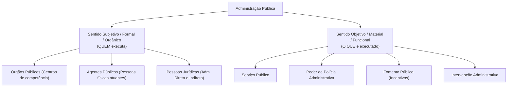
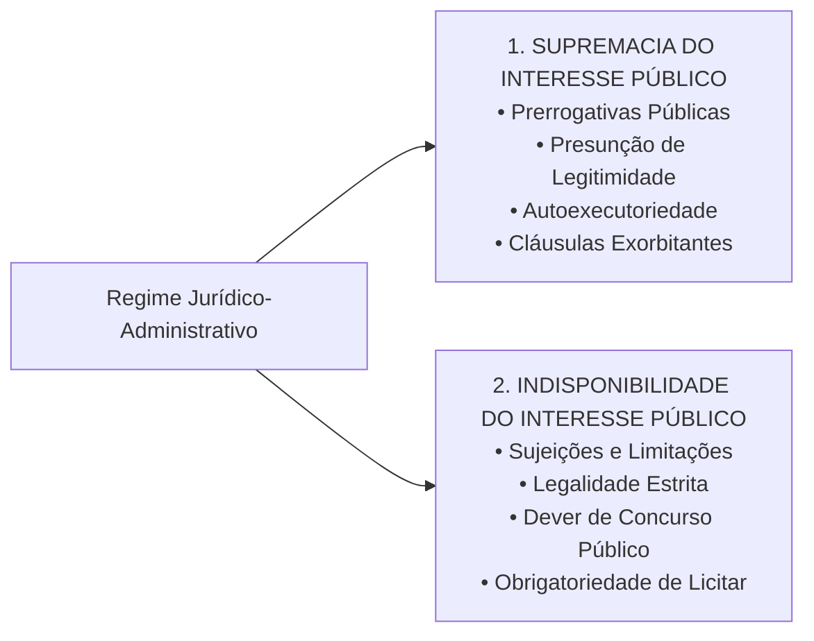
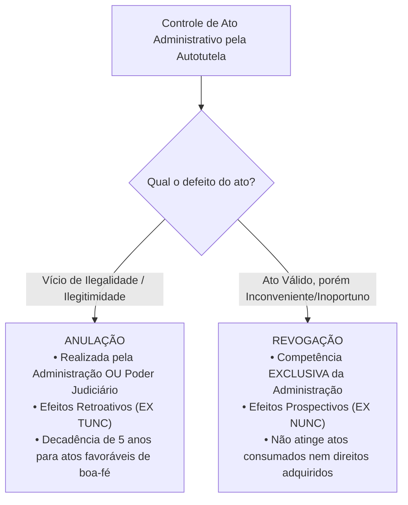

# 01 - Regime Jurídico Administrativo, Princípios e LINDB

> **Matéria:** Noções de Direito Administrativo  
> **Cargo:** A01 – Técnico de Controle Externo – Especialidade: Técnico Administrativo  
> **Arquivo:** `01_regime_juridico_principios_e_lindb.md`  

---

## 📌 Ementa / Itens do Edital
- Administração Pública: conceito, sentidos subjetivo/orgânico e objetivo/material
- Regime jurídico-administrativo: supremacia e indisponibilidade do interesse público
- Princípios constitucionais expressos: Legalidade, Impessoalidade, Moralidade, Publicidade e Eficiência (LIMPE - CF/88, art. 37, *caput*)
- Princípios administrativos implícitos/reconhecidos: Razoabilidade, Proporcionalidade, Segurança Jurídica, Continuidade dos Serviços Públicos, Autotutela (Súmulas 346 e 473 do STF) e Motivação
- Lei de Introdução às normas do Direito Brasileiro (LINDB - Decreto-Lei nº 4.657/1942 com redação dada pela Lei nº 12.376/2010 e alterações da Lei nº 13.655/2018, artigos 20 a 30) e sua aplicação na Administração Pública
- Responsabilização do agente público segundo o Decreto Federal nº 9.830/2019 e a LINDB (erro grosseiro e dolo)

---

## 🧭 Sumário

1. [Conceito e Sentidos de Administração Pública](#1-conceito-e-sentidos-de-administracao-publica)
    1. [Sentido Subjetivo, Formal ou Orgânico](#11-sentido-subjetivo-formal-ou-organico)
    2. [Sentido Objetivo, Material ou Funcional](#12-sentido-objetivo-material-ou-funcional)
    3. [Teste 001](#Teste-001)
    4. [Critérios Distintivos Adotados pela FCC](#13-criterios-distintivos-adotados-pela-fcc)
2. [O Regime Jurídico-Administrativo e sua Bipolaridade Fundamental](#2-o-regime-juridico-administrativo-e-sua-bipolaridade-fundamental)
    1. [Princípio da Supremacia do Interesse Público sobre o Privado](#21-principio-da-supremacia-do-interesse-publico-sobre-o-privado)
    2. [Princípio da Indisponibilidade do Interesse Público](#22-principio-da-indisponibilidade-do-interesse-publico)
    3. [Teste 002](#Teste-002)
    4. [Interesse Público Primário vs. Secundário](#23-interesse-publico-primario-vs-secundario)
3. [Princípios Constitucionais Expressos (Art. 37, caput, CF/88 - LIMPE)](#3-principios-constitucionais-expressos-art-37-caput-cf88-limpe)
    1. [Princípio da Legalidade Estrita](#31-principio-da-legalidade-estrita)
    2. [Teste 003](#Teste-003)
    3. [Princípio da Impessoalidade e a Vedação à Promoção Pessoal](#32-principio-da-impessoalidade-e-a-vedacao-a-promocao-pessoal)
    4. [Teste 004](#Teste-004)
    5. [Princípio da Moralidade e a Súmula Vinculante nº 13 (Antinepotismo)](#33-principio-da-moralidade-e-a-sumula-vinculante-no-13-antinepotismo)
    6. [Teste 005](#Teste-005)
    7. [Princípio da Publicidade e suas Exceções Constitucionais](#34-principio-da-publicidade-e-suas-excecoes-constitucionais)
    8. [Princípio da Eficiência (Emenda Constitucional nº 19/1998)](#35-principio-da-eficiencia-emenda-constitucional-no-191998)
    9. [Teste 006](#Teste-006)
4. [Princípios Administrativos Implícitos e Regime Sumular](#4-principios-administrativos-implicitos-e-regime-sumular)
    1. [Razoabilidade e Proporcionalidade](#41-razoabilidade-e-proporcionalidade)
    2. [Segurança Jurídica e Proteção à Confiança Legítima](#42-seguranca-juridica-e-protecao-a-confianca-legitima)
    3. [Teste 007](#Teste-007)
    4. [Princípio da Autotutela (Súmulas 346 e 473 do STF): Anulação vs. Revogação](#43-principio-da-autotutela-sumulas-346-e-473-do-stf-anulacao-vs-revogacao)
    5. [Teste 008](#Teste-008)
    6. [Princípio da Motivação e a Teoria dos Motivos Determinantes](#44-principio-da-motivacao-e-a-teoria-dos-motivos-determinantes)
    7. [Teste 009](#Teste-009)
    8. [Princípio da Continuidade dos Serviços Públicos](#45-principio-da-continuidade-dos-servicos-publicos)
5. [O Direito Público Positivo da LINDB (Arts. 20 a 30) e o Controle Externo](#5-o-direito-publico-positivo-da-lindb-arts-20-a-30-e-o-controle-externo)
    1. [Consequencialismo Jurídico e Vedação de Valores Abstratos (Art. 20)](#51-consequencialismo-juridico-e-vedacao-de-valores-abstratos-art-20)
    2. [Teste 010](#Teste-010)
    3. [Obstáculos Reais e Circunstâncias Práticas do Gestor (Art. 22)](#52-obstaculos-reais-e-circunstancias-praticas-do-gestor-art-22)
    4. [Responsabilização por Dolo ou Erro Grosseiro (Art. 28 da LINDB c/c Dec. 9.830/2019)](#53-responsabilizacao-por-dolo-ou-erro-grosseiro-art-28-da-lindb-cc-dec-98302019)
    5. [Teste 011](#Teste-011)
    6. [Segurança Jurídica, Transição e Vedação à Retroatividade (Arts. 23 e 24)](#54-seguranca-juridica-transicao-e-vedacao-a-retroatividade-arts-23-e-24)
6. [Fontes Recomendadas na Internet](#6-fontes-recomendadas-na-internet)

---

## 1. Conceito e Sentidos de Administração Pública

O Direito Administrativo brasileiro não se encontra codificado em um único diploma legal, fundando-se na Constituição da República de 1988, em leis esparsas e em construções doutrinárias e pretorianas consolidadas. O conceito de **Administração Pública** desdobra-se em dois sentidos complementares de fundamental relevância para as provas da Fundação Carlos Chagas (FCC):

### 1.1 Sentido Subjetivo, Formal ou Orgânico

Sob o enfoque **subjetivo, formal ou orgânico**, a Administração Pública define o complexo estrutural de **sujeitos de direito, órgãos e agentes** encarregados pelo ordenamento de exercer a função administrativa. 

- Responde à indagação: **"QUEM exerce a função administrativa?"**
- No ordenamento brasileiro, adota-se o critério estritamente formal: integram a Administração Pública em sentido subjetivo **exclusivamente os órgãos e entidades aos quais a lei confere tal condição** (União, Estados, DF, Municípios, suas autarquias, fundações públicas, empresas públicas e sociedades de economia mista). Particulares em colaboração com o poder público (concessionárias, permissionárias e organizações sociais) exercem atividade administrativa, mas **não integram a Administração Pública em sentido formal**.

### 1.2 Sentido Objetivo, Material ou Funcional

Sob o prisma **objetivo, material ou funcional**, a Administração Pública corresponde ao conjunto das **atividades e funções substantivas** tipicamente administrativas executadas pelo Estado.

- Responde à indagação: **"O QUE é executado pela máquina pública?"**
- Abrange classicamente quatro atividades administrativas basilares:
    1. **Serviço Público:** Prestação direta ou indireta de utilidades e comodidades materiais fruíveis individualmente pelos cidadãos (ex.: transporte coletivo, fornecimento de energia, saúde, saneamento básico).
    2. **Polícia Administrativa:** Restrições e condicionamentos impostos a direitos e liberdades individuais e ao uso da propriedade privada em prol do bem-estar coletivo (ex.: fiscalização sanitária, ambiental, trânsito e posturas urbanas).
    3. **Fomento Público:** Estímulo estatal protetivo à iniciativa privada de interesse social sem assunção direta da atividade (concessão de incentivos fiscais, subvenções econômicas e convênios com o terceiro setor).
    4. **Intervenção:** Atuação regulatória no domínio econômico ou sobre a propriedade privada (desapropriações, tombamentos, servidões administrativas).

### Teste 001
**(FCC - Analista Judiciário - Área Judiciária)**
Acerca do conceito e dos sentidos de Administração Pública no ordenamento jurídico brasileiro, considere a situação em que determinado doutrinador analisa os órgãos, os agentes e as pessoas jurídicas incumbidos de desempenhar a atividade estatal, contrapondo-os à própria atividade concreta, contínua e direta voltada ao atendimento das necessidades coletivas.

Sob a perspectiva técnico-doutrinária consagrada pelo Direito Administrativo e pela jurisprudência:

* **A)** Em sentido objetivo, material ou funcional, a Administração Pública compreende o conjunto de órgãos, agentes e pessoas jurídicas instituídos pelo Estado para a execução de suas finalidades.
* **B)** Em sentido subjetivo, formal ou orgânico, a Administração Pública designa a própria função administrativa do Estado, abrangendo os serviços públicos, o poder de polícia, o fomento e a intervenção.
* **C)** No Brasil, adotou-se prioritariamente o critério formal, de modo que somente integram a Administração Pública, em sentido estrito e subjetivo, as entidades e órgãos reconhecidos como tais pela ordem jurídica, independentemente da atividade desempenhada.
* **D)** A atividade política de comando superior e fixação de diretrizes governamentais (função política ou de governo) confunde-se integralmente com a função administrativa em sentido material.
* **E)** As concessionárias e permissionárias de serviços públicos, por prestarem serviços essenciais à coletividade, passam a integrar a Administração Pública em sentido subjetivo ou orgânico.

---

> **Comentário Detalhado:**
>
> - **A)** Incorreta. O conceito descrito (órgãos, agentes e pessoas jurídicas) corresponde à Administração Pública em sentido **subjetivo, formal ou orgânico**, e não em sentido objetivo/material.
> - **B)** Incorreta. O enunciado inverteu os conceitos: a função administrativa, compreendendo as atividades de polícia, serviço público, fomento e intervenção, consubstancia a Administração Pública em sentido **objetivo, material ou funcional**.
> - **C)** Correta. O ordenamento jurídico pátrio consagrou o critério formal (subjetivo/orgânico): apenas integram formalmente a Administração Pública os entes e órgãos que a legislação expressamente qualifica como tais (Administração Direta e Indireta, art. 37 da CF/88 e Decreto-Lei nº 200/1967).
> - **D)** Incorreta. A doutrina clássica distingue nitidamente a função de governo/política (elaboração de diretrizes políticas amplas, atos com discricionariedade ampla e base constitucional direta) da função administrativa (execução subordinada e técnica das leis e políticas públicas).
> - **E)** Incorreta. Concessionárias e permissionárias são particulares em colaboração com o Poder Público; exercem função administrativa delegada (sentido material), mas **jamais integram** a Administração Pública em sentido subjetivo/orgânico.
>
> **Gabarito: C**

---

### 1.3 Critérios Distintivos Adotados pela FCC

| Critério Distintivo | Sentido Subjetivo / Orgânico / Formal | Sentido Objetivo / Material / Funcional |
| :--- | :--- | :--- |
| **Pergunta-Guia** | *Quem realiza a atividade?* | *Qual atividade é realizada?* |
| **Composição** | Pessoas jurídicas, órgãos e agentes públicos da Administração Direta e Indireta | Serviços públicos, polícia administrativa, fomento e intervenção |
| **Grafia Típica** | Grafado com iniciais maiúsculas (**A**dministração **P**ública) | Grafado frequentemente com iniciais minúsculas (**a**dministração pública) |
| **Delegação a Particulares** | Não se transfere a entes delegatários privados | É transferido a concessionários e permissionários |

---

## 2. O Regime Jurídico-Administrativo e sua Bipolaridade Fundamental

O **Regime Jurídico-Administrativo** é o conjunto harmônico de princípios e regras de Direito Público que colocam a Administração Pública em posição especial perante os administrados, conferindo-lhe prerrogativas extraordinárias, ao mesmo tempo em que lhe impõe severas restrições.

Conforme consagrado pela doutrina de Celso Antônio Bandeira de Mello, o regime administrativo estrutura-se sobre dois pilares axiológicos fundamentais (bipolaridade do direito administrativo):

### 2.1 Princípio da Supremacia do Interesse Público sobre o Privado

Fundamenta a concessão de **prerrogativas e privilégios estatais** (*poderes de império*). Em situações de conflito genuíno entre o interesse particular e o interesse coletivo, este último deve prevalecer:

- *Manifestações Práticas:* Presunção de legitimidade e veracidade dos atos administrativos; autoexecutoriedade das decisões do poder de polícia; cláusulas exorbitantes nos contratos administrativos (como rescisão unilateral e alteração unilateral do objeto); e intervenção do Estado na propriedade particular mediante desapropriação e requisição administrativa.

### 2.2 Princípio da Indisponibilidade do Interesse Público

Representa o contrapeso democrático às prerrogativas estatais, corporificando as **sujeições e limitações administrativas**. O administrador público não é o proprietário dos bens e interesses que gere; atua como mero curador e gestor fiduciário do patrimônio do povo.

- *Manifestações Práticas:* Submissão inafastável ao princípio da legalidade estrita; obrigatoriedade de realização de concurso público para provimento de cargos efetivos (art. 37, II, CF); dever inegociável de licitar para obras, compras e serviços (art. 37, XXI, CF); dever de prestar contas aos Tribunais de Contas; e impossibilidade de renúncia graciosa a receitas tributárias ou concessão arbitrária de privilégios a particulares.

### Teste 002
**(FGV - Auditor Fiscal da Receita Estadual)**
O regime jurídico-administrativo fundamenta-se em uma bipolaridade basilar caracterizada pela coexistência de prerrogativas estatais e restrições impostas à atuação do Poder Público. A respeito dessa estrutura dogmática, assinale a afirmativa correta.

* **A)** A supremacia do interesse público sobre o privado é irrestrita, autorizando a Administração a sobrepor suas decisões à ordem constitucional em situações de conveniência política.
* **B)** O princípio da indisponibilidade do interesse público impõe que os bens e interesses coletivos pertençam à sociedade, atuando o administrador público como mero gestor fiduciário, carecedor de titularidade para deles dispor livremente.
* **C)** O interesse público secundário, consubstanciado nos interesses patrimoniais e fiscais imediatos do erário estatal, prevalece juridicamente sobre os direitos e garantias fundamentais dos cidadãos.
* **D)** As sujeições administrativas constituem privilégios concedidos aos órgãos estatais para sobrepujar a esfera de liberdade dos administrados sem necessidade de processo prévio.
* **E)** O princípio da indisponibilidade do interesse público inviabiliza que o Poder Público celebre transações, acordos judiciais ou termos de ajustamento de conduta, haja vista a vedação absoluta à autocomposição pelo Estado.

---

> **Comentário Detalhado:**
>
> - **A)** Incorreta. A supremacia do interesse público não é absoluta nem ilimitada; submete-se estritamente aos direitos fundamentais, à legalidade e aos princípios da proporcionalidade e razoabilidade.
> - **B)** Correta. Pelo princípio da indisponibilidade do interesse público, o administrador não é senhor nem proprietário dos interesses e bens coletivos, mas simples guardião e gestor fiduciário, cabendo-lhe atuar unicamente nos estritos limites traçados pela lei em prol da coletividade.
> - **C)** Incorreta. O interesse público primário (o bem comum coletivo) é o único dotado de supremacia jurídica. O interesse público secundário (o interesse patrimonial da Fazenda Pública como pessoa jurídica) só é legítimo quando coincide com o interesse primário ou com a ordem constitucional.
> - **D)** Incorreta. As sujeições administrativas representam limites, freios e restrições impostos à Administração (como o dever de licitar, realizar concurso público e motivar atos), e não prerrogativas ou privilégios de poder.
> - **E)** Incorreta. A indisponibilidade não impede a autocomposição ou celebração de acordos (como TACs ou mediações públicas), desde que tais medidas visem à melhor realização do interesse coletivo, conforme expressamente autorizado pelo art. 3º do CPC/2015 e pela LINDB (art. 26).
>
> **Gabarito: B**

---

### 2.3 Interesse Público Primário vs. Secundário

A jurisprudência do STF e do STJ acolhe expressamente a distinção doutrinária entre:

- **Interesse Público Primário:** É o interesse real da coletividade como um todo (justiça social, saúde pública, educação, segurança). É o único verdadeiramente supremo e indisponível.
- **Interesse Público Secundário:** É o interesse patrimonial e fazendário do próprio aparelho estatal como pessoa jurídica (arrecadar mais tributos, evitar condenações judiciais pecuniárias, economizar recursos a qualquer custo). 
> ⚠️ **Alerta FCC:** O interesse público secundário só é legítimo quando coincide plenamente com o interesse primário da sociedade. Caso o Estado viole direitos fundamentais de cidadãos apenas para auferir vantagem financeira aos cofres públicos, tal ato configura ilicitude e desvio de finalidade.

---

## 3. Princípios Constitucionais Expressos (Art. 37, caput, CF/88 - LIMPE)

O art. 37, *caput*, da Constituição Federal estabelece os cinco princípios expressos de observância obrigatória pela Administração Pública direta e indireta de qualquer dos Poderes da União, dos Estados, do Distrito Federal e dos Municípios:

### 3.1 Princípio da Legalidade Estrita

Enquanto o particular goza da **autonomia da vontade** e da legalidade ampla, podendo fazer tudo o que a lei não proíba (art. 5º, II, CF/88), o administrador público rege-se pela **legalidade estrita**: só pode agir e praticar atos quando houver prévia e expressa autorização ou determinação em lei (*subordinação estrita à lei*). O ato administrativo sem amparo legal é nulo de pleno direito.

### Teste 003
**(FCC - Analista Judiciário - Área Administrativa)**
No âmbito do Direito Público brasileiro, o princípio da legalidade apresenta conformação substancialmente distinta daquela aplicável às relações jurídicas privadas. A esse propósito, assinale a afirmativa que expressa com exatidão a disciplina jurídica desse princípio.

* **A)** No âmbito privado vigora a autonomia da vontade (art. 5º, II, CF/88), sendo lícito fazer tudo o que a lei não proíbe; já para a Administração Pública impera o princípio da estrita legalidade, cabendo-lhe agir tão somente quando houver prévia e expressa autorização legal.
* **B)** A Administração Pública pode praticar atos inominados e criar obrigações para os cidadãos com base exclusiva em portarias e instruções normativas, independentemente de lei em sentido formal.
* **C)** O princípio da juridicidade restringe a atuação do administrador público à estrita literalidade da lei ordinária, excluindo o bloco de constitucionalidade e os princípios implícitos.
* **D)** Em matérias afetas à discricionariedade administrativa, o administrador público fica dispensado de observar a lei, prevalecendo seu juízo exclusivo de oportunidade e conveniência sem qualquer balizamento normativo.
* **E)** O princípio da legalidade administrativa impede terminantemente a edição de qualquer decreto regulamentar que disponha sobre o detalhamento da execução da lei.

---

> **Comentário Detalhado:**
>
> - **A)** Correta. Enquanto o particular goza do postulado da autonomia privada (não ser obrigado a fazer ou deixar de fazer algo senão em virtude de lei), a Administração Pública sujeita-se à vinculação positiva à lei (legalidade estrita), só podendo atuar onde, como e quando a norma legal autorizar ou determinar.
> - **B)** Incorreta. Atos infralegais (portarias, instruções, resoluções) não podem inovar na ordem jurídica originária nem criar obrigações sem fundamento direto em lei formal (art. 5º, II, e art. 84, IV, CF/88).
> - **C)** Incorreta. O princípio da juridicidade amplia a submissão administrativa para além da lei formal, abrangendo todo o ordenamento jurídico (a Constituição, os tratados internacionais, os princípios gerais de direito e os precedentes vinculantes).
> - **D)** Incorreta. A discricionariedade nunca autoriza agir fora ou contra a lei. O juízo de oportunidade e conveniência ocorre estritamente dentro da moldura conferida pelo legislador, subordinando-se à finalidade pública, razoabilidade e proporcionalidade.
> - **E)** Incorreta. O decreto regulamentar executivo (art. 84, IV, CF/88) é o instrumento clássico pelo qual o Chefe do Executivo detalha e viabiliza a fiel execução das leis, desde que não exorbite seus termos.
>
> **Gabarito: A**

---

### 3.2 Princípio da Impessoalidade e a Vedação à Promoção Pessoal

O princípio da impessoalidade possui triplo desdobramento no âmbito dos concursos:

1. **Finalidade Pública:** Todo ato administrativo deve visar ao atendimento do interesse público genérico e à finalidade específica prevista na lei para a respectiva competência. A busca de vingança pessoal ou favorecimento a correligionários gera nulidade por *desvio de finalidade* (ou desvio de poder).
2. **Isonomia e Tratamento Neutro:** Proibição de concessão de privilégios ou perseguições arbitrárias. É a base axiológica do concurso público e da licitação.
3. **Vedação à Promoção Pessoal (Art. 37, § 1º, CF/88):** A publicidade dos atos, programas, obras, serviços e campanhas dos órgãos públicos deve possuir caráter estritamente educativo, informativo ou de orientação social, **dela não podendo constar nomes, símbolos, slogans ou imagens que caracterizem promoção pessoal de autoridades ou servidores públicos**.
    - *Teoria do Órgão (Imputação Volitiva):* Os atos praticados pelos agentes públicos são juridicamente imputados ao órgão ou pessoa jurídica estatal a que pertencem, e não à pessoa física do agente. Logo, quem realiza a obra é a "Secretaria de Saúde do Estado de Goiás", e não o "Secretário Fulano".

---

### Teste 004
**(FCC - Analista de Controle Externo / TCE-GO)**
O Prefeito de determinado município goiano autorizou a realização de ampla campanha institucional informando a entrega de um novo hospital municipal. Na publicidade veiculada em emissoras de televisão e painéis digitais, foram inseridas a fotografia oficial do Chefe do Executivo, o slogan utilizado em sua campanha partidária e mensagens conclamando a população a reconhecer seu esforço pessoal na entrega da obra.

Diante do regramento constitucional aplicável à Administração Pública, a conduta descrita vulnerou diretamente o princípio da:

* **A)** Publicidade, tendo em vista que é vedada a divulgação aos administrados de obras e serviços já concluídos pelo Poder Público.
* **B)** Impessoalidade, por caracterizar evidente promoção pessoal de agente político em informe institucional custeado com recursos públicos.
* **C)** Eficiência, unicamente em virtude de o gestor não ter anexado na peça publicitária a planilha detalhada com a economicidade da obra.
* **D)** Legalidade estrita, por inexistir autorização legislativa genérica permitindo a veiculação de qualquer informe por municípios.
* **E)** Autotutela, pois a publicidade de atos municipais depende de chancela prévia obrigatória do Tribunal de Contas competente.

---

> **Comentário Detalhado:**
>
> - **A)** Incorreta. A publicidade institucional de realizações do Poder Público é permitida e salutar para o controle social, desde que preserve rigoroso caráter educativo, informativo ou de orientação social. O erro não está em divulgar a obra concluída, mas em promover a figura pessoal do administrador.
> - **B)** Correta. O art. 37, § 1º, da Constituição Federal estabelece que a publicidade dos órgãos públicos não pode conter nomes, símbolos ou imagens que caracterizem promoção pessoal de autoridades ou servidores públicos. A aposição de fotografias e slogans eleitorais do Prefeito com dinheiro público fere frontalmente o princípio da impessoalidade e a Teoria do Órgão (segundo a qual as realizações pertencem ao Município e não à pessoa física do gestor), configurando ainda ato de improbidade administrativa.
> - **C)** Incorreta. O vício primordial e autônomo é a promoção pessoal ilícita, e não a ausência de demonstrativos contábeis na mídia veiculada.
> - **D)** Incorreta. Os entes federados gozam de autonomia constitucional para veicular campanhas informativas e de utilidade pública no interesse de seus munícipes.
> - **E)** Incorreta. O controle exercido pelo Tribunal de Contas não é prévio de censura publicitária; opera-se a posteriori ou de forma concomitante no exame das despesas orçamentárias.
> 
> **Gabarito: B**

---

### 3.3 Princípio da Moralidade e a Súmula Vinculante nº 13 (Antinepotismo)

Exige conduta pautada pela boa-fé objetiva, honestidade, lealdade, decência e probidade. O ato administrativo pode atender rigorosamente à literalidade da lei, mas ser manifestamente nulo se contaminado por torpeza, favorecimento antiético ou imoralidade administrativa.

#### A Súmula Vinculante nº 13 do Supremo Tribunal Federal:
A moralidade e a impessoalidade fundamentam o teor da **Súmula Vinculante nº 13**, que proíbe o nepotismo no serviço público brasileiro:
> *"A nomeação de cônjuge, companheiro ou parente em linha reta, colateral ou por afinidade, até o terceiro grau, inclusive, da autoridade nomeante ou de servidor da mesma pessoa jurídica investido em cargo de direção, chefia ou assessoramento, para o exercício de cargo em comissão ou de confiança ou, ainda, de função gratificada na administração pública direta e indireta em qualquer dos poderes da União, dos Estados, do Distrito Federal e dos Municípios, compreendido o ajuste mediante designações recíprocas (nepotismo cruzado), viola a Constituição Federal."*

- **Graus de Parentesco Atingidos:**
    - *1º Grau:* Pais, mães, filhos, filhas (consanguíneos); sogro, sogra, genro, nora (afins).
    - *2º Grau:* Avós, netos, **irmãos** (consanguíneos); cunhados (afins).
    - *3º Grau:* Tios, sobrinhos (consanguíneos).
- **Ressalva Jurisprudencial Consolidada (Cargos Políticos):** O STF firmou tese de que a SV nº 13 **não incide de forma automática e absoluta sobre cargos de natureza política** (ex.: Ministros de Estado, Secretários Estaduais e Secretários Municipais). Contudo, a nomeação de parente para cargo político será considerada inválida pelo Judiciário/Tribunal de Contas se comprovada a manifesta ausência de qualificação técnica para a função ou caracterizado patente desvio de finalidade (fraude à lei).

---

### Teste 005
**(FCC - Analista Judiciário)**
O Presidente de determinado órgão público estadual nomeou sua irmã para exercer o cargo em comissão de Diretora de Recursos Humanos do referido órgão. Instada a se manifestar sobre a legalidade da nomeação, a assessoria jurídica emitiu parecer favorável, sustentando que a vedação ao nepotismo atinge apenas parentes em linha reta (pais e filhos).

Conforme a jurisprudência pacificada do Supremo Tribunal Federal consolidada na **Súmula Vinculante nº 13**:

* **A)** O parecer está correto, pois o parentesco colateral de segundo grau (irmãos) não se submete à vedação sumular do nepotismo.
* **B)** A nomeação é válida, contanto que a irmã possua formação superior em área correlata à gestão de pessoas.
* **C)** A nomeação é nula por violar a Súmula Vinculante nº 13, que veda expressamente a nomeação de parentes em linha reta, colateral ou por afinidade até o terceiro grau para cargos em comissão.
* **D)** A proibição do nepotismo limita-se unicamente ao cônjuge e companheiro, sendo permitida a nomeação de parentes consanguíneos de qualquer grau.
* **E)** A restrição sumular não se aplica aos cargos em comissão de direção e chefia, restringindo-se às funções de assessoramento.

---

> **Comentário Detalhado:**
>
> - **A)** Incorreta. O parentesco colateral até o terceiro grau é expressamente abrangido pela proibição sumular. Irmãos são parentes em linha colateral de segundo grau consanguíneo, caindo sob o veto direto.
> - **B)** Incorreta. Em cargos em comissão de livre nomeação e exoneração de natureza estritamente administrativa (como a Diretoria de Recursos Humanos), a qualificação acadêmica do parente não afasta a presunção objetiva de nepotismo e a nulidade do provimento.
> - **C)** Correta. A Súmula Vinculante nº 13 do STF estabelece expressamente a inconstitucionalidade da nomeação de cônjuge, companheiro ou parente em linha reta, colateral ou por afinidade, até o **terceiro grau**, inclusive, da autoridade nomeante para cargos em comissão ou de confiança (direção, chefia e assessoramento). A nomeação de irmã (2º grau colateral) para cargo de Diretora é flagrantemente nula por vulnerar a moralidade e a impessoalidade.
> - **D)** Incorreta. O enunciado sumular abarca expressamente cônjuges, companheiros e todo o rol de parentes consanguíneos e afins até o 3º grau (pais, filhos, netos, avós, irmãos, sobrinhos, tios, sogros, cunhados).
> - **E)** Incorreta. A súmula atinge textualmente qualquer cargo de direção, chefia ou assessoramento, bem como funções gratificadas.
> 
> **Gabarito: C**

---

### 3.4 Princípio da Publicidade e suas Exceções Constitucionais

A publicidade exige que a atuação estatal seja transparente, acessível e cognoscível aos cidadãos e órgãos de controle externo. 

- A publicação oficial é **requisito de eficácia** (aptidão para produzir efeitos jurídicos) e de **exigibilidade** dos atos administrativos que criam obrigações para terceiros ou geram despesas públicas; não é requisito de validade intrínseca do ato.
- **Exceções Constitucionais Estritas:** A própria CF/88 ressalva o sigilo apenas nas hipóteses de **segurança do Estado e da sociedade** e de proteção inafastável à **intimidade, honra e vida privada** das pessoas (art. 5º, incisos X, XXXIII e LX).

### 3.5 Princípio da Eficiência (Emenda Constitucional nº 19/1998)

Inserido formalmente no rol do art. 37 pela Reforma Administrativa (EC nº 19/1998), impõe à Administração o dever de obter o melhor rendimento funcional, presteza, perfeição técnica, celeridade na tramitação e economicidade, maximizando os resultados com o menor dispêndio possível de recursos públicos.

- *Desdobramentos Constitucionais Práticos:* Avaliação especial de desempenho para aquisição da estabilidade do servidor (art. 41, § 4º, CF); perda do cargo público por avaliação periódica de desempenho (art. 41, § 1º, III, CF); e fixação de metas de desempenho institucional mediante contratos de gestão (art. 37, § 8º, CF).

---

### Teste 006
**(FGV - Analista de Controle Externo / TCE)**
Introduzido formalmente no caput do art. 37 da Constituição Federal pela Emenda Constitucional nº 19/1998, o princípio da eficiência impõe uma administração pública gerencial voltada a resultados. Sobre os desdobramentos normativos e práticos desse princípio, assinale a afirmativa correta.

* **A)** A busca pela eficiência econômica sobrepõe-se ao princípio da legalidade, permitindo ao gestor afastar regras procedimentais licitatórias sempre que verificar uma compra direta mais célere.
* **B)** O princípio da eficiência possui aplicação restrita à esfera de produtividade interna dos servidores, não gerando direitos subjetivos aos administrados quanto à qualidade dos serviços públicos prestados.
* **C)** Como corolário do princípio da eficiência, a CF/88 autorizou a perda de cargo do servidor público estável mediante procedimento de avaliação periódica de desempenho, na forma de lei complementar, assegurada ampla defesa.
* **D)** O princípio da eficiência impede a terceirização de atividades-meio na Administração Pública, por impor que todo e qualquer serviço estatal seja prestado diretamente por servidores concursados.
* **E)** A eficiência afasta o dever de motivação dos atos administrativos discricionários para conferir maior celeridade e desburocratização ao processo de tomada de decisão.

---

> **Comentário Detalhado:**
>
> - **A)** Incorreta. O princípio da eficiência jamais opera contra legem. A economicidade e a celeridade não autorizam o rompimento das regras constitucionais e legais que disciplinam a contratação pública.
> - **B)** Incorreta. A eficiência tem duas vertentes essenciais: a interna (atuação econômica e organizada do aparelho estatal) e a externa (prestação de serviços públicos céleres, adequados e de qualidade aos cidadãos administrados).
> - **C)** Correta. Nos termos do art. 41, § 1º, III, da CF/88 (incluído pela EC nº 19/1998), a avaliação periódica de desempenho constitui hipótese constitucional autônoma de perda do cargo do servidor estável, condicionada à edição de lei complementar e à garantia do contraditório e da ampla defesa.
> - **D)** Incorreta. O STF já fixou a tese de repercussão geral (Tema 725) no sentido de que é lícita a terceirização em todas as etapas da cadeia produtiva, inclusive em atividades-meio da Administração Pública, como instrumento de modernização gerencial.
> - **E)** Incorreta. A motivação é indispensável para verificar se o ato foi praticado com eficiência, finalidade pública e proporcionalidade; dispensar a motivação favoreceria o arbítrio e inviabilizaria o controle.
>
> **Gabarito: C**

---

## 4. Princípios Administrativos Implícitos e Regime Sumular

Além dos cinco princípios expressos no art. 37 da CF, o ordenamento constitucional e a legislação infraconstitucional (como a Lei do Processo Administrativo Federal nº 9.784/1999 e a Lei Estadual de Goiás nº 13.800/2001) consagram princípios implícitos de aplicação cogente:

### 4.1 Razoabilidade e Proporcionalidade

Exigem equilíbrio, bom senso, coerência e adequação entre os meios empregados pelo Estado e os fins pretendidos pela lei, vedando restrições desmedidas ou sacrifícios inúteis impostos aos administrados.

- **Tripé da Proporcionalidade:**
    1. *Adequação:* O meio escolhido deve ser apto a alcançar o objetivo público.
    2. *Necessidade (Exigibilidade):* Entre os meios aptos, deve-se eleger o que cause menor gravame ao cidadão (*vedação de excesso*).
    3. *Proporcionalidade em Sentido Estrito:* Os benefícios auferidos pela medida devem superar os ônus decorrentes da intervenção estatal.

### 4.2 Segurança Jurídica e Proteção à Confiança Legítima

Visa garantir a estabilidade das relações jurídicas constituídas e proteger a confiança dos administrados perante as condutas e orientações da Administração.

- *Vedação à Aplicação Retroativa:* O art. 2º, parágrafo único, inciso XIII, da Lei nº 9.784/1999 veda peremptoriamente a aplicação retroativa de nova interpretação jurídica para alcançar atos pretéritos já consolidados sob a orientação anterior.
- *Prazo Decadencial da Autotutela:* Fixação do prazo decadencial de **5 anos** para que a Administração anule atos administrativos favoráveis aos administrados praticados de boa-fé (art. 54 da Lei 9.784/99 e art. 54 da Lei Estadual/GO 13.800/2001).

---

### Teste 007
**(FCC - Auditor de Controle Externo / Adaptada TCE-GO)**
Determinada autarquia estadual concedeu, durante dez anos, com base em parecer normativo da Procuradoria-Geral do Estado, certa vantagem pecuniária a uma categoria de servidores. Posteriormente, a Procuradoria reviu seu entendimento histórico e fixou nova interpretação mais restritiva da lei, passando a considerar a vantagem indevida. A Administração resolveu então cobrar retroativamente de todos os servidores os valores recebidos ao longo dos últimos cinco anos.

Considerando o princípio da segurança jurídica, a disciplina do processo administrativo e o art. 24 da LINDB:

* **A)** A Administração agiu com estrito acerto, pois o princípio da legalidade prevalece sobre qualquer consideração temporal ou de confiança legítima.
* **B)** É vedada a aplicação retroativa de nova interpretação jurídica para alcançar situações plenamente constituídas sob a vigência da orientação anterior.
* **C)** A repetição dos valores é plenamente legítima, cabendo aos servidores o ônus de demonstrar prejuízo individual desproporcional.
* **D)** Nova orientação jurídica retroage automaticamente caso seja mais benéfica aos cofres públicos estaduais.
* **E)** A segurança jurídica apenas protege os atos administrativos chancelados expressamente por sentença judicial transitada em julgado.

---

> **Comentário Detalhado:**
>
> - **A)** Incorreta. No Estado Democrático de Direito, o princípio da legalidade não atua de modo isolado ou absoluto; ele deve ser harmonizado e sopesado com os princípios da segurança jurídica, da proteção à confiança legítima e da boa-fé objetiva.
> - **B)** Correta. O art. 24 da LINDB proíbe expressamente que, com base em alteração posterior de orientação geral, se declarem inválidas situações plenamente constituídas, devendo a revisão levar em conta as diretrizes gerais vigentes à época em que os atos foram praticados. Em idêntico sentido, o art. 2º, parágrafo único, XIII, da Lei Federal nº 9.784/1999 (e da legislação estadual congênere) veda expressamente a "aplicação retroativa de nova interpretação". As novas orientações só produzem efeitos prospectivos (*ex nunc*).
> - **C)** Incorreta. A Súmula 249 do TCU e a firme jurisprudência do STJ e do STF pacificaram o entendimento de que é incabível a repetição de indébito de verbas alimentares percebidas de boa-fé com esteio em interpretação jurídica equivocada do próprio poder público.
> - **D)** Incorreta. O interesse fazendário do erário (interesse público secundário) não tem o condão de justificar a retroatividade de teses prejudiciais contra cidadãos de boa-fé.
> - **E)** Incorreta. O princípio da segurança jurídica projeta seus efeitos protetivos diretamente sobre os atos da esfera administrativa e os processos de controle externo, dispensando a necessidade de provimento jurisdicional judicial anterior.
> 
> **Gabarito: B**

---

### 4.3 Princípio da Autotutela (Súmulas 346 e 473 do STF): Anulação vs. Revogação

O princípio da autotutela assegura à Administração Pública o poder-dever de controlar diretamente seus próprios atos, revendo-os quanto à legalidade ou ao mérito, sem necessidade de autorização judicial prévia.

#### Enunciado da Súmula 473 do STF:
> *"A administração pode anular seus próprios atos, quando eivados de vícios que os tornam ilegais, porque deles não se originam direitos; ou revogá-los, por motivo de conveniência ou oportunidade, respeitados os direitos adquiridos, e ressalvada, em todos os casos, a apreciação judicial."*

| Dimensão | Anulação de Ato Administrativo | Revogação de Ato Administrativo |
| :--- | :--- | :--- |
| **Fundamento Central** | **Ilegalidade / Ilegitimidade** (vício formal ou material de validade) | **Inconveniência ou Inoportunidade** (razões de mérito) |
| **Autoridade Competente** | **Administração Pública** (autotutela) ou **Poder Judiciário** | **Exclusiva da própria Administração** (Judiciário não revoga ato do Executivo) |
| **Efeitos no Tempo** | **Retroativos (*ex tunc*)**, apagando os efeitos desde a origem | **Prospectivos (*ex nunc*)**, preservando os efeitos já produzidos |
| **Limites Temporais** | Prazo decadencial de **5 anos** para atos benéficos ao cidadão de boa-fé | Não há prazo pré-fixado, respeitados atos consumados e direito adquirido |
| **Garantia Processual** | Exige contraditório e ampla defesa prévios se atingir direito de terceiros | Exige contraditório e ampla defesa se atingir direito constituído |

---

### Teste 008
**(FCC - Técnico de Controle Externo / Administrativa)**
Determinada autoridade administrativa do Poder Executivo estadual constatou que um ato de concessão de gratificação funcional a um grupo de servidores, praticado há dois anos, padecia de vício insanável de legalidade, por contrariar dispositivo expresso do regime jurídico único. Os servidores beneficiados não concorreram para o vício e agiram de boa-fé.

Considerando o princípio da autotutela e os enunciados das Súmulas 346 e 473 do Supremo Tribunal Federal:

* **A)** A autoridade deve revogar o ato administrativo, produzindo efeitos a partir da decisão (efeitos *ex nunc*), sem necessidade de contraditório prévio.
* **B)** O ato é nulo e deve ser anulado pela própria Administração, produzindo a anulação efeitos retroativos (*ex tunc*), assegurados o contraditório e a ampla defesa.
* **C)** Somente o Poder Judiciário dispõe de competência constitucional para anular atos praticados pela Administração Pública estadual.
* **D)** A Administração decaiu do direito de anular o ato, haja vista ter decorrido o prazo bienal de prescrição administrativa geral.
* **E)** O ato tornou-se imutável por força do princípio da segurança jurídica, não podendo mais ser anulado nem mesmo pelo Poder Judiciário.

---

> **Comentário Detalhado:**
>
> - **A)** Incorreta. Vício de ilegalidade insanável enseja a **anulação** do ato, e não revogação. A revogação recai exclusivamente sobre atos válidos e perfeitos que se tornaram inconvenientes ou inoportunos, gerando efeitos prospectivos (*ex nunc*).
> - **B)** Correta. Conforme as Súmulas 346 e 473 do STF, a Administração tem o poder-dever de anular seus próprios atos ilegais, operando a anulação efeitos retroativos (*ex tunc*). Todavia, como o ato produziu efeitos concretos favoráveis na esfera de direitos dos servidores beneficiados de boa-fé, é mandatório instaurar processo administrativo prévio assegurando-lhes o contraditório e a ampla defesa (Súmula Vinculante nº 3). Como transcorreram apenas dois anos, o direito da Administração de anular está plenamente preservado (o prazo decadencial é de 5 anos).
> - **C)** Incorreta. Pelo princípio da autotutela, a Administração Pública não necessita provocar o Judiciário para extirpar atos ilegais praticados em seus quadros.
> - **D)** Incorreta. O prazo decadencial da Administração Pública para anular atos favoráveis praticados de boa-fé é de **cinco anos** (art. 54 da Lei 9.784/99 e art. 54 da Lei Estadual/GO 13.800/2001), inexistindo prazo decadencial bienal no regime geral.
> - **E)** Incorreta. Como o quinquênio decadencial de cinco anos não se consumou, a segurança jurídica não convalidou o vício insanável.
> 
> **Gabarito: B**

---

### 4.4 Princípio da Motivação e a Teoria dos Motivos Determinantes

A motivação consiste na exposição explícita, por escrito, das razões de fato e dos fundamentos de direito que justificam a prática do ato administrativo.

- **Teoria dos Motivos Determinantes:** A validade do ato administrativo fica estritamente vinculada à veracidade e pertinência dos motivos fáticos declarados pela autoridade competente. Se a Administração fundamentar a exoneração de um servidor comissionado aduzindo escassez orçamentária, e restar documentalmente comprovado que havia saldo orçamentário excedente, o ato de desligamento será declarado nulo por falsidade do motivo, mesmo que a lei não exigisse motivação obrigatória para a referida exoneração.

### Teste 009
**(FCC - Procurador do Estado)**
Determinada autoridade administrativa removeu ex officio um servidor público estável para localidade distante, fazendo constar formalmente na portaria que a medida visava atender a urgente déficit de pessoal e reestruturação do setor destinatário. Posteriormente, restou documentalmente comprovado em processo administrativo que o setor de destino possuía excedente de servidores e que a verdadeira intenção da chefia fora aplicar uma punição disfarçada em virtude de desavenças partidárias.

Diante da Teoria dos Motivos Determinantes, o ato de remoção descrito é:

* **A)** Válido, pois a remoção ex officio insere-se no poder discricionário da Administração, sendo irrelevante a veracidade dos motivos declarados pela autoridade.
* **B)** Nulo de pleno direito, uma vez que a validade do ato fica vinculada à veracidade e subsistência dos motivos explicitados pela autoridade, configurando a falsidade do motivo e o desvio de finalidade vício insanável.
* **C)** Convalidável, bastando que a autoridade edite novo ato retificador suprimindo a motivação pretérita e afirmando a discricionariedade pura.
* **D)** Válido quanto aos seus efeitos pretéritos e revogável unicamente com efeitos ex nunc por motivo de conveniência e oportunidade da chefia.
* **E)** Nulo apenas se comprovado prejuízo financeiro direto ao erário público, haja vista que a motivação constitui mero requisito acidental do ato administrativo.

---

> **Comentário Detalhado:**
>
> - **A)** Incorreta. Pela Teoria dos Motivos Determinantes, quando a autoridade explicita os motivos de fato e de direito para a prática do ato (mesmo em ato discricionário em que a motivação fosse dispensada em tese), o ato vincula-se indelevelmente a esses motivos. Se os fatos forem falsos ou inexistentes, o ato é nulo.
> - **B)** Correta. A Teoria dos Motivos Determinantes vincula o ato administrativo à veracidade dos motivos invocados. Comprovada a falsidade do déficit de pessoal e o desvio de finalidade (utilização de remoção como sanção disciplinar disfarçada), o ato padece de vício de nulidade insanável e afronta a moralidade e a impessoalidade.
> - **C)** Incorreta. Vícios no motivo e na finalidade são insanáveis e não admitem convalidação retroativa nem substituição extemporânea de motivos.
> - **D)** Incorreta. Trata-se de nulidade (vício de legalidade), ensejando declaração de invalidade (anulação) com efeitos retroativos (ex tunc), e não revogação discricionária ex nunc.
> - **E)** Incorreta. A motivação e o motivo são elementos de validade essenciais; a nulidade por falsidade do motivo independe de demonstração de dano patrimonial financeiro imediato ao erário.
>
> **Gabarito: B**

---

### 4.5 Princípio da Continuidade dos Serviços Públicos

Os serviços públicos representam a prestação material de necessidades indeclináveis da sociedade, não podendo sofrer interrupções imotivadas ou abruptas.

- *Limites Legítimos de Suspensão (Lei nº 8.987/1995, art. 6º, § 3º):* O serviço pode ser suspenso após aviso prévio formal ao usuário por:
    1. Razões de ordem técnica ou de segurança das instalações;
    2. Inadimplemento contratual do usuário, ressalvadas unidades públicas essenciais (hospitais e postos de saúde não podem ter o fornecimento de energia desligado por falta de pagamento).

---

## 5. O Direito Público Positivo da LINDB (Arts. 20 a 30) e o Controle Externo

A Lei de Introdução às Normas do Direito Brasileiro (LINDB - Decreto-Lei nº 4.657/1942), com as alterações introduzidas pela Lei nº 13.655/2018 e regulamentadas pelo Decreto Federal nº 9.830/2019, inaugurou uma nova fase de pragmatismo, segurança jurídica e racionalidade no Direito Administrativo sancionador e nas decisões dos Tribunais de Contas.

### 5.1 Consequencialismo Jurídico e Vedação de Valores Abstratos (Art. 20)

> *"Art. 20. Nas esferas administrativa, controladora e judicial, não se decidirá com base em valores jurídicos abstratos sem que sejam consideradas as consequências práticas da decisão."*

- É vedado ao auditor ou julgador do Tribunal de Contas anular um contrato ou paralisar uma obra pública invocando fórmulas genéricas como "ofensa ao interesse público" ou "afronta à moralidade" sem motivar analiticamente os impactos socioeconômicos, os prejuízos à população e a viabilidade de alternativas de regularização.

### Teste 010
**(FGV - Auditor de Controle Externo / TCE)**
A Lei de Introdução às Normas do Direito Brasileiro (LINDB), com a redação conferida pela Lei nº 13.655/2018, estabeleceu novas diretrizes para as esferas administrativa, controladora e judicial. A respeito do regramento previsto nos arts. 20 e 21 da LINDB, assinale a afirmativa correta.

* **A)** Nas esferas administrativa, controladora e judicial, não se decidirá com base em valores jurídicos abstratos sem que sejam consideradas as consequências práticas da decisão.
* **B)** A exigência de motivação fundada em consequências práticas aplica-se unicamente ao Poder Judiciário, não vinculando as Cortes de Contas no exercício de suas auditorias.
* **C)** A invalidação de ato ou contrato administrativo prescinde de indicação expressa sobre suas consequências jurídicas e administrativas, privilegiando a aplicação automática da legalidade estrita.
* **D)** Ao decidir sobre a regularidade de conduta de gestor público, o órgão julgador deve desconsiderar os obstáculos e dificuldades reais, exigindo padrão de conduta ideal e irrealizável.
* **E)** As decisões controladoras que invalidarem atos administrativos não podem estabelecer qualquer regime de transição para cumprimento da nova orientação.

---

> **Comentário Detalhado:**
>
> - **A)** Correta. O art. 20, caput, da LINDB estatui textualmente que nas esferas administrativa, controladora e judicial não se decidirá com base em valores jurídicos abstratos sem que sejam consideradas as consequências práticas da decisão, exigindo ainda que a motivação demonstre a necessidade e a adequação da medida (parágrafo único).
> - **B)** Incorreta. O art. 20 é explícito ao determinar sua aplicação nas "esferas administrativa, controladora e judicial", vinculando diretamente a atuação e as decisões dos Tribunais de Contas.
> - **C)** Incorreta. O art. 21 da LINDB determina que a decisão que decretar a invalidação de ato, contrato, ajuste, processo ou norma administrativa deverá indicar, de modo expresso, as suas consequências jurídicas e administrativas.
> - **D)** Incorreta. O art. 22 da LINDB impõe expressamente que, na interpretação de normas sobre gestão pública, serão considerados os obstáculos e as dificuldades reais do gestor e as exigências das políticas públicas a seu cargo.
> - **E)** Incorreta. O parágrafo único do art. 21 da LINDB prevê a fixação de regime de transição sempre que necessário para que a nova obrigação seja cumprida de modo proporcional e equânime e sem prejuízo aos interesses gerais.
>
> **Gabarito: A**

---

### 5.2 Obstáculos Reais e Circunstâncias Práticas do Gestor (Art. 22)

> *"Art. 22. Na interpretação de normas sobre gestão pública, serão considerados os obstáculos e as dificuldades reais do gestor e as exigências das políticas públicas a seu cargo, sem prejuízo dos direitos dos administrados."*

- Na fiscalização de conformidade, os órgãos de controle externo devem contextualizar a conjuntura histórica e fática da tomada de decisão. Devem sopesar a escassez de recursos orçamentários, as falhas de infraestrutura, a urgência imposta por calamidades e o quadro pessoal deficiente do órgão no momento da prática do ato.

### 5.3 Responsabilização por Dolo ou Erro Grosseiro (Art. 28 da LINDB c/c Dec. 9.830/2019)

> *"Art. 28. O agente público responderá pessoalmente por suas decisões ou opiniões técnicas em caso de dolo ou erro grosseiro."*

- **Responsabilidade Subjetiva:** O servidor público ou parecerista técnico somente pode ser punido pessoalmente (com multas, sanções funcionais ou obrigação de ressarcir o erário) caso tenha atuado com **dolo** (intenção deliberada de descumprir a lei ou lesar o patrimônio) ou **erro grosseiro** (culpa grave inescusável).
- **Conceito de Erro Grosseiro (Decreto nº 9.830/2019, art. 12):** Considera-se erro grosseiro aquele manifesto, evidente e inescusável praticado com culpa grave, caracterizado por ação ou omissão com elevado grau de negligência, imprudência ou imperícia, demonstrando desprezo ostensivo às regras elementares de cautela que um profissional com diligência média adotaria nas mesmas circunstâncias fáticas.

> 🚨 **ALERTA CRÍTICO DE PROVA FCC:**  
> A divergência interpretativa razoável de lei, jurisprudência ou norma técnica entre o corpo técnico do Tribunal de Contas e o gestor **JAMAIS configura erro grosseiro**. Para impor sanção ao administrador, é indispensável que a acusação comprove desídia grave, negligência crassa ou dolo!

---

### Teste 011
**(FCC - Auditor de Controle Externo / Adaptada)**
Em processo de auditoria de conformidade instaurado no Tribunal de Contas, a equipe técnica propôs a aplicação de multa pecuniária e a imputação de débito pessoal a um Secretário de Estado em razão da contratação de serviços mediante interpretação jurídica que gerou dispêndio financeiro. Ficou demonstrado nos autos que, à época da decisão, a interpretação adotada pelo gestor era amplamente respaldada por respeitada doutrina e decisões de outros tribunais, inexistindo jurisprudência vinculante em sentido contrário, má-fé ou qualquer benefício pessoal auferido pelo agente.

À luz da Lei de Introdução às Normas do Direito Brasileiro (LINDB, art. 28) e do Decreto nº 9.830/2019:

* **A)** O agente público responde de forma estritamente objetiva na esfera do controle externo, bastando a constatação de dano orçamentário.
* **B)** O gestor responde pessoalmente apenas em caso de dolo ou erro grosseiro, não caracterizando erro grosseiro a decisão balizada em interpretação plausível da lei em contexto de controvérsia jurisprudencial.
* **C)** A divergência interpretativa em relação à posição da unidade técnica de auditoria do Tribunal de Contas qualifica-se ipso facto como erro grosseiro.
* **D)** Os Tribunais de Contas estão isentos de considerar os obstáculos e as dificuldades reais do gestor previstos no art. 22 da LINDB.
* **E)** A responsabilidade do agente público somente pode ser afastada caso haja prévia consulta formal respondida pelo Tribunal com efeito vinculante.

---

> **Comentário Detalhado:**
>
> - **A)** Incorreta. A responsabilidade pessoal e sancionatória do agente público perante o Tribunal de Contas é de índole subjetiva, demandando a demonstração inequívoca de dolo ou de erro grosseiro (culpa grave), nos termos do art. 28 da LINDB.
> - **B)** Correta. O art. 28 da LINDB prescreve que o agente público somente responderá pessoalmente por suas decisões ou pareceres técnicos em caso de dolo ou erro grosseiro. O art. 12 do Decreto Federal nº 9.830/2019 e a jurisprudência do STF consolidam que não se considera erro grosseiro a decisão sustentada em interpretação jurídica plausível, razoável e fundamentada em abalizada doutrina ou jurisprudência, ainda que não seja a tese acolhida pela corte de contas.
> - **C)** Incorreta. Mera discordância hermenêutica entre o administrador e a unidade de fiscalização do Tribunal de Contas não corporifica erro grosseiro ou conduta reprovável.
> - **D)** Incorreta. O art. 22 da LINDB impõe mandamento expresso direcionado aos órgãos de controle (como o TCE), determinando que ponderem os obstáculos, as carências estruturais e as dificuldades fáticas reais vivenciadas pelo gestor à época da decisão.
> - **E)** Incorreta. A consulta formal perante o Tribunal (prevista no art. 30 da LINDB) gera segurança jurídica vinculante, mas sua ausência não cria presunção de dolo ou culpa contra o administrador.
> 
> **Gabarito: B**

---

### 5.4 Segurança Jurídica, Transição e Vedação à Retroatividade (Arts. 23 e 24)

- **Regime de Transição (Art. 23):** Decisão que estabelece nova interpretação ou novo dever deve prever período de transição quando indispensável para que o novo dever seja cumprido de modo proporcional e sem caos operacional.
- **Vedação à Retroatividade de Nova Orientação Geral (Art. 24):** A revisão judicial, administrativa ou controladora sobre a validade de atos, contratos ou processos já consumados levará em conta as **orientações gerais vigentes à época**. É expressamente proibido declarar inválidas situações consolidadas com amparo na orientação pretérita com base em mudança jurisprudencial posterior.

---

## 6. Fontes Recomendadas na Internet

- [Constituição Federal de 1988 - Art. 37 (Princípios Constitucionais da Administração Pública)](https://www.planalto.gov.br/ccivil_03/constituicao/constituicao.htm#art37)  
  Texto constitucional oficial com as regras basilares da Administração Pública (LIMPE), concurso público, publicidade institucional e teto remuneratório.
- [Lei de Introdução às Normas do Direito Brasileiro (LINDB Compilada - Arts. 20 a 30)](https://www.planalto.gov.br/ccivil_03/decreto-lei/del4657compilado.htm)  
  Dispositivos introduzidos pela Lei nº 13.655/2018 disciplinando o consequencialismo jurídico, a segurança jurídica e a responsabilização por dolo ou erro grosseiro.
- [Lei Federal nº 13.655/2018 (Segurança Jurídica e Eficiência na Aplicação do Direito Público)](https://www.planalto.gov.br/ccivil_03/_ato2015-2018/2018/lei/l13655.htm)  
  Diploma legal que inseriu os artigos 20 a 30 na LINDB para balizar a atuação das esferas administrativa, controladora e judicial.
- [Decreto Federal nº 9.830/2019 (Regulamento dos Arts. 20 a 30 da LINDB)](https://www.planalto.gov.br/ccivil_03/_ato2019-2022/2019/decreto/d9830.htm)  
  Regulamentação que conceitua formalmente erro grosseiro, dolo, compromisso processual, motivação consequencialista e regime de transição.
- [Súmula Vinculante nº 13 do STF (Vedação ao Nepotismo)](https://portal.stf.jus.br/jurisprudencia/sumarios/sumulavinculante.asp?seq=13)  
  Precedentes e teor oficial da vedação ao nepotismo direto e cruzado na administração direta e indireta de todos os Poderes.
- [Súmula 473 do STF (Princípio da Autotutela Administrativa)](https://portal.stf.jus.br/jurisprudencia/sumarios/sumula.asp?seq=473)  
  Enunciado consolidado sobre o poder-dever de anulação de atos ilegais e a revogação de atos válidos por conveniência e oportunidade.
* DI PIETRO, Maria Sylvia Zanella. **Direito Administrativo**. 37. ed. Rio de Janeiro: Forense, 2024. (Cap. 3 - Regime Jurídico Administrativo e Princípios da Administração Pública).
* CARVALHO FILHO, José dos Santos. **Manual de Direito Administrativo**. 38. ed. Barueri: Atlas, 2024. (Cap. 1 - Introdução ao Direito Administrativo e Princípios Administrativos).
* MELLO, Celso Antônio Bandeira de. **Curso de Direito Administrativo**. 37. ed. Belo Horizonte: Fórum, 2024. (Cap. 2 - O Regime Jurídico-Administrativo: Supremacia e Indisponibilidade do Interesse Público).
