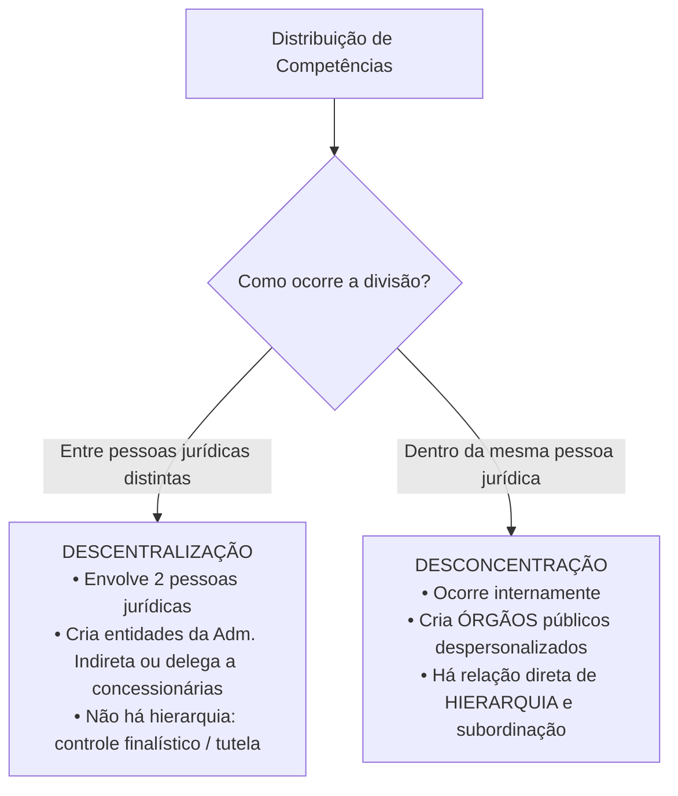
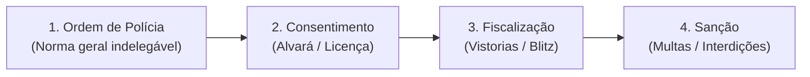
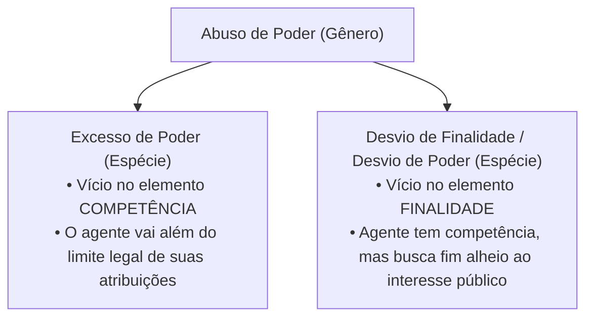

# 02 - Organização Administrativa, Poderes e Abuso de Autoridade

> **Matéria:** Noções de Direito Administrativo  
> **Cargo:** A01 – Técnico de Controle Externo – Especialidade: Técnico Administrativo  
> **Arquivo:** `02_organizacao_administrativa_e_poderes.md`  
> **Status:** 🟢 Teoria Aprofundada + 5 Questões FCC Comentadas (A a E)

---

## 📌 Ementa Oficial do Edital
- Organização administrativa brasileira: Administração Direta e Indireta.
- Descentralização vs. Desconcentração: conceitos, distinções e repercussões jurídicas.
- Entidades da Administração Indireta: Autarquias, Fundações Públicas, Empresas Públicas e Sociedades de Economia Mista.
- Regime jurídico das Estatais (Lei nº 13.303/2016).
- Terceiro Setor e entidades paraestatais: Serviços Sociais Autônomos (Sistema S), Organizações Sociais (OS) e OSCIPs.
- Poderes da Administração Pública: Poder Vinculado, Discricionário, Hierárquico, Disciplinar, Regulamentar e Poder de Polícia.
- Poder de Polícia: conceito (CTN, art. 78), atributos, limites e fases do ciclo de polícia.
- Uso e abuso do poder: excesso de poder e desvio de finalidade.
- Lei de Abuso de Autoridade (Lei nº 13.869/2019 e alterações): sujeitos ativos, elemento subjetivo especial e crimes funcionais.

---

## 🌳 Classificação Hierárquica do Conteúdo

```text
2. Organização Administrativa do Estado, Poderes e Lei de Abuso de Autoridade
├── 2.1 Técnicas de Organização Administrativa
│   ├── Centralização: Execução de serviços pela própria pessoa política originária
│   ├── Descentralização: Distribuição de competências para outra pessoa jurídica
│   │   ├── Por Serviços / Outorga: Criação da Administração Indireta (exige lei)
│   │   ├── Por Colaboração / Delegação: Concessionárias e permissionárias (contrato/ato)
│   │   └── Territorial / Geográfica: Territórios Federais com capacidade genérica
│   └── Desconcentração: Distribuição interna de competências criando ÓRGÃOS (subordinação)
├── 2.2 Estrutura da Administração Indireta
│   ├── Autarquias: Direito público, criadas diretamente por lei, imunidade recíproca
│   ├── Fundações Públicas: Direito público (criadas por lei) vs Direito privado (autorizadas)
│   ├── Empresas Públicas (EP): Capital 100% público, qualquer forma societária, JF no plano federal
│   ├── Sociedades de Economia Mista (SEM): Capital misto, obrigatoriamente S/A, Justiça Estadual
│   └── Controle Finalístico / Tutela / Supervisão Ministerial (Vínculo, não hierarquia)
├── 2.3 Poderes Administrativos e Prerrogativas Públicas
│   ├── Poder Vinculado vs Poder Discricionário (Mérito administrativo: conveniência e oportunidade)
│   ├── Poder Hierárquico: Comando, fiscalização, delegação e avocação (Vedações: CENORA)
│   ├── Poder Disciplinar: Aplicação de sanções funcionais a servidores e particulares com vínculo
│   ├── Poder Regulamentar / Normativo: Decretos regulamentares vs Decretos autônomos (Art. 84, VI)
│   └── Poder de Polícia: CTN art. 78, atributos, ciclo de polícia e delegação a estatais (Tema 532/STF)
└── 2.4 Uso e Abuso de Poder e a Lei nº 13.869/2019
    ├── Uso Regular do Poder: Exercício das prerrogativas nos limites da finalidade legal
    ├── Abuso de Poder: Excesso de Poder (Vício de Competência) e Desvio de Finalidade
    └── Lei de Abuso de Autoridade (Lei nº 13.869/2019):
        ├── Dolo específico obrigatório (Art. 1º, § 1º) e proibição do crime de hermenêutica
        └── Sujeitos ativos (membros e servidores de Tribunais de Contas) e efeitos não automáticos
```

---

## 📖 Teoria Aprofundada e Pontos Críticos

### 1. Descentralização x Desconcentração

A distinção entre as duas técnicas é recorrente nas provas da FCC:



> 💡 **DICA DE ESTUDO (Mnemônico Visual):**  
> - Desconcen**T**ração: tem **O** de **Ó**rgão (dentro da mesma estrutura).  
> - Descentrali**Z**ação: tem **E** de **E**ntidade (pessoa jurídica autônoma externa).

---

### 2. Quadro Comparativo: Empresas Públicas x Sociedades de Economia Mista

| Critério Distintivo | Empresa Pública (EP) | Sociedade de Economia Mista (SEM) |
|---|---|---|
| **Composição do Capital** | **100% Capital Público** (pode ser compartilhado entre entes públicos) | **Capital Misto** (Público + Privado; maioria com direito a voto é do Estado) |
| **Forma Societária** | **Qualquer forma admitida em direito** (S.A., Ltda., etc.) | **Obrigatoriamente Sociedade Anônima (S/A)** |
| **Foro Judicial (Âmbito Federal)** | **Justiça Federal** (CF, art. 109, I) | **Justiça Estadual** (STF, Súmula 556) |
| **Exemplos Nacionais** | Caixa Econômica Federal (CEF), Correios (ECT), BNDES | Banco do Brasil (BB), Petrobras, Sabesp |
| **Regime Jurídico** | Direito Privado (Lei nº 13.303/2016 e CLT) | Direito Privado (Lei nº 13.303/2016 e CLT) |
| **Forma de Instituição** | **Autorizada por lei específica** + Registro civil/Junta | **Autorizada por lei específica** + Registro civil/Junta |

---

### 3. Poderes Administrativos em Detalhes

#### 3.1 Poder Hierárquico: Delegação e Avocação
O poder hierárquico permite escalonar funções, dar ordens, fiscalizar, revisar atos, delegar e avocar competências.
- **Vedações Absolutas à Delegação (Mnemônico CENORA - Lei 9.784/99, art. 13):**
  - **CE:** Competência **Exclusiva** conferida por lei a determinado órgão ou autoridade.
  - **NO:** Edição de atos de caráter **Normativo**.
  - **RA:** Decisão de **Recursos Administrativos**.

#### 3.2 Poder Regulamentar: Decretos de Execução x Decretos Autônomos
- **Decretos Regulamentares (CF, art. 84, IV):** Editados pelo Chefe do Executivo para a fiel execução de leis já existentes. Não podem inovar na ordem jurídica nem criar obrigações primárias.
- **Decretos Autônomos (CF, art. 84, VI):** Espécie excepcional que retira fundamento direto da Constituição, cabendo apenas para:
  - *Alínea "a":* Organização e funcionamento da administração federal, quando **não implicar aumento de despesa** nem **criação ou extinção de órgãos públicos**.
  - *Alínea "b":* **Extinção de funções ou cargos públicos**, quando vagos.

#### 3.3 Poder de Polícia e Ciclo de Polícia
O poder de polícia consiste na prerrogativa estatal de limitar e disciplinar direitos e liberdades individuais em prol do bem-estar coletivo (CTN, art. 78).
- **Atributos:** Discricionariedade, Autoexecutoriedade e Coercibilidade.
- **Fases do Ciclo de Polícia:**
  1. *Ordem de polícia:* A norma legal que estabelece a restrição.
  2. *Consentimento de polícia:* A autorização ou licença prévia (quando exigida).
  3. *Fiscalização de polícia:* Vistorias, inspeções e blitz.
  4. *Sanção de polícia:* Aplicação de multas, interdições e apreensões.



> ⭐ **IMPORTANTE (Tema 532 do STF):**  
> É constitucional a delegação das fases de **consentimento, fiscalização e sanção** de trânsito a empresas públicas e sociedades de economia mista prestadoras de serviço público em regime não concorrencial e de capital social majoritariamente público. A fase de **ordem de polícia** (legislar) permanece privativa do Estado.

---

### 4. Uso e Abuso de Poder e Lei nº 13.869/2019



#### Elemento Subjetivo Especial na Lei de Abuso de Autoridade (Art. 1º, § 1º)
As condutas descritas na Lei nº 13.869/2019 constituem crime apenas quando praticadas pelo agente público com a **finalidade específica** de:
1. Prejudicar outrem;
2. Beneficiar a si mesmo ou a terceiro; ou
3. Por mero capricho ou satisfação pessoal.

> 🚨 **ALERTA DE PROVA / PEGADINHA FCC:**  
> **Não existe crime de hermenêutica!** O art. 1º, § 2º, estabelece expressamente que a divergência na interpretação de lei ou na avaliação de fatos e provas **NÃO configura abuso de autoridade**. Além disso, os efeitos de perda do cargo e inabilitação de 1 a 5 anos **não são automáticos** e exigem **reincidência** em crime de abuso de autoridade.

---

## 🌐 Fontes Recomendadas na Internet
- [Constituição Federal de 1988 - Artigo 37, XIX e Artigo 84, VI](https://www.planalto.gov.br/ccivil_03/constituicao/constituicao.htm)
  - Regras de criação de estatais e competência privativa para decretos autônomos.
- [Lei Federal nº 13.303/2016 - Estatuto das Estatais](https://www.planalto.gov.br/ccivil_03/_ato2015-2018/2016/lei/l13303.htm)
  - Estatuto jurídico de empresas públicas e sociedades de economia mista.
- [Lei Federal nº 13.869/2019 - Lei de Abuso de Autoridade](https://www.planalto.gov.br/ccivil_03/_ato2019-2022/2019/lei/l13869.htm)
  - Normas punitivas de condutas abusivas cometidas por agentes de todos os Poderes.
- [STF - Tema 532 da Repercussão Geral (Delegação do Poder de Polícia)](https://portal.stf.jus.br/jurisprudencia/repercussaoGeral/tema.asp?num=532)
  - Fixação da tese de delegação do poder de polícia sancionatório a empresas estatais prestadoras de serviços públicos.

---

## 📝 Questões Comentadas no Padrão FCC (Justificadas de A a E)

### Questão 1 (FCC - Analista de Gestão Pública / Adaptada)
O Governo do Estado de Goiás, com o propósito de aprimorar a prestação de serviços de processamento técnico de dados e segurança cibernética, planeja instituir uma entidade descentralizada com personalidade jurídica de direito privado e patrimônio composto exclusivamente por recursos públicos do tesouro estadual.

Em conformidade com a Constituição Federal e com o regime jurídico administrativo:

A) Trata-se de uma Autarquia de regime especial, cuja existência jurídica formal decorre diretamente da publicação da lei complementar instituidora.  
B) Trata-se de uma Sociedade de Economia Mista, devendo adotar obrigatoriamente a forma de sociedade anônima com capital misto.  
C) Trata-se de uma Empresa Pública, cuja criação depende de autorização em lei específica e cuja personalidade jurídica nasce com a inscrição de seus atos constitutivos no registro competente.  
D) Bastará a edição de decreto autônomo do Governador do Estado para outorgar-lhe personalidade jurídica e patrimônio próprio.  
E) A entidade integrará a Administração Direta estadual, estabelecendo relação de subordinação hierárquica direta com o Governador.  

> **Gabarito: C**  
>  
> **Comentário Analítico Passo a Passo:**  
> 1. Entidade descentralizada, com personalidade jurídica de direito privado e capital 100% público, corresponde à definição jurídica estrita de **Empresa Pública** (Decreto-Lei 200/67 e Lei 13.303/2016).  
> 2. Pelo art. 37, XIX, da Constituição Federal, as entidades estatais de direito privado dependem de **lei específica que autorize sua criação**.  
> 3. Como são pessoas jurídicas de direito privado, a personalidade jurídica não surge com a lei, mas sim com o **registro dos atos constitutivos** no órgão competente (Junta Comercial ou Cartório de RCPJ).  
>  
> **Análise das Alternativas:**  
> - **A) Incorreta:** Autarquias possuem personalidade jurídica de direito público e são criadas diretamente por lei ordinária específica.  
> - **B) Incorreta:** A Sociedade de Economia Mista exige conjugação de capital público e privado (capital misto), enquanto a questão indicou capital 100% público.  
> - **C) CORRETA:** Caracteriza precisamente uma Empresa Pública, com lei específica autorizativa e registro civil constitutivo.  
> - **D) Incorreta:** A instituição de entidades da Administração Indireta exige prévia e indelegável autorização legislativa formal (art. 37, XIX), sendo inadmissível por decreto autônomo.  
> - **E) Incorreta:** Entidades dotadas de personalidade jurídica própria integram a Administração Indireta e não mantêm subordinação hierárquica (apenas vinculação/tutela finalística).

---

### Questão 2 (FCC - Auditor de Controle Externo / Adaptada TCE-GO)
Um auditor fiscal do Tribunal de Contas, contrariado com a postura intransigente de um gestor municipal que se recusou a favorecer um parente do auditor em processo seletivo simplificado, instaurou fiscalização sigilosa sem autorização regimental ou sorteio eletrônico e realizou a apreensão arbitrária de computadores da prefeitura para constranger a autoridade local.

Analisando a tipologia dos atos administrativos e as regras da Lei nº 13.869/2019:

A) A conduta do auditor caracteriza uso regular do poder discricionário inerente à função de fiscalização externa.  
B) A conduta configura excesso de poder e desvio de finalidade, tipificando crime de abuso de autoridade diante da presença de elemento subjetivo especial consistente na satisfação de vingança ou interesse pessoal.  
C) Servidores de Tribunais de Contas gozam de imunidade penal material absoluta, não se sujeitando às cominações da Lei de Abuso de Autoridade.  
D) O ato do auditor padece unicamente de irregularidade administrativa sanável por convalidação posterior pelo Plenário do Tribunal.  
E) Para a caracterização de abuso de autoridade, a lei dispensa a análise do elemento anímico ou motivação especial, admitindo modalidade culposa.  

> **Gabarito: B**  
>  
> **Comentário Analítico Passo a Passo:**  
> 1. O auditor cometeu **abuso de poder** sob duas modalidades:  
>    - **Excesso de poder (vício de competência):** Atuou sem competência regimental e sem respaldo da ordem legal.  
>    - **Desvio de finalidade (vício de finalidade):** Praticou o ato com finalidade espúria de retaliação e vingança pessoal, em total divórcio do interesse público.  
> 2. Pela Lei nº 13.869/2019 (art. 1º, § 1º, c/c art. 2º), membros e servidores dos Tribunais de Contas são sujeitos ativos de crime de abuso de autoridade quando agem com o dolo específico de prejudicar outrem ou satisfazer capricho ou sentimento pessoal.  
>  
> **Análise das Alternativas:**  
> - **A) Incorreta:** A discricionariedade nunca autoriza o arbítrio, o desvio de finalidade ou a perseguição pessoal.  
> - **B) CORRETA:** Identifica com precisão as duas espécies de abuso de poder e a tipicidade penal na Lei de Abuso de Autoridade fundada no dolo específico.  
> - **C) Incorreta:** Não existe imunidade penal funcional contra crimes de abuso de autoridade para membros ou servidores do controle externo.  
> - **D) Incorreta:** Desvio de finalidade é vício insanável que contamina o ato com nulidade absoluta, vedada a convalidação.  
> - **E) Incorreta:** A Lei nº 13.869/2019 não prevê modalidade culposa e exige expressamente o elemento subjetivo especial do art. 1º, § 1º.

---

### Questão 3 (FCC - Procurador do Estado / Adaptada)
Determinada empresa pública estadual, constituída sob regime não concorrencial e de capital 100% pertencente ao Estado de Goiás, presta com exclusividade o serviço público de transporte metropolitano e gestão do trânsito viário intermunicipal. Lei estadual delegou à referida empresa atribuições para fiscalizar o tráfego e lavrar autos de infração com imposição de multas aos motoristas infratores.

À luz da jurisprudência firmada pelo Supremo Tribunal Federal em sede de repercussão geral (**Tema 532**):

A) A delegação é inconstitucional, pois todo o poder de polícia estatal é privativo e indelegável a pessoas jurídicas de direito privado.  
B) É constitucional a delegação das fases de consentimento, fiscalização e sanção de trânsito a empresas públicas e sociedades de economia mista que prestem serviço público em regime não concorrencial e com capital social majoritariamente público.  
C) Apenas a aplicação de sanções pode ser delegada à empresa estatal, permanecendo a fiscalização restrita a órgãos da Administração Direta.  
D) A delegação exige que a empresa pública adote previamente a natureza jurídica de autarquia em regime especial.  
E) A delegação é válida apenas se as multas aplicadas forem revertidas integralmente em bônus remuneratório aos agentes celetistas da empresa.  

> **Gabarito: B**  
>  
> **Comentário Analítico Passo a Passo:**  
> 1. O STF, ao julgar o RE 633.782 (Tema 532 da Repercussão Geral), pacificou a controvérsia histórica sobre a delegação do poder de polícia.  
> 2. Tese fixada pelo STF:  
>    *"É constitucional a delegação do poder de polícia, por meio de lei, a pessoas jurídicas de direito privado integrantes da Administração Pública indireta de capital social majoritariamente público que prestem exclusivamente serviço público de atuação própria do Estado e em regime não concorrencial."*  
> 3. O STF admitiu a delegação de três fases do ciclo de polícia: **consentimento**, **fiscalização** e **sanção**. Apenas a primeira fase (**legislar / ordem de polícia**) é originária e indelegável.  
>  
> **Análise das Alternativas:**  
> - **A) Incorreta:** Superada pela tese vinculante do Tema 532 do STF.  
> - **B) CORRETA:** Reproduz fielmente a tese firmada pelo Pretório Excelso.  
> - **C) Incorreta:** A fiscalização e o consentimento também são plenamente delegáveis.  
> - **D) Incorreta:** A empresa pública permanece sob regime de direito privado, sem necessidade de mutação autárquica.  
> - **E) Incorreta:** A vinculação direta de multas para acréscimo patrimonial pessoal violaria os princípios da moralidade e impessoalidade.

---

### Questão 4 (FCC - Técnico de Controle Externo / Administrativa)
No âmbito de uma Secretaria de Estado, o Secretário Titular pretende delegar temporariamente a um Diretor de Departamento subordinado a atribuição funcional de julgar recursos administrativos interpostos contra decisões sancionatórias de primeira instância proferidas pela própria pasta.

De acordo com a teoria geral do poder hierárquico e os limites da delegação fixados na legislação do processo administrativo:

A) A delegação pretendida é lícita e válida, haja vista que o poder hierárquico confere ao superior liberdade irrestrita para delegar qualquer de suas atribuições.  
B) A delegação é vedada pelo ordenamento jurídico, pois a decisão de recursos administrativos constitui matéria indelegável.  
C) A delegação somente será válida se for homologada previamente pelo Tribunal de Contas do Estado.  
D) A delegação transfere em definitivo a titularidade da competência recursal ao Diretor subordinado, extinguindo a responsabilidade do Secretário.  
E) A delegação é cabível desde que o recurso trate de matérias fáticas, sendo vedada apenas para matérias de direito estrito.  

> **Gabarito: B**  
>  
> **Comentário Analítico Passo a Passo:**  
> 1. Pelo princípio da legalidade e pela Lei de Processo Administrativo (Lei nº 9.784/1999, art. 13, que expressa norma geral de direito administrativo), existem três matérias que **NÃO podem ser objeto de delegação** (Mnemônico CENORA):  
>    - I. Edição de atos de caráter normativo;  
>    - II. **Decisão de recursos administrativos**;  
>    - III. Matérias de competência exclusiva do órgão ou autoridade.  
> 2. O julgamento de recurso administrativo pressupõe reexame hierárquico por instância superior. Permitir a delegação da competência recursal a uma autoridade subordinada esvaziaria o duplo grau de julgamento administrativo.  
>  
> **Análise das Alternativas:**  
> - **A) Incorreta:** O poder hierárquico e a delegação encontram limites expressos na lei (art. 13).  
> - **B) CORRETA:** A decisão de recursos administrativos é expressamente indelegável.  
> - **C) Incorreta:** O Tribunal de Contas não atua como órgão de homologação de atos de delegação interna.  
> - **D) Incorreta:** A delegação transfere apenas o exercício temporário da competência, jamais sua titularidade, e pode ser revogada a qualquer tempo.  
> - **E) Incorreta:** A proibição legal é absoluta para qualquer tipo de recurso administrativo, independentemente da matéria.

---

### Questão 5 (FCC - Analista de Controle Externo)
O Governador do Estado de Goiás editou decreto criando cinco novos Departamentos Técnicos dentro da estrutura da Secretaria da Fazenda e remanejando servidores públicos para preencher as novas chefias criadas, sem que houvesse prévia autorização em lei estadual específica.

Analisando a conformidade constitucional do ato com base nos limites do **decreto autônomo** (CF/88, art. 84, VI):

A) O ato do Governador é perfeitamente válido, pois a organização da administração pública é matéria de competência privativa que dispensa lei formal em qualquer hipótese.  
B) O decreto autônomo é cabível para criar ou extinguir órgãos públicos, desde que não implique criação de novos cargos efetivos.  
C) O decreto é inconstitucional, pois o decreto autônomo só pode disciplinar a organização administrativa quando não implicar aumento de despesa nem criação ou extinção de órgãos públicos.  
D) O ato configura exercício regular do poder de polícia administrativa, imune ao controle de legalidade.  
E) Apenas o Poder Judiciário poderia sustar os efeitos do referido decreto, descabendo atuação do Poder Legislativo.  

> **Gabarito: C**  
>  
> **Comentário Analítico Passo a Passo:**  
> 1. Art. 84, VI, "a", da Constituição Federal de 1988:  
>    Compete privativamente ao Chefe do Poder Executivo dispor, mediante decreto autônomo, sobre:  
>    *"organização e funcionamento da administração pública, quando não implicar aumento de despesa nem criação ou extinção de órgãos públicos."*  
> 2. Como o decreto criou cinco novos departamentos técnicos (que são **órgãos públicos**), houve violação da restrição constitucional expressa.  
> 3. A criação de órgãos públicos exige formalmente **lei em sentido estrito** (CF/88, art. 48, XI e art. 61, § 1º, II, "e"). Portanto, o decreto é formalmente inconstitucional.  
>  
> **Análise das Alternativas:**  
> - **A) Incorreta:** A CF/88 veda expressamente o uso de decreto autônomo quando houver criação ou extinção de órgãos públicos ou aumento de despesa.  
> - **B) Incorreta:** Decreto autônomo não pode criar nem extinguir órgãos públicos; sua alínea "b" permite apenas extinguir funções ou cargos vagos.  
> - **C) CORRETA:** Aplicação direta do art. 84, VI, "a", da CF/88.  
> - **D) Incorreta:** Trata-se de poder regulamentar/organizacional, e não de poder de polícia.  
> - **E) Incorreta:** O Poder Legislativo pode sustar atos normativos do Executivo que exorbitem do poder regulamentar (CF, art. 49, V).
