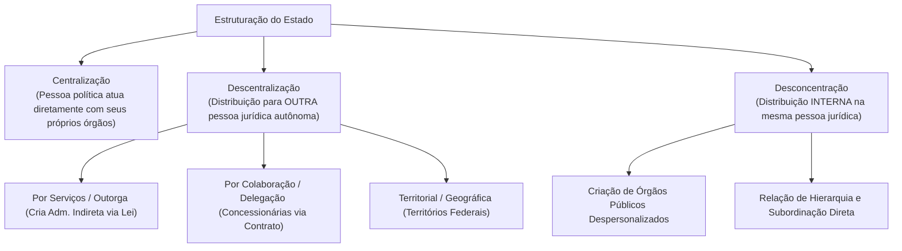
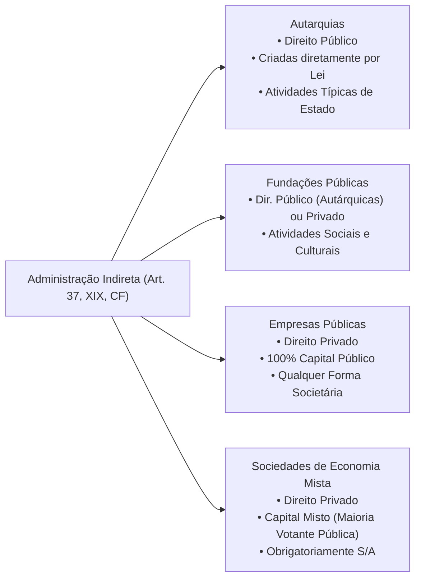
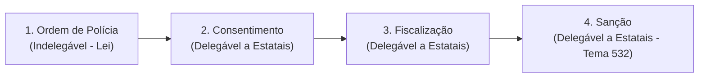
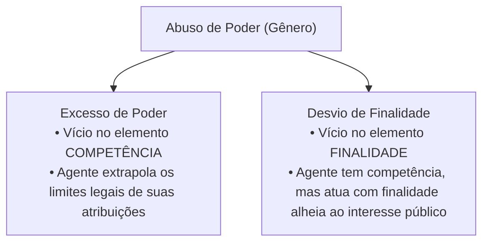

# 02 - Organização Administrativa, Poderes e Abuso de Autoridade

> **Matéria:** Noções de Direito Administrativo  
> **Cargo:** A01 – Técnico de Controle Externo – Especialidade: Técnico Administrativo  
> **Arquivo:** `02_organizacao_administrativa_e_poderes.md`  

---

## 📌 Ementa / Itens do Edital
- Organização administrativa brasileira: Administração Direta e Indireta
- Descentralização vs. Desconcentração: conceitos, distinções e repercussões jurídicas
- Entidades da Administração Indireta: Autarquias, Fundações Públicas, Empresas Públicas e Sociedades de Economia Mista
- Regime jurídico das Estatais (Lei nº 13.303/2016)
- Terceiro Setor e entidades paraestatais: Serviços Sociais Autônomos (Sistema S), Organizações Sociais (OS) e OSCIPs
- Poderes da Administração Pública: Poder Vinculado, Discricionário, Hierárquico, Disciplinar, Regulamentar e Poder de Polícia
- Poder de Polícia: conceito (CTN, art. 78), atributos, limites e fases do ciclo de polícia
- Uso e abuso do poder: excesso de poder e desvio de finalidade
- Lei de Abuso de Autoridade (Lei nº 13.869/2019 e alterações): sujeitos ativos, elemento subjetivo especial e crimes funcionais

---

## 🧭 Sumário

1. [Organização Administrativa: Técnicas de Estruturação Estatal](#1-organizacao-administrativa-tecnicas-de-estruturacao-estatal)
    1. [Centralização e Descentralização](#11-centralizacao-e-descentralizacao)
    2. [Desconcentração e a Criação de Órgãos Públicos](#12-desconcentracao-e-a-criacao-de-orgaos-publicos)
    3. [Quadro Distintivo: Descentralização vs. Desconcentração](#13-quadro-distintivo-descentralizacao-vs-desconcentracao)
    4. [Teste 012](#Teste-012)
2. [Entidades da Administração Indireta](#2-entidades-da-administracao-indireta)
    1. [Autarquias e Autarquias de Regime Especial](#21-autarquias-e-autarquias-de-regime-especial)
    2. [Fundações Públicas (Direito Público vs. Direito Privado)](#22-fundacoes-publicas-direito-publico-vs-direito-privado)
    3. [Empresas Públicas e Sociedades de Economia Mista](#23-empresas-publicas-e-sociedades-de-economia-mista)
    4. [O Estatuto Jurídico das Estatais (Lei nº 13.303/2016)](#24-o-estatuto-juridico-das-estatais-lei-no-133032016)
    5. [Controle Finalístico, Tutela e Supervisão Ministerial](#25-controle-finalistico-tutela-e-supervisao-ministerial)
    6. [Teste 013](#Teste-013)
    7. [Teste 014](#Teste-014)
    8. [Teste 015](#Teste-015)
    9. [Teste 016](#Teste-016)
3. [O Terceiro Setor e Entidades Paraestatais](#3-o-terceiro-setor-e-entidades-paraestatais)
    1. [Serviços Sociais Autônomos (Sistema S)](#31-servicos-sociais-autonomos-sistema-s)
    2. [Organizações Sociais (OS) e Contratos de Gestão](#32-organizacoes-sociais-os-e-contratos-de-gestao)
    3. [OSCIPs e Termos de Parceria](#33-oscips-e-termos-de-parceria)
    4. [Teste 017](#Teste-017)
4. [Poderes Administrativos e Prerrogativas Públicas](#4-poderes-administrativos-e-prerrogativas-publicas)
    1. [Poder Vinculado vs. Poder Discricionário e o Mérito Administrativo](#41-poder-vinculado-vs-poder-discricionario-e-o-merito-administrativo)
    2. [Poder Hierárquico: Delegação, Avocação e a Regra do CENORA](#42-poder-hierarquico-delegacao-avocacao-e-a-regra-do-cenora)
    3. [Poder Disciplinar e Sanções Funcionais](#43-poder-disciplinar-e-sancoes-funcionais)
    4. [Poder Regulamentar / Normativo e os Decretos Autônomos](#44-poder-regulamentar-normativo-e-os-decretos-autonomos)
    5. [Poder de Polícia, Ciclo de Polícia e Delegação (Tema 532/STF)](#45-poder-de-policia-ciclo-de-policia-e-delegacao-tema-532stf)
    6. [Teste 018](#Teste-018)
    7. [Teste 019](#Teste-019)
    8. [Teste 020](#Teste-020)
    9. [Teste 021](#Teste-021)
5. [Uso e Abuso de Poder e a Lei nº 13.869/2019](#5-uso-e-abuso-de-poder-e-a-lei-no-138692019)
    1. [Excesso de Poder vs. Desvio de Finalidade](#51-excesso-de-poder-vs-desvio-de-finalidade)
    2. [Elemento Subjetivo Especial e Proibição do Crime de Hermenêutica](#52-elemento-subjetivo-especial-e-proibicao-do-crime-de-hermeneutica)
    3. [Sujeitos Ativos no Âmbito dos Tribunais de Contas](#53-sujeitos-ativos-no-ambito-dos-tribunais-de-contas)
    4. [Teste 022](#Teste-022)
6. [Fontes Recomendadas na Internet](#6-fontes-recomendadas-na-internet)

---

## 1. Organização Administrativa: Técnicas de Estruturação Estatal

A organização administrativa é o conjunto de mecanismos normativos e estruturais mediante os quais o Estado distribui suas competências e funções entre pessoas jurídicas, órgãos e agentes públicos.

### 1.1 Centralização e Descentralização

- **Centralização:** Ocorre quando o Estado executa suas tarefas administrativas **diretamente**, por meio dos órgãos e agentes integrantes da própria pessoa jurídica política matriz (União, Estados, DF e Municípios — Administração Direta).
- **Descentralização:** Ocorre quando o Estado transfere a execução ou a titularidade e execução de determinada atividade administrativa para **outra pessoa jurídica distinta**, dotada de personalidade própria.
    - **Descentralização por Serviços, Outorga ou Funcional:** O poder público transfere a **titularidade e a execução** do serviço mediante **lei formal** para entidades da Administração Pública Indireta (Autarquias, Fundações Públicas, Empresas Públicas e Sociedades de Economia Mista). Possui caráter de estabilidade institucional duradoura.
    - **Descentralização por Colaboração ou Delegação:** O poder público transfere apenas a **execução material** do serviço para particulares (concessionárias e permissionárias de serviços públicos) mediante **contrato administrativo de concessão** ou **ato unilateral de permissão**. A titularidade permanece nas mãos do poder concedente.
    - **Descentralização Territorial ou Geográfica:** Ocorre na criação de Territórios Federais (entidades autárquicas geográficas com capacidade genérica de gestão local).

### 1.2 Desconcentração e a Criação de Órgãos Públicos

A **desconcentração** é uma técnica puramente interna de divisão e distribuição de competências que ocorre **dentro de uma mesma pessoa jurídica**. 

- Não gera uma nova entidade dotada de personalidade jurídica; dá origem a **órgãos públicos despersonalizados** (Ministérios, Secretarias de Estado, Diretorias, Departamentos).
- Caracteriza-se por uma **relação estrita de hierarquia, subordinação e controle disciplinar** entre a chefia superior e as unidades subordinadas.
- *Teoria do Órgão (Imputação Volitiva):* Os órgãos não possuem vontade própria autônoma nem patrimônio segregado; as manifestações volitivas de seus agentes são juridicamente imputadas à pessoa jurídica à qual o órgão se vincula.

### 1.3 Quadro Distintivo: Descentralização vs. Desconcentração

| Critério de Comparação | Descentralização Administrativa | Desconcentração Administrativa |
| :--- | :--- | :--- |
| **Pessoas Jurídicas Envolvidas** | Envolve **duas ou mais pessoas jurídicas distintas** | Ocorre **dentro de uma única pessoa jurídica** |
| **Criação Resultante** | Cria **novas entidades** autônomas da Administração Indireta | Cria **órgãos públicos** despersonalizados |
| **Vínculo Jurídico** | **Não há hierarquia nem subordinação** (há apenas vinculação / tutela finalística) | **Há relação estrita de hierarquia e subordinação** |
| **Mnemônico Visual FCC** | Descentrali**Z**ação $\rightarrow$ Gera **E**ntidades externas | Desconcen**T**ração $\rightarrow$ Gera **Ó**rgãos internos |

---

### Teste 012
**(FCC - Auditor Fiscal da Receita Estadual)**
No que tange às técnicas de organização e estruturação da Administração Pública, a doutrina e a jurisprudência estabelecem distinções fundamentais entre os institutos da centralização, descentralização, concentração e desconcentração.

A respeito desses conceitos, é correto afirmar:

* **A)** A descentralização consiste na distribuição interna de competências decisórias dentro de uma mesma pessoa jurídica, resultando na criação de órgãos públicos desprovidos de personalidade jurídica própria.
* **B)** A desconcentração pressupõe a transferência da titularidade e/ou da execução de serviços públicos para uma pessoa jurídica distinta, seja ela integrante da Administração Indireta ou um particular colaborador.
* **C)** Na descentralização por serviços, funcional ou outorga, o Poder Público cria, por meio de lei formal, uma entidade com personalidade jurídica própria (autarquia), transferindo-lhe a titularidade e a execução do serviço.
* **D)** A criação de ministérios, secretarias estaduais e diretorias setoriais constitui típica hipótese de descentralização política e territorial.
* **E)** Entre a Administração Direta e os órgãos criados por desconcentração inexiste qualquer vínculo de hierarquia ou subordinação funcional.

---

> **Comentário Detalhado:**
>
> - **A)** Incorreta. A distribuição interna de competências no âmbito da mesma pessoa jurídica com criação de órgãos denomina-se **desconcentração** (mnemônico: desCOncentração = COm criação de Órgãos), e não descentralização.
> - **B)** Incorreta. A transferência de competências para outra pessoa jurídica (distinta do ente matriz) consubstancia a **descentralização** (mnemônico: desCENtralização = criação de ENtidades), e não desconcentração.
> - **C)** Correta. A descentralização por serviços, funcional, técnica ou por outorga ocorre quando o Estado transfere, mediante previsão legal expressa, tanto a titularidade quanto a execução de determinado serviço para uma entidade de direito público da Administração Indireta (ex.: autarquias).
> - **D)** Incorreta. Ministérios e secretarias são órgãos públicos criados por **desconcentração** administrativa interna no âmbito da União e dos Estados, respectivamente.
> - **E)** Incorreta. Na desconcentração há forte e plena relação de **hierarquia e subordinação** entre o órgão superior e os órgãos inferiores dele derivados.
>
> **Gabarito: C**

---

## 2. Entidades da Administração Indireta

A Administração Indireta é o conjunto de entes descentralizados aos quais a lei confere personalidade jurídica própria para desempenhar atividades especializadas de interesse coletivo. Rege-se pelo art. 37, XIX, da CF/88.

### 2.1 Autarquias e Autarquias de Regime Especial

- **Conceito:** Pessoa jurídica de **direito público**, instituída diretamente por **lei específica**, para desempenhar atividades típicas e exclusivas de Estado que requeiram gestão administrativa e financeira descentralizada.
- **Regime Jurídico:** Totalmente público. Seus bens são públicos (impenhoráveis, inalienáveis e imprescritíveis); gozam de **imunidade tributária recíproca** (CF, art. 150, § 2º) sobre patrimônio, renda e serviços vinculados a suas finalidades; seus servidores submetem-se ao regime estatutário do respectivo ente; e suas dívidas judiciais são quitadas mediante precatórios.
- **Autarquias em Regime Especial (Agências Reguladoras):** Autarquias dotadas de maior autonomia institucional, financeira e decisória. Caracterizam-se por: dirigentes investidos com mandato fixo após sabatina legislativa (estabilidade no mandato, perda do cargo apenas nas hipóteses legais); poder normativo técnico regulatório; e inexistência de recurso hierárquico impróprio para os Ministérios/Secretarias sobre decisões técnicas de mérito.

### 2.2 Fundações Públicas (Direito Público vs. Direito Privado)

Entidades com patrimônio personalizado voltadas a finalidades sociais, de saúde, educação, cultura ou pesquisa (sem fins lucrativos):

- **Fundação Pública de Direito Público (Fundação Autárquica / Autarquia Fundacional):** Criada diretamente por lei específica. Equipara-se material e formalmente a uma autarquia em direitos, deveres, prerrogativas e imunidades.
- **Fundação Pública de Direito Privado:** Tem sua criação **autorizada por lei específica**, nascendo juridicamente com a inscrição de seus atos constitutivos no Cartório de Registro Civil das Pessoas Jurídicas. O art. 37, XIX, da CF exige a edição de **lei complementar para definir as áreas de sua atuação**.

### 2.3 Empresas Públicas e Sociedades de Economia Mista

São as empresas estatais, pessoas jurídicas de direito privado instituídas para exploração de atividade econômica de produção ou comercialização de bens/serviços ou para prestação de serviços públicos:

| Critério Distintivo | Empresa Pública (EP) | Sociedade de Economia Mista (SEM) |
| :--- | :--- | :--- |
| **Composição Societária do Capital** | **100% Capital Público** (admitida a copropriedade entre entes estatais diversos) | **Capital Misto** (Público + Privado; o Estado detém a maioria das ações com direito a voto) |
| **Forma Societária Admitida** | **Qualquer modalidade societária** (Ltda., S.A., etc.) | **Obrigatoriamente Sociedade Anônima (S/A)** |
| **Foro Competente na Justiça (União)** | **Justiça Federal** (CF, art. 109, I) | **Justiça Estadual** (STF, Súmula 556) |
| **Foro Competente (Estados/Municípios)** | **Justiça Estadual** comum | **Justiça Estadual** comum |
| **Modo de Criação** | **Autorizada por lei específica** + Registro na Junta/Cartório | **Autorizada por lei específica** + Registro na Junta/Cartório |
| **Exemplos Nacionais** | Caixa Econômica Federal (CEF), Correios (ECT), BNDES | Banco do Brasil (BB), Petrobras, Sabesp |

### 2.4 O Estatuto Jurídico das Estatais (Lei nº 13.303/2016)

A Lei Federal nº 13.303/2016 instituiu o estatuto jurídico unificado de governança e contratações para todas as empresas públicas e sociedades de economia mista da União, Estados, DF e Municípios:

- **Governança Corporativa e Conformidade:** Exigência de comitês estatutários de auditoria e risco, regras de integridade e requisitos rigorosos de idoneidade técnica e experiência profissional para a indicação de membros do Conselho de Administração e Diretorias Executivas (vedação a ocupantes de cargos políticos e sindicais partidários).
- **Regime Próprio de Licitações das Estatais:** As estatais possuem regime licitatório próprio disciplinado pelos arts. 28 a 84 da Lei 13.303/2016, com modalidades licitatórias simplificadas e procedimentos de negociação direta, não se sujeitando como regra geral à Lei nº 14.133/2021.

### 2.5 Controle Finalístico, Tutela e Supervisão Ministerial

Entre a Administração Direta e as entidades da Administração Indireta **NÃO existe subordinação hierárquica**. O controle exercido pelo ente instituidor denomina-se **controle finalístico, supervisão ministerial ou tutela administrativa**:

- É um controle de conformidade com os fins para os quais a entidade foi criada (*princípio da especialidade*).
- Não autoriza intervenções abusivas no mérito ou na gestão interna autônoma, limitando-se aos atos expressamente autorizados em lei.

---

### Teste 013
**(FGV - Analista de Controle Externo / TCE)**
As autarquias constituem pessoas jurídicas de direito público integrantes da Administração Indireta, criadas por lei específica para o desempenho de atividades típicas de Estado. Sobre o regime jurídico aplicável às autarquias comuns e às autarquias em regime especial (agências reguladoras), assinale a afirmativa correta.

* **A)** As autarquias adquirem personalidade jurídica a partir do registro de seus atos constitutivos no Cartório de Registro Civil de Pessoas Jurídicas ou na Junta Comercial.
* **B)** Os bens das autarquias ostentam a natureza de bens públicos, gozando de inalienabilidade relativa, impenhorabilidade, imprescritibilidade (não sujeição a usucapião) e não oneração.
* **C)** Os dirigentes de agências reguladoras podem ser exonerados ad nutum e sem justa causa pelo Chefe do Poder Executivo a qualquer momento de seu mandato.
* **D)** As decisões técnicas finais proferidas pelas agências reguladoras no exercício de suas competências normativas submetem-se a recurso hierárquico impróprio ordinário perante os Ministérios de Estado supervisores.
* **E)** As autarquias subordinam-se hierarquicamente aos órgãos centrais do Poder Executivo, cabendo a estes avocar e revogar seus atos a juízo de conveniência política.

---

> **Comentário Detalhado:**
>
> - **A)** Incorreta. As autarquias são pessoas jurídicas de direito público; sua existência e personalidade jurídica iniciam-se com a vigência da própria **lei específica criadora** (art. 37, XIX, CF/88), independentemente de registro cartorário.
> - **B)** Correta. Por integrarem o patrimônio de pessoas jurídicas de direito público, os bens autárquicos são legalmente qualificados como bens públicos (art. 98 do Código Civil), sendo impenhoráveis, imprescritíveis (não passíveis de usucapião, Súmula 340/STF) e gravados por inalienabilidade relativa.
> - **C)** Incorreta. Os dirigentes das agências reguladoras possuem estabilidade durante mandato fixo estabelecido em lei (quarentena e processo de destituição estrito), vedada a exoneração ad nutum para resguardar a autonomia técnica e decisória (Lei nº 13.848/2019).
> - **D)** Incorreta. Em regra, não cabe recurso hierárquico ao Ministério supervisor contra decisão de mérito técnico da agência (recurso hierárquico impróprio só é cabível em hipóteses excepcionais expressamente previstas em lei ou desvio de finalidade/usurpação de competência).
> - **E)** Incorreta. Não existe relação de subordinação hierárquica entre a Administração Direta e as autarquias, mas tão somente controle finalístico (tutela administrativa ou supervisão ministerial) nos limites estritos da lei.
>
> **Gabarito: B**

---

### Teste 014
**(FCC - Analista de Gestão Pública / Adaptada)**
O Governo do Estado de Goiás, com o propósito de aprimorar a prestação de serviços de processamento técnico de dados e segurança cibernética, planeja instituir uma entidade descentralizada com personalidade jurídica de direito privado e patrimônio composto exclusivamente por recursos públicos do tesouro estadual.

Em conformidade com a Constituição Federal e com o regime jurídico administrativo:

* **A)** Trata-se de uma Autarquia de regime especial, cuja existência jurídica formal decorre diretamente da publicação da lei complementar instituidora.
* **B)** Trata-se de uma Sociedade de Economia Mista, devendo adotar obrigatoriamente a forma de sociedade anônima com capital misto.
* **C)** Trata-se de uma Empresa Pública, cuja criação depende de autorização em lei específica e cuja personalidade jurídica nasce com a inscrição de seus atos constitutivos no registro competente.
* **D)** Bastará a edição de decreto autônomo do Governador do Estado para outorgar-lhe personalidade jurídica e patrimônio próprio.
* **E)** A entidade integrará a Administração Direta estadual, estabelecendo relação de subordinação hierárquica direta com o Governador.

---

> **Comentário Detalhado:**
>
> - **A)** Incorreta. As autarquias ostentam personalidade jurídica de direito público e são criadas diretamente por lei ordinária específica, não possuindo natureza de direito privado nem patrimônio societário.
> - **B)** Incorreta. A Sociedade de Economia Mista exige conjugação obrigatória de capital público e privado (capital misto), enquanto a questão delimitou patrimônio composto exclusivamente por recursos públicos.
> - **C)** Correta. A entidade descentralizada dotada de personalidade jurídica de direito privado cujo capital é 100% público define conceitualmente uma **Empresa Pública**. Pelo art. 37, XIX, da CF/88, as empresas estatais dependem de **lei ordinária específica que autorize sua instituição**. Por serem pessoas de direito privado, a personalidade jurídica civil surge formalmente com a inscrição dos atos constitutivos na Junta Comercial ou Cartório de RCPJ.
> - **D)** Incorreta. A criação de pessoas jurídicas da Administração Indireta depende de expressa e indelegável autorização em lei formal em sentido estrito (CF, art. 37, XIX), sendo nula a tentativa de instituição por mero decreto.
> - **E)** Incorreta. Entidades descentralizadas com personalidade jurídica própria integram a Administração Indireta e não mantêm subordinação hierárquica perante o Chefe do Executivo, sujeitando-se apenas ao controle finalístico (tutela/vinculação).
> 
> **Gabarito: C**

---

### Teste 015
**(FGV - Analista Jurídico de Controle Externo / TCE-GO)**
A Lei nº 13.303/2016 (Estatuto Jurídico das Empresas Públicas e Sociedades de Economia Mista) estabeleceu regras rigorosas de governança corporativa, compliance e transparência para as estatais. À luz dessa legislação e do regramento constitucional sobre estatais, assinale a afirmativa correta.

* **A)** A sociedade de economia mista pode adotar qualquer forma societária admitida em direito, desde que a totalidade de seu capital pertença a entes públicos.
* **B)** A empresa pública deve obrigatoriamente constituir-se sob a forma de sociedade anônima (S/A), admitindo-se a participação minoritária de capital privado com direito a voto.
* **C)** As empresas públicas e sociedades de economia mista exploradoras de atividade econômica em sentido estrito submetem-se ao regime jurídico próprio das empresas privadas, inclusive quanto aos direitos e obrigações civis, comerciais, trabalhistas e tributários.
* **D)** As empresas estatais prestadoras de serviços públicos próprios do Estado estão sujeitas à falência e insolvência civil de acordo com o regime concursal privado comum.
* **E)** As causas cíveis em que uma sociedade de economia mista federal for parte ou interveniente tramitam obrigatoriamente perante a Justiça Federal, a teor do art. 109, I, da CF/88.

---

> **Comentário Detalhado:**
>
> - **A)** Incorreta. A sociedade de economia mista deve constituir-se **obrigatoriamente sob a forma de sociedade por ações (S/A)**, com maioria do capital votante pertencente ao Poder Público, nos termos da Lei nº 13.303/2016 e do Decreto-Lei nº 200/1967.
> - **B)** Incorreta. A empresa pública admite **qualquer forma societária** admitida em direito (ex.: S/A, Ltda., empresa unipessoal) e seu capital deve ser **100% público** (União, Estados, DF, Municípios ou outras entidades da Administração Indireta).
> - **C)** Correta. O art. 173, § 1º, II, da CF/88 determina que a estatal exploradora de atividade econômica sujeita-se ao regime jurídico próprio das empresas privadas, inclusive quanto aos direitos e obrigações civis, comerciais, trabalhistas e tributários, para assegurar a livre concorrência e evitar vantagens concorrenciais indevidas.
> - **D)** Incorreta. O art. 2º, I, da Lei nº 11.101/2005 estatui que a lei de recuperação judicial e falência **não se aplica** a empresa pública e sociedade de economia mista.
> - **E)** Incorreta. A teor da Súmula 556 do STF e do art. 109, I, da CF/88, as ações em que figurem sociedades de economia mista federais (como o Banco do Brasil e a Petrobras) são julgadas na **Justiça Comum Estadual**, ressalvada a Justiça do Trabalho para lides trabalhistas.
>
> **Gabarito: C**

---

### Teste 016
**(FCC - Auditor de Controle Externo)**
O controle finalístico, tutela administrativa ou supervisão ministerial exercido pela Administração Direta sobre as pessoas jurídicas integrantes da Administração Indireta caracteriza-se por:

* **A)** Relação de subordinação hierárquica plena, facultando ao ente criador revogar de ofício atos discricionários da entidade descentralizada por motivos de pura conveniência administrativa.
* **B)** Vinculação institucional estrita aos limites previstos em lei (princípio da especialidade), não se presumindo competências de controle que não estejam expressamente positivadas.
* **C)** Inexistência de qualquer poder fiscalizatório ou orçamentário sobre as estatais e autarquias, assegurando-lhes soberania político-administrativa absoluta.
* **D)** Poder disciplinar automático e direto da autoridade ministerial para demitir empregados celetistas de empresas públicas sem necessidade de procedimento motivado prévio.
* **E)** Substituição integral da competência fiscalizatória exercida pelo Tribunal de Contas, que fica dispensado de auditar as entidades supervisionadas.

---

> **Comentário Detalhado:**
>
> - **A)** Incorreta. Não há subordinação hierárquica entre a Administração Direta e os entes da Indireta, mas sim mera **vinculação legal**. A Administração Direta não pode revogar atos discricionários legítimos das autarquias sob critério de conveniência ou oportunidade própria.
> - **B)** Correta. A tutela administrativa (controle finalístico ou supervisão ministerial) submete-se ao princípio da especialidade e da legalidade estrita. Por inexistir hierarquia, o controle restringe-se às hipóteses, matérias e instrumentos expressamente autorizados em lei, não podendo ser presumido ou extrapolado.
> - **C)** Incorreta. A supervisão ministerial impõe acompanhamento orçamentário, metas de desempenho, conformidade com políticas públicas setoriais e prestação de contas, não havendo falar em "soberania absoluta".
> - **D)** Incorreta. A competência disciplinar sobre os empregados é da própria pessoa jurídica empregadora (a empresa estatal), e não do Ministério supervisor.
> - **E)** Incorreta. O controle interno/supervisão ministerial jamais substitui nem afasta a jurisdição constitucional e autônoma exercida pelas Cortes de Contas (art. 71, CF/88).
>
> **Gabarito: B**

---

## 3. O Terceiro Setor e Entidades Paraestatais

O Terceiro Setor compreende entidades privadas sem fins lucrativos que colaboram voluntariamente com o Estado na consecução de finalidades públicas e sociais, sem integrar a estrutura formal da Administração Pública.

### 3.1 Serviços Sociais Autônomos (Sistema S)

- Pessoas jurídicas de direito privado criadas por autorização legislativa para prestar serviços de interesse social e capacitação profissional a categorias de empregados (SESI, SENAI, SESC, SENAC, SEST, SENAT, SEBRAE).
- Não integram a Administração Pública; financiam-se mediante contribuições parafiscais arrecadadas compulsoriamente pelo Estado. Submetem-se ao controle externo exercido pelo Tribunal de Contas quanto aos recursos parafiscais, mas possuem regulamentos próprios de licitação e processo seletivo simplificado para pessoal.

### 3.2 Organizações Sociais (OS) e Contratos de Gestão

- Pessoas jurídicas de direito privado sem fins lucrativos que recebem a qualificação jurídica de OS pelo Poder Executivo (Lei nº 9.637/1998 e legislações estaduais congêneres).
- Atuam na área de saúde, educação, cultura e pesquisa mediante a celebração de **Contrato de Gestão**. Podem receber fomento financeiro direto, dotações orçamentárias e cessão especial de servidores e bens públicos.

### 3.3 OSCIPs e Termos de Parceria

- Organizações da Sociedade Civil de Interesse Público regidas pela Lei nº 9.790/1999.
- O vínculo de cooperação instrumentaliza-se formalmente por meio de **Termo de Parceria**.

---

### Teste 017
**(FGV - Analista de Controle Externo / Auditoria)**
Determinada entidade privada sem fins lucrativos, criada por iniciativa de setor empresarial e instituída por lei para prestar serviços de assistência social e formação profissional aos trabalhadores da respectiva categoria (Serviço Social Autônomo - integrante do chamado "Sistema S"), foi objeto de representação perante o Tribunal de Contas.

A respeito da natureza jurídica e do controle público sobre as entidades do Sistema S, assinale a afirmativa correta.

* **A)** Integram a Administração Pública Indireta, ostentando natureza jurídica de autarquias corporativas especiais.
* **B)** Não se submetem à fiscalização do Tribunal de Contas, uma vez que sua personalidade jurídica é de direito privado e seus dirigentes não são servidores públicos.
* **C)** Submetem-se ao controle finalístico do Tribunal de Contas no que tange à aplicação dos recursos provenientes de contribuições parafiscais, embora não estejam obrigadas a seguir a Lei de Licitações comum, devendo editar e aplicar regulamentos próprios baseados nos princípios da impessoalidade e publicidade.
* **D)** Seus empregados são regidos pelo estatuto dos servidores públicos civis do Estado, com direito à estabilidade do art. 41 da CF/88.
* **E)** Estão obrigadas a realizar concurso público rigoroso nos moldes do art. 37, II, da CF/88 para a contratação de seu quadro de empregados.

---

> **Comentário Detalhado:**
>
> - **A)** Incorreta. As entidades do Sistema S (SESI, SENAI, SESC, SENAC, etc.) são pessoas jurídicas de direito privado, paraestatais e pertencentes ao Terceiro Setor, não integrando a Administração Direta nem a Indireta.
> - **B)** Incorreta. Por arrecadarem e gerirem contribuições parafiscais (recursos públicos de natureza tributária), estão sujeitas à prestação de contas e à jurisdição fiscalizatória dos Tribunais de Contas (art. 70, parágrafo único, CF/88).
> - **C)** Correta. Jurisprudência pacífica do STF e do TCU (Súmula TCU nº 230 e ADI 1.864/STF): as entidades do Sistema S gerenciam recursos parafiscais e prestam contas às Cortes de Contas; contudo, não se sujeitam à lei geral de licitações, mas sim aos seus regulamentos próprios de licitações e contratos, balizados pelos princípios do art. 37 da CF/88.
> - **D)** Incorreta. Seus empregados são regidos pela CLT (Consolidação das Leis do Trabalho) e não possuem direito à estabilidade constitucional do art. 41 da CF/88.
> - **E)** Incorreta. Conforme jurisprudência consolidada do STF (ADI 3.026 e RE 789.874), o Sistema S não está obrigado a concurso público formal do art. 37, II, mas sim a processo seletivo público objetivo e simplificado.
>
> **Gabarito: C**

---

## 4. Poderes Administrativos e Prerrogativas Públicas

Os poderes administrativos são prerrogativas instrumentais outorgadas aos agentes do Estado com a finalidade de viabilizar a satisfação do interesse público. Não constituem privilégios pessoais, mas verdadeiros **poderes-deveres** (o dever de agir é indeclinável).

### 4.1 Poder Vinculado vs. Poder Discricionário e o Mérito Administrativo

- **Poder Vinculado:** A lei estabelece com precisão exaustiva todos os requisitos e a única conduta obrigatória a ser adotada pelo agente, inexistindo qualquer margem de liberdade ou juízo de conveniência (ex.: concessão de aposentadoria ao servidor que cumpriu todos os requisitos legais).
- **Poder Discricionário:** A lei confere expressamente ao administrador uma margem controlada de livre apreciação para eleger a decisão mais adequada perante o caso concreto, com base na **conveniência e oportunidade** (**Mérito Administrativo**).
    - *Limites do Controle Judicial:* O Poder Judiciário e o Tribunal de Contas **não podem invadir o mérito administrativo puro** (não podem substituir a escolha legítima e discricionária do gestor); todavia, exercem pleno controle de legalidade, proporcionalidade, razoabilidade e moralidade sobre o ato.

### 4.2 Poder Hierárquico: Delegação, Avocação e a Regra do CENORA

O poder hierárquico distribui e escalona funções entre órgãos e agentes subordinados, conferindo poderes de dar ordens, fiscalizar, revisar atos, delegar e avocar competências:

- **Delegação:** Transferência temporária do exercício de certas competências para órgãos ou agentes subordinados ou de mesmo nível hierárquico.
- **Vedações Absolutas à Delegação (Mnemônico CENORA - Lei 9.784/99, art. 13):**
    - **CE:** Competência **Exclusiva** conferida por lei a determinado órgão ou autoridade.
    - **NO:** Edição de atos de caráter **Normativo**.
    - **RA:** Decisão de **Recursos Administrativos**.

> 🚨 **ALERTA CRÍTICO DE PROVA FCC:**  
> A decisão de recursos administrativos é **terminantemente indelegável**! Se o titular de uma pasta delegar a um subordinado o julgamento de um recurso contra sanção proferida pelo órgão, a delegação é nula de pleno direito, pois violaria o duplo grau de julgamento administrativo.

### 4.3 Poder Disciplinar e Sanções Funcionais

É a prerrogativa interna da Administração de apurar infrações e aplicar penalidades funcionais a agentes públicos submetidos à hierarquia estatal ou a **particulares com vínculo jurídico especial com o Estado** (ex.: empresas contratadas que cometem faltas em licitações e contratos).

- Não se confunde com o poder de polícia (que pune particulares em geral, desprovidos de vínculo jurídico especial prévio).

### 4.4 Poder Regulamentar / Normativo e os Decretos Autônomos

Prerrogativa outorgada aos Chefes do Poder Executivo para expedir atos gerais e abstratos:

- **Decretos de Execução / Regulamentares (CF, art. 84, IV):** Editados para a fiel execução de leis já existentes. Não podem inovar originariamente na ordem jurídica nem criar direitos ou obrigações primárias não contempladas na lei.
- **Decretos Autônomos (CF, art. 84, VI):** Espécie normativa primária excepcional, autorizada diretamente pelo texto constitucional apenas em duas hipóteses taxativas:
    - *Alínea "a":* **Organização e funcionamento da administração pública**, desde que **não implique aumento de despesa** nem **criação ou extinção de órgãos públicos**;
    - *Alínea "b":* **Extinção de funções ou cargos públicos, quando vagos**.

> 💡 **Pegadinha Clássica FCC:**  
> Decreto autônomo **NUNCA pode criar ou extinguir órgãos públicos**, e **NUNCA pode extinguir cargos públicos se estiverem ocupados**! A criação e extinção de órgãos públicos exige expressamente **lei formal em sentido estrito** (CF, art. 48, XI e art. 61, § 1º, II, "e").

### 4.5 Poder de Polícia, Ciclo de Polícia e Delegação (Tema 532/STF)

O art. 78 do Código Tributário Nacional (CTN) conceitua o **poder de polícia** como a atividade da administração pública que, regulando a prática de ato ou a abstenção de fato em razão de interesse público, limita ou disciplina direito, interesse ou liberdade individual.

- **Atributos do Poder de Polícia:** Discricionariedade, Autoexecutoriedade e Coercibilidade.
- **O Ciclo de Polícia (Quatro Fases):**
    1. *Ordem de Polícia:* A norma jurídica legal que institui a restrição ou comando abstrato.
    2. *Consentimento de Polícia:* Ato pelo qual o Estado autoriza ou licencia o exercício da atividade privada condicionada (alvarás, licenças).
    3. *Fiscalização de Polícia:* Vistorias, inspeções, autuações e blitz.
    4. *Sanção de Polícia:* Aplicação punitiva da penalidade administrativa (multa, apreensão de mercadoria, interdição de estabelecimento).

#### O Marco Histórico do Tema 532 da Repercussão Geral do STF:
Superando divergências anteriores, o STF pacificou a tese com eficácia vinculante:
> *"É constitucional a delegação do poder de polícia, por meio de lei, a pessoas jurídicas de direito privado integrantes da Administração Pública indireta de capital social majoritariamente público que prestem exclusivamente serviço público de atuação própria do Estado e em regime não concorrencial."*

- É constitucional delegar a estatais as fases de **consentimento, fiscalização e sanção**. Apenas a primeira fase (**legislar / ordem de polícia**) permanece indelegável, privativa do Estado.

---

### Teste 018
**(FCC - Técnico de Controle Externo / Administrativa)**
No âmbito de uma Secretaria de Estado, o Secretário Titular pretende delegar temporariamente a um Diretor de Departamento subordinado a atribuição funcional de julgar recursos administrativos interpostos contra decisões sancionatórias de primeira instância proferidas pela própria pasta.

De acordo com a teoria geral do poder hierárquico e os limites da delegação fixados na legislação do processo administrativo:

* **A)** A delegação pretendida é lícita e válida, haja vista que o poder hierárquico confere ao superior liberdade irrestrita para delegar qualquer de suas atribuições.
* **B)** A delegação é vedada pelo ordenamento jurídico, pois a decisão de recursos administrativos constitui matéria indelegável.
* **C)** A delegação somente será válida se for homologada previamente pelo Tribunal de Contas do Estado.
* **D)** A delegação transfere em definitivo a titularidade da competência recursal ao Diretor subordinado, extinguindo a responsabilidade do Secretário.
* **E)** A delegação é cabível desde que o recurso trate de matérias fáticas, sendo vedada apenas para matérias de direito estrito.

---

> **Comentário Detalhado:**
>
> - **A)** Incorreta. O poder hierárquico e as prerrogativas de delegação encontram limites intransponíveis expressos na legislação que regula o processo administrativo.
> - **B)** Correta. O art. 13 da Lei Federal nº 9.784/1999 (e dos diplomas estaduais correlatos) estabelece categoricamente três matérias absolutamente **indelegáveis** (Mnemônico CENORA): I - a edição de atos de caráter normativo; II - **a decisão de recursos administrativos**; III - as matérias de competência exclusiva do órgão ou autoridade. A apreciação recursal pressupõe reexame por autoridade de instância superior; admitir a delegação para órgão subordinado desvirtuaria a essência do duplo grau de jurisdição administrativa.
> - **C)** Incorreta. Não compete aos Tribunais de Contas homologar ou chancelar previamente a expedição de portarias internas de delegação.
> - **D)** Incorreta. A delegação transfere unicamente o exercício provisório de certas competências, preservando a titularidade no órgão delegante e admitindo revogação a qualquer tempo.
> - **E)** Incorreta. A vedação legal de delegação recursal é cogente e genérica, abarcando recursos que debatam matérias fáticas ou de direito.
> 
> **Gabarito: B**

---

### Teste 019
**(FCC - Técnico de Controle Externo)**
Sobre o poder disciplinar e a sua articulação com o poder hierárquico na Administração Pública, considere a seguinte hipótese: servidor público estável cometeu falta funcional grave devidamente apurada em processo administrativo disciplinar (PAD) com observância do contraditório e da ampla defesa, cuja tipificação legal comina com exclusividade a penalidade de demissão.

Diante da constatação inequívoca da infração legal grave, a autoridade julgadora competente:

* **A)** Pode, por juízo discricionário de conveniência e oportunidade, deixar de aplicar a penalidade de demissão se considerar o servidor eficiente em suas rotinas de trabalho.
* **B)** Tem o dever de aplicar a penalidade de demissão prevista em lei, haja vista que o poder disciplinar vincula a autoridade julgadora quanto à aplicação da sanção legalmente estipulada diante de conduta ilícita comprovada.
* **C)** Deve converter a demissão em advertência verbal, em atenção exclusiva ao princípio da insignificância administrativa.
* **D)** Exerce poder discricionário absoluto na fixação da sanção, independentemente das hipóteses taxativas cominadas no estatuto funcional aplicável.
* **E)** Fica impedida de punir o servidor caso o ato ilícito também configure crime comum que ainda não tenha transitado em julgado no juízo penal.

---

> **Comentário Detalhado:**
>
> - **A)** Incorreta. Comprovada a falta funcional punível com demissão, a autoridade competente não possui discricionariedade para perdoar a infração ou deixar de punir com base em mérito de conveniência. Trata-se de poder-dever vinculado.
> - **B)** Correta. Embora a tipificação de infrações disciplinares muitas vezes envolva termos indeterminados, uma vez tipificada de forma incontroversa a conduta cominada com demissão, o ato de aplicação da sanção torna-se **vinculado**, não restando margem de escolha à autoridade julgadora senão demitir o servidor faltoso (art. 128 e 132 da Lei nº 8.112/1990 e legislação correlata de Goiás).
> - **C)** Incorreta. A autoridade não pode comutar ou atenuar a pena para advertência fora das hipóteses e limites estritamente traçados em lei.
> - **D)** Incorreta. As penalidades administrativas sujeitam-se ao princípio da legalidade estrita e da proporcionalidade; a fixação da pena não é arbitrária nem goza de discricionariedade absoluta.
> - **E)** Incorreta. Vigora a independência das instâncias administrativa e penal, de modo que a Administração Pública pode punir disciplinarmente o servidor antes mesmo de qualquer desfecho do processo criminal, ressalvada a hipótese de absolvição penal categórica fundada em negativa de autoria ou inexistência material do fato.
>
> **Gabarito: B**

---

### Teste 020
**(FCC - Analista de Controle Externo)**
O Governador do Estado de Goiás editou decreto criando cinco novos Departamentos Técnicos dentro da estrutura da Secretaria da Fazenda e remanejando servidores públicos para preencher as novas chefias criadas, sem que houvesse prévia autorização em lei estadual específica.

Analisando a conformidade constitucional do ato com base nos limites do **decreto autônomo** (CF/88, art. 84, VI):

* **A)** O ato do Governador é perfeitamente válido, pois a organização da administração pública é matéria de competência privativa que dispensa lei formal em qualquer hipótese.
* **B)** O decreto autônomo é cabível para criar ou extinguir órgãos públicos, desde que não implique criação de novos cargos efetivos.
* **C)** O decreto é inconstitucional, pois o decreto autônomo só pode disciplinar a organização administrativa quando não implicar aumento de despesa nem criação ou extinção de órgãos públicos.
* **D)** O ato configura exercício regular do poder de polícia administrativa, imune ao controle de legalidade.
* **E)** Apenas o Poder Judiciário poderia sustar os efeitos do referido decreto, descabendo atuação do Poder Legislativo.

---

> **Comentário Detalhado:**
>
> - **A)** Incorreta. A competência privativa regulamentar do Chefe do Executivo é demarcada com rigidez pela Constituição, que interdita o uso de decretos autônomos para criar ou extinguir órgãos públicos.
> - **B)** Incorreta. O art. 84, VI, "a", veda categoricamente a criação ou extinção de órgãos públicos via decreto autônomo, admitindo apenas a extinção de cargos e funções públicas quando já se encontrarem vagos (alínea "b").
> - **C)** Correta. De acordo com o art. 84, VI, "a", da Constituição Federal, o decreto autônomo só pode disciplinar a organização e funcionamento da administração quando **não implicar aumento de despesa** nem **criação ou extinção de órgãos públicos**. Departamentos técnicos possuem a natureza jurídica de órgãos públicos despersonalizados; sua criação exige formalmente lei em sentido estrito (CF, art. 48, XI e art. 61, § 1º, II, "e"). Logo, o decreto padece de inconstitucionalidade formal.
> - **D)** Incorreta. A estruturação de secretarias e departamentos corporifica poder regulamentar e de organização administrativa, e não poder de polícia.
> - **E)** Incorreta. O Poder Legislativo detém competência constitucional expressa para sustar diretamente os atos normativos do Poder Executivo que exorbitem do poder regulamentar (CF, art. 49, V).
> 
> **Gabarito: C**

---

### Teste 021
**(FCC - Procurador do Estado / Adaptada)**
Determinada empresa pública estadual, constituída sob regime não concorrencial e de capital 100% pertencente ao Estado de Goiás, presta com exclusividade o serviço público de transporte metropolitano e gestão do trânsito viário intermunicipal. Lei estadual delegou à referida empresa atribuições para fiscalizar o tráfego e lavrar autos de infração com imposição de multas aos motoristas infratores.

À luz da jurisprudência firmada pelo Supremo Tribunal Federal em sede de repercussão geral (**Tema 532**):

* **A)** A delegação é inconstitucional, pois todo o poder de polícia estatal é privativo e indelegável a pessoas jurídicas de direito privado.
* **B)** É constitucional a delegação das fases de consentimento, fiscalização e sanção de trânsito a empresas públicas e sociedades de economia mista que prestem serviço público em regime não concorrencial e com capital social majoritariamente público.
* **C)** Apenas a aplicação de sanções pode ser delegada à empresa estatal, permanecendo a fiscalização restrita a órgãos da Administração Direta.
* **D)** A delegação exige que a empresa pública adote previamente a natureza jurídica de autarquia em regime especial.
* **E)** A delegação é válida apenas se as multas aplicadas forem revertidas integralmente em bônus remuneratório aos agentes celetistas da empresa.

---

> **Comentário Detalhado:**
>
> - **A)** Incorreta. Tese superada pelo julgamento do RE 633.782 pelo Plenário do STF, que validou a delegação em condições estritas de regime não concorrencial.
> - **B)** Correta. De acordo com o Tema 532 da Repercussão Geral do STF: *"É constitucional a delegação do poder de polícia, por meio de lei, a pessoas jurídicas de direito privado integrantes da Administração Pública indireta de capital social majoritariamente público que prestem exclusivamente serviço público de atuação própria do Estado e em regime não concorrencial."* O STF assentou que as etapas executivas do ciclo de polícia (**consentimento, fiscalização e sanção**) podem ser validamente exercidas por estatais prestadoras de serviços públicos, ficando reservada privativamente ao Estado apenas a etapa de **ordem de polícia** (legislar).
> - **C)** Incorreta. As fases de consentimento e fiscalização são tradicionalmente delegáveis, tendo a decisão do STF confirmado também a delegabilidade da fase sancionatória.
> - **D)** Incorreta. A pessoa jurídica preserva sua natureza de empresa pública (direito privado), sem necessidade de transformação autárquica.
> - **E)** Incorreta. Destinar o produto das multas para premiação pecuniária direta de agentes feriria frontalmente a impessoalidade e a moralidade administrativa.
> 
> **Gabarito: B**

---

## 5. Uso e Abuso de Poder e a Lei nº 13.869/2019

### 5.1 Excesso de Poder vs. Desvio de Finalidade

O **abuso de poder** é gênero que se desdobra em duas espécies nucleares:

1. **Excesso de Poder (Vício de Competência):** Ocorre quando a autoridade atua além dos limites legais de suas atribuições funcionais. O agente é incompetente para praticar aquele ato específico, exorbitando do mandato legal.
2. **Desvio de Finalidade / Desvio de Poder (Vício de Finalidade):** Ocorre quando o agente público atua dentro de sua competência legal formal, mas pratica o ato com o propósito de atingir fim diverso daquele fixado pela lei ou com intenção privada espúria (perseguição política, favorecimento ilícito ou vingança pessoal). É vício de nulidade insanável.

### 5.2 Elemento Subjetivo Especial e Proibição do Crime de Hermenêutica

A **Lei nº 13.869/2019** (Lei de Abuso de Autoridade) disciplina os crimes cometidos por agentes públicos no exercício de suas funções:

- **Dolo Específico Obrigatório (Art. 1º, § 1º):** As condutas descritas na lei constituem crime exclusivamente quando praticadas pelo agente público com a finalidade específica de:
    1. Prejudicar outrem;
    2. Beneficiar a si mesmo ou a terceiro; ou
    3. Por mero capricho ou satisfação pessoal.

    - *Não se admite modalidade culposa!*
- **Proibição do Crime de Hermenêutica (Art. 1º, § 2º):** A divergência na interpretação de lei ou na avaliação de fatos e provas **NÃO configura abuso de autoridade**. O magistrado, membro do Ministério Público ou auditor do Tribunal de Contas não comete crime simplesmente por aplicar uma tese jurídica contrária à pretensão do réu.

### 5.3 Sujeitos Ativos no Âmbito dos Tribunais de Contas

O art. 2º da Lei nº 13.869/2019 estabelece que é sujeito ativo de crime de abuso de autoridade qualquer agente público, servidor ou não, da administração direta e indireta de todos os Poderes, incluindo expressamente os **membros e servidores dos Tribunais e Conselhos de Contas**.

- **Efeitos da Condenação (Art. 4º):** A perda do cargo, mandato ou função pública e a inabilitação para o exercício de cargo público por período de 1 a 5 anos **NÃO são efeitos automáticos** da condenação penal. Exigem declaração motivada na sentença e estão condicionados à **reincidência específica** em crime de abuso de autoridade.

---

### Teste 022
**(FCC - Auditor de Controle Externo / Adaptada TCE-GO)**
Um auditor fiscal do Tribunal de Contas, contrariado com a postura intransigente de um gestor municipal que se recusou a favorecer um parente do auditor em processo seletivo simplificado, instaurou fiscalização sigilosa sem autorização regimental ou sorteio eletrônico e realizou a apreensão arbitrária de computadores da prefeitura para constranger a autoridade local.

Analisando a tipologia dos atos administrativos e as regras da Lei nº 13.869/2019:

* **A)** A conduta do auditor caracteriza uso regular do poder discricionário inerente à função de fiscalização externa.
* **B)** A conduta configura excesso de poder e desvio de finalidade, tipificando crime de abuso de autoridade diante da presença de elemento subjetivo especial consistente na satisfação de vingança ou interesse pessoal.
* **C)** Servidores de Tribunais de Contas gozam de imunidade penal material absoluta, não se sujeitando às cominações da Lei de Abuso de Autoridade.
* **D)** O ato do auditor padece unicamente de irregularidade administrativa sanável por convalidação posterior pelo Plenário do Tribunal.
* **E)** Para a caracterização de abuso de autoridade, a lei dispensa a análise do elemento anímico ou motivação especial, admitindo modalidade culposa.

---

> **Comentário Detalhado:**
>
> - **A)** Incorreta. O poder discricionário nunca acoberta ações arbitrárias desprovidas de amparo regimental e motivadas por retaliações ou vinganças privadas.
> - **B)** Correta. A conduta retrata as duas espécies de abuso de poder: **excesso de poder** (o auditor agiu fora e além de sua competência legal e regimental) e **desvio de finalidade** (o ato de fiscalização foi desviado para atingir objetivo ilícito e espúrio de vingança pessoal). Sob a ótica da Lei nº 13.869/2019 (art. 1º, § 1º, c/c art. 2º), membros e servidores de Tribunais de Contas respondem por crime de abuso de autoridade quando praticam o ato com a finalidade específica de prejudicar outrem ou satisfazer sentimento pessoal.
> - **C)** Incorreta. Não existe imunidade penal funcional contra crimes de abuso de autoridade para agentes de fiscalização de cortes de contas.
> - **D)** Incorreta. O desvio de finalidade é vício insanável de nulidade absoluta, sendo vedada sua convalidação no plano administrativo.
> - **E)** Incorreta. A Lei de Abuso de Autoridade não pune condutas culposas (negligência ou imperícia), exigindo taxativamente o dolo específico regulado no art. 1º, § 1º.
> 
> **Gabarito: B**

---

## 6. Fontes Recomendadas na Internet

- [Constituição Federal de 1988 - Art. 37, XIX e Art. 84, VI](https://www.planalto.gov.br/ccivil_03/constituicao/constituicao.htm#art37)  
  Dispositivos constitucionais reguladores da criação de entidades da Administração Indireta, decretos autônomos e foros judiciais.
- [Decreto-Lei nº 200/1967 (Organização da Administração Federal)](https://www.planalto.gov.br/ccivil_03/decreto-lei/del0200.htm)  
  Diploma histórico que estruturou os conceitos de Administração Direta e Indireta, descentralização e supervisão ministerial.
- [Lei Federal nº 13.303/2016 (Estatuto Jurídico das Empresas Estatais)](https://www.planalto.gov.br/ccivil_03/_ato2015-2018/2016/lei/l13303.htm)  
  Regulamento de governança corporativa, conselhos de administração e contratações para empresas públicas e sociedades de economia mista.
- [Lei Federal nº 13.869/2019 (Lei de Abuso de Autoridade)](https://www.planalto.gov.br/ccivil_03/_ato2019-2022/2019/lei/l13869.htm)  
  Tipificação dos crimes de abuso de autoridade, exigência do dolo específico e vedação ao crime de hermenêutica.
- [STF - Tema 532 de Repercussão Geral (Delegação do Poder de Polícia Administrativa)](https://portal.stf.jus.br/jurisprudencia/repercussaoGeral/tema.asp?num=532)  
  Precedente vinculante fixado no RE 633.782 admitindo delegação das fases de consentimento, fiscalização e sanção a estatais prestadoras de serviço público.
- [Lei Federal nº 9.784/1999 - Art. 13 (Limites da Delegação de Competência)](https://www.planalto.gov.br/ccivil_03/leis/l9784.htm#art13)  
  Regulamentação das vedações absolutas de delegação de atos normativos, decisão de recursos administrativos e competências exclusivas.
* DI PIETRO, Maria Sylvia Zanella. **Direito Administrativo**. 37. ed. Rio de Janeiro: Forense, 2024. (Cap. 4 e Cap. 10 - Poderes da Administração e Organização Administrativa).
* CARVALHO FILHO, José dos Santos. **Manual de Direito Administrativo**. 38. ed. Barueri: Atlas, 2024. (Cap. 2 e Cap. 9 - Poderes Administrativos, Administração Indireta e Entidades Paraestatais).
* OLIVEIRA, Rafael Carvalho Rezende. **Curso de Direito Administrativo**. 12. ed. Rio de Janeiro: Método, 2024. (Cap. 4 e Cap. 11 - Organização Administrativa, Terceiro Setor e Poder de Polícia).
