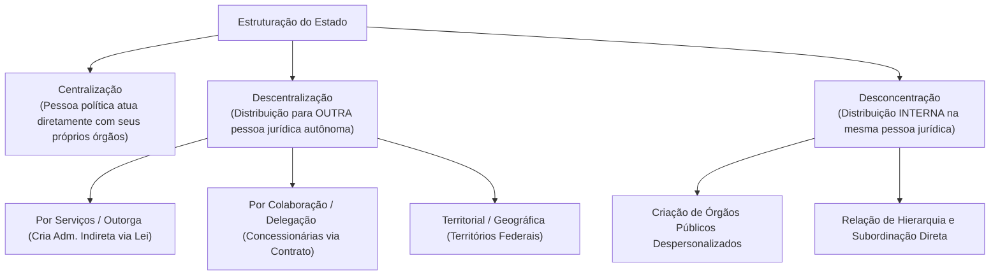
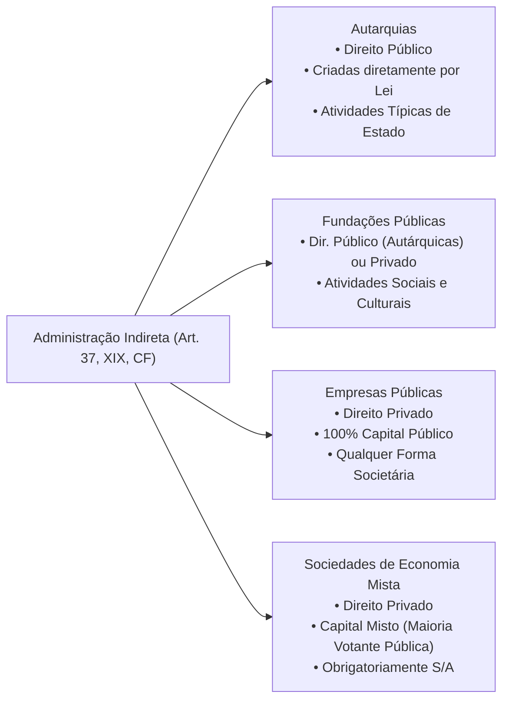
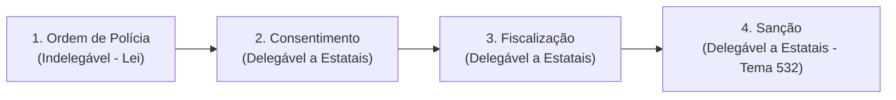
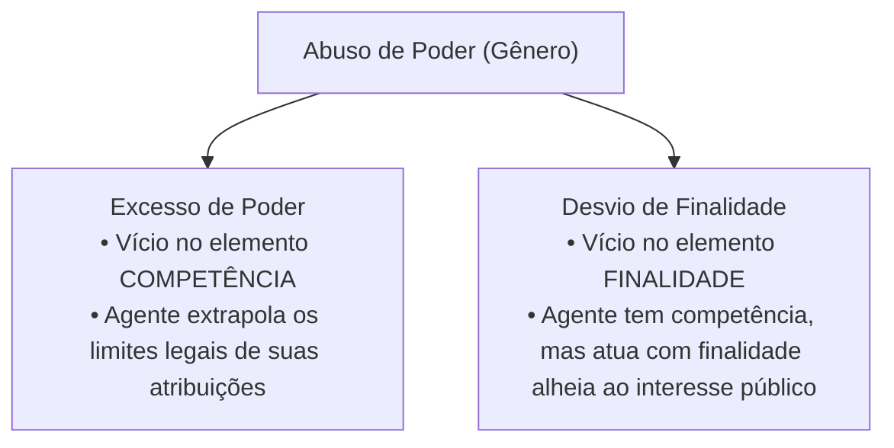

# 02 - Organização Administrativa, Poderes e Abuso de Autoridade

> **Matéria:** Noções de Direito Administrativo  
> **Cargo:** A01 – Técnico de Controle Externo – Especialidade: Técnico Administrativo  
> **Arquivo:** `02_organizacao_administrativa_e_poderes.md`  

---

## 📌 Ementa / Itens do Edital
- Organização administrativa brasileira: Administração Direta e Indireta
- Descentralização vs. Desconcentração: conceitos, distinções e repercussões jurídicas
- Entidades da Administração Indireta: Autarquias, Fundações Públicas, Empresas Públicas e Sociedades de Economia Mista
- Regime jurídico das Estatais (Lei nº 13.303/2016)
- Terceiro Setor e entidades paraestatais: Serviços Sociais Autônomos (Sistema S), Organizações Sociais (OS) e OSCIPs
- Poderes da Administração Pública: Poder Vinculado, Discricionário, Hierárquico, Disciplinar, Regulamentar e Poder de Polícia
- Poder de Polícia: conceito (CTN, art. 78), atributos, limites e fases do ciclo de polícia
- Uso e abuso do poder: excesso de poder e desvio de finalidade
- Lei de Abuso de Autoridade (Lei nº 13.869/2019 e alterações): sujeitos ativos, elemento subjetivo especial e crimes funcionais

---

## 🧭 Sumário

1. [Organização Administrativa: Técnicas de Estruturação Estatal](#1-organizacao-administrativa-tecnicas-de-estruturacao-estatal)
    1. [Centralização e Descentralização](#11-centralizacao-e-descentralizacao)
    2. [Desconcentração e a Criação de Órgãos Públicos](#12-desconcentracao-e-a-criacao-de-orgaos-publicos)
    3. [Quadro Distintivo: Descentralização vs. Desconcentração](#13-quadro-distintivo-descentralizacao-vs-desconcentracao)
    4. [Teste 012](#Teste-012)
2. [Entidades da Administração Indireta](#2-entidades-da-administracao-indireta)
    1. [Autarquias e Autarquias de Regime Especial](#21-autarquias-e-autarquias-de-regime-especial)
    2. [Fundações Públicas (Direito Público vs. Direito Privado)](#22-fundacoes-publicas-direito-publico-vs-direito-privado)
    3. [Empresas Públicas e Sociedades de Economia Mista](#23-empresas-publicas-e-sociedades-de-economia-mista)
    4. [O Estatuto Jurídico das Estatais (Lei nº 13.303/2016)](#24-o-estatuto-juridico-das-estatais-lei-no-133032016)
    5. [Controle Finalístico, Tutela e Supervisão Ministerial](#25-controle-finalistico-tutela-e-supervisao-ministerial)
    6. [Teste 013](#Teste-013)
    7. [Teste 014](#Teste-014)
    8. [Teste 015](#Teste-015)
    9. [Teste 016](#Teste-016)
3. [O Terceiro Setor e Entidades Paraestatais](#3-o-terceiro-setor-e-entidades-paraestatais)
    1. [Serviços Sociais Autônomos (Sistema S)](#31-servicos-sociais-autonomos-sistema-s)
    2. [Organizações Sociais (OS) e Contratos de Gestão](#32-organizacoes-sociais-os-e-contratos-de-gestao)
    3. [OSCIPs e Termos de Parceria](#33-oscips-e-termos-de-parceria)
    4. [Teste 017](#Teste-017)
4. [Poderes Administrativos e Prerrogativas Públicas](#4-poderes-administrativos-e-prerrogativas-publicas)
    1. [Poder Vinculado vs. Poder Discricionário e o Mérito Administrativo](#41-poder-vinculado-vs-poder-discricionario-e-o-merito-administrativo)
    2. [Poder Hierárquico: Delegação, Avocação e a Regra do CENORA](#42-poder-hierarquico-delegacao-avocacao-e-a-regra-do-cenora)
    3. [Poder Disciplinar e Sanções Funcionais](#43-poder-disciplinar-e-sancoes-funcionais)
    4. [Poder Regulamentar / Normativo e os Decretos Autônomos](#44-poder-regulamentar-normativo-e-os-decretos-autonomos)
    5. [Poder de Polícia, Ciclo de Polícia e Delegação (Tema 532/STF)](#45-poder-de-policia-ciclo-de-policia-e-delegacao-tema-532stf)
    6. [Teste 018](#Teste-018)
    7. [Teste 019](#Teste-019)
    8. [Teste 020](#Teste-020)
    9. [Teste 021](#Teste-021)
5. [Uso e Abuso de Poder e a Lei nº 13.869/2019](#5-uso-e-abuso-de-poder-e-a-lei-no-138692019)
    1. [Excesso de Poder vs. Desvio de Finalidade](#51-excesso-de-poder-vs-desvio-de-finalidade)
    2. [Elemento Subjetivo Especial e Proibição do Crime de Hermenêutica](#52-elemento-subjetivo-especial-e-proibicao-do-crime-de-hermeneutica)
    3. [Sujeitos Ativos no Âmbito dos Tribunais de Contas](#53-sujeitos-ativos-no-ambito-dos-tribunais-de-contas)
    4. [Teste 022](#Teste-022)
6. [Fontes Recomendadas na Internet](#6-fontes-recomendadas-na-internet)

---

## 1. Organização Administrativa: Técnicas de Estruturação Estatal

A organização administrativa é o conjunto de mecanismos normativos e estruturais mediante os quais o Estado distribui suas competências e funções entre pessoas jurídicas, órgãos e agentes públicos.

### 1.1 Centralização e Descentralização

- **Centralização:** Ocorre quando o Estado executa suas tarefas administrativas **diretamente**, por meio dos órgãos e agentes integrantes da própria pessoa jurídica política matriz (União, Estados, DF e Municípios — Administração Direta).
- **Descentralização:** Ocorre quando o Estado transfere a execução ou a titularidade e execução de determinada atividade administrativa para **outra pessoa jurídica distinta**, dotada de personalidade própria.
    - **Descentralização por Serviços, Outorga ou Funcional:** O poder público transfere a **titularidade e a execução** do serviço mediante **lei formal** para entidades da Administração Pública Indireta (Autarquias, Fundações Públicas, Empresas Públicas e Sociedades de Economia Mista). Possui caráter de estabilidade institucional duradoura.
    - **Descentralização por Colaboração ou Delegação:** O poder público transfere apenas a **execução material** do serviço para particulares (concessionárias e permissionárias de serviços públicos) mediante **contrato administrativo de concessão** ou **ato unilateral de permissão**. A titularidade permanece nas mãos do poder concedente.
    - **Descentralização Territorial ou Geográfica:** Ocorre na criação de Territórios Federais (entidades autárquicas geográficas com capacidade genérica de gestão local).

### 1.2 Desconcentração e a Criação de Órgãos Públicos

A **desconcentração** é uma técnica puramente interna de divisão e distribuição de competências que ocorre **dentro de uma mesma pessoa jurídica**. 

- Não gera uma nova entidade dotada de personalidade jurídica; dá origem a **órgãos públicos despersonalizados** (Ministérios, Secretarias de Estado, Diretorias, Departamentos).
- Caracteriza-se por uma **relação estrita de hierarquia, subordinação e controle disciplinar** entre a chefia superior e as unidades subordinadas.
- *Teoria do Órgão (Imputação Volitiva):* Os órgãos não possuem vontade própria autônoma nem patrimônio segregado; as manifestações volitivas de seus agentes são juridicamente imputadas à pessoa jurídica à qual o órgão se vincula.

### 1.3 Quadro Distintivo: Descentralização vs. Desconcentração

| Critério de Comparação | Descentralização Administrativa | Desconcentração Administrativa |
| :--- | :--- | :--- |
| **Pessoas Jurídicas Envolvidas** | Envolve **duas ou mais pessoas jurídicas distintas** | Ocorre **dentro de uma única pessoa jurídica** |
| **Criação Resultante** | Cria **novas entidades** autônomas da Administração Indireta | Cria **órgãos públicos** despersonalizados |
| **Vínculo Jurídico** | **Não há hierarquia nem subordinação** (há apenas vinculação / tutela finalística) | **Há relação estrita de hierarquia e subordinação** |
| **Mnemônico Visual FCC** | Descentrali**Z**ação $\rightarrow$ Gera **E**ntidades externas | Desconcen**T**ração $\rightarrow$ Gera **Ó**rgãos internos |

---

### Teste 012
**(FGV – TRT – Analista Judiciário - Suporte e Infraestrutura de TI – 2022)**  
O Prefeito do Município Alfa decidiu promover uma ampla reestruturação da estrutura administrativa municipal. Para tanto, adotou duas medidas:  
(1) encaminhou à Câmara Municipal projeto de lei para a criação de uma autarquia municipal de trânsito e de uma empresa pública de informática;  
(2) editou decreto extinguindo secretarias adjuntas e redistribuindo internamente suas competências regimentais entre diretorias de uma mesma Secretaria de Governo.

Em relação a essas medidas, é correto afirmar que:

* **A)** em (1) ocorre descentralização administrativa por serviços; e em (2), desconcentração administrativa.
* **B)** em (1) e em (2) ocorrem hipóteses típicas de desconcentração administrativa territorial e funcional.
* **C)** em (1) ocorre descentralização política originária; e em (2), delegação negocial de competências estatais.
* **D)** em (1) ocorre desconcentração funcional; e em (2), descentralização administrativa por colaboração.
* **E)** em (1) e em (2) ocorrem hipóteses de desestatização mediante transferência definitiva de titularidade.

---

> **Comentário Detalhado:**
>
> - **A)** **Correto**. Na medida (1), há descentralização administrativa por serviços, funcional ou outorga, pois o Município cria novas pessoas jurídicas integrantes da Administração Indireta (autarquia e empresa pública) e a elas transfere atribuições. Na medida (2), há mera desconcentração administrativa, pois ocorre distribuição interna de competências no âmbito da própria pessoa jurídica municipal (órgãos de uma mesma secretaria), mantendo-se o vínculo hierárquico.
> - **B)** **Incorreto**. A criação de novas pessoas jurídicas consubstancia descentralização, não desconcentração.
> - **C)** **Incorreto**. A descentralização políticadecorre diretamente da Constituição Federal aos entes federados; o Município não realiza descentralização política ao criar estatais.
> - **D)** **Incorreto**. Houve inversão terminológica completa entre os institutos da descentralização e desconcentração.
> - **E)** **Incorreto**. Desestatização envolve alienação de ativos ou privatização, hipótese inexistente nas medidas estatais internas.
>
> **Gabarito: A**
## 2. Entidades da Administração Indireta

A Administração Indireta é o conjunto de entes descentralizados aos quais a lei confere personalidade jurídica própria para desempenhar atividades especializadas de interesse coletivo. Rege-se pelo art. 37, XIX, da CF/88.

### 2.1 Autarquias e Autarquias de Regime Especial

- **Conceito:** Pessoa jurídica de **direito público**, instituída diretamente por **lei específica**, para desempenhar atividades típicas e exclusivas de Estado que requeiram gestão administrativa e financeira descentralizada.
- **Regime Jurídico:** Totalmente público. Seus bens são públicos (impenhoráveis, inalienáveis e imprescritíveis); gozam de **imunidade tributária recíproca** (CF, art. 150, § 2º) sobre patrimônio, renda e serviços vinculados a suas finalidades; seus servidores submetem-se ao regime estatutário do respectivo ente; e suas dívidas judiciais são quitadas mediante precatórios.
- **Autarquias em Regime Especial (Agências Reguladoras):** Autarquias dotadas de maior autonomia institucional, financeira e decisória. Caracterizam-se por: dirigentes investidos com mandato fixo após sabatina legislativa (estabilidade no mandato, perda do cargo apenas nas hipóteses legais); poder normativo técnico regulatório; e inexistência de recurso hierárquico impróprio para os Ministérios/Secretarias sobre decisões técnicas de mérito.

### 2.2 Fundações Públicas (Direito Público vs. Direito Privado)

Entidades com patrimônio personalizado voltadas a finalidades sociais, de saúde, educação, cultura ou pesquisa (sem fins lucrativos):

- **Fundação Pública de Direito Público (Fundação Autárquica / Autarquia Fundacional):** Criada diretamente por lei específica. Equipara-se material e formalmente a uma autarquia em direitos, deveres, prerrogativas e imunidades.
- **Fundação Pública de Direito Privado:** Tem sua criação **autorizada por lei específica**, nascendo juridicamente com a inscrição de seus atos constitutivos no Cartório de Registro Civil das Pessoas Jurídicas. O art. 37, XIX, da CF exige a edição de **lei complementar para definir as áreas de sua atuação**.

### 2.3 Empresas Públicas e Sociedades de Economia Mista

São as empresas estatais, pessoas jurídicas de direito privado instituídas para exploração de atividade econômica de produção ou comercialização de bens/serviços ou para prestação de serviços públicos:

| Critério Distintivo | Empresa Pública (EP) | Sociedade de Economia Mista (SEM) |
| :--- | :--- | :--- |
| **Composição Societária do Capital** | **100% Capital Público** (admitida a copropriedade entre entes estatais diversos) | **Capital Misto** (Público + Privado; o Estado detém a maioria das ações com direito a voto) |
| **Forma Societária Admitida** | **Qualquer modalidade societária** (Ltda., S.A., etc.) | **Obrigatoriamente Sociedade Anônima (S/A)** |
| **Foro Competente na Justiça (União)** | **Justiça Federal** (CF, art. 109, I) | **Justiça Estadual** (STF, Súmula 556) |
| **Foro Competente (Estados/Municípios)** | **Justiça Estadual** comum | **Justiça Estadual** comum |
| **Modo de Criação** | **Autorizada por lei específica** + Registro na Junta/Cartório | **Autorizada por lei específica** + Registro na Junta/Cartório |
| **Exemplos Nacionais** | Caixa Econômica Federal (CEF), Correios (ECT), BNDES | Banco do Brasil (BB), Petrobras, Sabesp |

### 2.4 O Estatuto Jurídico das Estatais (Lei nº 13.303/2016)

A Lei Federal nº 13.303/2016 instituiu o estatuto jurídico unificado de governança e contratações para todas as empresas públicas e sociedades de economia mista da União, Estados, DF e Municípios:

- **Governança Corporativa e Conformidade:** Exigência de comitês estatutários de auditoria e risco, regras de integridade e requisitos rigorosos de idoneidade técnica e experiência profissional para a indicação de membros do Conselho de Administração e Diretorias Executivas (vedação a ocupantes de cargos políticos e sindicais partidários).
- **Regime Próprio de Licitações das Estatais:** As estatais possuem regime licitatório próprio disciplinado pelos arts. 28 a 84 da Lei 13.303/2016, com modalidades licitatórias simplificadas e procedimentos de negociação direta, não se sujeitando como regra geral à Lei nº 14.133/2021.

### 2.5 Controle Finalístico, Tutela e Supervisão Ministerial

Entre a Administração Direta e as entidades da Administração Indireta **NÃO existe subordinação hierárquica**. O controle exercido pelo ente instituidor denomina-se **controle finalístico, supervisão ministerial ou tutela administrativa**:

- É um controle de conformidade com os fins para os quais a entidade foi criada (*princípio da especialidade*).
- Não autoriza intervenções abusivas no mérito ou na gestão interna autônoma, limitando-se aos atos expressamente autorizados em lei.

---

### Teste 013
**(FGV – TCE-GO – Analista de Controle Externo - Controle Externo – 2024)**
O Presidente da República editou o Decreto nº X, o qual dispôs 
sobre o seguinte:  
I. extinção dos órgãos públicos Alfa e Beta, com realocação dos 
respectivos ocupantes, o que decorria da exponencial 
diminuição de suas atividades , fruto de alterações no 
ambiente social;  
II. extinção dos cargos em comissão de simbologia W, na medida 
em que vagassem; 
III. disciplina da organização da Administração Pública federal. 
Por discordar das medidas adotadas, o Partido Político Alfa, com 
representação no Congresso Nacional, consultou sua assessoria 
jurídica em relação à conformidade constitucional das medidas 
adotadas.  
A assessoria informou que é constitucional o que consta em

* **A)** I, II e III.
* **B)** I, apenas.
* **C)** III, apenas.
* **D)** I e II, apenas.
* **E)** II e III, apenas.

---

> **Comentário Detalhado:**
>
> - **A)** Incorreta. Discrepa das diretrizes normativas e jurisprudenciais aplicáveis ao tema objeto do item.
> - **B)** Correta. Representa com precisão a disciplina do tema e o entendimento pacificado adotado pela banca (FGV).
> - **C)** Incorreta. Discrepa das diretrizes normativas e jurisprudenciais aplicáveis ao tema objeto do item.
> - **D)** Incorreta. Discrepa das diretrizes normativas e jurisprudenciais aplicáveis ao tema objeto do item.
> - **E)** Incorreta. Discrepa das diretrizes normativas e jurisprudenciais aplicáveis ao tema objeto do item.
>
> **Gabarito: B**

---
### Teste 014
**(FCC – TRT – Analista Judiciário - Tecnologia da Informação – 2009)**
Nas atividades culturais realizadas no âmbito da biblioteca 
são utilizadas várias técnicas e instrumentos combinados. 
Na perspectiva da ação cultural, como proposta por José 
Teixeira Coelho Neto, essas atividades devem

* **A)** alavancar a produção cultural, em que os parti-
cipantes são sujeitos do processo.
* **B)** ter princípio, meio e fim predeterminados, visando a 
realização de um produto.
* **C)** partir de um projeto da instituição e envolver os 
usuários como seus receptores.
* **D)** divertir o público e promover formas de lazer que 
incluam programas de leitura e de arte.
* **E)** facilitar o uso de instalações e meios ao desenvol-
vimento de eventos culturais. 
_________________________________________________________

---

> **Comentário Detalhado:**
>
> - **A)** Correta. Representa com precisão a disciplina do tema e o entendimento pacificado adotado pela banca (FCC).
> - **B)** Incorreta. Discrepa das diretrizes normativas e jurisprudenciais aplicáveis ao tema objeto do item.
> - **C)** Incorreta. Discrepa das diretrizes normativas e jurisprudenciais aplicáveis ao tema objeto do item.
> - **D)** Incorreta. Discrepa das diretrizes normativas e jurisprudenciais aplicáveis ao tema objeto do item.
> - **E)** Incorreta. Discrepa das diretrizes normativas e jurisprudenciais aplicáveis ao tema objeto do item.
>
> **Gabarito: A**

---
### Teste 015
**(FGV – TCE-GO – Analista de Controle Externo - Tecnologia da Informação – 2024)**
O poder que o Tribunal de Contas do Estado de Goiás 
possui para, no âmbito de sua competência e jurisdição, 
expedir atos normativos sobre matéria de sua atribuição e 
sobre a organização dos processos que lhe devam ser 
submetidos, obrigando os jurisdicionados ao seu cumpri-
mento, sob pena de responsabilidade, denomina-se

* **A)** processual.
* **B)** disciplinar.
* **C)** de Polícia.
* **D)** jurisdicional.
* **E)** regulamentar. 
_________________________________________________________

---

> **Comentário Detalhado:**
>
> - **A)** Incorreta. Discrepa das diretrizes normativas e jurisprudenciais aplicáveis ao tema objeto do item.
> - **B)** Incorreta. Discrepa das diretrizes normativas e jurisprudenciais aplicáveis ao tema objeto do item.
> - **C)** Incorreta. Discrepa das diretrizes normativas e jurisprudenciais aplicáveis ao tema objeto do item.
> - **D)** Correta. Representa com precisão a disciplina do tema e o entendimento pacificado adotado pela banca (FGV).
> - **E)** Incorreta. Discrepa das diretrizes normativas e jurisprudenciais aplicáveis ao tema objeto do item.
>
> **Gabarito: D**

---
### Teste 016
**(FGV – TRT – Analista Judiciário – 2024)**  
Considerando a natureza dos serviços públicos e as peculiaridades previstas no ordenamento pátrio, é correto afirmar que pode ser objeto de uma concessão patrocinada

* **A)** a delegação de atividade que tenha como objeto único a realização de uma obra pública.
* **B)** a delegação do exercício do poder de polícia, com relação a todas as fases que compõem o respectivo ciclo.
* **C)** a delegação do serviço de veículo leve sobre trilhos, com a previsão de instalação da respectiva infraestrutura e manutenção, mediante a cobrança de tarifa dos usuários.
* **D)** a delegação da construção de uma universidade pública e a prestação do respectivo serviço de educação no estabelecimento oficial, mediante a cobrança de mensalidades.
* **E)** a delegação do serviço de iluminação pública, medi ante a realização de obras e manutenção da respectiva infraestrutura.

---

> **Comentário Detalhado:**
>
> - **A)** Incorreta. A delegação de serviços públicos não transfere a titularidade do serviço, mas apenas sua execução.
> - **B)** Incorreta. Serviços públicos essenciais submetem-se ao princípio da continuidade.
> - **C)** Incorreta. A fixação de tarifas decorre da modicidade tarifária e do equilíbrio econômico-financeiro.
> - **D)** Correta. O ordenamento jurídico pátrio e a jurisprudência do STF consolidam que o exercício do poder de polícia e a prestação de serviços públicos submetem-se a regimes jurídicos distintos, sendo o poder de polícia indelegável a pessoas jurídicas de direito privado com finalidade lucrativa no tocante às sanções.
> - **E)** Incorreta. Concessões de serviços exigem licitação prévia na modalidade concorrência ou diálogo competitivo.
>
> **Gabarito: D**

---

## 3. O Terceiro Setor e Entidades Paraestatais

O Terceiro Setor compreende entidades privadas sem fins lucrativos que colaboram voluntariamente com o Estado na consecução de finalidades públicas e sociais, sem integrar a estrutura formal da Administração Pública.

### 3.1 Serviços Sociais Autônomos (Sistema S)

- Pessoas jurídicas de direito privado criadas por autorização legislativa para prestar serviços de interesse social e capacitação profissional a categorias de empregados (SESI, SENAI, SESC, SENAC, SEST, SENAT, SEBRAE).
- Não integram a Administração Pública; financiam-se mediante contribuições parafiscais arrecadadas compulsoriamente pelo Estado. Submetem-se ao controle externo exercido pelo Tribunal de Contas quanto aos recursos parafiscais, mas possuem regulamentos próprios de licitação e processo seletivo simplificado para pessoal.

### 3.2 Organizações Sociais (OS) e Contratos de Gestão

- Pessoas jurídicas de direito privado sem fins lucrativos que recebem a qualificação jurídica de OS pelo Poder Executivo (Lei nº 9.637/1998 e legislações estaduais congêneres).
- Atuam na área de saúde, educação, cultura e pesquisa mediante a celebração de **Contrato de Gestão**. Podem receber fomento financeiro direto, dotações orçamentárias e cessão especial de servidores e bens públicos.

### 3.3 OSCIPs e Termos de Parceria

- Organizações da Sociedade Civil de Interesse Público regidas pela Lei nº 9.790/1999.
- O vínculo de cooperação instrumentaliza-se formalmente por meio de **Termo de Parceria**.

---

### Teste 017
**(FCC – TRT – Analista Judiciário - Tecnologia da Informação – 2009)**
No exercício de seu poder regulamentar, o Chefe do Po-
der Executivo pode expedir, relativamente a todas as 
matérias de sua competência, regulamentos

* **A)** autônomos, destinados a criar normas jurídicas ge-
rais e abstratas, independentemente de lei anterior.
* **B)** autônomos, cuja eficácia e aplicabilidade independe 
de posterior manifestação do Poder Legislativo.
* **C)** de execução, destinados a dar fiel cumprimento às 
leis.
* **D)** de execução, destinados a dar fiel cumprimento aos 
decretos por ele expedidos.
* **E)** independentes, destinados a regulamentar a presta-
ção de serviços públicos. 
_________________________________________________________

---

> **Comentário Detalhado:**
>
> - **A)** Incorreta. Discrepa das diretrizes normativas e jurisprudenciais aplicáveis ao tema objeto do item.
> - **B)** Incorreta. Discrepa das diretrizes normativas e jurisprudenciais aplicáveis ao tema objeto do item.
> - **C)** Incorreta. Discrepa das diretrizes normativas e jurisprudenciais aplicáveis ao tema objeto do item.
> - **D)** Incorreta. Discrepa das diretrizes normativas e jurisprudenciais aplicáveis ao tema objeto do item.
> - **E)** Correta. Representa com precisão a disciplina do tema e o entendimento pacificado adotado pela banca (FCC).
>
> **Gabarito: E**

---
## 4. Poderes Administrativos e Prerrogativas Públicas

Os poderes administrativos são prerrogativas instrumentais outorgadas aos agentes do Estado com a finalidade de viabilizar a satisfação do interesse público. Não constituem privilégios pessoais, mas verdadeiros **poderes-deveres** (o dever de agir é indeclinável).

### 4.1 Poder Vinculado vs. Poder Discricionário e o Mérito Administrativo

- **Poder Vinculado:** A lei estabelece com precisão exaustiva todos os requisitos e a única conduta obrigatória a ser adotada pelo agente, inexistindo qualquer margem de liberdade ou juízo de conveniência (ex.: concessão de aposentadoria ao servidor que cumpriu todos os requisitos legais).
- **Poder Discricionário:** A lei confere expressamente ao administrador uma margem controlada de livre apreciação para eleger a decisão mais adequada perante o caso concreto, com base na **conveniência e oportunidade** (**Mérito Administrativo**).
    - *Limites do Controle Judicial:* O Poder Judiciário e o Tribunal de Contas **não podem invadir o mérito administrativo puro** (não podem substituir a escolha legítima e discricionária do gestor); todavia, exercem pleno controle de legalidade, proporcionalidade, razoabilidade e moralidade sobre o ato.

### 4.2 Poder Hierárquico: Delegação, Avocação e a Regra do CENORA

O poder hierárquico distribui e escalona funções entre órgãos e agentes subordinados, conferindo poderes de dar ordens, fiscalizar, revisar atos, delegar e avocar competências:

- **Delegação:** Transferência temporária do exercício de certas competências para órgãos ou agentes subordinados ou de mesmo nível hierárquico.
- **Vedações Absolutas à Delegação (Mnemônico CENORA - Lei 9.784/99, art. 13):**
    - **CE:** Competência **Exclusiva** conferida por lei a determinado órgão ou autoridade.
    - **NO:** Edição de atos de caráter **Normativo**.
    - **RA:** Decisão de **Recursos Administrativos**.

> 🚨 **ALERTA CRÍTICO DE PROVA FCC:**  
> A decisão de recursos administrativos é **terminantemente indelegável**! Se o titular de uma pasta delegar a um subordinado o julgamento de um recurso contra sanção proferida pelo órgão, a delegação é nula de pleno direito, pois violaria o duplo grau de julgamento administrativo.

### 4.3 Poder Disciplinar e Sanções Funcionais

É a prerrogativa interna da Administração de apurar infrações e aplicar penalidades funcionais a agentes públicos submetidos à hierarquia estatal ou a **particulares com vínculo jurídico especial com o Estado** (ex.: empresas contratadas que cometem faltas em licitações e contratos).

- Não se confunde com o poder de polícia (que pune particulares em geral, desprovidos de vínculo jurídico especial prévio).

### 4.4 Poder Regulamentar / Normativo e os Decretos Autônomos

Prerrogativa outorgada aos Chefes do Poder Executivo para expedir atos gerais e abstratos:

- **Decretos de Execução / Regulamentares (CF, art. 84, IV):** Editados para a fiel execução de leis já existentes. Não podem inovar originariamente na ordem jurídica nem criar direitos ou obrigações primárias não contempladas na lei.
- **Decretos Autônomos (CF, art. 84, VI):** Espécie normativa primária excepcional, autorizada diretamente pelo texto constitucional apenas em duas hipóteses taxativas:
    - *Alínea "a":* **Organização e funcionamento da administração pública**, desde que **não implique aumento de despesa** nem **criação ou extinção de órgãos públicos**;
    - *Alínea "b":* **Extinção de funções ou cargos públicos, quando vagos**.

> 💡 **Pegadinha Clássica FCC:**  
> Decreto autônomo **NUNCA pode criar ou extinguir órgãos públicos**, e **NUNCA pode extinguir cargos públicos se estiverem ocupados**! A criação e extinção de órgãos públicos exige expressamente **lei formal em sentido estrito** (CF, art. 48, XI e art. 61, § 1º, II, "e").

### 4.5 Poder de Polícia, Ciclo de Polícia e Delegação (Tema 532/STF)

O art. 78 do Código Tributário Nacional (CTN) conceitua o **poder de polícia** como a atividade da administração pública que, regulando a prática de ato ou a abstenção de fato em razão de interesse público, limita ou disciplina direito, interesse ou liberdade individual.

- **Atributos do Poder de Polícia:** Discricionariedade, Autoexecutoriedade e Coercibilidade.
- **O Ciclo de Polícia (Quatro Fases):**
    1. *Ordem de Polícia:* A norma jurídica legal que institui a restrição ou comando abstrato.
    2. *Consentimento de Polícia:* Ato pelo qual o Estado autoriza ou licencia o exercício da atividade privada condicionada (alvarás, licenças).
    3. *Fiscalização de Polícia:* Vistorias, inspeções, autuações e blitz.
    4. *Sanção de Polícia:* Aplicação punitiva da penalidade administrativa (multa, apreensão de mercadoria, interdição de estabelecimento).

#### O Marco Histórico do Tema 532 da Repercussão Geral do STF:
Superando divergências anteriores, o STF pacificou a tese com eficácia vinculante:
> *"É constitucional a delegação do poder de polícia, por meio de lei, a pessoas jurídicas de direito privado integrantes da Administração Pública indireta de capital social majoritariamente público que prestem exclusivamente serviço público de atuação própria do Estado e em regime não concorrencial."*

- É constitucional delegar a estatais as fases de **consentimento, fiscalização e sanção**. Apenas a primeira fase (**legislar / ordem de polícia**) permanece indelegável, privativa do Estado.

---

### Teste 018
**(FGV – TRT – Analista Judiciário - Tecnologia da Informação – 2024)**
Custo Direto 
(   ) Mobilização e desmobilização; 
(   ) Tributação sobre faturamento; 
(   ) Manutenção da sede da empresa; 
(   ) Materiais usados na obra; 
(   ) Remuneração da empresa pelo desenvolvimento de sua 
atividade econômica 
A sequência correta da numeração, na ordem apresentada é

* **A)** 5 – 1 – 4 – 3 – 2.
* **B)** 4 – 3 – 2 – 5 – 1.
* **C)** 3 – 4 – 2 – 5 – 1.
* **D)** 3 – 4 – 1 – 5 – 2.
* **E)** 5 – 3 – 2 – 4 – 1.

---

> **Comentário Detalhado:**
>
> - **A)** Incorreta. Discrepa das diretrizes normativas e jurisprudenciais aplicáveis ao tema objeto do item.
> - **B)** Incorreta. Discrepa das diretrizes normativas e jurisprudenciais aplicáveis ao tema objeto do item.
> - **C)** Incorreta. Discrepa das diretrizes normativas e jurisprudenciais aplicáveis ao tema objeto do item.
> - **D)** Incorreta. Discrepa das diretrizes normativas e jurisprudenciais aplicáveis ao tema objeto do item.
> - **E)** Correta. Representa com precisão a disciplina do tema e o entendimento pacificado adotado pela banca (FGV).
>
> **Gabarito: E**

---
### Teste 019
**(FGV – TCE-GO – Analista de Controle Externo - Controle Externo – 2024)**
A Lei nº 13.303/2016 estabelece que os órgãos de controle externo 
e interno das três esferas de governo fiscalizarão as empresas 
públicas e as sociedades de economia mista a eles relacionados, 
inclusive aquelas domiciliadas no exterior, quanto à legitimidade, 
à economicidade e à eficácia da aplicação de seus recursos, sob o 
ponto de vista contábil, financeiro, operacional e patrimonial. 
Acerca do mencionado tema, à luz da referida norma, é correto 
afirmar que

* **A)** as ações e deliberações do órgão ou ente de controle não 
podem implicar interferência na gestão das empresas públicas 
e das sociedades de economia mista a eles submetidas nem 
ingerência no exercício de suas competências ou na definição 
de políticas públicas.
* **B)** é vedado que os Tribunais de Contas realizem o controle 
externo em relação às licitações e contratos formalizados pelas 
empresas públicas e sociedades de economia mista, 
considerando a natureza jurídica de tais entidades 
administrativas.
* **C)** as gravações e filmagens existentes de reuniões, ordinárias ou 
extraordinárias, dos conselhos de administração ou fiscal das 
empresas públicas e das sociedades de economia mista, não 
poderão ser disponibilizados para os órgãos de controle, no 
âmbito dos trabalhos de auditoria.
* **D)** o exercício da supervisão por vinculação da empresa pública 
ou da sociedade de economia mista, pelo órgão a que se 
vincula, enseja necessariamente a redução da autonomia 
conferida pela lei específica que autorizou a criação da 
entidade supervisionada ou inerente a sua natureza, 
autorizando, assim, a ingerência do supervisor em sua 
administração e funcionamento.
* **E)** para a realização da aludida atividade fiscalizatória, os órgãos 
de controle deverão ter acesso às informações e aos 
documentos necessários à realização dos trabalhos, 
ressalvados aqueles classificados como sigilosos pela empresa 
pública ou pela sociedade de economia mista, nos termos da 
legislação de regência.

---

> **Comentário Detalhado:**
>
> - **A)** Incorreta. Discrepa das diretrizes normativas e jurisprudenciais aplicáveis ao tema objeto do item.
> - **B)** Incorreta. Discrepa das diretrizes normativas e jurisprudenciais aplicáveis ao tema objeto do item.
> - **C)** Correta. Representa com precisão a disciplina do tema e o entendimento pacificado adotado pela banca (FGV).
> - **D)** Incorreta. Discrepa das diretrizes normativas e jurisprudenciais aplicáveis ao tema objeto do item.
> - **E)** Incorreta. Discrepa das diretrizes normativas e jurisprudenciais aplicáveis ao tema objeto do item.
>
> **Gabarito: C**

---
### Teste 020
**(FGV – TRT – Analista Judiciário - Tecnologia da Informação – 2024)**
Sérgio, no exercício de suas atribuições como Analista do Tribunal 
de Contas do Estado de Goiás, deparou-se com um procedimento 
administrativo envolvendo o controle externo de legalidade sobre 
determinado ato discricionário do Poder Executivo.  
Acerca da aludida temática, é correto afirmar que

* **A)** é possível a revogação do ato administrativo pela Corte de 
Contas.
* **B)** não é possível o controle externo de ato discricionário pela 
Corte de Contas.
* **C)** é possível sindicar o mérito administrativo no  exercício do 
controle externo pela Corte de Contas.
* **D)** não é possível que a Corte de Contas substitua o Poder 
Executivo no exercício da discricionariedade.
* **E)** é possível anular o ato discricionário em questão por razões de 
conveniência e oportunidade da Corte de Contas. 

Administração Financeira e 
Orçamentária

---

> **Comentário Detalhado:**
>
> - **A)** Incorreta. Discrepa das diretrizes normativas e jurisprudenciais aplicáveis ao tema objeto do item.
> - **B)** Incorreta. Discrepa das diretrizes normativas e jurisprudenciais aplicáveis ao tema objeto do item.
> - **C)** Incorreta. Discrepa das diretrizes normativas e jurisprudenciais aplicáveis ao tema objeto do item.
> - **D)** Incorreta. Discrepa das diretrizes normativas e jurisprudenciais aplicáveis ao tema objeto do item.
> - **E)** Correta. Representa com precisão a disciplina do tema e o entendimento pacificado adotado pela banca (FGV).
>
> **Gabarito: E**

---
### Teste 021
**(FGV – TCE-GO – Analista de Controle Externo - Controle Externo – 2024)**
A Lei nº 13.303/2016 estabelece que os órgãos de controle externo 
e interno das três esferas de governo fiscalizarão as empresas 
públicas e as sociedades de economia mista a eles relacionados, 
inclusive aquelas domiciliadas no exterior, quanto à legitimidade, 
à economicidade e à eficácia da aplicação de seus recursos, sob o 
ponto de vista contábil, financeiro, operacional e patrimonial. 
Acerca do mencionado tema, à luz da referida norma, é correto 
afirmar que

* **A)** as ações e deliberações do órgão ou ente de controle não 
podem implicar interferência na gestão das empresas públicas 
e das sociedades de economia mista a eles submetidas nem 
ingerência no exercício de suas competências ou na definição 
de políticas públicas.
* **B)** é vedado que os Tribunais de Contas realizem o controle 
externo em relação às licitações e contratos formalizados pelas 
empresas públicas e sociedades de economia mista, 
considerando a natureza jurídica de tais entidades 
administrativas.
* **C)** as gravações e filmagens existentes de reuniões, ordinárias ou 
extraordinárias, dos conselhos de administração ou fiscal das 
empresas públicas e das sociedades de economia mista, não 
poderão ser disponibilizados para os órgãos de controle, no 
âmbito dos trabalhos de auditoria.
* **D)** o exercício da supervisão por vinculação da empresa pública 
ou da sociedade de economia mista, pelo órgão a que se 
vincula, enseja necessariamente a redução da autonomia 
conferida pela lei específica que autorizou a criaç ão da 
entidade supervisionada ou inerente a sua natureza, 
autorizando, assim, a ingerência do supervisor em sua 
administração e funcionamento.
* **E)** para a realização da aludida atividade fiscalizatória, os órgãos 
de controle deverão ter acesso às informaçõe s e aos 
documentos necessários à realização dos trabalhos, 
ressalvados aqueles classificados como sigilosos pela empresa 
pública ou pela sociedade de economia mista, nos termos da 
legislação de regência.

---

> **Comentário Detalhado:**
>
> - **A)** Incorreta. Discrepa das diretrizes normativas e jurisprudenciais aplicáveis ao tema objeto do item.
> - **B)** Incorreta. Discrepa das diretrizes normativas e jurisprudenciais aplicáveis ao tema objeto do item.
> - **C)** Correta. Representa com precisão a disciplina do tema e o entendimento pacificado adotado pela banca (FGV).
> - **D)** Incorreta. Discrepa das diretrizes normativas e jurisprudenciais aplicáveis ao tema objeto do item.
> - **E)** Incorreta. Discrepa das diretrizes normativas e jurisprudenciais aplicáveis ao tema objeto do item.
>
> **Gabarito: C**

---
## 5. Uso e Abuso de Poder e a Lei nº 13.869/2019

### 5.1 Excesso de Poder vs. Desvio de Finalidade

O **abuso de poder** é gênero que se desdobra em duas espécies nucleares:

1. **Excesso de Poder (Vício de Competência):** Ocorre quando a autoridade atua além dos limites legais de suas atribuições funcionais. O agente é incompetente para praticar aquele ato específico, exorbitando do mandato legal.
2. **Desvio de Finalidade / Desvio de Poder (Vício de Finalidade):** Ocorre quando o agente público atua dentro de sua competência legal formal, mas pratica o ato com o propósito de atingir fim diverso daquele fixado pela lei ou com intenção privada espúria (perseguição política, favorecimento ilícito ou vingança pessoal). É vício de nulidade insanável.

### 5.2 Elemento Subjetivo Especial e Proibição do Crime de Hermenêutica

A **Lei nº 13.869/2019** (Lei de Abuso de Autoridade) disciplina os crimes cometidos por agentes públicos no exercício de suas funções:

- **Dolo Específico Obrigatório (Art. 1º, § 1º):** As condutas descritas na lei constituem crime exclusivamente quando praticadas pelo agente público com a finalidade específica de:
    1. Prejudicar outrem;
    2. Beneficiar a si mesmo ou a terceiro; ou
    3. Por mero capricho ou satisfação pessoal.

    - *Não se admite modalidade culposa!*
- **Proibição do Crime de Hermenêutica (Art. 1º, § 2º):** A divergência na interpretação de lei ou na avaliação de fatos e provas **NÃO configura abuso de autoridade**. O magistrado, membro do Ministério Público ou auditor do Tribunal de Contas não comete crime simplesmente por aplicar uma tese jurídica contrária à pretensão do réu.

### 5.3 Sujeitos Ativos no Âmbito dos Tribunais de Contas

O art. 2º da Lei nº 13.869/2019 estabelece que é sujeito ativo de crime de abuso de autoridade qualquer agente público, servidor ou não, da administração direta e indireta de todos os Poderes, incluindo expressamente os **membros e servidores dos Tribunais e Conselhos de Contas**.

- **Efeitos da Condenação (Art. 4º):** A perda do cargo, mandato ou função pública e a inabilitação para o exercício de cargo público por período de 1 a 5 anos **NÃO são efeitos automáticos** da condenação penal. Exigem declaração motivada na sentença e estão condicionados à **reincidência específica** em crime de abuso de autoridade.

---

### Teste 022
**(FGV – TRF-1 – Analista Judiciário - Tecnologia da Informação – 2024)**  
Fernando, técnico judiciário do Tribunal Regional Federal da 1ª Região, estava conversando com seu colega de trabalho a respeito das distinções conceituais e operacionais entre o poder de polícia administrativa e o poder de polícia judiciária no ordenamento jurídico brasileiro. 

Ao debaterem sobre a natureza e as características dessas duas formas de atuação estatal, é correto afirmar que:

* **A)** as autoridades que exercem a atividade de polícia administrativa pertencem exclusivamente ao Poder Judiciário.
* **B)** a polícia judiciária tem caráter puramente preventivo, ao passo que a polícia administrativa opera apenas de forma repressiva.
* **C)** ambas operam de forma preventiva e repressiva, incidindo a administrativa preponderantemente sobre bens, direitos e atividades.
* **D)** apenas a polícia judiciária pode incidir sobre bens particulares, na medida em que a administrativa recai restritamente sobre pessoas.
* **E)** a polícia federal detém atribuições exclusivas de polícia administrativa, carecendo de competência de polícia judiciária.

---

> **Comentário Detalhado:**
>
> - **A)** **Incorreto**. A polícia administrativa é exercida precipuamente por órgãos e agentes do Poder Executivo e seus órgãos fiscalizadores.
> - **B)** **Incorreto**. Ambas podem atuar de forma preventiva e repressiva (ex.: concessão de licença e aplicação de multa pela polícia administrativa; patrulhamento e prisão em flagrante pela judiciária).
> - **C)** **Correto**. A distinção clássica ensinada pela doutrina (Hely Lopes Meirelles e Di Pietro) aponta que a polícia administrativa incide predominantemente sobre bens, direitos e atividades (condicionando e restringindo seu exercício em prol do bem-estar coletivo), enquanto a polícia judiciária incide prioritariamente sobre pessoas (autores de ilícitos penais). Ademais, ambas as espécies admitem atuação tanto preventiva quanto repressiva.
> - **D)** **Incorreto**. A polícia administrativa incide justamente sobre bens e atividades particulares (imóveis, comércios, veículos).
> - **E)** **Incorreto**. A Polícia Federal exerce funções de polícia judiciária da União de forma precípua (art. 144, § 1º, IV da CF/88).
>
> **Gabarito: C**
## 6. Fontes Recomendadas na Internet

- [Constituição Federal de 1988 - Art. 37, XIX e Art. 84, VI](https://www.planalto.gov.br/ccivil_03/constituicao/constituicao.htm#art37)  
  Dispositivos constitucionais reguladores da criação de entidades da Administração Indireta, decretos autônomos e foros judiciais.
- [Decreto-Lei nº 200/1967 (Organização da Administração Federal)](https://www.planalto.gov.br/ccivil_03/decreto-lei/del0200.htm)  
  Diploma histórico que estruturou os conceitos de Administração Direta e Indireta, descentralização e supervisão ministerial.
- [Lei Federal nº 13.303/2016 (Estatuto Jurídico das Empresas Estatais)](https://www.planalto.gov.br/ccivil_03/_ato2015-2018/2016/lei/l13303.htm)  
  Regulamento de governança corporativa, conselhos de administração e contratações para empresas públicas e sociedades de economia mista.
- [Lei Federal nº 13.869/2019 (Lei de Abuso de Autoridade)](https://www.planalto.gov.br/ccivil_03/_ato2019-2022/2019/lei/l13869.htm)  
  Tipificação dos crimes de abuso de autoridade, exigência do dolo específico e vedação ao crime de hermenêutica.
- [STF - Tema 532 de Repercussão Geral (Delegação do Poder de Polícia Administrativa)](https://portal.stf.jus.br/jurisprudencia/repercussaoGeral/tema.asp?num=532)  
  Precedente vinculante fixado no RE 633.782 admitindo delegação das fases de consentimento, fiscalização e sanção a estatais prestadoras de serviço público.
- [Lei Federal nº 9.784/1999 - Art. 13 (Limites da Delegação de Competência)](https://www.planalto.gov.br/ccivil_03/leis/l9784.htm#art13)  
  Regulamentação das vedações absolutas de delegação de atos normativos, decisão de recursos administrativos e competências exclusivas.
* DI PIETRO, Maria Sylvia Zanella. **Direito Administrativo**. 37. ed. Rio de Janeiro: Forense, 2024. (Cap. 4 e Cap. 10 - Poderes da Administração e Organização Administrativa).
* CARVALHO FILHO, José dos Santos. **Manual de Direito Administrativo**. 38. ed. Barueri: Atlas, 2024. (Cap. 2 e Cap. 9 - Poderes Administrativos, Administração Indireta e Entidades Paraestatais).
* OLIVEIRA, Rafael Carvalho Rezende. **Curso de Direito Administrativo**. 12. ed. Rio de Janeiro: Método, 2024. (Cap. 4 e Cap. 11 - Organização Administrativa, Terceiro Setor e Poder de Polícia).
