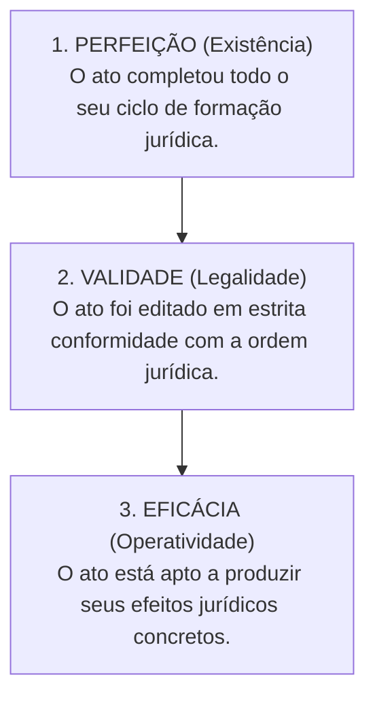
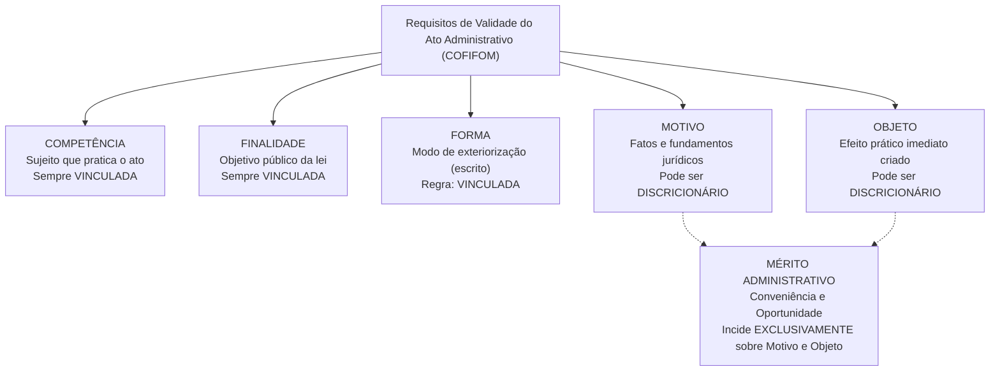
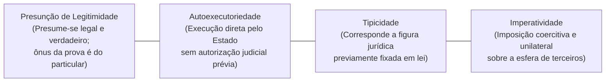
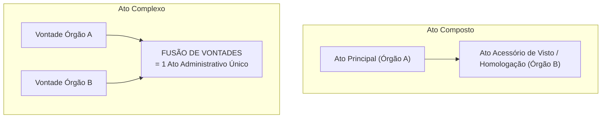

# 03 - Atos Administrativos e Processo Administrativo Estadual (Lei 13.800/2001)

> **Matéria:** Noções de Direito Administrativo  
> **Cargo:** A01 – Técnico de Controle Externo – Especialidade: Técnico Administrativo  
> **Arquivo:** `03_atos_administrativos_e_processo_estadual.md`  

---

## 📌 Ementa / Itens do Edital
- Ato administrativo: conceito, características e distinções
- Elementos e requisitos de validade (Competência, Finalidade, Forma, Motivo e Objeto - COFIFOM)
- Atributos do ato administrativo: Presunção de Legitimidade, Autoexecutoriedade, Tipicidade e Imperatividade (PATI)
- Classificação dos atos administrativos: vinculados e discricionários; simples, complexos e compostos
- Formação, efeitos, perfeição, validade e eficácia
- Extinção dos atos: anulação, revogação, cassação, caducidade e contraposição
- Convalidação (sanamento de vícios de competência e forma)
- Processo Administrativo no Estado de Goiás: Lei Estadual nº 13.800/2001 e alterações

---

## 🧭 Sumário

1. [Teoria Geral do Ato Administrativo e Distinções Conceituais](#1-teoria-geral-do-ato-administrativo-e-distincoes-conceituais)
    1. [Fato da Administração vs. Fato Administrativo vs. Ato Administrativo](#11-fato-da-administracao-vs-fato-administrativo-vs-ato-administrativo)
    2. [Perfeição, Validade e Eficácia do Ato](#12-perfeicao-validade-e-eficacia-do-ato)
    3. [Teste 023](#Teste-023)
2. [Elementos e Requisitos de Validade do Ato (Mnemônico COFIFOM)](#2-elementos-e-requisitos-de-validade-do-ato-mnemonico-cofifom)
    1. [Competência (Sujeito Competente)](#21-competencia-sujeito-competente)
    2. [Finalidade e o Desvio de Poder](#22-finalidade-e-o-desvio-de-poder)
    3. [Forma e Princípio da Solenidade](#23-forma-e-principio-da-solenidade)
    4. [Motivo e a Teoria dos Motivos Determinantes](#24-motivo-e-a-teoria-dos-motivos-determinantes)
    5. [Objeto (Conteúdo) e a Delimitação do Mérito Administrativo](#25-objeto-conteudo-e-a-delimitacao-do-merito-administrativo)
    6. [Teste 024](#Teste-024)
    7. [Teste 025](#Teste-025)
    8. [Teste 026](#Teste-026)
3. [Atributos do Ato Administrativo (Mnemônico PATI)](#3-atributos-do-ato-administrativo-mnemonico-pati)
    1. [Presunção de Legitimidade e Veracidade](#31-presuncao-de-legitimidade-e-veracidade)
    2. [Autoexecutoriedade e seus Limites](#32-autoexecutoriedade-e-seus-limites)
    3. [Tipicidade Administrativa](#33-tipicidade-administrativa)
    4. [Imperatividade e Poder Extroverso](#34-imperatividade-e-poder-extroverso)
    5. [Teste 027](#Teste-027)
4. [Classificações Relevantes para a FCC: Atos Simples, Complexos e Compostos](#4-classificacoes-relevantes-para-a-fcc-atos-simples-complexos-e-compostos)
    1. [Atos Simples, Complexos e Compostos](#41-atos-simples-complexos-e-compostos)
    2. [O Registro de Aposentadoria no Tribunal de Contas (Tema 445 / STF)](#42-o-registro-de-aposentadoria-no-tribunal-de-contas-tema-445-stf)
    3. [Teste 028](#Teste-028)
    4. [Teste 029](#Teste-029)
5. [Extinção e Convalidação dos Atos Administrativos](#5-extincao-e-convalidacao-dos-atos-administrativos)
    1. [Modos de Extinção: Anulação, Revogação, Cassação, Caducidade e Contraposição](#51-modos-de-extincao-anulacao-revogacao-cassacao-caducidade-e-contraposicao)
    2. [Convalidação: Requisitos, Limites e Efeitos Temporais](#52-convalidacao-requisitos-limites-e-efeitos-temporais)
    3. [Teste 030](#Teste-030)
    4. [Teste 031](#Teste-031)
6. [Processo Administrativo no Estado de Goiás (Lei Estadual nº 13.800/2001)](#6-processo-administrativo-no-estado-de-goias-lei-estadual-no-138002001)
    1. [Princípios Norteadores e Direitos dos Administrados](#61-principios-norteadores-e-direitos-dos-administrados)
    2. [Vedações Absolutas à Delegação (Regra do CENORA - Art. 13)](#62-vedacoes-absolutas-a-delegacao-regra-do-cenora-art-13)
    3. [Impedimentos e Suspeição de Agentes e Julgadores](#63-impedimentos-e-suspeicao-de-agentes-e-julgadores)
    4. [Motivação das Decisões e Regime Recursal](#64-motivacao-das-decisoes-e-regime-recursal)
    5. [Teste 032](#Teste-032)
    6. [Teste 033](#Teste-033)
7. [Fontes Recomendadas na Internet](#7-fontes-recomendadas-na-internet)

---

## 1. Teoria Geral do Ato Administrativo e Distinções Conceituais

O ato administrativo é a manifestação unilateral de vontade da Administração Pública ou de quem lhe faça as vezes, que, agindo sob o império do Direito Público, tem por fim imediato adquirir, resguardar, transferir, modificar, extinguir ou declarar direitos, ou impor obrigações aos administrados ou a si própria.

### 1.1 Fato da Administração vs. Fato Administrativo vs. Ato Administrativo

A doutrina administrativista clássica (seguida com rigor pela banca FCC) diferencia os eventos jurídicos da administração pública em três categorias:

- **Fato da Administração:** Evento puramente material ou natural ocorrido no seio da Administração, mas desprovido de repercussão ou consequência jurídica direta para o Direito Administrativo (ex.: o funcionário que limpa o chão de uma repartição; a pintura ordinária de uma parede).
- **Fato Administrativo:** Acontecimento fático que produz efeitos jurídicos relevantes no âmbito do Direito Administrativo. Pode decorrer de um ato voluntário (ex.: a apreensão material de mercadorias pirateadas) ou de um evento da natureza (ex.: a queda de uma árvore sobre veículo particular gerando responsabilidade civil; o decurso do tempo acarretando prescrição).
- **Ato Administrativo:** Declaração jurídica formal e intencional emitida pelo Estado com a finalidade de produzir efeitos jurídicos no mundo do direito (ex.: a expedição de uma licença de obras, a demissão de um servidor público estável, a aplicação de uma penalidade em licitação).

### 1.2 Perfeição, Validade e Eficácia do Ato

A teoria tridimensional do ato administrativo estabelece três planos de análise que não se confundem:

- **Ato Perfeito:** Aquele que completou todas as fases de seu ciclo de formação interna, estando concluído. Pode ser válido ou inválido.
- **Ato Válido:** Aquele que, além de perfeito, atende a todos os requisitos e pressupostos estabelecidos em lei (sem vícios de legalidade).
- **Ato Eficaz:** Aquele que está pronto para deflagrar seus efeitos jurídicos práticos, não dependendo de condição suspensiva, termo inicial ou publicação oficial.
    - *Exemplo Prático FCC:* Um ato de demissão assinado pelo Governador é **perfeito e válido**, mas só se torna **eficaz** a partir de sua publicação no Diário Oficial do Estado.

---

### Teste 023
**(FCC – Analista Judiciário – TRT / Simulado)**  
No estudo da Teoria Geral do Ato Administrativo, os planos da existência, da validade e da eficácia representam momentos conceituais distintos. A respeito da distinção dogmática entre a validade e a eficácia dos atos administrativos, é correto afirmar que:

* **A)** Um ato administrativo válido é necessariamente eficaz, produzindo efeitos jurídicos desde a sua assinatura.
* **B)** O ato nulo por vício de competência pode ser plenamente eficaz antes de ter sua invalidade declarada.
* **C)** A pendência de termo inicial ou condição suspensiva compromete a validade originária do ato administrativo.
* **D)** O ato pendente de homologação obrigatória pelo Tribunal de Contas é existente, válido e plenamente eficaz.
* **E)** A declaração judicial de nulidade de um ato administrativo opera efeitos prospectivos sem retroagir à origem.

---

> **Comentário Detalhado:**
>
> - **A)** **Incorreto**. Validade e eficácia não se confundem: um ato pode ser perfeitamente válido, mas ineficaz por estar sujeito a condição suspensiva, termo inicial ou necessidade de homologação externa.
> - **B)** **Correto**. Em virtude do princípio da presunção de legitimidade e veracidade dos atos administrativos, o ato que padece de vício de nulidade (como defeito de competência) produz efeitos práticos e jurídicos regulares perante terceiros até que seja formalmente invalidado pela Administração ou pelo Judiciário.
> - **C)** **Incorreto**. O termo ou condição suspensiva afeta unicamente o plano da eficácia (exequibilidade), não o da validade (conformidade com a lei).
> - **D)** **Incorreto**. O ato pendente de homologação pelo Tribunal de Contas (ato complexo) ainda não completou seu ciclo de formação e eficácia plena.
> - **E)** **Incorreto**. A anulação opera efeitos retroativos (ex tunc), desfazendo as consequências pretéritas geradas pelo ato inválido.
>
> **Gabarito: B**
## 2. Elementos e Requisitos de Validade do Ato (Mnemônico COFIFOM)

A Lei de Ação Popular (Lei Federal nº 4.717/1965, art. 2º) positivou a doutrina dos cinco elementos constitutivos indispensáveis para a validade do ato administrativo: **Competência, Finalidade, Forma, Motivo e Objeto** (**COFIFOM**).

### 2.1 Competência (Sujeito Competente)

É o círculo de atribuições conferido pelo ordenamento jurídico ao agente ou órgão público para a prática do ato.

- **Características:** É irrenunciável, intransferível por acordo entre as partes, inderrogável, imprescritível e imodificável pela vontade do titular.
- **Espécies de Vício de Competência:**
    - *Usurpação de Função:* Crime praticado por particular que se faz passar por funcionário público (ato inexistente).
    - *Excesso de Poder:* O agente público ultrapassa os limites legais de suas atribuições funcionais (ato nulo insanável).
    - *Incompetência Relativa:* O ato é praticado por agente de mesmo órgão ou hierarquia que não detinha a atribuição específica, sem que a competência fosse atribuída com exclusividade pela lei. Admite **convalidação** por ratificação da autoridade competente.

### 2.2 Finalidade e o Desvio de Poder

A finalidade representa o objetivo mediato de interesse público que o ato deve alcançar. É elemento **invariavelmente vinculado**; o administrador jamais detém discricionariedade para escolher a finalidade pública a ser perseguida.

- **Desvio de Finalidade (Desvio de Poder):** Ocorre quando a autoridade competente utiliza poderes legítimos para atingir fins alheios ao interesse público ou fim diverso daquele categorizado pela lei para aquela competência (ex.: remoção compulsória de servidor com o propósito punitivo disfarçado de perseguição pessoal). É vício que acarreta a **nulidade absoluta e insanável** do ato administrativo.

### 2.3 Forma e Princípio da Solenidade

A forma é o modo pelo qual a vontade da Administração se exterioriza e ganha publicidade no mundo jurídico.

- No Direito Administrativo vige o princípio do formalismo moderado, mas como regra geral os atos são solenes e devem ser expedidos por **escrito**, contendo data, identificação do cargo e assinatura.
- *Defeitos de Forma:* A omissão de formalidades não essenciais que não prejudiquem o direito de defesa dos administrados configura vício sanável, passível de **convalidação**.

### 2.4 Motivo e a Teoria dos Motivos Determinantes

O motivo constitui a situação de fato (o evento do mundo real) e a situação de direito (o enquadramento na norma legal) que autorizam ou determinam a prática do ato administrativo.

- Não se confunde com a **motivação** (a motivação é a declaração escrita dos motivos; o motivo é o próprio fato em si).

#### A Teoria dos Motivos Determinantes:
Consagrada pela jurisprudência pacífica do STF e do STJ, preceitua que a validade do ato administrativo fica indissoluvelmente vinculada à veracidade, exatidão e subsistência dos motivos alegados pela autoridade:

- Mesmo que o ato seja discricionário e prescindisse originalmente de motivação obrigatória (como a exoneração *ad nutum* de um assessor comissionado), se a autoridade decidir enunciar publicamente um motivo (ex.: afirmar no decreto que exonerou o servidor em razão do corte orçamentário do setor), **o ato ficará vinculado a essa justificativa**.
- Se for judicialmente ou administrativamente comprovado que o motivo é falso (o órgão tinha recursos abundantes) ou juridicamente inexistente, **o ato de exoneração é nulo de pleno direito**, devendo ser extirpado da ordem jurídica.

### 2.5 Objeto (Conteúdo) e a Delimitação do Mérito Administrativo

O objeto é o efeito jurídico imediato e substantivo que o ato produz no mundo real (é o "o que" o ato decide, cria, extingue ou altera). Deve ser lícito, possível, determinado ou determinável.

- **O Mérito Administrativo:** Nos atos discricionários, o mérito administrativo — consubstanciado no juízo de **conveniência e oportunidade** privativo da autoridade pública — incide **estrita e unicamente sobre o Motivo e o Objeto**. Os elementos Competência, Finalidade e Forma são sempre vinculados.

---

### Teste 024
**(FGV – Auditor de Controle Externo – TCE-GO / Simulado)**  
A autoridade competente de determinada autarquia estadual instaurou processo administrativo de fiscalização e aplicou sanção a uma sociedade empresária credenciada. Inconformada, a empresa alegou vício de competência do agente sancionador. Sobre o elemento competência do ato administrativo, assinale a opção correta:

* **A)** A competência administrativa é de exercício obrigatório, intransferível e indelegável em qualquer circunstância.
* **B)** A competência fixada em lei pode ser renunciada pela autoridade quando comprovada carência de quadro técnico.
* **C)** A incompetência em razão da matéria constitui vício de legalidade insanável, inadmitindo convalidação administrativa.
* **D)** O vício de incompetência decorrente do excesso de poder convalida-se tacitamente com o decurso de trinta dias.
* **E)** A competência exclusiva pode ser livremente delegada mediante portaria conjunta publicada no Diário Oficial.

---

> **Comentário Detalhado:**
>
> - **A)** **Incorreto**. A competência é delegável e avocável nos termos e limites autorizados em lei (arts. 11 e 12 da Lei nº 9.784/1999).
> - **B)** **Incorreto**. A competência é irrenunciável e se exerce pelos órgãos a que foi atribuída em lei (art. 11 da Lei nº 9.784/1999).
> - **C)** **Correto**. O vício de competência em razão da matéria (ratione materiae) e em razão da hierarquia é insanável (vício material absoluto), gerando a nulidade do ato e impedindo qualquer convalidação (art. 55 da Lei nº 9.784/1999). Somente a competência ratione personae (quanto à pessoa do agente, sem exclusividade legal) admite convalidação.
> - **D)** **Incorreto**. O excesso de poder é vício de legalidade gravoso que não convalida tacitamente pelo decurso de trinta dias.
> - **E)** **Incorreto**. As matérias de competência exclusiva são legalmente indelegáveis (art. 13, III da Lei nº 9.784/1999).
>
> **Gabarito: C**
### Teste 025
**(FCC – Auditor de Controle Externo – TCE-GO / Simulado)**  
O Governador do Estado exonerou servidor ocupante de cargo em comissão de livre nomeação e exoneração, consignando na portaria que a dispensa decorreu de readequação orçamentária e corte de gastos com folha. Em processo de auditoria, comprovou-se que na mesma data foram nomeados dois assessores com vencimentos idênticos. O ato de exoneração:

* **A)** É discricionário e prescinde de motivação, não ficando vinculado aos motivos declarados na portaria.
* **B)** É nulo de pleno direito por força da Teoria dos Motivos Determinantes, ante a comprovada falsidade do motivo.
* **C)** É convalidável pela autoridade competente mediante publicação retroativa de novo decreto sem justificação.
* **D)** É revogável exclusivamente por provocação formal do servidor dispensado perante o Tribunal de Contas.
* **E)** Permanece plenamente válido e intangível por se tratar de cargo de livre exoneração ad nutum.

---

> **Comentário Detalhado:**
>
> - **A)** **Incorreto**. Embora a exoneração ad nutum prescinda de motivação originária, uma vez declarada a motivação, o ato vincula-se à existência e veracidade dos motivos enunciados.
> - **B)** **Correto**. Pela Teoria dos Motivos Determinantes, quando a autoridade administrativa opta por motivar um ato que seria dispensado de motivação (como a exoneração em cargo em comissão), a validade do ato fica estritamente atrelada à veracidade do motivo alegado. Demonstrada a falsidade do motivo (inexistência de contenção de despesas), o ato padece de vício insanável de motivo, tornando-se nulo de pleno direito.
> - **C)** **Incorreto**. Vício de falsidade de motivo não admite convalidação com substituição de fundamentação ex post facto.
> - **D)** **Incorreto**. O ato deve ser anulado por vício de legalidade, e não revogado por conveniência.
> - **E)** **Incorreto**. A natureza ad nutum do cargo não autoriza a autoridade a motivar com falsidade comprovada.
>
> **Gabarito: B**
### Teste 026
**(FCC – TRT – Analista Judiciário - 2009)**  
No estudo dogmático do ato administrativo, a doutrina tradicional e o art. 2º da Lei Federal nº 4.717/1965 (Lei da Ação Popular) estruturam a validade dos atos em cinco elementos ou requisitos essenciais. Dentre os elementos indispensáveis à formação do ato administrativo, citam-se:

* **A)** a autoexecutoriedade, a imperatividade e a presunção de legitimidade perante administrados.
* **B)** a discricionariedade, a vinculação e a revogabilidade por juízo de mérito administrativo.
* **C)** a conveniência, a oportunidade e a razoabilidade quanto ao objeto tutelado na decisão.
* **D)** o sujeito competente, a finalidade, a forma, o motivo e o objeto jurídico do provimento.
* **E)** os atos de império, os atos de gestão patrimonial e os atos negociais de interesse público.

---

> **Comentário Detalhado:**
>
> - **A)** **Incorreto**. Autoexecutoriedade, imperatividade e presunção de legitimidade são atributos (características) do ato administrativo, e não seus elementos/requisitos de validade.
> - **B)** **Incorreto**. Discricionariedade e vinculação expressam o grau de liberdade conferido por lei à autoridade decisora.
> - **C)** **Incorreto**. Conveniência e oportunidade integram o mérito dos atos discricionários.
> - **D)** **Correto**. São cinco os elementos/requisitos essenciais de validade do ato administrativo (mnemônico COFIFOMO): Competência (sujeito), Finalidade, Forma, Motivo e Objeto, expressamente positivados no art. 2º da Lei nº 4.717/1965.
> - **E)** **Incorreto**. Trata-se de classificação doutrinária quanto à posição jurídica da Administração.
>
> **Gabarito: D**
## 3. Atributos do Ato Administrativo (Mnemônico PATI)

Os atributos do ato administrativo consagram prerrogativas que decorrem diretamente do princípio da supremacia do interesse público:

### 3.1 Presunção de Legitimidade e Veracidade

Presume-se que o ato administrativo foi expedido em estrita consonância com a lei (legitimidade) e que os fatos relatados pelos agentes públicos são verdadeiros (veracidade).

- É presunção relativa (*juris tantum*), que admite prova em contrário.
- Gera a **inversão do ônus da prova**: incumbe ao particular demonstrar e comprovar a ilegalidade ou falsidade do ato impugnado perante o Judiciário ou a Administração.

### 3.2 Autoexecutoriedade e seus Limites

É a prerrogativa conferida à Administração Pública de compelir materialmente o administrado a cumprir o ato ou executar diretamente a providência administrativa, inclusive com uso moderado da força física policial, **sem necessidade de intervenção ou autorização prévia do Poder Judiciário** (ex.: guincho de carro estacionado em local proibido; interdição e lacração de restaurante com alimentos deteriorados; apreensão de drogas).

- **Limites Críticos da Autoexecutoriedade:** A autoexecutoriedade depende de expressa previsão legal ou de situação fática emergencial/urgente.  
> 🚨 **ALERTA CLÁSSICO FCC:**  
> A cobrança de **multas pecuniárias administrativas NÃO é autoexecutória**! Se o particular se recusar a pagar a multa, a Administração não pode tomar o dinheiro de sua conta bancária diretamente; deve inscrever o débito em Dívida Ativa e ajuizar Ação de Execução Fiscal perante o Poder Judiciário.

### 3.3 Tipicidade Administrativa

Formulada por Maria Sylvia Zanella Di Pietro, preceitua que cada ato administrativo deve corresponder rigorosamente a figuras e modelos abstratos previamente tipificados na legislação. Impede que o Estado crie atos unilaterais inominados ou arbitrários sem desenho legal prévio.

### 3.4 Imperatividade e Poder Extroverso

Consiste na faculdade de impor obrigações coercitivas e restrições unilaterais a terceiros, independentemente de sua concordância prévia.

- Não está presente em atos negociais (licenças, autorizações) e atos meramente enunciativos (pareceres, certidões, atestados).

---

### Teste 027
**(FGV – Analista Judiciário – TJ-GO / Simulado)**  
Determinada fiscalização de vigilância sanitária estadual constatou que um restaurante comercializava alimentos estragados e impróprios para o consumo humano, gerando risco iminente de intoxicação coletiva. De imediato, a equipe de fiscalização determinou a interdição do estabelecimento e apreendeu as mercadorias. Sobre a autoexecutoriedade:

* **A)** Exige prévia autorização judicial liminar para a sua incidência, em observância à inafastabilidade da jurisdição.
* **B)** Presente em todos os atos administrativos indistintamente, inclusive na cobrança coercitiva de multas pecuniárias.
* **C)** Legítima na hipótese fática descrita por se tratar de situação urgente de iminente perigo à saúde da população.
* **D)** Restringe-se à lavratura do auto de infração, cabendo privativamente à polícia civil executar o fechamento do local.
* **E)** Subordina-se a prévio depósito recursal pelo comerciante para que a ordem estatal possa surtir efeitos jurídicos.

---

> **Comentário Detalhado:**
>
> - **A)** **Incorreto**. A autoexecutoriedade consiste exatamente na prerrogativa estatal de executar diretamente suas decisões sem necessidade de tutela judicial prévia.
> - **B)** **Incorreto**. A autoexecutoriedade não é atributo universal de todos os atos; a cobrança de multas administrativas de trânsito ou sanitárias exige inscrição em dívida ativa e execução fiscal judicializada (não autoexecutória).
> - **C)** **Correto**. A autoexecutoriedade autoriza a prática imediata de medidas materiais coercitivas quando houver expressa previsão em lei ou em hipóteses de urgência que demandem atuação pronta para evitar dano irreparável ao interesse público (como a apreensão de alimentos estragados para tutela da saúde pública).
> - **D)** **Incorreto**. A autoridade sanitária dispõe de competência legal para executar a interdição materialmente.
> - **E)** **Incorreto**. Não se condiciona a depósito e o recurso não detém efeito suspensivo automático em situação de perigo iminente.
>
> **Gabarito: C**
## 4. Classificações Relevantes para a FCC: Atos Simples, Complexos e Compostos

### 4.1 Atos Simples, Complexos e Compostos

- **Ato Simples:** Resulta da manifestação de vontade de um **único órgão** administrativo (seja ele singular, como o ato de um Secretário de Estado, ou colegiado, como a decisão plenária de um Tribunal de Contas).
- **Ato Composto:** Resulta da manifestação de vontade de um único órgão que emite um **ato principal**, cuja eficácia depende de um **ato instrumental acessório** emanado de outro órgão (ex.: aprovação, homologação, visto, chancela). Há um ato principal e um ato acessório.
- **Ato Complexo:** Resulta da **fusão e integração convergente de vontades de dois ou mais órgãos autônomos e independentes**, que se conjugam para formar um **único ato administrativo final**.

### 4.2 O Registro de Aposentadoria no Tribunal de Contas (Tema 445 / STF)

O julgamento da legalidade e a concessão de registro de aposentadoria, pensão ou reforma pelas Cortes de Contas é um dos temas prediletos da FCC:

1. **Natureza Jurídica:** Trata-se categoricamente de um **ato administrativo complexo** (Súmula Vinculante nº 3 e pacífica jurisprudência do STF). O ato inicial expedido pelo órgão de origem é meramente precário e provisório; somente ganha definitividade e perfeição com o julgamento e registro pelo Tribunal de Contas.
2. **Dispensa de Contraditório Prévio (SV nº 3):** Na apreciação da legalidade do ato de concessão inicial de aposentadoria, é dispensado o contraditório e a ampla defesa no Tribunal de Contas, salvo se transcorrer prazo desarrazoado.
3. **O Prazo Decadencial de 5 Anos (Tema 445 do STF):** O STF fixou a seguinte tese vinculante:
   > *"Em atenção aos princípios da segurança jurídica e da confiança legítima, os Tribunais de Contas estão sujeitos ao prazo de 5 anos para o julgamento da legalidade do ato de concessão inicial de aposentadoria, reforma ou pensão, **a contar da chegada do processo à respectiva Corte de Contas**, após o qual, se não houver decisão, o ato considerar-se-á definitivamente registrado."*
4. **Impossibilidade de Revogação por Conveniência:** Por se tratar de ato vinculado, a autoridade de origem não pode revogar a aposentadoria com base em razões de conveniência ou oportunidade (mérito).

---

### Teste 028
**(FGV – TRT – Analista Judiciário - 2024)**  
Na classificação doutrinária dos atos administrativos quanto à formação da vontade estatal, a doutrina tradicional distingue os atos simples, os atos complexos e os atos compostos. A respeito da distinção dogmática entre ato complexo e ato composto, é correto afirmar que:

* **A)** o ato complexo resulta da manifestação de dois órgãos que emitem um ato principal e outro acessório instrumental.
* **B)** o ato composto aperfeiçoa-se com a manifestação convergente de dois ou mais órgãos para formar um ato único.
* **C)** o ato complexo exige a integração de vontades autônomas de órgãos distintos para que o ato se considere perfeito.
* **D)** o ato composto resulta da deliberação de um órgão colegiado singular cuja vontade se manifesta pela maioria de votos.
* **E)** o ato complexo independe da aprovação do órgão superior para produzir integralmente seus efeitos jurídicos válidos.

---

> **Comentário Detalhado:**
>
> - **A)** **Incorreto**. Essa é a definição do ato composto (ato principal emitido por um órgão condicionado à aprovação ou homologação instrumental de outro).
> - **B)** **Incorreto**. Essa é a definição do ato complexo.
> - **C)** **Correto**. No ato complexo, há a fusão e conjunção de vontades emanadas de dois ou mais órgãos ou autoridades independentes para formar um ato jurídico único (ex.: nomeação de Ministros do STF pelo Presidente com aprovação do Senado; concessão inicial de aposentadoria sujeita a registro pelo Tribunal de Contas). Antes da integração da segunda vontade, o ato sequer está completo e perfeito.
> - **D)** **Incorreto**. A manifestação colegiada singular consubstancia ato simples colegial.
> - **E)** **Incorreto**. A manifestação de todos os órgãos envolvidos é elemento constitutivo para a formação e perfeição do ato complexo.
>
> **Gabarito: C**
### Teste 029
**(FGV – TRT – Analista Judiciário - 2024)**  
Determinada autarquia estadual publicou ato concedendo aposentadoria a servidor público estatutário e enviou os autos funcionais ao Tribunal de Contas do Estado para fins de registro e controle de legalidade. Decorridos seis anos da entrada do processo na Corte de Contas sem deliberação, o processo foi pautado para julgamento. À luz do art. 71, III, da CF/88 e do Tema nº 445 do STF:

* **A)** O ato de concessão de aposentadoria é ato composto, restando precluso o exame de legalidade pelo Tribunal de Contas.
* **B)** O Tribunal de Contas dispõe de cinco anos da chegada dos autos na Corte para julgar a legalidade, sob pena de registro tácito.
* **C)** O prazo decadencial de cinco anos conta-se da publicação do ato pelo órgão de origem, tornando o processo intempestivo.
* **D)** O controle de legalidade exercido pelos Tribunais de Contas sobre atos complexos é imprescritível por expressa previsão constitucional.
* **E)** O transcurso de cinco anos sem julgamento converte a aposentadoria estatutária em provimento irrevogável de pensão privada.

---

> **Comentário Detalhado:**
>
> - **A)** **Incorreto**. A aposentadoria é ato complexo (concessão pelo órgão de origem fundida ao registro pelo Tribunal de Contas).
> - **B)** **Correto**. Tese Vinculante fixada pelo STF no Tema nº 445 de Repercussão Geral: "Em atenção aos princípios da segurança jurídica e da confiança legítima, os Tribunais de Contas estão sujeitos ao prazo de 5 anos para o julgamento da legalidade do ato de concessão inicial de aposentadoria, reforma ou pensão, a contar da chegada do processo à respectiva Corte de Contas, após o que, na falta de julgamento, considerar-se-á tacitamente registrado".
> - **C)** **Incorreto**. O prazo quinquenal conta-se da entrada dos autos na Corte de Contas (marco inicial), e não da publicação originária.
> - **D)** **Incorreto**. O STF pacificou a incidência do prazo decadencial de cinco anos em obséquio à segurança jurídica.
> - **E)** **Incorreto**. O efeito decorrente do decurso do prazo é o registro tácito do ato aposentatório pelo Tribunal de Contas.
>
> **Gabarito: B**
## 5. Extinção e Convalidação dos Atos Administrativos

### 5.1 Modos de Extinção: Anulação, Revogação, Cassação, Caducidade e Contraposição

| Modalidade de Extinção | Causa Primária | Efeitos no Tempo | Competência | Distinção Prática FCC |
| :--- | :--- | :---: | :--- | :--- |
| **Anulação** | **Ilegalidade originária** do ato (vício de legalidade insanável) | **Retroativo (*ex tunc*)** | Administração Pública ou Poder Judiciário | Desfaz o ato desde o nascimento, pois dele não se originam direitos. |
| **Revogação** | **Inconveniência ou inoportunidade superveniente** (mérito) | **Prospectivo (*ex nunc*)** | **Exclusiva da própria Administração** | Recai sobre atos válidos; respeita direitos adquiridos e atos consumados. |
| **Cassação** | **Descumprimento de condições legais** pelo particular beneficiário | *Ex nunc* | Administração Pública | Sanção contra o administrado faltoso (ex.: cassar alvará sanitário por comida estragada). |
| **Caducidade** | **Superveniência de lei nova** que torna a atividade ilegal | *Ex nunc* | Administração Pública | O ato era legal, mas nova legislação proibiu a atividade (ex.: lei que veda pedágio na área). |
| **Contraposição / Derrubada** | Emissão de **novo ato com efeitos antagônicos** e incompatíveis | *Ex nunc* | Administração Pública | O novo ato extingue o anterior (ex.: ato de exoneração contrapõe-se ao de nomeação). |
| **Renúncia** | Desistência expressa voluntária manifestada pelo beneficiário | *Ex nunc* | Manifestação do particular | O titular abre mão do benefício conferido pelo ato. |

> ⚠️ **Atenção Máxima FCC:**  
> O Poder Judiciário **JAMAIS pode revogar atos administrativos do Poder Executivo**. O Judiciário pode anular atos ilegais, mas se pronunciar sobre a conveniência e oportunidade de atos do Executivo configuraria intolerável violação à separação dos Poderes (art. 2º da CF).

### 5.2 Convalidação: Requisitos, Limites e Efeitos Temporais

A convalidação (ou sanatória) é o ato administrativo pelo qual a Administração corrige e supre um vício existente em ato ilegal anterior com efeitos retroativos (**ex tunc**).

- **Dispositivo Normativo:** Art. 55 da Lei Federal nº 9.784/1999 e art. 54 da Lei Estadual/GO nº 13.800/2001.
- **Requisitos Cumulativos Obrigatórios:**
    1. O ato **não pode acarretar lesão ao interesse público**;
    2. O ato **não pode causar prejuízos a terceiros de boa-fé**;
    3. O vício deve ser **sanável**.

- **Defeitos Sanáveis que Comportam Convalidação:**
    - **Competência quanto à Pessoa:** Admite convalidação (ratificação pela autoridade competente), desde que a lei **NÃO tenha atribuído competência exclusiva** à autoridade que praticou o ato originário.
    - **Forma:** Admite convalidação se a forma desrespeitada não foi expressamente exigida por lei como requisito essencial de validade do ato.
- **Defeitos Insanáveis (NULIDADE ABSOLUTA - Vedada Convalidação):**
    - Vício de **Finalidade** (desvio de poder);
    - Vício de **Motivo** (motivo falso ou inexistente);
    - Vício de **Objeto** (objeto ilícito ou impossível);
    - Vício de competência privativa/exclusiva ou forma essencial.

---

### Teste 030
**(FGV – TRF-1ª Região – Analista Judiciário - 2024)**  
Ao estudar as modalidades de extinção do ato administrativo no Direito Administrativo brasileiro, Júlia verificou a ocorrência de uma hipótese em que o beneficiário de uma licença outorgada pelo Poder Público descumpriu dolosamente as normas legais e condicionantes impostas no momento da expedição do ato. 

Nesse contexto doutrinário, a modalidade de desfazimento do ato administrativo decorrente da superveniente culpa do beneficiário denomina-se:

* **A)** caducidade.
* **B)** revogação.
* **C)** cassação.
* **D)** anulação.
* **E)** contraposição.

---

> **Comentário Detalhado:**
>
> - **A)** **Incorreto**. A caducidade ocorre quando uma lei nova superveniente torna ilegal a manutenção do ato administrativo emitido validamente no passado.
> - **B)** **Incorreto**. A revogação decorre de juízo discricionário de conveniência e oportunidade da própria Administração sobre ato válido.
> - **C)** **Correto**. A cassação é a extinção extintiva-sancionatória do ato administrativo decorrente do descumprimento, pelo particular beneficiário, de requisitos legais ou condições fáticas obrigatórias fixadas para a manutenção do benefício outorgado (ex.: hotel com alvará de funcionamento que passa a operar como casa de prostituição clandestina).
> - **D)** **Incorreto**. A anulação pressupõe vício congênito de ilegalidade existente no momento da edição do ato.
> - **E)** **Incorreto**. A contraposição (ou derrubada) ocorre quando um ato posterior com efeitos antagônicos extingue o ato anterior (ex.: exoneração extingue nomeação).
>
> **Gabarito: C**
### Teste 031
**(FCC – TRT – Analista Judiciário - 2009)**  
Em relação à invalidação, revogação e convalidação dos atos administrativos no ordenamento jurídico brasileiro, é correto afirmar que:

* **A)** apenas os atos discricionários podem ser objeto de revogação por conveniência e oportunidade da Administração.
* **B)** apenas os atos vinculados admitem a declaração de anulação quando constatada a presença de vício de legalidade.
* **C)** a revogação por motivo de oportunidade desfaz integralmente os efeitos jurídicos pretéritos produzidos pelo ato.
* **D)** a anulação de ato ilegal produz sempre efeitos prospectivos ex nunc para preservar os direitos dos beneficiários.
* **E)** os vícios insanáveis de competência em razão da matéria e de finalidade desvio admitem ampla convalidação legal.

---

> **Comentário Detalhado:**
>
> - **A)** **Correto**. A revogação incide estritamente sobre atos administrativos discricionários válidos, por motivo de conveniência e oportunidade (mérito administrativo). Os atos puramente vinculados não admitem revogação, pois não contêm margem de discricionariedade concedida pela lei à autoridade julgadora.
> - **B)** **Incorreto**. Tanto os atos vinculados quanto os atos discricionários podem ser objeto de anulação se praticados com violação à lei.
> - **C)** **Incorreto**. A revogação opera efeitos ex nunc (não retroativos), respeitando os direitos adquiridos consolidados sob a vigência do ato.
> - **D)** **Incorreto**. A anulação opera, em regra, efeitos retroativos ex tunc, fulminando o ato desde o seu nascimento.
> - **E)** **Incorreto**. Vício de matéria e vício de desvio de finalidade são insanáveis e jamais admitem convalidação.
>
> **Gabarito: A**
## 6. Processo Administrativo no Estado de Goiás (Lei Estadual nº 13.800/2001)

A **Lei Estadual nº 13.800/2001** disciplina o processo administrativo no âmbito da Administração Pública direta e indireta do Estado de Goiás:

### 6.1 Princípios Norteadores e Direitos dos Administrados

- Subordina-se aos princípios da legalidade, finalidade, motivação, razoabilidade, proporcionalidade, moralidade, ampla defesa, contraditório, segurança jurídica, interesse público e eficiência (art. 2º).
- Reconhece o direito do cidadão de ser tratado com respeito, ter ciência da tramitação dos processos em que tenha a condição de interessado, ter vista dos autos, obter certidões e formular alegações e apresentar documentos antes da tomada da decisão.

### 6.2 Vedações Absolutas à Delegação (Regra do CENORA - Art. 13)

Reproduzindo a regra geral do direito público brasileiro, o art. 13 da Lei Goiana nº 13.800/2001 veda taxativamente a delegação de três matérias específicas:

1. **Competência Exclusiva** atribuída por lei a determinado órgão ou autoridade;
2. Edição de atos de caráter **Normativo**;
3. Decisão de **Recursos Administrativos**.

### 6.3 Impedimentos e Suspeição de Agentes e Julgadores

Para assegurar a imparcialidade nas decisões administrativas, a lei estadual estabelece distinção crucial entre:

- **Impedimento (Vício Objetivo - Art. 18):** O servidor ou autoridade é legalmente impedido de atuar em processo no qual:
    - Tenha interesse direto ou indireto na matéria;
    - Tenha participado ou venha a participar como perito, testemunha ou representante, ou se tais situações ocorrerem quanto ao cônjuge, companheiro ou parentes até o terceiro grau;
    - Esteja litigando judicial ou administrativamente com o interessado ou respectivo cônjuge/companheiro.
    - *Omissão do Impedimento:* Constitui falta disciplinar grave.
- **Suspeição (Vício Subjetivo - Art. 20):** Pode ser arguida a suspeição de autoridade ou servidor que tenha amizade íntima ou inimizade notória com algum dos interessados ou com os respectivos cônjuges, companheiros, parentes e afins até o terceiro grau.

### 6.4 Motivação das Decisões e Regime Recursal

- **Dever de Motivação (Art. 50):** As decisões que neguem, limitem ou afetem direitos ou interesses, imponham sanções, decidam recursos, dispensem licitações ou anulem/revoguem atos anteriores devem ser expressamente motivadas, com indicação dos fatos e fundamentos jurídicos.
- **Prazos Recursais (Art. 59):** Salvo disposição legal específica em contrário, o prazo para interposição de recurso administrativo na administração goiana é de **10 (dez) dias**, contados da ciência ou divulgação oficial da decisão.
- **Efeitos do Recurso e Reformatio in Pejus (Arts. 61 e 64):** O recurso tem como regra geral efeito estritamente devolutivo (efeito suspensivo é excepcional). A autoridade julgadora pode confirmar, modificar, anular ou revogar, total ou parcialmente, a decisão recorrida; se da revisão puder decorrer gravame à situação do recorrente (*reformatio in pejus*), este deverá ser cientificado previamente para formular suas alegações no prazo de 10 dias.

---

### Teste 032
**(FCC – TRT – Analista Judiciário - 2024)**  
O Presidente de determinada autarquia delegou a órgão hierarquicamente inferior a competência para instruir procedimentos apuratórios e expedir certidões, fixando prazo determinado de vigência para a delegação. 

A respeito dos efeitos do ato de delegação sobre a autoridade delegante, com base na Lei de Processo Administrativo (Lei nº 9.784/1999):

* **A)** a autoridade delegante pode exercer a competência delegada a qualquer tempo, pois a titularidade legal permanece com ela.
* **B)** a autoridade delegante fica impedida de praticar o ato delegado durante todo o prazo fixado na portaria originária.
* **C)** a autoridade delegante somente pode voltar a exercer a competência delegada após o trânsito em julgado de processo revogatório.
* **D)** a autoridade delegante perde em definitivo o poder decisório, respondendo solidariamente por improbidade com o delegado.
* **E)** a competência delegada passa a ser concorrente entre o delegante e o delegado, prevalecendo a decisão do subalterno.

---

> **Comentário Detalhado:**
>
> - **A)** **Correto**. O ato de delegação transfere unicamente o exercício provisório de certas atribuições administrativas, mantendo a titularidade originária com a autoridade delegante. Por essa razão, a autoridade delegante mantém competência concorrente e pode, a qualquer tempo e discricionariamente, praticar o ato ou revogar total ou parcialmente a delegação outorgada (art. 14, § 2º da Lei nº 9.784/1999).
> - **B)** **Incorreto**. O delegante não perde a faculdade de avocar ou exercer diretamente o ato quando entender conveniente.
> - **C)** **Incorreto**. A revogação da delegação é ato discricionário unilateral que opera efeitos imediatos sem trânsito em julgado.
> - **D)** **Incorreto**. O delegado responde pessoalmente pelos atos que praticar na delegação (Súmula 510 do STF), sem perda definitiva do delegante.
> - **E)** **Incorreto**. Prevalece hierarquicamente a deliberação da autoridade delegante superior.
>
> **Gabarito: A**
### Teste 033
**(FGV – Analista Judiciário – TJ-GO / Simulado - Lei Estadual nº 13.800/2001)**  
De acordo com o regime jurídico do processo administrativo no âmbito da Administração Pública do Estado de Goiás (Lei Estadual nº 13.800/2001), a autoridade ou servidor que incorrer em impedimento funcional deve comunicar o fato incontinenti à autoridade competente, abstendo-se de atuar no feito. 

Configura hipótese de IMPEDIMENTO legal, nos termos expressos do art. 18 da referida legislação estadual, a participação de autoridade ou servidor que:

* **A)** tenha amizade notória ou inimizade capital com qualquer dos litigantes ou seus procuradores.
* **B)** tenha interesse direto ou indireto na matéria controvertida ou seja cônjuge de um dos litigantes.
* **C)** mantenha relação de subordinação funcional estrita com o chefe imediato da repartição processante.
* **D)** possua débito inscrito em dívida ativa com a Fazenda Pública estadual em execução fiscal suspensa.
* **E)** tenha divergência de posicionamento doutrinário com as teses defendidas na peça recursal do interessado.

---

> **Comentário Detalhado:**
>
> - **A)** **Incorreto**. Amizade notória ou inimizade capital configura caso de suspeição (art. 20 da Lei nº 13.800/2001 e art. 20 da Lei nº 9.784/1999), e não de impedimento legal objetivo.
> - **B)** **Correto**. O art. 18 da Lei Estadual nº 13.800/2001 (idêntico ao art. 18 da Lei nº 9.784/1999) enumera taxativamente as causas objetivas de impedimento processual: "É impedido de atuar em processo administrativo o servidor ou autoridade que: I - tenha interesse direto ou indireto na matéria; II - tenha participado ou venha a participar como perito, testemunha ou representante, ou se tais situações ocorrem quanto ao cônjuge, companheiro ou parentes e afins até o terceiro grau; III - esteja litigando judicial ou administrativamente com o interessado ou respectivo cônjuge ou companheiro".
> - **C)** **Incorreto**. Subordinação hierárquica regular de trabalho não gera impedimento automático para atuar em processo.
> - **D)** **Incorreto**. Débito fiscal com a Fazenda é matéria estranha às hipóteses legais de impedimento processual.
> - **E)** **Incorreto**. Divergência de hermenêutica ou teses jurídicas não afeta a imparcialidade objetiva legal do julgador.
>
> **Gabarito: B**
## 7. Fontes Recomendadas na Internet

- [Lei Estadual de Goiás nº 13.800/2001 (Processo Administrativo Estadual de Goiás)](https://legisla.casacivil.go.gov.br/pesquisa_legislacao/81441/lei-13800)  
  Texto legal consolidado que disciplina o processo administrativo, impedimentos, suspeição, convalidação e prazos recursais no Estado de Goiás.
- [Lei Federal nº 4.717/1965 (Lei da Ação Popular - Art. 2º)](https://www.planalto.gov.br/ccivil_03/leis/l4717.htm#art2)  
  Dispositivo normativo de referência que define os elementos e vícios de competência, finalidade, forma, motivo e objeto do ato administrativo.
- [Súmula Vinculante nº 3 do STF (Contraditório e Registro de Aposentadorias nos Tribunais de Contas)](https://portal.stf.jus.br/jurisprudencia/sumarios/sumulavinculante.asp?seq=3)  
  Enunciado vinculante que consagra a natureza complexa e a exceção de contraditório no ato inicial de concessão de aposentadoria, reforma e pensão.
- [STF - Tema 445 de Repercussão Geral (Prazo Decadencial de 5 Anos para Registro no TC)](https://portal.stf.jus.br/jurisprudencia/repercussaoGeral/tema.asp?num=445)  
  Tese de repercussão geral fixando o prazo de 5 anos para julgamento da legalidade do ato concessório a contar da chegada dos autos ao Tribunal de Contas.
- [Lei Federal nº 9.784/1999 (Processo Administrativo Federal)](https://www.planalto.gov.br/ccivil_03/leis/l9784.htm)  
  Normas gerais sobre motivação, convalidação (art. 55), anulação decadencial quinquenal (art. 54) e vedações à delegação (art. 13).
* DI PIETRO, Maria Sylvia Zanella. **Direito Administrativo**. 37. ed. Rio de Janeiro: Forense, 2024. (Cap. 7 e Cap. 16 - Atos Administrativos e Processo Administrativo).
* CARVALHO FILHO, José dos Santos. **Manual de Direito Administrativo**. 38. ed. Barueri: Atlas, 2024. (Cap. 3 e Cap. 21 - Atos Administrativos: Elementos, Atributos, Extinção e Processo Administrativo).
* MELLO, Celso Antônio Bandeira de. **Curso de Direito Administrativo**. 37. ed. Belo Horizonte: Fórum, 2024. (Cap. 7 - Teoria dos Atos Administrativos, Perfeição, Validade, Eficácia e Convalidação).
