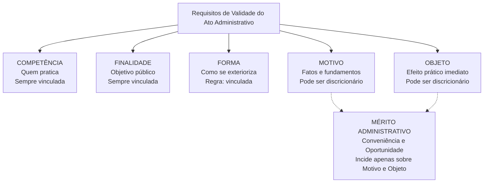
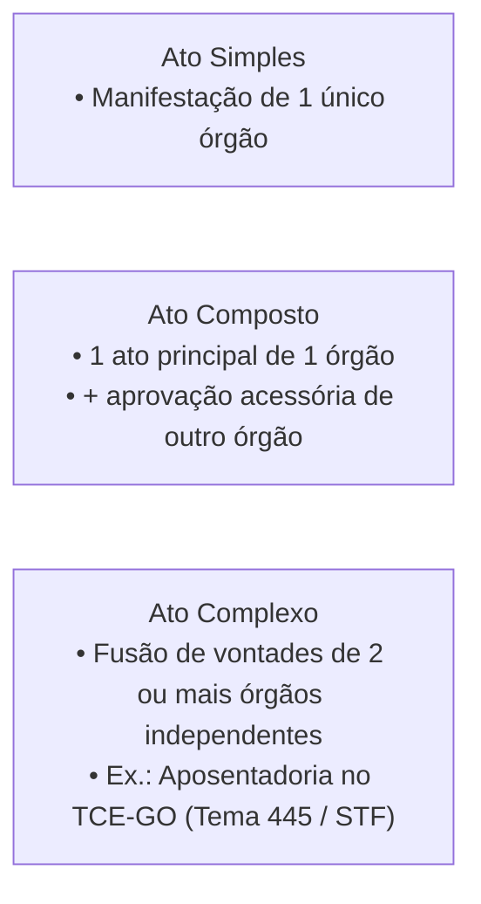

# 03 - Atos Administrativos e Processo Administrativo Estadual (Lei 13.800/2001)

> **Matéria:** Noções de Direito Administrativo  
> **Cargo:** A01 – Técnico de Controle Externo – Especialidade: Técnico Administrativo  
> **Arquivo:** `03_atos_administrativos_e_processo_estadual.md`  
> **Status:** 🟢 Teoria Aprofundada + 5 Questões FCC Comentadas (A a E)

---

## 📌 Ementa Oficial do Edital
- Ato administrativo: conceito, características e distinções.
- Elementos e requisitos de validade (Competência, Finalidade, Forma, Motivo e Objeto - COFIFOM).
- Atributos do ato administrativo: Presunção de Legitimidade, Autoexecutoriedade, Tipicidade e Imperatividade (PATI).
- Classificação dos atos administrativos: vinculados e discricionários; simples, complexos e compostos.
- Formação, efeitos, perfeição, validade e eficácia.
- Extinção dos atos: anulação, revogação, cassação, caducidade e contraposição.
- Convalidação (sanamento de vícios de competência e forma).
- Processo Administrativo no Estado de Goiás: Lei Estadual nº 13.800/2001 e alterações.

---

## 🌳 Classificação Hierárquica do Conteúdo

```text
3. Teoria Geral do Ato Administrativo e Lei Estadual de Processo (Lei GO nº 13.800/2001)
├── 3.1 Teoria Geral do Ato Administrativo
│   ├── Conceito e Distinções: Fato Administrativo vs. Ato da Administração vs. Ato Administrativo
│   ├── Elementos / Requisitos de Validade (Mnemônico COFIFOM):
│   │   ├── Competência: Sujeito competente, irrenunciável, delegação e avocação
│   │   ├── Finalidade: Satisfação do interesse público estrito (vício insanável: desvio de poder)
│   │   ├── Forma: Modo de exteriorização da vontade (vício convalidável se não essencial)
│   │   ├── Motivo: Fatos e fundamentos jurídicos (Teoria dos Motivos Determinantes)
│   │   └── Objeto / Conteúdo: Efeito jurídico imediato do ato (lícito, possível e determinado)
│   │   └── Mérito Administrativo: Discricionariedade incide estritamente sobre Motivo e Objeto
│   ├── Atributos do Ato Administrativo (Mnemônico PATI):
│   │   ├── Presunção de Legitimidade e Veracidade: Inversão do ônus da prova
│   │   ├── Autoexecutoriedade: Execução material direta sem necessidade de chancela judicial
│   │   ├── Tipicidade: Previsão prévia do modelo na ordem jurídica
│   │   └── Imperatividade: Poder extroverso (imposição de obrigações unilaterais a terceiros)
│   └── Classificações Chave da FCC:
│       ├── Atos Simples (um órgão) vs. Compostos (um ato principal + visto/aprovação)
│       └── Atos Complexos (dois órgãos autônomos fundem vontades: ex. Aposentadoria no TCE)
├── 3.2 Extinção e Convalidação dos Atos Administrativos
│   ├── Anulação: Ilegalidade, efeitos ex tunc, realizada por Adm. ou Judiciário (decadência 5 anos)
│   ├── Revogação: Inconveniência/inoportunidade, efeitos ex nunc, exclusiva da Administração
│   ├── Cassação: Descumprimento superveniente de condições legais pelo particular beneficiário
│   ├── Caducidade: Lei nova superveniente incompatível com a continuidade do ato
│   ├── Contraposição / Derrubada: Novo ato com efeito antagônico (ex.: nomeação vs. exoneração)
│   └── Convalidação (Art. 55 da Lei 9.784/99):
│       ├── Requisitos: Não acarretar lesão ao interesse público nem prejuízos a terceiros
│       └── Cabimento estrito: Competência relativa (não exclusiva) e Forma (não essencial)
└── 3.3 Processo Administrativo no Estado de Goiás (Lei Estadual nº 13.800/2001)
    ├── Princípios Fundamentais (Art. 2º): Legalidade, finalidade, motivação, segurança jurídica
    ├── Vedações Absolutas à Delegação (Art. 13 - CENORA):
    │   ├── Competência Exclusiva atribuída por lei
    │   ├── Edição de atos de caráter Normativo
    │   └── Decisão de Recursos Administrativos
    ├── Impedimentos Objetivos (Art. 18) vs. Suspeição Subjetiva (Art. 20 - amizade/inimizade)
    ├── Motivação Obrigatória das Decisões Administrativas (Art. 50)
    └── Regime Recursal (Arts. 56 a 65): Prazo de 10 dias, efeito devolutivo e reformatio in pejus
```

---

## 📖 Teoria Aprofundada e Pontos Críticos

### 1. Elementos de Validade do Ato (Mnemônico COFIFOM)



#### Teoria dos Motivos Determinantes
A validade do ato administrativo condiciona-se à veracidade e legalidade dos motivos expressados pela autoridade administrativa:
- Se a Administração exonera um servidor ocupante de cargo em comissão alegando *"redução orçamentária do setor"*, e restar comprovado que havia recursos abundantes ou se logo em seguida for nomeado outro ocupante, **o ato de exoneração é nulo por vício de motivo**, ainda que o cargo fosse de livre exoneração sem necessidade originária de justificativa.

---

### 2. Atributos do Ato Administrativo (Mnemônico PATI)

1. **Presunção de Legitimidade e Veracidade:** Presume-se que o ato foi editado em conformidade com a lei (legitimidade) e que os fatos relatados pelo agente são verdadeiros (veracidade). É presunção relativa (*juris tantum*), cabendo ao particular o ônus da prova em sentido contrário.
2. **Autoexecutoriedade:** Prerrogativa de praticar atos materiais executórios diretamente, inclusive com emprego moderado da força física, sem necessidade de obter prévia autorização judicial (ex.: guincho de veículo estacionado em local proibido, interdição sanitária de restaurante). Está presente em atos de polícia e situações de urgência; **não existe na cobrança de multas administrativas** (que exige execução fiscal judicial).
3. **Tipicidade:** O ato deve corresponder rigorosamente às figuras jurídicas predefinidas pelo ordenamento legal. Impede que a Administração invente atos inominados unilaterais.
4. **Imperatividade:** Poder extroverso do Estado de impor obrigações unilaterais aos particulares, independentemente de sua concordância. Não está presente em atos negociais (ex.: licenças) nem em atos enunciativos (ex.: certidões, pareceres).

---

### 3. Atos Simples, Complexos e Compostos (Jurisprudência FCC / STF)



> ⭐ **IMPORTANTE (O Ato de Aposentadoria e o Tribunal de Contas):**  
> A concessão inicial de aposentadoria por órgão estatal e seu posterior registro pelo Tribunal de Contas constitui **ato administrativo complexo** (Súmula Vinculante nº 3 do STF). O ato só se torna perfeito e definitivo com o registro pelo Tribunal de Contas. Nos termos do **Tema 445 do STF**, os Tribunais de Contas possuem o prazo de **5 anos** para apreciar a legalidade da concessão inicial, contados a partir da **chegada do processo à corte de contas**. Transcorrido esse prazo sem julgamento, consolida-se o registro tácito.

---

### 4. Convalidação e Extinção dos Atos

| Modalidade | Causa / Fundamento | Efeitos Temporais | Competência | Possibilidade de Convalidação? |
|---|---|:---:|---|:---:|
| **Anulação** | Ilegalidade originária do ato | *Ex tunc* (retroativo) | Administração ou Judiciário | **NÃO** (se insanável) |
| **Revogação** | Inconveniência ou inoportunidade superveniente | *Ex nunc* (prospectivo) | Exclusiva da Administração | Não se aplica |
| **Convalidação** | Sanamento de ato com defeito leve | *Ex tunc* (retroativo) | Administração Pública | **SIM** (apenas Competência relativa e Forma não essencial) |
| **Cassação** | Descumprimento das condições legais pelo beneficiário | *Ex nunc* | Administração Pública | Não se aplica |
| **Caducidade** | Norma jurídica nova contrária ao ato concedido | *Ex nunc* | Administração Pública | Não se aplica |

> 🚨 **ALERTA DE PROVA / PEGADINHA FCC:**  
> A revogação **NUNCA** pode ser declarada pelo Poder Judiciário no exercício de sua função jurisdicional (apenas em sua gestão administrativa interna de seus próprios atos). O Judiciário só pode **anular** atos do Executivo por vício de legalidade, jamais revogá-los por mérito.

---

### 5. Processo Administrativo em Goiás (Lei Estadual nº 13.800/2001)

- **Art. 13 - Vedações à Delegação (CENORA):**
  1. Competência **Exclusiva** conferida em lei;
  2. Edição de atos de caráter **Normativo**;
  3. Decisão de **Recursos Administrativos**.
- **Impedimento (Objetivo - art. 18):** O servidor deve se abster obrigatoriamente se tiver interesse direto/indireto, se atuou como perito/testemunha no processo, ou se litiga judicial ou administrativamente com o interessado ou seu cônjuge/companheiro/parente até 3º grau.
- **Suspeição (Subjetivo - art. 20):** Ocorre se o servidor tiver amizade íntima ou inimizade notória com algum dos interessados ou com seus respectivos parentes.
- **Prazos Recursais (Art. 59):** Regra geral de **10 dias** contados da intimação oficial para a interposição de recurso administrativo.

---

## 🌐 Fontes Recomendadas na Internet
- [Lei Estadual de Goiás nº 13.800/2001 (Processo Administrativo Estadual)](https://legisla.casacivil.go.gov.br/pesquisa_legislacao/38927/lei-13800)
  - Texto compilado do marco processual administrativo do Estado de Goiás.
- [Lei Federal nº 4.717/1965 (Ação Popular - Art. 2º)](https://www.planalto.gov.br/ccivil_03/leis/l4717.htm#art2)
  - Base conceitual dos cinco elementos do ato: competência, finalidade, forma, motivo e objeto.
- [Súmula Vinculante nº 3 do STF (Atos de Aposentadoria)](https://portal.stf.jus.br/jurisprudencia/sumarios/sumulavinculante.asp?seq=3)
  - Dispensa de contraditório no ato inicial de concessão e controle externo pelo Tribunal de Contas.
- [STF - Tema 445 da Repercussão Geral](https://portal.stf.jus.br/jurisprudencia/repercussaoGeral/tema.asp?num=445)
  - Acórdão que fixou o prazo de 5 anos para o registro de aposentadoria a contar da entrada dos autos na corte de contas.

---

## 📝 Questões Comentadas no Padrão FCC (Justificadas de A a E)

### Questão 1 (FCC - Analista de Controle Externo / Adaptada TCE-GO)
Determinada autarquia estadual goiana publicou ato de concessão de aposentadoria voluntária a um auditor fiscal e encaminhou o respectivo processo ao Tribunal de Contas do Estado de Goiás para fins de apreciação e registro de legalidade. Após seis meses de tramitação no Tribunal de Contas, a autarquia estadual pretendeu revogar unilateralmente a concessão com base em conveniência administrativa decorrente de escassez de quadro técnico.

À luz da teoria geral dos atos administrativos e da jurisprudência firmada pelo Supremo Tribunal Federal:

A) A aposentadoria concedida qualifica-se como ato administrativo simples, aperfeiçoado de forma definitiva com a publicação pelo órgão de origem.  
B) Trata-se de ato composto, haja vista que a manifestação do Tribunal de Contas consubstancia ato instrumental de mera homologação protocolar.  
C) Trata-se de ato complexo, que apenas se aperfeiçoa e ganha definitividade jurídica com a manifestação convergente de vontades do órgão de origem e do Tribunal de Contas no exercício de sua competência constitucional de registro.  
D) O ato de aposentadoria é discricionário por natureza, sendo plenamente revogável a qualquer tempo pela autoridade de origem por motivos de oportunidade e conveniência.  
E) A competência de registro pelo Tribunal de Contas possui prazo decadencial de dois anos contado da data de nascimento do servidor inativado.  

> **Gabarito: C**  
>  
> **Comentário Analítico Passo a Passo:**  
> 1. Pela jurisprudência pacífica do Supremo Tribunal Federal (Súmula Vinculante nº 3 e Tema 445 de Repercussão Geral), a concessão de aposentadoria, pensão ou reforma sujeita a controle e registro pelos Tribunais de Contas é um **ato administrativo complexo**.  
> 2. O ato complexo resulta da manifestação de dois ou mais órgãos autônomos e independentes que integram suas vontades para formar um ato único. O ato concessório emitido pelo órgão de origem é precário e provisório; somente ganha definitividade e perfeição com o julgamento de legalidade e outorga de registro pelo Tribunal de Contas.  
> 3. Por se tratar de ato vinculado (direito subjetivo preenchido os requisitos legais), ele não é suscetível de revogação por discricionariedade ou conveniência da Administração.  
>  
> **Análise das Alternativas:**  
> - **A) Incorreta:** Ato simples é aquele que resulta da manifestação volitiva de um único órgão.  
> - **B) Incorreta:** No ato composto há um ato principal expedido por um órgão e um ato acessório/aprobatório de outro; a aposentadoria com registro no TC é pacificamente classificada pelo STF como ato complexo.  
> - **C) CORRETA:** Caracteriza precisamente a definição doutrinária e jurisprudencial do ato complexo.  
> - **D) Incorreta:** A aposentadoria é ato vinculado regido por lei, não admitindo revogação por mera conveniência do órgão empregador.  
> - **E) Incorreta:** O prazo fixado no Tema 445 do STF é de 5 anos a contar da chegada do processo ao Tribunal de Contas.

---

### Questão 2 (FCC - Técnico de Controle Externo / TCE-GO)
No âmbito de um processo administrativo disciplinar disciplinado pela Lei Estadual nº 13.800/2001, um Superintendente Regional do Estado de Goiás delegou por portaria ao seu Chefe de Gabinete a competência para proferir decisão de mérito em recurso administrativo interposto por servidor apenado.

Considerando o regime jurídico de competência e delegação estabelecido na Lei Estadual nº 13.800/2001:

A) A delegação é válida, tendo em vista que o princípio da eficiência autoriza o repasse de quaisquer competências para desafogar instâncias superiores.  
B) A delegação padece de vício de ilegalidade insanável, por violar proibição legal expressa que veda a delegação da competência para decidir recursos administrativos.  
C) A decisão em recurso administrativo pode ser delegada, desde que haja expressa concordância do servidor recorrente.  
D) A delegação de recurso administrativo é admissível caso o recurso verse exclusivamente sobre questões fáticas.  
E) A competência administrativa é irrenunciável e não admite delegação de nenhuma natureza na esfera pública estadual de Goiás.  

> **Gabarito: B**  
>  
> **Comentário Analítico Passo a Passo:**  
> 1. O art. 13 da Lei Estadual nº 13.800/2001 (Processo Administrativo Estadual) estabelece de forma categórica as matérias insuscetíveis de delegação (regra CENORA):  
>    *"Não podem ser objeto de delegação:*  
>    *I - a edição de atos de caráter normativo;*  
>    *II - a decisão de recursos administrativos;*  
>    *III - as matérias de competência exclusiva do órgão ou autoridade."*  
> 2. O julgamento de recurso administrativo consubstancia o direito ao duplo grau de jurisdição administrativa. A delegação da decisão recursal a agente subordinado violaria o princípio da hierarquia e a garantia da ampla defesa.  
>  
> **Análise das Alternativas:**  
> - **A) Incorreta:** O princípio da eficiência não se sobrepõe à vedação legal imperativa.  
> - **B) CORRETA:** O julgamento de recursos administrativos é indelegável por expressa determinação do art. 13, II, da Lei nº 13.800/2001.  
> - **C) Incorreta:** O consentimento do interessado não tem o poder de afastar a norma cogente de ordem pública.  
> - **D) Incorreta:** A proibição legal atinge qualquer espécie de recurso administrativo.  
> - **E) Incorreta:** A competência admite delegação regular em matérias executórias e ordinatórias, ressalvadas as vedações do art. 13.

---

### Questão 3 (FCC - Procurador do Estado / Adaptada)
Determinada autoridade administrativa estadual proferiu ato administrativo autorizando a ocupação temporária de bem público por particular. Posteriormente, a assessoria jurídica constatou que a competência para emitir o ato pertencia legalmente a um Diretor Setorial distinto, inexistindo competência exclusiva em favor de qualquer deles. Verificou-se que a autorização atendeu plenamente ao interesse público, não causou prejuízo a terceiros e observou todos os demais requisitos de forma, motivo e objeto.

Diante do vício constatado, a Administração Pública:

A) Deve obrigatoriamente anular o ato com efeitos retroativos, visto que vícios de competência jamais comportam sanamento.  
B) Pode convalidar o ato administrativo por meio de ratificação pela autoridade competente, operando a convalidação efeitos retroativos (*ex tunc*).  
C) Deve revogar o ato administrativo com eficácia prospectiva (*ex nunc*), por se tratar de vício de mérito.  
D) Está impedida de agir, operando-se a preclusão administrativa imediata no momento da publicação do ato.  
E) Deve converter o ato em desapropriação indireta com indenização ao particular ocupante.  

> **Gabarito: B**  
>  
> **Comentário Analítico Passo a Passo:**  
> 1. Requisitos da Convalidação (Lei Federal 9.784/99, art. 55 e Lei Goiana 13.800/2001, art. 54):  
>    *"Em decisão na qual se evidencie não acarretarem lesão ao interesse público nem prejuízo a terceiros, os atos que apresentarem defeitos sanáveis poderão ser convalidados pela própria Administração."*  
> 2. São defeitos sanáveis:  
>    - **Vício de Competência quanto à pessoa:** Quando a competência legal não tiver sido outorgada com exclusividade; a autoridade titular pode ratificar o ato praticado pelo agente incompetente.  
>    - **Vício de Forma:** Desde que a forma não tenha sido instituída como elemento essencial para a validade do ato.  
> 3. A convalidação opera efeitos retroativos (**ex tunc**), confirmando a validade do ato desde a sua gênese originária.  
>  
> **Análise das Alternativas:**  
> - **A) Incorreta:** A convalidação é admitida para vício relativo de competência que não seja exclusiva.  
> - **B) CORRETA:** O vício relativo de competência pode ser convalidado por ratificação da autoridade competente com efeitos retroativos (*ex tunc*).  
> - **C) Incorreta:** Não se trata de revogação (que incide sobre conveniência de atos legais), mas de correção de defeito de validade.  
> - **D) Incorreta:** A Administração tem o poder-dever de autotutela para sanar ou anular seus atos.  
> - **E) Incorreta:** Fundamento juridicamente absurdo e descontextualizado.

---

### Questão 4 (FCC - Auditor de Controle Externo)
O Governador do Estado exonerou servidor ocupante de cargo em comissão de livre nomeação e exoneração, fundamentando formalmente o decreto na suposta extinção orçamentária do programa governamental em que o servidor atuava. Posteriormente, em ação judicial, restou fartamente comprovado por perícia que o programa estatal continuava plenamente ativo, com dotação financeira reforçada e com as mesmas atribuições mantidas.

Com base na **Teoria dos Motivos Determinantes**:

A) O ato de exoneração é perfeitamente válido, tendo em vista que a exoneração de cargo em comissão é discricionária e imune a controle de legalidade.  
B) O ato é nulo, pois a validade do ato administrativo fica vinculada à existência e veracidade dos motivos externados pela autoridade que o editou.  
C) O Poder Judiciário não pode invalidar o ato, pois a análise dos motivos configuraria invasão indevida no mérito administrativo.  
D) A autoridade administrativa pode substituir retroativamente o motivo falso por um motivo verdadeiro para salvar o ato da anulação.  
E) A Teoria dos Motivos Determinantes aplica-se unicamente aos atos administrativos vinculados.  

> **Gabarito: B**  
>  
> **Comentário Analítico Passo a Passo:**  
> 1. Pela Teoria dos Motivos Determinantes (doutrina e jurisprudência pacíficas do STF e STJ), a validade do ato administrativo vincula-se aos motivos invocados como seu fundamento fático e jurídico.  
> 2. Ainda que o ato seja discricionário e prescindisse de fundamentação expressa (como na exoneração *ad nutum* de cargos em comissão), se a autoridade optar por justificar o ato, a validade deste dependerá da veracidade dos motivos expostos.  
> 3. Se os motivos declarados forem inexistentes, falsos ou juridicamente errôneos, o ato padece de nulidade absoluta e deve ser anulado pelo Poder Judiciário ou pela Administração.  
>  
> **Análise das Alternativas:**  
> - **A) Incorreta:** A exoneração *ad nutum* é discricionária, mas a indicação de motivo falso vincula e invalida o ato.  
> - **B) CORRETA:** Expressão exata da Teoria dos Motivos Determinantes: demonstrada a falsidade do motivo externado, o ato é irremediavelmente nulo.  
> - **C) Incorreta:** O controle de veracidade dos fatos integra o controle de legalidade (verificação do elemento motivo), não configurando intromissão indevida no mérito administrativo.  
> - **D) Incorreta:** A motivação posterior não tem o condão de convalidar ato eivado de motivo originariamente falso.  
> - **E) Incorreta:** A teoria tem maior relevância prática justamente nos atos discricionários em que a motivação foi facultativa.

---

### Questão 5 (FCC - Analista Judiciário)
Determinada empresa concessionária de rodovias obteve licença municipal para instalação de praça de pedágio. Dois anos após o início regular da operação, o Município promulgou nova lei de zoneamento urbano proibindo a cobrança de pedágio na referida área geográfica. Por sua vez, em outro ponto da cidade, um restaurante que possuía alvará sanitário foi flagrado comercializando alimentos estragados e descumprindo normas higiênicas fundamentais.

As formas de extinção dos atos administrativos aplicáveis, respectivamente, à praça de pedágio e ao restaurante são:

A) Revogação e anulação  
B) Caducidade e cassação  
C) Cassação e caducidade  
D) Anulação e revogação  
E) Contraposição e renúncia  

> **Gabarito: B**  
>  
> **Comentário Analítico Passo a Passo:**  
> 1. **Situação 1 (Praça de pedágio):** O ato de autorização/licença era originariamente válido, mas uma **lei nova superveniente** tornou ilegal a atividade antes permitida. A extinção de ato válido em razão de superveniência de lei incompatível denomina-se **CADUCIDADE**.  
> 2. **Situação 2 (Restaurante):** O particular detinha licença válida, mas passou a **descumprir supervenientemente as condições legais obrigatórias** que permitiam o funcionamento (normas sanitárias). A extinção do ato punindo a conduta faltosa do particular beneficiário denomina-se **CASSAÇÃO**.  
>  
> **Análise das Alternativas:**  
> - **A) Incorreta:** Não houve revogação por conveniência nem anulação por ilegalidade originária.  
> - **B) CORRETA:** Encaixe perfeito: Caducidade (lei nova incompatível) e Cassação (falta grave superveniente do beneficiário).  
> - **C) Incorreta:** Inverteu os conceitos entre os dois casos.  
> - **D) Incorreta:** Confunde extinções sancionatórias e legislativas com anulação e revogação.  
> - **E) Incorreta:** Contraposição ocorre por ato administrativo antagônico; renúncia é extinção por vontade do próprio beneficiário.
