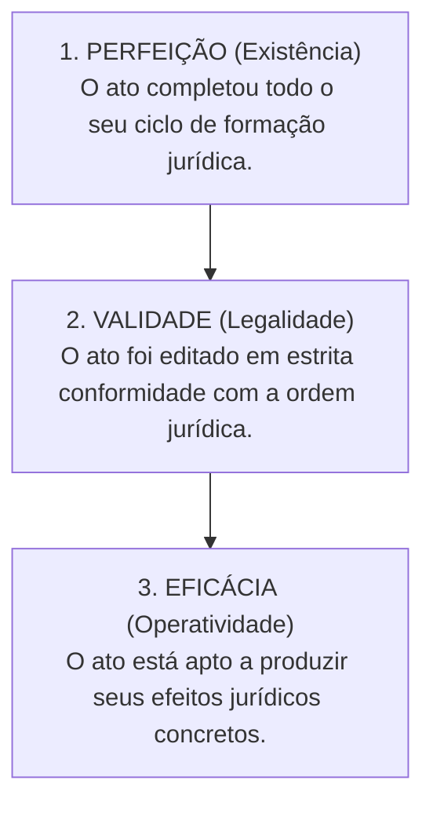
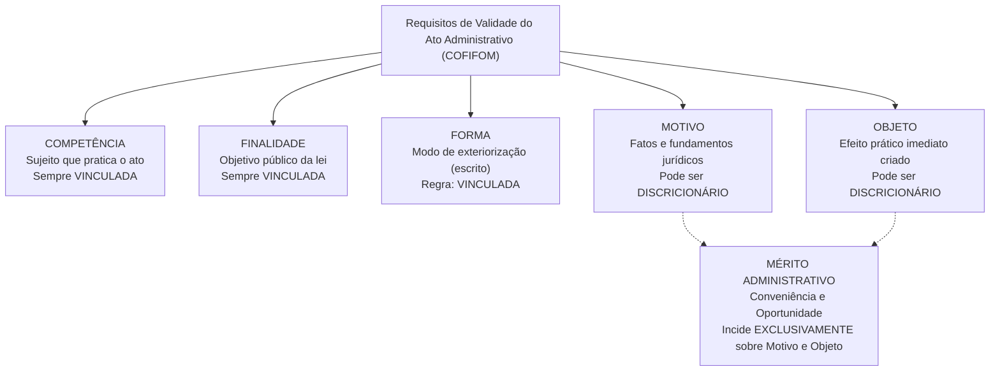
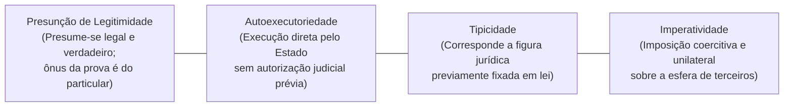
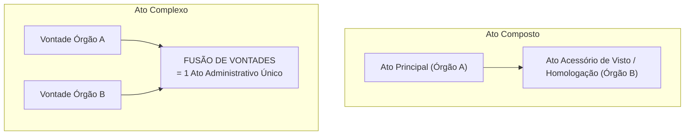

# 03 - Atos Administrativos e Processo Administrativo Estadual (Lei 13.800/2001)

> **Matéria:** Noções de Direito Administrativo  
> **Cargo:** A01 – Técnico de Controle Externo – Especialidade: Técnico Administrativo  
> **Arquivo:** `03_atos_administrativos_e_processo_estadual.md`  

---

## 📌 Ementa / Itens do Edital
- Ato administrativo: conceito, características e distinções
- Elementos e requisitos de validade (Competência, Finalidade, Forma, Motivo e Objeto - COFIFOM)
- Atributos do ato administrativo: Presunção de Legitimidade, Autoexecutoriedade, Tipicidade e Imperatividade (PATI)
- Classificação dos atos administrativos: vinculados e discricionários; simples, complexos e compostos
- Formação, efeitos, perfeição, validade e eficácia
- Extinção dos atos: anulação, revogação, cassação, caducidade e contraposição
- Convalidação (sanamento de vícios de competência e forma)
- Processo Administrativo no Estado de Goiás: Lei Estadual nº 13.800/2001 e alterações

---

## 🧭 Sumário

- [1. Teoria Geral do Ato Administrativo e Distinções Conceituais](#1-teoria-geral-do-ato-administrativo-e-distinções-conceituais)
  - [1.1 Fato da Administração vs. Fato Administrativo vs. Ato Administrativo](#11-fato-da-administração-vs-fato-administrativo-vs-ato-administrativo)
  - [1.2 Perfeição, Validade e Eficácia do Ato](#12-perfeição-validade-e-eficácia-do-ato)
- [2. Elementos e Requisitos de Validade do Ato (Mnemônico COFIFOM)](#2-elementos-e-requisitos-de-validade-do-ato-mnemônico-cofifom)
  - [2.1 Competência (Sujeito Competente)](#21-competência-sujeito-competente)
  - [2.2 Finalidade e o Desvio de Poder](#22-finalidade-e-o-desvio-de-poder)
  - [2.3 Forma e Princípio da Solenidade](#23-forma-e-princípio-da-solenidade)
  - [2.4 Motivo e a Teoria dos Motivos Determinantes](#24-motivo-e-a-teoria-dos-motivos-determinantes)
  - [2.5 Objeto (Conteúdo) e a Delimitação do Mérito Administrativo](#25-objeto-conteúdo-e-a-delimitação-do-mérito-administrativo)
- [3. Atributos do Ato Administrativo (Mnemônico PATI)](#3-atributos-do-ato-administrativo-mnemônico-pati)
  - [3.1 Presunção de Legitimidade e Veracidade](#31-presunção-de-legitimidade-e-veracidade)
  - [3.2 Autoexecutoriedade e seus Limites](#32-autoexecutoriedade-e-seus-limites)
  - [3.3 Tipicidade Administrativa](#33-tipicidade-administrativa)
  - [3.4 Imperatividade e Poder Extroverso](#34-imperatividade-e-poder-extroverso)
- [4. Classificações Relevantes para a FCC: Atos Simples, Complexos e Compostos](#4-classificações-relevantes-para-a-fcc-atos-simples-complexos-e-compostos)
  - [4.1 Atos Simples, Complexos e Compostos](#41-atos-simples-complexos-e-compostos)
  - [4.2 O Registro de Aposentadoria no Tribunal de Contas (Tema 445 / STF)](#42-o-registro-de-aposentadoria-no-tribunal-de-contas-tema-445--stf)
- [5. Extinção e Convalidação dos Atos Administrativos](#5-extinção-e-convalidação-dos-atos-administrativos)
  - [5.1 Modos de Extinção: Anulação, Revogação, Cassação, Caducidade e Contraposição](#51-modos-de-extinção-anulação-revogação-cassação-caducidade-e-contraposição)
  - [5.2 Convalidação: Requisitos, Limites e Efeitos Temporais](#52-convalidação-requisitos-limites-e-efeitos-temporais)
- [6. Processo Administrativo no Estado de Goiás (Lei Estadual nº 13.800/2001)](#6-processo-administrativo-no-estado-de-goiás-lei-estadual-nº-138002001)
  - [6.1 Princípios Norteadores e Direitos dos Administrados](#61-princípios-norteadores-e-direitos-dos-administrados)
  - [6.2 Vedações Absolutas à Delegação (Regra do CENORA - Art. 13)](#62-vedações-absolutas-à-delegação-regra-do-cenora---art-13)
  - [6.3 Impedimentos e Suspeição de Agentes e Julgadores](#63-impedimentos-e-suspeição-de-agentes-e-julgadores)
  - [6.4 Motivação das Decisões e Regime Recursal](#64-motivação-das-decisões-e-regime-recursal)
- [7. Fontes Recomendadas na Internet](#7-fontes-recomendadas-na-internet)
- [8. Questões Comentadas & Exemplos (Padrão FCC)](#8-questões-comentadas--exemplos-padrão-fcc)

---

## 1. Teoria Geral do Ato Administrativo e Distinções Conceituais

O ato administrativo é a manifestação unilateral de vontade da Administração Pública ou de quem lhe faça as vezes, que, agindo sob o império do Direito Público, tem por fim imediato adquirir, resguardar, transferir, modificar, extinguir ou declarar direitos, ou impor obrigações aos administrados ou a si própria.

### 1.1 Fato da Administração vs. Fato Administrativo vs. Ato Administrativo

A doutrina administrativista clássica (seguida com rigor pela banca FCC) diferencia os eventos jurídicos da administração pública em três categorias:

- **Fato da Administração:** Evento puramente material ou natural ocorrido no seio da Administração, mas desprovido de repercussão ou consequência jurídica direta para o Direito Administrativo (ex.: o funcionário que limpa o chão de uma repartição; a pintura ordinária de uma parede).
- **Fato Administrativo:** Acontecimento fático que produz efeitos jurídicos relevantes no âmbito do Direito Administrativo. Pode decorrer de um ato voluntário (ex.: a apreensão material de mercadorias pirateadas) ou de um evento da natureza (ex.: a queda de uma árvore sobre veículo particular gerando responsabilidade civil; o decurso do tempo acarretando prescrição).
- **Ato Administrativo:** Declaração jurídica formal e intencional emitida pelo Estado com a finalidade de produzir efeitos jurídicos no mundo do direito (ex.: a expedição de uma licença de obras, a demissão de um servidor público estável, a aplicação de uma penalidade em licitação).

### 1.2 Perfeição, Validade e Eficácia do Ato

A teoria tridimensional do ato administrativo estabelece três planos de análise que não se confundem:

- **Ato Perfeito:** Aquele que completou todas as fases de seu ciclo de formação interna, estando concluído. Pode ser válido ou inválido.
- **Ato Válido:** Aquele que, além de perfeito, atende a todos os requisitos e pressupostos estabelecidos em lei (sem vícios de legalidade).
- **Ato Eficaz:** Aquele que está pronto para deflagrar seus efeitos jurídicos práticos, não dependendo de condição suspensiva, termo inicial ou publicação oficial.
  - *Exemplo Prático FCC:* Um ato de demissão assinado pelo Governador é **perfeito e válido**, mas só se torna **eficaz** a partir de sua publicação no Diário Oficial do Estado.

---

## 2. Elementos e Requisitos de Validade do Ato (Mnemônico COFIFOM)

A Lei de Ação Popular (Lei Federal nº 4.717/1965, art. 2º) positivou a doutrina dos cinco elementos constitutivos indispensáveis para a validade do ato administrativo: **Competência, Finalidade, Forma, Motivo e Objeto** (**COFIFOM**).

### 2.1 Competência (Sujeito Competente)

É o círculo de atribuições conferido pelo ordenamento jurídico ao agente ou órgão público para a prática do ato.
- **Características:** É irrenunciável, intransferível por acordo entre as partes, inderrogável, imprescritível e imodificável pela vontade do titular.
- **Espécies de Vício de Competência:**
  - *Usurpação de Função:* Crime praticado por particular que se faz passar por funcionário público (ato inexistente).
  - *Excesso de Poder:* O agente público ultrapassa os limites legais de suas atribuições funcionais (ato nulo insanável).
  - *Incompetência Relativa:* O ato é praticado por agente de mesmo órgão ou hierarquia que não detinha a atribuição específica, sem que a competência fosse atribuída com exclusividade pela lei. Admite **convalidação** por ratificação da autoridade competente.

### 2.2 Finalidade e o Desvio de Poder

A finalidade representa o objetivo mediato de interesse público que o ato deve alcançar. É elemento **invariavelmente vinculado**; o administrador jamais detém discricionariedade para escolher a finalidade pública a ser perseguida.
- **Desvio de Finalidade (Desvio de Poder):** Ocorre quando a autoridade competente utiliza poderes legítimos para atingir fins alheios ao interesse público ou fim diverso daquele categorizado pela lei para aquela competência (ex.: remoção compulsória de servidor com o propósito punitivo disfarçado de perseguição pessoal). É vício que acarreta a **nulidade absoluta e insanável** do ato administrativo.

### 2.3 Forma e Princípio da Solenidade

A forma é o modo pelo qual a vontade da Administração se exterioriza e ganha publicidade no mundo jurídico.
- No Direito Administrativo vige o princípio do formalismo moderado, mas como regra geral os atos são solenes e devem ser expedidos por **escrito**, contendo data, identificação do cargo e assinatura.
- *Defeitos de Forma:* A omissão de formalidades não essenciais que não prejudiquem o direito de defesa dos administrados configura vício sanável, passível de **convalidação**.

### 2.4 Motivo e a Teoria dos Motivos Determinantes

O motivo constitui a situação de fato (o evento do mundo real) e a situação de direito (o enquadramento na norma legal) que autorizam ou determinam a prática do ato administrativo.
- Não se confunde com a **motivação** (a motivação é a declaração escrita dos motivos; o motivo é o próprio fato em si).

#### A Teoria dos Motivos Determinantes:
Consagrada pela jurisprudência pacífica do STF e do STJ, preceitua que a validade do ato administrativo fica indissoluvelmente vinculada à veracidade, exatidão e subsistência dos motivos alegados pela autoridade:
- Mesmo que o ato seja discricionário e prescindisse originalmente de motivação obrigatória (como a exoneração *ad nutum* de um assessor comissionado), se a autoridade decidir enunciar publicamente um motivo (ex.: afirmar no decreto que exonerou o servidor em razão do corte orçamentário do setor), **o ato ficará vinculado a essa justificativa**.
- Se for judicialmente ou administrativamente comprovado que o motivo é falso (o órgão tinha recursos abundantes) ou juridicamente inexistente, **o ato de exoneração é nulo de pleno direito**, devendo ser extirpado da ordem jurídica.

### 2.5 Objeto (Conteúdo) e a Delimitação do Mérito Administrativo

O objeto é o efeito jurídico imediato e substantivo que o ato produz no mundo real (é o "o que" o ato decide, cria, extingue ou altera). Deve ser lícito, possível, determinado ou determinável.
- **O Mérito Administrativo:** Nos atos discricionários, o mérito administrativo — consubstanciado no juízo de **conveniência e oportunidade** privativo da autoridade pública — incide **estrita e unicamente sobre o Motivo e o Objeto**. Os elementos Competência, Finalidade e Forma são sempre vinculados.

---

## 3. Atributos do Ato Administrativo (Mnemônico PATI)

Os atributos do ato administrativo consagram prerrogativas que decorrem diretamente do princípio da supremacia do interesse público:

### 3.1 Presunção de Legitimidade e Veracidade

Presume-se que o ato administrativo foi expedido em estrita consonância com a lei (legitimidade) e que os fatos relatados pelos agentes públicos são verdadeiros (veracidade).
- É presunção relativa (*juris tantum*), que admite prova em contrário.
- Gera a **inversão do ônus da prova**: incumbe ao particular demonstrar e comprovar a ilegalidade ou falsidade do ato impugnado perante o Judiciário ou a Administração.

### 3.2 Autoexecutoriedade e seus Limites

É a prerrogativa conferida à Administração Pública de compelir materialmente o administrado a cumprir o ato ou executar diretamente a providência administrativa, inclusive com uso moderado da força física policial, **sem necessidade de intervenção ou autorização prévia do Poder Judiciário** (ex.: guincho de carro estacionado em local proibido; interdição e lacração de restaurante com alimentos deteriorados; apreensão de drogas).
- **Limites Críticos da Autoexecutoriedade:** A autoexecutoriedade depende de expressa previsão legal ou de situação fática emergencial/urgente.  
> 🚨 **ALERTA CLÁSSICO FCC:**  
> A cobrança de **multas pecuniárias administrativas NÃO é autoexecutória**! Se o particular se recusar a pagar a multa, a Administração não pode tomar o dinheiro de sua conta bancária diretamente; deve inscrever o débito em Dívida Ativa e ajuizar Ação de Execução Fiscal perante o Poder Judiciário.

### 3.3 Tipicidade Administrativa

Formulada por Maria Sylvia Zanella Di Pietro, preceitua que cada ato administrativo deve corresponder rigorosamente a figuras e modelos abstratos previamente tipificados na legislação. Impede que o Estado crie atos unilaterais inominados ou arbitrários sem desenho legal prévio.

### 3.4 Imperatividade e Poder Extroverso

Consiste na faculdade de impor obrigações coercitivas e restrições unilaterais a terceiros, independentemente de sua concordância prévia.
- Não está presente em atos negociais (licenças, autorizações) e atos meramente enunciativos (pareceres, certidões, atestados).

---

## 4. Classificações Relevantes para a FCC: Atos Simples, Complexos e Compostos

### 4.1 Atos Simples, Complexos e Compostos

- **Ato Simples:** Resulta da manifestação de vontade de um **único órgão** administrativo (seja ele singular, como o ato de um Secretário de Estado, ou colegiado, como a decisão plenária de um Tribunal de Contas).
- **Ato Composto:** Resulta da manifestação de vontade de um único órgão que emite um **ato principal**, cuja eficácia depende de um **ato instrumental acessório** emanado de outro órgão (ex.: aprovação, homologação, visto, chancela). Há um ato principal e um ato acessório.
- **Ato Complexo:** Resulta da **fusão e integração convergente de vontades de dois ou mais órgãos autônomos e independentes**, que se conjugam para formar um **único ato administrativo final**.

### 4.2 O Registro de Aposentadoria no Tribunal de Contas (Tema 445 / STF)

O julgamento da legalidade e a concessão de registro de aposentadoria, pensão ou reforma pelas Cortes de Contas é um dos temas prediletos da FCC:
1. **Natureza Jurídica:** Trata-se categoricamente de um **ato administrativo complexo** (Súmula Vinculante nº 3 e pacífica jurisprudência do STF). O ato inicial expedido pelo órgão de origem é meramente precário e provisório; somente ganha definitividade e perfeição com o julgamento e registro pelo Tribunal de Contas.
2. **Dispensa de Contraditório Prévio (SV nº 3):** Na apreciação da legalidade do ato de concessão inicial de aposentadoria, é dispensado o contraditório e a ampla defesa no Tribunal de Contas, salvo se transcorrer prazo desarrazoado.
3. **O Prazo Decadencial de 5 Anos (Tema 445 do STF):** O STF fixou a seguinte tese vinculante:
   > *"Em atenção aos princípios da segurança jurídica e da confiança legítima, os Tribunais de Contas estão sujeitos ao prazo de 5 anos para o julgamento da legalidade do ato de concessão inicial de aposentadoria, reforma ou pensão, **a contar da chegada do processo à respectiva Corte de Contas**, após o qual, se não houver decisão, o ato considerar-se-á definitivamente registrado."*
4. **Impossibilidade de Revogação por Conveniência:** Por se tratar de ato vinculado, a autoridade de origem não pode revogar a aposentadoria com base em razões de conveniência ou oportunidade (mérito).

---

## 5. Extinção e Convalidação dos Atos Administrativos

### 5.1 Modos de Extinção: Anulação, Revogação, Cassação, Caducidade e Contraposição

| Modalidade de Extinção | Causa Primária | Efeitos no Tempo | Competência | Distinção Prática FCC |
| :--- | :--- | :---: | :--- | :--- |
| **Anulação** | **Ilegalidade originária** do ato (vício de legalidade insanável) | **Retroativo (*ex tunc*)** | Administração Pública ou Poder Judiciário | Desfaz o ato desde o nascimento, pois dele não se originam direitos. |
| **Revogação** | **Inconveniência ou inoportunidade superveniente** (mérito) | **Prospectivo (*ex nunc*)** | **Exclusiva da própria Administração** | Recai sobre atos válidos; respeita direitos adquiridos e atos consumados. |
| **Cassação** | **Descumprimento de condições legais** pelo particular beneficiário | *Ex nunc* | Administração Pública | Sanção contra o administrado faltoso (ex.: cassar alvará sanitário por comida estragada). |
| **Caducidade** | **Superveniência de lei nova** que torna a atividade ilegal | *Ex nunc* | Administração Pública | O ato era legal, mas nova legislação proibiu a atividade (ex.: lei que veda pedágio na área). |
| **Contraposição / Derrubada** | Emissão de **novo ato com efeitos antagônicos** e incompatíveis | *Ex nunc* | Administração Pública | O novo ato extingue o anterior (ex.: ato de exoneração contrapõe-se ao de nomeação). |
| **Renúncia** | Desistência expressa voluntária manifestada pelo beneficiário | *Ex nunc* | Manifestação do particular | O titular abre mão do benefício conferido pelo ato. |

> ⚠️ **Atenção Máxima FCC:**  
> O Poder Judiciário **JAMAIS pode revogar atos administrativos do Poder Executivo**. O Judiciário pode anular atos ilegais, mas se pronunciar sobre a conveniência e oportunidade de atos do Executivo configuraria intolerável violação à separação dos Poderes (art. 2º da CF).

### 5.2 Convalidação: Requisitos, Limites e Efeitos Temporais

A convalidação (ou sanatória) é o ato administrativo pelo qual a Administração corrige e supre um vício existente em ato ilegal anterior com efeitos retroativos (**ex tunc**).
- **Dispositivo Normativo:** Art. 55 da Lei Federal nº 9.784/1999 e art. 54 da Lei Estadual/GO nº 13.800/2001.
- **Requisitos Cumulativos Obrigatórios:**
  1. O ato **não pode acarretar lesão ao interesse público**;
  2. O ato **não pode causar prejuízos a terceiros de boa-fé**;
  3. O vício deve ser **sanável**.
- **Defeitos Sanáveis que Comportam Convalidação:**
  - **Competência quanto à Pessoa:** Admite convalidação (ratificação pela autoridade competente), desde que a lei **NÃO tenha atribuído competência exclusiva** à autoridade que praticou o ato originário.
  - **Forma:** Admite convalidação se a forma desrespeitada não foi expressamente exigida por lei como requisito essencial de validade do ato.
- **Defeitos Insanáveis (NULIDADE ABSOLUTA - Vedada Convalidação):**
  - Vício de **Finalidade** (desvio de poder);
  - Vício de **Motivo** (motivo falso ou inexistente);
  - Vício de **Objeto** (objeto ilícito ou impossível);
  - Vício de competência privativa/exclusiva ou forma essencial.

---

## 6. Processo Administrativo no Estado de Goiás (Lei Estadual nº 13.800/2001)

A **Lei Estadual nº 13.800/2001** disciplina o processo administrativo no âmbito da Administração Pública direta e indireta do Estado de Goiás:

### 6.1 Princípios Norteadores e Direitos dos Administrados

- Subordina-se aos princípios da legalidade, finalidade, motivação, razoabilidade, proporcionalidade, moralidade, ampla defesa, contraditório, segurança jurídica, interesse público e eficiência (art. 2º).
- Reconhece o direito do cidadão de ser tratado com respeito, ter ciência da tramitação dos processos em que tenha a condição de interessado, ter vista dos autos, obter certidões e formular alegações e apresentar documentos antes da tomada da decisão.

### 6.2 Vedações Absolutas à Delegação (Regra do CENORA - Art. 13)

Reproduzindo a regra geral do direito público brasileiro, o art. 13 da Lei Goiana nº 13.800/2001 veda taxativamente a delegação de três matérias específicas:
1. **Competência Exclusiva** atribuída por lei a determinado órgão ou autoridade;
2. Edição de atos de caráter **Normativo**;
3. Decisão de **Recursos Administrativos**.

### 6.3 Impedimentos e Suspeição de Agentes e Julgadores

Para assegurar a imparcialidade nas decisões administrativas, a lei estadual estabelece distinção crucial entre:

- **Impedimento (Vício Objetivo - Art. 18):** O servidor ou autoridade é legalmente impedido de atuar em processo no qual:
  - Tenha interesse direto ou indireto na matéria;
  - Tenha participado ou venha a participar como perito, testemunha ou representante, ou se tais situações ocorrerem quanto ao cônjuge, companheiro ou parentes até o terceiro grau;
  - Esteja litigando judicial ou administrativamente com o interessado ou respectivo cônjuge/companheiro.
  - *Omissão do Impedimento:* Constitui falta disciplinar grave.
- **Suspeição (Vício Subjetivo - Art. 20):** Pode ser arguida a suspeição de autoridade ou servidor que tenha amizade íntima ou inimizade notória com algum dos interessados ou com os respectivos cônjuges, companheiros, parentes e afins até o terceiro grau.

### 6.4 Motivação das Decisões e Regime Recursal

- **Dever de Motivação (Art. 50):** As decisões que neguem, limitem ou afetem direitos ou interesses, imponham sanções, decidam recursos, dispensem licitações ou anulem/revoguem atos anteriores devem ser expressamente motivadas, com indicação dos fatos e fundamentos jurídicos.
- **Prazos Recursais (Art. 59):** Salvo disposição legal específica em contrário, o prazo para interposição de recurso administrativo na administração goiana é de **10 (dez) dias**, contados da ciência ou divulgação oficial da decisão.
- **Efeitos do Recurso e Reformatio in Pejus (Arts. 61 e 64):** O recurso tem como regra geral efeito estritamente devolutivo (efeito suspensivo é excepcional). A autoridade julgadora pode confirmar, modificar, anular ou revogar, total ou parcialmente, a decisão recorrida; se da revisão puder decorrer gravame à situação do recorrente (*reformatio in pejus*), este deverá ser cientificado previamente para formular suas alegações no prazo de 10 dias.

---

## 7. Fontes Recomendadas na Internet

- [Lei Estadual de Goiás nº 13.800/2001 (Processo Administrativo Estadual)](https://legisla.casacivil.go.gov.br/pesquisa_legislacao/38927/lei-13800)  
  Texto legal consolidado que disciplina o processo administrativo e os prazos recursais no Estado de Goiás.
- [Lei Federal nº 4.717/1965 (Lei da Ação Popular - Art. 2º)](https://www.planalto.gov.br/ccivil_03/leis/l4717.htm#art2)  
  Dispositivo normativo de referência que define os vícios de competência, finalidade, forma, motivo e objeto.
- [Súmula Vinculante nº 3 do STF (Registro de Atos de Aposentadoria)](https://portal.stf.jus.br/jurisprudencia/sumarios/sumulavinculante.asp?seq=3)  
  Enunciado que consagra a desnecessidade de contraditório no ato inicial de concessão perante cortes de contas.
- [STF - Tema 445 de Repercussão Geral (Prazo de Registro no TC)](https://portal.stf.jus.br/jurisprudencia/repercussaoGeral/tema.asp?num=445)  
  Tese de repercussão geral fixando o prazo de 5 anos para julgamento a contar da entrada dos autos no Tribunal de Contas.
- [Lei Federal nº 9.784/1999 (Processo Administrativo Federal - Arts. 13 e 55)](https://www.planalto.gov.br/ccivil_03/leis/l9784.htm)  
  Normas gerais sobre convalidação e vedações à delegação de recursos administrativos.

---

## 8. Questões Comentadas & Exemplos (Padrão FCC)

### Questão 1 (FCC - Analista de Controle Externo / Adaptada TCE-GO)
Determinada autarquia estadual goiana publicou ato de concessão de aposentadoria voluntária a um auditor fiscal e encaminhou o respectivo processo ao Tribunal de Contas do Estado de Goiás para fins de apreciação e registro de legalidade. Após seis meses de tramitação no Tribunal de Contas, a autarquia estadual pretendeu revogar unilateralmente a concessão com base em conveniência administrativa decorrente de escassez de quadro técnico.

À luz da teoria geral dos atos administrativos e da jurisprudência firmada pelo Supremo Tribunal Federal:

A) A aposentadoria concedida qualifica-se como ato administrativo simples, aperfeiçoado de forma definitiva com a publicação pelo órgão de origem.  
B) Trata-se de ato composto, haja vista que a manifestação do Tribunal de Contas consubstancia ato instrumental de mera homologação protocolar.  
C) Trata-se de ato complexo, que apenas se aperfeiçoa e ganha definitividade jurídica com a manifestação convergente de vontades do órgão de origem e do Tribunal de Contas no exercício de sua competência constitucional de registro.  
D) O ato de aposentadoria é discricionário por natureza, sendo plenamente revogável a qualquer tempo pela autoridade de origem por motivos de oportunidade e conveniência.  
E) A competência de registro pelo Tribunal de Contas possui prazo decadencial de dois anos contado da data de nascimento do servidor inativado.  

> **Comentário Detalhado:**
> - **A)** Incorreta. O ato simples é aquele cuja produção jurídica decorre da vontade exclusiva de um único órgão estatal, não correspondendo à aposentadoria submetida a registro de corte de contas.
> - **B)** Incorreta. No ato composto, há uma manifestação volitiva principal de um órgão e uma aprovação/visto meramente acessório de outro; a aposentadoria com registro pelo Tribunal de Contas é classificada pelo STF como ato genuinamente complexo.
> - **C)** Correta. De acordo com a jurisprudência pacífica do Supremo Tribunal Federal (Súmula Vinculante nº 3 e Tema 445 da Repercussão Geral), o ato de aposentadoria, pensão ou reforma submetido ao controle externo constitucional dos Tribunais de Contas tipifica um **ato administrativo complexo**. Ele resulta da fusão indispensável de vontades do órgão instituidor e do Tribunal de Contas (exercendo sua competência do art. 71, III, da CF/88), aperfeiçoando-se e ganhando estabilidade definitiva apenas após a chancela do registro da corte.
> - **D)** Incorreta. A aposentadoria preenchidos os requisitos constitucionais é ato estritamente vinculado (direito subjetivo do servidor), não admitindo desfazimento por critérios de conveniência e oportunidade da Administração.
> - **E)** Incorreta. Pelo Tema 445 do STF, o prazo para julgamento da legalidade do ato concessório inicial é de **cinco anos**, contados **da data da chegada do processo ao Tribunal de Contas**, após o qual opera-se o registro tácito.
> 
> **Gabarito: C**

---

### Questão 2 (FCC - Técnico de Controle Externo / TCE-GO)
No âmbito de um processo administrativo disciplinar disciplinado pela Lei Estadual nº 13.800/2001, um Superintendente Regional do Estado de Goiás delegou por portaria ao seu Chefe de Gabinete a competência para proferir decisão de mérito em recurso administrativo interposto por servidor apenado.

Considerando o regime jurídico de competência e delegação estabelecido na Lei Estadual nº 13.800/2001:

A) A delegação é válida, tendo em vista que o princípio da eficiência autoriza o repasse de quaisquer competências para desafogar instâncias superiores.  
B) A delegação padece de vício de ilegalidade insanável, por violar proibição legal expressa que veda a delegação da competência para decidir recursos administrativos.  
C) A decisão em recurso administrativo pode ser delegada, desde que haja expressa concordância do servidor recorrente.  
D) A delegação de recurso administrativo é admissível caso o recurso verse exclusivamente sobre questões fáticas.  
E) A competência administrativa é irrenunciável e não admite delegação de nenhuma natureza na esfera pública estadual de Goiás.  

> **Comentário Detalhado:**
> - **A)** Incorreta. O princípio da eficiência não pode servir de pretexto para violar restrições normativas cogentes de competência legalmente estabelecidas.
> - **B)** Correta. O art. 13, inciso II, da Lei Estadual de Goiás nº 13.800/2001 (em perfeita consonância com o art. 13 da Lei Federal nº 9.784/99) veda terminantemente a delegação da competência para **decidir recursos administrativos** (regra CENORA). O julgamento recursal pressupõe reexame hierárquico por autoridade superior; transferir a decisão recursal para um subordinado aniquila a garantia do duplo grau de jurisdição administrativa e contamina a delegação com vício de ilegalidade insanável.
> - **C)** Incorreta. A competência em matéria de recursos é de ordem pública e irrenunciável, não podendo ser flexibilizada por acordo individual do administrado.
> - **D)** Incorreta. A vedação legal de delegação é absoluta, abrangendo matérias de fato e de direito.
> - **E)** Incorreta. A lei admite amplamente a delegação do exercício de competências ordinatórias e executórias, ressalvadas exclusivamente as hipóteses do art. 13.
> 
> **Gabarito: B**

---

### Questão 3 (FCC - Procurador do Estado / Adaptada)
Determinada autoridade administrativa estadual proferiu ato administrativo autorizando a ocupação temporária de bem público por particular. Posteriormente, a assessoria jurídica constatou que a competência para emitir o ato pertencia legalmente a um Diretor Setorial distinto, inexistindo competência exclusiva em favor de qualquer deles. Verificou-se que a autorização atendeu plenamente ao interesse público, não causou prejuízo a terceiros e observou todos os demais requisitos de forma, motivo e objeto.

Diante do vício constatado, a Administração Pública:

A) Deve obrigatoriamente anular o ato com efeitos retroativos, visto que vícios de competência jamais comportam sanamento.  
B) Pode convalidar o ato administrativo por meio de ratificação pela autoridade competente, operando a convalidação efeitos retroativos (*ex tunc*).  
C) Deve revogar o ato administrativo com eficácia prospectiva (*ex nunc*), por se tratar de vício de mérito.  
D) Está impedida de agir, operando-se a preclusão administrativa imediata no momento da publicação do ato.  
E) Deve converter o ato em desapropriação indireta com indenização ao particular ocupante.  

> **Comentário Detalhado:**
> - **A)** Incorreta. O vício de incompetência quanto à pessoa, desde que não se trate de competência privativa ou exclusiva conferida por lei, é um defeito sanável que admite convalidação.
> - **B)** Correta. Nos termos do art. 54 da Lei Estadual/GO nº 13.800/2001 e do art. 55 da Lei Federal nº 9.784/1999, os atos que apresentarem defeitos sanáveis poderão ser convalidados pela própria Administração, desde que demonstrado que a providência não acarreta lesão ao interesse público nem prejuízo a terceiros de boa-fé. O defeito relativo de competência é convalidado mediante o instituto da **ratificação** pela autoridade verdadeiramente competente, operando efeitos retroativos (**ex tunc**) à data originária da prática do ato.
> - **C)** Incorreta. A revogação destina-se a suprimir atos válidos e perfeitos por razões supervenientes de mérito (oportunidade e conveniência), e não atos maculados por vícios de competência.
> - **D)** Incorreta. Pelo princípio da autotutela, a Administração mantém o poder-dever permanente de fiscalizar e sanar as irregularidades de seus próprios atos.
> - **E)** Incorreta. Assertiva juridicamente descabida, pois autorização de uso de bem público em nada se assemelha a desapropriação indireta.
> 
> **Gabarito: B**

---

### Questão 4 (FCC - Auditor de Controle Externo)
O Governador do Estado exonerou servidor ocupante de cargo em comissão de livre nomeação e exoneração, fundamentando formalmente o decreto na suposta extinção orçamentária do programa governamental em que o servidor atuava. Posteriormente, em ação judicial, restou fartamente comprovado por perícia que o programa estatal continuava plenamente ativo, com dotação financeira reforçada e com as mesmas atribuições mantidas.

Com base na **Teoria dos Motivos Determinantes**:

A) O ato de exoneração é perfeitamente válido, tendo em vista que a exoneração de cargo em comissão é discricionária e imune a controle de legalidade.  
B) O ato é nulo, pois a validade do ato administrativo fica vinculada à existência e veracidade dos motivos externados pela autoridade que o editou.  
C) O Poder Judiciário não pode invalidar o ato, pois a análise dos motivos configuraria invasão indevida no mérito administrativo.  
D) A autoridade administrativa pode substituir retroativamente o motivo falso por um motivo verdadeiro para salvar o ato da anulação.  
E) A Teoria dos Motivos Determinantes aplica-se unicamente aos atos administrativos vinculados.  

> **Comentário Detalhado:**
> - **A)** Incorreta. Embora a exoneração de ocupante de cargo em comissão (*ad nutum*) seja dispensada de fundamentação prévia, a autoridade que opta por explicitar os motivos fáticos do desligamento vincula a higidez jurídica do ato à comprovação concreta desses motivos.
> - **B)** Correta. A **Teoria dos Motivos Determinantes** dita que a validade de qualquer ato administrativo fica vinculada à veracidade, exatidão e sustentabilidade jurídica dos motivos invocados para a sua edição. Comprovado em juízo que a justificativa alegada pela autoridade (extinção do programa por falta de verbas) era cabalmente falsa e inexistente no plano fático, o ato padece de vício de nulidade insanável no elemento motivo, devendo ser desfeito.
> - **C)** Incorreta. A averiguação da veracidade fática dos motivos declarados no ato constitui controle estrito de **legalidade** (verificação da ocorrência material do elemento motivo), não configurando invasão no mérito administrativo.
> - **D)** Incorreta. A autoridade não pode alterar retroativamente a motivação externada com o intuito de convalidar ato cuja nulidade já fora consumada.
> - **E)** Incorreta. A teoria possui sua maior aplicação prática precisamente nos atos **discricionários**, nos quais a motivação facultativa vincula a legitimidade da atuação estatal.
> 
> **Gabarito: B**

---

### Questão 5 (FCC - Analista Judiciário)
Determinada empresa concessionária de rodovias obteve licença municipal para instalação de praça de pedágio. Dois anos após o início regular da operação, o Município promulgou nova lei de zoneamento urbano proibindo a cobrança de pedágio na referida área geográfica. Por sua vez, em outro ponto da cidade, um restaurante que possuía alvará sanitário foi flagrado comercializando alimentos estragados e descumprindo normas higiênicas fundamentais.

As formas de extinção dos atos administrativos aplicáveis, respectivamente, à praça de pedágio e ao restaurante são:

A) Revogação e anulação  
B) Caducidade e cassação  
C) Cassação e caducidade  
D) Anulação e revogação  
E) Contraposição e renúncia  

> **Comentário Detalhado:**
> - **A)** Incorreta. O primeiro caso decorreu de norma legal nova superveniente e não de conveniência do Executivo (revogação); o segundo decorreu de sanção contra descumprimento culposo do particular, e não de defeito de validade originário (anulação).
> - **B)** Correta. Identifica rigorosamente as modalidades de extinção anômala dos atos:
>   - **Caducidade:** Extinção do ato decorrente da superveniência de norma jurídica legal de hierarquia superior que torna incompatível a continuidade da situação jurídica outrora válida (a nova lei municipal de zoneamento proibiu o pedágio no local).
>   - **Cassação:** Extinção do ato administrativo como penalidade aplicada em desfavor do particular beneficiário que passou a descumprir os requisitos e condicionantes legais obrigatórios que amparavam a autorização ou alvará (o restaurante comercializava comida estragada desrespeitando o alvará de funcionamento sanitário).
> - **C)** Incorreta. Inverteu a ordem de subsunção conceitual entre as duas situações hipotéticas.
> - **D)** Incorreta. Ignora a tipologia das extinções por caducidade e cassação.
> - **E)** Incorreta. Contraposição decorre de novo ato administrativo antagônico; renúncia decorre de manifestação unilateral do beneficiário.
> 
> **Gabarito: B**
