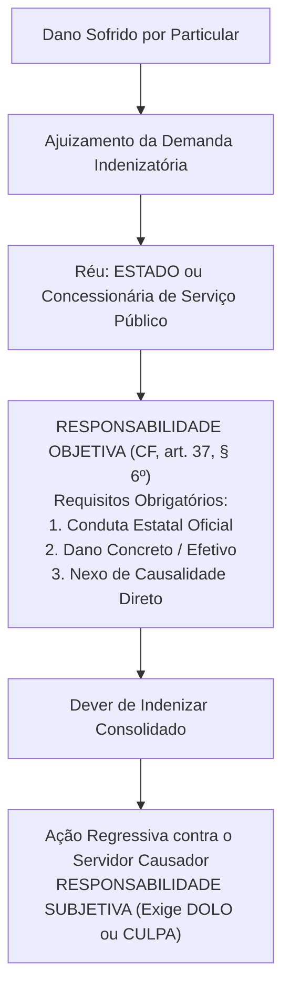
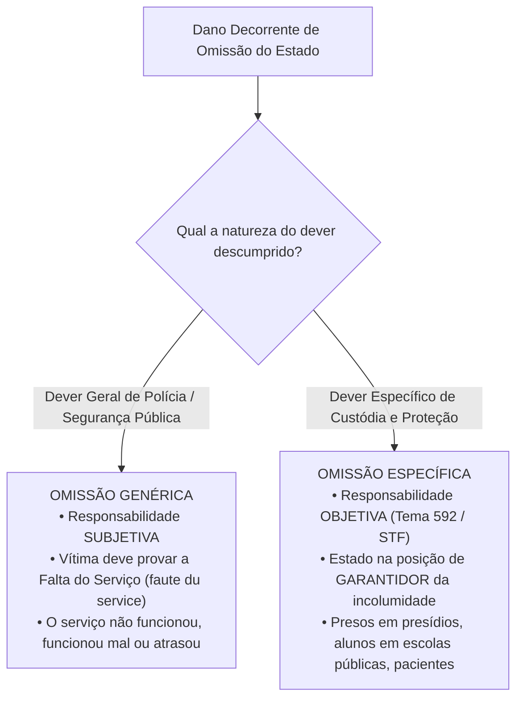
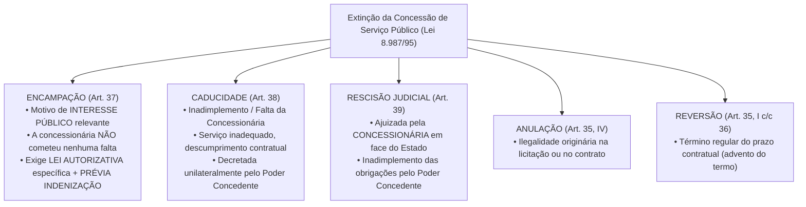

# 04 - Serviços Públicos, Bens Públicos e Responsabilidade Civil do Estado

> **Matéria:** Noções de Direito Administrativo  
> **Cargo:** A01 – Técnico de Controle Externo – Especialidade: Técnico Administrativo  
> **Arquivo:** `04_servicos_publicos_bens_e_responsabilidade_civil.md`  

---

## 📌 Ementa / Itens do Edital
- Responsabilidade civil do Estado: evolução histórica, fundamentos e modalidades
- Artigo 37, § 6º da Constituição Federal de 1988: responsabilidade objetiva das pessoas jurídicas de direito público e das de direito privado prestadoras de serviços públicos
- Teoria do Risco Administrativo vs. Teoria do Risco Integral
- Responsabilidade por ação vs. responsabilidade por omissão estatal (*faute du service* e dever específico de custódia)
- Causas excludentes e atenuantes do nexo de causalidade
- Ação regressiva contra o agente público e Tema 940 do STF (Teoria da Dupla Garantia)
- Serviços públicos: conceito, princípios, delegação a particulares (Lei nº 8.987/1995 e Lei nº 11.079/2004)
- Bens públicos: conceito, classificação (Código Civil, art. 99), afetação/desafetação e regime jurídico

---

## 🧭 Sumário

1. [Responsabilidade Civil Extracontratual do Estado](#1-responsabilidade-civil-extracontratual-do-estado)
    1. [Evolução Histórica da Responsabilidade Estatal](#11-evolucao-historica-da-responsabilidade-estatal)
    2. [O Art. 37, § 6º da CF/88 e os Elementos da Responsabilidade Objetiva](#12-o-art-37-6o-da-cf88-e-os-elementos-da-responsabilidade-objetiva)
    3. [Teoria do Risco Administrativo: Excludentes e Atenuantes](#13-teoria-do-risco-administrativo-excludentes-e-atenuantes)
    4. [Teoria do Risco Integral e suas Hipóteses Excepcionais](#14-teoria-do-risco-integral-e-suas-hipoteses-excepcionais)
    5. [Responsabilidade por Omissão Estatal: Genérica vs. Específica](#15-responsabilidade-por-omissao-estatal-generica-vs-especifica)
    6. [Ação Regressiva e a Teoria da Dupla Garantia (Tema 940 / STF)](#16-acao-regressiva-e-a-teoria-da-dupla-garantia-tema-940-stf)
    7. [Teste 034](#Teste-034)
    8. [Teste 035](#Teste-035)
    9. [Teste 036](#Teste-036)
    10. [Teste 037](#Teste-037)
2. [Regime Jurídico dos Serviços Públicos e sua Delegação](#2-regime-juridico-dos-servicos-publicos-e-sua-delegacao)
    1. [Princípios do Serviço Público Adequado](#21-principios-do-servico-publico-adequado)
    2. [Concessão Comum e Permissão de Serviço Público (Lei nº 8.987/1995)](#22-concessao-comum-e-permissao-de-servico-publico-lei-no-89871995)
    3. [Formas de Extinção das Concessões: Encampação vs. Caducidade](#23-formas-de-extincao-das-concessoes-encampacao-vs-caducidade)
    4. [Parcerias Público-Privadas - PPPs (Lei nº 11.079/2004)](#24-parcerias-publico-privadas-ppps-lei-no-110792004)
    5. [Teste 038](#Teste-038)
    6. [Teste 039](#Teste-039)
    7. [Teste 040](#Teste-040)
    8. [Teste 041](#Teste-041)
3. [Bens Públicos: Classificação, Afetação e Prerrogativas](#3-bens-publicos-classificacao-afetacao-e-prerrogativas)
    1. [Classificação Quanto à Destinação (Código Civil, art. 99)](#31-classificacao-quanto-a-destinacao-codigo-civil-art-99)
    2. [Fenômeno da Afetação e Desafetação](#32-fenomeno-da-afetacao-e-desafetacao)
    3. [Prerrogativas do Regime Jurídico e a Imprescritibilidade Absoluta](#33-prerrogativas-do-regime-juridico-e-a-imprescritibilidade-absoluta)
    4. [Teste 042](#Teste-042)
    5. [Teste 043](#Teste-043)
    6. [Teste 044](#Teste-044)
4. [Fontes Recomendadas na Internet](#4-fontes-recomendadas-na-internet)

---

## 1. Responsabilidade Civil Extracontratual do Estado

A responsabilidade civil extracontratual da Administração Pública consiste na obrigação jurídica que recai sobre o Estado de reparar os danos materiais, morais e estéticos causados a particulares por condutas comissivas ou omissivas de seus agentes públicos no exercício de suas atribuições ou a pretexto de exercê-las.

### 1.1 Evolução Histórica da Responsabilidade Estatal

- **Teoria da Irresponsabilidade Estatal (*The King can do no wrong*):** Predominou nos Estados Absolutistas. O monarca e o Estado não respondiam por quaisquer danos causados aos súditos.
- **Teorias Civilistas / Subjetivas (Culpa Comum):** Surgiram com o advento do Estado Liberal de Direito. Exigiam que a vítima comprovasse a culpa individualizada do agente público (*culpa in eligendo* ou *culpa in vigilando*), operando em extrema desvantagem processual para o particular.
- **Teoria da Culpa Administrativa / Culpa do Serviço (*Faute du Service*):** Desvinculou a culpa da pessoa física do servidor. A responsabilidade continuava sendo subjetiva, mas bastava à vítima comprovar a falta do serviço estatal: o serviço não funcionou, funcionou mal ou funcionou com atraso intolerável.
- **Teoria Objetiva do Risco Administrativo:** Consagrada pelo Direito Constitucional contemporâneo, dispensa integralmente a comprovação de dolo ou culpa estatal, fundando-se na causalidade material e na solidariedade social perante os riscos criados pela atividade administrativa.

### 1.2 O Art. 37, § 6º da CF/88 e os Elementos da Responsabilidade Objetiva

> *"Art. 37, § 6º. As pessoas jurídicas de direito público e as de direito privado prestadoras de serviços públicos responderão pelos danos que seus agentes, nessa qualidade, causarem a terceiros, assegurado o direito de regresso contra o responsável nos casos de dolo ou culpa."*

#### Elementos Indispensáveis para a Responsabilização Objetiva:
1. **Conduta Estatal:** Ação ou comportamento imputável a um agente público (efetivo, comissionado, temporário ou terceiro delegatário) agindo nessa qualidade.
2. **Dano Efetivo:** Prejuízo certo, juridicamente tutelado, de natureza patrimonial, moral ou estética.
3. **Nexo de Causalidade:** Relação direta de causa e efeito entre a conduta oficial e o dano experimentado pela vítima (Teoria do Dano Direto e Imediato).

> ⭐ **IMPORTANTE / REPERCUSSÃO GERAL STF:**  
> A responsabilidade objetiva do art. 37, § 6º, aplica-se às **empresas prestadoras de serviços públicos** (concessionárias e permissionárias) tanto em relação aos **usuários do serviço** quanto em relação a **terceiros não usuários** (vítimas de acidentes causados pelo serviço público - RE 591.874/STF).

### 1.3 Teoria do Risco Administrativo: Excludentes e Atenuantes

O ordenamento jurídico brasileiro adota como **regra geral a Teoria do Risco Administrativo**. Essa teoria baseia-se na ideia de que a atividade estatal gera riscos inerentes para a coletividade, devendo o poder público arcar com os prejuízos decorrentes. Todavia, **NÃO se trata de responsabilidade absoluta**, admitindo-se a ruptura ou atenuação do nexo causal nas seguintes hipóteses:

- **Causas Excludentes do Nexo de Causalidade (Afastam 100% da Indenização):**
    1. *Culpa Exclusiva da Vítima:* O evento decorreu inteiramente do comportamento negligente, imprudente ou voluntário do próprio lesado (ex.: pedestre que se atira intencionalmente sob as rodas de um ônibus público em alta velocidade).
    2. *Caso Fortuito ou Força Maior Absoluta:* Eventos imprevisíveis da natureza com violência desmedida (raios imprevisíveis, terremotos, trombas d'água fora de qualquer série histórica), desde que o Estado não tenha sido omisso em adotar medidas preventivas exigíveis.
    3. *Fato Exclusivo de Terceiro:* Dano provocado exclusivamente por ação autônoma e imprevisível de outrem sem qualquer concurso da conduta estatal (ex.: assalto à mão armada ocorrido dentro de um ônibus coletivo com disparo de arma de fogo deflagrado pelo criminoso).

- **Causas Atenuantes do Nexo de Causalidade:**
    - *Culpa Concorrente da Vítima:* A vítima e o agente público concorreram simultaneamente para a eclosão do evento danoso. O Estado continua obrigado a indenizar, mas o montante indenizatório é **reduzido proporcionalmente** ao grau de culpa da vítima.

### 1.4 Teoria do Risco Integral e suas Hipóteses Excepcionais

Na **Teoria do Risco Integral**, a obrigação estatal de indenizar é cega e absoluta. O Estado atua como garantidor universal de riscos, **sendo vedada a invocação de qualquer causa excludente** (o poder público é condenado mesmo diante de caso fortuito, força maior ou culpa exclusiva da vítima).

O ordenamento constitucional e legal brasileiro reconhece a incidência do risco integral em apenas **três hipóteses taxativas**:

1. **Dano Nuclear:** Responsabilidade civil por acidentes radiológicos ou nucleares (CF/88, art. 21, XXIII, "d");
2. **Atos de Guerra e Terrorismo Aéreo:** Danos a terceiros decorrentes de atentados terroristas contra aeronaves comerciais de matrícula brasileira (Lei Federal nº 10.744/2003);
3. **Dano Ambiental:** Jurisprudência vinculante consolidada do Superior Tribunal de Justiça (Tema Repetitivo 707/STJ) para degradações ecológicas graves.

### 1.5 Responsabilidade por Omissão Estatal: Genérica vs. Específica

Quando o dano decorre de um não-fazer da Administração Pública, a jurisprudência estabelece rígida bifurcação metodológica:

- **Omissão Genérica (Responsabilidade Subjetiva):** O Estado descumpre seu dever genérico de proteção da ordem social (ex.: furto de veículo particular estacionado em via pública comum; alagamento pontual em chuva sazonal). A vítima deve provar a ocorrência de culpa anônima do serviço (*faute du service*), demonstrando que o poder público foi negligente diante de um dever exigível.
- **Omissão Específica (Responsabilidade Objetiva - Tema 592/STF):** Ocorre quando o Estado atua na **posição de garante**, detendo a pessoa ou a coisa sob sua imediata custódia física institucional (ex.: morte ou lesão corporal de detento em estabelecimento penitenciário; acidente com criança no interior de escola pública municipal; suicídio de paciente internado em hospital psiquiátrico público). A responsabilidade é **OBJETIVA**; o Estado só se exonera se comprovar que a morte ou o dano decorreu de causa natural ou que o evento era faticamente inevitável mesmo com o cumprimento de todos os protocolos regulares de vigilância.

### 1.6 Ação Regressiva e a Teoria da Dupla Garantia (Tema 940 / STF)

O Supremo Tribunal Federal, ao julgar o RE 1.027.633 sob a sistemática da repercussão geral (**Tema 940**), pacificou a controvérsia sobre a legitimidade passiva nas ações indenizatórias fundamentadas no art. 37, § 6º, da CF/88:

> *"A teor do art. 37, § 6º, da Constituição Federal, a ação por danos causados por agente público deve ser ajuizada contra o Estado ou a pessoa jurídica de direito privado prestadora de serviço público, **sendo parte ilegítima para figurar no polo passivo o autor do ato**, assegurado o direito de regresso contra o responsável nos casos de dolo ou culpa."*

#### A Teoria da Dupla Garantia:
1. **Primeira Garantia (Ao Cidadão Vítima):** Assegura que o particular lesionado demandará contra o Estado ou concessionária sob regime de responsabilidade objetiva (sem ter que provar a culpa do servidor) e com a certeza de solvência financeira pública.
2. **Segunda Garantia (Ao Agente Público):** Protege o servidor contra ações temerárias de administrados inconformados, assegurando-lhe que **jamais poderá ser réu direto** na ação proposta pela vítima, nem compor litisconsórcio passivo originário com o Estado.

- **Regime da Ação Regressiva:** O Estado, após ser definitivamente condenado e efetuar o pagamento da indenização à vítima, tem o **dever de ajuizar ação regressiva** contra o servidor causador do dano. No âmbito da ação de regresso, a responsabilidade do servidor é **SUBJETIVA**, dependendo da comprovação cabal de que ele agiu com **dolo ou culpa** (negligência, imprudência ou imperícia).

---

### Teste 034
**(FCC – Analista Judiciário – TRT / Simulado)**  
Motorista de ambulância pertencente à Secretaria de Saúde de determinado Estado da Federação, ao conduzir o veículo oficial em velocidade compatível durante o transporte regular de paciente, colidiu contra o automóvel de um particular que avançou o sinal vermelho de um cruzamento. Diante dos danos materiais causados ao particular:

* **A)** O Estado responde de forma objetiva fundada no risco integral, sendo irrelevante a conduta culposa do terceiro.
* **B)** A culpa exclusiva da vítima ou de terceiro elide o nexo causal, afastando o dever de indenizar do Estado.
* **C)** O particular prejudicado deve ajuizar a ação indenizatória diretamente em face do servidor público condutor.
* **D)** A responsabilidade civil do ente público condiciona-se à prévia instauração de sindicância de trânsito.
* **E)** O Estado responde subjetivamente por danos no trânsito, cabendo ao particular lesado provar dolo do agente.

---

> **Comentário Detalhado:**
>
> - **A)** **Incorreto**. A regra geral da responsabilidade civil extracontratual do Estado no Brasil é a Teoria do Risco Administrativo (art. 37, § 6º da CF/88), a qual admite excludentes do nexo causal (como culpa exclusiva da vítima, caso fortuito e força maior). A Teoria do Risco Integral é excepcionalíssima.
> - **B)** **Correto**. Sob a égide da Teoria do Risco Administrativo, a comprovação de que o dano adveio de culpa exclusiva da vítima (ao avançar o semáforo vermelho) ou de fato exclusivo de terceiro rompe o liame de causalidade entre a conduta administrativa e o resultado lesivo, eximindo o Poder Público do dever reparatório.
> - **C)** **Incorreto**. Pelo Tema nº 940 do STF (Teoria da Dupla Garantia), a ação de indenização deve ser proposta unicamente contra a pessoa jurídica de direito público, vedado o litisconsórcio passivo com o agente.
> - **D)** **Incorreto**. A tutela judicial independe de apuração administrativa prévia (art. 5º, XXXV da CF/88).
> - **E)** **Incorreto**. A responsabilidade do Estado por condutas comissivas de seus agentes públicos é estritamente objetiva.
>
> **Gabarito: B**
### Teste 035
**(FGV – TJ-MT – Analista Judiciário - 2024)**  
No estudo da Responsabilidade Civil Extracontratual do Estado, a doutrina e a jurisprudência distinguem a Teoria do Risco Administrativo da Teoria do Risco Integral. A respeito das hipóteses em que o ordenamento jurídico pátrio adota excepcionalmente a Teoria do Risco Integral (em que o Estado responde sem possibilidade de alegar excludentes de culpabilidade da vítima ou força maior), assinale a opção que indica caso regido por essa teoria:

* **A)** Danos decorrentes de acidentes automobilísticos com viaturas policiais em perseguição de fugitivos.
* **B)** Danos causados por desabamento de pontes e encostas provocados por chuvas torrenciais imprevisíveis.
* **C)** Danos decorrentes de atividade ou acidente nuclear e danos causados por poluição ambiental grave.
* **D)** Danos oriundos de assalto à mão armada ocorrido no interior de agência de sociedade de economia mista.
* **E)** Danos causados por fuga de detento de presídio estadual dias após ter escapado do estabelecimento penal.

---

> **Comentário Detalhado:**
>
> - **A)** **Incorreto**. Acidentes com viaturas policiais submetem-se à Teoria do Risco Administrativo comum (art. 37, § 6º da CF/88), admitindo comprovação de culpa exclusiva da vítima ou de terceiro.
> - **B)** **Incorreto**. Força maior e eventos climáticos extraordinários rompem o nexo causal no risco administrativo geral.
> - **C)** **Correto**. No ordenamento jurídico brasileiro, a Teoria do Risco Integral é hipótese excepcionalíssima e taxativa que veda qualquer excludente de nexo causal, aplicando-se prioritariamente a: 1) danos nucleares (art. 21, XXIII, "d" da CF/88); 2) danos ambientais graves (art. 225, § 3º da CF/88 e Lei nº 6.938/1981); e 3) atentados terroristas contra aeronaves brasileiras (Lei nº 10.744/2003).
> - **D)** **Incorreto**. Assalto em agência de estatal consubstancia fato de terceiro sem risco integral.
> - **E)** **Incorreto**. O STF fixou no Tema nº 362 que a responsabilidade por ato de foragido exige nexo direto com o momento da fuga; decorridos dias ou meses, não há responsabilidade do Estado.
>
> **Gabarito: C**
### Teste 036
**(FCC – Auditor de Controle Externo – TCE-GO / Simulado)**  
Durante o período noturno de custódia em estabelecimento prisional estadual administrado pela Secretaria de Administração Penitenciária, um detento foi assassinado por companheiros de cela com instrumentos perfurantes artesanais. À luz do art. 5º, XLIX, da Constituição Federal e da jurisprudência vinculante do Supremo Tribunal Federal (Tema nº 592 de Repercussão Geral):

* **A)** O Estado responde de forma puramente subjetiva, exigindo dos herdeiros prova cabal de dolo dos policiais penais.
* **B)** A responsabilidade estatal é afastada sumariamente caso o preso assassinado contasse com histórico de rebeldia.
* **C)** O Estado responde objetivamente pela morte de detento, salvo se provar que a morte decorreu de ato inoponível.
* **D)** A indenização civil por morte de custodiado condiciona-se à prévia condenação criminal dos executores do homicídio.
* **E)** O dever de indenizar é de responsabilidade subsidiária da empresa privada prestadora de segurança ao presídio.

---

> **Comentário Detalhado:**
>
> - **A)** **Incorreto**. A custódia prisional atrai responsabilidade civil objetiva por violação ao dever específico de proteção (art. 5º, XLIX da CF/88), não se aplicando a teoria subjetiva da culpa anônima comum.
> - **B)** **Incorreto**. A conduta prévia do preso não exime o Poder Público do dever inafastável de zelar por sua integridade física.
> - **C)** **Correto**. Tese Vinculante do Tema nº 592 do STF: "Em caso de inobservância do seu dever específico de proteção previsto no art. 5º, inciso XLIX, da Constituição Federal, o Estado responde de forma objetiva pela morte de detento. Essa responsabilidade só pode ser afastada quando o Estado demonstrar a quebra do nexo causal, isto é, que a morte não poderia ter sido evitada mesmo com a adoção de todas as cautelas de segurança legalmente exigíveis".
> - **D)** **Incorreto**. A esfera cível indenizatória é independente da persecução penal contra os homicidas.
> - **E)** **Incorreto**. A segurança penitenciária é função de polícia indelegável e de titularidade do Estado.
>
> **Gabarito: C**
### Teste 037
**(FCC – Analista de Controle Externo – TCE-GO / Simulado)**  
Uma viatura oficial pertencente ao Tribunal de Contas, conduzida por servidor público efetivo em missão institucional, abalroou veículo de particular por negligência do agente ao não respeitar a preferência em rotatória. De acordo com o art. 37, § 6º, da CF/88 e a jurisprudência pacificada pelo Supremo Tribunal Federal no Tema nº 940:

* **A)** O particular pode optar por propor a demanda indenizatória unicamente contra o servidor público condutor.
* **B)** A ação indenizatória deve ser proposta exclusivamente contra o Estado, que dispõe de ação regressiva por dolo ou culpa.
* **C)** O servidor condutor e o Poder Público estadual devem integrar obrigatoriamente litisconsórcio passivo necessário.
* **D)** A reparação civil pelo Tribunal de Contas depende do trânsito em julgado de processo disciplinar administrativo.
* **E)** A ação regressiva da Fazenda Pública prescreve em dois anos contados da data da ocorrência do sinistro viário.

---

> **Comentário Detalhado:**
>
> - **A)** **Incorreto**. O particular não detém a faculdade de processar diretamente o agente público.
> - **B)** **Correto**. Tese de Repercussão Geral do Tema nº 940 do STF (Teoria da Dupla Garantia): "A teor do disposto no art. 37, § 6º, da Constituição Federal, a ação por danos causados por agente público deve ser ajuizada contra o Estado ou a pessoa jurídica de direito privado prestadora de serviço público, sendo parte ilegítima para a ação o autor do ato, assegurado o direito de regresso contra o responsável nos casos de dolo ou culpa". A dupla garantia protege o particular (certeza de pagamento pelo erário) e o agente (não ser acionado diretamente por terceiros no exercício funcional).
> - **C)** **Incorreto**. O STF fixou a ilegitimidade passiva do servidor público para figurar no polo passivo da ação indenizatória ordinária.
> - **D)** **Incorreto**. A obrigação de indenizar do Estado independe da apuração funcional interna do agente.
> - **E)** **Incorreto**. O direito de regresso rege-se pelas normas de ressarcimento ao erário após o pagamento judicial efetivo.
>
> **Gabarito: B**
## 2. Regime Jurídico dos Serviços Públicos e sua Delegação

### 2.1 Princípios do Serviço Público Adequado

A Lei Federal nº 8.987/1995 (art. 6º) prescreve que toda concessão ou permissão pressupõe a prestação de **serviço adequado**, assim entendido o que satisfaz as condições de:

- **Regularidade:** Prestação sem oscilações arbitrárias de qualidade.
- **Continuidade:** Não interrupção da atividade, admitida a suspensão motivada em hipóteses estritas de segurança técnica ou inadimplemento do usuário após aviso prévio formal.
- **Eficiência:** Máxima produtividade e excelência técnica.
- **Segurança:** Minimização de riscos aos usuários e ao meio ambiente.
- **Atualidade:** Incorporação contínua de métodos modernos, equipamentos tecnológicos de ponta e expansão da rede.
- **Generalidade:** Acesso universal e não discriminatório a todos os cidadãos.
- **Cortesia:** Urbanidade no trato com os usuários.
- **Modicidade das Tarifas:** Fixação de preços públicos acessíveis à população em equilíbrio econômico-financeiro.

### 2.2 Concessão Comum e Permissão de Serviço Público (Lei nº 8.987/1995)

- **Concessão Comum de Serviço Público:** Delegação contratual bilateral formalizada com pessoa jurídica ou consórcio de empresas, mediante prévia licitação obrigatória, para exploração do serviço por prazo determinado, a expensas e risco da concessionária, remunerada unicamente pelas tarifas cobradas dos usuários.
- **Permissão de Serviço Público:** Delegação formalizada mediante **contrato de adesão**, a título precário, após prévia licitação, admitindo como permitente pessoa física ou jurídica.

### 2.3 Formas de Extinção das Concessões: Encampação vs. Caducidade

A diferenciação entre as modalidades de extinção contratual na Lei nº 8.987/1995 é intensamente cobrada pela FCC:

| Critério de Comparação | Encampação (Resgate) | Caducidade |
| :--- | :--- | :--- |
| **Causa Primária** | **Interesse público superveniente** (conveniência administrativa) | **Inadimplemento contratual culposo** da concessionária |
| **Culpa da Concessionária?** | **NÃO** (a empresa cumpria rigorosamente o contrato) | **SIM** (prestação defeituosa, paralisações, descumprimento de prazos) |
| **Exigência de Lei?** | **SIM**, exige **lei autorizativa específica** do ente concedente | **NÃO**, declarada por **decreto** do Chefe do Executivo |
| **Indenização Prévia?** | **SIM**, o pagamento de indenização deve ser **prévio** à retomada | **NÃO**, indenização é apurada a posteriori descontadas multas contratuais |

### 2.4 Parcerias Público-Privadas - PPPs (Lei nº 11.079/2004)

As Parcerias Público-Privadas constituem concessões especiais destinadas a viabilizar investimentos vultosos de infraestrutura em colaboração com o capital privado:

1. **Concessão Patrocinada (Art. 2º, § 1º):** É a concessão de serviços públicos ou obras públicas em que a remuneração da concessionária envolve a combinação de **tarifa paga pelos usuários** mais uma **contraprestação pecuniária complementar paga pelo parceiro público**.
2. **Concessão Administrativa (Art. 2º, § 2º):** É o contrato de prestação de serviços de que a **Administração Pública seja a usuária direta ou indireta**, ainda que envolva a execução de obra ou fornecimento e instalação de bens. A remuneração é **100% custeada pelo erário**, inexistindo cobrança de tarifas dos cidadãos (ex.: construção e operação de hospitais públicos do SUS, presídios, iluminação pública).
3. **Vedações Legais Obrigatórias à Celebração de PPPs (Art. 2º, § 4º):**
    - Contratos cujo valor total seja **inferior a R$ 10.000.000,00 (dez milhões de reais)**;
    - Período de prestação de serviços **inferior a 5 (cinco) anos** ou superior a 35 (trinta e cinco) anos;
    - Contratos que tenham por objeto único o fornecimento de mão de obra, a mera locação de equipamentos ou a execução isolada de obra pública sem prestação continuada de serviços.

---

### Teste 038
**(FCC – Procurador do Estado – PGE-GO / Simulado)**  
Sobre os princípios que informam a prestação de serviços públicos previstos na Lei Federal nº 8.987/1995 e na doutrina administrativista contemporânea, assinale a opção correta:

* **A)** A continuidade veda em absoluto a interrupção do serviço, mesmo após aviso prévio por inadimplemento de fatura de água.
* **B)** A modicidade tarifária impõe gratuidade universal aos serviços públicos, arcando o erário com o custo operacional total.
* **C)** A mutabilidade do regime autoriza a adequação contínua do serviço às novas exigências técnicas e necessidades sociais.
* **D)** A generalidade impede a concessão de tarifas sociais diferenciadas para atender famílias de comprovada baixa renda.
* **E)** A atualidade restringe o emprego de tecnologias modernas para salvaguardar a estabilidade dos contratos concedidos.

---

> **Comentário Detalhado:**
>
> - **A)** **Incorreto**. O art. 6º, § 3º, II da Lei nº 8.987/1995 autoriza a interrupção temporária do serviço público após prévio aviso formal decorrente de inadimplemento do usuário, sem violação à continuidade.
> - **B)** **Incorreto**. A modicidade tarifária preconiza tarifas justas e acessíveis para manter o equilíbrio econômico-financeiro da concessão, não exigindo gratuidade irrestrita.
> - **C)** **Correto**. O princípio da mutabilidade do regime jurídico (ou da flexibilidade) permite à Administração alterar unilateralmente cláusulas regulamentares da prestação para assegurar a evolução das técnicas, a modernização dos equipamentos e o atendimento eficiente às demandas mutáveis da sociedade (art. 6º, § 2º da Lei nº 8.987/1995).
> - **D)** **Incorreto**. O princípio da generalidade (ou cortesia) não impede a fixação de tarifas sociais subsidiadas para consumidores carentes.
> - **E)** **Incorreto**. O princípio da atualidade impõe a modernidade das técnicas, equipamentos e instalações.
>
> **Gabarito: C**
### Teste 039
**(FGV – Analista de Gestão Pública – SEAD-GO / Simulado)**  
A respeito dos regimes de delegação de serviços públicos previstos na Lei Federal nº 8.987/1995, assinale a afirmativa que apresenta distinção correta entre concessão comum e permissão de serviço público:

* **A)** A concessão é outorgada a pessoa física ou jurídica, enquanto a permissão formaliza-se unicamente com pessoa jurídica.
* **B)** A concessão outorga-se por contrato bilateral, ao passo que a permissão é formalizada a título precário por contrato.
* **C)** A concessão dispensa procedimento de licitação, ao passo que a permissão exige modalidade estrita de pregão eletrônico.
* **D)** A concessão tem caráter essencialmente precário, enquanto a permissão goza de prazo indeterminado e irrevogabilidade.
* **E)** A concessão admite delegação de competências policiais sancionatórias, ao passo que a permissão restringe-se a obras.

---

> **Comentário Detalhado:**
>
> - **A)** **Incorreto**. A concessão é formalizada exclusivamente com pessoa jurídica ou consórcio de empresas (art. 2º, II); já a permissão pode ser outorgada a pessoa física ou jurídica (art. 2º, IV da Lei nº 8.987/1995).
> - **B)** **Correto**. Pela Lei nº 8.987/1995, a concessão é contrato bilateral celebrado por prazo determinado com garantias de equilíbrio econômico-financeiro; já a permissão (art. 40) formaliza-se por contrato de adesão marcado por precariedade mitigada e revogabilidade unilateral pelo poder concedente.
> - **C)** **Incorreto**. Ambas exigem prévia licitação obrigatória (art. 175 da CF/88); ademais, para concessão a modalidade é concorrência pública ou diálogo competitivo.
> - **D)** **Incorreto**. A precariedade é atributo da permissão, não da concessão.
> - **E)** **Incorreto**. Atos de polícia punitiva geral não são passíveis de concessão nem permissão a entes mercantis privados.
>
> **Gabarito: B**
### Teste 040
**(FCC – Procurador do Estado – PGE-GO / Simulado)**  
O Estado de Goiás celebrou contrato de concessão de serviço público rodoviário com uma sociedade empresária pelo prazo de vinte anos. Transcorridos cinco anos, em razão de relevante interesse público e conveniência estratégica estadual, o Governador pretende retomar a prestação direta da rodovia antes do término contratual. Nos termos da Lei nº 8.987/1995:

* **A)** O Estado pode promover a encampação unilateral mediante decreto, sem necessidade de lei ou prévia indenização.
* **B)** A retomada é vedada pelo princípio da segurança jurídica, vinculando o Poder Concedente ao prazo de vinte anos.
* **C)** A encampação exige autorização por lei autorizativa específica e prévio pagamento de justa indenização em dinheiro.
* **D)** A rescisão unilateral pode ser declarada pelo Estado com base na caducidade, prescindindo de justa reparação patrimonial.
* **E)** A reversão dos bens vinculados ao contrato fica impedida até que se opere a amortização contábil integral da obra.

---

> **Comentário Detalhado:**
>
> - **A)** **Incorreto**. O art. 37 da Lei nº 8.987/1995 exige expressamente autorização legislativa por lei específica e prévio pagamento de indenização.
> - **B)** **Incorreto**. O Estado detém a prerrogativa exorbitante de retomar a execução do serviço por interesse público superveniente (encampação).
> - **C)** **Correto**. A encampação (art. 37 da Lei nº 8.987/1995) é a retomada do serviço pelo poder concedente durante o prazo da concessão, por motivo de interesse público, mediante lei autorizativa específica e após o prévio pagamento da indenização das parcelas dos investimentos vinculados a bens reversíveis ainda não amortizados.
> - **D)** **Incorreto**. Caducidade é a extinção punitiva por inexecução culposa da concessionária; para interesse público, o instituto é a encampação.
> - **E)** **Incorreto**. A reversão dos bens ao poder concedente é decorrência da extinção contratual, apurando-se a indenização cabível.
>
> **Gabarito: C**
### Teste 041
**(FGV – TRT – Analista Judiciário - 2025)**  
No Brasil, as Parcerias Público-Privadas (PPPs) são disciplinadas pela Lei Federal nº 11.079/2004 e contemplam duas modalidades contratuais distintas: a concessão patrocinada e a concessão administrativa. A respeito da concessão patrocinada, é correto afirmar que consiste no contrato de concessão de serviços públicos ou de obras públicas:

* **A)** em que a remuneração do parceiro privado advém unicamente de subsídio orçamentário mensal pago pela Administração.
* **B)** que envolve, adicionalmente à tarifa cobrada dos usuários, contraprestação pecuniária do parceiro público ao parceiro privado.
* **C)** que se destina à prestação de serviços de que a Administração Pública seja a usuária direta ou indireta de modo exclusivo.
* **D)** cujo valor financeiro total estimado para o empreendimento de infraestrutura seja inferior a dez milhões de reais.
* **E)** pactuado por prazo de execução inferior a cinco anos para permitir a renovação periódica dos termos licitados.

---

> **Comentário Detalhado:**
>
> - **A)** **Incorreto**. A remuneração unicamente decorrente do poder público caracteriza a concessão administrativa (art. 2º, § 2º).
> - **B)** **Correto**. Conforme a definição legal expressa no art. 2º, § 1º, da Lei Federal nº 11.079/2004: "Concessão patrocinada é a concessão de serviços públicos ou de obras públicas de que trata a Lei nº 8.987, de 13 de fevereiro de 1995, quando envolver, adicionalmente à tarifa cobrada dos usuários, contraprestação pecuniária do parceiro público ao parceiro privado".
> - **C)** **Incorreto**. Essa é a definição exata de concessão administrativa (art. 2º, § 2º).
> - **D)** **Incorreto**. É vedada a celebração de PPP cujo valor seja inferior a R$ 10.000.000,00 (dez milhões de reais), nos termos do art. 2º, § 4º, I da lei.
> - **E)** **Incorreto**. O prazo do contrato de PPP não pode ser inferior a 5 (cinco) anos nem superior a 35 (trinta e cinco) anos (art. 5º, I).
>
> **Gabarito: B**
## 3. Bens Públicos: Classificação, Afetação e Prerrogativas

Conforme o art. 98 do Código Civil, são bens públicos todos aqueles pertencentes às pessoas jurídicas de direito público interno (União, Estados, DF, Municípios e suas autarquias e fundações públicas de direito público). Todos os demais são bens privados.

### 3.1 Classificação Quanto à Destinação (Código Civil, art. 99)

- **Bens de Uso Comum do Povo (Art. 99, I):** Destinados ao uso franqueado e indistinto de toda a coletividade (mares, rios, estradas, ruas, praças, praias). Podem ser utilizados gratuitamente ou mediante cobrança de tarifa/pedágio autorizada por lei.
- **Bens de Uso Especial (Art. 99, II):** Destinados à execução direta dos serviços públicos e ao funcionamento da máquina administrativa (edifícios de fóruns e tribunais, escolas públicas, hospitais estatais, viaturas policiais, quartéis).
- **Bens Dominicais ou Dominicais (Art. 99, III):** Bens que constituem o patrimônio disponível do Estado sem destinação pública específica ou aplicação administrativa direta (terras devolutas, prédios públicos desativados, títulos da dívida pública, bens desapropriados e não afetados).

### 3.2 Fenômeno da Afetação e Desafetação

- **Afetação:** É a atribuição formal ou fática de uma destinação pública a determinado bem (o bem passa a ser de uso comum ou de uso especial). Enquanto afetado, o bem é **inalienável**.
- **Desafetação:** É a retirada da destinação pública do bem, convertendo-o em bem dominical. Somente após a regular desafetação o bem público torna-se passível de alienação, observadas as exigências de autorização legislativa, interesse público justificado, avaliação prévia e procedimento licitatório.

### 3.3 Prerrogativas do Regime Jurídico e a Imprescritibilidade Absoluta

O regime jurídico dos bens públicos é informado por quatro prerrogativas estruturantes:

1. **Inalienabilidade Relativa:** Os bens de uso comum e de uso especial são inalienáveis enquanto conservarem sua qualificação pública. Os bens dominicais podem ser alienados, desde que cumpridos os requisitos da lei de licitações.
2. **Impenhorabilidade:** Os bens públicos não podem ser objeto de penhora ou constrição judicial para garantia de dívidas. A execução contra a Fazenda Pública opera-se exclusivamente sob o regime constitucional de **precatórios judiciais ou requisições de pequeno valor - RPV** (CF, art. 100).
3. **Imprescritibilidade Absoluta (Vedação de Usucapião):**  
   O art. 183, § 3º e o art. 191, parágrafo único, da Constituição Federal, corroborados pela **Súmula 340 do STF**, preceituam que **nenhum bem público, qualquer que seja sua classificação (inclusive os bens dominicais), pode ser adquirido por usucapião**.
    - *Natureza da Ocupação Irregular:* O particular que ocupa área pública sem título legítimo é considerado **mero detentor clandestino**. Não exerce posse jurídica tutelável, não tem direito a interditos possessórios contra o Estado e não faz jus a retenção ou indenização por benfeitorias realizadas.

4. **Não-Onerabilidade:** Impossibilidade de que bens públicos sejam gravados com direitos reais de garantia em favor de terceiros (hipoteca, penhor, anticrese).

---

### Teste 042
**(FCC – TRT – Analista Judiciário - 2009)**  
O Código Civil brasileiro, em seu art. 99, classifica os bens públicos em bens de uso comum do povo, bens de uso especial e bens dominicais. A respeito do regime jurídico que recai sobre essas três categorias de bens públicos, assinale a opção correta:

* **A)** Os bens de uso comum do povo e os de uso especial são inalienáveis enquanto conservarem a sua qualificação legal.
* **B)** Os bens dominicais podem ser objeto de usucapião por particulares desde que a posse mansa supere vinte anos.
* **C)** Os bens de uso especial podem ser penhorados judicialmente para satisfação de créditos trabalhistas e fiscais.
* **D)** A desafetação de um bem de uso comum do povo opera-se tacitamente com a omissão da autoridade pública por dez anos.
* **E)** Todos os bens públicos admitem oneração por garantias reais de hipoteca para obtenção de financiamento bancário.

---

> **Comentário Detalhado:**
>
> - **A)** **Correto**. Conforme preceitua expressamente o art. 100 do Código Civil: "Os bens públicos de uso comum do povo e os de uso especial são inalienáveis, enquanto conservarem a sua qualificação, na forma que a lei dispuser". Somente após a regular desafetação (conversão em bens dominicais) é que podem ser alienados, observados os requisitos da lei de licitações.
> - **B)** **Incorreto**. Pelo art. 102 do Código Civil e arts. 183, § 3º e 191, parágrafo único da CF/88, os bens públicos jamais são sujeitos a usucapião (imprescritibilidade).
> - **C)** **Incorreto**. Todos os bens públicos gozam da prerrogativa de impenhorabilidade (art. 100 da CF/88).
> - **D)** **Incorreto**. A desafetação exige ato formal do Poder Público ou fato administrativo inconteste; a mera omissão não desafeta bem público.
> - **E)** **Incorreto**. Bens públicos não podem ser gravados com ônus reais de garantia (inonorabilidade).
>
> **Gabarito: A**
### Teste 043
**(FGV – Analista de Controle Externo – TCE-GO / Simulado)**  
A afetação e a desafetação de bens públicos expressam a consagração ou a desvinculação de uma coisa pública a uma finalidade estatal específica. A respeito dos modos de afetação e desafetação e de suas repercussões para o controle patrimonial, é correto afirmar que:

* **A)** A afetação exige sempre lei autorizativa específica aprovada pelo Legislativo, vedada a afetação tácita fática.
* **B)** A desafetação de bem de uso especial para dominical transfere o bem para o comércio jurídico, admitindo alienação.
* **C)** O bem desafetado perde a imunidade tributária e a impenhorabilidade mesmo pertencendo ao patrimônio estatal.
* **D)** A construção de uma escola em terreno dominical consubstancia desafetação administrativa por ato formal de gestão.
* **E)** Os bens de uso comum do povo não admitem desafetação por se tratarem de patrimônio com tutela constitucional absoluta.

---

> **Comentário Detalhado:**
>
> - **A)** **Incorreto**. A afetação pode ocorrer de forma expressa (por lei ou decreto) ou fática/tácita (quando a Administração simplesmente passa a destinar o bem a um serviço público).
> - **B)** **Correto**. A desafetação é o fenômeno jurídico pelo qual o bem público deixa de estar vinculado a uma destinação pública direta (deixa de ser de uso comum ou de uso especial) e ingressa na categoria de bem dominical (patrimonial). Uma vez desafetado, passa a ser alienável, desde que cumpridos os requisitos legais (interesse público, avaliação prévia e autorização legislativa).
> - **C)** **Incorreto**. O bem dominical continua sendo bem público e, portanto, mantém a impenhorabilidade e a imprescritibilidade.
> - **D)** **Incorreto**. Destinar o imóvel à atividade escolar consubstancia afetação (e não desafetação).
> - **E)** **Incorreto**. Bens de uso comum (praças, ruas) admitem desafetação mediante lei específica.
>
> **Gabarito: B**
### Teste 044
**(FCC – Analista Judiciário – TRT / Simulado)**  
Determinada área de terras devolutas pertencente ao patrimônio do Estado de Goiás foi invadida por particulares que ali construíram residências e desenvolveram atividade agropastoril contínua e pacífica por mais de quinze anos ininterruptos. Diante do pleito de usucapião formulado pelos posseiros em face da Fazenda Pública estadual:

* **A)** A pretensão é juridicamente inviável, pois a Constituição veda o usucapião de imóveis públicos de qualquer espécie.
* **B)** O usucapião é admissível exclusivamente para terras devolutas dominicais desprovidas de afetação administrativa direta.
* **C)** A ocupação mansa e pacífica de terra pública por mais de dez anos converte a detenção ilícita em posse de boa-fé.
* **D)** O Estado perde a titularidade do domínio imobiliário caso não comprove a cobrança periódica de foro ou taxa de ocupação.
* **E)** O juiz deve declarar a prescrição aquisitiva extraordinária em favor dos posseiros que exploram a função social da terra.

---

> **Comentário Detalhado:**
>
> - **A)** **Correto**. Conforme dispõem os arts. 183, § 3º e 191, parágrafo único, da CF/88, e a Súmula nº 340 do STF ("Desde a vigência do Código Civil, os bens dominicais, como os demais bens públicos, não podem ser adquiridos por usucapião"), os bens públicos de qualquer natureza (inclusive as terras devolutas dominicais) são absolutamente imprescritíveis. A ocupação de bem público por particular consubstancia mera detenção clandestina, insuscetível de gerar efeitos possessórios aquisitivos contra o Poder Público.
> - **B)** **Incorreto**. Os bens dominicais gozam da mesma imprescritibilidade outorgada aos demais bens públicos.
> - **C)** **Incorreto**. A jurisprudência consolidada do STJ (Súmula 619) reconhece que a ocupação de área pública não gera posse, mas mera detenção fática precária.
> - **D)** **Incorreto**. A omissão do Estado não acarreta a perda da propriedade de terras públicas.
> - **E)** **Incorreto**. A função social não autoriza a aquisição por usucapião de imóveis pertencentes ao domínio do Estado.
>
> **Gabarito: A**
## 4. Fontes Recomendadas na Internet

- [Constituição Federal de 1988 - Art. 37, § 6º, Art. 183, § 3º e Art. 191](https://www.planalto.gov.br/ccivil_03/constituicao/constituicao.htm#art37)  
  Bases normativas fundamentais da responsabilidade civil objetiva do Estado e vedação expressa à usucapião de bens públicos urbanos e rurais.
- [Lei Federal nº 8.987/1995 (Lei Geral de Concessões e Permissões de Serviços Públicos)](https://www.planalto.gov.br/ccivil_03/leis/l8987cons.htm)  
  Regulamento dos princípios do serviço público adequado, direitos dos usuários e hipóteses de extinção contratual (encampação e caducidade).
- [Lei Federal nº 11.079/2004 (Marco das Parcerias Público-Privadas - PPPs)](https://www.planalto.gov.br/ccivil_03/_ato2004-2006/2004/lei/l11079.htm)  
  Dispositivos sobre concessões patrocinadas, concessões administrativas, repartição de riscos e limites operacionais de contratação.
- [Lei Federal nº 13.460/2017 (Código de Defesa dos Usuários dos Serviços Públicos)](https://www.planalto.gov.br/ccivil_03/_ato2015-2018/2017/lei/l13460.htm)  
  Normas gerais sobre participação, proteção e defesa dos direitos do usuário dos serviços públicos da administração direta e indireta.
- [Código Civil Brasileiro - Arts. 98 a 103 (Regime Jurídico dos Bens Públicos)](https://www.planalto.gov.br/ccivil_03/leis/2002/l10406compilada.htm#art98)  
  Classificação legal dos bens públicos de uso comum do povo, de uso especial e dominicais, e regras de inalienabilidade.
- [STF - Tema 940 de Repercussão Geral (Teoria da Dupla Garantia na Responsabilidade Civil)](https://portal.stf.jus.br/jurisprudencia/repercussaoGeral/tema.asp?num=940)  
  Tese que consolidou a ilegitimidade passiva originária do agente público em ações indenizatórias propostas pela vítima em face do Estado.
* DI PIETRO, Maria Sylvia Zanella. **Direito Administrativo**. 37. ed. Rio de Janeiro: Forense, 2024. (Cap. 5, Cap. 15 e Cap. 17 - Serviços Públicos, Responsabilidade Extracontratual do Estado e Bens Públicos).
* CARVALHO FILHO, José dos Santos. **Manual de Direito Administrativo**. 38. ed. Barueri: Atlas, 2024. (Cap. 6, Cap. 11 e Cap. 18 - Serviços Públicos, Concessões, Responsabilidade Civil do Estado e Bens Públicos).
* OLIVEIRA, Rafael Carvalho Rezende. **Curso de Direito Administrativo**. 12. ed. Rio de Janeiro: Método, 2024. (Cap. 12, Cap. 20 e Cap. 23 - Serviços Públicos, Bens Públicos e Responsabilidade Civil Estatal).
