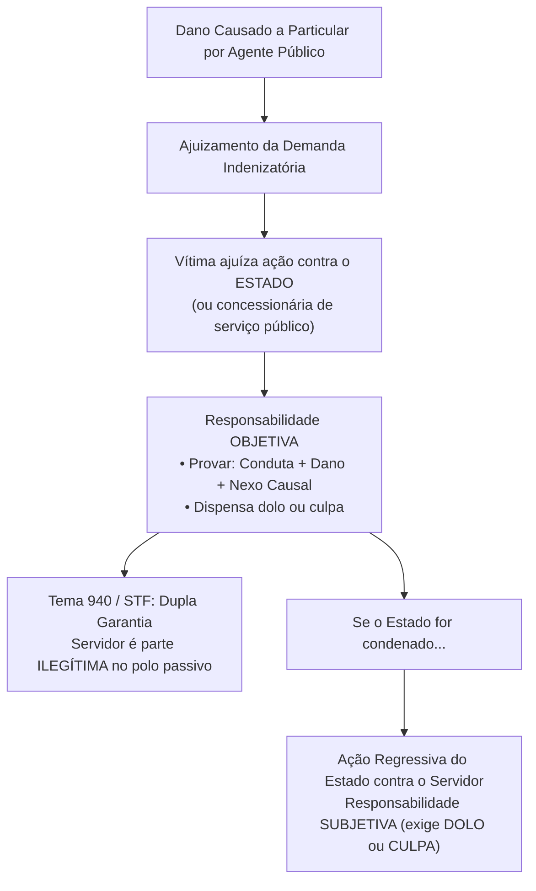
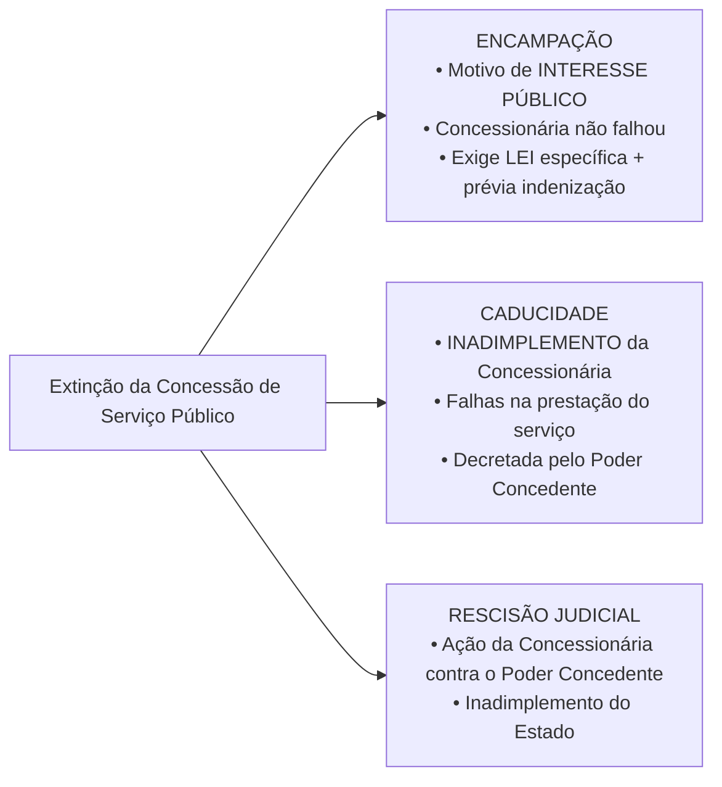

# 04 - Serviços Públicos, Bens Públicos e Responsabilidade Civil do Estado

> **Matéria:** Noções de Direito Administrativo  
> **Cargo:** A01 – Técnico de Controle Externo – Especialidade: Técnico Administrativo  
> **Arquivo:** `04_servicos_publicos_bens_e_responsabilidade_civil.md`  
> **Status:** 🟢 Teoria Aprofundada + 5 Questões FCC Comentadas (A a E)

---

## 📌 Ementa Oficial do Edital
- Responsabilidade civil do Estado: evolução histórica, fundamentos e modalidades.
- Artigo 37, § 6º da Constituição Federal de 1988: responsabilidade objetiva das pessoas jurídicas de direito público e das de direito privado prestadoras de serviços públicos.
- Teoria do Risco Administrativo vs. Teoria do Risco Integral.
- Responsabilidade por ação vs. responsabilidade por omissão estatal (*faute du service* e dever específico de custódia).
- Causas excludentes e atenuantes do nexo de causalidade.
- Ação regressiva contra o agente público e Tema 940 do STF (Teoria da Dupla Garantia).
- Serviços públicos: conceito, princípios, delegação a particulares (Lei nº 8.987/1995 e Lei nº 11.079/2004).
- Bens públicos: conceito, classificação (Código Civil, art. 99), afetação/desafetação e regime jurídico.

---

## 🌳 Classificação Hierárquica do Conteúdo

```text
4. Responsabilidade Extracontratual do Estado, Regime dos Serviços Públicos e Bens Públicos
├── 4.1 Responsabilidade Civil Extracontratual do Estado
│   ├── Evolução Histórica: Irresponsabilidade -> Teorias Subjetivas -> Risco Administrativo
│   ├── Elementos da Responsabilidade Objetiva (Conduta + Dano + Nexo de Causalidade)
│   │   ├── Dispensa de comprovação de dolo ou culpa da Administração
│   │   └── Abrange pessoas de direito público e delegatárias de serviços (usuários e terceiros)
│   ├── Excludentes do Nexo Causal: Culpa exclusiva da vítima, caso fortuito/força maior e fato de terceiro
│   │   └── Culpa concorrente da vítima: apenas atenua o valor indenizatório
│   ├── Teoria do Risco Integral (Sem excludentes): Dano nuclear, terrorismo aéreo e dano ambiental
│   ├── Responsabilidade por Omissão Estatal:
│   │   ├── Omissão Genérica: Responsabilidade subjetiva (culpa anônima / faute du service)
│   │   └── Omissão Específica: Responsabilidade objetiva decorrente de dever legal de custódia
│   └── Ação Regressiva e Teoria da Dupla Garantia (Tema 940/STF):
│       ├── Ilegitimidade passiva do servidor para constar como réu na ação da vítima
│       └── Regresso contra o servidor exige comprovação de dolo ou culpa (subjetiva)
├── 4.2 Regime Jurídico dos Serviços Públicos (Leis 8.987/1995 e 11.079/2004)
│   ├── Princípios do Serviço Adequado: Continuidade, modicidade, atualidade e generalidade
│   ├── Instrumentos de Delegação a Particulares:
│   │   ├── Concessão Comum: Contrato bilateral, pessoa jurídica/consórcio, licitação prévia
│   │   ├── Permissão de Serviço Público: Contrato de adesão, precário, licitação prévia
│   │   └── Autorização de Serviço: Ato administrativo unilateral discricionário e precário
│   ├── Parcerias Público-Privadas - PPPs (Lei nº 11.079/2004):
│   │   ├── Concessão Patrocinada: Tarifa paga pelo usuário + contraprestação do parceiro público
│   │   └── Concessão Administrativa: Administração é usuária direta/indireta (100% bancada pelo Estado)
│   └── Modalidades de Extinção da Concessão:
│       ├── Encampação: Retomada por interesse público (exige lei autorizativa e prévia indenização)
│       ├── Caducidade: Decretada pelo Poder Concedente por inadimplemento culposo da concessionária
│       └── Rescisão Judicial: Ação movida pela concessionária por culpa da Administração
└── 4.3 Bens Públicos (Código Civil, Arts. 98 a 103)
    ├── Classificação Quanto à Destinação:
    │   ├── Bens de Uso Comum do Povo: Mares, rios, estradas, ruas e praças
    │   ├── Bens de Uso Especial: Prédios de órgãos, hospitais, veículos oficiais, escolas
    │   └── Bens Dominicais: Patrimônio disponível do Estado sem destinação pública específica
    ├── Fenômeno da Afetação (atribuição de fim público) e Desafetação (retirada de fim público)
    └── Prerrogativas do Regime Jurídico dos Bens Públicos:
        ├── Inalienabilidade relativa (bens dominicais alienáveis com autorização e licitação)
        ├── Impenhorabilidade (execução por precatórios - art. 100 da CF/88)
        ├── Imprescritibilidade absoluta (vedação de usucapião - Súmula 340 do STF)
        └── Não onerabilidade (impossibilidade de gravação com ônus real)
```

---

## 📖 Teoria Aprofundada e Pontos Críticos

### 1. Responsabilidade Civil do Estado (CF/88, Art. 37, § 6º)



#### 1.1 Risco Administrativo x Risco Integral
- **Risco Administrativo (Regra Geral Constitucional):** A responsabilidade do Estado é objetiva, mas admite o abrandamento ou a exclusão do dever de indenizar diante de causas de rompimento do nexo de causalidade:
  1. *Culpa exclusiva da vítima:* Exclui totalmente o dever de indenizar.
  2. *Culpa concorrente da vítima:* Não exclui a responsabilidade, mas atenua o valor da indenização fixada pelo juiz.
  3. *Caso fortuito ou força maior:* Eventos da natureza imprevisíveis e inevitáveis (rompem o nexo causal, salvo se demonstrada a omissão culposa do Estado em preveni-los).
  4. *Fato exclusivo de terceiro:* Ação de terceiro que deu causa direta e imprevisível ao evento danoso.
- **Risco Integral (Excepcionalíssimo):** O Estado é obrigado a indenizar mesmo diante de caso fortuito ou culpa da vítima. Hipóteses reconhecidas:
  - Danos decorrentes de acidentes nucleares (CF/88, art. 21, XXIII, "d");
  - Atos de terrorismo contra aeronaves comerciais brasileiras (Lei 10.744/2003);
  - Danos ao meio ambiente (jurisprudência consolidada do STJ).

#### 1.2 Responsabilidade por Omissão: Genérica x Específica
- **Omissão Genérica:** Quando o Estado descumpre um dever geral de polícia ou fiscalização da ordem social (ex.: furto de veículo particular em via pública). A responsabilidade é **SUBJETIVA**, exigindo da vítima a demonstração da culpa do serviço (*faute du service* - o serviço não funcionou, funcionou mal ou atrasou).
- **Omissão Específica:** Quando o Estado tinha o **dever jurídico específico de custódia e proteção** da pessoa ou coisa sob seus cuidados diretos (ex.: suicídio de preso em presídio público, aluno ferido dentro de escola pública, paciente em hospital público). A responsabilidade é **OBJETIVA** (Tema 592 do STF), cabendo ao Estado comprovar que adotou todas as cautelas exigíveis para afastar o nexo causal.

---

### 2. Regime dos Serviços Públicos e Extinção das Concessões



#### 2.1 Parcerias Público-Privadas (PPPs - Lei nº 11.079/2004)
1. **Concessão Patrocinada:** Envolve a cobrança de tarifa dos usuários mais uma contraprestação pecuniária paga pelo parceiro público ao concessionário privado (ex.: rodovia com pedágio subsidiado pelo Estado).
2. **Concessão Administrativa:** O contrato de prestação de serviços tem a Administração Pública como usuária direta ou indireta, sendo **integralmente custeada pelo erário** (sem cobrança de tarifa do cidadão - ex.: construção e gestão de presídio ou hospital público).
3. **Vedações Legais à PPP (Art. 2º, § 4º):** É proibida a celebração de PPP cujo valor seja **inferior a R$ 10 milhões**, cujo período seja **inferior a 5 anos** ou cujo objeto verse exclusivamente sobre fornecimento de mão de obra ou execução isolada de obra pública.

---

### 3. Bens Públicos: Classificação e Prerrogativas

| Categoria de Bem Público | Exemplos | Afetação Pública | Alienabilidade |
|---|---|:---:|:---:|
| **Uso Comum do Povo** | Rios, mares, ruas, praças, praias | **SIM** (afetado) | Inalienável enquanto mantiver destinação pública |
| **Uso Especial** | Edifício do TCE-GO, hospitais, escolas, viaturas | **SIM** (afetado) | Inalienável enquanto mantiver destinação pública |
| **Dominicais** | Terras devolutas, prédios públicos desativados | **NÃO** (desafetado) | **Alienável** (com autorização legal e licitação) |

> 🚨 **ALERTA DE PROVA / PEGADINHA FCC:**  
> A imprescritibilidade dos bens públicos é **absoluta**! Nenhum bem público pode ser adquirido por **usucapião**, inclusive os bens dominicais (Súmula 340 do STF e arts. 183, § 3º e 191, parágrafo único, da CF/88). A ocupação privada não autorizada sobre terra pública constitui **mera detenção administrativa clandestina**, descabendo indenização por benfeitorias ou interdição possessória contra o Estado.

---

## 🌐 Fontes Recomendadas na Internet
- [Constituição Federal de 1988 - Artigo 37, § 6º e Artigos 183 e 191](https://www.planalto.gov.br/ccivil_03/constituicao/constituicao.htm)
  - Responsabilidade extracontratual pública e vedação absoluta de usucapião sobre bens públicos.
- [Lei Federal nº 8.987/1995 (Concessões e Permissões de Serviços Públicos)](https://www.planalto.gov.br/ccivil_03/leis/l8987cons.htm)
  - Marco das concessões comuns, direitos dos usuários e hipóteses de encampação e caducidade.
- [Lei Federal nº 11.079/2004 (Parcerias Público-Privadas - PPPs)](https://www.planalto.gov.br/ccivil_03/_ato2004-2006/2004/lei/l11079.htm)
  - Normas gerais de concessões patrocinadas e administrativas.
- [Código Civil de 2002 - Artigos 98 a 103 (Bens Públicos)](https://www.planalto.gov.br/ccivil_03/leis/2002/l10406compilada.htm#art98)
  - Tipologia dos bens públicos, afetação, desafetação e regime jurídico protetivo.
- [STF - Tema 940 da Repercussão Geral (Dupla Garantia)](https://portal.stf.jus.br/jurisprudencia/repercussaoGeral/tema.asp?num=940)
  - Ilegitimidade passiva do servidor causador do dano em ação direta ajuizada pela vítima.

---

## 📝 Questões Comentadas no Padrão FCC (Justificadas de A a E)

### Questão 1 (FCC - Analista de Controle Externo / Adaptada TCE-GO)
Uma viatura oficial pertencente ao Tribunal de Contas, conduzida em horário de expediente por um motorista oficial devidamente habilitado, abalroou o automóvel particular de uma cidadã em razão de uma manobra imprudente realizada pelo servidor no trânsito. A proprietária do veículo particular ajuizou ação ordinária de indenização por danos materiais exclusivamente em face do motorista servidor público, requerendo sua condenação direta com fundamento no art. 37, § 6º, da Constituição Federal.

À luz da jurisprudência firmada pelo Supremo Tribunal Federal em regime de repercussão geral (**Tema 940**):

A) A ação foi proposta corretamente, visto que a vítima tem a prerrogativa constitucional de optar por processar o servidor, o Estado ou ambos em litisconsórcio passivo.  
B) O motorista oficial é parte passiva ilegítima na relação processual originária, devendo a ação indenizatória ser ajuizada contra o Estado, que responde objetivamente e terá direito de regresso contra o servidor nos casos de dolo ou culpa.  
C) O Estado responde de forma puramente subsidiária, devendo a execução incidir primeiramente sobre os bens particulares do servidor condutor da viatura.  
D) A responsabilidade do Estado resta excluída pelo simples fato de o servidor não ter agido com dolo de causar o dano patrimonial.  
E) A ilegitimidade do servidor cessa caso a vítima comprove perante o juízo que o Tribunal de Contas não dispõe de dotação orçamentária para precatórios.  

> **Gabarito: B**  
>  
> **Comentário Analítico Passo a Passo:**  
> 1. Tese fixada pelo Supremo Tribunal Federal no julgamento do RE 1.027.633 (Tema 940 da Repercussão Geral):  
>    *"A teor do art. 37, § 6º, da Constituição Federal, a ação por danos causados por agente público deve ser ajuizada contra o Estado ou a pessoa jurídica de direito privado prestadora de serviço público, sendo parte ilegítima para figurar no polo passivo o autor do ato, assegurado o direito de regresso contra o responsável nos casos de dolo ou culpa."*  
> 2. Trata-se da **Teoria da Dupla Garantia**:  
>    - Garante ao particular a solvência patrimonial do Estado e a responsabilização objetiva (dispensa comprovação de culpa).  
>    - Garante ao agente público o direito de não ser processado diretamente por cidadãos por atos praticados no estrito exercício da função estatal.  
> 3. O Estado responde objetivamente perante o particular; em regresso contra o motorista, o Estado deve comprovar dolo ou culpa (responsabilidade subjetiva).  
>  
> **Análise das Alternativas:**  
> - **A) Incorreta:** O STF vedou expressamente o ajuizamento direto contra o servidor ou a formação de litisconsórcio passivo originário com o agente público.  
> - **B) CORRETA:** Expressão precisa da tese vinculante do Tema 940 do STF.  
> - **C) Incorreta:** A responsabilidade do Estado perante terceiros lesionados é primária, direta e objetiva.  
> - **D) Incorreta:** A responsabilidade objetiva independe de dolo; basta o nexo causal entre a conduta oficial e o dano.  
> - **E) Incorreta:** As regras de precatório não transferem legitimidade passiva ao patrimônio do servidor.

---

### Questão 2 (FCC - Procurador do Estado / Adaptada)
O Estado de Goiás celebrou contrato de concessão de serviço público rodoviário com determinado consórcio de empresas de engenharia pelo prazo de 25 anos. Transcorridos sete anos de execução regular, o Poder Concedente estadual verificou que, por conveniência estratégica de interesse público, seria mais vantajoso reassumir a administração direta da rodovia estadual, não existindo qualquer falta, infração ou atraso por parte do consórcio concessionário.

Nessas circunstâncias, a extinção antecipada do contrato de concessão por motivos de conveniência e interesse público operou-se por meio de:

A) Caducidade, precedida de instauração de processo administrativo sancionador com aplicação de penalidade contratual.  
B) Rescisão judicial em ação movida pela Fazenda Pública perante a Vara da Fazenda Estadual.  
C) Encampação, dependente de edição de lei autorizativa específica e do pagamento de prévia indenização à concessionária.  
D) Anulação, com desfazimento retroativo de todos os atos da concessão rodoviária.  
E) Caducidade, que dispensa autorização legislativa ou pagamento de indenização prévia.  

> **Gabarito: C**  
>  
> **Comentário Analítico Passo a Passo:**  
> 1. Art. 37 da Lei Federal nº 8.987/1995:  
>    *"Considera-se encampação a retomada do serviço pelo poder concedente durante o prazo da concessão, por motivo de interesse público, mediante lei autorizativa específica e após prévio pagamento da indenização."*  
> 2. Distinção fundamental:  
>    - **Encampação:** O concessionário não cometeu qualquer descumprimento; a causa é o **interesse público superveniente** do Estado. Exige **lei autorizativa específica** e **indenização prévia**.  
>    - **Caducidade:** A causa é o **inadimplemento contratual** da concessionária (prestação defeituosa ou descumprimento de cláusulas). Decretada por decreto pelo Poder Concedente.  
>  
> **Análise das Alternativas:**  
> - **A) Incorreta:** Caducidade pressupõe descumprimento contratual pela concessionária.  
> - **B) Incorreta:** A rescisão judicial é ajuizada pela concessionária em face da Administração em caso de inadimplemento do poder público (art. 39).  
> - **C) CORRETA:** Caracterização clássica da encampação (interesse público + lei autorizativa + indenização prévia).  
> - **D) Incorreta:** Anulação pressupõe ilegalidade originária do contrato.  
> - **E) Incorreta:** Confunde encampação com caducidade.

---

### Questão 3 (FCC - Auditor de Controle Externo / Adaptada)
Durante o período noturno de custódia em estabelecimento prisional estadual sob controle da Secretaria de Administração Penitenciária, um detento provisório foi assassinado por asfixia por companheiros de cela. A família do falecido ingressou com ação de indenização contra o Estado alegando responsabilidade civil estatal. Em contestação, o Estado sustentou ausência de responsabilidade, sob o fundamento de que a morte decorreu de ato exclusivo de terceiros (homicídio entre presos).

Em conformidade com a tese firmada pelo Supremo Tribunal Federal em regime de repercussão geral (**Tema 592**):

A) O Estado responde de forma subjetiva, devendo os autores da ação comprovar dolo pessoal do Diretor do presídio.  
B) Em caso de inobservância de seu dever específico de proteção e custódia previsto no art. 5º, XLIX, da CF/88, o Estado é civilmente responsável por morte de detento, operando a responsabilidade de forma objetiva, salvo se demonstrar que a morte decorreu de causa natural ou impossível de ser evitada mesmo com a vigilância adequada.  
C) A morte de preso no interior de estabelecimento prisional é hipótese automática de caso fortuito absoluto que rompe em definitivo o nexo de causalidade.  
D) A responsabilidade estatal somente incide caso o estabelecimento penitenciário seja administrado sob regime de parceria público-privada.  
E) O Estado responde com base na Teoria do Risco Integral, não admitindo qualquer prova pericial contrária em juízo.  

> **Gabarito: B**  
>  
> **Comentário Analítico Passo a Passo:**  
> 1. Tese do STF no RE 841.526 (Tema 592 de Repercussão Geral):  
>    *"Em caso de inobservância do seu dever específico de proteção previsto no art. 5º, inciso XLIX, da Constituição Federal, o Estado é responsável pela morte de detento."*  
> 2. O Estado detém a pessoa sob custódia física direta, assumindo a posição de garantidor da integridade física dos presos.  
> 3. Trata-se de hipótese de **omissão específica estatal**, sob regime de responsabilidade objetiva. O Estado só se exonera demonstrando que o resultado era faticamente inevitável mesmo com o cumprimento de todos os protocolos de vigilância exigíveis.  
>  
> **Análise das Alternativas:**  
> - **A) Incorreta:** A responsabilidade decorrente do dever de custódia é objetiva, não dependendo de dolo do dirigente penitenciário.  
> - **B) CORRETA:** Reproduz os fundamentos do Tema 592 do STF sobre a quebra do dever específico de custódia e proteção.  
> - **C) Incorreta:** O homicídio ou suicídio no presídio não configura excludente automática de caso fortuito quando decorrente de negligência no dever de guarda.  
> - **D) Incorreta:** Aplica-se a qualquer presídio sob gestão pública ou delegada.  
> - **E) Incorreta:** O Brasil não adota a Teoria do Risco Integral para mortes em presídios; adota o risco administrativo (admite comprovação de causas naturais inevitáveis).

---

### Questão 4 (FCC - Analista Judiciário)
Determinada área de terras devolutas pertencente ao patrimônio do Estado de Goiás encontra-se sem destinação pública específica há várias décadas. Um particular invadiu o imóvel em 2005, construiu moradia residencial e exerceu posse mansa, pacífica e contínua sobre a gleba por mais de quinze anos ininterruptos. Em 2024, o particular ajuizou ação de usucapião extraordinária contra o Estado pleiteando a declaração de aquisição da propriedade do bem.

Com base na disciplina constitucional e do Código Civil sobre bens públicos:

A) A pretensão do particular é legítima, pois os bens dominicais desprovidos de afetação pública sujeitam-se a usucapião extraordinária após quinze anos de posse.  
B) Os bens públicos dominicais, assim como os de uso comum e os de uso especial, são dotados de imprescritibilidade absoluta, sendo insuscetíveis de aquisição por usucapião.  
C) O imóvel converteu-se tacitamente em bem privado em virtude do abandono imobiliário prolongado pela Administração.  
D) A usucapião é cabível desde que o particular comprove a realização de benfeitorias úteis e o pagamento de tributos municipais.  
E) Caberá ao particular a manutenção da posse direta em desfavor da Fazenda Pública, impedindo a reintegração de posse pelo Estado.  

> **Gabarito: B**  
>  
> **Comentário Analítico Passo a Passo:**  
> 1. Art. 183, § 3º e Art. 191, parágrafo único, da Constituição Federal de 1988:  
>    *"Os imóveis públicos não serão adquiridos por usucapião."*  
> 2. Súmula 340 do Supremo Tribunal Federal:  
>    *"Desde a vigência do Código Civil, os bens dominicais, como os demais bens públicos, não podem ser adquiridos por usucapião."*  
> 3. A imprescritibilidade é um atributo jurídico absoluto que protege **todas as espécies de bens públicos** (de uso comum do povo, de uso especial e dominicais). A posse de particular sobre bem público consubstancia **mera detenção precária clandestina**, insuscetível de gerar direitos aquisitivos ou tutela possessória contra o Estado.  
>  
> **Análise das Alternativas:**  
> - **A) Incorreta:** Viola frontalmente a CF/88 e a Súmula 340 do STF; nenhum bem público sujeita-se a usucapião.  
> - **B) CORRETA:** Enunciação exata da imprescritibilidade absoluta dos bens públicos em qualquer categoria.  
> - **C) Incorreta:** Não existe perda de propriedade de bem público por simples inércia estatal ou desafetação fática em favor de invasor.  
> - **D) Incorreta:** A realização de benfeitorias em ocupação irregular não autoriza a usucapião contra o poder público.  
> - **E) Incorreta:** O particular é mero detentor; a Fazenda Pública tem direito indiscutível à reintegração de posse.

---

### Questão 5 (FCC - Técnico de Controle Externo / Administrativa)
O Governo do Estado pretende estruturar um projeto de infraestrutura hospitalar sob o regime de Parceria Público-Privada (PPP), no qual a concessionária privada será responsável pela construção de um complexo médico-hospitalar e pela prestação dos serviços de conservação predial e gestão de equipamentos médicos. O hospital atenderá exclusivamente pelo Sistema Único de Saúde (SUS), sendo 100% dos custos da contraprestação remunerados diretamente pelo Poder Público estadual, sem nenhuma cobrança de tarifa dos usuários atendidos.

À luz da Lei Federal nº 11.079/2004 (Lei das PPPs), a contratação descrita qualifica-se como:

A) Concessão patrocinada, visto que envolve a exploração de infraestrutura hospitalar pública com financiamento privado.  
B) Concessão administrativa, caracterizada pelo fato de a Administração Pública ser a usuária direta ou indireta do serviço, respondendo pela contraprestação pecuniária integral sem tarifa cobrada do usuário.  
C) Concessão comum de serviço público regida estritamente pela Lei nº 8.987/1995.  
D) Contrato de gestão de Organização Social dispensado de prévia licitação pública.  
E) Empreitada por preço unitário regida exclusivamente pelas regras gerais da Lei de Licitações.  

> **Gabarito: B**  
>  
> **Comentário Analítico Passo a Passo:**  
> 1. Art. 2º, § 2º, da Lei Federal nº 11.079/2004:  
>    *"Concessão administrativa é o contrato de prestação de serviços de que a Administração Pública seja a usuária direta ou indireta, ainda que envolva a execução de obra ou fornecimento e instalação de bens."*  
> 2. Distinção essencial das espécies de PPP:  
>    - **Concessão Patrocinada (§ 1º):** Há tarifa paga pelo usuário final complementada por contraprestação pecuniária do poder público.  
>    - **Concessão Administrativa (§ 2º):** Não há cobrança de tarifa do usuário; **a contraprestação é 100% paga pela Administração Pública**, que atua como usuária direta ou indireta da prestação de serviços.  
> 3. Como o hospital é 100% gratuito para os pacientes do SUS e remunerado integralmente pelo Estado de Goiás, trata-se inequivocamente de **concessão administrativa**.  
>  
> **Análise das Alternativas:**  
> - **A) Incorreta:** Na concessão patrocinada exige-se a existência de tarifa paga pelo usuário associada a contraprestação estatal.  
> - **B) CORRETA:** Subsunção perfeita da concessão administrativa na Lei nº 11.079/2004.  
> - **C) Incorreta:** A concessão comum é remunerada unicamente por tarifas dos usuários (Lei 8.987/95).  
> - **D) Incorreta:** O contrato de gestão de OS não constitui contrato de parceria público-privada.  
> - **E) Incorreta:** Trata-se de PPP de longo prazo, e não de mera empreitada de obra da Lei 14.133/2021.
