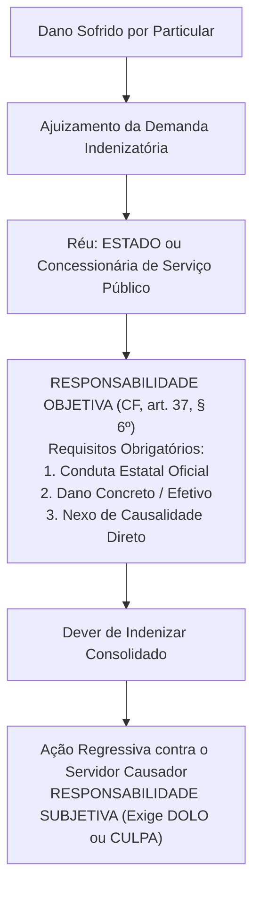
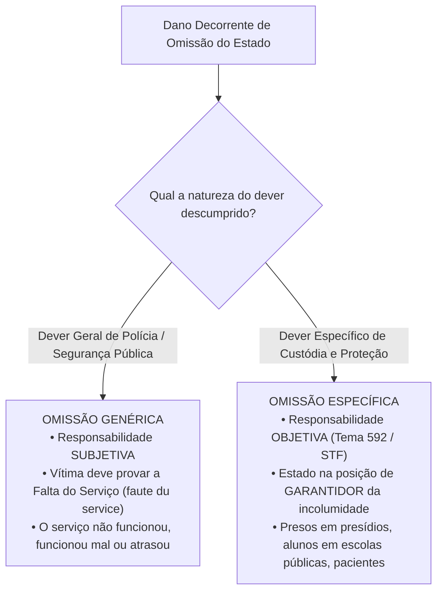
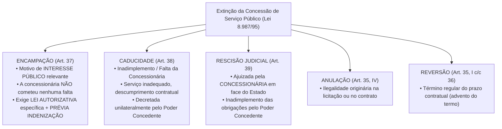

# 04 - Serviços Públicos, Bens Públicos e Responsabilidade Civil do Estado

> **Matéria:** Noções de Direito Administrativo  
> **Cargo:** A01 – Técnico de Controle Externo – Especialidade: Técnico Administrativo  
> **Arquivo:** `04_servicos_publicos_bens_e_responsabilidade_civil.md`  

---

## 📌 Ementa / Itens do Edital
- Responsabilidade civil do Estado: evolução histórica, fundamentos e modalidades
- Artigo 37, § 6º da Constituição Federal de 1988: responsabilidade objetiva das pessoas jurídicas de direito público e das de direito privado prestadoras de serviços públicos
- Teoria do Risco Administrativo vs. Teoria do Risco Integral
- Responsabilidade por ação vs. responsabilidade por omissão estatal (*faute du service* e dever específico de custódia)
- Causas excludentes e atenuantes do nexo de causalidade
- Ação regressiva contra o agente público e Tema 940 do STF (Teoria da Dupla Garantia)
- Serviços públicos: conceito, princípios, delegação a particulares (Lei nº 8.987/1995 e Lei nº 11.079/2004)
- Bens públicos: conceito, classificação (Código Civil, art. 99), afetação/desafetação e regime jurídico

---

## 🧭 Sumário

- [1. Responsabilidade Civil Extracontratual do Estado](#1-responsabilidade-civil-extracontratual-do-estado)
  - [1.1 Evolução Histórica da Responsabilidade Estatal](#11-evolução-histórica-da-responsabilidade-estatal)
  - [1.2 O Art. 37, § 6º da CF/88 e os Elementos da Responsabilidade Objetiva](#12-o-art-37--6º-da-cf88-e-os-elementos-da-responsabilidade-objetiva)
  - [1.3 Teoria do Risco Administrativo: Excludentes e Atenuantes](#13-teoria-do-risco-administrativo-excludentes-e-atenuantes)
  - [1.4 Teoria do Risco Integral e suas Hipóteses Excepcionais](#14-teoria-do-risco-integral-e-suas-hipóteses-excepcionais)
  - [1.5 Responsabilidade por Omissão Estatal: Genérica vs. Específica](#15-responsabilidade-por-omissão-estatal-genérica-vs-específica)
  - [1.6 Ação Regressiva e a Teoria da Dupla Garantia (Tema 940 / STF)](#16-ação-regressiva-e-a-teoria-da-dupla-garantia-tema-940--stf)
- [2. Regime Jurídico dos Serviços Públicos e sua Delegação](#2-regime-jurídico-dos-serviços-públicos-e-sua-delegação)
  - [2.1 Princípios do Serviço Público Adequado](#21-princípios-do-serviço-público-adequado)
  - [2.2 Concessão Comum e Permissão de Serviço Público (Lei nº 8.987/1995)](#22-concessão-comum-e-permissão-de-serviço-público-lei-nº-89871995)
  - [2.3 Formas de Extinção das Concessões: Encampação vs. Caducidade](#23-formas-de-extinção-das-concessões-encampação-vs-caducidade)
  - [2.4 Parcerias Público-Privadas - PPPs (Lei nº 11.079/2004)](#24-parcerias-público-privadas---ppps-lei-nº-110792004)
- [3. Bens Públicos: Classificação, Afetação e Prerrogativas](#3-bens-públicos-classificação-afetação-e-prerrogativas)
  - [3.1 Classificação Quanto à Destinação (Código Civil, art. 99)](#31-classificação-quanto-à-destinação-código-civil-art-99)
  - [3.2 Fenômeno da Afetação e Desafetação](#32-fenômeno-da-afetação-e-desafetação)
  - [3.3 Prerrogativas do Regime Jurídico e a Imprescritibilidade Absoluta](#33-prerrogativas-do-regime-jurídico-e-a-imprescritibilidade-absoluta)
- [4. Fontes Recomendadas na Internet](#4-fontes-recomendadas-na-internet)
- [5. Questões Comentadas & Exemplos (Padrão FCC)](#5-questões-comentadas--exemplos-padrão-fcc)

---

## 1. Responsabilidade Civil Extracontratual do Estado

A responsabilidade civil extracontratual da Administração Pública consiste na obrigação jurídica que recai sobre o Estado de reparar os danos materiais, morais e estéticos causados a particulares por condutas comissivas ou omissivas de seus agentes públicos no exercício de suas atribuições ou a pretexto de exercê-las.

### 1.1 Evolução Histórica da Responsabilidade Estatal

- **Teoria da Irresponsabilidade Estatal (*The King can do no wrong*):** Predominou nos Estados Absolutistas. O monarca e o Estado não respondiam por quaisquer danos causados aos súditos.
- **Teorias Civilistas / Subjetivas (Culpa Comum):** Surgiram com o advento do Estado Liberal de Direito. Exigiam que a vítima comprovasse a culpa individualizada do agente público (*culpa in eligendo* ou *culpa in vigilando*), operando em extrema desvantagem processual para o particular.
- **Teoria da Culpa Administrativa / Culpa do Serviço (*Faute du Service*):** Desvinculou a culpa da pessoa física do servidor. A responsabilidade continuava sendo subjetiva, mas bastava à vítima comprovar a falta do serviço estatal: o serviço não funcionou, funcionou mal ou funcionou com atraso intolerável.
- **Teoria Objetiva do Risco Administrativo:** Consagrada pelo Direito Constitucional contemporâneo, dispensa integralmente a comprovação de dolo ou culpa estatal, fundando-se na causalidade material e na solidariedade social perante os riscos criados pela atividade administrativa.

### 1.2 O Art. 37, § 6º da CF/88 e os Elementos da Responsabilidade Objetiva

> *"Art. 37, § 6º. As pessoas jurídicas de direito público e as de direito privado prestadoras de serviços públicos responderão pelos danos que seus agentes, nessa qualidade, causarem a terceiros, assegurado o direito de regresso contra o responsável nos casos de dolo ou culpa."*

#### Elementos Indispensáveis para a Responsabilização Objetiva:
1. **Conduta Estatal:** Ação ou comportamento imputável a um agente público (efetivo, comissionado, temporário ou terceiro delegatário) agindo nessa qualidade.
2. **Dano Efetivo:** Prejuízo certo, juridicamente tutelado, de natureza patrimonial, moral ou estética.
3. **Nexo de Causalidade:** Relação direta de causa e efeito entre a conduta oficial e o dano experimentado pela vítima (Teoria do Dano Direto e Imediato).

> ⭐ **IMPORTANTE / REPERCUSSÃO GERAL STF:**  
> A responsabilidade objetiva do art. 37, § 6º, aplica-se às **empresas prestadoras de serviços públicos** (concessionárias e permissionárias) tanto em relação aos **usuários do serviço** quanto em relação a **terceiros não usuários** (vítimas de acidentes causados pelo serviço público - RE 591.874/STF).

### 1.3 Teoria do Risco Administrativo: Excludentes e Atenuantes

O ordenamento jurídico brasileiro adota como **regra geral a Teoria do Risco Administrativo**. Essa teoria baseia-se na ideia de que a atividade estatal gera riscos inerentes para a coletividade, devendo o poder público arcar com os prejuízos decorrentes. Todavia, **NÃO se trata de responsabilidade absoluta**, admitindo-se a ruptura ou atenuação do nexo causal nas seguintes hipóteses:

- **Causas Excludentes do Nexo de Causalidade (Afastam 100% da Indenização):**
  1. *Culpa Exclusiva da Vítima:* O evento decorreu inteiramente do comportamento negligente, imprudente ou voluntário do próprio lesado (ex.: pedestre que se atira intencionalmente sob as rodas de um ônibus público em alta velocidade).
  2. *Caso Fortuito ou Força Maior Absoluta:* Eventos imprevisíveis da natureza com violência desmedida (raios imprevisíveis, terremotos, trombas d'água fora de qualquer série histórica), desde que o Estado não tenha sido omisso em adotar medidas preventivas exigíveis.
  3. *Fato Exclusivo de Terceiro:* Dano provocado exclusivamente por ação autônoma e imprevisível de outrem sem qualquer concurso da conduta estatal (ex.: assalto à mão armada ocorrido dentro de um ônibus coletivo com disparo de arma de fogo deflagrado pelo criminoso).
- **Causas Atenuantes do Nexo de Causalidade:**
  - *Culpa Concorrente da Vítima:* A vítima e o agente público concorreram simultaneamente para a eclosão do evento danoso. O Estado continua obrigado a indenizar, mas o montante indenizatório é **reduzido proporcionalmente** ao grau de culpa da vítima.

### 1.4 Teoria do Risco Integral e suas Hipóteses Excepcionais

Na **Teoria do Risco Integral**, a obrigação estatal de indenizar é cega e absoluta. O Estado atua como garantidor universal de riscos, **sendo vedada a invocação de qualquer causa excludente** (o poder público é condenado mesmo diante de caso fortuito, força maior ou culpa exclusiva da vítima).

O ordenamento constitucional e legal brasileiro reconhece a incidência do risco integral em apenas **três hipóteses taxativas**:
1. **Dano Nuclear:** Responsabilidade civil por acidentes radiológicos ou nucleares (CF/88, art. 21, XXIII, "d");
2. **Atos de Guerra e Terrorismo Aéreo:** Danos a terceiros decorrentes de atentados terroristas contra aeronaves comerciais de matrícula brasileira (Lei Federal nº 10.744/2003);
3. **Dano Ambiental:** Jurisprudência vinculante consolidada do Superior Tribunal de Justiça (Tema Repetitivo 707/STJ) para degradações ecológicas graves.

### 1.5 Responsabilidade por Omissão Estatal: Genérica vs. Específica

Quando o dano decorre de um não-fazer da Administração Pública, a jurisprudência estabelece rígida bifurcação metodológica:

- **Omissão Genérica (Responsabilidade Subjetiva):** O Estado descumpre seu dever genérico de proteção da ordem social (ex.: furto de veículo particular estacionado em via pública comum; alagamento pontual em chuva sazonal). A vítima deve provar a ocorrência de culpa anônima do serviço (*faute du service*), demonstrando que o poder público foi negligente diante de um dever exigível.
- **Omissão Específica (Responsabilidade Objetiva - Tema 592/STF):** Ocorre quando o Estado atua na **posição de garante**, detendo a pessoa ou a coisa sob sua imediata custódia física institucional (ex.: morte ou lesão corporal de detento em estabelecimento penitenciário; acidente com criança no interior de escola pública municipal; suicídio de paciente internado em hospital psiquiátrico público). A responsabilidade é **OBJETIVA**; o Estado só se exonera se comprovar que a morte ou o dano decorreu de causa natural ou que o evento era faticamente inevitável mesmo com o cumprimento de todos os protocolos regulares de vigilância.

### 1.6 Ação Regressiva e a Teoria da Dupla Garantia (Tema 940 / STF)

O Supremo Tribunal Federal, ao julgar o RE 1.027.633 sob a sistemática da repercussão geral (**Tema 940**), pacificou a controvérsia sobre a legitimidade passiva nas ações indenizatórias fundamentadas no art. 37, § 6º, da CF/88:

> *"A teor do art. 37, § 6º, da Constituição Federal, a ação por danos causados por agente público deve ser ajuizada contra o Estado ou a pessoa jurídica de direito privado prestadora de serviço público, **sendo parte ilegítima para figurar no polo passivo o autor do ato**, assegurado o direito de regresso contra o responsável nos casos de dolo ou culpa."*

#### A Teoria da Dupla Garantia:
1. **Primeira Garantia (Ao Cidadão Vítima):** Assegura que o particular lesionado demandará contra o Estado ou concessionária sob regime de responsabilidade objetiva (sem ter que provar a culpa do servidor) e com a certeza de solvência financeira pública.
2. **Segunda Garantia (Ao Agente Público):** Protege o servidor contra ações temerárias de administrados inconformados, assegurando-lhe que **jamais poderá ser réu direto** na ação proposta pela vítima, nem compor litisconsórcio passivo originário com o Estado.

- **Regime da Ação Regressiva:** O Estado, após ser definitivamente condenado e efetuar o pagamento da indenização à vítima, tem o **dever de ajuizar ação regressiva** contra o servidor causador do dano. No âmbito da ação de regresso, a responsabilidade do servidor é **SUBJETIVA**, dependendo da comprovação cabal de que ele agiu com **dolo ou culpa** (negligência, imprudência ou imperícia).

---

## 2. Regime Jurídico dos Serviços Públicos e sua Delegação

### 2.1 Princípios do Serviço Público Adequado

A Lei Federal nº 8.987/1995 (art. 6º) prescreve que toda concessão ou permissão pressupõe a prestação de **serviço adequado**, assim entendido o que satisfaz as condições de:
- **Regularidade:** Prestação sem oscilações arbitrárias de qualidade.
- **Continuidade:** Não interrupção da atividade, admitida a suspensão motivada em hipóteses estritas de segurança técnica ou inadimplemento do usuário após aviso prévio formal.
- **Eficiência:** Máxima produtividade e excelência técnica.
- **Segurança:** Minimização de riscos aos usuários e ao meio ambiente.
- **Atualidade:** Incorporação contínua de métodos modernos, equipamentos tecnológicos de ponta e expansão da rede.
- **Generalidade:** Acesso universal e não discriminatório a todos os cidadãos.
- **Cortesia:** Urbanidade no trato com os usuários.
- **Modicidade das Tarifas:** Fixação de preços públicos acessíveis à população em equilíbrio econômico-financeiro.

### 2.2 Concessão Comum e Permissão de Serviço Público (Lei nº 8.987/1995)

- **Concessão Comum de Serviço Público:** Delegação contratual bilateral formalizada com pessoa jurídica ou consórcio de empresas, mediante prévia licitação obrigatória, para exploração do serviço por prazo determinado, a expensas e risco da concessionária, remunerada unicamente pelas tarifas cobradas dos usuários.
- **Permissão de Serviço Público:** Delegação formalizada mediante **contrato de adesão**, a título precário, após prévia licitação, admitindo como permitente pessoa física ou jurídica.

### 2.3 Formas de Extinção das Concessões: Encampação vs. Caducidade

A diferenciação entre as modalidades de extinção contratual na Lei nº 8.987/1995 é intensamente cobrada pela FCC:

| Critério de Comparação | Encampação (Resgate) | Caducidade |
| :--- | :--- | :--- |
| **Causa Primária** | **Interesse público superveniente** (conveniência administrativa) | **Inadimplemento contratual culposo** da concessionária |
| **Culpa da Concessionária?** | **NÃO** (a empresa cumpria rigorosamente o contrato) | **SIM** (prestação defeituosa, paralisações, descumprimento de prazos) |
| **Exigência de Lei?** | **SIM**, exige **lei autorizativa específica** do ente concedente | **NÃO**, declarada por **decreto** do Chefe do Executivo |
| **Indenização Prévia?** | **SIM**, o pagamento de indenização deve ser **prévio** à retomada | **NÃO**, indenização é apurada a posteriori descontadas multas contratuais |

### 2.4 Parcerias Público-Privadas - PPPs (Lei nº 11.079/2004)

As Parcerias Público-Privadas constituem concessões especiais destinadas a viabilizar investimentos vultosos de infraestrutura em colaboração com o capital privado:

1. **Concessão Patrocinada (Art. 2º, § 1º):** É a concessão de serviços públicos ou obras públicas em que a remuneração da concessionária envolve a combinação de **tarifa paga pelos usuários** mais uma **contraprestação pecuniária complementar paga pelo parceiro público**.
2. **Concessão Administrativa (Art. 2º, § 2º):** É o contrato de prestação de serviços de que a **Administração Pública seja a usuária direta ou indireta**, ainda que envolva a execução de obra ou fornecimento e instalação de bens. A remuneração é **100% custeada pelo erário**, inexistindo cobrança de tarifas dos cidadãos (ex.: construção e operação de hospitais públicos do SUS, presídios, iluminação pública).
3. **Vedações Legais Obrigatórias à Celebração de PPPs (Art. 2º, § 4º):**
   - Contratos cujo valor total seja **inferior a R$ 10.000.000,00 (dez milhões de reais)**;
   - Período de prestação de serviços **inferior a 5 (cinco) anos** ou superior a 35 (trinta e cinco) anos;
   - Contratos que tenham por objeto único o fornecimento de mão de obra, a mera locação de equipamentos ou a execução isolada de obra pública sem prestação continuada de serviços.

---

## 3. Bens Públicos: Classificação, Afetação e Prerrogativas

Conforme o art. 98 do Código Civil, são bens públicos todos aqueles pertencentes às pessoas jurídicas de direito público interno (União, Estados, DF, Municípios e suas autarquias e fundações públicas de direito público). Todos os demais são bens privados.

### 3.1 Classificação Quanto à Destinação (Código Civil, art. 99)

- **Bens de Uso Comum do Povo (Art. 99, I):** Destinados ao uso franqueado e indistinto de toda a coletividade (mares, rios, estradas, ruas, praças, praias). Podem ser utilizados gratuitamente ou mediante cobrança de tarifa/pedágio autorizada por lei.
- **Bens de Uso Especial (Art. 99, II):** Destinados à execução direta dos serviços públicos e ao funcionamento da máquina administrativa (edifícios de fóruns e tribunais, escolas públicas, hospitais estatais, viaturas policiais, quartéis).
- **Bens Dominicais ou Dominicais (Art. 99, III):** Bens que constituem o patrimônio disponível do Estado sem destinação pública específica ou aplicação administrativa direta (terras devolutas, prédios públicos desativados, títulos da dívida pública, bens desapropriados e não afetados).

### 3.2 Fenômeno da Afetação e Desafetação

- **Afetação:** É a atribuição formal ou fática de uma destinação pública a determinado bem (o bem passa a ser de uso comum ou de uso especial). Enquanto afetado, o bem é **inalienável**.
- **Desafetação:** É a retirada da destinação pública do bem, convertendo-o em bem dominical. Somente após a regular desafetação o bem público torna-se passível de alienação, observadas as exigências de autorização legislativa, interesse público justificado, avaliação prévia e procedimento licitatório.

### 3.3 Prerrogativas do Regime Jurídico e a Imprescritibilidade Absoluta

O regime jurídico dos bens públicos é informado por quatro prerrogativas estruturantes:

1. **Inalienabilidade Relativa:** Os bens de uso comum e de uso especial são inalienáveis enquanto conservarem sua qualificação pública. Os bens dominicais podem ser alienados, desde que cumpridos os requisitos da lei de licitações.
2. **Impenhorabilidade:** Os bens públicos não podem ser objeto de penhora ou constrição judicial para garantia de dívidas. A execução contra a Fazenda Pública opera-se exclusivamente sob o regime constitucional de **precatórios judiciais ou requisições de pequeno valor - RPV** (CF, art. 100).
3. **Imprescritibilidade Absoluta (Vedação de Usucapião):**  
   O art. 183, § 3º e o art. 191, parágrafo único, da Constituição Federal, corroborados pela **Súmula 340 do STF**, preceituam que **nenhum bem público, qualquer que seja sua classificação (inclusive os bens dominicais), pode ser adquirido por usucapião**.
   - *Natureza da Ocupação Irregular:* O particular que ocupa área pública sem título legítimo é considerado **mero detentor clandestino**. Não exerce posse jurídica tutelável, não tem direito a interditos possessórios contra o Estado e não faz jus a retenção ou indenização por benfeitorias realizadas.
4. **Não-Onerabilidade:** Impossibilidade de que bens públicos sejam gravados com direitos reais de garantia em favor de terceiros (hipoteca, penhor, anticrese).

---

## 4. Fontes Recomendadas na Internet

- [Constituição Federal de 1988 - Arts. 37, § 6º, 183, § 3º e 191](https://www.planalto.gov.br/ccivil_03/constituicao/constituicao.htm)  
  Bases normativas fundamentais da responsabilidade objetiva do Estado e vedação expressa à usucapião de terras públicas.
- [Lei Federal nº 8.987/1995 (Lei Geral de Concessões de Serviços Públicos)](https://www.planalto.gov.br/ccivil_03/leis/l8987cons.htm)  
  Regulamento dos direitos dos usuários, concessões, permissões e hipóteses de extinção contratual (encampação e caducidade).
- [Lei Federal nº 11.079/2004 (Marco das Parcerias Público-Privadas)](https://www.planalto.gov.br/ccivil_03/_ato2004-2006/2004/lei/l11079.htm)  
  Dispositivos sobre concessões patrocinadas, concessões administrativas e limites operacionais de contratação.
- [Código Civil Brasileiro - Arts. 98 a 103 (Regime dos Bens Públicos)](https://www.planalto.gov.br/ccivil_03/leis/2002/l10406compilada.htm#art98)  
  Classificação dos bens públicos de uso comum, especial e dominicais, e normas de inalienabilidade.
- [STF - Tema 940 de Repercussão Geral (Dupla Garantia na Responsabilidade Civil)](https://portal.stf.jus.br/jurisprudencia/repercussaoGeral/tema.asp?num=940)  
  Tese que consolidou a ilegitimidade passiva originária do agente público em ações indenizatórias movidas pela vítima.

---

## 5. Questões Comentadas & Exemplos (Padrão FCC)

### Questão 1 (FCC - Analista de Controle Externo / Adaptada TCE-GO)
Uma viatura oficial pertencente ao Tribunal de Contas, conduzida em horário de expediente por um motorista oficial devidamente habilitado, abalroou o automóvel particular de uma cidadã em razão de uma manobra imprudente realizada pelo servidor no trânsito. A proprietária do veículo particular ajuizou ação ordinária de indenização por danos materiais exclusivamente em face do motorista servidor público, requerendo sua condenação direta com fundamento no art. 37, § 6º, da Constituição Federal.

À luz da jurisprudência firmada pelo Supremo Tribunal Federal em regime de repercussão geral (**Tema 940**):

A) A ação foi proposta corretamente, visto que a vítima tem a prerrogativa constitucional de optar por processar o servidor, o Estado ou ambos em litisconsórcio passivo.  
B) O motorista oficial é parte passiva ilegítima na relação processual originária, devendo a ação indenizatória ser ajuizada contra o Estado, que responde objetivamente e terá direito de regresso contra o servidor nos casos de dolo ou culpa.  
C) O Estado responde de forma puramente subsidiária, devendo a execução incidir primeiramente sobre os bens particulares do servidor condutor da viatura.  
D) A responsabilidade do Estado resta excluída pelo simples fato de o servidor não ter agido com dolo de causar o dano patrimonial.  
E) A ilegitimidade do servidor cessa caso a vítima comprove perante o juízo que o Tribunal de Contas não dispõe de dotação orçamentária para precatórios.  

> **Comentário Detalhado:**
> - **A)** Incorreta. A jurisprudência vinculante do Supremo Tribunal Federal vedou a propositura de ação indenizatória exclusivamente em face do servidor causador do ato, bem como a formação de litisconsórcio passivo facultativo entre a Fazenda Pública e o agente estatal.
> - **B)** Correta. De acordo com a tese fixada pelo STF no Tema 940 da Repercussão Geral (RE 1.027.633), com amparo na **Teoria da Dupla Garantia**: *"a ação por danos causados por agente público deve ser ajuizada contra o Estado ou a pessoa jurídica de direito privado prestadora de serviço público, sendo parte ilegítima para figurar no polo passivo o autor do ato, assegurado o direito de regresso contra o responsável nos casos de dolo ou culpa."* O particular demanda contra o Estado sob responsabilidade objetiva; o Estado, se condenado, aciona o servidor em via regressiva sob responsabilidade subjetiva (dolo ou culpa).
> - **C)** Incorreta. A responsabilidade do Estado perante a vítima é direta, primária e solidária institucionalmente, descabendo benefício de ordem patrimonial contra o servidor.
> - **D)** Incorreta. A responsabilidade estatal é de natureza objetiva, aperfeiçoando-se com a demonstração da conduta, do dano e do nexo de causalidade, dispensando dolo ou culpa da Administração.
> - **E)** Incorreta. As regras financeiras de precatórios decorrem do art. 100 da CF/88 e não transferem legitimidade passiva para a pessoa física do servidor.
> 
> **Gabarito: B**

---

### Questão 2 (FCC - Procurador do Estado / Adaptada)
O Estado de Goiás celebrou contrato de concessão de serviço público rodoviário com determinado consórcio de empresas de engenharia pelo prazo de 25 anos. Transcorridos sete anos de execução regular, o Poder Concedente estadual verificou que, por conveniência estratégica de interesse público, seria mais vantajoso reassumir a administração direta da rodovia estadual, não existindo qualquer falta, infração ou atraso por parte do consórcio concessionário.

Nessas circunstâncias, a extinção antecipada do contrato de concessão por motivos de conveniência e interesse público operou-se por meio de:

A) Caducidade, precedida de instauração de processo administrativo sancionador com aplicação de penalidade contratual.  
B) Rescisão judicial em ação movida pela Fazenda Pública perante a Vara da Fazenda Estadual.  
C) Encampação, dependente de edição de lei autorizativa específica e do pagamento de prévia indenização à concessionária.  
D) Anulação, com desfazimento retroativo de todos os atos da concessão rodoviária.  
E) Caducidade, que dispensa autorização legislativa ou pagamento de indenização prévia.  

> **Comentário Detalhado:**
> - **A)** Incorreta. A caducidade é a extinção do contrato decorrente de inadimplemento culposo ou prestação defeituosa por parte da própria concessionária. Como a concessionária cumpria rigorosamente o contrato, descabe caducidade.
> - **B)** Incorreta. A rescisão judicial é a modalidade de extinção proposta pela concessionária em face da Administração em virtude de descumprimento de cláusulas pelo poder público (art. 39 da Lei 8.987/95).
> - **C)** Correta. Nos termos do art. 37 da Lei Federal nº 8.987/1995, a **encampação** (ou resgate) é a retomada coativa do serviço pelo poder concedente durante o prazo da concessão por motivo de **interesse público relevante**, exigindo imperativamente **lei autorizativa específica** e **pagamento prévio de justa indenização** à concessionária pelos investimentos em bens reversíveis ainda não amortizados.
> - **D)** Incorreta. A anulação aplica-se exclusivamente a hipóteses de vício originário de ilegalidade no certame licitatório ou no termo de contrato.
> - **E)** Incorreta. Confunde encampação com caducidade e nega a exigência de lei e indenização prévia.
> 
> **Gabarito: C**

---

### Questão 3 (FCC - Auditor de Controle Externo / Adaptada)
Durante o período noturno de custódia em estabelecimento prisional estadual sob controle da Secretaria de Administração Penitenciária, um detento provisório foi assassinado por asfixia por companheiros de cela. A família do falecido ingressou com ação de indenização contra o Estado alegando responsabilidade civil estatal. Em contestação, o Estado sustentou ausência de responsabilidade, sob o fundamento de que a morte decorreu de ato exclusivo de terceiros (homicídio entre presos).

Em conformidade com a tese firmada pelo Supremo Tribunal Federal em regime de repercussão geral (**Tema 592**):

A) O Estado responde de forma subjetiva, devendo os autores da ação comprovar dolo pessoal do Diretor do presídio.  
B) Em caso de inobservância de seu dever específico de proteção e custódia previsto no art. 5º, XLIX, da CF/88, o Estado é civilmente responsável por morte de detento, operando a responsabilidade de forma objetiva, salvo se demonstrar que a morte decorreu de causa natural ou impossível de ser evitada mesmo com a vigilância adequada.  
C) A morte de preso no interior de estabelecimento prisional é hipótese automática de caso fortuito absoluto que rompe em definitivo o nexo de causalidade.  
D) A responsabilidade estatal somente incide caso o estabelecimento penitenciário seja administrado sob regime de parceria público-privada.  
E) O Estado responde com base na Teoria do Risco Integral, não admitindo qualquer prova pericial contrária em juízo.  

> **Comentário Detalhado:**
> - **A)** Incorreta. Na violação de dever de custódia específica, o regime adotado pelo Pretório Excelso é objetivo, dispensando a prova de dolo do gestor penitenciário.
> - **B)** Correta. De acordo com a tese vinculante firmada pelo STF no Tema 592 de Repercussão Geral (RE 841.526): *"Em caso de inobservância do seu dever específico de proteção previsto no art. 5º, inciso XLIX, da Constituição Federal, o Estado é responsável pela morte de detento."* O recolhimento de cidadão a estabelecimento prisional coloca o Estado na condição de garantidor estrito de sua integridade física, tipificando **omissão estatal específica de natureza objetiva**. O Estado só afasta o dever reparatório se comprovar pericialmente que a morte decorreu de causa estritamente natural ou que era faticamente impossível impedi-la mesmo adotados todos os procedimentos de vigilância e cautela cabíveis.
> - **C)** Incorreta. O homicídio de detento em cela coletiva durante a custódia não corporifica caso fortuito ou excludente automática de fato de terceiro.
> - **D)** Incorreta. O dever constitucional de custódia incide sobre presídios sob gestão direta do poder público ou sob regime delegado.
> - **E)** Incorreta. O ordenamento jurídico pátrio adota a teoria do risco administrativo e não do risco integral para a custódia de presos, admitindo comprovação de causas naturais inevitáveis.
> 
> **Gabarito: B**

---

### Questão 4 (FCC - Analista Judiciário)
Determinada área de terras devolutas pertencente ao patrimônio do Estado de Goiás encontra-se sem destinação pública específica há várias décadas. Um particular invadiu o imóvel em 2005, construiu moradia residencial e exerceu posse mansa, pacífica e contínua sobre a gleba por mais de quinze anos ininterruptos. Em 2024, o particular ajuizou ação de usucapião extraordinária contra o Estado pleiteando a declaração de aquisição da propriedade do bem.

Com base na disciplina constitucional e do Código Civil sobre bens públicos:

A) A pretensão do particular é legítima, pois os bens dominicais desprovidos de afetação pública sujeitam-se a usucapião extraordinária após quinze anos de posse.  
B) Os bens públicos dominicais, assim como os de uso comum e os de uso especial, são dotados de imprescritibilidade absoluta, sendo insuscetíveis de aquisição por usucapião.  
C) O imóvel converteu-se tacitamente em bem privado em virtude do abandono imobiliário prolongado pela Administração.  
D) A usucapião é cabível desde que o particular comprove a realização de benfeitorias úteis e o pagamento de tributos municipais.  
E) Caberá ao particular a manutenção da posse direta em desfavor da Fazenda Pública, impedindo a reintegração de posse pelo Estado.  

> **Comentário Detalhado:**
> - **A)** Incorreta. A regra constitucional e sumular é taxativa: nenhum bem público é passível de usucapião, independentemente de se encontrar ou não afetado.
> - **B)** Correta. A Constituição da República de 1988 estabelece categoricamente nos arts. 183, § 3º (imóveis urbanos) e 191, parágrafo único (imóveis rurais) que os imóveis públicos não serão adquiridos por usucapião. Em idêntico sentido, a **Súmula 340 do STF** consagra: *"Desde a vigência do Código Civil, os bens dominicais, como os demais bens públicos, não podem ser adquiridos por usucapião."* A imprescritibilidade é atributo absoluto aplicável a todos os bens públicos, constituindo a ocupação irregular mera **detenção clandestina** insuscetível de gerar efeitos aquisitivos ou tutela possessória contra a Administração.
> - **C)** Incorreta. A inércia administrativa não gera perda de propriedade imobiliária pública nem desafetação em proveito de invasor privado.
> - **D)** Incorreta. Benfeitorias realizadas em ocupação clandestina de terras públicas não geram direito a retenção nem autorizam usucapião contra a Fazenda Pública.
> - **E)** Incorreta. O mero detentor não possui legitimidade para opor embargos de retenção ou impedir a expedição do mandado de reintegração de posse pleiteado pelo Estado.
> 
> **Gabarito: B**

---

### Questão 5 (FCC - Técnico de Controle Externo / Administrativa)
O Governo do Estado pretende estruturar um projeto de infraestrutura hospitalar sob o regime de Parceria Público-Privada (PPP), no qual a concessionária privada será responsável pela construção de um complexo médico-hospitalar e pela prestação dos serviços de conservação predial e gestão de equipamentos médicos. O hospital atenderá exclusivamente pelo Sistema Único de Saúde (SUS), sendo 100% dos custos da contraprestação remunerados diretamente pelo Poder Público estadual, sem nenhuma cobrança de tarifa dos usuários atendidos.

À luz da Lei Federal nº 11.079/2004 (Lei das PPPs), a contratação descrita qualifica-se como:

A) Concessão patrocinada, visto que envolve a exploração de infraestrutura hospitalar pública com financiamento privado.  
B) Concessão administrativa, caracterizada pelo fato de a Administração Pública ser a usuária direta ou indireta do serviço, respondendo pela contraprestação pecuniária integral sem tarifa cobrada do usuário.  
C) Concessão comum de serviço público regida estritamente pela Lei nº 8.987/1995.  
D) Contrato de gestão de Organização Social dispensado de prévia licitação pública.  
E) Empreitada por preço unitário regida exclusivamente pelas regras gerais da Lei de Licitações.  

> **Comentário Detalhado:**
> - **A)** Incorreta. A concessão patrocinada exige imperativamente a existência de tarifa cobrada dos usuários, complementada por contraprestação pecuniária do parceiro público (art. 2º, § 1º, da Lei 11.079/2004). Como os pacientes do SUS nada pagam, não se trata de concessão patrocinada.
> - **B)** Correta. O art. 2º, § 2º, da Lei Federal nº 11.079/2004 define textualmente: *"Concessão administrativa é o contrato de prestação de serviços de que a Administração Pública seja a usuária direta ou indireta, ainda que envolva a execução de obra ou fornecimento e instalação de bens."* Na concessão administrativa, a remuneração da concessionária privada decorre inteiramente da contraprestação pecuniária paga pelo poder público, prestando o serviço público de forma inteiramente gratuita para os usuários finais.
> - **C)** Incorreta. A concessão comum da Lei 8.987/95 fundamenta-se estritamente na cobrança de tarifa do usuário, sem contraprestação ordinária regular do Estado.
> - **D)** Incorreta. O modelo de OS mediante contrato de gestão é regido pelo Terceiro Setor e não constitui parceria público-privada.
> - **E)** Incorreta. A empreitada é mera contratação de obra civil isolada da Lei 14.133/2021, sem transferência da gestão continuada de serviços e infraestrutura.
> 
> **Gabarito: B**
