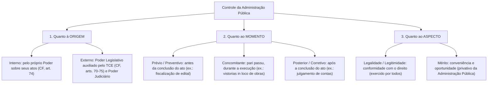
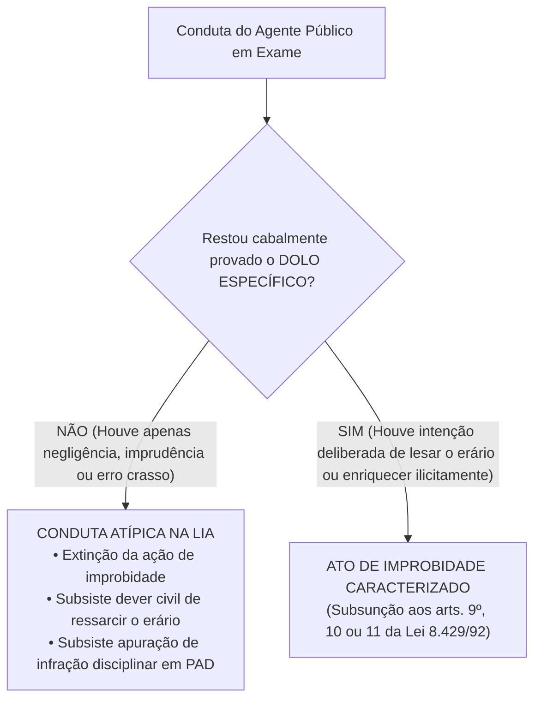
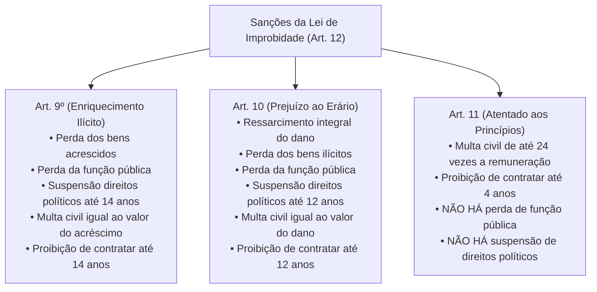

# 05 - Controle da Administração Pública e Improbidade Administrativa (Lei 8.429/1992 e Lei 14.230/2021)

> **Matéria:** Noções de Direito Administrativo  
> **Cargo:** A01 – Técnico de Controle Externo – Especialidade: Técnico Administrativo  
> **Arquivo:** `05_controle_da_administracao_e_improbidade_administrativa.md`  

---

## 📌 Ementa / Itens do Edital
- Controle da Administração Pública: conceito, fundamentos e classificações
- Classificação quanto à origem (Interno e Externo), momento (Prévio, Concomitante e Posterior) e aspecto (Legalidade e Mérito)
- Controle Legislativo e a atuação constitucional do Tribunal de Contas
- Controle Judicial: limites da atuação do Judiciário sobre o mérito administrativo e princípios da razoabilidade e proporcionalidade
- Instrumentos de controle judicial: Mandado de Segurança, Ação Popular e Ação Civil Pública
- Lei de Improbidade Administrativa (Lei Federal nº 8.429/1992 com redação dada pela Lei Federal nº 14.230/2021 e alterações)
- Sujeitos ativo e passivo dos atos de improbidade
- Elemento subjetivo: extinção da modalidade culposa e exigência de dolo específico (Tema 1.199 do STF)
- Tipologia dos atos de improbidade: Enriquecimento Ilícito (art. 9º), Prejuízo ao Erário (art. 10) e Atentado aos Princípios (art. 11)
- Sanções cominadas e regime prescricional unificado e intercorrente

---

## 🧭 Sumário

1. [Teoria Geral do Controle da Administração Pública](#1-teoria-geral-do-controle-da-administracao-publica)
    1. [Fundamento Republicano e Sistema de Freios e Contrapesos](#11-fundamento-republicano-e-sistema-de-freios-e-contrapesos)
    2. [Classificação Quanto à Origem: Controle Interno vs. Controle Externo](#12-classificacao-quanto-a-origem-controle-interno-vs-controle-externo)
    3. [Classificação Quanto ao Momento: Prévio, Concomitante e Posterior](#13-classificacao-quanto-ao-momento-previo-concomitante-e-posterior)
    4. [Classificação Quanto ao Aspecto: Controle de Legalidade vs. Mérito](#14-classificacao-quanto-ao-aspecto-controle-de-legalidade-vs-merito)
    5. [Teste 045](#Teste-045)
    6. [Teste 046](#Teste-046)
2. [O Controle Legislativo e a Atuação dos Tribunais de Contas](#2-o-controle-legislativo-e-a-atuacao-dos-tribunais-de-contas)
    1. [A Função Constitucional do Tribunal de Contas (CF/88, arts. 70 a 75)](#21-a-funcao-constitucional-do-tribunal-de-contas-cf88-arts-70-a-75)
    2. [Natureza das Decisões e Título Executivo Extrajudicial](#22-natureza-das-decisoes-e-titulo-executivo-extrajudicial)
    3. [Teste 047](#Teste-047)
    4. [Teste 048](#Teste-048)
3. [O Controle Judicial dos Atos Administrativos](#3-o-controle-judicial-dos-atos-administrativos)
    1. [Limites do Controle Judicial sobre o Mérito Administrativo](#31-limites-do-controle-judicial-sobre-o-merito-administrativo)
    2. [Anulação por Desvio de Finalidade e a Teoria dos Motivos Determinantes](#32-anulacao-por-desvio-de-finalidade-e-a-teoria-dos-motivos-determinantes)
    3. [Ações Constitucionais de Controle: Mandado de Segurança, Ação Popular e ACP](#33-acoes-constitucionais-de-controle-mandado-de-seguranca-acao-popular-e-acp)
    4. [Teste 049](#Teste-049)
    5. [Teste 050](#Teste-050)
4. [A Nova Lei de Improbidade Administrativa (Lei 8.429/1992 e Lei 14.230/2021)](#4-a-nova-lei-de-improbidade-administrativa-lei-84291992-e-lei-142302021)
    1. [Sujeitos Ativos e Passivos da Improbidade Administrativa](#41-sujeitos-ativos-e-passivos-da-improbidade-administrativa)
    2. [O Elemento Subjetivo e a Extinção da Culpa (Tema 1.199 / STF)](#42-o-elemento-subjetivo-e-a-extincao-da-culpa-tema-1199-stf)
    3. [Proibição do Crime de Hermenêutica no Âmbito da LIA](#43-proibicao-do-crime-de-hermeneutica-no-ambito-da-lia)
    4. [Teste 051](#Teste-051)
    5. [Teste 052](#Teste-052)
5. [Tipologia dos Atos de Improbidade e Quadro Sancionatório](#5-tipologia-dos-atos-de-improbidade-e-quadro-sancionatorio)
    1. [Enriquecimento Ilícito (Art. 9º da LIA)](#51-enriquecimento-ilicito-art-9o-da-lia)
    2. [Prejuízo ao Erário (Art. 10 da LIA)](#52-prejuizo-ao-erario-art-10-da-lia)
    3. [Atentado aos Princípios da Administração (Art. 11 da LIA - Rol Taxativo)](#53-atentado-aos-principios-da-administracao-art-11-da-lia-rol-taxativo)
    4. [Matriz Comparativa de Sanções do Artigo 12 da LIA](#54-matriz-comparativa-de-sancoes-do-artigo-12-da-lia)
    5. [Regime Prescricional Geral e Intercorrente (Art. 23 da LIA)](#55-regime-prescricional-geral-e-intercorrente-art-23-da-lia)
    6. [Teste 053](#Teste-053)
    7. [Teste 054](#Teste-054)
    8. [Teste 055](#Teste-055)
6. [Fontes Recomendadas na Internet](#6-fontes-recomendadas-na-internet)

---

## 1. Teoria Geral do Controle da Administração Pública

O controle da Administração Pública compreende o conjunto de mecanismos jurídicos e institucionais mediante os quais se fiscaliza, orienta, corrige e revisa a atuação dos órgãos, agentes e entidades do Estado, com vistas a assegurar a observância da legalidade, moralidade, economicidade e a consecução do interesse coletivo.

### 1.1 Fundamento Republicano e Sistema de Freios e Contrapesos

No Estado Democrático de Direito, nenhum poder estatal é absoluto ou imune a fiscalização. O controle administrativo fundamenta-se:

1. No **Princípio Republicano** (prestação de contas obrigatória de todo aquele que gere recursos públicos);
2. No **Princípio da Indisponibilidade do Interesse Público** (o administrador gere patrimônio alheio);
3. No **Sistema de Freios e Contrapesos (*Checks and Balances*)**, consagrado pelo art. 2º da CF/88, segundo o qual os Poderes Legislativo, Executivo e Judiciário são harmônicos e independentes, exercendo controles recíprocos uns sobre os outros.

### 1.2 Classificação Quanto à Origem: Controle Interno vs. Controle Externo

- **Controle Interno (CF/88, art. 74):** Exercido por cada um dos Poderes (Executivo, Legislativo e Judiciário) e pelo Ministério Público sobre sua própria estrutura administrativa e órgãos subordinados. Funda-se na hierarquia e na autotutela. Suas finalidades constitucionais compreendem: avaliar o cumprimento de metas do PPA, comprovar a legalidade da gestão orçamentária, exercer o controle de operações de crédito e apoiar o controle externo em sua missão institucional.
- **Controle Externo (CF/88, art. 70 a 75):** Exercido por um Poder sobre a atuação administrativa de outro Poder ou sobre terceiros gestores de recursos públicos. No plano federativo, é titularizado privativamente pelo **Poder Legislativo** (Assembleia Legislativa / Congresso Nacional), com o auxílio técnico, operacional e constitucional autônomo do **Tribunal de Contas**. Também abrange o controle jurisdicional repressivo exercido pelo Poder Judiciário.

### 1.3 Classificação Quanto ao Momento: Prévio, Concomitante e Posterior

- **Controle Prévio (Preventivo ou *a priori*):** Realizado antes da consumação ou produção de efeitos do ato administrativo, com o objetivo de prevenir irregularidades e evitar lesões ao erário (ex.: apreciação prévia de editais de concessão vultosos pelo TCE; aprovação legislativa de indicados a cargos de agências reguladoras).
- **Controle Concomitante (Simultâneo ou *pari passu*):** Realizado simultaneamente à execução material da atividade administrativa, em tempo real (ex.: auditorias de acompanhamento de execução orçamentária; fiscalizações e vistorias *in loco* em canteiros de obras rodoviárias estaduais).
- **Controle Posterior (Corretivo ou *a posteriori*):** Realizado após a consumação integral do ato administrativo ou do encerramento do exercício financeiro, visando sancionar faltas, anular ilegalidades ou certificar a higidez das contas (ex.: julgamento de tomadas de contas especiais; auditorias de conformidade posteriores; homologação ou rejeição das contas de gestores).

### 1.4 Classificação Quanto ao Aspecto: Controle de Legalidade vs. Mérito

- **Controle de Legalidade / Legitimidade:** Avalia a conformidade formal e material do ato administrativo com a Constituição, leis, decretos, súmulas vinculantes e princípios de direito público (razoabilidade, proporcionalidade e moralidade). Pode ser exercido pela própria Administração, pelo Tribunal de Contas e pelo Poder Judiciário.
- **Controle de Mérito:** Avalia a **conveniência e oportunidade** da decisão administrativa tomada dentro da margem de discricionariedade permitida pela lei. É atribuição **privativa e exclusiva da própria Administração Pública**, sendo vedado ao Judiciário ou ao Tribunal de Contas substituir o juízo de mérito do administrador.

---

### Teste 045
**(FCC - Analista de Controle Externo / TCE-GO)**
A Constituição Federal de 1988 estabelece que os Poderes Legislativo, Executivo e Judiciário manterão, de forma integrada, sistema de controle interno (art. 74).

A respeito das finalidades constitucionais do controle interno e de sua articulação com o controle externo a cargo do Tribunal de Contas, assinale a afirmativa correta.

* **A)** Os responsáveis pelo controle interno que tomarem conhecimento de qualquer irregularidade ou ilegalidade têm a faculdade discricionária de decidir se comunicam ou não o fato ao Tribunal de Contas.
* **B)** O sistema de controle interno exerce papel meramente consultivo, sendo vedada sua atuação na avaliação do cumprimento das metas previstas no plano plurianual e na execução dos programas de governo.
* **C)** Os responsáveis pelo controle interno, ao tomarem conhecimento de qualquer irregularidade ou ilegalidade, dela darão ciência ao Tribunal de Contas competente, sob pena de responsabilidade solidária.
* **D)** O controle externo exercido pelo Tribunal de Contas absorve as funções do controle interno, tornando dispensável a manutenção de controladorias nos órgãos do Poder Executivo estadual.
* **E)** O controle interno tem competência para anular julgamentos técnicos definitivos emitidos pelo Tribunal de Contas sobre contas de prefeitos municipais.

---

> **Comentário Detalhado:**
>
> - **A)** Incorreta. Não se trata de faculdade ou juízo discricionário, mas de um **dever legal cogente e indeclinável** imposto expressamente pela Carta Magna.
> - **B)** Incorreta. O art. 74, I, da CF/88 estabelece expressamente como finalidade do controle interno "avaliar o cumprimento das metas previstas no plano plurianual, a execução dos programas de governo e dos orçamentos da União".
> - **C)** Correta. O art. 74, § 1º, da Constituição Federal dispõe literalmente que *"Os responsáveis pelo controle interno, ao tomarem conhecimento de qualquer irregularidade ou ilegalidade, dela darão ciência ao Tribunal de Contas da União [e congêneres estaduais], sob pena de responsabilidade solidária"*. O silêncio ou a omissão dolosa/culposa do controlador interno acarreta sua corresponsabilização direta pelo ilícito.
> - **D)** Incorreta. Controle interno e controle externo são instâncias constitucionais autônomas, harmônicas e complementares que atuam de forma integrada.
> - **E)** Incorreta. O controle interno jamais tem ascendência sobre as decisões colegiadas do Tribunal de Contas.
>
> **Gabarito: C**

---

### Teste 046
**(FCC - Técnico de Controle Externo / Administrativa)**
No âmbito da sistemática de fiscalização dos atos estatais, o acompanhamento em tempo real realizado pelos auditores do Tribunal de Contas sobre a execução das despesas orçamentárias e as vistorias in loco realizadas em canteiros de obras durante a construção de uma rodovia estadual qualificam-se, quanto à origem e quanto ao momento do controle, respectivamente, como:

* **A)** Controle interno e controle prévio
* **B)** Controle externo e controle concomitante
* **C)** Controle interno e controle posterior
* **D)** Controle externo e controle prévio
* **E)** Controle jurisdicional e controle repressivo

---

> **Comentário Detalhado:**
>
> - **A)** Incorreta. A fiscalização exercida pelo Tribunal de Contas decorre de órgão autônomo externo em auxílio ao Legislativo (controle externo), e a fiscalização durante o andamento da obra não é controle prévio.
> - **B)** Correta. Classificação estrita quanto aos critérios fundamentais de controle:
>     - **Quanto à Origem:** Trata-se de **controle externo**, pois é exercido pelo Tribunal de Contas (instituição externa integrante da estrutura do controle parlamentar do art. 71 da CF/88) fiscalizando órgãos do Poder Executivo estadual.
>     - **Quanto ao Momento:** Trata-se de **controle concomitante**, haja vista que as inspeções e vistorias realizam-se em tempo real, no curso do processo de execução das despesas e das obras (*pari passu*), distinguindo-se do controle prévio (que analisa o edital antes da licitação) e do posterior (que julga a prestação de contas após o encerramento do exercício financeiro).
> - **C)** Incorreta. O acompanhamento em tempo real não é controle posterior, tampouco interno.
> - **D)** Incorreta. A fiscalização simultânea durante a execução não é prévia.
> - **E)** Incorreta. O Tribunal de Contas não exerce jurisdição judicial em sentido estrito (função monopolizada pelo Poder Judiciário).
> 
> **Gabarito: B**

---

## 2. O Controle Legislativo e a Atuação dos Tribunais de Contas

### 2.1 A Função Constitucional do Tribunal de Contas (CF/88, arts. 70 a 75)

O controle externo a cargo do Poder Legislativo é exercido com o auxílio técnico do Tribunal de Contas do Estado (TCE-GO). As Cortes de Contas ostentam envergadura e autonomia constitucional direta, exercendo competências indelegáveis:

1. **Julgamento de Contas dos Administradores Públicos (Art. 71, II):** Julgar as contas de todos os ordenadores de despesa, dirigentes de estatais e gestores responsáveis por dinheiros, bens e valores públicos estaduais.
2. **Apreciação das Contas do Chefe do Executivo (Art. 71, I):** Emitir **parecer prévio** conclusivo sobre as contas anuais prestadas pelo Governador do Estado (o julgamento definitivo cabe à Assembleia Legislativa).
3. **Fiscalização Operacional e Financeira (Art. 71, IV):** Realizar inspeções e auditorias de natureza contábil, financeira, orçamentária, operacional e patrimonial.
4. **Fiscalização de Atos de Admissão e Aposentadoria (Art. 71, III):** Apreciar, para fins de registro, a legalidade dos atos de admissão de pessoal (salvo cargos comissionados) e de concessão inicial de aposentadorias, reformas e pensões.
5. **Aplicação de Sanções (Art. 71, VIII):** Aplicar aos responsáveis as sanções previstas em sua Lei Orgânica, incluindo multas pecuniárias, imputação de débito e inabilitação temporária para o exercício de cargo em comissão.

### 2.2 Natureza das Decisões e Título Executivo Extrajudicial

- **Eficácia de Título Executivo (CF/88, art. 71, § 3º):** As decisões do Tribunal de Contas de que resulte imputação de débito ou cominação de multa pecuniária possuem **eficácia de título executivo extrajudicial**.
- **Execução do Título:** A cobrança judicial não é executada pelo próprio Tribunal de Contas, mas sim pelo ente público lesado (a Procuradoria-Geral do Estado - PGE promove a competente Ação de Execução Fiscal perante a Vara da Fazenda Pública).

---

### Teste 047
**(FGV - Auditor de Controle Externo / TCE)**
No desenho institucional do controle externo brasileiro, o Tribunal de Contas desempenha competências multifacetadas delineadas no art. 71 da Constituição da República.

Sobre a competência das Cortes de Contas para apreciar a legalidade de atos de admissão de pessoal e concessão de benefícios previdenciários, assinale a afirmativa correta.

* **A)** O Tribunal de Contas aprecia a legalidade das admissões de pessoal a qualquer título, inclusive as nomeações para cargos de provimento em comissão.
* **B)** O ato de aposentadoria de servidor público é ato administrativo complexo que somente se aperfeiçoa com o registro no Tribunal de Contas, aplicando-se o prazo decadencial de cinco anos a contar da chegada do processo ao respectivo Tribunal de Contas (Tema 445 / STF).
* **C)** A concessão de aposentadoria consolida-se de imediato na esfera jurídica do servidor no momento da publicação do ato pelo órgão de origem, não podendo o Tribunal de Contas recusar seu registro.
* **D)** O Tribunal de Contas competente para julgar as contas de gestão prestadas por dirigentes de empresas estatais exploradoras de atividade econômica é o Poder Judiciário, ante o regime de direito privado dessas empresas.
* **E)** A recusa de registro de aposentadoria pelo Tribunal de Contas submete-se a recurso ordinário perante a Assembleia Legislativa.

---

> **Comentário Detalhado:**
>
> - **A)** Incorreta. O art. 71, III, da CF/88 estabelece que o Tribunal de Contas aprecia a legalidade dos atos de admissão de pessoal, na administração direta e indireta, incluídas as fundações instituídas e mantidas pelo Poder Público, **ressalvadas as nomeações para cargo em comissão**.
> - **B)** Correta. Conforme fixado pelo STF no **Tema 445 de Repercussão Geral** (RE 636.553), o ato de aposentadoria, reforma ou pensão ostenta natureza de ato complexo; assim, o prazo de 5 (cinco) anos para que a Corte de Contas analise a legalidade do ato com estrita observância do contraditório e da ampla defesa conta-se **a partir da chegada do respectivo processo ao Tribunal de Contas**. Passados os 5 anos sem manifestação, opera-se a estabilização/registro tácito.
> - **C)** Incorreta. A publicação originária tem eficácia precária e provisória até a manifestação integrativa do Tribunal de Contas.
> - **D)** Incorreta. O art. 71, II, da CF/88 submete à fiscalização do Tribunal de Contas qualquer pessoa que administre bens e valores públicos, inclusive dirigentes de empresas públicas e sociedades de economia mista.
> - **E)** Incorreta. A recusa de registro é deliberação técnica privativa do TC, impassível de recurso político para o Poder Legislativo.
>
> **Gabarito: B**

---

### Teste 048
**(FCC - Procurador do Estado)**
Em processo de tomada de contas especial instaurado para apurar dano ao erário decorrente de superfaturamento em obras públicas estaduais, o Tribunal de Contas condenou o ex-gestor ao ressarcimento ao erário do valor desviado, bem como aplicou-lhe multa administrativa pecuniária individual.

À luz do art. 71, § 3º, da Constituição Federal e da jurisprudência consolidada, o acórdão proferido pelo Tribunal de Contas:

* **A)** Constitui título executivo extrajudicial, prescindindo de ação de conhecimento prévia para sua cobrança em juízo.
* **B)** Depende de homologação prévia por sentença judicial transitada em julgado para que possa ser executado perante a Vara da Fazenda Pública.
* **C)** Tem eficácia de título executivo judicial, devendo ser executado pelo próprio Tribunal de Contas por meio de seus auditores fiscais.
* **D)** Pode ter a cobrança executiva promovida diretamente pelo Ministério Público junto ao Tribunal de Contas em nome próprio.
* **E)** Prescreve na esfera patrimonial de cobrança no prazo de vinte anos, sendo inaplicável a Lei de Execução Fiscal.

---

> **Comentário Detalhado:**
>
> - **A)** Correta. O art. 71, § 3º, da CF/88 estatui categoricamente: *"As decisões do Tribunal de que resulte imputação de débito ou multa terão eficácia de título executivo"*. Trata-se de **título executivo extrajudicial**, apto a embasar direta e imediatamente ação de execução de título extrajudicial por quantia certa.
> - **B)** Incorreta. Não há qualquer necessidade de processo de conhecimento judicial prévio ou homologação judicial para conferir exequibilidade à decisão condenatória do TC.
> - **C)** Incorreta. É título **extrajudicial** e não judicial. Além disso, o Tribunal de Contas não tem personalidade jurídica nem capacidade postulatória para executar judicialmente suas próprias decisões condenatórias.
> - **D)** Incorreta. O STF pacificou no Tema 643 que a execução da decisão do Tribunal de Contas compete à **Procuradoria do respectivo ente federativo** (PGE ou PGM beneficiária do crédito), e não ao Ministério Público de Contas (MPC).
> - **E)** Incorreta. O STF definiu no Tema 899 (RE 636.886) que a pretensão de ressarcimento ao erário fundada em decisão de Tribunal de Contas prescreve em 5 (cinco) anos, regulada pela Lei de Execução Fiscal.
>
> **Gabarito: A**

---

## 3. O Controle Judicial dos Atos Administrativos

Em razão do princípio da inafastabilidade da tutela jurisdicional (CF/88, art. 5º, XXXV: *"a lei não excluirá da apreciação do Poder Judiciário lesão ou ameaça a direito"*), o Brasil adota o sistema de jurisdição una (sistema inglês), cabendo unicamente ao Poder Judiciário dizer o direito com força definitiva de coisa julgada material.

### 3.1 Limites do Controle Judicial sobre o Mérito Administrativo

- **Veto de Substituição de Mérito:** O juiz não pode substituir a valoração legítima de conveniência e oportunidade do administrador eleito ou concursado (ex.: escolher entre asfaltar a rua A ou reformar o posto de saúde B, quando ambas as opções são legais e orçamentariamente viáveis).
- **Proibição de Revogação Judicial:** O Poder Judiciário, no exercício de sua função jurisdicional, **NUNCA revoga atos do Poder Executivo**. O Judiciário apenas **anula** atos administrativos que padeçam de vícios de ilegalidade originária.

### 3.2 Anulação por Desvio de Finalidade e a Teoria dos Motivos Determinantes

O controle judicial sobre atos discricionários não se restringe à literalidade da lei, alcançando a legalidade ampla e os princípios constitucionais:

- **Desvio de Finalidade:** O Judiciário deve decretar a anulação do ato se restar demonstrado que a autoridade usou de sua competência legal para perseguir um desafeto pessoal, satisfazer capricho ou favorecer correligionários.
- **Teoria dos Motivos Determinantes:** Se a motivação alegada no ato for comprovadamente falsa, inexistente ou contraditória com os fatos da realidade, o ato é nulo por vício de motivo, devendo o Judiciário anulá-lo com efeitos retroativos (*ex tunc*).

### 3.3 Ações Constitucionais de Controle: Mandado de Segurança, Ação Popular e ACP

| Ação Constitucional | Base Normativa | Legitimidade Ativa | Objeto / Finalidade Principal | Particularidades Processuais |
| :--- | :--- | :--- | :--- | :--- |
| **Mandado de Segurança** | CF, art. 5º, LXIX; Lei 12.016/2009 | Pessoa física ou jurídica titular do direito | Proteger **direito líquido e certo**, não amparado por *habeas corpus* ou *habeas data*, contra ato ilegal ou abuso de poder | Exige **prova documental pré-constituída**; não admite dilação probatória; prazo decadencial de 120 dias. |
| **Ação Popular** | CF, art. 5º, LXXIII; Lei 4.717/1965 | **Qualquer cidadão brasileiro** no gozo de seus direitos políticos (título de eleitor) | Anular ato lesivo ao **patrimônio público**, à **moralidade administrativa**, ao **meio ambiente** e ao **patrimônio histórico e cultural** | Autor fica **isento de custas judiciais e sucumbência**, salvo comprovada má-fé. |
| **Ação Civil Pública** | CF, art. 129, III; Lei 7.347/1985 | Ministério Público, Defensoria Pública, Entes Federados, Autarquias e Associações constituídas há mais de 1 ano | Tutela de **direitos difusos, coletivos e individuais homogêneos** (meio ambiente, patrimônio público, consumidor) | Permite condenação em dinheiro (revertida a fundo público) e obrigação de fazer/não fazer. |

---

### Teste 049
**(FCC - Analista de Controle Externo / Adaptada TCE-GO)**
O Secretário Municipal de Saúde de determinado município goiano determinou a remoção ex officio de um enfermeiro concursado e estável para um posto de saúde isolado na zona rural. No ato formal de remoção, a autoridade consignou como motivação expressa a "premente necessidade de suprir grave carência de profissionais de enfermagem na referida unidade rural". O servidor ajuizou mandado de segurança perante o Poder Judiciário, instruído com certidões oficiais comprovando que o posto de saúde rural contava com equipe completa de enfermeiros sem demanda excedente, e que a remoção fora motivada por retaliação pessoal em razão de denúncia protocolada pelo enfermeiro no Conselho Regional.

Diante do controle jurisdicional dos atos administrativos e da Teoria dos Motivos Determinantes:

* **A)** O ato de remoção é imune a qualquer controle jurisdicional, por consubstanciar exercício de mérito administrativo privativo do Poder Executivo municipal.
* **B)** O Poder Judiciário deve decretar a anulação do ato de remoção, pois a comprovação da falsidade do motivo determinante contamina o ato com vício insanável de legalidade (desvio de finalidade).
* **C)** Caberia ao Poder Judiciário unicamente revogar o ato de remoção a partir do trânsito em julgado da sentença com efeitos meramente prospectivos.
* **D)** O Judiciário deve convalidar o ato e fixar uma nova justificativa substitutiva condizente com a conveniência do município.
* **E)** A falsidade do motivo alegado não gera nulidade caso a autoridade possuísse competência formal para assinar a portaria de remoção.

---

> **Comentário Detalhado:**
>
> - **A)** Incorreta. O mérito administrativo não autoriza perseguição pessoal, retaliação nem encobre fraudes a princípios da moralidade e impessoalidade.
> - **B)** Correta. De acordo com a **Teoria dos Motivos Determinantes**, a validade do ato administrativo fica irrevogavelmente vinculada à veracidade e consistência jurídica dos motivos fáticos declarados pela autoridade. Demonstrado perante o Judiciário que o motivo declarado no ato (carência de enfermeiros na zona rural) era cabalmente falso e que a verdadeira finalidade era a vingança pessoal contra o servidor, o ato padece de **vício de motivo** e de **desvio de finalidade (ou de poder)**. O exame da veracidade fática dos motivos integra o **controle estrito de legalidade e moralidade**, devendo o Judiciário decretar a **anulação** do ato com efeitos retroativos (*ex tunc*).
> - **C)** Incorreta. O Judiciário não pode revogar atos administrativos do Poder Executivo por critérios de mérito; sua atuação jurisdicional restringe-se à anulação de atos eivados de ilegalidade.
> - **D)** Incorreta. O vício de finalidade é vício de nulidade absoluta e insanável, sendo vedada sua convalidação ou substituição judicial de motivos.
> - **E)** Incorreta. A competência do agente não convalida a ilicitude do motivo e o desvio de poder.
> 
> **Gabarito: B**

---

### Teste 050
**(FCC - Analista Judiciário)**
Qualquer cidadão brasileiro no gozo de seus direitos políticos tem legitimidade ativa constitucional para propor **Ação Popular** perante o Poder Judiciário visando à anulação de ato lesivo:

* **A)** Exclusivamente ao patrimônio financeiro da União, sendo inadmissível o manejo da ação contra atos lesivos de municípios ou Estados.
* **B)** Ao patrimônio público ou de entidade de que o Estado participe, à moralidade administrativa, ao meio ambiente e ao patrimônio histórico e cultural.
* **C)** Aos direitos individuais homogêneos de consumidores bancários privados.
* **D)** Exclusivamente a direitos patrimoniais de pessoas jurídicas de direito privado com fins lucrativos.
* **E)** À honra subjetiva e intimidade pessoal de agentes públicos ocupantes de cargos políticos.

---

> **Comentário Detalhado:**
>
> - **A)** Incorreta. A Ação Popular pode ser proposta contra atos lesivos praticados por qualquer esfera federativa: União, Estados, Distrito Federal ou Municípios, bem como suas respectivas entidades descentralizadas.
> - **B)** Correta. O art. 5º, inciso LXXIII, da Constituição da República de 1988 estabelece textualmente: *"qualquer cidadão é parte legítima para propor ação popular que vise a anular ato lesivo ao patrimônio público ou de entidade de que o Estado participe, à moralidade administrativa, ao meio ambiente e ao patrimônio histórico e cultural, ficando o autor, salvo comprovada má-fé, isento de custas judiciais e do ônus da sucumbência"*. O cidadão (eleitor munido de título eleitoral) atua na defesa extraordinária de bens coletivos difusos protegidos pela Carta Magna.
> - **C)** Incorreta. Direitos individuais de consumidores privados são tutelados mediante Ação Civil Pública ou ações de indenização civil individual, e não por Ação Popular.
> - **D)** Incorreta. O objeto da ação popular é o patrimônio público e os valores republicanos coletivos, e não o interesse patrimonial privado de empresas comerciais.
> - **E)** Incorreta. A ofensa a direitos da personalidade cabe unicamente ao titular ofendido em ação indenizatória de direito comum.
> 
> **Gabarito: B**

---

## 4. A Nova Lei de Improbidade Administrativa (Lei 8.429/1992 e Lei 14.230/2021)

A Lei Federal nº 14.230/2021 promoveu a mais profunda reforma na Lei de Improbidade Administrativa (LIA - Lei nº 8.429/1992), transformando o diploma em um estatuto de Direito Administrativo Sancionador rígido, com garantias processuais do direito punitivo.

### 4.1 Sujeitos Ativos e Passivos da Improbidade Administrativa

- **Sujeito Ativo (Art. 2º):** Considera-se agente público para os efeitos desta Lei o agente político, o servidor público e todo aquele que exerce, ainda que transitoriamente ou sem remuneração, por eleição, nomeação, designação, contratação ou qualquer outra forma de investidura ou vínculo, mandato, cargo, emprego ou função nas entidades públicas.
- **Particular em Concurso (Art. 3º):** As disposições da LIA aplicam-se àquele que, mesmo não sendo agente público, **induza ou concorra dolosamente** para a prática do ato de improbidade.  
  > ⚠️ **Regra Consolidada STJ/STF:** Não é cabível ação de improbidade exclusivamente em face de particular desacompanhado de agente público no polo passivo!

### 4.2 O Elemento Subjetivo e a Extinção da Culpa (Tema 1.199 / STF)

A alteração mais radical da Lei nº 14.230/2021 consistiu na **abolição total e expressa da modalidade culposa** para todos os atos de improbidade administrativa.

#### Tese Vinculante do Tema 1.199 do STF (RE 1.205.746):
1. **Exigência de Dolo Específico:** É necessária a comprovação de responsabilidade subjetiva com **dolo específico** para a tipificação de qualquer ato de improbidade administrativa (artigos 9º, 10 e 11). Não basta dolo genérico; exige-se a demonstração da vontade livre e consciente de alcançar o resultado ilícito, acompanhada do fim especial de agir.
2. **Extinção da Culpa (Inclusive Culpa Grave):** A negligência crassa, a imprudência, a imperícia ou o erro de gestão administrativa, ainda que inescusáveis, **NÃO configuram improbidade administrativa**. O agente negligente pode responder disciplinarmente no estatuto funcional ou em ação regressiva civil comum de reparação ao erário, mas não sob a pecha desonrosa da improbidade.
3. **Direito Intertemporal:**
    - *Processos com trânsito em julgado:* A nova lei **NÃO retroage** para desconstituir condenações culposas já consolidadas pela coisa julgada material.
    - *Processos em andamento:* A revogação da culpa **aplica-se imediatamente e de forma retroativa** a todas as ações de improbidade em curso em qualquer grau de jurisdição.

### 4.3 Proibição do Crime de Hermenêutica no Âmbito da LIA

O art. 1º, § 8º, da LIA estabelece expressamente que **não configura improbidade a ação ou omissão decorrente de divergência interpretativa da lei**, baseada em jurisprudência, ainda que não pacificada, mesmo que não venha a ser posteriormente a prevalecente nos tribunais judiciais ou de contas.

---

### Teste 051
**(FGV - Analista de Controle Externo / TCE-GO)**
A Lei nº 14.230/2021 promoveu profunda reformulação na Lei de Improbidade Administrativa (Lei nº 8.429/1992). Quanto aos sujeitos ativos e passivos dos atos de improbidade administrativa, assinale a afirmativa correta.

* **A)** O particular que não exerça função pública somente pode responder por ato de improbidade administrativa se for comprovado que induziu ou concorreu dolosamente para a prática do ato ímprobo, vedada a sua responsabilização isolada sem a presença de agente público no polo passivo.
* **B)** As pessoas jurídicas privadas não podem figurar no polo passivo de ações de improbidade administrativa, recaindo as sanções da LIA exclusivamente sobre as pessoas físicas dos administradores.
* **C)** Os agentes políticos estão integralmente imunes às sanções da Lei de Improbidade Administrativa, sujeitando-se exclusivamente a processo de crime de responsabilidade.
* **D)** O terceiro particular pode ser condenado por improbidade administrativa na modalidade culposa se restar demonstrada negligência profissional manifesta.
* **E)** Entidades que recebam subvenção ou benefício financeiro do poder público não são consideradas sujeitos passivos dos atos de improbidade administrativa.

---

> **Comentário Detalhado:**
>
> - **A)** Correta. O art. 3º da Lei nº 8.429/1992 (com redação da Lei nº 14.230/2021) prevê que as disposições da lei aplicam-se àquele que, mesmo não sendo agente público, induza ou concorra dolosamente para a prática do ato de improbidade. A jurisprudência consolidada do STJ e do STF pacificou que o particular jamais responde sozinho por improbidade administrativa; é indispensável a concorrência e a presença simultânea de um agente público no polo passivo ou na descrição da trama ímproba.
> - **B)** Incorreta. O art. 3º, § 1º, da LIA admite a responsabilização de pessoa jurídica por improbidade, desde que observada a subsidiariedade com a Lei Anticorrupção (Lei nº 12.846/2013).
> - **C)** Incorreta. Conforme jurisprudência do STF (Pet 3.240 e Rcl 2.138), prefeitos, secretários estaduais e governadores submetem-se ao regime da Lei de Improbidade Administrativa (a única exceção absoluta é o Presidente da República, sujeito exclusivamente à Lei nº 1.079/1950 por crimes de responsabilidade).
> - **D)** Incorreta. Com o advento da Lei nº 14.230/2021 e do Tema 1.199/STF, **toda e qualquer modalidade culposa foi revogada**; exige-se dolo específico em todos os tipos da LIA.
> - **E)** Incorreta. O art. 1º, § 6º e § 7º, da LIA prevê expressamente que as entidades privadas que recebam subvenção, benefício fiscal ou creditício do erário são sujeitos passivos protegidos pela lei.
>
> **Gabarito: A**

---

### Teste 052
**(FCC - Auditor de Controle Externo / Adaptada)**
Durante procedimento licitatório no âmbito de uma autarquia estadual, o Diretor de Suprimentos autorizou a liquidação e o pagamento adiantado de faturas referentes a bens de consumo que não foram entregues pelo fornecedor, causando dano patrimonial efetivo ao erário estadual de R$ 300.000,00. Ficou categoricamente comprovado nos autos da ação que o Diretor agiu com negligência crassa e inobservância de normas básicas de conferência documental, mas sem conluio, sem percepção de propina e sem intenção deliberada (dolo) de causar o prejuízo.

À luz da Lei Federal nº 8.429/1992 com a redação conferida pela Lei Federal nº 14.230/2021 e da tese firmada pelo Supremo Tribunal Federal no **Tema 1.199**:

* **A)** O Diretor responderá por ato de improbidade administrativa causador de prejuízo ao erário (art. 10), cuja modalidade culposa permanece em pleno vigor no ordenamento jurídico pátrio.
* **B)** A conduta do agente é atípica na esfera da Lei de Improbidade Administrativa, em razão da revogação da modalidade culposa e da exigência indispensável de dolo específico para a caracterização de atos de improbidade.
* **C)** O Diretor responderá automaticamente por violação aos princípios administrativos (art. 11), para o qual a lei admite condenação por culpa grave inescusável.
* **D)** A ausência de dolo isenta o Diretor de qualquer dever de ressarcimento do dano civilmente e de qualquer penalidade disciplinar interna.
* **E)** A nova Lei de Improbidade Administrativa aplica-se apenas aos atos que resultem em enriquecimento ilícito pessoal do agente público.

---

> **Comentário Detalhado:**
>
> - **A)** Incorreta. A Lei Federal nº 14.230/2021 revogou a modalidade culposa que existia no art. 10 da Lei nº 8.429/1992.
> - **B)** Correta. A Lei nº 14.230/2021 extirpou a modalidade culposa do sistema de improbidade administrativa brasileiro. Conforme tese fixada pelo STF no Tema 1.199 da Repercussão Geral, para todas as espécies de atos de improbidade (arts. 9º, 10 e 11) é indispensável a comprovação do **dolo específico** (vontade livre e consciente de alcançar o resultado ilícito tipificado na lei). A negligência crassa ou culpa grave não configuram improbidade, tornando a conduta do Diretor **atípica perante a LIA** (sem prejuízo de responder administrativamente perante a corregedoria e civilmente em ação de reparação de danos).
> - **C)** Incorreta. O art. 11 possui rol taxativo e também exige dolo específico, não admitindo modalidade culposa.
> - **D)** Incorreta. A atipicidade perante a LIA não afasta a obrigação civil comum de ressarcimento do erário nem a aplicação de sanções em processo administrativo disciplinar (PAD).
> - **E)** Incorreta. A LIA continua punindo atos de prejuízo ao erário e de atentado a princípios, desde que cometidos com dolo específico.
> 
> **Gabarito: B**

---

## 5. Tipologia dos Atos de Improbidade e Quadro Sancionatório

### 5.1 Enriquecimento Ilícito (Art. 9º da LIA)

Ocorre quando o agente aufere qualquer tipo de vantagem patrimonial indevida em razão do exercício de cargo, mandato, função ou emprego público.

- *Exemplos:* Receber propina, comissão ou presente oneroso; utilizar bens, veículos ou servidores públicos em obras ou serviços particulares; incorporar ao patrimônio pessoal bens públicos; evolução patrimonial desproporcional à renda declarada.
- **Natureza do Rol:** Rol **exemplificativo** (*numerus apertus*).

### 5.2 Prejuízo ao Erário (Art. 10 da LIA)

Consiste em qualquer ação ou omissão dolosa que enseje, efetiva e comprovadamente, perda patrimonial, desvio, apropriação, malbaratamento ou dilapidação dos bens ou haveres públicos.

- **Exigência de Dano Efetivo e Real:** A Lei nº 14.230/2021 **proibiu o dano presumido (*in re ipsa*)**. Para que haja condenação pelo art. 10, a acusação deve comprovar documental e pericialmente o prejuízo financeiro concreto experimentado pelos cofres públicos.
- **Natureza do Rol:** Rol considerado **taxativo** pela nova redação legal.

### 5.3 Atentado aos Princípios da Administração (Art. 11 da LIA - Rol Taxativo)

Trata de condutas dolosas que violam os deveres de honestidade, imparcialidade e legalidade expressamente descritos no texto da lei.

- **ROL ESTRITAMENTE TAXATIVO (*Numerus Clausus*):** O art. 11 passou a ter um rol fechado. Somente configuram improbidade por violação a princípios as condutas literalmente previstas em seus incisos:
    - *Inciso III:* Revelar fato ou circunstância de que tem ciência em razão das atribuições e que deva permanecer em segredo;
    - *Inciso IV:* Negar publicidade aos atos oficiais (salvo sigilo legal);
    - *Inciso V:* Frustrar a licitude de concurso público;
    - *Inciso VIII:* Recusar cumprimento a lei federal sem declaração de inconstitucionalidade;
    - *Inciso XI:* Praticar nepotismo (nomeação de cônjuge, companheiro ou parente até 3º grau).

### 5.4 Matriz Comparativa de Sanções do Artigo 12 da LIA

| Tipo de Improbidade | Natureza do Rol | Suspensão dos Direitos Políticos | Perda da Função Pública? | Multa Civil Máxima | Proibição de Contratar / Benefícios |
| :--- | :---: | :---: | :---: | :---: | :---: |
| **Art. 9º (Enriquecimento Ilícito)** | Exemplificativo | Até **14 anos** | **SIM** (atinge o cargo exercido à época) | Até o valor do **acréscimo patrimonial** | Até **14 anos** |
| **Art. 10 (Prejuízo ao Erário)** | Taxativo | Até **12 anos** | **SIM** | Até o valor do **dano efetivo** | Até **12 anos** |
| **Art. 11 (Atentado a Princípios)** | **Estritamente Taxativo** | **NÃO HÁ MAIS** | **NÃO HÁ MAIS** | Até **24 vezes a remuneração** do agente | Até **4 anos** |

> 🚨 **ALERTA CRÍTICO DE PROVA FCC:**  
> A eliminação das penas de perda da função pública e suspensão dos direitos políticos no **artigo 11** é uma das novidades mais exploradas pela FCC. O candidato desatualizado marca que houve perda de cargo por atentado a princípios, errando a questão. Para o art. 11 subsistem apenas a **multa civil de até 24 remunerações** e a **proibição de contratar por até 4 anos**!

### 5.5 Regime Prescricional Geral e Intercorrente (Art. 23 da LIA)

- **Prazo Prescricional Unificado:** A ação para a aplicação das sanções da LIA prescreve em **8 (oito) anos**, contados a partir da data da ocorrência do fato ou, no caso de infrações permanentes, do dia em que cessou a permanência.
- **Prescrição Intercorrente (Art. 23, § 4º a § 8º):** A instauração do inquérito civil ou da ação judicial interrompe a prescrição. Uma vez interrompida com o ajuizamento da ação, o prazo recomeça a correr pela metade: prescreve a pretensão se o processo judicial ficar paralisado por mais de **4 (quatro) anos** entre marcos interruptivos (como publicação de sentenças ou acórdãos condenatórios).

---

### Teste 053
**(FCC - Auditor de Controle Externo)**
Constitui ato de improbidade administrativa que importa enriquecimento ilícito (art. 9º da Lei nº 8.429/1992, com as alterações da Lei nº 14.230/2021):

* **A)** Agir com negligência na celebração ou fiscalização de contrato administrativo de transporte escolar, provocando prejuízo financeiro ao erário público.
* **B)** Perceber vantagem econômica de qualquer natureza, direta ou indireta, para facilitar a aquisição de bem por preço superior ao de mercado.
* **C)** Deixar de prestar contas no prazo legal quando estejam disponíveis as condições técnicas para fazê-lo, com o escopo de ocultar irregularidades.
* **D)** Nomear parente consanguíneo de segundo grau para cargo de provimento em comissão em virtude de erro escusável na interpretação da Súmula Vinculante nº 13.
* **E)** Frustrar a licitude de procedimento licitatório sem auferimento de qualquer benefício patrimonial pessoal e sem perda financeira pelo erário.

---

> **Comentário Detalhado:**
>
> - **A)** Incorreta. Condutas negligentes (culpa) não caracterizam mais improbidade em hipótese alguma. Ademais, dano financeiro sem ganho patrimonial pessoal amolda-se ao art. 10 (prejuízo ao erário), e não ao art. 9º.
> - **B)** Correta. O art. 9º, III, da Lei nº 8.429/1992 tipifica expressamente como ato de improbidade que importa enriquecimento ilícito *"perceber vantagem econômica de qualquer natureza, direta ou indireta, para facilitar a aquisição, permuta ou locação de bem móvel ou imóvel, ou a contratação de serviços pelas entidades referidas no art. 1º desta lei, por preço superior ao valor de mercado"*. Exige vantagem patrimonial indevida auferida pelo agente público.
> - **C)** Incorreta. Deixar de prestar contas dolosamente atenta contra os princípios da administração pública (art. 11, VI, da LIA), não consubstanciando enriquecimento ilícito por si só.
> - **D)** Incorreta. A nomeação indevida de parente com dolo constitui ofensa a princípios (art. 11, XI - nepotismo); se fundada em erro escusável de hermenêutica ou sem dolo, é atípica na esfera da improbidade.
> - **E)** Incorreta. Frustrar a licitude de licitação gerando perda patrimonial é hipótese do art. 10, VIII da LIA; sem dolo e sem dano, não configura improbidade do art. 9º.
>
> **Gabarito: B**

---

### Teste 054
**(FGV - Analista Jurídico de Controle Externo / TCE-GO)**
A Lei nº 14.230/2021 alterou profundamente o art. 11 da Lei nº 8.429/1992 (atos de improbidade que atentam contra os princípios da Administração Pública), bem como o regime prescricional do art. 23.

Sobre o regime atual dos atos de improbidade contra princípios e da prescrição na LIA, assinale a afirmativa correta.

* **A)** O rol de atos de improbidade administrativa previstos no art. 11 da Lei nº 8.429/1992 tornou-se taxativo (numerus clausus), exigindo a comprovação de dolo específico e da lesividade relevante ao bem jurídico tutelado.
* **B)** Qualquer violação aos princípios da legalidade e da moralidade autoriza a condenação por improbidade administrativa, subsistindo a natureza exemplificativa do caput do art. 11.
* **C)** O prazo prescricional para ajuizamento da ação de improbidade administrativa é de dez anos, contado da data do término do mandato do prefeito.
* **D)** A prescrição intercorrente na ação de improbidade administrativa ocorre no prazo de dois anos contados da publicação da sentença de primeiro grau.
* **E)** O ato de improbidade contra princípios previsto no art. 11 admite a sanção de perda dos direitos políticos por até vinte anos.

---

> **Comentário Detalhado:**
>
> - **A)** Correta. A Lei nº 14.230/2021 conferiu caráter **taxativo (exaustivo / numerus clausus)** aos incisos do art. 11 da LIA, conforme expressamente reconhecido pelo STF no Tema 1.199. Não mais se admite condenar o agente com base genérica em "ofensa a princípios" do caput; a conduta deve amoldar-se estritamente a um dos incisos positivados (ex.: frustrar concurso, nepotismo, revelar segredo), exigindo-se dolo específico e lesividade relevante.
> - **B)** Incorreta. Foi superada a tese do rol exemplificativo; o legislador vedou expressamente condenações genéricas sem enquadramento estrito nos incisos do art. 11.
> - **C)** Incorreta. O art. 23 da LIA fixa prazo prescricional unificado de **8 (oito) anos**, contado a partir da data de ocorrência do fato (ou, no caso de infrações permanentes, do dia em que cessou a permanência).
> - **D)** Incorreta. A prescrição intercorrente opera-se no prazo de **4 (quatro) anos** (art. 23, § 5º da LIA) entre os marcos interruptivos legais (ajuizamento, publicação da sentença condenatória, acórdão confirmatório etc.).
> - **E)** Incorreta. O art. 12, III, da LIA (com redação da Lei 14.230/2021) **revogou a sanção de suspensão dos direitos políticos** para os atos do art. 11; as sanções cabíveis são multa civil de até 24 vezes a remuneração e proibição de contratar/receber benefícios por até 4 anos.
>
> **Gabarito: A**

---

### Teste 055
**(FCC - Procurador do Estado / Adaptada)**
Determinada autoridade estadual foi condenada judicialmente em ação de improbidade administrativa transitada em julgado com base estrita no art. 11 da Lei nº 8.429/1992, por ter violado o dever de imparcialidade e sigilo funcional ao divulgar trecho de documento reservado antes da respectiva publicação oficial.

Em conformidade com o novo regime sancionatório estabelecido pela Lei Federal nº 14.230/2021 para os atos que atentam contra os princípios da Administração Pública (art. 11):

* **A)** A autoridade está sujeita cumulativamente à perda da função pública e à suspensão dos direitos políticos por até oito anos.
* **B)** O juízo competente poderá aplicar apenas as sanções de pagamento de multa civil de até 24 vezes o valor da remuneração e proibição de contratar com o poder público pelo prazo de até 4 anos.
* **C)** As sanções cominadas ao art. 11 são idênticas àquelas cominadas para os atos de enriquecimento ilícito do art. 9º.
* **D)** A condenação por violação a princípios acarreta a indisponibilidade automática de todos os bens pessoais do agente condenado.
* **E)** A penalidade de cassação de aposentadoria é de imposição obrigatória e imediata em qualquer condenação do art. 11.

---

> **Comentário Detalhado:**
>
> - **A)** Incorreta. A Lei nº 14.230/2021 revogou as penalidades de perda da função pública e de suspensão de direitos políticos para as condenações fundamentadas exclusivamente no art. 11.
> - **B)** Correta. De acordo com a nova redação do art. 12, inciso III, da Lei nº 8.429/1992 (dada pela Lei nº 14.230/2021), as únicas sanções cominadas para a prática de atos de improbidade que atentam contra os princípios da Administração Pública (art. 11) são:
>     1. **Pagamento de multa civil de até 24 vezes o valor da remuneração** percebida pelo agente; e
>     2. **Proibição de contratar com o poder público** ou de receber benefícios ou incentivos fiscais/creditícios pelo prazo não superior a **4 (quatro) anos**.
>
> - **C)** Incorreta. O art. 9º traz cominações muito mais drásticas, incluindo perda de bens ilícitos, perda de função pública e suspensão de direitos políticos até 14 anos.
> - **D)** Incorreta. A indisponibilidade de bens no novo regime exige perigo de dano e estimativa de reparação patrimonial, não incidindo genericamente no art. 11.
> - **E)** Incorreta. Não existe penalidade de cassação de aposentadoria para o art. 11.
> 
> **Gabarito: B**

---

## 6. Fontes Recomendadas na Internet

- [Lei Federal nº 8.429/1992 Compilada (Lei de Improbidade Administrativa)](https://www.planalto.gov.br/ccivil_03/leis/l8429compilada.htm)  
  Texto oficial compilado com as profundas alterações introduzidas pela Lei nº 14.230/2021 quanto a dolo específico, tipicidade e prescrição.
- [Lei Federal nº 14.230/2021 (Reforma da Lei de Improbidade Administrativa)](https://www.planalto.gov.br/ccivil_03/_ato2019-2022/2021/lei/l14230.htm)  
  Diploma reformador que extinguiu a modalidade culposa, tornou taxativo o rol do art. 11 e instituiu a prescrição intercorrente.
- [STF - Tema 1.199 da Repercussão Geral (Dolo Específico e Irretroatividade na LIA)](https://portal.stf.jus.br/jurisprudencia/repercussaoGeral/tema.asp?num=1199)  
  Julgamento histórico do STF que confirmou a extinção da improbidade culposa e definiu as regras de direito intertemporal da Lei nº 14.230/2021.
- [Constituição Federal de 1988 - Arts. 70 a 75 (Fiscalização Contábil, Financeira e Orçamentária)](https://www.planalto.gov.br/ccivil_03/constituicao/constituicao.htm#art70)  
  Regramento constitucional do controle externo exercido pelo Poder Legislativo com o auxílio dos Tribunais de Contas e do controle interno.
- [Lei Federal nº 12.846/2013 (Lei Anticorrupção Empresarial)](https://www.planalto.gov.br/ccivil_03/_ato2011-2014/2013/lei/l12846.htm)  
  Dispõe sobre a responsabilização administrativa e civil objetiva de pessoas jurídicas pela prática de atos contra a administração pública.
- [Lei Federal nº 4.717/1965 (Lei da Ação Popular)](https://www.planalto.gov.br/ccivil_03/leis/l4717.htm)  
  Estatuto da ação constitucional privativa do cidadão eleitor para defesa da moralidade administrativa e do patrimônio público.
* DI PIETRO, Maria Sylvia Zanella. **Direito Administrativo**. 37. ed. Rio de Janeiro: Forense, 2024. (Cap. 18 e Cap. 19 - Controle da Administração Pública e Improbidade Administrativa).
* CARVALHO FILHO, José dos Santos. **Manual de Direito Administrativo**. 38. ed. Barueri: Atlas, 2024. (Cap. 20 e Cap. 22 - Controle da Administração e Improbidade Administrativa na Lei 14.230/2021).
* NEVES, Daniel Amorim Assumpção; OLIVEIRA, Rafael Carvalho Rezende. **Improbidade Administrativa: Direito Material e Processual**. 10. ed. Rio de Janeiro: Forense, 2023. (Cap. 3 a Cap. 8 - Nova Sistemática da Lei 8.429/1992).
