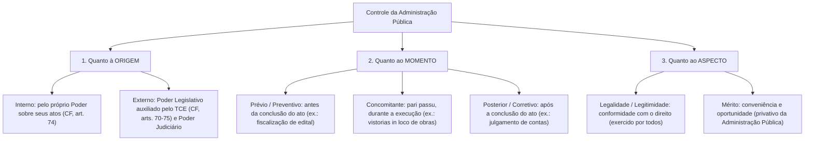
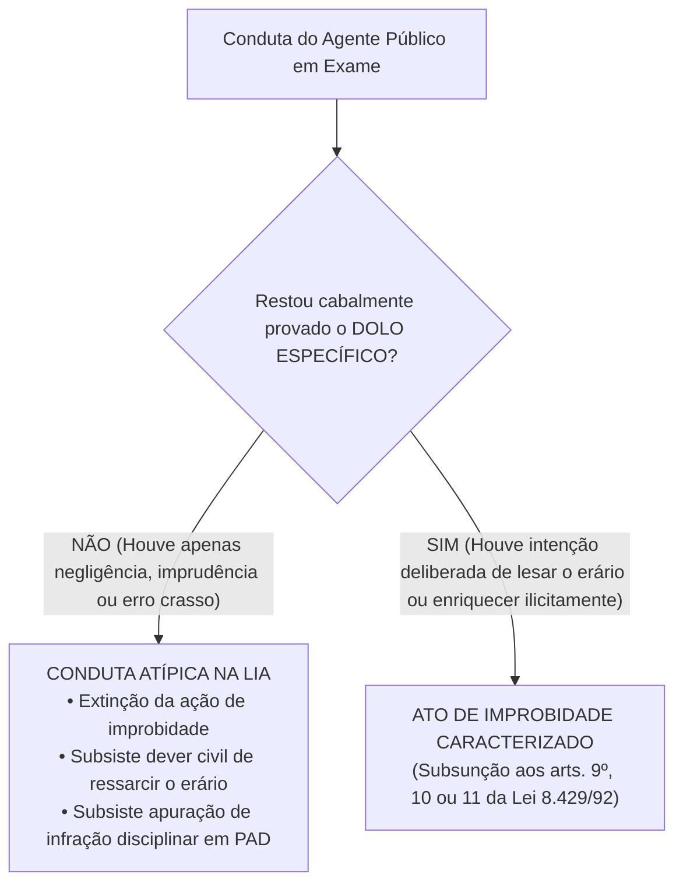
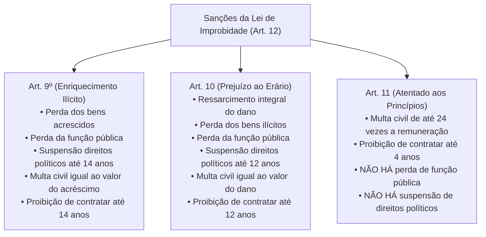

# 05 - Controle da Administração Pública e Improbidade Administrativa (Lei 8.429/1992 e Lei 14.230/2021)

> **Matéria:** Noções de Direito Administrativo  
> **Cargo:** A01 – Técnico de Controle Externo – Especialidade: Técnico Administrativo  
> **Arquivo:** `05_controle_da_administracao_e_improbidade_administrativa.md`  

---

## 📌 Ementa / Itens do Edital
- Controle da Administração Pública: conceito, fundamentos e classificações
- Classificação quanto à origem (Interno e Externo), momento (Prévio, Concomitante e Posterior) e aspecto (Legalidade e Mérito)
- Controle Legislativo e a atuação constitucional do Tribunal de Contas
- Controle Judicial: limites da atuação do Judiciário sobre o mérito administrativo e princípios da razoabilidade e proporcionalidade
- Instrumentos de controle judicial: Mandado de Segurança, Ação Popular e Ação Civil Pública
- Lei de Improbidade Administrativa (Lei Federal nº 8.429/1992 com redação dada pela Lei Federal nº 14.230/2021 e alterações)
- Sujeitos ativo e passivo dos atos de improbidade
- Elemento subjetivo: extinção da modalidade culposa e exigência de dolo específico (Tema 1.199 do STF)
- Tipologia dos atos de improbidade: Enriquecimento Ilícito (art. 9º), Prejuízo ao Erário (art. 10) e Atentado aos Princípios (art. 11)
- Sanções cominadas e regime prescricional unificado e intercorrente

---

## 🧭 Sumário

1. [Teoria Geral do Controle da Administração Pública](#1-teoria-geral-do-controle-da-administracao-publica)
    1. [Fundamento Republicano e Sistema de Freios e Contrapesos](#11-fundamento-republicano-e-sistema-de-freios-e-contrapesos)
    2. [Classificação Quanto à Origem: Controle Interno vs. Controle Externo](#12-classificacao-quanto-a-origem-controle-interno-vs-controle-externo)
    3. [Classificação Quanto ao Momento: Prévio, Concomitante e Posterior](#13-classificacao-quanto-ao-momento-previo-concomitante-e-posterior)
    4. [Classificação Quanto ao Aspecto: Controle de Legalidade vs. Mérito](#14-classificacao-quanto-ao-aspecto-controle-de-legalidade-vs-merito)
    5. [Teste 045](#Teste-045)
    6. [Teste 046](#Teste-046)
2. [O Controle Legislativo e a Atuação dos Tribunais de Contas](#2-o-controle-legislativo-e-a-atuacao-dos-tribunais-de-contas)
    1. [A Função Constitucional do Tribunal de Contas (CF/88, arts. 70 a 75)](#21-a-funcao-constitucional-do-tribunal-de-contas-cf88-arts-70-a-75)
    2. [Natureza das Decisões e Título Executivo Extrajudicial](#22-natureza-das-decisoes-e-titulo-executivo-extrajudicial)
    3. [Teste 047](#Teste-047)
    4. [Teste 048](#Teste-048)
3. [O Controle Judicial dos Atos Administrativos](#3-o-controle-judicial-dos-atos-administrativos)
    1. [Limites do Controle Judicial sobre o Mérito Administrativo](#31-limites-do-controle-judicial-sobre-o-merito-administrativo)
    2. [Anulação por Desvio de Finalidade e a Teoria dos Motivos Determinantes](#32-anulacao-por-desvio-de-finalidade-e-a-teoria-dos-motivos-determinantes)
    3. [Ações Constitucionais de Controle: Mandado de Segurança, Ação Popular e ACP](#33-acoes-constitucionais-de-controle-mandado-de-seguranca-acao-popular-e-acp)
    4. [Teste 049](#Teste-049)
    5. [Teste 050](#Teste-050)
4. [A Nova Lei de Improbidade Administrativa (Lei 8.429/1992 e Lei 14.230/2021)](#4-a-nova-lei-de-improbidade-administrativa-lei-84291992-e-lei-142302021)
    1. [Sujeitos Ativos e Passivos da Improbidade Administrativa](#41-sujeitos-ativos-e-passivos-da-improbidade-administrativa)
    2. [O Elemento Subjetivo e a Extinção da Culpa (Tema 1.199 / STF)](#42-o-elemento-subjetivo-e-a-extincao-da-culpa-tema-1199-stf)
    3. [Proibição do Crime de Hermenêutica no Âmbito da LIA](#43-proibicao-do-crime-de-hermeneutica-no-ambito-da-lia)
    4. [Teste 051](#Teste-051)
    5. [Teste 052](#Teste-052)
5. [Tipologia dos Atos de Improbidade e Quadro Sancionatório](#5-tipologia-dos-atos-de-improbidade-e-quadro-sancionatorio)
    1. [Enriquecimento Ilícito (Art. 9º da LIA)](#51-enriquecimento-ilicito-art-9o-da-lia)
    2. [Prejuízo ao Erário (Art. 10 da LIA)](#52-prejuizo-ao-erario-art-10-da-lia)
    3. [Atentado aos Princípios da Administração (Art. 11 da LIA - Rol Taxativo)](#53-atentado-aos-principios-da-administracao-art-11-da-lia-rol-taxativo)
    4. [Matriz Comparativa de Sanções do Artigo 12 da LIA](#54-matriz-comparativa-de-sancoes-do-artigo-12-da-lia)
    5. [Regime Prescricional Geral e Intercorrente (Art. 23 da LIA)](#55-regime-prescricional-geral-e-intercorrente-art-23-da-lia)
    6. [Teste 053](#Teste-053)
    7. [Teste 054](#Teste-054)
    8. [Teste 055](#Teste-055)
6. [Fontes Recomendadas na Internet](#6-fontes-recomendadas-na-internet)

---

## 1. Teoria Geral do Controle da Administração Pública

O controle da Administração Pública compreende o conjunto de mecanismos jurídicos e institucionais mediante os quais se fiscaliza, orienta, corrige e revisa a atuação dos órgãos, agentes e entidades do Estado, com vistas a assegurar a observância da legalidade, moralidade, economicidade e a consecução do interesse coletivo.

### 1.1 Fundamento Republicano e Sistema de Freios e Contrapesos

No Estado Democrático de Direito, nenhum poder estatal é absoluto ou imune a fiscalização. O controle administrativo fundamenta-se:

1. No **Princípio Republicano** (prestação de contas obrigatória de todo aquele que gere recursos públicos);
2. No **Princípio da Indisponibilidade do Interesse Público** (o administrador gere patrimônio alheio);
3. No **Sistema de Freios e Contrapesos (*Checks and Balances*)**, consagrado pelo art. 2º da CF/88, segundo o qual os Poderes Legislativo, Executivo e Judiciário são harmônicos e independentes, exercendo controles recíprocos uns sobre os outros.

### 1.2 Classificação Quanto à Origem: Controle Interno vs. Controle Externo

- **Controle Interno (CF/88, art. 74):** Exercido por cada um dos Poderes (Executivo, Legislativo e Judiciário) e pelo Ministério Público sobre sua própria estrutura administrativa e órgãos subordinados. Funda-se na hierarquia e na autotutela. Suas finalidades constitucionais compreendem: avaliar o cumprimento de metas do PPA, comprovar a legalidade da gestão orçamentária, exercer o controle de operações de crédito e apoiar o controle externo em sua missão institucional.
- **Controle Externo (CF/88, art. 70 a 75):** Exercido por um Poder sobre a atuação administrativa de outro Poder ou sobre terceiros gestores de recursos públicos. No plano federativo, é titularizado privativamente pelo **Poder Legislativo** (Assembleia Legislativa / Congresso Nacional), com o auxílio técnico, operacional e constitucional autônomo do **Tribunal de Contas**. Também abrange o controle jurisdicional repressivo exercido pelo Poder Judiciário.

### 1.3 Classificação Quanto ao Momento: Prévio, Concomitante e Posterior

- **Controle Prévio (Preventivo ou *a priori*):** Realizado antes da consumação ou produção de efeitos do ato administrativo, com o objetivo de prevenir irregularidades e evitar lesões ao erário (ex.: apreciação prévia de editais de concessão vultosos pelo TCE; aprovação legislativa de indicados a cargos de agências reguladoras).
- **Controle Concomitante (Simultâneo ou *pari passu*):** Realizado simultaneamente à execução material da atividade administrativa, em tempo real (ex.: auditorias de acompanhamento de execução orçamentária; fiscalizações e vistorias *in loco* em canteiros de obras rodoviárias estaduais).
- **Controle Posterior (Corretivo ou *a posteriori*):** Realizado após a consumação integral do ato administrativo ou do encerramento do exercício financeiro, visando sancionar faltas, anular ilegalidades ou certificar a higidez das contas (ex.: julgamento de tomadas de contas especiais; auditorias de conformidade posteriores; homologação ou rejeição das contas de gestores).

### 1.4 Classificação Quanto ao Aspecto: Controle de Legalidade vs. Mérito

- **Controle de Legalidade / Legitimidade:** Avalia a conformidade formal e material do ato administrativo com a Constituição, leis, decretos, súmulas vinculantes e princípios de direito público (razoabilidade, proporcionalidade e moralidade). Pode ser exercido pela própria Administração, pelo Tribunal de Contas e pelo Poder Judiciário.
- **Controle de Mérito:** Avalia a **conveniência e oportunidade** da decisão administrativa tomada dentro da margem de discricionariedade permitida pela lei. É atribuição **privativa e exclusiva da própria Administração Pública**, sendo vedado ao Judiciário ou ao Tribunal de Contas substituir o juízo de mérito do administrador.

---

### Teste 045
**(FCC – Analista de Controle Externo – TCE-GO / Simulado)**  
A Constituição Federal de 1988 estabelece que os Poderes Legislativo, Executivo e Judiciário manterão, de forma integrada, sistema de controle interno com finalidades expressas no art. 74. A respeito das atribuições constitucionais do controle interno e de sua articulação com o controle externo, assinale a afirmativa correta:

* **A)** Os responsáveis pelo controle interno, cientes de irregularidades, devem avisar o Tribunal de Contas sob responsabilidade solidária.
* **B)** O controle interno tem competência originária e exclusiva para anular atos praticados por secretários de Estado no exercício de competências discricionárias privativas.
* **C)** A constatação de desvios orçamentários pelo controle interno impede o Ministério Público de ajuizar ação de improbidade até deliberação do Legislativo.
* **D)** O sistema de controle interno vincula-se hierarquicamente ao Tribunal de Contas, cabendo a este homologar previamente o plano anual de auditoria.
* **E)** As auditorias de controle interno dispensam formalização de relatórios quando as falhas constatadas forem classificadas como de baixo impacto financeiro.

---

> **Comentário Detalhado:**
>
> - **A)** **Correto**. Literalidade do art. 74, § 1º, da CF/88: "Os responsáveis pelo controle interno, ao tomarem conhecimento de qualquer irregularidade ou ilegalidade, dela darão ciência ao Tribunal de Contas da União, sob pena de responsabilidade solidária". Trata-se de dever constitucional inafastável dos auditores internos.
> - **B)** **Incorreto**. O controle interno avalia a legalidade e eficácia da gestão, mas a anulação cabe à própria autoridade competente em autotutela ou ao Judiciário.
> - **C)** **Incorreto**. O Ministério Público possui titularidade autônoma e incondicionada para a persecução judicial de atos de improbidade.
> - **D)** **Incorreto**. O controle interno pertence à estrutura de cada Poder respectivo, sem subordinação hierárquica ao Tribunal de Contas.
> - **E)** **Incorreto**. Os achados de auditoria devem ser obrigatoriamente documentados em relatórios formais.
>
> **Gabarito: A**
### Teste 046
**(FCC – Técnico de Controle Externo – TCE-GO / Simulado)**  
No âmbito da sistemática de fiscalização dos atos estatais, o acórdão proferido pelo Tribunal de Contas que imputar débito ou aplicar multa comina sanção de natureza patrimonial ao responsável. Segundo o art. 71, § 3º, da Constituição Federal e a jurisprudência pacificada do Supremo Tribunal Federal (Tema nº 642):

* **A)** A decisão do Tribunal de Contas que imputa débito tem eficácia de título executivo, cobrada pela Fazenda Pública credora.
* **B)** A execução do acórdão do Tribunal de Contas deve ser proposta judicialmente pela própria Corte de Contas, que detém capacidade postulatória plena.
* **C)** O título executivo constituído pelo Tribunal de Contas exige prévia homologação pelo Poder Judiciário para que possa ensejar cobrança forçada.
* **D)** A imputação de débito pelo Tribunal de Contas obsta a incidência concomitante de sanções disciplinares no âmbito funcional da Administração Direta.
* **E)** A prescrição da execução de título emitido pelo Tribunal de Contas consuma-se em dois anos a contar da publicação do acórdão no órgão oficial.

---

> **Comentário Detalhado:**
>
> - **A)** **Correto**. O art. 71, § 3º, da CF/88 preceitua que as decisões do Tribunal de Contas de que resulte imputação de débito ou multa terão eficácia de título executivo. Ademais, no julgamento do Tema nº 642 de Repercussão Geral, o STF firmou que o ente público titular do crédito lesado (o Estado ou Município beneficiário) tem legitimidade ativa exclusiva para a execução fiscal, representada por seus procuradores da Fazenda Pública.
> - **B)** **Incorreto**. O Tribunal de Contas não detém legitimidade ativa para promover a execução judicial de seus títulos (Súmula 642 do STF).
> - **C)** **Incorreto**. O título executivo é extrajudicial e pronto para execução fiscal direta, dispensando qualquer homologação judicante.
> - **D)** **Incorreto**. A esfera de controle externo financeiro é independente da esfera disciplinar funcional do servidor.
> - **E)** **Incorreto**. O prazo prescricional para execução fiscal fundada em título do TC é de cinco anos (Decreto nº 20.910/1932 e Tema 899 STF).
>
> **Gabarito: A**
## 2. O Controle Legislativo e a Atuação dos Tribunais de Contas

### 2.1 A Função Constitucional do Tribunal de Contas (CF/88, arts. 70 a 75)

O controle externo a cargo do Poder Legislativo é exercido com o auxílio técnico do Tribunal de Contas do Estado (TCE-GO). As Cortes de Contas ostentam envergadura e autonomia constitucional direta, exercendo competências indelegáveis:

1. **Julgamento de Contas dos Administradores Públicos (Art. 71, II):** Julgar as contas de todos os ordenadores de despesa, dirigentes de estatais e gestores responsáveis por dinheiros, bens e valores públicos estaduais.
2. **Apreciação das Contas do Chefe do Executivo (Art. 71, I):** Emitir **parecer prévio** conclusivo sobre as contas anuais prestadas pelo Governador do Estado (o julgamento definitivo cabe à Assembleia Legislativa).
3. **Fiscalização Operacional e Financeira (Art. 71, IV):** Realizar inspeções e auditorias de natureza contábil, financeira, orçamentária, operacional e patrimonial.
4. **Fiscalização de Atos de Admissão e Aposentadoria (Art. 71, III):** Apreciar, para fins de registro, a legalidade dos atos de admissão de pessoal (salvo cargos comissionados) e de concessão inicial de aposentadorias, reformas e pensões.
5. **Aplicação de Sanções (Art. 71, VIII):** Aplicar aos responsáveis as sanções previstas em sua Lei Orgânica, incluindo multas pecuniárias, imputação de débito e inabilitação temporária para o exercício de cargo em comissão.

### 2.2 Natureza das Decisões e Título Executivo Extrajudicial

- **Eficácia de Título Executivo (CF/88, art. 71, § 3º):** As decisões do Tribunal de Contas de que resulte imputação de débito ou cominação de multa pecuniária possuem **eficácia de título executivo extrajudicial**.
- **Execução do Título:** A cobrança judicial não é executada pelo próprio Tribunal de Contas, mas sim pelo ente público lesado (a Procuradoria-Geral do Estado - PGE promove a competente Ação de Execução Fiscal perante a Vara da Fazenda Pública).

---

### Teste 047
**(FCC – TRT – Analista Judiciário - 2009)**  
Compete privativamente ao Tribunal de Contas do Estado, no exercício do controle externo financeiro e orçamentário que lhe incumbe a ordem constitucional, desempenhar atribuições técnicas fiscalizatórias. Dentre as competências fixadas na Constituição Federal (art. 71) e na Constituição Estadual, é correto afirmar que cabe ao Tribunal de Contas:

* **A)** julgar anualmente as contas prestadas pelo Chefe do Poder Executivo estadual e fixar sua remuneração política.
* **B)** sustar diretamente, no exercício de controle prévio, a vigência de decretos normativos expedidos pelo Governador.
* **C)** apreciar as contas prestadas anualmente pelo Governador do Estado, mediante emissão de parecer prévio conclusivo.
* **D)** exercer a representação judicial da Administração Direta em ações civis públicas ajuizadas por dano ao meio ambiente.
* **E)** revogar liminarmente contratos administrativos por razões discricionárias de conveniência e oportunidade pública.

---

> **Comentário Detalhado:**
>
> - **A)** **Incorreto**. O Tribunal de Contas não julga as contas do Governador (Chefe do Executivo); cabe ao Poder Legislativo julgá-las. A fixação de subsídios é privativa da Assembleia Legislativa.
> - **B)** **Incorreto**. A sustação de atos normativos que exorbitem o poder regulamentar é competência privativa do Poder Legislativo (art. 49, V da CF/88).
> - **C)** **Correto**. Conforme estabelece o art. 71, I, da CF/88, compete ao Tribunal de Contas "apreciar as contas prestadas anualmente pelo Presidente da República [e Governadores/Prefeitos], mediante parecer prévio que deverá ser elaborado em sessenta dias a contar de seu recebimento". O julgamento político-institucional compete à Assembleia Legislativa.
> - **D)** **Incorreto**. A representação judicial da Administração estadual cabe à Procuradoria-Geral do Estado (PGE).
> - **E)** **Incorreto**. O Tribunal de Contas não revoga contratos por conveniência, pois fiscaliza a legalidade e legitimidade.
>
> **Gabarito: C**
### Teste 048
**(FCC – Procurador do Estado – PGE-GO / Simulado)**  
Em processo de Tomada de Contas Especial instaurado no Tribunal de Contas do Estado de Goiás para apurar desvio de recursos públicos em convênio estadual, o relator determinou a citação solidária do ex-Prefeito convenente e da empresa privada contratada. A respeito do julgamento das contas e de seus efeitos legais:

* **A)** A condenação do ex-Prefeito ao ressarcimento do erário pelo Tribunal de Contas gera automática inelegibilidade de natureza criminal.
* **B)** Contas irregulares com dano insanável e improbidade dolosa geram a inelegibilidade eleitoral prevista na LC nº 64/1990.
* **C)** A citação da pessoa jurídica contratada é incabível por se tratar de ente privado não sujeito à jurisdição da Corte de Contas.
* **D)** A quitação das contas pelo Tribunal obsta definitivamente a apuração de faltas funcionais em sede de sindicância disciplinar.
* **E)** O Tribunal de Contas pode determinar a quebra de sigilo bancário de particulares sem prévia anuência do Poder Judiciário.

---

> **Comentário Detalhado:**
>
> - **A)** **Incorreto**. As sanções do Tribunal de Contas têm natureza administrativa e patrimonial, não penal. A inelegibilidade não decorre de condenação criminal.
> - **B)** **Correto**. Conforme preceitua a Lei Complementar nº 64/1990 (Lei das Inelegibilidades, art. 1º, I, "g"), são inelegíveis para qualquer cargo os que tiverem suas contas relativas ao exercício de cargos ou funções públicas rejeitadas por irregularidade insanável que configure ato doloso de improbidade administrativa, por decisão irrecorrível do órgão competente, salvo se suspensa ou anulada pelo Judiciário.
> - **C)** **Incorreto**. O particular ou pessoa jurídica que celebra contrato ou convênio com verba pública submete-se à jurisdição do Tribunal de Contas (art. 70, parágrafo único e art. 71, II da CF/88).
> - **D)** **Incorreto**. A quitação das contas de gestão não impede a apuração de responsabilidade administrativa disciplinar autônoma.
> - **E)** **Incorreto**. O STF pacificou que Tribunais de Contas estaduais não possuem competência para determinar a quebra direta de sigilo bancário de particulares sem reserva de jurisdição judiciária.
>
> **Gabarito: B**
## 3. O Controle Judicial dos Atos Administrativos

Em razão do princípio da inafastabilidade da tutela jurisdicional (CF/88, art. 5º, XXXV: *"a lei não excluirá da apreciação do Poder Judiciário lesão ou ameaça a direito"*), o Brasil adota o sistema de jurisdição una (sistema inglês), cabendo unicamente ao Poder Judiciário dizer o direito com força definitiva de coisa julgada material.

### 3.1 Limites do Controle Judicial sobre o Mérito Administrativo

- **Veto de Substituição de Mérito:** O juiz não pode substituir a valoração legítima de conveniência e oportunidade do administrador eleito ou concursado (ex.: escolher entre asfaltar a rua A ou reformar o posto de saúde B, quando ambas as opções são legais e orçamentariamente viáveis).
- **Proibição de Revogação Judicial:** O Poder Judiciário, no exercício de sua função jurisdicional, **NUNCA revoga atos do Poder Executivo**. O Judiciário apenas **anula** atos administrativos que padeçam de vícios de ilegalidade originária.

### 3.2 Anulação por Desvio de Finalidade e a Teoria dos Motivos Determinantes

O controle judicial sobre atos discricionários não se restringe à literalidade da lei, alcançando a legalidade ampla e os princípios constitucionais:

- **Desvio de Finalidade:** O Judiciário deve decretar a anulação do ato se restar demonstrado que a autoridade usou de sua competência legal para perseguir um desafeto pessoal, satisfazer capricho ou favorecer correligionários.
- **Teoria dos Motivos Determinantes:** Se a motivação alegada no ato for comprovadamente falsa, inexistente ou contraditória com os fatos da realidade, o ato é nulo por vício de motivo, devendo o Judiciário anulá-lo com efeitos retroativos (*ex tunc*).

### 3.3 Ações Constitucionais de Controle: Mandado de Segurança, Ação Popular e ACP

| Ação Constitucional | Base Normativa | Legitimidade Ativa | Objeto / Finalidade Principal | Particularidades Processuais |
| :--- | :--- | :--- | :--- | :--- |
| **Mandado de Segurança** | CF, art. 5º, LXIX; Lei 12.016/2009 | Pessoa física ou jurídica titular do direito | Proteger **direito líquido e certo**, não amparado por *habeas corpus* ou *habeas data*, contra ato ilegal ou abuso de poder | Exige **prova documental pré-constituída**; não admite dilação probatória; prazo decadencial de 120 dias. |
| **Ação Popular** | CF, art. 5º, LXXIII; Lei 4.717/1965 | **Qualquer cidadão brasileiro** no gozo de seus direitos políticos (título de eleitor) | Anular ato lesivo ao **patrimônio público**, à **moralidade administrativa**, ao **meio ambiente** e ao **patrimônio histórico e cultural** | Autor fica **isento de custas judiciais e sucumbência**, salvo comprovada má-fé. |
| **Ação Civil Pública** | CF, art. 129, III; Lei 7.347/1985 | Ministério Público, Defensoria Pública, Entes Federados, Autarquias e Associações constituídas há mais de 1 ano | Tutela de **direitos difusos, coletivos e individuais homogêneos** (meio ambiente, patrimônio público, consumidor) | Permite condenação em dinheiro (revertida a fundo público) e obrigação de fazer/não fazer. |

---

### Teste 049
**(FCC – Analista de Controle Externo – TCE-GO / Simulado)**  
O Secretário Municipal de Saúde de determinado município goiano descumpriu reiteradamente ordem de alocação de leitos pediátricos de UTI pactuados no SUS, alegando a discricionariedade na gestão das vagas hospitalares. O Ministério Público ajuizou Ação Civil Pública pleiteando a imediata internação de recém-nascidos em risco de morte. A intervenção judicial:

* **A)** É vedada pelo princípio da separação dos poderes, que impede qualquer controle judicial sobre a área sanitária.
* **B)** É legítima para garantir o mínimo existencial e o direito à vida, quando constatada inércia estatal desarrazoada.
* **C)** Restringe-se à fixação de indenização financeira aos pais, vedada a determinação cominatória de internação.
* **D)** Exige a prévia demonstração de superávit orçamentário primário no caixa municipal pelo promotor de justiça.
* **E)** Fica condicionada à autorização da Câmara de Vereadores por se tratar de despesa extraordinária de saúde.

---

> **Comentário Detalhado:**
>
> - **A)** **Incorreto**. O princípio da separação dos poderes não consagra imunidade absoluta ao administrador público perante o descumprimento de mandamentos constitucionais fundamentais.
> - **B)** **Correto**. Conforme jurisprudência pacífica do STF (Tema 698 de Repercussão Geral), a intervenção do Poder Judiciário em políticas públicas voltadas à concretização de direitos fundamentais (como a saúde e a vida de recém-nascidos) é plenamente legítima em situações excepcionais de omissão estatal injustificada, não configurando violação à separação de poderes nem à cláusula da reserva do possível quando em jogo o mínimo existencial.
> - **C)** **Incorreto**. O juiz pode e deve expedir tutelas específicas de obrigação de fazer (internação imediata sob pena de multa diária ou bloqueio de verbas).
> - **D)** **Incorreto**. A cláusula da reserva do possível não pode ser invocada genericamente para justificar omissões que aniquilem o núcleo essencial da dignidade humana.
> - **E)** **Incorreto**. A tutela jurisdicional independe de qualquer autorização do Poder Legislativo municipal.
>
> **Gabarito: B**
### Teste 050
**(FCC – TRT – Analista Judiciário - 2009)**  
Ato lesivo ao patrimônio público, à moralidade administrativa e ao meio ambiente, praticado por autoridade pública estadual mediante desvio de verbas destinadas a programa de habitação popular, sujeita-se a mecanismos constitucionais de controle jurisdicional. A respeito da Ação Popular (art. 5º, LXXIII, da CF/88), é correto afirmar que:

* **A)** qualquer cidadão no gozo de seus direitos políticos detém legitimidade ativa originária para ajuizá-la.
* **B)** os partidos políticos e sindicatos de classe podem ajuizá-la diretamente em nome de seus filiados.
* **C)** as pessoas jurídicas de direito privado têm plena legitimidade ativa para propô-la perante o juízo competente.
* **D)** o Ministério Público tem legitimidade prioritária para propor a ação popular perante as varas de fazenda pública.
* **E)** a comprovação de dano material estrito é dispensável, bastando a lesividade à moralidade administrativa e ao erário.

---

> **Comentário Detalhado:**
>
> - **A)** **Correto**. O art. 5º, LXXIII, da CF/88 consagra que "qualquer cidadão é parte legítima para propor ação popular que vise a anular ato lesivo ao patrimônio público ou de entidade de que o Estado participe, à moralidade administrativa, ao meio ambiente e ao patrimônio histórico e cultural". A legitimidade ativa é privativa da pessoa física detentora de cidadania (título de eleitor ativo).
> - **B)** **Incorreto**. Entidades coletivas, partidos e sindicatos não detêm legitimidade para a ação popular; seu instrumento é a ação civil pública ou mandado de segurança coletivo.
> - **C)** **Incorreto**. Pela Súmula nº 365 do STF: "Pessoa jurídica não tem legitimidade para propor ação popular".
> - **D)** **Incorreto**. O Ministério Público não pode ajuizar ação popular originária; atua como fiscal da ordem jurídica (custos iuris) e assume o polo ativo apenas em caso de desistência do cidadão autor.
> - **E)** **Incorreto**. Embora a moralidade seja tutelada, a alternativa A traduz a literalidade e essência da legitimidade constitucional do cidadão.
>
> **Gabarito: A**
## 4. A Nova Lei de Improbidade Administrativa (Lei 8.429/1992 e Lei 14.230/2021)

A Lei Federal nº 14.230/2021 promoveu a mais profunda reforma na Lei de Improbidade Administrativa (LIA - Lei nº 8.429/1992), transformando o diploma em um estatuto de Direito Administrativo Sancionador rígido, com garantias processuais do direito punitivo.

### 4.1 Sujeitos Ativos e Passivos da Improbidade Administrativa

- **Sujeito Ativo (Art. 2º):** Considera-se agente público para os efeitos desta Lei o agente político, o servidor público e todo aquele que exerce, ainda que transitoriamente ou sem remuneração, por eleição, nomeação, designação, contratação ou qualquer outra forma de investidura ou vínculo, mandato, cargo, emprego ou função nas entidades públicas.
- **Particular em Concurso (Art. 3º):** As disposições da LIA aplicam-se àquele que, mesmo não sendo agente público, **induza ou concorra dolosamente** para a prática do ato de improbidade.  
  > ⚠️ **Regra Consolidada STJ/STF:** Não é cabível ação de improbidade exclusivamente em face de particular desacompanhado de agente público no polo passivo!

### 4.2 O Elemento Subjetivo e a Extinção da Culpa (Tema 1.199 / STF)

A alteração mais radical da Lei nº 14.230/2021 consistiu na **abolição total e expressa da modalidade culposa** para todos os atos de improbidade administrativa.

#### Tese Vinculante do Tema 1.199 do STF (RE 1.205.746):
1. **Exigência de Dolo Específico:** É necessária a comprovação de responsabilidade subjetiva com **dolo específico** para a tipificação de qualquer ato de improbidade administrativa (artigos 9º, 10 e 11). Não basta dolo genérico; exige-se a demonstração da vontade livre e consciente de alcançar o resultado ilícito, acompanhada do fim especial de agir.
2. **Extinção da Culpa (Inclusive Culpa Grave):** A negligência crassa, a imprudência, a imperícia ou o erro de gestão administrativa, ainda que inescusáveis, **NÃO configuram improbidade administrativa**. O agente negligente pode responder disciplinarmente no estatuto funcional ou em ação regressiva civil comum de reparação ao erário, mas não sob a pecha desonrosa da improbidade.
3. **Direito Intertemporal:**
    - *Processos com trânsito em julgado:* A nova lei **NÃO retroage** para desconstituir condenações culposas já consolidadas pela coisa julgada material.
    - *Processos em andamento:* A revogação da culpa **aplica-se imediatamente e de forma retroativa** a todas as ações de improbidade em curso em qualquer grau de jurisdição.

### 4.3 Proibição do Crime de Hermenêutica no Âmbito da LIA

O art. 1º, § 8º, da LIA estabelece expressamente que **não configura improbidade a ação ou omissão decorrente de divergência interpretativa da lei**, baseada em jurisprudência, ainda que não pacificada, mesmo que não venha a ser posteriormente a prevalecente nos tribunais judiciais ou de contas.

---

### Teste 051
**(FGV – TJ-MT – Analista Judiciário - 2024)**  
Em dezembro de 2024, João, estagiário voluntário que atuava sem remuneração em determinado cartório de vara judicial estadual, utilizou indevidamente as senhas de acesso restrito de magistrado para obter vantagens financeiras de advogados em processos em trâmite. 

Considerando as alterações promovidas pela Lei Federal nº 14.230/2021 na Lei de Improbidade Administrativa (Lei nº 8.429/1992):

* **A)** João não pode responder por improbidade administrativa, pois a ausência de remuneração afasta a qualidade de agente público.
* **B)** João qualifica-se como agente público pela LIA, respondendo por enriquecimento ilícito na modalidade dolosa.
* **C)** A caracterização da improbidade praticada por estagiário exige a condenação penal prévia por crime de concussão.
* **D)** A configuração de improbidade admite a modalidade culposa quando constatada negligência inescusável do servidor orientador.
* **E)** As penas da Lei de Improbidade não alcançam estagiários, aplicando-se apenas aos servidores efetivos e comissionados.

---

> **Comentário Detalhado:**
>
> - **A)** **Incorreto**. O art. 2º da Lei nº 8.429/1992 (com redação da Lei nº 14.230/2021) adota conceito amplíssimo de agente público: "Para os efeitos desta Lei, consideram-se agente público o agente político, o servidor público e todo aquele que exerce, ainda que transitoriamente ou sem remuneração, por eleição, nomeação, designação, contratação ou qualquer outra forma de investidura ou vínculo, mandato, cargo, emprego ou função nas entidades referidas no art. 1º desta Lei". Estagiários voluntários são agentes públicos para fins da LIA.
> - **B)** **Correto**. João exerce função pública de fato e, ao cobrar vantagens indevidas, pratica ato de improbidade que importa enriquecimento ilícito (art. 9º da LIA), exigindo-se o dolo específico para a sua responsabilização.
> - **C)** **Incorreto**. A esfera cível da improbidade é independente da responsabilização penal.
> - **D)** **Incorreto**. A Lei nº 14.230/2021 extinguiu expressamente a modalidade culposa de improbidade administrativa em todos os tipos da lei.
> - **E)** **Incorreto**. O regime sancionador alcança qualquer agente público que cometa atos ilícitos no exercício funcional.
>
> **Gabarito: B**
### Teste 052
**(FCC – TRT – Analista Judiciário - 2024)**  
Antônio, servidor público estadual ocupante de função de gestão financeira, cometeu equívoco formal na prestação de contas de adiantamento de despesas em 2018, agindo com manifesta imprudência, mas sem qualquer intenção de lesar o erário ou desviar verbas. O Ministério Público ajuizou ação de improbidade em 2020 por conduta culposa. 

Com a edição da Lei nº 14.230/2021 e a fixação da tese de repercussão geral pelo STF no Tema nº 1.199:

* **A)** A revogação da modalidade culposa retroage para alcançar ações em curso sem trânsito em julgado, impondo a improcedência da demanda.
* **B)** A alteração legislativa não se aplica a atos praticados antes de 2021, prosseguindo a ação sob as regras originárias da culpa estrita.
* **C)** O juiz deve converter automaticamente a imputação de improbidade culposa em crime formal contra a administração pública.
* **D)** A modalidade culposa permanece válida para atos que geram dano ao erário decorrentes de erro administrativo grave.
* **E)** A ação retroage para beneficiar o réu mesmo nas hipóteses em que já tenha havido coisa julgada material transitada.

---

> **Comentário Detalhado:**
>
> - **A)** **Correto**. Tese de Repercussão Geral do Tema nº 1.199 do STF: "A revogação da modalidade culposa do ato de improbidade administrativa, promovida pela Lei 14.230/2021, é irretroativa, em virtude do artigo 5º, inciso XXXVI, da Constituição Federal, não tendo o condão de desconstituir os efeitos da coisa julgada; todavia, aplica-se aos atos de improbidade administrativa culposos praticados na vigência do texto anterior da lei, porém sem condenação transitada em julgado, inclusive em grau de recurso, devendo ser extintas as respectivas ações". Não havendo trânsito em julgado, a ação em curso é fulminada pela ausência de dolo.
> - **B)** **Incorreto**. O STF reconheceu a retroatividade in bonam partem para todos os processos judiciais ainda em curso (sem trânsito em julgado).
> - **C)** **Incorreto**. A esfera judicial cível não se converte em denúncia criminal de ofício pelo magistrado.
> - **D)** **Incorreto**. A Lei nº 14.230/2021 revogou integralmente qualquer modalidade culposa do art. 10 da LIA.
> - **E)** **Incorreto**. O STF garantiu a intangibilidade da coisa julgada material já consumada antes da nova lei.
>
> **Gabarito: A**
## 5. Tipologia dos Atos de Improbidade e Quadro Sancionatório

### 5.1 Enriquecimento Ilícito (Art. 9º da LIA)

Ocorre quando o agente aufere qualquer tipo de vantagem patrimonial indevida em razão do exercício de cargo, mandato, função ou emprego público.

- *Exemplos:* Receber propina, comissão ou presente oneroso; utilizar bens, veículos ou servidores públicos em obras ou serviços particulares; incorporar ao patrimônio pessoal bens públicos; evolução patrimonial desproporcional à renda declarada.
- **Natureza do Rol:** Rol **exemplificativo** (*numerus apertus*).

### 5.2 Prejuízo ao Erário (Art. 10 da LIA)

Consiste em qualquer ação ou omissão dolosa que enseje, efetiva e comprovadamente, perda patrimonial, desvio, apropriação, malbaratamento ou dilapidação dos bens ou haveres públicos.

- **Exigência de Dano Efetivo e Real:** A Lei nº 14.230/2021 **proibiu o dano presumido (*in re ipsa*)**. Para que haja condenação pelo art. 10, a acusação deve comprovar documental e pericialmente o prejuízo financeiro concreto experimentado pelos cofres públicos.
- **Natureza do Rol:** Rol considerado **taxativo** pela nova redação legal.

### 5.3 Atentado aos Princípios da Administração (Art. 11 da LIA - Rol Taxativo)

Trata de condutas dolosas que violam os deveres de honestidade, imparcialidade e legalidade expressamente descritos no texto da lei.

- **ROL ESTRITAMENTE TAXATIVO (*Numerus Clausus*):** O art. 11 passou a ter um rol fechado. Somente configuram improbidade por violação a princípios as condutas literalmente previstas em seus incisos:
    - *Inciso III:* Revelar fato ou circunstância de que tem ciência em razão das atribuições e que deva permanecer em segredo;
    - *Inciso IV:* Negar publicidade aos atos oficiais (salvo sigilo legal);
    - *Inciso V:* Frustrar a licitude de concurso público;
    - *Inciso VIII:* Recusar cumprimento a lei federal sem declaração de inconstitucionalidade;
    - *Inciso XI:* Praticar nepotismo (nomeação de cônjuge, companheiro ou parente até 3º grau).

### 5.4 Matriz Comparativa de Sanções do Artigo 12 da LIA

| Tipo de Improbidade | Natureza do Rol | Suspensão dos Direitos Políticos | Perda da Função Pública? | Multa Civil Máxima | Proibição de Contratar / Benefícios |
| :--- | :---: | :---: | :---: | :---: | :---: |
| **Art. 9º (Enriquecimento Ilícito)** | Exemplificativo | Até **14 anos** | **SIM** (atinge o cargo exercido à época) | Até o valor do **acréscimo patrimonial** | Até **14 anos** |
| **Art. 10 (Prejuízo ao Erário)** | Taxativo | Até **12 anos** | **SIM** | Até o valor do **dano efetivo** | Até **12 anos** |
| **Art. 11 (Atentado a Princípios)** | **Estritamente Taxativo** | **NÃO HÁ MAIS** | **NÃO HÁ MAIS** | Até **24 vezes a remuneração** do agente | Até **4 anos** |

> 🚨 **ALERTA CRÍTICO DE PROVA FCC:**  
> A eliminação das penas de perda da função pública e suspensão dos direitos políticos no **artigo 11** é uma das novidades mais exploradas pela FCC. O candidato desatualizado marca que houve perda de cargo por atentado a princípios, errando a questão. Para o art. 11 subsistem apenas a **multa civil de até 24 remunerações** e a **proibição de contratar por até 4 anos**!

### 5.5 Regime Prescricional Geral e Intercorrente (Art. 23 da LIA)

- **Prazo Prescricional Unificado:** A ação para a aplicação das sanções da LIA prescreve em **8 (oito) anos**, contados a partir da data da ocorrência do fato ou, no caso de infrações permanentes, do dia em que cessou a permanência.
- **Prescrição Intercorrente (Art. 23, § 4º a § 8º):** A instauração do inquérito civil ou da ação judicial interrompe a prescrição. Uma vez interrompida com o ajuizamento da ação, o prazo recomeça a correr pela metade: prescreve a pretensão se o processo judicial ficar paralisado por mais de **4 (quatro) anos** entre marcos interruptivos (como publicação de sentenças ou acórdãos condenatórios).

---

### Teste 053
**(FGV – TRT – Analista Judiciário - 2024)**  
A Lei Federal nº 8.429/1992, reformulada pela Lei Federal nº 14.230/2021, tipifica os atos de improbidade administrativa que importam enriquecimento ilícito (art. 9º), os que causam prejuízo ao erário (art. 10) e os que atentam contra os princípios da administração pública (art. 11). 

Constitui ato de improbidade administrativa que importa ENRIQUECIMENTO ILÍCITO (art. 9º da LIA):

* **A)** frustrar a licitude de processo licitatório para obter preço favorável à Administração em contratação direta.
* **B)** receber vantagem econômica de qualquer natureza para tolerar a exploração de jogos de azar ou narcóticos.
* **C)** ordenar a realização de despesas não autorizadas em lei sem comprovação de vantagem pessoal para o ordenador.
* **D)** celebrar contrato de prestação de serviços com terceiro sem a observância das formalidades legais cabíveis.
* **E)** conceder benefício fiscal a sociedade empresária sem a observância dos requisitos orçamentários da LRF.

---

> **Comentário Detalhado:**
>
> - **A)** **Incorreto**. Frustrar a licitude de licitação é ato que causa prejuízo ao erário (art. 10, VIII da LIA).
> - **B)** **Correto**. O art. 9º, V, da Lei nº 8.429/1992 tipifica expressamente como ato de enriquecimento ilícito: "receber vantagem econômica de qualquer natureza, direta ou indireta, para tolerar a exploração ou a prática de jogos de azar, de lenocínio, de narcotráfico, de contrabando, de usura ou de qualquer outra atividade ilícita, ou aceitar promessa de tal vantagem". O auferimento de proveito patrimonial pelo agente caracteriza a subsunção ao art. 9º.
> - **C)** **Incorreto**. Ordenar despesa sem autorização enquadra-se no art. 10, IX (lesão ao erário).
> - **D)** **Incorreto**. Celebrar contrato sem formalidades é ato de lesão ao erário (art. 10, XI).
> - **E)** **Incorreto**. Concessão indevida de benefício tributário subsume-se ao art. 10, VII (lesão ao erário).
>
> **Gabarito: B**
### Teste 054
**(FGV – TRT-1ª Região – Analista Judiciário - 2024)**  
A Lei nº 14.230/2021 alterou profundamente o regime dos atos de improbidade administrativa que atentam contra os princípios da administração pública (art. 11 da Lei nº 8.429/1992). 

A respeito da nova disciplina jurídica conferida ao art. 11 da LIA pelo legislador reformador, é correto afirmar que:

* **A)** os incisos do art. 11 constituem rol taxativo de condutas, vedada a punição por extensão interpretativa.
* **B)** a configuração de improbidade por atentado a princípios prescinde de dolo, bastando culpa manifesta do agente.
* **C)** o descumprimento genérico de deveres éticos autoriza condenação por improbidade mesmo fora dos incisos do art. 11.
* **D)** a perda da função pública é sanção de aplicação obrigatória para todos os atos tipificados no art. 11 da LIA.
* **E)** os prazos prescricionais do art. 11 são imprescritíveis por força da tutela do patrimônio público imaterial.

---

> **Comentário Detalhado:**
>
> - **A)** **Correto**. A Lei nº 14.230/2021 transformou o caput do art. 11 em rol estritamente TAXATIVO (numerus clausus). Ao contrário da redação original de 1992 (que continha rol exemplificativo aberto), o novo texto legal expressa: "Constitui ato de improbidade administrativa que atenta contra os princípios da administração pública a ação ou omissão dolosa que viole os deveres de honestidade, de imparcialidade e de legalidade, caracterizada por UMA DAS SEGUINTES CONDUTAS". Não se admite mais condenação fora das condutas expressamente descritas em seus incisos.
> - **B)** **Incorreto**. O dolo específico é requisito indispensável para todos os atos de improbidade.
> - **C)** **Incorreto**. É vedada a responsabilização por infrações genéricas desprovidas de subsunção típica estrita.
> - **D)** **Incorreto**. A Lei nº 14.230/2021 excluiu a perda da função pública do rol de sanções cominadas ao art. 11 (art. 12, III da LIA).
> - **E)** **Incorreto**. Os atos do art. 11 prescrevem no prazo geral de 8 (oito) anos (art. 23 da LIA).
>
> **Gabarito: A**
### Teste 055
**(FGV – TRT – Analista Judiciário - 2024)**  
Determinada autoridade administrativa foi processada judicialmente por ato de improbidade administrativa ajuizado pelo Ministério Público. A respeito das novas regras de prescrição geral e prescrição intercorrente introduzidas na Lei nº 8.429/1992 pela Lei nº 14.230/2021, é correto afirmar que:

* **A)** a ação prescreve em dez anos contados do término do mandato ou do cargo em comissão exercido pelo agente.
* **B)** a ação prescreve em oito anos contados da data da ocorrência do fato ou de sua cessação em atos permanentes.
* **C)** a prescrição intercorrente opera-se em dois anos se a sentença de mérito não for proferida no primeiro grau.
* **D)** a instauração de inquérito civil suspende o prazo prescricional pelo período improrrogável de até cinco anos.
* **E)** os atos de improbidade que causam dano patrimonial ao erário são imprescritíveis perante o Poder Judiciário.

---

> **Comentário Detalhado:**
>
> - **A)** **Incorreto**. A regra anterior atrelada ao fim do mandato foi expressamente revogada.
> - **B)** **Correto**. O art. 23, caput, da Lei nº 8.429/1992 (com redação da Lei nº 14.230/2021) fixou prazo unificado: "A ação para a aplicação das sanções previstas nesta Lei prescreve em 8 (oito) anos, contados a partir da data da ocorrência do fato ou, no caso de infrações permanentes, do dia em que cessou a permanência".
> - **C)** **Incorreto**. O prazo da prescrição intercorrente é de 4 (quatro) anos entre os marcos interruptivos (art. 23, § 4º e § 5º da LIA).
> - **D)** **Incorreto**. O inquérito civil suspende a prescrição pelo prazo máximo de 180 (cento e oitenta) dias (art. 23, § 2º).
> - **E)** **Incorreto**. Conforme o Tema nº 897 do STF, apenas ações de ressarcimento decorrentes de ato de improbidade DOLOSO são imprescritíveis; a aplicação das sanções punitivas da LIA sujeita-se ao prazo prescricional de 8 anos.
>
> **Gabarito: B**
## 6. Fontes Recomendadas na Internet

- [Lei Federal nº 8.429/1992 Compilada (Lei de Improbidade Administrativa)](https://www.planalto.gov.br/ccivil_03/leis/l8429compilada.htm)  
  Texto oficial compilado com as profundas alterações introduzidas pela Lei nº 14.230/2021 quanto a dolo específico, tipicidade e prescrição.
- [Lei Federal nº 14.230/2021 (Reforma da Lei de Improbidade Administrativa)](https://www.planalto.gov.br/ccivil_03/_ato2019-2022/2021/lei/l14230.htm)  
  Diploma reformador que extinguiu a modalidade culposa, tornou taxativo o rol do art. 11 e instituiu a prescrição intercorrente.
- [STF - Tema 1.199 da Repercussão Geral (Dolo Específico e Irretroatividade na LIA)](https://portal.stf.jus.br/jurisprudencia/repercussaoGeral/tema.asp?num=1199)  
  Julgamento histórico do STF que confirmou a extinção da improbidade culposa e definiu as regras de direito intertemporal da Lei nº 14.230/2021.
- [Constituição Federal de 1988 - Arts. 70 a 75 (Fiscalização Contábil, Financeira e Orçamentária)](https://www.planalto.gov.br/ccivil_03/constituicao/constituicao.htm#art70)  
  Regramento constitucional do controle externo exercido pelo Poder Legislativo com o auxílio dos Tribunais de Contas e do controle interno.
- [Lei Federal nº 12.846/2013 (Lei Anticorrupção Empresarial)](https://www.planalto.gov.br/ccivil_03/_ato2011-2014/2013/lei/l12846.htm)  
  Dispõe sobre a responsabilização administrativa e civil objetiva de pessoas jurídicas pela prática de atos contra a administração pública.
- [Lei Federal nº 4.717/1965 (Lei da Ação Popular)](https://www.planalto.gov.br/ccivil_03/leis/l4717.htm)  
  Estatuto da ação constitucional privativa do cidadão eleitor para defesa da moralidade administrativa e do patrimônio público.
* DI PIETRO, Maria Sylvia Zanella. **Direito Administrativo**. 37. ed. Rio de Janeiro: Forense, 2024. (Cap. 18 e Cap. 19 - Controle da Administração Pública e Improbidade Administrativa).
* CARVALHO FILHO, José dos Santos. **Manual de Direito Administrativo**. 38. ed. Barueri: Atlas, 2024. (Cap. 20 e Cap. 22 - Controle da Administração e Improbidade Administrativa na Lei 14.230/2021).
* NEVES, Daniel Amorim Assumpção; OLIVEIRA, Rafael Carvalho Rezende. **Improbidade Administrativa: Direito Material e Processual**. 10. ed. Rio de Janeiro: Forense, 2023. (Cap. 3 a Cap. 8 - Nova Sistemática da Lei 8.429/1992).
