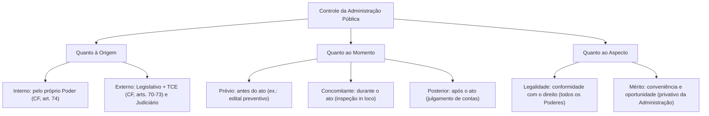
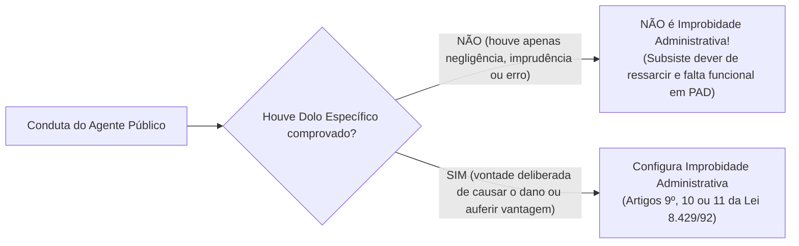

# 05 - Controle da Administração Pública e Improbidade Administrativa (Lei 8.429/1992 e Lei 14.230/2021)

> **Matéria:** Noções de Direito Administrativo  
> **Cargo:** A01 – Técnico de Controle Externo – Especialidade: Técnico Administrativo  
> **Arquivo:** `05_controle_da_administracao_e_improbidade_administrativa.md`  
> **Status:** 🟢 Teoria Aprofundada + 5 Questões FCC Comentadas (A a E)

---

## 📌 Ementa Oficial do Edital
- Controle da Administração Pública: conceito, fundamentos e classificações.
- Classificação quanto à origem (Interno e Externo), momento (Prévio, Concomitante e Posterior) e aspecto (Legalidade e Mérito).
- Controle Legislativo e a atuação constitucional do Tribunal de Contas.
- Controle Judicial: limites da atuação do Judiciário sobre o mérito administrativo e princípios da razoabilidade e proporcionalidade.
- Instrumentos de controle judicial: Mandado de Segurança, Ação Popular e Ação Civil Pública.
- Lei de Improbidade Administrativa (Lei Federal nº 8.429/1992 com redação dada pela Lei Federal nº 14.230/2021 e alterações).
- Sujeitos ativo e passivo dos atos de improbidade.
- Elemento subjetivo: extinção da modalidade culposa e exigência de dolo específico (Tema 1.199 do STF).
- Tipologia dos atos de improbidade: Enriquecimento Ilícito (art. 9º), Prejuízo ao Erário (art. 10) e Atentado aos Princípios (art. 11).
- Sanções cominadas e regime prescricional unificado e intercorrente.

---

## 🌳 Classificação Hierárquica do Conteúdo

```text
5. Sistema de Controle Administrativo e Novo Regime da Improbidade Administrativa
├── 5.1 Teoria Geral do Controle da Administração Pública
│   ├── Conceito e Fundamento Constitucional (Mecanismo de freios e contrapesos)
│   ├── Classificações do Controle Estatal:
│   │   ├── Quanto à Origem: Controle Interno (CF, art. 74) vs. Controle Externo (CF, arts. 70 a 73)
│   │   ├── Quanto ao Momento: Prévio (preventivo), Concomitante (pari passu) e Posterior (corretivo)
│   │   ├── Quanto à Amplitude: Controle Hierárquico (subordinação) vs. Finalístico (tutela/supervisão)
│   │   └── Quanto ao Aspecto: Controle de Legalidade/Legitimidade vs. Controle de Mérito (oportunidade)
│   ├── Limites Constitucionais do Controle Judicial:
│   │   ├── Vedação de ingerência no mérito administrativo discricionário
│   │   └── Anulação legítima por desvio de finalidade, violação à razoabilidade e motivos falsos
│   └── Instrumentos Judiciais de Tutela do Patrimônio Público:
│       ├── Mandado de Segurança (CF, art. 5º, LXIX - direito líquido e certo)
│       ├── Ação Popular (CF, art. 5º, LXXIII - exclusivo de cidadão eleitor; isenção de custas)
│       └── Ação Civil Pública (Lei 7.347/1985 - tutela coletiva do patrimônio público)
└── 5.2 Lei de Improbidade Administrativa (Lei nº 8.429/1992 com alterações da Lei nº 14.230/2021)
    ├── Conceito e Sujeitos: Agente público amplo e particular em concurso necessário
    ├── O Elemento Subjetivo na Nova LIA (Tema 1.199 do STF):
    │   ├── Extinção da modalidade culposa em todas as espécies de atos de improbidade
    │   ├── Exigência obrigatória de DOLO ESPECÍFICO (fim especial de agir ilícito)
    │   ├── Proibição do crime de hermenêutica: divergência interpretativa razoável não é improbidade
    │   └── Aplicação intertemporal: retroage para processos em andamento sem trânsito em julgado
    ├── Categorias e Tipologia de Atos de Improbidade:
    │   ├── Art. 9º - Enriquecimento Ilícito: Obtenção de vantagem patrimonial indevida (rol exemplificativo)
    │   ├── Art. 10 - Prejuízo ao Erário: Dano patrimonial efetivo comprovado; veda dano in re ipsa (rol taxativo)
    │   └── Art. 11 - Atentado aos Princípios: ROL ESTRITAMENTE TAXATIVO (numerus clausus)
    ├── Quadro Sancionatório do Artigo 12:
    │   ├── Art. 9º: Perda de bens, perda da função, suspensão direitos pol. até 14 anos, multa igual ao ganho
    │   ├── Art. 10: Ressarcimento do dano, perda de bens, perda da função, suspensão até 12 anos, multa igual ao dano
    │   └── Art. 11: Multa civil até 24 vezes a remuneração e proibição contratar até 4 anos (SEM perda de função/direitos)
    └── Prescrição (Artigo 23): Prazo unificado de 8 anos do fato e prescrição intercorrente de 4 anos
```

---

## 📖 Teoria Aprofundada e Pontos Críticos

### 1. Classificação do Controle da Administração Pública



#### Limites do Controle Judicial sobre o Mérito Administrativo
O Poder Judiciário possui a função típica de controlar a **estrita legalidade e legitimidade** dos atos administrativos.
- **Regra:** O Judiciário **NÃO pode revogar** atos administrativos nem substituir a valoração de conveniência e oportunidade conferida por lei ao administrador (mérito administrativo).
- **Exceção e Anulação:** O Judiciário pode e deve **anular** atos discricionários quando houver manifesta violação aos princípios da razoabilidade, proporcionalidade, moralidade ou ocorrência de **desvio de finalidade** e demonstração de falsidade dos motivos declarados (Teoria dos Motivos Determinantes).

---

### 2. A Nova Lei de Improbidade Administrativa (Lei 14.230/2021)

#### 2.1 O Julgamento Histórico do Tema 1.199 do STF
O Supremo Tribunal Federal fixou diretrizes constitucionais vinculantes para a aplicação da nova LIA:
1. **Exigência de Dolo Específico:** Para todas as modalidades de atos de improbidade (arts. 9º, 10 e 11), é imprescindível a comprovação de dolo específico (vontade livre e consciente de alcançar o resultado ilícito, com fim especial de agir). A modalidade culposa foi expressamente banida do ordenamento jurídico.
2. **Irretroatividade das Condenações Transitadas em Julgado:** A nova lei mais benéfica não autoriza a desconstituição de condenações por improbidade culposa já acobertadas pela coisa julgada material.
3. **Aplicação Imediata aos Processos em Andamento:** A revogação da modalidade culposa aplica-se de forma retroativa imediata a todas as ações judiciais que ainda estejam tramitando sem trânsito em julgado.



---

### 3. Quadro Sancionatório Comparativo (Art. 12 da LIA)

| Espécie de Ato de Improbidade | Natureza do Rol Legal | Suspensão dos Direitos Políticos | Perda da Função Pública? | Multa Civil Máxima | Proibição de Contratar com o Poder Público |
|---|:---:|:---:|:---:|:---:|:---:|
| **Art. 9º - Enriquecimento Ilícito** | **Exemplificativo** | Até **14 anos** | **SIM** (atinge o cargo ocupado à época) | Valor equivalente ao acréscimo patrimonial | Até **14 anos** |
| **Art. 10 - Prejuízo ao Erário** | **Taxativo** (exige dano real) | Até **12 anos** | **SIM** | Valor equivalente ao dano efetivo | Até **12 anos** |
| **Art. 11 - Violação a Princípios** | **Taxativo** (*numerus clausus*) | **NÃO HÁ MAIS** | **NÃO HÁ MAIS** | Até **24 vezes a remuneração** do agente | Até **4 anos** |

> 🚨 **ALERTA DE PROVA / PEGADINHA FCC:**  
> A Lei nº 14.230/2021 **eliminou** a pena de suspensão de direitos políticos e a pena de perda da função pública para as condenações baseadas exclusivamente no **artigo 11** (violação a princípios). Para o art. 11 restam unicamente a **multa civil** (até 24 vezes o subsídio) e a **proibição de contratar** (até 4 anos). Além disso, o rol do art. 11 passou a ser **estritamente taxativo**!

---

### 4. Regime Prescricional (Art. 23 da LIA)
- **Prazo Unificado Geral:** A ação de improbidade prescreve em **8 anos**, contados a partir da data em que o fato foi praticado ou da cessação da permanência nos atos continuados.
- **Prescrição Intercorrente:** Prescreve a pretensão punitiva se houver paralisação do processo judicial por prazo superior a **4 anos** entre os marcos interruptivos legais (ajuizamento da ação e publicação de sentenças ou acórdãos condenatórios).

---

## 🌐 Fontes Recomendadas na Internet
- [Lei Federal nº 8.429/1992 - Lei de Improbidade Administrativa (Consolidada com Lei 14.230/2021)](https://www.planalto.gov.br/ccivil_03/leis/l8429.htm)
  - Redação oficial compilada do marco regulatório da improbidade administrativa.
- [STF - Tema 1.199 da Repercussão Geral (Dolo Específico e Retroatividade)](https://portal.stf.jus.br/jurisprudencia/repercussaoGeral/tema.asp?num=1199)
  - Acórdão vinculante sobre a obrigatoriedade do dolo e regras de direito intertemporal.
- [Constituição Federal de 1988 - Artigos 70 a 75 (Controle Externo)](https://www.planalto.gov.br/ccivil_03/constituicao/constituicao.htm#art70)
  - Competências constitucionais do controle parlamentar e das cortes de contas.
- [Lei Federal nº 4.717/1965 (Lei da Ação Popular)](https://www.planalto.gov.br/ccivil_03/leis/l4717.htm)
  - Normas da ação constitucional do cidadão para anulação de atos lesivos ao erário.

---

## 📝 Questões Comentadas no Padrão FCC (Justificadas de A a E)

### Questão 1 (FCC - Analista de Controle Externo / Adaptada TCE-GO)
O Secretário Municipal de Saúde de determinado município goiano determinou a remoção ex officio de um enfermeiro concursado e estável para um posto de saúde isolado na zona rural. No ato formal de remoção, a autoridade consignou como motivação expressa a "premente necessidade de suprir grave carência de profissionais de enfermagem na referida unidade rural". O servidor ajuizou mandado de segurança perante o Poder Judiciário, instruído com certidões oficiais comprovando que o posto de saúde rural contava com equipe completa de enfermeiros sem demanda excedente, e que a remoção fora motivada por retaliação pessoal em razão de denúncia protocolada pelo enfermeiro no Conselho Regional.

Diante do controle jurisdicional dos atos administrativos e da Teoria dos Motivos Determinantes:

A) O ato de remoção é imune a qualquer controle jurisdicional, por consubstanciar exercício de mérito administrativo privativo do Poder Executivo municipal.  
B) O Poder Judiciário deve decretar a anulação do ato de remoção, pois a comprovação da falsidade do motivo determinante contamina o ato com vício insanável de legalidade (desvio de finalidade).  
C) Caberia ao Poder Judiciário unicamente revogar o ato de remoção a partir do trânsito em julgado da sentença com efeitos meramente prospectivos.  
D) O Judiciário deve convalidar o ato e fixar uma nova justificativa substitutiva condizente com a conveniência do município.  
E) A falsidade do motivo alegado não gera nulidade caso a autoridade possuísse competência formal para assinar a portaria de remoção.  

> **Gabarito: B**  
>  
> **Comentário Analítico Passo a Passo:**  
> 1. Pela **Teoria dos Motivos Determinantes**, a validade do ato administrativo fica irrevogavelmente vinculada à veracidade dos motivos fáticos e jurídicos alegados como seu fundamento.  
> 2. Se a autoridade alegou a necessidade de pessoal na zona rural, mas os fatos comprovam que o motivo era falso e que a medida decorreu de perseguição pessoal, o ato padece de **vício de motivo** e de **desvio de finalidade (ou de poder)**.  
> 3. O controle da veracidade dos motivos e da observância da finalidade pública é um **controle de estrita legalidade e moralidade**, plenamente cabível pelo Poder Judiciário sem implicar invasão no mérito administrativo.  
> 4. O ato é nulo de pleno direito e deve ser **anulado** pelo Judiciário com efeitos retroativos (*ex tunc*), restabelecendo o servidor em sua lotação originária.  
>  
> **Análise das Alternativas:**  
> - **A) Incorreta:** O mérito administrativo não protege atos fraudulentos, ilegais ou eivados de perseguição pessoal.  
> - **B) CORRETA:** A falsidade do motivo acarreta nulidade insanável que impõe anulação judicial por desvio de finalidade.  
> - **C) Incorreta:** O Poder Judiciário não pode revogar atos do Poder Executivo por conveniência; pode apenas anular por ilegalidade.  
> - **D) Incorreta:** O vício de finalidade é insanável e insuscetível de convalidação.  
> - **E) Incorreta:** A competência regular da autoridade não sana a ilicitude do motivo e da finalidade.

---

### Questão 2 (FCC - Auditor de Controle Externo / Adaptada)
Durante procedimento licitatório no âmbito de uma autarquia estadual, o Diretor de Suprimentos autorizou a liquidação e o pagamento adiantado de faturas referentes a bens de consumo que não foram entregues pelo fornecedor, causando dano patrimonial efetivo ao erário estadual de R$ 300.000,00. Ficou categoricamente comprovado nos autos da ação que o Diretor agiu com negligência crassa e inobservância de normas básicas de conferência documental, mas sem conluio, sem percepção de propina e sem intenção deliberada (dolo) de causar o prejuízo.

À luz da Lei Federal nº 8.429/1992 com a redação conferida pela Lei Federal nº 14.230/2021 e da tese firmada pelo Supremo Tribunal Federal no **Tema 1.199**:

A) O Diretor responderá por ato de improbidade administrativa causador de prejuízo ao erário (art. 10), cuja modalidade culposa permanece em pleno vigor no ordenamento jurídico pátrio.  
B) A conduta do agente é atípica na esfera da Lei de Improbidade Administrativa, em razão da revogação da modalidade culposa e da exigência indispensável de dolo específico para a caracterização de atos de improbidade.  
C) O Diretor responderá automaticamente por violação aos princípios administrativos (art. 11), para o qual a lei admite condenação por culpa grave inescusável.  
D) A ausência de dolo isenta o Diretor de qualquer dever de ressarcimento do dano civilmente e de qualquer penalidade disciplinar interna.  
E) A nova Lei de Improbidade Administrativa aplica-se apenas aos atos que resultem em enriquecimento ilícito pessoal do agente público.  

> **Gabarito: B**  
>  
> **Comentário Analítico Passo a Passo:**  
> 1. A Lei nº 14.230/2021 promoveu a **extinção absoluta da modalidade culposa** para todos os atos de improbidade administrativa, revogando o parágrafo único do antigo art. 10 da Lei nº 8.429/1992.  
> 2. O art. 1º, §§ 1º e 2º, passou a exigir a comprovação de **dolo específico** (vontade livre e consciente de alcançar o resultado ilícito tipificado nos artigos 9º, 10 e 11).  
> 3. No Tema 1.199, o STF confirmou a constitucionalidade da extinção da culpa na improbidade administrativa.  
> 4. Portanto, a conduta culposa do Diretor não configura ato de improbidade administrativa. (Ressalte-se que ele ainda pode responder civilmente pelo ressarcimento do erário e disciplinarmente perante o estatuto dos servidores).  
>  
> **Análise das Alternativas:**  
> - **A) Incorreta:** A modalidade culposa do art. 10 foi revogada de forma expressa pela Lei nº 14.230/2021.  
> - **B) CORRETA:** Reproduz fielmente a exigência do dolo específico na nova LIA e a tese do Tema 1.199 do STF.  
> - **C) Incorreta:** O art. 11 também exige dolo específico e possui rol taxativo, inadmitindo culpa.  
> - **D) Incorreta:** A atipicidade na improbidade não exclui a responsabilidade civil regressiva pelo dano nem a sanção em processo disciplinar.  
> - **E) Incorreta:** A LIA continua tipificando o prejuízo ao erário e o atentado aos princípios, desde que praticados com dolo.

---

### Questão 3 (FCC - Procurador do Estado / Adaptada)
Determinada autoridade estadual foi condenada judicialmente em ação de improbidade administrativa transitada em julgado com base estrita no art. 11 da Lei nº 8.429/1992, por ter violado o dever de imparcialidade e sigilo funcional ao divulgar trecho de documento reservado antes da respectiva publicação oficial.

Em conformidade com o novo regime sancionatório estabelecido pela Lei Federal nº 14.230/2021 para os atos que atentam contra os princípios da Administração Pública (art. 11):

A) A autoridade está sujeita cumulativamente à perda da função pública e à suspensão dos direitos políticos por até oito anos.  
B) O juízo competente poderá aplicar apenas as sanções de pagamento de multa civil de até 24 vezes o valor da remuneração e proibição de contratar com o poder público pelo prazo de até 4 anos.  
C) As sanções cominadas ao art. 11 são idênticas àquelas cominadas para os atos de enriquecimento ilícito do art. 9º.  
D) A condenação por violação a princípios acarreta a indisponibilidade automática de todos os bens pessoais do agente condenado.  
E) A penalidade de cassação de aposentadoria é de imposição obrigatória e imediata em qualquer condenação do art. 11.  

> **Gabarito: B**  
>  
> **Comentário Analítico Passo a Passo:**  
> 1. Art. 12, III, da Lei nº 8.429/1992 (com redação da Lei nº 14.230/2021):  
>    Para os atos do art. 11, aplicam-se exclusivamente:  
>    - **Pagamento de multa civil de até 24 vezes o valor da remuneração** percebida pelo agente; e  
>    - **Proibição de contratar com o poder público** ou de receber benefícios/incentivos fiscais ou creditícios pelo prazo não superior a **4 anos**.  
> 2. A reforma legislativa de 2021 **suprimiu expressamente** as sanções de **perda da função pública** e de **suspensão dos direitos políticos** que antes incidiam sobre os atos do art. 11.  
>  
> **Análise das Alternativas:**  
> - **A) Incorreta:** A suspensão de direitos políticos e a perda da função foram abolidas para as infrações ao art. 11.  
> - **B) CORRETA:** Enuncia precisamente as duas únicas sanções mantidas no art. 12, III, da LIA reformada.  
> - **C) Incorreta:** As sanções do art. 9º são muito mais severas (incluem suspensão de direitos políticos até 14 anos e perda de função).  
> - **D) Incorreta:** A indisponibilidade de bens exige a demonstração de perigo de dano e garantia de ressarcimento ou de valor de acréscimo patrimonial ilícito, não cabendo no art. 11 em que não há dano patrimonial apurado.  
> - **E) Incorreta:** Não há sanção de cassação de aposentadoria no rol do art. 12, III.

---

### Questão 4 (FCC - Técnico de Controle Externo / Administrativa)
No âmbito da sistemática de fiscalização dos atos estatais, o acompanhamento em tempo real realizado pelos auditores do Tribunal de Contas sobre a execução das despesas orçamentárias e as vistorias in loco realizadas em canteiros de obras durante a construção de uma rodovia estadual qualificam-se, quanto à origem e quanto ao momento do controle, respectivamente, como:

A) Controle interno e controle prévio  
B) Controle externo e controle concomitante  
C) Controle interno e controle posterior  
D) Controle externo e controle prévio  
E) Controle jurisdicional e controle repressivo  

> **Gabarito: B**  
>  
> **Comentário Analítico Passo a Passo:**  
> 1. **Quanto à Origem:** A fiscalização exercida pelo Tribunal de Contas sobre os órgãos e entidades do Poder Executivo estadual é realizada por instituição externa e autônoma em auxílio ao Poder Legislativo, caracterizando tipicamente o **CONTROLE EXTERNO** (CF/88, arts. 70 e 71).  
> 2. **Quanto ao Momento:** Como a fiscalização ocorre em tempo real, acompanhando a execução da despesa e o andamento das obras durante a vigência do contrato (*pari passu*), trata-se de **CONTROLE CONCOMITANTE** (que não se confunde com o prévio, que analisa o edital antes da licitação, nem com o posterior, que julga a prestação de contas após o encerramento do exercício financeiro).  
>  
> **Análise das Alternativas:**  
> - **A) Incorreta:** A atuação do Tribunal de Contas é controle externo, e o momento durante a execução não é prévio.  
> - **B) CORRETA:** Classificação perfeita: controle externo (origem) e controle concomitante (momento de realização).  
> - **C) Incorreta:** O acompanhamento em tempo real durante a execução não é controle posterior.  
> - **D) Incorreta:** A vistoria durante o andamento da obra não é controle prévio.  
> - **E) Incorreta:** O controle dos Tribunais de Contas não tem natureza jurisdicional estrita (função exercida pelo Judiciário).

---

### Questão 5 (FCC - Analista Judiciário)
Qualquer cidadão brasileiro no gozo de seus direitos políticos tem legitimidade ativa constitucional para propor **Ação Popular** perante o Poder Judiciário visando à anulação de ato lesivo:

A) Exclusivamente ao patrimônio financeiro da União, sendo inadmissível o manejo da ação contra atos lesivos de municípios ou Estados.  
B) Ao patrimônio público ou de entidade de que o Estado participe, à moralidade administrativa, ao meio ambiente e ao patrimônio histórico e cultural.  
C) Aos direitos individuais homogêneos de consumidores bancários privados.  
D) Exclusivamente a direitos patrimoniais de pessoas jurídicas de direito privado com fins lucrativos.  
E) À honra subjetiva e intimidade pessoal de agentes públicos ocupantes de cargos políticos.  

> **Gabarito: B**  
>  
> **Comentário Analítico Passo a Passo:**  
> 1. Art. 5º, inciso LXXIII, da Constituição Federal de 1988:  
>    *"qualquer cidadão é parte legítima para propor ação popular que vise a anular ato lesivo ao patrimônio público ou de entidade de que o Estado participe, à moralidade administrativa, ao meio ambiente e ao patrimônio histórico e cultural, ficando o autor, salvo comprovada má-fé, isento de custas judiciais e do ônus da sucumbência;"*  
> 2. O cidadão (eleitor munido de título eleitoral) atua em defesa de interesses difusos da coletividade, visando anular atos estatais que firam os quatro bens juridicamente tutelados pelo dispositivo constitucional.  
>  
> **Análise das Alternativas:**  
> - **A) Incorreta:** A Ação Popular pode ser manejada contra atos de quaisquer esferas da Federação (União, Estados, DF e Municípios).  
> - **B) CORRETA:** Reproduz fielmente a dicção literal e abrangência do art. 5º, LXXIII, da CF/88.  
> - **C) Incorreta:** Direitos individuais de consumidores são tutelados por Ação Civil Pública ou ações individuais, não por Ação Popular.  
> - **D) Incorreta:** O objeto é a proteção do patrimônio público, moralidade e bens coletivos, e não patrimônio puramente privado de empresas com fins lucrativos.  
> - **E) Incorreta:** A defesa de honra subjetiva cabe exclusivamente em ações indenizatórias individuais do ofendido.
