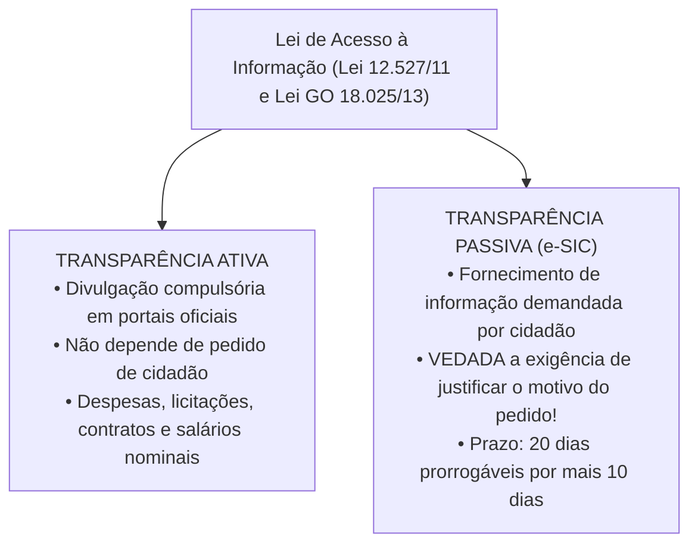
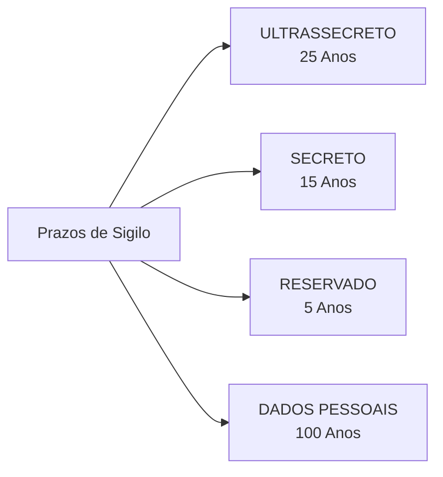
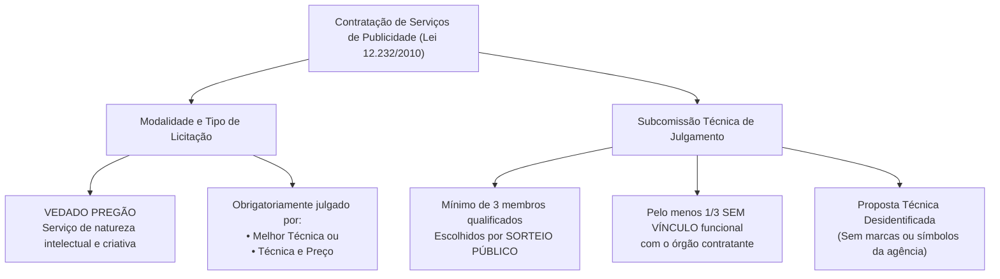

# 06 - Acesso à Informação (LAI Federal e Estadual GO) e Serviços de Publicidade

> **Matéria:** Noções de Direito Administrativo  
> **Cargo:** A01 – Técnico de Controle Externo – Especialidade: Técnico Administrativo  
> **Arquivo:** `06_acesso_a_informacao_e_contratos_publicidade.md`  
> **Status:** 🟢 Teoria Aprofundada + 5 Questões FCC Comentadas (A a E)

---

## 📌 Ementa Oficial do Edital
- Direito de acesso à informação e transparência pública.
- Lei Federal nº 12.527/2011 (Lei de Acesso à Informação - LAI).
- Lei Estadual de Goiás nº 18.025/2013 (Acesso à informação no âmbito do Estado de Goiás).
- Transparência ativa vs. transparência passiva; Serviço de Informações ao Cidadão (SIC).
- Prazos, pedidos e recursos no procedimento de acesso à informação.
- Classificação de informações sigilosas: graus de sigilo (ultrassecreto, secreto e reservado), prazos e proteção a dados pessoais (100 anos).
- Contratação de serviços de publicidade pela Administração Pública: Lei Federal nº 12.232/2010 e alterações.
- Julgamento por subcomissão técnica e vedação da modalidade pregão para serviços de criação publicitária.

---

## 🌳 Classificação Hierárquica do Conteúdo

```text
6. Transparência Pública, Acesso à Informação e Contratos de Publicidade Institucional
├── 6.1 Regime da Lei de Acesso à Informação (Lei 12.527/2011 e Lei GO 18.025/2013)
│   ├── Diretrizes: Publicidade como regra geral e sigilo como exceção estrita
│   ├── Transparência Ativa: Portais oficiais com dados abertos, contratos e remunerações
│   │   └── Tema 483 do STF: Legitimidade da divulgação nominal do subsídio de servidores
│   └── Transparência Passiva (Serviço de Informações ao Cidadão - e-SIC):
│       ├── Ilegitimidade de exigência de justificativa ou motivo pessoal (Art. 10, § 3º)
│       ├── Prazos: Resposta imediata se disponível; prazo ordinário de até 20 dias
│       ├── Prorrogação: Por mais 10 dias mediante justificativa expressa prévia (Total: 30 dias)
│       └── Recursos administrativos: Prazo de 10 dias à autoridade hierárquica superior
├── 6.2 Classificação de Sigilo e Proteção a Dados Pessoais
│   ├── Graus de Sigilo e Prazos Máximos de Restrição (Art. 24 da LAI):
│   │   ├── Ultrassecreto: Até 25 anos (admite uma prorrogação; Chefe do Executivo)
│   │   ├── Secreta: Até 15 anos (Secretários de Estado e dirigentes máximos)
│   │   └── Reservada: Até 5 anos (Chefias e diretorias)
│   └── Proteção de Informações Pessoais (Art. 31 da LAI):
│       └── Dados relativos à intimidade e vida privada: Restrição de até 100 ANOS
└── 6.3 Licitações e Contratos de Serviços de Publicidade (Lei Federal nº 12.232/2010)
    ├── Objeto Específico: Serviços criativos de planejamento, concepção e campanhas
    ├── Vedação Expressa: PROIBIDO o uso da modalidade PREGÃO para criação publicitária
    ├── Tipos Obrigatórios de Licitação: "Melhor Técnica" ou "Técnica e Preço"
    └── Julgamento pela Subcomissão Técnica (Art. 10):
        ├── Composição mínima de 3 membros com formação/atuação na área de comunicação
        ├── Escolha obrigatória por SORTEIO PÚBLICO em sessão aberta
        ├── Regra de Impessoalidade: No mínimo 1/3 dos membros NÃO podem ter vínculo com o órgão
        └── Proposta Técnica Apócrifa: Invólucros desidentificados para julgamento imparcial
```

---

## 📖 Teoria Aprofundada e Pontos Críticos

### 1. Transparência Ativa x Transparência Passiva na LAI



#### Divulgação Nominal de Remuneração (Tema 483 do STF)
O Supremo Tribunal Federal consolidou a legitimidade da publicação, nos sítios oficiais da Administração Pública, do nome dos servidores e dos respectivos valores recebidos a título de remuneração e vantagens pecuniárias. Prevalece o princípio republicano da publicidade e o controle social das finanças públicas, não havendo violação à intimidade.

---

### 2. Graus de Sigilo e Prazos de Restrição da LAI

A informação só pode ser classificada em grau de sigilo quando indispensável à **segurança da sociedade ou do Estado** (art. 23 da LAI):

| Categoria | Prazo Máximo de Restrição | Prorrogação? | Autoridades Competentes no Estado de Goiás |
|---|:---:|:---:|---|
| **Ultrassecreta** | **Até 25 anos** | **SIM** (uma única vez por até 25 anos) | Governador do Estado |
| **Secreta** | **Até 15 anos** | **NÃO** | Governador, Secretários de Estado e dirigentes máximos de autarquias |
| **Reservada** | **Até 5 anos** | **NÃO** | Autoridades que exerçam cargo de direção, chefia ou comando |
| **Informação Pessoal** | **Até 100 anos** | **NÃO** | Tutela da intimidade, vida privada, honra e imagem (art. 31) |



> 🚨 **ALERTA DE PROVA / PEGADINHA FCC:**  
> **Nenhum documento com informação de violação a direitos humanos pode ser colocado sob sigilo!** O art. 21, parágrafo único, da LAI veda categoricamente a restrição de acesso a informações ou documentos que versem sobre condutas que impliquem violação aos direitos humanos praticadas por agentes públicos.

---

### 3. Prazos Procedimentais da Transparência Passiva (e-SIC)
- **Regra:** Se a informação estiver disponível, o acesso é **imediato**.
- **Prazo Geral:** Não sendo possível o acesso imediato, a Administração deve responder em até **20 dias**.
- **Prorrogação:** O prazo de 20 dias pode ser prorrogado por mais **10 dias** mediante **justificativa expressa** comunicada previamente ao requerente.
- **Recurso:** Indeferido o acesso, cabe recurso no prazo de **10 dias** dirigido à autoridade hierarquicamente superior à que proferiu a decisão.

---

### 4. Licitação de Serviços de Publicidade (Lei nº 12.232/2010)



> ⭐ **IMPORTANTE (A Vedação ao Pregão em Publicidade):**  
> A criação de campanhas de publicidade não se enquadra no conceito de "serviço comum" da Lei de Licitações, pois não pode ter seus padrões de desempenho descritos de forma objetiva e linear no edital. Por força do art. 5º da Lei nº 12.232/2010 e do art. 29 da Lei nº 14.133/2021, é terminantemente **proibida a utilização da modalidade pregão** para serviços publicitários que envolvam esforço criativo.

---

## 🌐 Fontes Recomendadas na Internet
- [Lei Federal nº 12.527/2011 (Lei de Acesso à Informação - LAI)](https://www.planalto.gov.br/ccivil_03/_ato2011-2014/2011/lei/l12527.htm)
  - Marco geral regulador do acesso à informação pública, transparência e sigilo no Brasil.
- [Lei Estadual de Goiás nº 18.025/2013 (Acesso à Informação em Goiás)](https://legisla.casacivil.go.gov.br/pesquisa_legislacao/83437/lei-18025)
  - Estatuto de transparência do Estado de Goiás aplicável ao TCE-GO e ao Executivo estadual.
- [Lei Federal nº 12.232/2010 (Contratação de Serviços de Publicidade)](https://www.planalto.gov.br/ccivil_03/_ato2007-2010/2010/lei/l12232.htm)
  - Regime especial das licitações de publicidade, subcomissão técnica e regras de julgamento.
- [STF - Tema 483 da Repercussão Geral (Divulgação da Remuneração de Servidores)](https://portal.stf.jus.br/jurisprudencia/repercussaoGeral/tema.asp?num=483)
  - Fixação da constitucionalidade da divulgação nominal dos vencimentos de servidores em portais públicos.

---

## 📝 Questões Comentadas no Padrão FCC (Justificadas de A a E)

### Questão 1 (FCC - Analista de Controle Externo / Adaptada TCE-GO)
Um cidadão domiciliado no Município de Goiânia protocolou pedido de acesso à informação no Serviço de Informações ao Cidadão (SIC) do Tribunal de Contas do Estado de Goiás, solicitando cópia integral dos processos licitatórios e contratos de fornecimento de tecnologia celebrados pelo Tribunal no ano anterior. O servidor encarregado do protocolo indeferiu liminarmente a solicitação, justificando que o interessado não havia comprovado legítimo interesse nem declarado os motivos pelos quais desejava consultar a referida documentação.

À luz da Lei Federal nº 12.527/2011 (LAI) e da Lei Estadual de Goiás nº 18.025/2013:

A) A decisão administrativa está correta, visto que o requerimento de documentos públicos depende de prévia demonstração de interesse jurídico direto pelo peticionário.  
B) O indeferimento administrativo é manifestamente ilegal, pois a legislação veda categoricamente quaisquer exigências relativas aos motivos determinantes da solicitação de informações de interesse público.  
C) Caberia ao cidadão obter autorização judicial prévia por meio de Habeas Data para ter acesso aos autos de contratações públicas.  
D) O cidadão somente poderia obter acesso às informações caso comprovasse vínculo funcional com a Administração Pública estadual.  
E) A negativa é legítima porque contratos de tecnologia da informação possuem sigilo ultrassecreto automático por 25 anos.  

> **Gabarito: B**  
>  
> **Comentário Analítico Passo a Passo:**  
> 1. Fundamento legal: Art. 10, § 3º, da Lei Federal nº 12.527/2011 (reproduzido na Lei Estadual nº 18.025/2013):  
>    *"São vedadas quaisquer exigências relativas aos motivos determinantes da solicitação de informações de interesse público."*  
> 2. O acesso à informação é um direito fundamental de titularidade universal de qualquer pessoa (física ou jurídica), sem exigência de demonstrar "interesse pessoal" ou justificar as razões do pedido.  
> 3. Os contratos públicos e procedimentos licitatórios custeados com recursos do erário são dotados de publicidade obrigatória. O indeferimento fundado na ausência de justificativa pessoal viola frontalmente o princípio republicano e a LAI.  
>  
> **Análise das Alternativas:**  
> - **A) Incorreta:** O controle social não exige comprovação de interesse jurídico ou pessoal.  
> - **B) CORRETA:** Expressão literal do art. 10, § 3º da LAI e da lei goiana.  
> - **C) Incorreta:** O Habeas Data tutela dados pessoais do impetrante, e não informações gerais sobre contratos públicos.  
> - **D) Incorreta:** Qualquer pessoa tem direito de acesso, independentemente de ser servidor público.  
> - **E) Incorreta:** Contratos públicos de TI não são automaticamente ultrassecretos; a regra é a plena publicidade ativa.

---

### Questão 2 (FCC - Técnico de Controle Externo / Administrativa)
Uma autarquia estadual pretende deflagrar procedimento licitatório para contratação de agência de propaganda com o objetivo de criar planos anuais de comunicação, peças publicitárias impressas e digitais, e campanhas educativas de conscientização no trânsito. A comissão de licitação cogitou a adoção da modalidade **Pregão Eletrônico** com julgamento pelo critério de **Menor Preço**, sob a premissa de que a modalidade garante maior economia e agilidade ao procedimento.

Considerando as normas especiais da Lei Federal nº 12.232/2010 e a jurisprudência dominante sobre o tema:

A) A comissão agiu acertadamente, sendo o pregão eletrônico de menor preço a modalidade compulsória para quaisquer serviços contratados por entes públicos.  
B) A adoção do pregão é vedada pela legislação para contratação de serviços de publicidade institucional que demandam esforço criativo, devendo a licitação ser realizada obrigatoriamente pelos tipos 'melhor técnica' ou 'técnica e preço'.  
C) A autarquia deveria optar pela modalidade Leilão, realizando a disputa por lances sucessivos presenciais.  
D) É obrigatória a contratação direta mediante inexigibilidade de licitação, por se tratar de serviço de natureza criativa singular.  
E) A autarquia pode utilizar pregão desde que fixe como tipo o maior lance comercial de patrocínio.  

> **Gabarito: B**  
>  
> **Comentário Analítico Passo a Passo:**  
> 1. Art. 5º da Lei Federal nº 12.232/2010:  
>    As licitações para a contratação dos serviços de publicidade previstos no art. 2º serão processadas obrigatoriamente pelos tipos **"melhor técnica"** ou **"técnica e preço"**, sendo **expressamente vedada a utilização da modalidade pregão**.  
> 2. O pregão destina-se a "bens e serviços comuns", cujos padrões de desempenho possam ser descritos de forma uniforme e mensurados estritamente pelo menor preço. A criação de campanhas publicitárias envolve concepção estética, linguagem artística e planejamento estratégico conceitual, atributos intelectuais incompatíveis com o pregão de menor preço puro.  
>  
> **Análise das Alternativas:**  
> - **A) Incorreta:** O pregão é vedado para serviços de criação de publicidade institucional.  
> - **B) CORRETA:** Subsunção impecável ao art. 5º da Lei nº 12.232/2010.  
> - **C) Incorreta:** Leilão destina-se à alienação de bens públicos, e não à contratação de serviços intelectuais.  
> - **D) Incorreta:** A Lei nº 12.232/2010 impõe a licitação formal para serviços publicitários, afastando a inexigibilidade genérica.  
> - **E) Incorreta:** Não existe pregão pelo maior lance em contratos de despesa de publicidade.

---

### Questão 3 (FCC - Analista de Controle Externo / Tecnologia da Informação)
Determinada informação produzida pela Secretaria de Segurança Pública de Goiás teve seu acesso restrito por conter dados de inteligência cuja revelação poria em risco a integridade de operações em andamento. A autoridade competente pretende classificar o documento em grau de sigilo nos termos da Lei Federal nº 12.527/2011 (LAI).

Em relação aos graus de sigilo e aos prazos máximos legais de restrição de acesso previstos na LAI:

A) Os graus de sigilo são Ultrassecreto (até 25 anos), Secreto (até 15 anos) e Reservado (até 5 anos).  
B) O prazo máximo de sigilo para informações reservadas é de 10 anos, e para dados ultrassecretos é de 50 anos improrrogáveis.  
C) Todas as informações sigilosas ficam sob restrição definitiva e perpétua, não admitindo desclassificação temporal.  
D) Informações relativas à vida privada e intimidade pessoal de cidadãos ficam sob sigilo pelo prazo máximo de 15 anos.  
E) Qualquer servidor público efetivo dispõe de competência originária para classificar documentos no grau ultrassecreto.  

> **Gabarito: A**  
>  
> **Comentário Analítico Passo a Passo:**  
> 1. Art. 24, § 1º, da Lei Federal nº 12.527/2011:  
>    Os prazos máximos de restrição de acesso à informação vigoram a partir da data de sua produção e são:  
>    - **I - Ultrassecreta:** até **25 (vinte e cinco) anos**;  
>    - **II - Secreta:** até **15 (quinze) anos**;  
>    - **III - Reservada:** até **5 (cinco) anos**.  
> 2. As informações pessoais relativas à intimidade, vida privada, honra e imagem (art. 31) têm prazo de restrição diferenciado de até **100 anos**, não se confundindo com os graus de sigilo de segurança do Estado.  
>  
> **Análise das Alternativas:**  
> - **A) CORRETA:** Enumeração exata dos três graus de sigilo e seus respectivos prazos máximos de restrição.  
> - **B) Incorreta:** Prazos adulterados (reservado é 5 anos, não 10; ultrassecreto é 25 anos).  
> - **C) Incorreta:** Não existe sigilo eterno ou perpétuo na ordem republicana da LAI.  
> - **D) Incorreta:** Informações pessoais têm prazo de restrição de até 100 anos (art. 31, § 1º, I).  
> - **E) Incorreta:** O grau ultrassecreto é privativo de altas autoridades (Governador de Estado no plano estadual).

---

### Questão 4 (FCC - Analista Jurídico)
No âmbito de procedimento licitatório processado sob o regime da Lei Federal nº 12.232/2010 para a contratação de agência de propaganda, a comissão de contratação realizou sessão para constituição da Subcomissão Técnica encarregada de julgar as propostas técnicas.

A respeito da composição e das regras aplicáveis à **Subcomissão Técnica**, a lei exige que:

A) Todos os membros sejam servidores públicos estatutários com pelo menos dez anos de efetivo exercício no órgão contratante.  
B) A subcomissão seja composta por no mínimo 3 membros com formação ou atuação na área de comunicação, selecionados obrigatoriamente por sorteio público em sessão aberta, sendo que no mínimo um terço (1/3) não pode manter vínculo funcional com o órgão licitante.  
C) Os membros sejam indicados livre e diretamente pelo Presidente do Tribunal sem necessidade de sorteio ou publicidade.  
D) As agências participantes do certame indiquem a metade dos avaliadores técnicos da subcomissão.  
E) A proposta técnica apresentada pelas agências contenha logotipo e marcas de identificação destacadas para facilitar a atribuição de notas.  

> **Gabarito: B**  
>  
> **Comentário Analítico Passo a Passo:**  
> 1. Art. 10 da Lei Federal nº 12.232/2010:  
>    - A subcomissão técnica será constituída por **pelo menos 3 (três) membros** com formação superior ou atuação comprovada na área de comunicação, publicidade ou marketing.  
>    - A escolha dos membros dá-se **obrigatoriamente por sorteio público**, em sessão previamente convocada com publicação na imprensa oficial.  
>    - Para assegurar a independência e a imparcialidade do julgamento, a lei impõe que **pelo menos um terço (1/3)** dos membros sorteados **NÃO mantenha vínculo funcional ou contratual** com o órgão ou entidade licitante.  
> 2. Além disso, as propostas técnicas devem ser apresentadas de forma **desidentificada (apócrifa)**, sob pena de desclassificação.  
>  
> **Análise das Alternativas:**  
> - **A) Incorreta:** A lei veda expressamente que todos tenham vínculo funcional com o órgão, exigindo a cota externa de 1/3.  
> - **B) CORRETA:** Síntese perfeita de todos os requisitos do art. 10 da Lei nº 12.232/2010.  
> - **C) Incorreta:** A escolha direta sem sorteio público viola norma expressa da lei.  
> - **D) Incorreta:** Os licitantes não indicam membros para a comissão julgadora.  
> - **E) Incorreta:** É vedada qualquer marca, símbolo ou elemento de identificação na proposta técnica preliminar.

---

### Questão 5 (FCC - Auditor de Controle Externo / Adaptada)
Determinada associação de servidores públicos ajuizou ação civil pretendendo que o Tribunal de Contas retirasse de seu Portal da Transparência a divulgação nominal individualizada da remuneração e vantagens pecuniárias recebidas pelos servidores do Tribunal, alegando que tal publicidade vulnerava a garantia constitucional da privacidade e intimidade.

Em consonância com a jurisprudência vinculante fixada pelo Supremo Tribunal Federal no julgamento do **Tema 483** da Repercussão Geral:

A) A pretensão da associação deve ser acolhida integralmente, sendo inconstitucional a divulgação nominal do subsídio de servidores públicos sem prévia autorização judicial.  
B) É legítima a publicação, inclusive em sítio oficial mantido pela Administração Pública na internet, dos nomes dos servidores e do valor dos correspondentes vencimentos e vantagens pecuniárias, prevalecendo o princípio da publicidade administrativa.  
C) A divulgação de remunerações é permitida apenas quanto aos cargos comissionados, permanecendo sob sigilo absoluto a remuneração dos concursados efetivos.  
D) A publicidade dos salários de servidores atenta contra a moralidade pública, configurando dano moral presumido (*in re ipsa*).  
E) Os vencimentos de agentes públicos podem ser divulgados apenas mediante solicitação individual fundamentada protocolada presencialmente no protocolo físico.  

> **Gabarito: B**  
>  
> **Comentário Analítico Passo a Passo:**  
> 1. Tese fixada pelo Supremo Tribunal Federal no RE 652.777 (Tema 483 da Repercussão Geral):  
>    *"É legítima a publicação, inclusive em sítio eletrônico mantido pela Administração Pública, dos nomes dos seus servidores e do valor dos correspondentes vencimentos e vantagens pecuniárias."*  
> 2. A remuneração é paga com recursos arrecadados de toda a sociedade por meio de tributos. A remuneração do servidor decorre do exercício de função pública no Estado, de modo que a supremacia do princípio republicano da transparência ativa impõe a divulgação pública nominal e individualizada das despesas com pessoal.  
>  
> **Análise das Alternativas:**  
> - **A) Incorreta:** Contraria a tese vinculante do Tema 483 do STF.  
> - **B) CORRETA:** Expressão literal da decisão histórica do Pretório Excelso.  
> - **C) Incorreta:** A publicidade incide indistintamente sobre servidores comissionados e efetivos.  
> - **D) Incorreta:** A publicidade atende ao princípio da moralidade e controle dos gastos públicos.  
> - **E) Incorreta:** A LAI exige a transparência ativa em formato aberto na internet, sem necessidade de pedido ou justificativa prévia.
