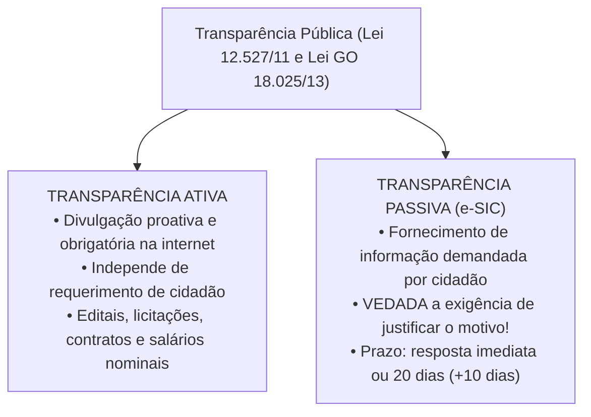
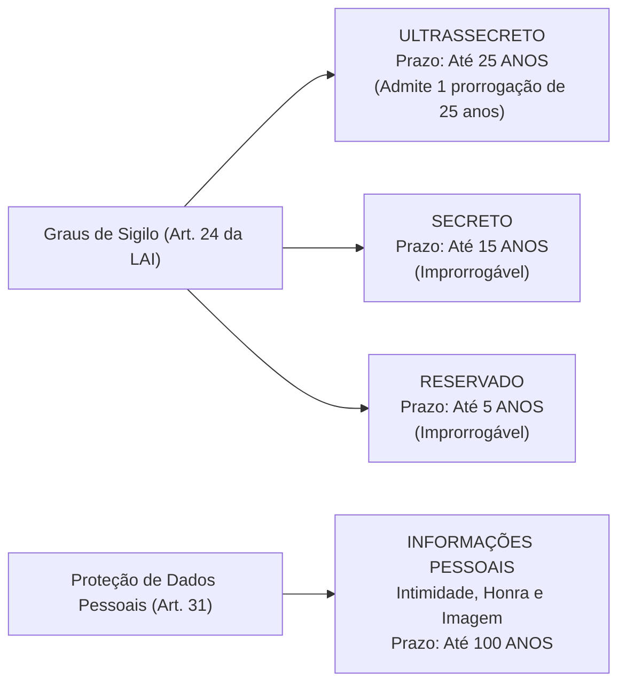
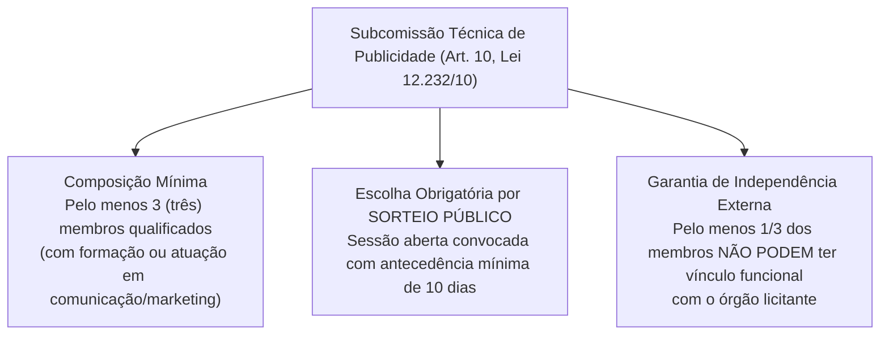

# 06 - Acesso à Informação (LAI Federal e Estadual GO) e Serviços de Publicidade

> **Matéria:** Noções de Direito Administrativo  
> **Cargo:** A01 – Técnico de Controle Externo – Especialidade: Técnico Administrativo  
> **Arquivo:** `06_acesso_a_informacao_e_contratos_publicidade.md`  

---

## 📌 Ementa / Itens do Edital
- Direito de acesso à informação e transparência pública
- Lei Federal nº 12.527/2011 (Lei de Acesso à Informação - LAI)
- Lei Estadual de Goiás nº 18.025/2013 (Acesso à informação no âmbito do Estado de Goiás)
- Transparência ativa vs. transparência passiva; Serviço de Informações ao Cidadão (SIC)
- Prazos, pedidos e recursos no procedimento de acesso à informação
- Classificação de informações sigilosas: graus de sigilo (ultrassecreto, secreto e reservado), prazos e proteção a dados pessoais (100 anos)
- Contratação de serviços de publicidade pela Administração Pública: Lei Federal nº 12.232/2010 e alterações
- Julgamento por subcomissão técnica e vedação da modalidade pregão para serviços de criação publicitária

---

## 🧭 Sumário

1. [Transparência Pública e Regime da Lei de Acesso à Informação](#1-transparencia-publica-e-regime-da-lei-de-acesso-a-informacao)
    1. [Diretrizes Fundamentais: A Publicidade como Regra Geral](#11-diretrizes-fundamentais-a-publicidade-como-regra-geral)
    2. [Transparência Ativa e a Divulgação de Vencimentos (Tema 483 / STF)](#12-transparencia-ativa-e-a-divulgacao-de-vencimentos-tema-483-stf)
    3. [Transparência Passiva e a Vedação de Justificativa (Art. 10, § 3º)](#13-transparencia-passiva-e-a-vedacao-de-justificativa-art-10-3o)
    4. [Prazos Procedimentais e Regime Recursal](#14-prazos-procedimentais-e-regime-recursal)
    5. [Teste 056](#Teste-056)
    6. [Teste 057](#Teste-057)
    7. [Teste 058](#Teste-058)
    8. [Teste 059](#Teste-059)
2. [Classificação de Informações Sigilosas e Proteção de Dados Pessoais](#2-classificacao-de-informacoes-sigilosas-e-protecao-de-dados-pessoais)
    1. [Graus de Sigilo e Prazos Máximos de Restrição](#21-graus-de-sigilo-e-prazos-maximos-de-restricao)
    2. [Competência Funcional para Classificação no Estado de Goiás](#22-competencia-funcional-para-classificacao-no-estado-de-goias)
    3. [Proteção de Informações Pessoais (100 Anos)](#23-protecao-de-informacoes-pessoais-100-anos)
    4. [Vedação Absoluta de Sigilo: Violações a Direitos Humanos](#24-vedacao-absoluta-de-sigilo-violacoes-a-direitos-humanos)
    5. [Teste 060](#Teste-060)
    6. [Teste 061](#Teste-061)
    7. [Teste 062](#Teste-062)
3. [Licitações e Contratos de Serviços de Publicidade (Lei nº 12.232/2010)](#3-licitacoes-e-contratos-de-servicos-de-publicidade-lei-no-122322010)
    1. [Objeto Específico e a Vedação Categórica ao Pregão](#31-objeto-especifico-e-a-vedacao-categorica-ao-pregao)
    2. [Tipos Licitatórios Obrigatórios](#32-tipos-licitatorios-obrigatorios)
    3. [A Subcomissão Técnica de Julgamento (Art. 10)](#33-a-subcomissao-tecnica-de-julgamento-art-10)
    4. [Julgamento às Cegas e Proposta Técnica Desidentificada](#34-julgamento-as-cegas-e-proposta-tecnica-desidentificada)
    5. [Teste 063](#Teste-063)
    6. [Teste 064](#Teste-064)
    7. [Teste 065](#Teste-065)
4. [Fontes Recomendadas na Internet](#4-fontes-recomendadas-na-internet)

---

## 1. Transparência Pública e Regime da Lei de Acesso à Informação

O direito fundamental de acesso à informação pública, assegurado pelo art. 5º, inciso XXXIII, pelo art. 37, § 3º, II e pelo art. 216, § 2º da Constituição Federal, encontra-se disciplinado em âmbito nacional pela **Lei Federal nº 12.527/2011 (LAI)** e, no âmbito estadual goiano, pela **Lei Estadual de Goiás nº 18.025/2013**, incidindo sobre todos os Poderes do Estado, incluindo o Tribunal de Contas do Estado de Goiás (TCE-GO).

### 1.1 Diretrizes Fundamentais: A Publicidade como Regra Geral

O regime democrático inverte a lógica tradicional do segredo de Estado, assentando os seguintes pilares cogentes:

1. **Publicidade como Preceito Geral e Sigilo como Exceção:** Toda informação sob a custódia do Estado é originariamente pública; a restrição de acesso somente é admitida em caráter temporário, fundamentado e em rol estrito de hipóteses legais;
2. **Divulgação de Informações de Interesse Público Independentemente de Solicitações:** Dever estatal de transparência proativa contínua;
3. **Utilização de Meios de Comunicação Viabilizados pela Tecnologia:** Disponibilização de portais na internet em formatos eletrônicos abertos e estruturados;
4. **Fomento ao Controle Social da Administração Pública:** Viabilização do escrutínio republicano pelo cidadão.

### 1.2 Transparência Ativa e a Divulgação de Vencimentos (Tema 483 / STF)

A **transparência ativa** compreende o dever imposto aos órgãos públicos de veicular, em seus sítios oficiais na internet, independentemente de qualquer requerimento prévio de cidadãos, um rol mínimo de informações administrativas: estrutura organizacional, repasses financeiros, execução orçamentária detalhada, procedimentos licitatórios com editais e contratos na íntegra, relatórios de gestão fiscal e dados de auditoria externa.

#### A Divulgação Nominal de Remuneração e o Tema 483 do STF:
Uma das controvérsias mais relevantes decididas pelo Pretório Excelso refere-se à publicação dos salários de servidores públicos. No julgamento do **Tema 483 da Repercussão Geral (RE 652.777)**, o STF fixou a seguinte tese vinculante:
> *"É legítima a publicação, inclusive em sítio eletrônico mantido pela Administração Pública, dos nomes dos seus servidores e do valor dos correspondentes vencimentos e vantagens pecuniárias."*

- **Fundamento Constitucional:** A remuneração do servidor decorre do exercício de função pública remunerada com recursos arrecadados de toda a sociedade. A publicidade nominal e individualizada atende aos princípios republicano e da moralidade administrativa, não configurando invasão ilícita na intimidade ou na vida privada dos agentes públicos.

### 1.3 Transparência Passiva e a Vedação de Justificativa (Art. 10, § 3º)

A **transparência passiva** instrumentaliza o dever do poder público de responder a demandas específicas formuladas por qualquer interessado por meio do **Serviço de Informações ao Cidadão (SIC / e-SIC)**.

> 🚨 **REGRA DE OURO / ALERTA CRÍTICO FCC:**  
> O art. 10, § 3º, da Lei Federal nº 12.527/2011 (reproduzido textualmente na Lei Estadual/GO nº 18.025/2013) estabelece expressamente:  
> **"São vedadas quaisquer exigências relativas aos motivos determinantes da solicitação de informações de interesse público."**  
> O cidadão não precisa demonstrar interesse pessoal, não precisa de representação por advogado e **não precisa justificar o porquê** de estar solicitando a informação. Qualquer indeferimento administrativo fundado em "falta de legítimo interesse" ou "ausência de justificativa" é flagrantemente ilegal!

### 1.4 Prazos Procedimentais e Regime Recursal

O procedimento de atendimento às solicitações de informação rege-se pelos seguintes parâmetros temporais estritos:

- **Acesso Imediato:** Se a informação solicitada estiver disponível de pronto, o órgão deve franqueá-la de imediato ao requerente.
- **Prazo Ordinário:** Não sendo possível o acesso imediato, o órgão tem até **20 (vinte) dias** para prestar a informação, indicar que não possui a informação (apontando, se souber, o órgão correto) ou comunicar a recusa fundamentada de sigilo.
- **Prorrogação Justificada:** O prazo de 20 dias pode ser prorrogado por mais **10 (dez) dias** (totalizando até 30 dias), desde que haja **justificativa expressa prévia** comunicada formalmente ao cidadão antes do vencimento do prazo originário.
- **Recursos Administrativos:** No caso de indeferimento de acesso ou de omissão de resposta, o interessado pode interpor recurso administrativo no prazo de **10 (dez) dias** a contar da ciência da decisão, dirigido à autoridade hierarquicamente superior à que negou a informação, que terá o prazo de 5 (cinco) dias para deliberar.

---

### Teste 056
**(FCC – Auditor de Controle Externo – TCE-GO / Simulado)**  
A Lei de Acesso à Informação (Lei Federal nº 12.527/2011) regulamenta o direito constitucional fundamental de acesso a informações públicas (art. 5º, XXXIII da CF/88). A respeito das diretrizes fundamentais estabelecidas no art. 3º da LAI, assinale a opção correta:

* **A)** O sigilo de documentos estatais é a regra originária da administração, constituindo a publicidade exceção estrita.
* **B)** A publicidade é a regra geral da administração, sendo o sigilo exceção adotada mediante justificativa legal.
* **C)** A divulgação oficiosa de dados públicos em sítios eletrônicos subordina-se a prévio requerimento do administrado.
* **D)** O fomento à cultura de transparência restringe-se às informações contábeis e fiscais do Poder Executivo estadual.
* **E)** O acesso a informações governamentais condiciona-se à demonstração de legítimo interesse jurídico pelo cidadão.

---

> **Comentário Detalhado:**
>
> - **A)** **Incorreto**. O art. 3º, I da Lei nº 12.527/2011 fixa expressamente que a publicidade é a regra geral e o sigilo a exceção.
> - **B)** **Correto**. O art. 3º da LAI estabelece as diretrizes basilares: "I - observância da publicidade como preceito geral e do sigilo como preceito excepcional; II - divulgação de informações de interesse público, independentemente de solicitações; III - utilização de meios de comunicação viabilizados pela tecnologia da informação; IV - fomento ao desenvolvimento da cultura de transparência na administração pública; V - desenvolvimento do controle social da administração pública".
> - **C)** **Incorreto**. A transparência ativa impõe a divulgação compulsória de dados de ofício pela internet, sem necessidade de pedido.
> - **D)** **Incorreto**. A diretriz de transparência alcança todos os Poderes, órgãos e esferas da federação de modo irrestrito.
> - **E)** **Incorreto**. O art. 10, § 3º da LAI veda expressamente qualquer exigência de motivação ou justificativa para pedidos de acesso.
>
> **Gabarito: B**
### Teste 057
**(FCC – Auditor de Controle Externo – TCE-GO / Simulado)**  
Determinada associação de servidores públicos ajuizou ação civil contra o Estado postulando a retirada dos nomes e vencimentos dos seus associados do Portal da Transparência, sob alegação de ofensa à intimidade e à vida privada. À luz da LAI e da jurisprudência fixada pelo STF no Tema nº 483:

* **A)** É válida a divulgação nominal dos vencimentos de servidores no Portal da Transparência por atender ao interesse público.
* **B)** O Estado deve omitir os nomes e cargos dos servidores, divulgando unicamente a matrícula funcional nos dados abertos.
* **C)** A remuneração funcional é protegida por sigilo fiscal absoluto, inadmitindo consulta por cidadãos ou controladores.
* **D)** A publicidade da remuneração exige prévia e expressa autorização formal de cada servidor público interessado.
* **E)** É permitida a divulgação em portal de transparência apenas dos valores globais da folha mensal do órgão público.

---

> **Comentário Detalhado:**
>
> - **A)** **Correto**. Tese Vinculante do Tema nº 483 de Repercussão Geral do STF: "É legítima a publicação, em sítio eletrônico mantido pela Administração Pública, do nome de seus servidores e do valor dos correspondentes vencimentos e vantagens pecuniárias". O STF assentou que a remuneração de agentes públicos é custeada pelo erário, devendo submeter-se ao escrutínio da cidadania e da transparência ativa.
> - **B)** **Incorreto**. O STF assentou a legitimidade da divulgação do nome civil associado ao valor da remuneração.
> - **C)** **Incorreto**. Remuneração de servidor público não se reveste de sigilo fiscal, pois decorre do pagamento de verbas públicas.
> - **D)** **Incorreto**. A transparência pública decorre de imposição legal cogente (art. 8º da LAI), independendo de consentimento individual.
> - **E)** **Incorreto**. A LAI e o STF exigem a discriminação individualizada das parcelas remuneratórias por agente.
>
> **Gabarito: A**
### Teste 058
**(FCC – Analista de Controle Externo – TCE-GO / Simulado)**  
Um cidadão protocolou pedido formal de acesso a informações perante determinada autarquia estadual goiana requerendo cópia de notas de empenho de obras rodoviárias. Considerando as normas gerais de transparência passiva disciplinadas na Lei Federal nº 12.527/2011:

* **A)** O órgão público deve fornecer a informação de imediato ou no prazo improrrogável de até cinco dias corridos.
* **B)** O acesso deve ser imediato ou em até vinte dias, admitida prorrogação por dez mediante justificativa expressa.
* **C)** O fornecimento do documento subordina-se ao pagamento prévio de taxa administrativa pelo serviço de busca.
* **D)** O órgão pode exigir do requerente a comprovação da destinação pretendida para os dados públicos solicitados.
* **E)** O indeferimento tácito do pedido autoriza a perda imediata do cargo do servidor que atua no protocolo de entrada.

---

> **Comentário Detalhado:**
>
> - **A)** **Incorreto**. O prazo geral não é de 5 dias corridos; o art. 11 da LAI estabelece 20 dias, admitindo prorrogação.
> - **B)** **Correto**. O art. 11 da Lei nº 12.527/2011 preceitua que, não sendo possível conceder o acesso imediato, o órgão deverá, em prazo não superior a 20 (vinte) dias, comunicar a data e o local para consulta ou fornecer a informação, admitida prorrogação por mais 10 (dez) dias mediante justificativa expressa formal.
> - **C)** **Incorreto**. O serviço de busca e fornecimento de informação é gratuito, salvo custos de reprodução gráfica (art. 12 da LAI).
> - **D)** **Incorreto**. O art. 10, § 3º da LAI veda expressamente qualquer exigência de motivação do pedido de acesso.
> - **E)** **Incorreto**. A omissão sujeita o agente a sanções funcionais após regular processo administrativo, sem perda sumária de cargo.
>
> **Gabarito: B**
### Teste 059
**(FGV – Analista de Controle Externo – TCE-GO / Simulado)**  
Determinado cidadão protocolou requerimento de acesso à informação perante uma autarquia estadual e teve seu pedido indeferido com fundamento genérico de sigilo. A respeito do regime recursal disciplinado no art. 15 da Lei nº 12.527/2011, assinale a opção correta:

* **A)** O requerente dispõe de dez dias para recorrer à autoridade hierarquicamente superior à que proferiu a decisão.
* **B)** O recurso administrativo de indeferimento de acesso a dados deve ser julgado no prazo decadencial de trinta dias úteis.
* **C)** A interposição recursal exige o pagamento prévio de custas postais e depósito de caução garantidora de autenticidade.
* **D)** O recurso no âmbito da LAI é dotado de efeito suspensivo automático sobre a classificação de documentos do órgão.
* **E)** O silêncio da autoridade recursal importa renúncia tácita do direito de petição do cidadão perante o Poder Público.

---

> **Comentário Detalhado:**
>
> - **A)** **Correto**. O art. 15 da Lei nº 12.527/2011 dispõe expressamente: "No caso de indeferimento de acesso a informações ou às razões da negativa do acesso, poderá o interessado interpor recurso contra a decisão no prazo de 10 (dez) dias a contar da sua ciência. Parágrafo único. O recurso será dirigido à autoridade hierarquicamente superior à que exarou a decisão impugnada, que deverá se manifestar no prazo de 5 (cinco) dias".
> - **B)** **Incorreto**. A manifestação recursal da autoridade superior deve ocorrer em 5 (cinco) dias, e não trinta.
> - **C)** **Incorreto**. Os recursos na LAI são inteiramente gratuitos e dispensam depósito recursal ou preparo de custas.
> - **D)** **Incorreto**. Não há efeito suspensivo automático sobre a classificação sigilosa preexistente.
> - **E)** **Incorreto**. O silêncio administrativo autoriza o recurso às instâncias superiores e a impetração de habeas data ou mandado de segurança.
>
> **Gabarito: A**
## 2. Classificação de Informações Sigilosas e Proteção de Dados Pessoais

O sigilo é exceção estrita no ordenamento jurídico, admitido apenas quando a publicidade puser em risco a segurança da sociedade (vida, saúde ou integridade da população) ou do Estado (soberania, relações internacionais, inteligência, investigações).

### 2.1 Graus de Sigilo e Prazos Máximos de Restrição

A Lei Federal nº 12.527/2011 (art. 24) e a Lei Estadual nº 18.025/2013 classificam as informações sigilosas em três graus de hierarquia estrita:

| Grau de Sigilo | Prazo Máximo de Restrição | Possibilidade de Prorrogação? | Autoridade Competente em Goiás |
| :--- | :---: | :---: | :--- |
| **Ultrassecreto** | Até **25 anos** | **SIM** (apenas uma única vez, por igual período) | Governador do Estado e Presidentes dos Poderes / Tribunal de Contas |
| **Secreto** | Até **15 anos** | **NÃO** (prazo improrrogável) | Governador, Secretários de Estado e dirigentes máximos de autarquias |
| **Reservado** | Até **5 anos** | **NÃO** (prazo improrrogável) | Autoridades que exerçam funções de direção, chefia ou comando |

### 2.2 Competência Funcional para Classificação no Estado de Goiás

A classificação do sigilo é privativa de autoridades com expressa investidura legal:

- A classificação no grau **ultrassecreto** exige a chancela pessoal do Chefe do Poder Executivo (Governador) ou dos Presidentes da Assembleia Legislativa, do Tribunal de Justiça e do Tribunal de Contas.
- O grau **secreto** pode ser delegado até o nível de Secretários de Estado e dirigentes máximos de autarquias e fundações.
- O grau **reservado** pode ser firmado por autoridades que exerçam atribuições de direção, chefia ou assessoria superior.

### 2.3 Proteção de Informações Pessoais (100 Anos)

O art. 31 da LAI estabelece regime especial de proteção para as informações pessoais relativas à **intimidade, vida privada, honra e imagem**:

- Têm acesso restrito a agentes públicos legalmente autorizados e à própria pessoa a que se referem, independentemente de classificação de sigilo;
- O prazo máximo de restrição de acesso a informações pessoais sensíveis é de **até 100 (cem) anos**, a contar da data de sua produção.

### 2.4 Vedação Absoluta de Sigilo: Violações a Direitos Humanos

> 🚨 **ALERTA CRÍTICO DE PROVA FCC:**  
> O art. 21, parágrafo único, da LAI consagra uma vedação intransponível:  
> **Não pode ser objeto de qualquer classificação de sigilo nem ter seu acesso restringido a informação ou documento que verse sobre condutas que impliquem violação a direitos humanos praticadas por agentes públicos ou a mando de autoridades públicas!**

---

### Teste 060
**(FCC – Analista de Controle Externo – TCE-GO / Simulado)**  
Determinada informação de interesse da segurança pública estadual foi submetida a processo de classificação de sigilo pela comissão técnica competente. Nos termos expressos do art. 24, § 1º, da Lei Federal nº 12.527/2011, os prazos máximos de restrição de acesso à informação vigoram a partir da data de sua produção e são de:

* **A)** cinquenta anos para ultrassecreta, vinte e cinco anos para secreta e dez anos para reservada.
* **B)** vinte e cinco anos para ultrassecreta, quinze anos para secreta e cinco anos para reservada.
* **C)** trinta anos para ultrassecreta, vinte anos para secreta e dez anos para documentos reservados.
* **D)** vinte anos para ultrassecreta, dez anos para secreta e cinco anos para documentos reservados.
* **E)** quinze anos para ultrassecreta, dez anos para secreta e dois anos para a modalidade reservada.

---

> **Comentário Detalhado:**
>
> - **A)** **Incorreto**. Prazos desconformes com a sistemática legal do art. 24 da LAI.
> - **B)** **Correto**. O art. 24, § 1º, da Lei nº 12.527/2011 estabelece expressamente os prazos máximos de sigilo contados da data de sua produção: "I - ultrassecreta: 25 (vinte e cinco) anos; II - secreta: 15 (quinze) anos; III - reservada: 5 (cinco) anos" (regra mnemônica: 25 - 15 - 5).
> - **C)** **Incorreto**. Prazos divergentes da literalidade da legislação federal.
> - **D)** **Incorreto**. Não correspondem aos prazos legais do ordenamento pátrio.
> - **E)** **Incorreto**. Prazos em descompasso com os comandos da LAI.
>
> **Gabarito: B**
### Teste 061
**(FCC – Técnico de Controle Externo – TCE-GO / Simulado)**  
No que concerne à classificação de informações sigilosas e à competência funcional das autoridades no âmbito estadual, com fundamento no art. 27 da Lei Federal nº 12.527/2011, a competência para classificar informação no grau ULTRASSECRETO cabe a:

* **A)** qualquer servidor ocupante de cargo efetivo da área de inteligência policial estadual.
* **B)** Governador do Estado, Vice-Governador, Secretários de Estado e titulares de autarquias.
* **C)** Procurador-Geral de Justiça exclusivamente, vedada a classificação por autoridade do Executivo.
* **D)** Auditores de Controle Externo do Tribunal de Contas do Estado durante auditorias setoriais.
* **E)** Presidente da Assembleia Legislativa unicamente, mediante aprovação pelo Plenário legislativo.

---

> **Comentário Detalhado:**
>
> - **A)** **Incorreto**. A classificação ultrassecreta é de competência restritíssima das mais altas autoridades de cúpula estatal.
> - **B)** **Correto**. O art. 27, I, da Lei nº 12.527/2011 estabelece que a classificação no grau ultrassecreto é privativa de autoridades de cúpula: no âmbito estadual e distrital, do Governador do Estado, do Vice-Governador, de Secretários de Estado e autoridades com prerrogativas equivalentes, além dos dirigentes máximos de autarquias e fundações estaduais.
> - **C)** **Incorreto**. O Chefe do Executivo detém competência precípua para classificação no âmbito de seu Poder.
> - **D)** **Incorreto**. Auditores de controle externo não detêm poder discricionário de classificação originária de documentos do jurisdicionado.
> - **E)** **Incorreto**. O Presidente do Legislativo classifica no âmbito do próprio Poder Legislativo, não sendo competência exclusiva.
>
> **Gabarito: B**
### Teste 062
**(FGV – Analista de Controle Externo – TCE-GO / Simulado)**  
Determinado cidadão requereu, com fundamento na LAI, acesso aos prontuários médicos e laudos psicológicos de determinado candidato nomeado em concurso público estadual. De acordo com o art. 31 da Lei Federal nº 12.527/2011 e a Lei Geral de Proteção de Dados Pessoais (LGPD):

* **A)** Os dados relativos à intimidade, vida privada e saúde têm acesso restrito pelo prazo máximo de cem anos.
* **B)** As informações de saúde de agentes públicos são de domínio público universal em razão do concurso público.
* **C)** A proteção a dados pessoais extingue-se automaticamente após o decurso do prazo quinquenal da posse.
* **D)** Qualquer particular pode obter certidão integral de prontuário de terceiro sem justificar a finalidade.
* **E)** O sigilo de informações de saúde prescreve no prazo máximo de vinte e cinco anos da realização do exame.

---

> **Comentário Detalhado:**
>
> - **A)** **Correto**. O art. 31, § 1º, I, da Lei Federal nº 12.527/2011 determina expressamente que as informações pessoais relativas à intimidade, vida privada, honra e imagem terão seu acesso restrito a agentes públicos legalmente autorizados e à pessoa a que se referirem, independentemente de classificação de sigilo, pelo prazo máximo de 100 (cem) anos a contar da data de sua produção.
> - **B)** **Incorreto**. Dados médicos e de intimidade são dados pessoais sensíveis e não perdem a tutela com o concurso.
> - **C)** **Incorreto**. O prazo da restrição de acesso a dados da intimidade é centenário (100 anos).
> - **D)** **Incorreto**. Terceiros não têm acesso a dados pessoais de terceiros sem autorização expressa ou previsão legal específica.
> - **E)** **Incorreto**. O prazo legal é de até cem anos, e não vinte e cinco.
>
> **Gabarito: A**
## 3. Licitações e Contratos de Serviços de Publicidade (Lei nº 12.232/2010)

A contratação de serviços de publicidade institucional pela Administração Pública direta e indireta de qualquer dos Poderes da União, Estados, DF e Municípios submete-se a regime jurídico especialíssimo regido pela **Lei Federal nº 12.232/2010** (combinada subsidiariamente com a Lei Geral de Licitações nº 14.133/2021).

### 3.1 Objeto Específico e a Vedação Categórica ao Pregão

- **Abrangência do Objeto (Art. 2º):** Destina-se exclusivamente à contratação de serviços prestados por intermédio de agências de propaganda, compreendendo o conjunto de atividades integradas de estudo, planejamento, conceituação, concepção, criação, execução interna e distribuição de peças e campanhas publicitárias.
- **VEDAÇÃO ABSOLUTA AO PREGÃO (Art. 5º da Lei 12.232/2010 c/c Art. 29 da Lei 14.133/2021):**  
  A criação publicitária constitui serviço eminentemente intelectual, subjetivo e artístico, cujos padrões de desempenho e qualidade não podem ser prévia e objetivamente definidos por especificações usuais de mercado. Portanto, **é terminantemente PROIBIDA a utilização da modalidade PREGÃO** para a contratação de serviços de publicidade que envolvam esforço criativo!

### 3.2 Tipos Licitatórios Obrigatórios

Por expressa imposição do art. 5º da Lei nº 12.232/2010, as licitações para serviços de publicidade devem ser processadas e julgadas **obrigatoriamente** por meio de um dos seguintes tipos licitatórios:

1. **Melhor Técnica**; ou
2. **Técnica e Preço**.

### 3.3 A Subcomissão Técnica de Julgamento (Art. 10)

Para julgar a proposta técnica das agências concorrentes, a lei afasta a comissão permanente genérica e exige a criação de uma **Subcomissão Técnica especializada**, que obedece a requisitos estritos:

1. **Número de Membros:** Composta por, no mínimo, **3 (três) membros** qualificados (com formação superior ou experiência comprovada na área de publicidade, comunicação social ou marketing);
2. **Sorteio Público:** A escolha dos membros é realizada obrigatoriamente por **sorteio público**, a partir de uma lista prévia com número de nomes pelo menos três vezes superior ao número de vagas;
3. **Regra de Desvinculação Funcional (Mínimo de 1/3 Externo):** Para assegurar a idoneidade e evitar favorecimentos políticos, a lei exige que **pelo menos um terço (1/3)** dos integrantes da subcomissão técnica seja composto por profissionais que **não mantenham nenhum vínculo funcional ou contratual com o órgão licitante**.

### 3.4 Julgamento às Cegas e Proposta Técnica Desidentificada

Para garantir o julgamento impessoal e estritamente técnico:

- A proposta técnica deve ser entregue em invólucro opaco e lacrado, **sem qualquer logotipo, marca, slogan, rubrica ou sinal que identifique a agência licitante** (*proposta apócrifa*);
- A violação da desidentificação acarreta a **desclassificação sumária e imediata** da proposta;
- A Subcomissão Técnica atribui as notas técnicas em sessão secreta de análise, e somente após a consolidação das notas os invólucros de identificação são abertos perante todos os licitantes.

---

### Teste 063
**(FCC – Técnico de Controle Externo – TCE-GO / Simulado)**  
Uma autarquia estadual pretende deflagrar procedimento licitatório para contratação de serviços de publicidade institucional prestados por agência de propaganda. Considerando as normas gerais estabelecidas na Lei Federal nº 12.232/2010 e na Lei Federal nº 14.133/2021:

* **A)** A licitação para serviços de publicidade deve ser realizada compulsoriamente pela modalidade pregão eletrônico.
* **B)** Os serviços de publicidade institucional devem ser contratados mediante melhor técnica ou técnica e preço.
* **C)** É admitida a contratação direta por inexigibilidade fundada em notória especialização sem critérios objetivos.
* **D)** O julgamento das propostas publicitárias deve adotar com exclusividade o critério estrito de menor preço global.
* **E)** A licitação de publicidade dispensa a atuação de subcomissão técnica de julgamento de proposta de comunicação.

---

> **Comentário Detalhado:**
>
> - **A)** **Incorreto**. O art. 5º da Lei nº 12.232/2010 e o art. 180 da Lei nº 14.133/2021 vedam expressamente a utilização da modalidade pregão para contratação de serviços de publicidade institucional.
> - **B)** **Correto**. Conforme estabelece expressamente o art. 5º da Lei nº 12.232/2010, os serviços de publicidade institucional prestados por intermédio de agências de propaganda serão obrigatoriamente licitados nas modalidades com os tipos "melhor técnica" ou "técnica e preço", em razão da natureza eminentemente intelectual e criativa do objeto.
> - **C)** **Incorreto**. É vedada a inexigibilidade genérica de licitação para contratação de serviços de publicidade governamental.
> - **D)** **Incorreto**. O tipo menor preço é vedado para a seleção de campanhas publicitárias com agências.
> - **E)** **Incorreto**. A Lei nº 12.232/2010 exige expressamente a formação de subcomissão técnica com sorteio de membros sem vínculo.
>
> **Gabarito: B**
### Teste 064
**(FCC – Procurador do Estado – PGE-GO / Simulado)**  
A contratação de serviços de publicidade institucional prestados por intermédio de agências de propaganda, regida pela Lei Federal nº 12.232/2010, submete-se a rigoroso procedimento de julgamento de propostas técnicas. A respeito da composição e funcionamento da subcomissão técnica (art. 10 da lei):

* **A)** A subcomissão técnica deve ser constituída por membros indicados livremente pela agência que venceu o plano.
* **B)** A subcomissão deve ser composta por pelo menos três membros, sendo no mínimo um terço sem vínculo funcional.
* **C)** Todos os membros da subcomissão técnica devem ser auditores do Tribunal de Contas para garantir a lisura.
* **D)** Os integrantes da subcomissão técnica devem manter filiação partidária idêntica à do Governador do Estado.
* **E)** A subcomissão atua em sessão secreta sem lavratura de ata pública para resguardar as criações intelectuais.

---

> **Comentário Detalhado:**
>
> - **A)** **Incorreto**. A escolha dos membros da subcomissão segue procedimento legal de sorteio público entre cadastrados prévios.
> - **B)** **Correto**. O art. 10, § 1º, da Lei nº 12.232/2010 preconiza expressamente que as propostas técnicas serão julgadas por subcomissão técnica composta por, no mínimo, 3 (três) membros, dos quais pelo menos 1/3 (um terço) não poderá manter qualquer vínculo funcional ou contratual, direto ou indireto, com o órgão ou entidade responsável pela licitação.
> - **C)** **Incorreto**. Membros de Tribunais de Contas não integram comissões de licitação de jurisdicionados (atuação a posteriori).
> - **D)** **Incorreto**. É vedada qualquer vinculação político-partidária na formação de comissões técnicas estatais.
> - **E)** **Incorreto**. Os atos licitatórios são públicos e as pontuações fundamentadas em atas oficiais obrigatórias.
>
> **Gabarito: B**
### Teste 065
**(FCC – Analista Jurídico – PGE-GO / Simulado)**  
No âmbito de procedimento licitatório processado sob o regime da Lei Federal nº 12.232/2010 para contratação de agência de publicidade pelo Estado de Goiás, foram inseridas cláusulas para disciplinar pagamentos e bonificações. A respeito da disciplina dos pagamentos e das vedações expressas nessa legislação:

* **A)** A agência de publicidade pode reter valores de descontos obtidos de veículos de comunicação sem repasse ao erário.
* **B)** As vantagens e descontos especiais obtidos na negociação de veículos de comunicação pertencem ao contratante público.
* **C)** É permitida a remuneração de serviços de publicidade governamental com base exclusiva em permuta patrimonial de bens.
* **D)** O poder público pode efetuar adiantamento de recursos antes da formalização do plano de mídia pelos contratados.
* **E)** Os veículos de divulgação comercial ficam dispensados de emitir nota fiscal de veiculação em favor do ente estatal.

---

> **Comentário Detalhado:**
>
> - **A)** **Incorreto**. A retenção indevida de descontos é ilícita e viola expressamente a legislação de regência.
> - **B)** **Correto**. O art. 15 da Lei nº 12.232/2010 dispõe expressamente que os descontos de antecipação de pagamento, os bônus e vantagens obtidos na compra de espaço e tempo em veículos de divulgação pertencem integralmente ao contratante público e deverão ser repassados à Administração ou deduzidos das faturas.
> - **C)** **Incorreto**. Os pagamentos governamentais devem ser realizados em moeda corrente e estritamente atrelados às liquidações orçamentárias.
> - **D)** **Incorreto**. É vedado o adiantamento de valores sem a devida comprovação da execução dos serviços.
> - **E)** **Incorreto**. A comprovação de veiculação (clipping e faturas originais) é exigência indeclinável para a liquidação da despesa.
>
> **Gabarito: B**
## 4. Fontes Recomendadas na Internet

- [Lei Federal nº 12.527/2011 (Lei de Acesso à Informação - LAI)](https://www.planalto.gov.br/ccivil_03/_ato2011-2014/2011/lei/l12527.htm)  
  Regulamento nacional que fixa as diretrizes da transparência ativa e passiva, prazos do SIC e graus de classificação de sigilo.
- [Lei Estadual de Goiás nº 18.025/2013 (Lei de Acesso à Informação no Estado de Goiás)](https://legisla.casacivil.go.gov.br/pesquisa_legislacao/83437/lei-18025)  
  Marco normativo goiano de acesso à informação, transparência pública e competências para classificação de sigilo em âmbito estadual.
- [Lei Federal nº 12.232/2010 (Contratação de Serviços de Publicidade pela Administração Pública)](https://www.planalto.gov.br/ccivil_03/_ato2007-2010/2010/lei/l12232.htm)  
  Disciplina as licitações e contratos de serviços de publicidade institucional, o sorteio da subcomissão técnica e a vedação ao pregão.
- [STF - Tema 483 da Repercussão Geral (Divulgação Nominal de Remuneração de Servidores)](https://portal.stf.jus.br/jurisprudencia/repercussaoGeral/tema.asp?num=483)  
  Precedente vinculante consolidando a legitimidade da divulgação de nomes e vencimentos de servidores públicos em portais da transparência.
- [Lei Federal nº 14.133/2021 (Nova Lei de Licitações - Artigo 29)](https://www.planalto.gov.br/ccivil_03/_ato2019-2022/2021/lei/l14133.htm#art29)  
  Dispositivo que reitera a inaplicabilidade do pregão para contratações de serviços técnicos especializados e de publicidade criativa.
* DI PIETRO, Maria Sylvia Zanella. **Direito Administrativo**. 37. ed. Rio de Janeiro: Forense, 2024. (Cap. 3 e Cap. 9 - Princípio da Publicidade, Lei de Acesso à Informação e Licitações Especiais).
* CARVALHO FILHO, José dos Santos. **Manual de Direito Administrativo**. 38. ed. Barueri: Atlas, 2024. (Cap. 1 e Cap. 6 - Transparência Administrativa, Sigilo Oficial e Regime da Lei 12.527/2011).
* JUSTEN FILHO, Marçal. **Comentários à Lei de Licitações e Contratações Administrativas: Lei 14.133/2021**. 2. ed. São Paulo: Thomson Reuters Brasil, 2023. (Comentários aos arts. 1º a 5º e Regimes Licitatórios Especiais da Lei 12.232/2010).
