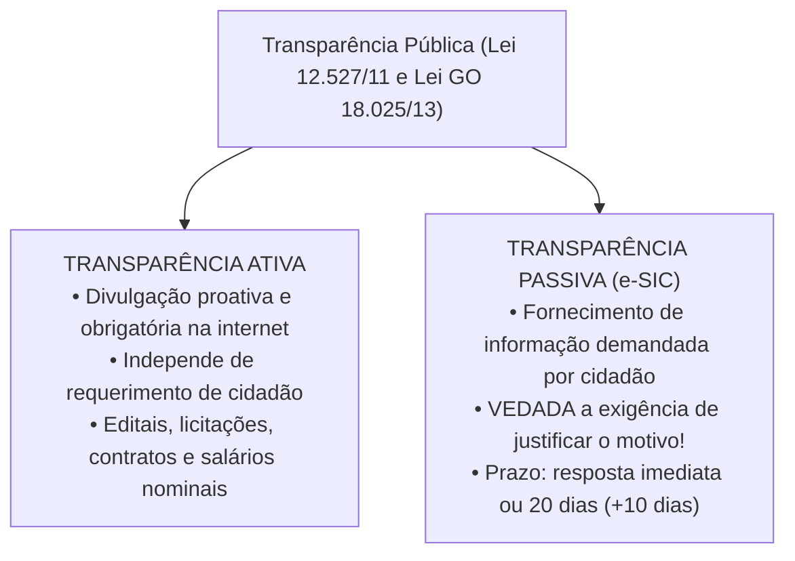
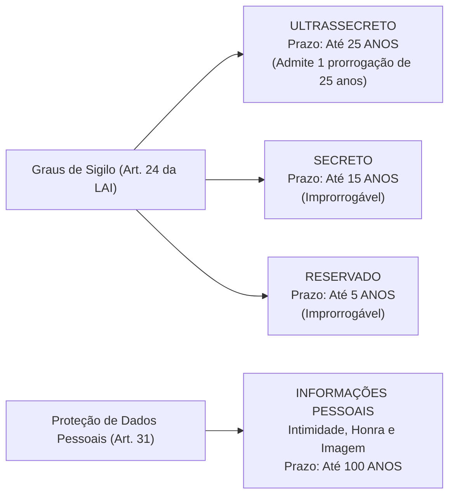
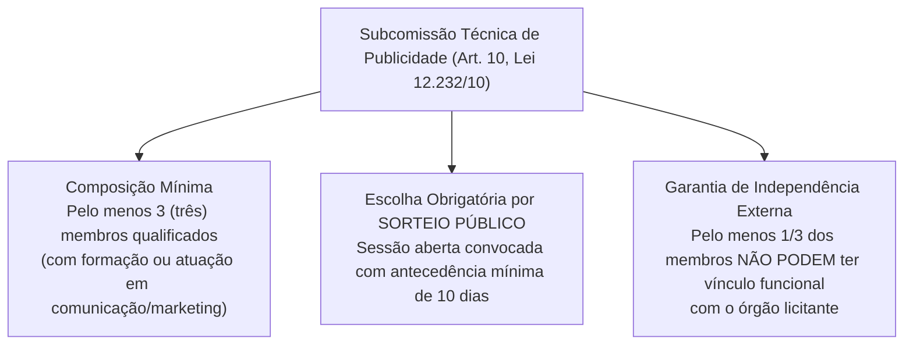

# 06 - Acesso à Informação (LAI Federal e Estadual GO) e Serviços de Publicidade

> **Matéria:** Noções de Direito Administrativo  
> **Cargo:** A01 – Técnico de Controle Externo – Especialidade: Técnico Administrativo  
> **Arquivo:** `06_acesso_a_informacao_e_contratos_publicidade.md`  

---

## 📌 Ementa / Itens do Edital
- Direito de acesso à informação e transparência pública
- Lei Federal nº 12.527/2011 (Lei de Acesso à Informação - LAI)
- Lei Estadual de Goiás nº 18.025/2013 (Acesso à informação no âmbito do Estado de Goiás)
- Transparência ativa vs. transparência passiva; Serviço de Informações ao Cidadão (SIC)
- Prazos, pedidos e recursos no procedimento de acesso à informação
- Classificação de informações sigilosas: graus de sigilo (ultrassecreto, secreto e reservado), prazos e proteção a dados pessoais (100 anos)
- Contratação de serviços de publicidade pela Administração Pública: Lei Federal nº 12.232/2010 e alterações
- Julgamento por subcomissão técnica e vedação da modalidade pregão para serviços de criação publicitária

---

## 🧭 Sumário
- [1. Transparência Pública e Regime da Lei de Acesso à Informação](#1-transparencia-publica-e-regime-da-lei-de-acesso-a-informacao)
    - [1.1 Diretrizes Fundamentais: A Publicidade como Regra Geral](#11-diretrizes-fundamentais-a-publicidade-como-regra-geral)
    - [1.2 Transparência Ativa e a Divulgação de Vencimentos (Tema 483 / STF)](#12-transparencia-ativa-e-a-divulgacao-de-vencimentos-tema-483-stf)
    - [1.3 Transparência Passiva e a Vedação de Justificativa (Art. 10, § 3º)](#13-transparencia-passiva-e-a-vedacao-de-justificativa-art-10-3o)
    - [1.4 Prazos Procedimentais e Regime Recursal](#14-prazos-procedimentais-e-regime-recursal)
- [2. Classificação de Informações Sigilosas e Proteção de Dados Pessoais](#2-classificacao-de-informacoes-sigilosas-e-protecao-de-dados-pessoais)
    - [2.1 Graus de Sigilo e Prazos Máximos de Restrição](#21-graus-de-sigilo-e-prazos-maximos-de-restricao)
    - [2.2 Competência Funcional para Classificação no Estado de Goiás](#22-competencia-funcional-para-classificacao-no-estado-de-goias)
    - [2.3 Proteção de Informações Pessoais (100 Anos)](#23-protecao-de-informacoes-pessoais-100-anos)
    - [2.4 Vedação Absoluta de Sigilo: Violações a Direitos Humanos](#24-vedacao-absoluta-de-sigilo-violacoes-a-direitos-humanos)
- [3. Licitações e Contratos de Serviços de Publicidade (Lei nº 12.232/2010)](#3-licitacoes-e-contratos-de-servicos-de-publicidade-lei-no-122322010)
    - [3.1 Objeto Específico e a Vedação Categórica ao Pregão](#31-objeto-especifico-e-a-vedacao-categorica-ao-pregao)
    - [3.2 Tipos Licitatórios Obrigatórios](#32-tipos-licitatorios-obrigatorios)
    - [3.3 A Subcomissão Técnica de Julgamento (Art. 10)](#33-a-subcomissao-tecnica-de-julgamento-art-10)
    - [3.4 Julgamento às Cegas e Proposta Técnica Desidentificada](#34-julgamento-as-cegas-e-proposta-tecnica-desidentificada)
- [4. Fontes Recomendadas na Internet](#4-fontes-recomendadas-na-internet)

---

## 1. Transparência Pública e Regime da Lei de Acesso à Informação

O direito fundamental de acesso à informação pública, assegurado pelo art. 5º, inciso XXXIII, pelo art. 37, § 3º, II e pelo art. 216, § 2º da Constituição Federal, encontra-se disciplinado em âmbito nacional pela **Lei Federal nº 12.527/2011 (LAI)** e, no âmbito estadual goiano, pela **Lei Estadual de Goiás nº 18.025/2013**, incidindo sobre todos os Poderes do Estado, incluindo o Tribunal de Contas do Estado de Goiás (TCE-GO).

### 1.1 Diretrizes Fundamentais: A Publicidade como Regra Geral

O regime democrático inverte a lógica tradicional do segredo de Estado, assentando os seguintes pilares cogentes:

1. **Publicidade como Preceito Geral e Sigilo como Exceção:** Toda informação sob a custódia do Estado é originariamente pública; a restrição de acesso somente é admitida em caráter temporário, fundamentado e em rol estrito de hipóteses legais;
2. **Divulgação de Informações de Interesse Público Independentemente de Solicitações:** Dever estatal de transparência proativa contínua;
3. **Utilização de Meios de Comunicação Viabilizados pela Tecnologia:** Disponibilização de portais na internet em formatos eletrônicos abertos e estruturados;
4. **Fomento ao Controle Social da Administração Pública:** Viabilização do escrutínio republicano pelo cidadão.

### Questão 01 (FCC - Auditor de Controle Externo / TCE-GO)
A Lei de Acesso à Informação (Lei Federal nº 12.527/2011) regulamenta o direito constitucional fundamental de obter informações dos órgãos públicos (art. 5º, XXXIII, CF/88).

A respeito das diretrizes estruturantes da LAI e do regime de publicidade na Administração Pública, assinale a afirmativa correta.

* **A)** O sigilo é a regra geral na Administração Pública, devendo a publicidade ser deferida excepcionalmente apenas aos cidadãos que comprovem interesse jurídico direto e pessoal na informação pleiteada.
* **B)** A publicidade é o preceito geral e o sigilo a exceção, sendo dever do Estado garantir o acesso a informações públicas mediante utilização de meios de comunicação viabilizados pela tecnologia da informação e fomento à cultura de transparência.
* **C)** A divulgação em sítios eletrônicos oficiais de dados orçamentários, repasses financeiros e contratos administrativos configura transparência passiva.
* **D)** As entidades privadas sem fins lucrativos que recebam recursos públicos para realização de ações de interesse público estão totalmente dispensadas de prestar contas ou conferir publicidade a esses recursos.
* **E)** O fornecimento de informação pública está condicionado ao prévio pagamento de taxa remuneratória correspondente ao custo da busca e do trabalho intelectual do servidor público.

> **Comentário Detalhado:**
>
> - **A)** Incorreta. A regra geral republicana e constitucional é a **publicidade máxima**; o sigilo é estrita e fundamentada exceção legal. Ademais, a LAI proíbe expressamente a exigência de motivação ou comprovação de interesse jurídico do requerente.
> - **B)** Correta. O art. 3º da Lei nº 12.527/2011 consagra as diretrizes fundamentais da LAI: I - publicidade como preceito geral e do sigilo como exceção; II - divulgação de informações de interesse público, independentemente de solicitações; III - utilização de meios de comunicação viabilizados pela tecnologia da informação; IV - fomento ao desenvolvimento da cultura de transparência; V - desenvolvimento do controle social da administração pública.
> - **C)** Incorreta. A divulgação prévia, obrigatória e espontânea nos portais da transparência sem necessidade de provocação do cidadão denomina-se **transparência ativa**. Transparência passiva é a resposta a pedidos específicos formulados pelos cidadãos.
> - **D)** Incorreta. O art. 2º da LAI submete as entidades privadas que recebam recursos públicos (subvenções, convênios, contratos de gestão) ao dever de dar publicidade aos valores públicos geridos.
> - **E)** Incorreta. O art. 10 da LAI estabelece que o serviço de busca e fornecimento da informação é **gratuito**, salvo nos casos de reprodução de documentos pelo órgão, situação em que poderá ser cobrado exclusivamente o valor do custo dos serviços e dos materiais utilizados.
>
> **Gabarito: B**

---

### 1.2 Transparência Ativa e a Divulgação de Vencimentos (Tema 483 / STF)

A **transparência ativa** compreende o dever imposto aos órgãos públicos de veicular, em seus sítios oficiais na internet, independentemente de qualquer requerimento prévio de cidadãos, um rol mínimo de informações administrativas: estrutura organizacional, repasses financeiros, execução orçamentária detalhada, procedimentos licitatórios com editais e contratos na íntegra, relatórios de gestão fiscal e dados de auditoria externa.

#### A Divulgação Nominal de Remuneração e o Tema 483 do STF:
Uma das controvérsias mais relevantes decididas pelo Pretório Excelso refere-se à publicação dos salários de servidores públicos. No julgamento do **Tema 483 da Repercussão Geral (RE 652.777)**, o STF fixou a seguinte tese vinculante:
> *"É legítima a publicação, inclusive em sítio eletrônico mantido pela Administração Pública, dos nomes dos seus servidores e do valor dos correspondentes vencimentos e vantagens pecuniárias."*

- **Fundamento Constitucional:** A remuneração do servidor decorre do exercício de função pública remunerada com recursos arrecadados de toda a sociedade. A publicidade nominal e individualizada atende aos princípios republicano e da moralidade administrativa, não configurando invasão ilícita na intimidade ou na vida privada dos agentes públicos.

---

### Questão 02 (FCC - Auditor de Controle Externo / Adaptada)
Determinada associação de servidores públicos ajuizou ação civil pretendendo que o Tribunal de Contas retirasse de seu Portal da Transparência a divulgação nominal individualizada da remuneração e vantagens pecuniárias recebidas pelos servidores do Tribunal, alegando que tal publicidade vulnerava a garantia constitucional da privacidade e intimidade.

Em consonância com a jurisprudência vinculante fixada pelo Supremo Tribunal Federal no julgamento do **Tema 483** da Repercussão Geral:

* **A)** A pretensão da associação deve ser acolhida integralmente, sendo inconstitucional a divulgação nominal do subsídio de servidores públicos sem prévia autorização judicial.
* **B)** É legítima a publicação, inclusive em sítio oficial mantido pela Administração Pública na internet, dos nomes dos servidores e do valor dos correspondentes vencimentos e vantagens pecuniárias, prevalecendo o princípio da publicidade administrativa.
* **C)** A divulgação de remunerações é permitida apenas quanto aos cargos comissionados, permanecendo sob sigilo absoluto a remuneração dos concursados efetivos.
* **D)** A publicidade dos salários de servidores atenta contra a moralidade pública, configurando dano moral presumido (*in re ipsa*).
* **E)** Os vencimentos de agentes públicos podem ser divulgados apenas mediante solicitação individual fundamentada protocolada presencialmente no protocolo físico.

> **Comentário Detalhado:**
>
> - **A)** Incorreta. A pretensão da associação afronta a tese vinculante do STF fixada em repercussão geral, sendo legítima e constitucional a divulgação.
> - **B)** Correta. No julgamento do RE 652.777 sob a sistemática da repercussão geral (**Tema 483**), o Supremo Tribunal Federal assentou: *"É legítima a publicação, inclusive em sítio eletrônico mantido pela Administração Pública, dos nomes dos seus servidores e do valor dos correspondentes vencimentos e vantagens pecuniárias."* A prevalência do princípio da publicidade, da transparência ativa e do controle social dos gastos públicos sobrepõe-se à pretensão de sigilo patrimonial de quem é pago pelo erário.
> - **C)** Incorreta. A transparência ativa recai uniformemente sobre servidores concursados efetivos, comissionados e agentes políticos.
> - **D)** Incorreta. A divulgação de vencimentos atende à moralidade pública e decorre de mandamento constitucional e da Lei de Acesso à Informação, inexistindo ilicitude ou dano moral.
> - **E)** Incorreta. A transparência ativa é de acesso franqueado e universal pela rede mundial de computadores, dispensando pedidos ou justificativas prévias.
> 
> **Gabarito: B**

---

### 1.3 Transparência Passiva e a Vedação de Justificativa (Art. 10, § 3º)

A **transparência passiva** instrumentaliza o dever do poder público de responder a demandas específicas formuladas por qualquer interessado por meio do **Serviço de Informações ao Cidadão (SIC / e-SIC)**.

> 🚨 **REGRA DE OURO / ALERTA CRÍTICO FCC:**  
> O art. 10, § 3º, da Lei Federal nº 12.527/2011 (reproduzido textualmente na Lei Estadual/GO nº 18.025/2013) estabelece expressamente:  
> **"São vedadas quaisquer exigências relativas aos motivos determinantes da solicitação de informações de interesse público."**  
> O cidadão não precisa demonstrar interesse pessoal, não precisa de representação por advogado e **não precisa justificar o porquê** de estar solicitando a informação. Qualquer indeferimento administrativo fundado em "falta de legítimo interesse" ou "ausência de justificativa" é flagrantemente ilegal!

---

### Questão 03 (FCC - Analista de Controle Externo / Adaptada TCE-GO)
Um cidadão domiciliado no Município de Goiânia protocolou pedido de acesso à informação no Serviço de Informações ao Cidadão (SIC) do Tribunal de Contas do Estado de Goiás, solicitando cópia integral dos processos licitatórios e contratos de fornecimento de tecnologia celebrados pelo Tribunal no ano anterior. O servidor encarregado do protocolo indeferiu liminarmente a solicitação, justificando que o interessado não havia comprovado legítimo interesse nem declarado os motivos pelos quais desejava consultar a referida documentação.

À luz da Lei Federal nº 12.527/2011 (LAI) e da Lei Estadual de Goiás nº 18.025/2013:

* **A)** A decisão administrativa está correta, visto que o requerimento de documentos públicos depende de prévia demonstração de interesse jurídico direto pelo peticionário.
* **B)** O indeferimento administrativo é manifestamente ilegal, pois a legislação veda categoricamente quaisquer exigências relativas aos motivos determinantes da solicitação de informações de interesse público.
* **C)** Caberia ao cidadão obter autorização judicial prévia por meio de Habeas Data para ter acesso aos autos de contratações públicas.
* **D)** O cidadão somente poderia obter acesso às informações caso comprovasse vínculo funcional com a Administração Pública estadual.
* **E)** A negativa é legítima porque contratos de tecnologia da informação possuem sigilo ultrassecreto automático por 25 anos.

> **Comentário Detalhado:**
>
> - **A)** Incorreta. O direito à transparência e ao controle social da Administração Pública independe de justificativa ou demonstração de interesse jurídico individual ou subjetivo.
> - **B)** Correta. De acordo com o art. 10, § 3º, da Lei Federal nº 12.527/2011 e com o art. 10, § 3º, da Lei Estadual de Goiás nº 18.025/2013: *"são vedadas quaisquer exigências relativas aos motivos determinantes da solicitação de informações de interesse público."* Qualquer cidadão tem o direito constitucional de ter acesso a contratos, licitações e despesas públicas sem ser compelido a justificar perante a Administração as razões que motivaram seu pedido. O indeferimento liminar é frontalmente ilegal.
> - **C)** Incorreta. O *Habeas Data* tutela dados e registros pessoais do próprio impetrante constantes de bancos de dados estatais, não servindo para obtenção de cópias de processos licitatórios gerais.
> - **D)** Incorreta. O acesso à informação pública é direito fundamental estendido a qualquer cidadão ou pessoa jurídica, servidor ou não.
> - **E)** Incorreta. Contratos administrativos e processos licitatórios são regidos pelo princípio da publicidade ativa obrigatória, não detendo sigilo automático.
> 
> **Gabarito: B**

---

### 1.4 Prazos Procedimentais e Regime Recursal

O procedimento de atendimento às solicitações de informação rege-se pelos seguintes parâmetros temporais estritos:

- **Acesso Imediato:** Se a informação solicitada estiver disponível de pronto, o órgão deve franqueá-la de imediato ao requerente.
- **Prazo Ordinário:** Não sendo possível o acesso imediato, o órgão tem até **20 (vinte) dias** para prestar a informação, indicar que não possui a informação (apontando, se souber, o órgão correto) ou comunicar a recusa fundamentada de sigilo.
- **Prorrogação Justificada:** O prazo de 20 dias pode ser prorrogado por mais **10 (dez) dias** (totalizando até 30 dias), desde que haja **justificativa expressa prévia** comunicada formalmente ao cidadão antes do vencimento do prazo originário.
- **Recursos Administrativos:** No caso de indeferimento de acesso ou de omissão de resposta, o interessado pode interpor recurso administrativo no prazo de **10 (dez) dias** a contar da ciência da decisão, dirigido à autoridade hierarquicamente superior à que negou a informação, que terá o prazo de 5 (cinco) dias para deliberar.

---

### Questão 04 (FGV - Analista de Controle Externo / Auditoria)
Determinado cidadão protocolou requerimento de acesso à informação perante uma autarquia estadual, solicitando cópia integral de notas de empenho e medições de uma obra de pavimentação rodoviária.

De acordo com o rito procedimental estabelecido pela Lei Federal nº 12.527/2011 para a transparência passiva, a Administração Pública:

* **A)** Deve autorizar ou conceder o acesso imediato à informação disponível; não sendo possível o acesso imediato, tem o prazo de até vinte dias para responder, prorrogável justificadamente por mais dez dias.
* **B)** Dispõe do prazo improrrogável de sessenta dias úteis para deliberar sobre o requerimento de informações públicas.
* **C)** Pode condicionar a tramitação do pedido à declaração das razões determinantes da solicitação pelo cidadão interessado.
* **D)** Em caso de indeferimento de acesso a informações, não precisa fundamentar a negativa, haja vista a discricionariedade inerente à segurança dos arquivos públicos.
* **E)** Fica dispensada de prever instância recursal contra a decisão denegatória, sendo o Mandado de Segurança a única via admissível de insurgência.

> **Comentário Detalhado:**
>
> - **A)** Correta. O art. 11 da Lei nº 12.527/2011 estipula que o órgão público deve conceder o acesso imediato à informação disponível. Na impossibilidade de fazê-lo incontinente, deverá responder em prazo **não superior a 20 (vinte) dias**, admitida prorrogação por mais **10 (dez) dias** mediante justificativa expressa e motivada encaminhada ao requerente.
> - **B)** Incorreta. O prazo legal é de 20 dias (com prorrogação de 10 dias), e não 60 dias úteis.
> - **C)** Incorreta. O art. 10, § 3º, da LAI é peremptório: *"São vedadas quaisquer exigências relativas aos motivos determinantes da solicitação de informações de interesse público"*.
> - **D)** Incorreta. O indeferimento deve ser expressa e detalhadamente fundamentado, indicando as razões de sigilo ou a inexistência do documento, sob pena de responsabilidade funcional.
> - **E)** Incorreta. Negado o acesso, cabe recurso administrativo no prazo de 10 dias à autoridade hierarquicamente superior (art. 15 da LAI), não sendo o Judiciário a via exclusiva.
>
> **Gabarito: A**

---

## 2. Classificação de Informações Sigilosas e Proteção de Dados Pessoais

O sigilo é exceção estrita no ordenamento jurídico, admitido apenas quando a publicidade puser em risco a segurança da sociedade (vida, saúde ou integridade da população) ou do Estado (soberania, relações internacionais, inteligência, investigações).

### 2.1 Graus de Sigilo e Prazos Máximos de Restrição

A Lei Federal nº 12.527/2011 (art. 24) e a Lei Estadual nº 18.025/2013 classificam as informações sigilosas em três graus de hierarquia estrita:

| Grau de Sigilo | Prazo Máximo de Restrição | Possibilidade de Prorrogação? | Autoridade Competente em Goiás |
| :--- | :---: | :---: | :--- |
| **Ultrassecreto** | Até **25 anos** | **SIM** (apenas uma única vez, por igual período) | Governador do Estado e Presidentes dos Poderes / Tribunal de Contas |
| **Secreto** | Até **15 anos** | **NÃO** (prazo improrrogável) | Governador, Secretários de Estado e dirigentes máximos de autarquias |
| **Reservado** | Até **5 anos** | **NÃO** (prazo improrrogável) | Autoridades que exerçam funções de direção, chefia ou comando |

---

### Questão 05 (FCC - Analista de Controle Externo / Tecnologia da Informação)
Determinada informação produzida pela Secretaria de Segurança Pública de Goiás teve seu acesso restrito por conter dados de inteligência cuja revelação poria em risco a integridade de operações em andamento. A autoridade competente pretende classificar o documento em grau de sigilo nos termos da Lei Federal nº 12.527/2011 (LAI).

Em relação aos graus de sigilo e aos prazos máximos legais de restrição de acesso previstos na LAI:

* **A)** Os graus de sigilo são Ultrassecreto (até 25 anos), Secreto (até 15 anos) e Reservado (até 5 anos).
* **B)** O prazo máximo de sigilo para informações reservadas é de 10 anos, e para dados ultrassecretos é de 50 anos improrrogáveis.
* **C)** Todas as informações sigilosas ficam sob restrição definitiva e perpétua, não admitindo desclassificação temporal.
* **D)** Informações relativas à vida privada e intimidade pessoal de cidadãos ficam sob sigilo pelo prazo máximo de 15 anos.
* **E)** Qualquer servidor público efetivo dispõe de competência originária para classificar documentos no grau ultrassecreto.

> **Comentário Detalhado:**
>
> - **A)** Correta. O art. 24, § 1º, da Lei Federal nº 12.527/2011 e o diploma estadual goiano fixam exatamente os seguintes prazos máximos de restrição a contar da produção do documento:
>     - I - **Ultrassecreta:** até **25 (vinte e cinco) anos**;
>     - II - **Secreta:** até **15 (quinze) anos**;
>     - III - **Reservada:** até **5 (cinco) anos**.
> - **B)** Incorreta. O prazo para documentos reservados é de 5 anos (e não 10), e o prazo originário do ultrassecreto é de 25 anos.
> - **C)** Incorreta. No Estado Democrático de Direito não existe sigilo eterno ou perpétuo; decorrido o prazo legal máximo de classificação, a informação torna-se automaticamente pública.
> - **D)** Incorreta. A proteção legal outorgada a informações pessoais relativas à intimidade, vida privada, honra e imagem tem prazo máximo de até **100 anos** (art. 31, § 1º, I), não se confundindo com o prazo de 15 anos do grau secreto.
> - **E)** Incorreta. A competência para classificar informações no grau ultrassecreto é privativa de autoridades do ápice administrativo (Governador do Estado e Presidentes de Poderes/Tribunal de Contas).
> 
> **Gabarito: A**

---

### 2.2 Competência Funcional para Classificação no Estado de Goiás

A classificação do sigilo é privativa de autoridades com expressa investidura legal:

- A classificação no grau **ultrassecreto** exige a chancela pessoal do Chefe do Poder Executivo (Governador) ou dos Presidentes da Assembleia Legislativa, do Tribunal de Justiça e do Tribunal de Contas.
- O grau **secreto** pode ser delegado até o nível de Secretários de Estado e dirigentes máximos de autarquias e fundações.
- O grau **reservado** pode ser firmado por autoridades que exerçam atribuições de direção, chefia ou assessoria superior.

### Questão 06 (FCC - Técnico de Controle Externo / Adaptada TCE-GO)
No que concerne à classificação de informações sigilosas e à competência para a atribuição dos graus de sigilo no âmbito da Administração Pública do Estado de Goiás, conforme a Lei nº 12.527/2011 e o Decreto Estadual nº 7.904/2013, assinale a afirmativa correta.

* **A)** A competência para classificar informação no grau ultrassecreto (prazo máximo de restrição de 25 anos) é privativa do Governador e do Vice-Governador do Estado, no âmbito do Poder Executivo estadual.
* **B)** Qualquer servidor público ocupante de cargo efetivo possui competência legal para classificar documentos públicos como ultrassecretos a seu livre critério funcional.
* **C)** A autoridade que classifica um documento como secreto pode fixar discricionariamente prazo de sigilo de trinta anos, ante a soberania da gestão documental estadual.
* **D)** As informações de grau reservado possuem prazo de proteção sigilosa de até quinze anos, vedada a sua desclassificação antes do decurso do prazo.
* **E)** A classificação de sigilo não exige termo formal fundamentado de classificação, bastando o carimbo de confidencialidade aposto na capa dos autos.

> **Comentário Detalhado:**
>
> - **A)** Correta. A classificação de grau ultrassecreto (máximo de 25 anos) restringe-se às mais altas autoridades governamentais. No âmbito estadual goiano (Decreto Estadual nº 7.904/2013 c/c art. 27 da Lei nº 12.527/2011), a competência para classificação no grau **ultrassecreto** é exclusiva do Governador do Estado e do Vice-Governador; no grau **secreto** (máximo 15 anos), dos Secretários de Estado e autoridades equivalentes; e no grau **reservado** (máximo 5 anos), dos dirigentes máximos de autarquias, fundações e empresas públicas.
> - **B)** Incorreta. Servidores de escalão subalterno ou intermediário não detêm competência para classificar informações ultrassecretas ou secretas.
> - **C)** Incorreta. O teto legal da LAI (art. 24, § 1º) é taxativo: ultrassecreta = até 25 anos; secreta = até 15 anos; reservada = até 5 anos. Fixar 30 anos é ilegalidade manifesta.
> - **D)** Incorreta. O prazo de sigilo da informação reservada é de no máximo **5 (cinco) anos** (art. 24, § 1º, III, da LAI).
> - **E)** Incorreta. O art. 28 da LAI exige a formalização do Termo de Classificação de Informação (TCI), contendo a fundamentação da restrição, o assunto, o prazo e a indicação da autoridade competente.
>
> **Gabarito: A**

---

### 2.3 Proteção de Informações Pessoais (100 Anos)

O art. 31 da LAI estabelece regime especial de proteção para as informações pessoais relativas à **intimidade, vida privada, honra e imagem**:

- Têm acesso restrito a agentes públicos legalmente autorizados e à própria pessoa a que se referem, independentemente de classificação de sigilo;
- O prazo máximo de restrição de acesso a informações pessoais sensíveis é de **até 100 (cem) anos**, a contar da data de sua produção.

### 2.4 Vedação Absoluta de Sigilo: Violações a Direitos Humanos

> 🚨 **ALERTA CRÍTICO DE PROVA FCC:**  
> O art. 21, parágrafo único, da LAI consagra uma vedação intransponível:  
> **Não pode ser objeto de qualquer classificação de sigilo nem ter seu acesso restringido a informação ou documento que verse sobre condutas que impliquem violação a direitos humanos praticadas por agentes públicos ou a mando de autoridades públicas!**

---

### Questão 07 (FGV - Analista de Controle Externo / TCE-GO)
Determinado cidadão requereu, com fundamento na LAI, acesso aos registros funcionais de servidores públicos estaduais que participaram, na condição de testemunhas e sindicantes, de apuração de graves violações a direitos humanos e atos de tortura ocorridos durante período de exceção política. O órgão responsável indeferiu o pedido, sob o argumento de que as informações envolveriam intimidade e vida privada, sujeitando-se ao sigilo legal de cem anos do art. 31 da LAI.

À luz da Lei Federal nº 12.527/2011 e da jurisprudência dos Tribunais Superiores, a decisão administrativa denegatória:

* **A)** É legítima, pois o direito à privacidade e à honra individual prevalece de forma absoluta sobre qualquer pretensão de apuração histórica ou controle social.
* **B)** É ilegítima, visto que a própria Lei de Acesso à Informação veda taxativamente a restrição de acesso a informações ou documentos que versem sobre condutas que impliquem violação dos direitos humanos praticada por agentes públicos ou a mando de autoridades públicas.
* **C)** Deveria ter condicionado a liberação dos documentos à autorização prévia e expressa de todos os servidores citados no relatório.
* **D)** Poderia conceder o acesso exclusivamente se o requerente firmasse termo de confidencialidade comprometendo-se a não divulgar os dados à imprensa.
* **E)** Ampara-se no princípio da supremacia do interesse público secundário de preservação da imagem funcional dos órgãos estatais.

> **Comentário Detalhado:**
>
> - **A)** Incorreta. O direito à verdade e à memória histórica sobre violações de direitos humanos não pode ser obstado sob o pretexto de proteção da intimidade de agentes públicos executores de ilícitos de Estado.
> - **B)** Correta. O art. 21, parágrafo único, da Lei nº 12.527/2011 prevê categoricamente: *"As informações ou documentos que versem sobre condutas que impliquem violação dos direitos humanos praticada por agentes públicos ou a mando de autoridades públicas não poderão ser objeto de restrição de acesso"*. O preceito afasta qualquer alegação de sigilo, inclusive o regime de informações pessoais do art. 31.
> - **C)** Incorreta. A consulta ou autorização dos servidores violadores de direitos humanos é expressamente dispensada pela lei.
> - **D)** Incorreta. O acesso nesse caso é público e amplo, não comportando imposição de cláusula de sigilo ou termo de confidencialidade individual.
> - **E)** Incorreta. O interesse público primário de preservação dos direitos humanos e transparência histórica sobrepuja eventuais interesses corporativos secundários da corporação.
>
> **Gabarito: B**

---

## 3. Licitações e Contratos de Serviços de Publicidade (Lei nº 12.232/2010)

A contratação de serviços de publicidade institucional pela Administração Pública direta e indireta de qualquer dos Poderes da União, Estados, DF e Municípios submete-se a regime jurídico especialíssimo regido pela **Lei Federal nº 12.232/2010** (combinada subsidiariamente com a Lei Geral de Licitações nº 14.133/2021).

### 3.1 Objeto Específico e a Vedação Categórica ao Pregão

- **Abrangência do Objeto (Art. 2º):** Destina-se exclusivamente à contratação de serviços prestados por intermédio de agências de propaganda, compreendendo o conjunto de atividades integradas de estudo, planejamento, conceituação, concepção, criação, execução interna e distribuição de peças e campanhas publicitárias.
- **VEDAÇÃO ABSOLUTA AO PREGÃO (Art. 5º da Lei 12.232/2010 c/c Art. 29 da Lei 14.133/2021):**  
  A criação publicitária constitui serviço eminentemente intelectual, subjetivo e artístico, cujos padrões de desempenho e qualidade não podem ser prévia e objetivamente definidos por especificações usuais de mercado. Portanto, **é terminantemente PROIBIDA a utilização da modalidade PREGÃO** para a contratação de serviços de publicidade que envolvam esforço criativo!

---

### Questão 08 (FCC - Técnico de Controle Externo / Administrativa)
Uma autarquia estadual pretende deflagrar procedimento licitatório para contratação de agência de propaganda com o objetivo de criar planos anuais de comunicação, peças publicitárias impressas e digitais, e campanhas educativas de conscientização no trânsito. A comissão de licitação cogitou a adoção da modalidade **Pregão Eletrônico** com julgamento pelo critério de **Menor Preço**, sob a premissa de que a modalidade garante maior economia e agilidade ao procedimento.

Considerando as normas especiais da Lei Federal nº 12.232/2010 e a jurisprudência dominante sobre o tema:

* **A)** A comissão agiu acertadamente, sendo o pregão eletrônico de menor preço a modalidade compulsória para quaisquer serviços contratados por entes públicos.
* **B)** A adoção do pregão é vedada pela legislação para contratação de serviços de publicidade institucional que demandam esforço criativo, devendo a licitação ser realizada obrigatoriamente pelos tipos 'melhor técnica' ou 'técnica e preço'.
* **C)** A autarquia deveria optar pela modalidade Leilão, realizando a disputa por lances sucessivos presenciais.
* **D)** É obrigatória a contratação direta mediante inexigibilidade de licitação, por se tratar de serviço de natureza criativa singular.
* **E)** A autarquia pode utilizar pregão desde que fixe como tipo o maior lance comercial de patrocínio.

> **Comentário Detalhado:**
>
> - **A)** Incorreta. O pregão é privativo de bens e serviços comuns, sendo expressamente vetado para publicidade criativa institucional.
> - **B)** Correta. O art. 5º da Lei Federal nº 12.232/2010, em consonância com o art. 29 da Lei nº 14.133/2021, preceitua que as licitações para serviços de publicidade institucional serão processadas obrigatoriamente pelos tipos **"melhor técnica"** ou **"técnica e preço"**, sendo **expressamente vedada a adoção da modalidade pregão**. A criação publicitária requer desenvolvimento conceitual, artístico e intelectual que não pode ser enquadrado como "serviço comum" passível de julgamento puramente por menor preço.
> - **C)** Incorreta. O leilão é modalidade destinada à alienação de bens públicos ou apreendidos, não se aplicando à contratação de serviços.
> - **D)** Incorreta. Os serviços de publicidade institucional regidos pela Lei nº 12.232/2010 demandam licitação formal obrigatória, sendo expressamente vedada a contratação direta por inexigibilidade genérica.
> - **E)** Incorreta. Não existe tipo de maior lance de patrocínio para despesas correntes de contratos de publicidade institucional.
> 
> **Gabarito: B**

---

### 3.2 Tipos Licitatórios Obrigatórios

Por expressa imposição do art. 5º da Lei nº 12.232/2010, as licitações para serviços de publicidade devem ser processadas e julgadas **obrigatoriamente** por meio de um dos seguintes tipos licitatórios:

1. **Melhor Técnica**; ou
2. **Técnica e Preço**.

### Questão 09 (FCC - Procurador do Estado / Adaptada)
A contratação de serviços de publicidade institucional prestados por intermédio de agências de propaganda pela Administração Pública rege-se pelas normas especiais da Lei nº 12.232/2010.

No que tange aos procedimentos e tipos de licitação admitidos para esses serviços, assinale a afirmativa correta.

* **A)** Os serviços de publicidade prestados por agências de propaganda podem ser licitados mediante pregão eletrônico, desde que os serviços sejam considerados comuns pela Administração.
* **B)** As licitações de publicidade disciplinadas pela Lei nº 12.232/2010 devem ser processadas obrigatoriamente pelos tipos 'melhor técnica' ou 'técnica e preço', sendo vedada a utilização do pregão.
* **C)** O julgamento das propostas técnicas é realizado privativamente pelo chefe da assessoria de comunicação do órgão, dispensada a criação de subcomissão técnica.
* **D)** Os membros da subcomissão técnica de julgamento devem ser todos servidores ocupantes de cargos de provimento efetivo do próprio órgão licitante.
* **E)** As propostas técnicas devem ser apresentadas com a ostensiva identificação da agência de publicidade em todas as páginas para conferir maior transparência à comissão avaliadora.

> **Comentário Detalhado:**
>
> - **A)** Incorreta. A Lei nº 12.232/2010 e a própria Lei nº 14.133/2021 (art. 29, parágrafo único) **vedam expressamente o uso do pregão** para a contratação de serviços de publicidade e propaganda, em face da sua natureza eminentemente intelectual, subjetiva e artística.
> - **B)** Correta. O art. 5º da Lei nº 12.232/2010 prescreve que as licitações para contratação de serviços de publicidade serão processadas obrigatoriamente pelos tipos **"melhor técnica"** ou **"técnica e preço"**, sendo terminantemente vedado o pregão ou o julgamento exclusivo por menor preço.
> - **C)** Incorreta. As propostas técnicas são julgadas obrigatoriamente por uma **subcomissão técnica** composta por no mínimo três membros (art. 10).
> - **D)** Incorreta. Pelo menos um terço (1/3) da subcomissão técnica deve ser composto por profissionais que **não mantenham qualquer vínculo funcional** ou contratual com o órgão público licitante (sorteados publicamente em sessão pública), visando a garantir a imparcialidade do julgamento.
> - **E)** Incorreta. A proposta técnica deve ser julgada **às cegas (proposta técnica desidentificada)**; a identificação da agência antes do julgamento da pontuação técnica é causa de desclassificação sumária da licitante (art. 6º da Lei nº 12.232/2010).
>
> **Gabarito: B**

---

### 3.3 A Subcomissão Técnica de Julgamento (Art. 10)

Para julgar a proposta técnica das agências concorrentes, a lei afasta a comissão permanente genérica e exige a criação de uma **Subcomissão Técnica especializada**, que obedece a requisitos estritos:

1. **Número de Membros:** Composta por, no mínimo, **3 (três) membros** qualificados (com formação superior ou experiência comprovada na área de publicidade, comunicação social ou marketing);
2. **Sorteio Público:** A escolha dos membros é realizada obrigatoriamente por **sorteio público**, a partir de uma lista prévia com número de nomes pelo menos três vezes superior ao número de vagas;
3. **Regra de Desvinculação Funcional (Mínimo de 1/3 Externo):** Para assegurar a idoneidade e evitar favorecimentos políticos, a lei exige que **pelo menos um terço (1/3)** dos integrantes da subcomissão técnica seja composto por profissionais que **não mantenham nenhum vínculo funcional ou contratual com o órgão licitante**.

---

### Questão 10 (FCC - Analista Jurídico)
No âmbito de procedimento licitatório processado sob o regime da Lei Federal nº 12.232/2010 para a contratação de agência de propaganda, a comissão de contratação realizou sessão para constituição da Subcomissão Técnica encarregada de julgar as propostas técnicas.

A respeito da composição e das regras aplicáveis à **Subcomissão Técnica**, a lei exige que:

* **A)** Todos os membros sejam servidores públicos estatutários com pelo menos dez anos de efetivo exercício no órgão contratante.
* **B)** A subcomissão seja composta por no mínimo 3 membros com formação ou atuação na área de comunicação, selecionados obrigatoriamente por sorteio público em sessão aberta, sendo que no mínimo um terço (1/3) não pode manter vínculo funcional com o órgão licitante.
* **C)** Os membros sejam indicados livre e diretamente pelo Presidente do Tribunal sem necessidade de sorteio ou publicidade.
* **D)** As agências participantes do certame indiquem a metade dos avaliadores técnicos da subcomissão.
* **E)** A proposta técnica apresentada pelas agências contenha logotipo e marcas de identificação destacadas para facilitar a atribuição de notas.

> **Comentário Detalhado:**
>
> - **A)** Incorreta. A lei expressamente proíbe que todos os membros possuam vínculo com o órgão licitante, impondo a presença obrigatória de avaliadores externos independentes.
> - **B)** Correta. De acordo com o art. 10 da Lei Federal nº 12.232/2010, a Subcomissão Técnica de publicidade é composta por pelo menos **3 (três) membros** com formação superior ou experiência comprovada na área de comunicação social, publicidade ou marketing. Seus integrantes são escolhidos **obrigatoriamente mediante sorteio público** em sessão previamente convocada, sendo imperativo que **pelo menos um terço (1/3) dos membros não mantenha vínculo funcional ou contratual** com o órgão ou entidade promotora da licitação.
> - **C)** Incorreta. A indicação direta discricionária é nula de pleno direito; a seleção exige sorteio público aberto na presença de interessados.
> - **D)** Incorreta. Licitantes não participam nem indicam avaliadores da comissão de licitação.
> - **E)** Incorreta. As propostas técnicas devem ser apresentadas de forma estritamente desidentificada e apócrifa (sem marcas, logotipos ou sinais da agência), sob pena de desclassificação imediata para preservar o julgamento impessoal e às cegas.
> 
> **Gabarito: B**

---

### 3.4 Julgamento às Cegas e Proposta Técnica Desidentificada

Para garantir o julgamento impessoal e estritamente técnico:

- A proposta técnica deve ser entregue em invólucro opaco e lacrado, **sem qualquer logotipo, marca, slogan, rubrica ou sinal que identifique a agência licitante** (*proposta apócrifa*);
- A violação da desidentificação acarreta a **desclassificação sumária e imediata** da proposta;
- A Subcomissão Técnica atribui as notas técnicas em sessão secreta de análise, e somente após a consolidação das notas os invólucros de identificação são abertos perante todos os licitantes.

---

## 4. Fontes Recomendadas na Internet

- [Lei Federal nº 12.527/2011 (Lei de Acesso à Informação - LAI)](https://www.planalto.gov.br/ccivil_03/_ato2011-2014/2011/lei/l12527.htm)  
  Regulamento nacional que fixa as diretrizes da transparência ativa e passiva, prazos do SIC e graus de classificação de sigilo.
- [Lei Estadual de Goiás nº 18.025/2013 (Lei de Acesso à Informação no Estado de Goiás)](https://legisla.casacivil.go.gov.br/pesquisa_legislacao/83437/lei-18025)  
  Marco normativo goiano de acesso à informação, transparência pública e competências para classificação de sigilo em âmbito estadual.
- [Lei Federal nº 12.232/2010 (Contratação de Serviços de Publicidade pela Administração Pública)](https://www.planalto.gov.br/ccivil_03/_ato2007-2010/2010/lei/l12232.htm)  
  Disciplina as licitações e contratos de serviços de publicidade institucional, o sorteio da subcomissão técnica e a vedação ao pregão.
- [STF - Tema 483 da Repercussão Geral (Divulgação Nominal de Remuneração de Servidores)](https://portal.stf.jus.br/jurisprudencia/repercussaoGeral/tema.asp?num=483)  
  Precedente vinculante consolidando a legitimidade da divulgação de nomes e vencimentos de servidores públicos em portais da transparência.
- [Lei Federal nº 14.133/2021 (Nova Lei de Licitações - Artigo 29)](https://www.planalto.gov.br/ccivil_03/_ato2019-2022/2021/lei/l14133.htm#art29)  
  Dispositivo que reitera a inaplicabilidade do pregão para contratações de serviços técnicos especializados e de publicidade criativa.
* DI PIETRO, Maria Sylvia Zanella. **Direito Administrativo**. 37. ed. Rio de Janeiro: Forense, 2024. (Cap. 3 e Cap. 9 - Princípio da Publicidade, Lei de Acesso à Informação e Licitações Especiais).
* CARVALHO FILHO, José dos Santos. **Manual de Direito Administrativo**. 38. ed. Barueri: Atlas, 2024. (Cap. 1 e Cap. 6 - Transparência Administrativa, Sigilo Oficial e Regime da Lei 12.527/2011).
* JUSTEN FILHO, Marçal. **Comentários à Lei de Licitações e Contratações Administrativas: Lei 14.133/2021**. 2. ed. São Paulo: Thomson Reuters Brasil, 2023. (Comentários aos arts. 1º a 5º e Regimes Licitatórios Especiais da Lei 12.232/2010).
