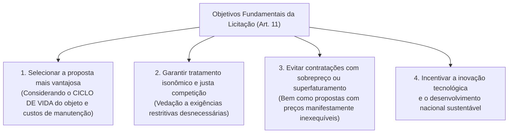
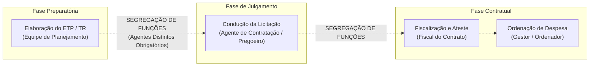
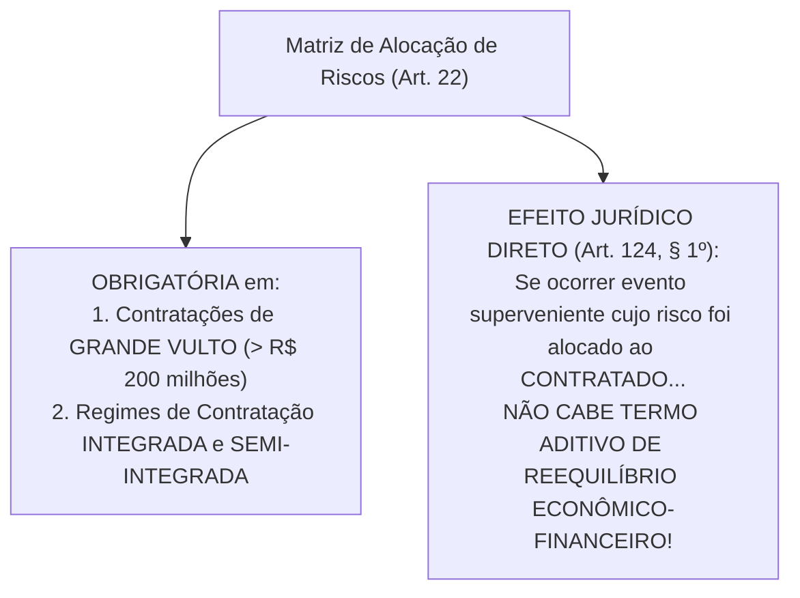

# 01 - Governança, Planejamento da Contratação, ETP, TR e Matriz de Riscos (Lei 14.133/2021)

> **Matéria:** Licitações e Contratos Administrativos  
> **Cargo:** A01 – Técnico de Controle Externo – Especialidade: Técnico Administrativo  
> **Arquivo:** `01_governanca_planejamento_etp_tr_e_matriz_riscos.md`  

---

## 📌 Ementa / Itens do Edital
- Princípios gerais e regime da Lei Federal nº 14.133/2021 (Nova Lei de Licitações e Contratos Administrativos - NLLC)
- Governança das contratações públicas e gestão por competências
- Agentes públicos na licitação: Agente de Contratação, Pregoeiro, Equipe de Apoio e Comissão de Contratação
- Princípio da Segregação de Funções e vedação de conflito de interesses
- Planejamento das contratações públicas: Plano de Contratações Anual (PCA)
- Estudo Técnico Preliminar (ETP): conceito, conteúdo obrigatório e facultativo
- Termo de Referência (TR), Projeto Básico e Projeto Executivo
- Matriz de Alocação de Riscos: conceito, finalidade e equilíbrio econômico-financeiro originário
- Portal Nacional de Contratações Públicas (PNCP): natureza, atribuições e publicidade centralizada

---

## 🧭 Sumário
- [1. Princípios Gerais e Regime da Lei Federal nº 14.133/2021 (NLLC)](#1-principios-gerais-e-regime-da-lei-federal-no-141332021-nllc)
    - [1.1 Âmbito de Aplicação Subjetivo e Objetos Abrangidos](#11-ambito-de-aplicacao-subjetivo-e-objetos-abrangidos)
    - [1.2 Os Objetivos Fundamentais do Processo Licitatório (Art. 11)](#12-os-objetivos-fundamentais-do-processo-licitatorio-art-11)
    - [1.3 Governança das Contratações e Gestão por Competências](#13-governanca-das-contratacoes-e-gestao-por-competencias)
- [2. Agentes Públicos da Contratação e Segregação de Funções](#2-agentes-publicos-da-contratacao-e-segregacao-de-funcoes)
    - [2.1 O Agente de Contratação e o Pregoeiro](#21-o-agente-de-contratacao-e-o-pregoeiro)
    - [2.2 Comissão de Contratação e a Regra do Diálogo Competitivo](#22-comissao-de-contratacao-e-a-regra-do-dialogo-competitivo)
    - [2.3 O Princípio da Segregação de Funções e Conflito de Interesses](#23-o-principio-da-segregacao-de-funcoes-e-conflito-de-interesses)
    - [2.4 Defesa Jurídica Institucional dos Agentes (Art. 10)](#24-defesa-juridica-institucional-dos-agentes-art-10)
- [3. Planejamento das Contratações e Instrumentos Preparatórios](#3-planejamento-das-contratacoes-e-instrumentos-preparatorios)
    - [3.1 Plano de Contratações Anual (PCA) e Integração Orçamentária](#31-plano-de-contratacoes-anual-pca-e-integracao-orcamentaria)
    - [3.2 Estudo Técnico Preliminar (ETP): Conceito e Elementos Obrigatórios](#32-estudo-tecnico-preliminar-etp-conceito-e-elementos-obrigatorios)
    - [3.3 Termo de Referência vs. Projeto Básico e Projeto Executivo](#33-termo-de-referencia-vs-projeto-basico-e-projeto-executivo)
    - [3.4 Matriz de Alocação de Riscos e Equilíbrio Econômico-Financeiro](#34-matriz-de-alocacao-de-riscos-e-equilibrio-economico-financeiro)
- [4. O Portal Nacional de Contratações Públicas (PNCP)](#4-o-portal-nacional-de-contratacoes-publicas-pncp)
    - [4.1 Natureza e Atribuições Centrais do Portal](#41-natureza-e-atribuicoes-centrais-do-portal)
    - [4.2 A Divulgação no PNCP como Requisito Indispensável de Eficácia (Art. 94)](#42-a-divulgacao-no-pncp-como-requisito-indispensavel-de-eficacia-art-94)
- [5. Fontes Recomendadas na Internet](#5-fontes-recomendadas-na-internet)
- [6. Questões Comentadas & Exemplos (Padrão FCC)](#6-questoes-comentadas-exemplos-padrao-fcc)

---

## 1. Princípios Gerais e Regime da Lei Federal nº 14.133/2021 (NLLC)

A **Lei Federal nº 14.133/2021** (Nova Lei de Licitações e Contratos Administrativos - NLLC) consolidou o regime jurídico das compras públicas no Brasil, revogando expressamente a Lei nº 8.666/1993, a Lei do Pregão (Lei nº 10.520/2002) e o Regime Diferenciado de Contratações Públicas (RDC - Lei nº 12.462/2011).

### 1.1 Âmbito de Aplicação Subjetivo e Objetos Abrangidos

- **Entes Abrangidos (Art. 1º):** Submetem-se aos seus comandos a Administração Pública direta, autárquica e fundacional de todos os entes federados (União, Estados, Distrito Federal e Municípios), abrangendo os Poderes Executivo, Legislativo e Judiciário, além do Tribunal de Contas e do Ministério Público no exercício de suas funções administrativas atípicas.
- **Ressalva das Empresas Estatais:** As empresas públicas e as sociedades de economia mista continuam submetidas ao seu regime licitatório e contratual próprio preconizado pela **Lei Federal nº 13.303/2016**, aplicando-se-lhes a NLLC apenas no capítulo referente aos crimes em licitações e contratos (arts. 337-E a 337-P do Código Penal, inseridos pelo art. 178 da Lei 14.133/2021).
- **Princípios Expressos (Art. 5º):** Legalidade, impessoalidade, moralidade, publicidade, eficiência, interesse público, probidade administrativa, igualdade, planejamento, transparência, eficácia, segregação de funções, motivação, vinculação ao edital, julgamento objetivo, segurança jurídica, razoabilidade, proporcionalidade, celeridade, economicidade e desenvolvimento nacional sustentável.

### 1.2 Os Objetivos Fundamentais do Processo Licitatório (Art. 11)

A NLLC inovou ao estruturar quatro objetivos finalísticos obrigatórios a serem perseguidos pela Administração:

### 1.3 Governança das Contratações e Gestão por Competências

A NLLC elevou a governança ao patamar de exigência legal expressa (art. 11, parágrafo único):

- A alta administração do órgão ou entidade é responsável pela implementação e fiscalização contínua de mecanismos de liderança, estratégia e controle;
- Exige **gestão por competências**, determinando que os agentes públicos designados para atuar na área de licitações possuam formação compatível ou qualificação atestada por certificação profissional emitida por escola de governo.

---

## 2. Agentes Públicos da Contratação e Segregação de Funções

### 2.1 O Agente de Contratação e o Pregoeiro

O **Agente de Contratação** (art. 8º) é a pessoa física designada pela autoridade competente para tomar decisões, acompanhar o trâmite da licitação, dar impulso ao procedimento e executar quaisquer outras atividades necessárias ao bom andamento do certame até a homologação.

- **Requisito Obrigatório de Investidura:** Deve ser, preferencialmente, **servidor efetivo ou empregado público dos quadros permanentes** da Administração Pública.  
  > 🚨 **ALERTA CRÍTICO FCC:** É vedada a designação exclusiva de cidadão ocupante de cargo em comissão sem vínculo efetivo com o ente federado para atuar como Agente de Contratação!
- **Responsabilidade Individual:** Responde **individualmente** pelos atos que praticar na condução do procedimento, salvo quando for induzido a erro pela atuação de sua equipe de apoio ou comissão.
- **Pregoeiro:** É a denominação atribuída ao agente de contratação quando a licitação for processada na modalidade **Pregão** (art. 8º, § 5º).

### 2.2 Comissão de Contratação e a Regra do Diálogo Competitivo

A condução por comissão colegiada constitui exceção à regra geral do agente individual:

- **Composição da Comissão:** Composta por, no mínimo, **3 (três) membros**, sendo a maioria servidores efetivos ou empregados públicos permanentes. Os membros respondem solidariamente por todos os atos, ressalvado o membro que manifestar voto divergente registrado expressamente em ata (art. 8º, § 1º).
- **Hipóteses de Atuação:** Bens e serviços especiais; procedimentos auxiliares; e obrigatoriamente no **Diálogo Competitivo**.

> 💡 **Regra Canônica FCC:**  
> Na modalidade **Diálogo Competitivo**, a condução por **comissão de contratação de no mínimo 3 servidores efetivos** é **OBRIGATÓRIA** por expressa exigência do art. 32, inciso XI, da Lei nº 14.133/2021. Jamais pode ser conduzida por agente monocrático isolado!

### 2.3 O Princípio da Segregação de Funções e Conflito de Interesses

Positivado formalmente no art. 5º e detalhado no art. 7º, § 1º, da NLLC:

- **Conceito:** Impõe a repartição criteriosa de funções entre agentes públicos distintos, vedando expressamente a concentração de atribuições mais suscetíveis a riscos em uma mesma autoridade;
- **Aplicação Prática Inegociável:**
    1. O agente que elabora o Estudo Técnico Preliminar e o Termo de Referência (fase interna) **não deve conduzir o julgamento das propostas** como agente de contratação (fase externa);
    2. O agente que julga e adjudica a licitação **não pode atuar como fiscal ou gestor do contrato**, nem ser o responsável por atestar faturas e autorizar pagamentos financeiros.

### 2.4 Defesa Jurídica Institucional dos Agentes (Art. 10)

Se o agente público for demandado nas esferas judicial ou controladora (perante o Tribunal de Contas) em virtude de atos praticados em estrito cumprimento do dever legal na licitação, **terá direito à representação judicial pela Advocacia Pública** (Procuradoria do Estado), desde que sua conduta tenha sido previamente respaldada por parecer jurídico da assessoria do órgão.

---

## 3. Planejamento das Contratações e Instrumentos Preparatórios

A Lei nº 14.133/2021 consagrou a centralidade da **fase preparatória**, superando a cultura de contratações improvisadas.

### 3.1 Plano de Contratações Anual (PCA) e Integração Orçamentária

- O art. 12, VII, preconiza a elaboração do **Plano de Contratações Anual (PCA)**, instrumento de governança que consolida todas as compras e contratações que o órgão pretende realizar no exercício financeiro subsequente.
- Seu objetivo primordial é racionalizar as compras públicas, viabilizar o ganho de escala e garantir a perfeita compatibilização das despesas com as metas do Plano Plurianual (PPA), da Lei de Diretrizes Orçamentárias (LDO) e da Lei Orçamentária Anual (LOA).

### 3.2 Estudo Técnico Preliminar (ETP): Conceito e Elementos Obrigatórios

O **Estudo Técnico Preliminar (ETP)** é o documento constitutivo da primeira etapa do planejamento de uma contratação. Ele evidencia o problema público a ser resolvido e avalia comparativamente as alternativas viáveis disponíveis no mercado para eleger a solução mais eficiente (art. 18).

#### Os 5 Elementos Obrigatórios do ETP (Art. 18, § 2º):
Embora o ETP contenha treze itens descritivos em seu roteiro geral, a NLLC fixou **cinco elementos com preenchimento obrigatório indispensável**:

1. Descrição da **necessidade da contratação**;
2. **Estimativa das quantidades** a serem contratadas, acompanhada de memória de cálculo detalhada;
3. **Estimativa do valor da contratação**, amparada em pesquisa prévia de preços;
4. **Justificativa para o parcelamento ou não** da solução de mercado;
5. **Posicionamento conclusivo** sobre a adequação da contratação para o atendimento da necessidade pública.

### 3.3 Termo de Referência vs. Projeto Básico e Projeto Executivo

- **Termo de Referência (TR - Art. 6º, XXIII):** Documento elaborado para a contratação de **bens e serviços em geral**, contendo os elementos técnicos necessários para caracterizar o objeto de forma clara, o modelo de execução, os critérios de medição e pagamento e os parâmetros de aceitabilidade das propostas.
- **Projeto Básico (Art. 6º, XXV):** Documento elaborado para **obras e serviços de engenharia**, contendo elementos técnicos precisos e consolidados que permitam a perfeita identificação do empreendimento e a estimativa de custos de cada etapa construtiva.
- **Projeto Executivo (Art. 6º, XXVI):** Conjunto dos elementos detalhados necessários e suficientes para a execução completa da obra civil.

### 3.4 Matriz de Alocação de Riscos e Equilíbrio Econômico-Financeiro

A **Matriz de Alocação de Riscos** (art. 6º, XXVII e art. 22) é a cláusula contratual que promove a divisão objetiva e contratual de encargos financeiros e riscos supervenientes entre a Administração Pública e o contratado.

- **Obrigatoriedade:** É obrigatória nas contratações de **grande vulto** (valor que ultrapassa R$ 200.000.000,00) e nos regimes de contratação integrada e semi-integrada.
- **Vedação ao Reequilíbrio Econômico-Financeiro (Art. 124, § 1º):** Se determinado evento imprevisível ou oscilação de mercado ocorrer, mas sua responsabilidade financeira tiver sido previamente alocada à contratada na matriz de riscos, **a empresa NÃO tem direito a aditivo de reequilíbrio econômico-financeiro**. O risco já foi precificado e assumido pela empresa em sua proposta licitatória originária.

---

## 4. O Portal Nacional de Contratações Públicas (PNCP)

### 4.1 Natureza e Atribuições Centrais do Portal

O **Portal Nacional de Contratações Públicas (PNCP)**, disciplinado pelos arts. 174 a 176 da Lei nº 14.133/2021, é o sítio eletrônico oficial único de divulgação de compras públicas gerido pelo Comitê Gestor da Rede Nacional de Contratações Públicas.

- Suas atribuições envolvem centralizar a publicação de editais, atas de registro de preços, planos anuais de contratações, catálogos eletrônicos de padronização e o cadastro unificado de fornecedores impedidos e inidôneos.

### 4.2 A Divulgação no PNCP como Requisito Indispensável de Eficácia (Art. 94)

> *"Art. 94. A divulgação no Portal Nacional de Contratações Públicas (PNCP) é **condição indispensável para a eficácia do contrato e de seus aditamentos** e deverá ocorrer nos seguintes prazos, contados da data de sua assinatura:*  
> *I - 20 (vinte) dias úteis, no caso de licitação;*  
> *II - 10 (dez) dias úteis, no caso de contratação direta."*

> 🚨 **ALERTA DE PROVA FCC:**  
> A publicação no Diário Oficial e em jornais de grande circulação não substitui a divulgação no PNCP. Sem a veiculação tempestiva no PNCP, o contrato administrativo é considerado inoperante, **carecendo de eficácia jurídica** para produzir obrigações e autorizar pagamentos com recursos públicos.

---

## 5. Fontes Recomendadas na Internet

- [Lei Federal nº 14.133/2021 - Arts. 1º a 27 e 174 a 176 (Governança, Planejamento e PNCP)](https://www.planalto.gov.br/ccivil_03/_ato2019-2022/2021/lei/l14133.htm#art1)  
  Texto legal nacional que rege os princípios da licitação, agentes de contratação, segregação de funções, ETP, matriz de riscos e o PNCP.
- [Lei Federal nº 14.133/2021 - Art. 94 (Divulgação Obrigatória no PNCP como Condição de Eficácia)](https://www.planalto.gov.br/ccivil_03/_ato2019-2022/2021/lei/l14133.htm#art94)  
  Dispositivo que fixa os prazos de 20 e 10 dias úteis para divulgação de contratos e aditamentos no Portal Nacional de Contratações Públicas.
- [Decreto Federal nº 10.947/2022 (Regulamento do Plano de Contratações Anual - PCA)](https://www.planalto.gov.br/ccivil_03/_ato2019-2022/2022/decreto/D10947.htm)  
  Normas de elaboração do calendário anual de contratações integradas ao planejamento estratégico e às leis orçamentárias.
- [Compras.gov.br - Instruções Normativas SEGES sobre a Fase Preparatória e ETP (Lei 14.133/2021)](https://www.gov.br/compras/pt-br/acesso-a-informacao/legislacao/instrucoes-normativas)  
  Repositório normativo oficial das Instruções Normativas federais sobre pesquisa de preços, Estudo Técnico Preliminar (ETP) e Termo de Referência (TR).
- [Constituição Federal de 1988 - Art. 37, XXI (Obrigatoriedade Constitucional de Licitar)](https://www.planalto.gov.br/ccivil_03/constituicao/constituicao.htm#art37)  
  Matriz constitucional do dever de licitar, da isonomia entre concorrentes e da manutenção das condições efetivas da proposta.
* JUSTEN FILHO, Marçal. **Comentários à Lei de Licitações e Contratações Administrativas: Lei 14.133/2021**. 2. ed. São Paulo: Thomson Reuters Brasil, 2023. (Comentários aos arts. 5º a 27 - Governança, Agentes de Contratação, Segregação de Funções e Fase Preparatória).
* DI PIETRO, Maria Sylvia Zanella. **Direito Administrativo**. 37. ed. Rio de Janeiro: Forense, 2024. (Cap. 9 - Licitação Pública: Princípios, Governança, ETP, Termo de Referência e Matriz de Riscos).
* NIEBUHR, Joel de Menezes. **Licitação Pública e Contrato Administrativo**. 6. ed. Belo Horizonte: Fórum, 2023. (Cap. 4 e Cap. 5 - Planejamento da Contratação, Estudo Técnico Preliminar e PNCP).

---

## 6. Questões Comentadas & Exemplos (Padrão FCC)

### Questão 1 (FCC - Analista de Controle Externo / Adaptada TCE-GO)
O Diretor-Geral de uma autarquia estadual designou um mesmo servidor público ocupante de cargo em comissão sem vínculo efetivo com o Estado para elaborar o Estudo Técnico Preliminar e o Termo de Referência de uma licitação, conduzir a sessão pública do certame como Agente de Contratação e, após a homologação, atuar como gestor e fiscal único da execução do contrato administrativo.

Em face das normas expressas de governança e princípios instituídos pela Lei Federal nº 14.133/2021:

* **A)** A designação foi regular, visto que a centralização de todas as fases da contratação em um único servidor otimiza a celeridade e a economicidade administrativa.
* **B)** O procedimento violou o princípio da segregação de funções, além de descumprir o requisito legal de que o Agente de Contratação seja preferencialmente servidor efetivo ou empregado público dos quadros permanentes.
* **C)** A Lei nº 14.133/2021 exige que o Agente de Contratação seja contratado por consultoria privada terceirizada, vedando a investidura de agentes públicos.
* **D)** O princípio da segregação de funções aplica-se apenas no âmbito de concessões comuns regidas pela Lei nº 8.987/1995.
* **E)** A cumulação de funções de agente de contratação e fiscal de contrato é obrigatória em órgãos que contam com menos de cem servidores.

> **Comentário Detalhado:**
>
> - **A)** Incorreta. A busca por celeridade não autoriza a eliminação de controles internos básicos nem a supressão de salvaguardas contra desvios de conduta.
> - **B)** Correta. De acordo com o art. 5º e art. 7º, § 1º, da Lei Federal nº 14.133/2021, a autoridade deve observar o **princípio da segregação de funções**, sendo vedada a designação do mesmo agente para atuar simultaneamente em funções mais suscetíveis a riscos (planejar o objeto, julgar a licitação e fiscalizar a despesa). Ademais, o art. 8º da NLLC exige que o Agente de Contratação seja designado dentre **servidores efetivos ou empregados públicos dos quadros permanentes** da Administração Pública, o que impede a entrega da condução do certame a servidor exclusivamente comissionado.
> - **C)** Incorreta. O agente de contratação é agente público investido legalmente nos quadros do Estado, e não consultor privado terceirizado.
> - **D)** Incorreta. O princípio da segregação de funções é expresso e cogente em todos os processos licitatórios submetidos à Lei nº 14.133/2021.
> - **E)** Incorreta. A cumulação dessas atribuições de risco é proibida; adaptações transitórias para pequenos órgãos não impõem a cumulação como dever obrigatório.
> 
> **Gabarito: B**

---

### Questão 2 (FCC - Auditor de Controle Externo / Adaptada)
Em licitação de obra de engenharia de grande vulto (valor estimado em R$ 250 milhões), a Administração Pública incluiu no edital uma detalhada **Matriz de Alocação de Riscos**, atribuindo expressamente à futura contratada os ônus financeiros decorrentes de oscilações normais de mercado no preço do cimento e atrasos de licenciamento ambiental causados por defeitos no projeto de sua responsabilidade. Durante o segundo ano de execução da obra, o preço do cimento aumentou 18%, e a empresa pleiteou perante o órgão contratante a recomposição do equilíbrio econômico-financeiro do contrato.

Com base na disciplina da Lei Federal nº 14.133/2021:

* **A)** O pedido de reequilíbrio econômico-financeiro deve ser indeferido, pois a materialização de risco expressamente atribuído ao contratado na matriz de riscos não autoriza aditivo de valor.
* **B)** O reequilíbrio é compulsório, tendo em vista que a cláusula de matriz de riscos é nula em obras que ultrapassem o valor de R$ 100 milhões.
* **C)** O Poder Público é obrigado a arcar com 50% da variação cambial e de insumos industriais, independentemente de previsão editalícia.
* **D)** A ocorrência de qualquer oscilação de mercado gera direito subjetivo automático à rescisão unilateral com indenização de lucros cessantes.
* **E)** A matriz de alocação de riscos somente produz efeitos se ratificada por acórdão do Tribunal de Contas respectivo.

> **Comentário Detalhado:**
>
> - **A)** Correta. A Lei Federal nº 14.133/2021 prescreve em seu art. 124, § 1º, que é dispensada a formalização de termo aditivo para restabelecimento do equilíbrio econômico-financeiro quando o evento superveniente decorrer de risco cuja responsabilidade financeira tenha sido contratualmente atribuída ao contratado na **Matriz de Alocação de Riscos**. Tendo a empresa assumido o risco de oscilação ordinária do insumo, ela o precificou em sua proposta; a concretização desse evento não rompe a equação originária do contrato.
> - **B)** Incorreta. A matriz de riscos é cláusula de adoção **obrigatória** nas contratações de grande vulto (art. 22, § 3º), assim entendidas aquelas que ultrapassam R$ 200 milhões.
> - **C)** Incorreta. O rateio de ônus depende de estipulação expressa na matriz de riscos, descabendo divisão genérica e apriorística de 50%.
> - **D)** Incorreta. Variações normais de custos dentro da álea ordinária e dos riscos contratados não conferem direito à rescisão com lucros cessantes.
> - **E)** Incorreta. A matriz de riscos possui plena eficácia negocial interpartes a partir da assinatura do contrato, sem necessidade de chancela prévia da corte de contas.
> 
> **Gabarito: A**

---

### Questão 3 (FCC - Procurador do Estado / Adaptada)
Durante a fase preparatória de uma contratação de serviços técnicos contínuos de informática, a equipe de planejamento instruiu os autos com o **Estudo Técnico Preliminar (ETP)**. Um dos analistas sugeriu suprimir do ETP a estimativa dos quantitativos e a justificativa para o parcelamento da solução, alegando que tais informações poderiam constar diretamente no Termo de Referência.

Considerando o que prescreve o art. 18 da Lei Federal nº 14.133/2021 sobre o conteúdo do Estudo Técnico Preliminar:

* **A)** A sugestão do analista é lícita, visto que todo o conteúdo do ETP é meramente exemplificativo e facultativo.
* **B)** A estimativa das quantidades com respectiva memória de cálculo e a justificativa para o parcelamento ou não da solução são elementos obrigatórios indispensáveis do ETP.
* **C)** O ETP é dispensado de plano em qualquer contratação cujo valor seja inferior a R$ 50 milhões.
* **D)** O ETP pode ser substituído por mera pesquisa sumária na internet realizada após a publicação do edital.
* **E)** A indicação da viabilidade técnica da contratação é facultativa caso haja parecer favorável da chefia imediata.

> **Comentário Detalhado:**
>
> - **A)** Incorreta. A Lei nº 14.133/2021 estabelece no art. 18, § 2º, um rol taxativo de cinco itens que devem obrigatoriamente constar do ETP, não sendo sua confecção meramente discricionária.
> - **B)** Correta. O art. 18, § 2º, da Lei nº 14.133/2021 expressamente impõe a obrigatoriedade da inclusão no ETP de:
>     - I. Descrição da necessidade da contratação;
>     - **IV. Estimativa das quantidades a serem contratadas, acompanhada das memórias de cálculo e dos documentos que lhe dão suporte;**
>     - VI. Estimativa do valor da contratação;
>     - **VII. Justificativa para o parcelamento ou não da contratação;**
>     - XIII. Posicionamento conclusivo sobre a adequação da contratação para o atendimento da necessidade pública.  
>   Logo, a supressão desses tópicos é vedada pela norma geral.
> - **C)** Incorreta. O ETP constitui a regra geral da fase de planejamento da NLLC, independentemente do valor da contratação.
> - **D)** Incorreta. A pesquisa mercadológica e a elaboração do ETP devem preceder formalmente a redação do termo de referência e do edital.
> - **E)** Incorreta. O posicionamento conclusivo sobre a viabilidade técnica e adequação da contratação é um dos elementos estritamente obrigatórios do ETP (§ 2º, XIII).
> 
> **Gabarito: B**

---

### Questão 4 (FCC - Técnico de Controle Externo / Administrativa)
No âmbito do Tribunal de Contas, a comissão encarregada de planejar o processo licitatório para a escolha de solução inovadora por meio da modalidade **Diálogo Competitivo** formulou consulta sobre a condução da sessão pública do certame.

Conforme as disposições da Lei Federal nº 14.133/2021 relativas aos agentes da licitação:

* **A)** A modalidade Diálogo Competitivo deve ser conduzida obrigatoriamente por uma comissão de contratação composta de pelo menos 3 servidores efetivos ou empregados públicos dos quadros permanentes.
* **B)** O Diálogo Competitivo é conduzido por um único agente de contratação monocrático comissionado.
* **C)** O certame deve ser coordenado diretamente pelo Presidente do Tribunal de Contas, dispensada a equipe de apoio.
* **D)** As empresas licitantes participantes do diálogo devem indicar dois membros para compor a comissão com direito a voto.
* **E)** A condução por colegiado é terminantemente proibida na Nova Lei de Licitações, prevalecendo sempre a decisão monocrática.

> **Comentário Detalhado:**
>
> - **A)** Correta. De acordo com o art. 32, inciso XI, e art. 8º, § 1º, da Lei Federal nº 14.133/2021: *"o diálogo competitivo será conduzido por comissão de contratação composta de pelo menos 3 (três) servidores efetivos ou empregados públicos pertencentes aos quadros permanentes da Administração, admitida a contratação de profissionais para assessoramento técnico da comissão."* Trata-se de uma das hipóteses legais em que a condução colegiada por comissão de contratação é obrigatória, em razão das sucessivas rodadas de debates técnicos com os licitantes.
> - **B)** Incorreta. A condução monocrática por agente individual é vedada no Diálogo Competitivo.
> - **C)** Incorreta. O Presidente da corte atua como autoridade homologadora, descabendo a condução direta da sessão pública sem comissão técnica.
> - **D)** Incorreta. Representantes de empresas participantes são concorrentes externos e não integram a comissão julgadora.
> - **E)** Incorreta. A comissão colegiada é amplamente permitida em bens especiais e obrigatória no Diálogo Competitivo.
> 
> **Gabarito: A**

---

### Questão 5 (FCC - Analista Judiciário)
O Estado de Goiás homologou licitação para aquisição de equipamentos hospitalares e celebrou contrato administrativo com a empresa vencedora em 10 de maio. A assessoria do órgão providenciou a publicação do extrato no Diário Oficial do Estado no dia seguinte, mas deixou de publicar o instrumento e seus anexos no **Portal Nacional de Contratações Públicas (PNCP)**.

À luz do art. 94 da Lei Federal nº 14.133/2021, o contrato administrativo celebrado:

* **A)** Produz efeitos plenos e imediatos, visto que a publicação no Diário Oficial do Estado é a única legalmente exigível para a eficácia contratual.
* **B)** Não possui eficácia jurídica plena, visto que a divulgação no Portal Nacional de Contratações Públicas (PNCP) é condição indispensável para a eficácia do contrato e de seus aditamentos.
* **C)** É nulo de pleno direito por vício insanável de objeto, devendo ser repetida toda a licitação.
* **D)** Transfere a obrigação do fornecimento diretamente para o segundo colocado do certame licitatório.
* **E)** Fica dispensado de publicação no PNCP caso o valor contratado seja inferior a R$ 20 milhões.

> **Comentário Detalhado:**
>
> - **A)** Incorreta. A Lei nº 14.133/2021 alterou o marco de publicidade em relação ao regime revogado da Lei 8.666/93; o Diário Oficial é veículo complementar, sendo a publicidade no PNCP a condição indispensável de eficácia.
> - **B)** Correta. O art. 94 da Lei Federal nº 14.133/2021 preceitua categoricamente: *"A divulgação no Portal Nacional de Contratações Públicas (PNCP) é condição indispensável para a eficácia do contrato e de seus aditamentos e deverá ocorrer nos seguintes prazos, contados da data de sua assinatura: I - 20 (vinte) dias úteis, no caso de licitação; II - 10 (dez) dias úteis, no caso de contratação direta."* Sem a publicação tempestiva no PNCP, o contrato existe e é válido, mas permanece **ineficaz** perante o ordenamento, não autorizando a exigência de cumprimento nem o empenho e liquidação de despesas públicas.
> - **C)** Incorreta. A omissão no PNCP afeta a eficácia do instrumento contratual e comporta saneamento mediante publicação posterior no portal, não configurando nulidade insanável no objeto da licitação.
> - **D)** Incorreta. O segundo colocado só é convocado em caso de recusa injustificada do primeiro colocado em assinar o contrato.
> - **E)** Incorreta. A obrigatoriedade de publicação no PNCP como condição de eficácia atinge contratos de qualquer valor.
> 
> **Gabarito: B**
