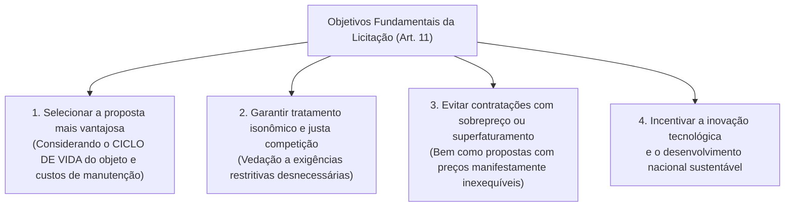
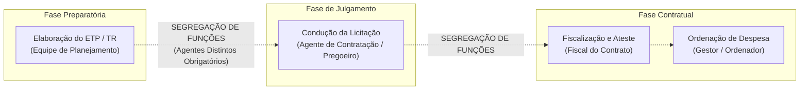
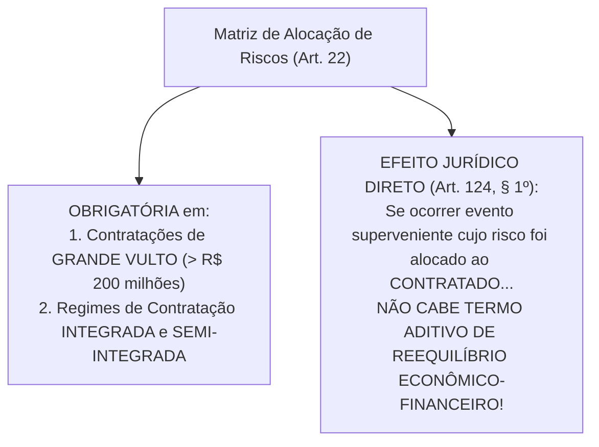

# 01 - Governança, Planejamento da Contratação, ETP, TR e Matriz de Riscos (Lei 14.133/2021)

> **Matéria:** Licitações e Contratos Administrativos  
> **Cargo:** A01 – Técnico de Controle Externo – Especialidade: Técnico Administrativo  
> **Arquivo:** `01_governanca_planejamento_etp_tr_e_matriz_riscos.md`  

---

## 📌 Ementa / Itens do Edital
- Princípios gerais e regime da Lei Federal nº 14.133/2021 (Nova Lei de Licitações e Contratos Administrativos - NLLC)
- Governança das contratações públicas e gestão por competências
- Agentes públicos na licitação: Agente de Contratação, Pregoeiro, Equipe de Apoio e Comissão de Contratação
- Princípio da Segregação de Funções e vedação de conflito de interesses
- Planejamento das contratações públicas: Plano de Contratações Anual (PCA)
- Estudo Técnico Preliminar (ETP): conceito, conteúdo obrigatório e facultativo
- Termo de Referência (TR), Projeto Básico e Projeto Executivo
- Matriz de Alocação de Riscos: conceito, finalidade e equilíbrio econômico-financeiro originário
- Portal Nacional de Contratações Públicas (PNCP): natureza, atribuições e publicidade centralizada

---

## 🧭 Sumário

1. [Princípios Gerais e Regime da Lei Federal nº 14.133/2021 (NLLC)](#1-principios-gerais-e-regime-da-lei-federal-no-141332021-nllc)
    1. [Âmbito de Aplicação Subjetivo e Objetos Abrangidos](#11-ambito-de-aplicacao-subjetivo-e-objetos-abrangidos)
    2. [Os Objetivos Fundamentais do Processo Licitatório (Art. 11)](#12-os-objetivos-fundamentais-do-processo-licitatorio-art-11)
    3. [Governança das Contratações e Gestão por Competências](#13-governanca-das-contratacoes-e-gestao-por-competencias)
    4. [Teste 066](#Teste-066)
    5. [Teste 067](#Teste-067)
2. [Agentes Públicos da Contratação e Segregação de Funções](#2-agentes-publicos-da-contratacao-e-segregacao-de-funcoes)
    1. [O Agente de Contratação e o Pregoeiro](#21-o-agente-de-contratacao-e-o-pregoeiro)
    2. [Comissão de Contratação e a Regra do Diálogo Competitivo](#22-comissao-de-contratacao-e-a-regra-do-dialogo-competitivo)
    3. [O Princípio da Segregação de Funções e Conflito de Interesses](#23-o-principio-da-segregacao-de-funcoes-e-conflito-de-interesses)
    4. [Defesa Jurídica Institucional dos Agentes (Art. 10)](#24-defesa-juridica-institucional-dos-agentes-art-10)
    5. [Teste 068](#Teste-068)
    6. [Teste 069](#Teste-069)
    7. [Teste 070](#Teste-070)
    8. [Teste 071](#Teste-071)
3. [Planejamento das Contratações e Instrumentos Preparatórios](#3-planejamento-das-contratacoes-e-instrumentos-preparatorios)
    1. [Plano de Contratações Anual (PCA) e Integração Orçamentária](#31-plano-de-contratacoes-anual-pca-e-integracao-orcamentaria)
    2. [Estudo Técnico Preliminar (ETP): Conceito e Elementos Obrigatórios](#32-estudo-tecnico-preliminar-etp-conceito-e-elementos-obrigatorios)
    3. [Termo de Referência vs. Projeto Básico e Projeto Executivo](#33-termo-de-referencia-vs-projeto-basico-e-projeto-executivo)
    4. [Matriz de Alocação de Riscos e Equilíbrio Econômico-Financeiro](#34-matriz-de-alocacao-de-riscos-e-equilibrio-economico-financeiro)
    5. [Teste 072](#Teste-072)
    6. [Teste 073](#Teste-073)
    7. [Teste 074](#Teste-074)
    8. [Teste 075](#Teste-075)
4. [O Portal Nacional de Contratações Públicas (PNCP)](#4-o-portal-nacional-de-contratacoes-publicas-pncp)
    1. [Natureza e Atribuições Centrais do Portal](#41-natureza-e-atribuicoes-centrais-do-portal)
    2. [A Divulgação no PNCP como Requisito Indispensável de Eficácia (Art. 94)](#42-a-divulgacao-no-pncp-como-requisito-indispensavel-de-eficacia-art-94)
    3. [Teste 076](#Teste-076)
5. [Fontes Recomendadas na Internet](#5-fontes-recomendadas-na-internet)

---

## 1. Princípios Gerais e Regime da Lei Federal nº 14.133/2021 (NLLC)

A **Lei Federal nº 14.133/2021** (Nova Lei de Licitações e Contratos Administrativos - NLLC) consolidou o regime jurídico das compras públicas no Brasil, revogando expressamente a Lei nº 8.666/1993, a Lei do Pregão (Lei nº 10.520/2002) e o Regime Diferenciado de Contratações Públicas (RDC - Lei nº 12.462/2011).

### 1.1 Âmbito de Aplicação Subjetivo e Objetos Abrangidos

- **Entes Abrangidos (Art. 1º):** Submetem-se aos seus comandos a Administração Pública direta, autárquica e fundacional de todos os entes federados (União, Estados, Distrito Federal e Municípios), abrangendo os Poderes Executivo, Legislativo e Judiciário, além do Tribunal de Contas e do Ministério Público no exercício de suas funções administrativas atípicas.
- **Ressalva das Empresas Estatais:** As empresas públicas e as sociedades de economia mista continuam submetidas ao seu regime licitatório e contratual próprio preconizado pela **Lei Federal nº 13.303/2016**, aplicando-se-lhes a NLLC apenas no capítulo referente aos crimes em licitações e contratos (arts. 337-E a 337-P do Código Penal, inseridos pelo art. 178 da Lei 14.133/2021).
- **Princípios Expressos (Art. 5º):** Legalidade, impessoalidade, moralidade, publicidade, eficiência, interesse público, probidade administrativa, igualdade, planejamento, transparência, eficácia, segregação de funções, motivação, vinculação ao edital, julgamento objetivo, segurança jurídica, razoabilidade, proporcionalidade, celeridade, economicidade e desenvolvimento nacional sustentável.

### 1.2 Os Objetivos Fundamentais do Processo Licitatório (Art. 11)

A NLLC inovou ao estruturar quatro objetivos finalísticos obrigatórios a serem perseguidos pela Administração:

### 1.3 Governança das Contratações e Gestão por Competências

A NLLC elevou a governança ao patamar de exigência legal expressa (art. 11, parágrafo único):

- A alta administração do órgão ou entidade é responsável pela implementação e fiscalização contínua de mecanismos de liderança, estratégia e controle;
- Exige **gestão por competências**, determinando que os agentes públicos designados para atuar na área de licitações possuam formação compatível ou qualificação atestada por certificação profissional emitida por escola de governo.

---

### Teste 066
**(FGV – Auditor de Controle Externo – TCE-GO / Simulado)**  
A Lei nº 14.133/2021 (Nova Lei de Licitações e Contratos Administrativos) consolidou no art. 5º um rol abrangente de princípios aplicáveis às contratações públicas. A respeito dos princípios expressos e setoriais da novel legislação, assinale a opção correta:

* **A)** O princípio do planejamento veda qualquer alteração no cronograma físico-financeiro das obras públicas contratadas.
* **B)** A segregação de funções veda concentrar autorização e fiscalização em um mesmo agente público.
* **C)** A vinculação ao edital impede a Administração de rever atos ilegais na licitação antes da homologação do certame.
* **D)** A celeridade processual afasta a obrigatoriedade da elaboração de parecer jurídico em contratações diretas por valor.
* **E)** O princípio da transparência restringe a divulgação dos contratos aos órgãos ministeriais de auditoria governamental.

---

> **Comentário Detalhado:**
>
> - **A)** **Incorreto**. O planejamento orienta a fase preparatória e a previsibilidade, mas não impede aditivos de readequação de cronograma justificados.
> - **B)** **Correto**. O art. 5º c/c o art. 7º, § 1º, da Lei nº 14.133/2021 consagram o princípio da segregação de funções, segundo o qual é vedada a designação do mesmo agente público para atuação simultânea em funções mais suscetíveis a riscos, de modo a obstar que o mesmo servidor seja responsável por instruir a contratação, homologar o certame e fiscalizar a execução financeira.
> - **C)** **Incorreto**. A vinculação ao edital não anula a autotutela administrativa (Súmula 473 do STF).
> - **D)** **Incorreto**. O parecer jurídico é exigência geral na fase preparatória (art. 53), admitida dispensa apenas em casos estritamente previstos.
> - **E)** **Incorreto**. A transparência impõe publicidade universal no Portal Nacional de Contratações Públicas (PNCP).
>
> **Gabarito: B**
### Teste 067
**(FCC – Analista de Gestão Pública – SEAD-GO / Simulado)**  
Em consonância com as diretrizes de governança pública insculpidas no art. 11 da Lei Federal nº 14.133/2021, o processo licitatório tem por objetivos precípuos assegurar a seleção da proposta apta a gerar o resultado de contratação mais vantajoso. Sob a ótica da governança das contratações:

* **A)** A alta administração deve implementar processos de gestão de riscos e controles preventivos.
* **B)** O resultado vantajoso subordina-se com exclusividade ao menor valor monetário desembolsado no momento do pregão.
* **C)** O tratamento isonômico autoriza o favorecimento imotivado de empresas locais sem expressa previsão legislativa.
* **D)** O controle preventivo substitui integralmente a atuação fiscalizatória constitucional do Tribunal de Contas.
* **E)** A governança das contratações é de observância restrita e facultativa aos órgãos da Administração Indireta.

---

> **Comentário Detalhado:**
>
> - **A)** **Correto**. O art. 11, parágrafo único, da Lei nº 14.133/2021 preconiza que a alta administração do órgão ou entidade é responsável pela governança das contratações e deve implementar processos e estruturas, inclusive gestão de riscos e controles internos, para avaliar, direcionar e monitorar os processos licitatórios e os respectivos contratos.
> - **B)** **Incorreto**. O resultado mais vantajoso considera o ciclo de vida do objeto, sustentabilidade e custos indiretos de manutenção, e não apenas o desembolso inicial.
> - **C)** **Incorreto**. A isonomia veda preferências arbitrárias, admitindo margem de preferência apenas nos estritos limites da lei.
> - **D)** **Incorreto**. O controle interno governamental atua em cooperação com o controle externo, sem afastá-lo.
> - **E)** **Incorreto**. A governança aplica-se obrigatoriamente a todos os órgãos da Administração Direta, autárquica e fundacional.
>
> **Gabarito: A**
## 2. Agentes Públicos da Contratação e Segregação de Funções

### 2.1 O Agente de Contratação e o Pregoeiro

O **Agente de Contratação** (art. 8º) é a pessoa física designada pela autoridade competente para tomar decisões, acompanhar o trâmite da licitação, dar impulso ao procedimento e executar quaisquer outras atividades necessárias ao bom andamento do certame até a homologação.

- **Requisito Obrigatório de Investidura:** Deve ser, preferencialmente, **servidor efetivo ou empregado público dos quadros permanentes** da Administração Pública.  
  > 🚨 **ALERTA CRÍTICO FCC:** É vedada a designação exclusiva de cidadão ocupante de cargo em comissão sem vínculo efetivo com o ente federado para atuar como Agente de Contratação!
- **Responsabilidade Individual:** Responde **individualmente** pelos atos que praticar na condução do procedimento, salvo quando for induzido a erro pela atuação de sua equipe de apoio ou comissão.
- **Pregoeiro:** É a denominação atribuída ao agente de contratação quando a licitação for processada na modalidade **Pregão** (art. 8º, § 5º).

### 2.2 Comissão de Contratação e a Regra do Diálogo Competitivo

A condução por comissão colegiada constitui exceção à regra geral do agente individual:

- **Composição da Comissão:** Composta por, no mínimo, **3 (três) membros**, sendo a maioria servidores efetivos ou empregados públicos permanentes. Os membros respondem solidariamente por todos os atos, ressalvado o membro que manifestar voto divergente registrado expressamente em ata (art. 8º, § 1º).
- **Hipóteses de Atuação:** Bens e serviços especiais; procedimentos auxiliares; e obrigatoriamente no **Diálogo Competitivo**.

> 💡 **Regra Canônica FCC:**  
> Na modalidade **Diálogo Competitivo**, a condução por **comissão de contratação de no mínimo 3 servidores efetivos** é **OBRIGATÓRIA** por expressa exigência do art. 32, inciso XI, da Lei nº 14.133/2021. Jamais pode ser conduzida por agente monocrático isolado!

### 2.3 O Princípio da Segregação de Funções e Conflito de Interesses

Positivado formalmente no art. 5º e detalhado no art. 7º, § 1º, da NLLC:

- **Conceito:** Impõe a repartição criteriosa de funções entre agentes públicos distintos, vedando expressamente a concentração de atribuições mais suscetíveis a riscos em uma mesma autoridade;
- **Aplicação Prática Inegociável:**
    1. O agente que elabora o Estudo Técnico Preliminar e o Termo de Referência (fase interna) **não deve conduzir o julgamento das propostas** como agente de contratação (fase externa);
    2. O agente que julga e adjudica a licitação **não pode atuar como fiscal ou gestor do contrato**, nem ser o responsável por atestar faturas e autorizar pagamentos financeiros.

### 2.4 Defesa Jurídica Institucional dos Agentes (Art. 10)

Se o agente público for demandado nas esferas judicial ou controladora (perante o Tribunal de Contas) em virtude de atos praticados em estrito cumprimento do dever legal na licitação, **terá direito à representação judicial pela Advocacia Pública** (Procuradoria do Estado), desde que sua conduta tenha sido previamente respaldada por parecer jurídico da assessoria do órgão.

---

### Teste 068
**(FGV – Analista de Controle Externo – TCE-GO / Simulado)**  
A Lei nº 14.133/2021 inovou ao disciplinar a gestão por competências como critério obrigatório para a designação dos agentes públicos que atuam nas licitações e contratos (art. 7º). A respeito dos requisitos legais exigidos para a designação desses agentes:

* **A)** Os agentes designados devem ser preferencialmente servidores efetivos dos quadros permanentes.
* **B)** A designação para funções de licitação prescinde de formação técnica prévia caso o servidor conte com dois anos de posse.
* **C)** É permitida a designação de terceirizados como fiscais titulares de contratos por força do princípio da eficiência.
* **D)** A autoridade pode designar cônjuge de licitante habitual do órgão desde que não atue no julgamento de propostas.
* **E)** A capacitação continuada em contratações públicas constitui mera faculdade orçamentária dos entes municipais.

---

> **Comentário Detalhado:**
>
> - **A)** **Correto**. O art. 7º, I, da Lei nº 14.133/2021 determina expressamente que os agentes públicos designados para o desempenho das funções essenciais à execução da lei devem ser, preferencialmente, servidores públicos efetivos ou empregados públicos pertencentes aos quadros permanentes da Administração Pública.
> - **B)** **Incorreto**. O art. 7º, II, exige que os agentes tenham atribuições afins ou formação compatível ou comprovação de qualificação atestada por certificação profissional.
> - **C)** **Incorreto**. A fiscalização de contratos é função pública típica indelegável a particulares terceirizados.
> - **D)** **Incorreto**. O art. 7º, III, veda a designação de pessoas que mantenham relação de parentesco (cônjuge, companheiro ou parente até terceiro grau) com licitantes habituais.
> - **E)** **Incorreto**. As escolas de governo devem obrigatoriamente promover a capacitação permanente dos agentes públicos.
>
> **Gabarito: A**
### Teste 069
**(FCC – Técnico de Controle Externo – TCE-GO / Simulado)**  
No âmbito do Tribunal de Contas, a comissão encarregada de planejar as contratações submeteu minuta de edital para seleção de agente de contratação e comissão de licitação. À luz das disposições do art. 8º da Lei nº 14.133/2021:

* **A)** A licitação na modalidade pregão pode ser conduzida por leiloeiro oficial credenciado perante o tribunal.
* **B)** O agente de contratação atua obrigatoriamente em colegiado de cinco membros em todos os certames licitados.
* **C)** Em bens e serviços especiais, o agente pode ser substituído por comissão de contratação.
* **D)** Em licitações de diálogo competitivo, a condução do certame cabe a pregoeiro singular nomeado pela mesa diretora.
* **E)** O agente de contratação responde solidariamente por todos os atos praticados pela equipe de apoio durante a sessão.

---

> **Comentário Detalhado:**
>
> - **A)** **Incorreto**. O leiloeiro oficial atua exclusivamente na modalidade leilão para alienação de bens (art. 8º, § 2º).
> - **B)** **Incorreto**. O agente de contratação atua ordinariamente de forma individual, auxiliado por equipe de apoio.
> - **C)** **Correto**. O art. 8º, § 2º, da Lei nº 14.133/2021 preconiza que, em licitação que envolva bens ou serviços especiais, desde que observado o potencial de complexidade do objeto, o agente de contratação poderá ser substituído por comissão de contratação formada por, no mínimo, 3 (três) membros.
> - **D)** **Incorreto**. O diálogo competitivo é conduzido obrigatoriamente por comissão de contratação composta por pelo menos três servidores efetivos (art. 32, § 1º, XI).
> - **E)** **Incorreto**. A responsabilidade do agente é individual por seus atos decisórios; os membros da equipe de apoio respondem pelos pareceres técnicos que subscreverem.
>
> **Gabarito: C**
### Teste 070
**(FCC – Analista de Controle Externo – TCE-GO / Simulado)**  
O Diretor-Geral de uma autarquia estadual designou um mesmo servidor público efetivo para atuar como pregoeiro responsável pela condução do certame e, simultaneamente, como fiscal titular e ordenador de despesas do contrato decorrente. O ato de designação:

* **A)** É válido e eficiente, pois a concentração de funções reduz custos operacionais em estruturas autárquicas pequenas.
* **B)** É nulo por violar a segregação de funções e o art. 7º, § 1º da Lei nº 14.133/2021.
* **C)** É convalidável pela autoridade supervisora mediante expedição de portaria ratificadora de aprovação técnica.
* **D)** Exige a concordância do servidor nomeado para que produza efeitos de exoneração da responsabilidade fiscalizatória.
* **E)** Subordina-se à homologação discricionária do Tribunal de Contas para aferição da conveniência e oportunidade.

---

> **Comentário Detalhado:**
>
> - **A)** **Incorreto**. A limitação de pessoal não autoriza a quebra de salvaguardas essenciais da probidade administrativa.
> - **B)** **Correto**. O art. 7º, § 1º, da Lei nº 14.133/2021 estabelece que o princípio da segregação de funções veda expressamente a designação do mesmo agente público para atuação simultânea em funções mais suscetíveis a riscos, a fim de mitigar a ocorrência de fraudes e conflitos de interesse. A cumulação das funções de condutor do certame, fiscalizador de execução e ordenador de despesas vicia o ato com nulidade insanável.
> - **C)** **Incorreto**. Vício de violação cogente à segregação de funções constitui ilegalidade material insuscetível de convalidação.
> - **D)** **Incorreto**. O vício é objetivo e independe da vontade ou aquiescência individual do agente designado.
> - **E)** **Incorreto**. O controle pelo Tribunal de Contas opera a posteriori na fiscalização de legalidade e conformidade.
>
> **Gabarito: B**
### Teste 071
**(FCC – Procurador do Estado – PGE-GO / Simulado)**  
O art. 10 da Lei Federal nº 14.133/2021 estabelece importante prerrogativa funcional aos agentes públicos que atuam nas licitações e contratos estatais. Caso o servidor responda a processo judicial ou administrativo em razão de ato praticado no exercício regular de suas funções e em consonância com pareceres técnicos e jurídicos:

* **A)** Caberá à advocacia pública que orientou a contratação exercer a sua representação judicial ou extrajudicial.
* **B)** O servidor deve contratar advogado particular às suas próprias expensas sem direito a qualquer ressarcimento.
* **C)** O Tribunal de Contas arcará com os custos periciais caso a manifestação fiscalizatória tenha ensejado a ação.
* **D)** A representação pela advocacia pública aplica-se mesmo em caso de comprovada má-fé ou conluio doloso do agente.
* **E)** A defesa técnica pelo órgão jurídico condiciona-se à prévia autorização da Assembleia Legislativa estadual.

---

> **Comentário Detalhado:**
>
> - **A)** **Correto**. O art. 10, caput, da Lei nº 14.133/2021 consagra que, se o agente público que tiver participado de procedimentos relacionados a licitações e contratos for demandado em juízo ou perante órgãos de controle por ato praticado com estrita observância de orientação constante em parecer jurídico emitido na forma do art. 53, caberá à advocacia pública competente exercer sua representação judicial ou extrajudicial.
> - **B)** **Incorreto**. A advocacia pública assume originariamente a defesa; e caso o servidor opte por advogado privado e seja absolvido, fará jus ao ressarcimento das despesas (art. 10, § 2º).
> - **C)** **Incorreto**. Não cabe aos Tribunais de Contas patrocinar ou custear despesas defensivas individuais de jurisdicionados.
> - **D)** **Incorreto**. O art. 10, § 1º veda a representação jurídica se houver indícios de prática de ato ilícito doloso do agente.
> - **E)** **Incorreto**. A atuação da advocacia pública decorre de imposição legal vinculada e dispensa autorização parlamentar.
>
> **Gabarito: A**
## 3. Planejamento das Contratações e Instrumentos Preparatórios

A Lei nº 14.133/2021 consagrou a centralidade da **fase preparatória**, superando a cultura de contratações improvisadas.

### 3.1 Plano de Contratações Anual (PCA) e Integração Orçamentária

- O art. 12, VII, preconiza a elaboração do **Plano de Contratações Anual (PCA)**, instrumento de governança que consolida todas as compras e contratações que o órgão pretende realizar no exercício financeiro subsequente.
- Seu objetivo primordial é racionalizar as compras públicas, viabilizar o ganho de escala e garantir a perfeita compatibilização das despesas com as metas do Plano Plurianual (PPA), da Lei de Diretrizes Orçamentárias (LDO) e da Lei Orçamentária Anual (LOA).

### 3.2 Estudo Técnico Preliminar (ETP): Conceito e Elementos Obrigatórios

O **Estudo Técnico Preliminar (ETP)** é o documento constitutivo da primeira etapa do planejamento de uma contratação. Ele evidencia o problema público a ser resolvido e avalia comparativamente as alternativas viáveis disponíveis no mercado para eleger a solução mais eficiente (art. 18).

#### Os 5 Elementos Obrigatórios do ETP (Art. 18, § 2º):
Embora o ETP contenha treze itens descritivos em seu roteiro geral, a NLLC fixou **cinco elementos com preenchimento obrigatório indispensável**:

1. Descrição da **necessidade da contratação**;
2. **Estimativa das quantidades** a serem contratadas, acompanhada de memória de cálculo detalhada;
3. **Estimativa do valor da contratação**, amparada em pesquisa prévia de preços;
4. **Justificativa para o parcelamento ou não** da solução de mercado;
5. **Posicionamento conclusivo** sobre a adequação da contratação para o atendimento da necessidade pública.

### 3.3 Termo de Referência vs. Projeto Básico e Projeto Executivo

- **Termo de Referência (TR - Art. 6º, XXIII):** Documento elaborado para a contratação de **bens e serviços em geral**, contendo os elementos técnicos necessários para caracterizar o objeto de forma clara, o modelo de execução, os critérios de medição e pagamento e os parâmetros de aceitabilidade das propostas.
- **Projeto Básico (Art. 6º, XXV):** Documento elaborado para **obras e serviços de engenharia**, contendo elementos técnicos precisos e consolidados que permitam a perfeita identificação do empreendimento e a estimativa de custos de cada etapa construtiva.
- **Projeto Executivo (Art. 6º, XXVI):** Conjunto dos elementos detalhados necessários e suficientes para a execução completa da obra civil.

### 3.4 Matriz de Alocação de Riscos e Equilíbrio Econômico-Financeiro

A **Matriz de Alocação de Riscos** (art. 6º, XXVII e art. 22) é a cláusula contratual que promove a divisão objetiva e contratual de encargos financeiros e riscos supervenientes entre a Administração Pública e o contratado.

- **Obrigatoriedade:** É obrigatória nas contratações de **grande vulto** (valor que ultrapassa R$ 200.000.000,00) e nos regimes de contratação integrada e semi-integrada.
- **Vedação ao Reequilíbrio Econômico-Financeiro (Art. 124, § 1º):** Se determinado evento imprevisível ou oscilação de mercado ocorrer, mas sua responsabilidade financeira tiver sido previamente alocada à contratada na matriz de riscos, **a empresa NÃO tem direito a aditivo de reequilíbrio econômico-financeiro**. O risco já foi precificado e assumido pela empresa em sua proposta licitatória originária.

---

### Teste 072
**(FGV – TRF-1ª Região – Analista Judiciário - 2024)**  
O Tribunal iniciou o planejamento da contratação para o desenvolvimento de uma nova solução tecnológica com vistas a integrar os sistemas processuais eletrônicos. No âmbito da fase preparatória, a equipe de planejamento da contratação elaborou o Estudo Técnico Preliminar (ETP) com fundamento no art. 18 da Lei Federal nº 14.133/2021. 

A respeito dos elementos essenciais e da finalidade do Estudo Técnico Preliminar, é correto afirmar que o ETP:

* **A)** consiste no instrumento contratual definitivo que fixa as sanções cominatórias aos fornecedores licitados.
* **B)** evidencia o problema a ser resolvido e a melhor solução entre as alternativas possíveis no mercado fornecedor.
* **C)** substitui integralmente a necessidade de confecção do Termo de Referência em obras complexas de engenharia.
* **D)** prescinde de estimativa preliminar de preços quando a contratação envolver licenças proprietárias de software.
* **E)** é de elaboração facultativa em todas as aquisições de soluções de tecnologia da informação e comunicação.

---

> **Comentário Detalhado:**
>
> - **A)** **Incorreto**. O ETP é documento constitutivo da fase preparatória e de planejamento interno, e não contrato executivo.
> - **B)** **Correto**. O art. 18, § 1º, da Lei nº 14.133/2021 define com precisão: "O estudo técnico preliminar deverá evidenciar o problema a ser resolvido e a sua melhor solução, de modo a permitir a avaliação da viabilidade técnica e econômica da contratação". O ETP fundamenta o Termo de Referência após comparar as opções do mercado.
> - **C)** **Incorreto**. O ETP não substitui o Termo de Referência nem o Projeto Básico; serve de base e subsídio para a sua elaboração.
> - **D)** **Incorreto**. A estimativa do valor da contratação é elemento obrigatório do ETP (art. 18, § 1º, VI).
> - **E)** **Incorreto**. A regra geral é a obrigatoriedade do ETP, admitidas dispensas pontuais taxativas.
>
> **Gabarito: B**
### Teste 073
**(FCC – Procurador do Estado – PGE-GO / Simulado)**  
Durante a fase preparatória de uma contratação de serviços técnicos especializados de consultoria atuarial, a equipe de planejamento autárquica elaborou Estudo Técnico Preliminar simplificado. Nos termos do art. 18, § 2º, da Lei Federal nº 14.133/2021, constituem elementos OBRIGATÓRIOS indeclináveis que devem figurar em qualquer ETP:

* **A)** A descrição da necessidade, a estimativa do valor e o parecer conclusivo de viabilidade.
* **B)** A comprovação prévia de regularidade fiscal de três licitantes concorrentes e a minuta de contrato assinada.
* **C)** O cronograma físico-financeiro detalhado com metodologia BIM para todos os serviços intelectuais comuns.
* **D)** A indicação nominal dos auditores do Tribunal de Contas que acompanharão a fase de execução orçamentária.
* **E)** A declaração formal de renúncia a recursos administrativos por parte dos prestadores interessados no objeto.

---

> **Comentário Detalhado:**
>
> - **A)** **Correto**. Embora o art. 18, § 1º da Lei nº 14.133/2021 enumere 13 incisos, o § 2º determina que são OBRIGATÓRIOS em qualquer ETP os seguintes itens essenciais: I - descrição da necessidade da contratação; IV - estimativas das quantidades acompanhadas das memórias de cálculo; VI - estimativa do valor da contratação; VIII - justificativas para o parcelamento ou não da solução; e XIII - posicionamento conclusivo sobre a adequação e a viabilidade técnica e econômica da contratação.
> - **B)** **Incorreto**. A regularidade fiscal dos licitantes é aferida na fase de habilitação, não no ETP preparatório.
> - **C)** **Incorreto**. A metodologia BIM é obrigatória para obras de engenharia (art. 19, § 3º), não para serviços comuns.
> - **D)** **Incorreto**. O Tribunal de Contas não compõe a equipe de planejamento do órgão jurisdicionado.
> - **E)** **Incorreto**. É vedada a renúncia prévia a direitos e recursos administrativos legalmente previstos.
>
> **Gabarito: A**
### Teste 074
**(FCC – Auditor de Controle Externo – TCE-GO / Simulado)**  
Na fase preparatória das contratações regidas pela Lei nº 14.133/2021, a caracterização adequada do objeto a ser licitado materializa-se em documentos técnicos específicos. A respeito da distinção conceitual e aplicabilidade do Termo de Referência (TR), do Projeto Básico (PB) e do Projeto Executivo (PE):

* **A)** O Termo de Referência aplica-se à contratação de obras de engenharia, ao passo que o Projeto Básico destina-se a compras.
* **B)** O Projeto Executivo compreende todos os elementos necessários para estimar o custo, prescindindo de detalhamento.
* **C)** O Termo de Referência é o documento preparatório para aquisição de bens e contratação de serviços em geral.
* **D)** O Projeto Básico dispensa a indicação de matriz de riscos mesmo nas obras licitadas sob regime de contratação integrada.
* **E)** O Termo de Referência pode ser substituído por cotação telefônica de preços nas licitações de grande vulto financeiro.

---

> **Comentário Detalhado:**
>
> - **A)** **Incorreto**. Ocorre o oposto: Termo de Referência é para bens e serviços em geral (art. 6º, XXIII); Projeto Básico é para obras e serviços de engenharia (art. 6º, XXV).
> - **B)** **Incorreto**. O Projeto Executivo é o nível máximo de detalhamento executivo e construtivo de engenharia (art. 6º, XXVI).
> - **C)** **Correto**. O art. 6º, XXIII, da Lei nº 14.133/2021 conceitua Termo de Referência como o "documento necessário para a contratação de bens e serviços, que deve conter os seguintes parâmetros e elementos descritivos: definição do objeto, fundamentação da contratação, requisitos da contratação, modelo de gestão do contrato, critérios de medição e de pagamento, estimativa de valor e adequação orçamentária".
> - **D)** **Incorreto**. O Projeto Básico ou o anteprojeto na contratação integrada exige obrigatoriamente a matriz de alocação de riscos.
> - **E)** **Incorreto**. A formalização do TR é obrigatória e rigorosa, insuscetível de substituição informal.
>
> **Gabarito: C**
### Teste 075
**(FCC – Auditor de Controle Externo – TCE-GO / Simulado)**  
Em licitação de obra de engenharia de grande vulto (valor estimado superior a duzentos milhões de reais), a Administração estadual incluiu no edital a Matriz de Alocação de Riscos entre o contratante público e o contratado privado. Segundo o art. 103 da Lei Federal nº 14.133/2021:

* **A)** A inclusão da matriz de riscos é vedada nas contratações integradas por transferir ônus ao parceiro particular.
* **B)** A matriz de riscos define o equilíbrio econômico-financeiro originário quanto aos eventos supervenientes ali alocados.
* **C)** Os riscos ordinários atribuídos contratualmente à empresa contratada autorizam pedido de reequilíbrio tarifário ao Estado.
* **D)** A matriz de riscos afasta a responsabilidade do construtor por defeitos de solidez e segurança previstos no Código Civil.
* **E)** A alocação de riscos aos particulares dispensa a prestação de garantia contratual na execução de obras rodoviárias.

---

> **Comentário Detalhado:**
>
> - **A)** **Incorreto**. A matriz de riscos é OBRIGATÓRIA nas contratações de grande vulto e nas contratações integradas e semi-integradas (art. 22, § 3º).
> - **B)** **Correto**. Conforme o art. 103 da Lei nº 14.133/2021, o contrato pode identificar os riscos contratuais previstos e presumíveis e alocá-los entre contratante e contratado. O § 4º do art. 103 é categórico: "A matriz de alocação de riscos define o equilíbrio econômico-financeiro inicial do contrato em relação aos eventos supervenientes nela previstos, e é vedada a celebração de aditivos com fundamento em eventos cuja responsabilidade tenha sido assumida pela parte contratante ou contratada". Se o evento danoso estiver atribuído ao contratado na matriz, ele não pode pleitear reequilíbrio econômico-financeiro.
> - **C)** **Incorreto**. Os riscos assumidos pela contratada impedem a repactuação ou revisão contratual fundada no fato ocorrido.
> - **D)** **Incorreto**. A responsabilidade civil legal por solidez da obra (art. 618 do Código Civil) é cogente e inafastável.
> - **E)** **Incorreto**. As exigências de seguro-garantia são mantidas e reforçadas para contratos de grande vulto (art. 99 da NLLC).
>
> **Gabarito: B**
## 4. O Portal Nacional de Contratações Públicas (PNCP)

### 4.1 Natureza e Atribuições Centrais do Portal

O **Portal Nacional de Contratações Públicas (PNCP)**, disciplinado pelos arts. 174 a 176 da Lei nº 14.133/2021, é o sítio eletrônico oficial único de divulgação de compras públicas gerido pelo Comitê Gestor da Rede Nacional de Contratações Públicas.

- Suas atribuições envolvem centralizar a publicação de editais, atas de registro de preços, planos anuais de contratações, catálogos eletrônicos de padronização e o cadastro unificado de fornecedores impedidos e inidôneos.

### 4.2 A Divulgação no PNCP como Requisito Indispensável de Eficácia (Art. 94)

> *"Art. 94. A divulgação no Portal Nacional de Contratações Públicas (PNCP) é **condição indispensável para a eficácia do contrato e de seus aditamentos** e deverá ocorrer nos seguintes prazos, contados da data de sua assinatura:*  
> *I - 20 (vinte) dias úteis, no caso de licitação;*  
> *II - 10 (dez) dias úteis, no caso de contratação direta."*

> 🚨 **ALERTA DE PROVA FCC:**  
> A publicação no Diário Oficial e em jornais de grande circulação não substitui a divulgação no PNCP. Sem a veiculação tempestiva no PNCP, o contrato administrativo é considerado inoperante, **carecendo de eficácia jurídica** para produzir obrigações e autorizar pagamentos com recursos públicos.

---

### Teste 076
**(FCC – Analista Judiciário – TRT / Simulado)**  
O Estado de Goiás homologou seu Plano de Contratações Anual (PCA), consolidando todas as demandas de compras e serviços pretendidas pelos órgãos estaduais para o exercício financeiro subsequente. A respeito do Plano de Contratações Anual na disciplina da Lei Federal nº 14.133/2021:

* **A)** O PCA tem por objetivo primordial subsidiar a elaboração das leis orçamentárias e evitar o fracionamento indevido.
* **B)** O plano aprovado adquire caráter imutável, vedada a inserção de novas aquisições mesmo diante de calamidade pública.
* **C)** A elaboração do PCA dispensa a divulgação em sítio eletrônico oficial por conter dados estratégicos da gestão.
* **D)** O plano anual restringe-se às compras dispensáveis por baixo valor, não alcançando contratações vultosas.
* **E)** A execução de compras desvinculadas do PCA extingue automaticamente a vigência da Lei Orçamentária Anual.

---

> **Comentário Detalhado:**
>
> - **A)** **Correto**. O art. 12, VII, da Lei Federal nº 14.133/2021 estabelece que a fase preparatória das contratações deve alinhar-se com o Plano de Contratações Anual, elaborado com o objetivo de racionalizar as contratações dos órgãos e entidades sob sua jurisdição, garantir o alinhamento com o planejamento estratégico, subsidiar a elaboração das respectivas leis orçamentárias e evitar o parcelamento/fracionamento indevido de despesas.
> - **B)** **Incorreto**. O PCA é instrumento dinâmico e flexível, admitindo revisões e inclusões justificadas ao longo do exercício.
> - **C)** **Incorreto**. O PCA deve ser divulgado publicamente no Portal Nacional de Contratações Públicas (PNCP) e em sítio oficial.
> - **D)** **Incorreto**. O plano consolida todas as aquisições planejadas, prioritariamente as compras e serviços continuados e de vulto.
> - **E)** **Incorreto**. A inobservância do PCA enseja apuração de responsabilidade de planejamento, sem afetar a vigência da LOA.
>
> **Gabarito: A**
## 5. Fontes Recomendadas na Internet

- [Lei Federal nº 14.133/2021 - Arts. 1º a 27 e 174 a 176 (Governança, Planejamento e PNCP)](https://www.planalto.gov.br/ccivil_03/_ato2019-2022/2021/lei/l14133.htm#art1)  
  Texto legal nacional que rege os princípios da licitação, agentes de contratação, segregação de funções, ETP, matriz de riscos e o PNCP.
- [Lei Federal nº 14.133/2021 - Art. 94 (Divulgação Obrigatória no PNCP como Condição de Eficácia)](https://www.planalto.gov.br/ccivil_03/_ato2019-2022/2021/lei/l14133.htm#art94)  
  Dispositivo que fixa os prazos de 20 e 10 dias úteis para divulgação de contratos e aditamentos no Portal Nacional de Contratações Públicas.
- [Decreto Federal nº 10.947/2022 (Regulamento do Plano de Contratações Anual - PCA)](https://www.planalto.gov.br/ccivil_03/_ato2019-2022/2022/decreto/D10947.htm)  
  Normas de elaboração do calendário anual de contratações integradas ao planejamento estratégico e às leis orçamentárias.
- [Compras.gov.br - Instruções Normativas SEGES sobre a Fase Preparatória e ETP (Lei 14.133/2021)](https://www.gov.br/compras/pt-br/acesso-a-informacao/legislacao/instrucoes-normativas)  
  Repositório normativo oficial das Instruções Normativas federais sobre pesquisa de preços, Estudo Técnico Preliminar (ETP) e Termo de Referência (TR).
- [Constituição Federal de 1988 - Art. 37, XXI (Obrigatoriedade Constitucional de Licitar)](https://www.planalto.gov.br/ccivil_03/constituicao/constituicao.htm#art37)  
  Matriz constitucional do dever de licitar, da isonomia entre concorrentes e da manutenção das condições efetivas da proposta.
* JUSTEN FILHO, Marçal. **Comentários à Lei de Licitações e Contratações Administrativas: Lei 14.133/2021**. 2. ed. São Paulo: Thomson Reuters Brasil, 2023. (Comentários aos arts. 5º a 27 - Governança, Agentes de Contratação, Segregação de Funções e Fase Preparatória).
* DI PIETRO, Maria Sylvia Zanella. **Direito Administrativo**. 37. ed. Rio de Janeiro: Forense, 2024. (Cap. 9 - Licitação Pública: Princípios, Governança, ETP, Termo de Referência e Matriz de Riscos).
* NIEBUHR, Joel de Menezes. **Licitação Pública e Contrato Administrativo**. 6. ed. Belo Horizonte: Fórum, 2023. (Cap. 4 e Cap. 5 - Planejamento da Contratação, Estudo Técnico Preliminar e PNCP).
