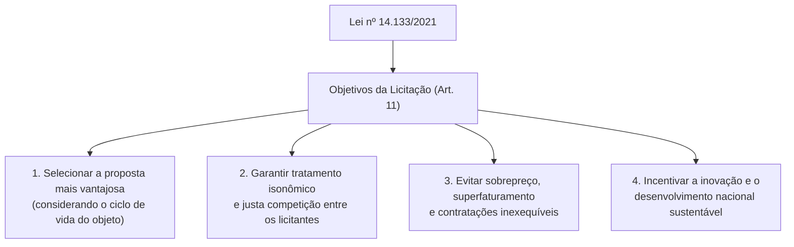
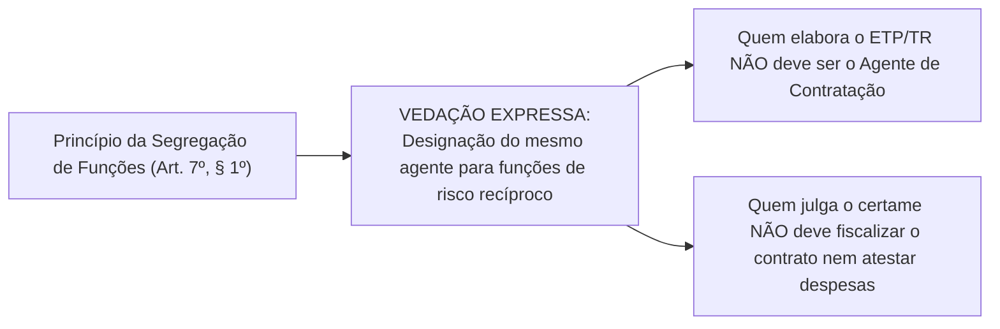

# 01 - Governança, Planejamento da Contratação, ETP, TR e Matriz de Riscos (Lei 14.133/2021)

> **Matéria:** Licitações e Contratos Administrativos  
> **Cargo:** A01 – Técnico de Controle Externo – Especialidade: Técnico Administrativo  
> **Arquivo:** `01_governanca_planejamento_etp_tr_e_matriz_riscos.md`  
> **Status:** 🟢 Teoria Aprofundada + 5 Questões FCC Comentadas (A a E)

---

## 📌 Ementa Oficial do Edital
- Princípios gerais e regime da Lei Federal nº 14.133/2021 (Nova Lei de Licitações e Contratos Administrativos - NLLC).
- Governança das contratações públicas e gestão por competências.
- Agentes públicos na licitação: Agente de Contratação, Pregoeiro, Equipe de Apoio e Comissão de Contratação.
- Princípio da Segregação de Funções e vedação de conflito de interesses.
- Planejamento das contratações públicas: Plano de Contratações Anual (PCA).
- Estudo Técnico Preliminar (ETP): conceito, conteúdo obrigatório e facultativo.
- Termo de Referência (TR), Projeto Básico e Projeto Executivo.
- Matriz de Alocação de Riscos: conceito, finalidade e equilíbrio econômico-financeiro originário.
- Portal Nacional de Contratações Públicas (PNCP): natureza, atribuições e publicidade centralizada.

---

## 🌳 Classificação Hierárquica do Conteúdo

```text
1. Governança das Contratações Públicas e Fase Preparatória (Lei nº 14.133/2021)
├── 1.1 Princípios e Regime Geral da Nova Lei de Licitações (Lei nº 14.133/2021)
│   ├── Âmbito de Aplicação: Administração Direta, Autarquias e Fundações de todos os entes federados
│   ├── Princípios Expressos (Art. 5º): Legalidade, planejamento, transparência, segregação de funções
│   └── Objetivos da Licitação (Art. 11): Proposta mais vantajosa (ciclo de vida), inovação e sustentabilidade
├── 1.2 Governança e Atores do Processo Licitatório (Arts. 7º a 10)
│   ├── Agente de Contratação: Servidor efetivo/permanente que conduz o certame e responde individualmente
│   ├── Pregoeiro: Denominação do agente de contratação na modalidade Pregão
│   ├── Comissão de Contratação: Colegiado de no mínimo 3 membros (obrigatória no Diálogo Competitivo)
│   ├── Princípio da Segregação de Funções (Art. 7º, § 1º): Vedação de sobreposição de funções de risco
│   └── Defesa Jurídica Institucional (Art. 10): Advocacia Pública defende agentes respaldados em pareceres
├── 1.3 Planejamento das Contratações e Documentos Preparatórios (Arts. 18 a 27)
│   ├── Plano de Contratações Anual - PCA (Art. 12, VII): Compatibilização com PPA, LDO e LOA
│   ├── Estudo Técnico Preliminar - ETP (Art. 18): Análise de alternativas de mercado e viabilidade
│   │   └── Elementos Obrigatórios: Necessidade, quantidades, valor estimado, parcelamento e viabilidade
│   ├── Termo de Referência (TR - bens/serviços) vs. Projeto Básico e Executivo (obras/engenharia)
│   └── Matriz de Alocação de Riscos (Arts. 6º, XXVII e 22):
│       ├── Repartição objetiva de ônus financeiros supervenientes
│       └── Obrigatoriedade em grande vulto (> R$ 200 milhões) e regimes integrado/semi-integrado
└── 1.4 O Portal Nacional de Contratações Públicas - PNCP (Arts. 94 e 174 a 176)
    ├── Sítio eletrônico oficial único gerido pelo Comitê Gestor da Rede Nacional
    └── Requisito Indispensável de Eficácia: A publicação no PNCP é condição de validade do contrato
```

---

## 📖 Teoria Aprofundada e Pontos Críticos

### 1. Princípios e Objetivos da Nova Lei de Licitações (Lei nº 14.133/2021)

A Lei nº 14.133/2021 unificou o regime licitatório da Administração Direta, Autárquica e Fundacional de todos os entes da Federação (União, Estados, DF e Municípios). As empresas estatais continuam regidas pela Lei nº 13.303/2016, aplicando-se a NLLC a elas apenas no capítulo referente aos crimes licitatórios (art. 178).



---

### 2. Agentes Públicos e Segregação de Funções (Arts. 7º a 10)

| Agente / Colegiado | Requisitos de Investidura | Atribuições Principais | Responsabilidade |
|---|---|---|---|
| **Agente de Contratação** | **Servidor efetivo** ou empregado público dos quadros permanentes | Conduzir a sessão pública, julgar propostas, habilitar licitantes e sanear falhas | **Individual** pelos atos da fase externa (salvo indução a erro pela equipe) |
| **Pregoeiro** | Servidor efetivo/permanente qualificado | Condução da modalidade **Pregão** | Individual |
| **Comissão de Contratação** | Colegiado de **no mínimo 3 membros** (maioria de servidores efetivos) | Bens/serviços especiais, pré-qualificação e **Diálogo Competitivo** (obrigatório!) | **Solidária**, salvo voto divergente formalmente registrado em ata |
| **Equipe de Apoio** | Servidores ou comissionados | Prestar auxílio operacional e técnico ao agente | Subsidiária |



> 🚨 **ALERTA DE PROVA / PEGADINHA FCC:**  
> O Agente de Contratação **NÃO pode ser servidor exclusivamente comissionado**! A lei exige expressamente que seja servidor efetivo ou empregado público estável dos quadros permanentes da Administração. Na modalidade **Diálogo Competitivo**, a condução por comissão de contratação de no mínimo 3 servidores efetivos é **obrigatória** (art. 32, XI).

---

### 3. Fase Preparatória: ETP, TR e Matriz de Riscos

#### 3.1 Estudo Técnico Preliminar (ETP - Art. 18)
O ETP é o documento da fase preparatória que evidencia o problema a ser resolvido e a melhor solução técnica dentre as alternativas disponíveis no mercado. Dentre seus elementos, a lei prevê **5 elementos obrigatórios indispensáveis** (§ 2º):
1. Descrição da necessidade da contratação;
2. Estimativa das quantidades a serem contratadas, acompanhada de memória de cálculo;
3. Estimativa do valor da contratação (pesquisa prévia de mercado);
4. Justificativa para o parcelamento ou não da solução;
5. Posicionamento conclusivo sobre a adequação da contratação para o atendimento da necessidade.

#### 3.2 Matriz de Alocação de Riscos (Art. 6º, XXVII e Art. 22)
A matriz de riscos define a partilha objetiva de encargos financeiros decorrentes de eventos supervenientes e imprevisíveis (ou previsíveis de consequências incalculáveis):
- **Obrigatoriedade:** Contratações de **grande vulto** (valor superior a R$ 200 milhões) e nos regimes de **contratação integrada** e **semi-integrada**.
- **Impacto no Equilíbrio Econômico-Financeiro:** A ocorrência de evento cujo risco foi atribuído à empresa contratada na matriz **NÃO autoriza aditivo de reequilíbrio econômico-financeiro** (art. 124, § 1º), visto que o risco já foi precificado pelo licitante na composição de seu preço.

---

### 4. Portal Nacional de Contratações Públicas - PNCP (Arts. 94 e 174)

O PNCP é o sítio eletrônico oficial gerido pelo governo federal para centralizar todas as contratações públicas do país:
- **Eficácia Contratual:** A divulgação no PNCP é **condição indispensável para a eficácia** do contrato e de seus aditamentos (art. 94). O contrato deve ser publicado no PNCP no prazo de **20 dias úteis** após a assinatura (ou **10 dias úteis** no caso de contratação direta).
- A publicação no Diário Oficial e em jornais de grande circulação é complementar; a eficácia jurídica plena subordina-se à inserção no PNCP.

---

## 🌐 Fontes Recomendadas na Internet
- [Lei Federal nº 14.133/2021 - Nova Lei de Licitações e Contratos](https://www.planalto.gov.br/ccivil_03/_ato2019-2022/2021/lei/l14133.htm)
  - Legislação nacional consolidada sobre governança, planejamento, ETP, matriz de riscos e PNCP.
- [Portal Nacional de Contratações Públicas (PNCP)](https://pncp.gov.br/)
  - Plataforma centralizada oficial de divulgação e publicidade de editais e atas de registro de preços.
- [Manual de Governança das Contratações Públicas do TCU](https://portal.tcu.gov.br/)
  - Orientações e jurisprudência do TCU sobre gestão por competências e segregação de funções.
- [Decreto Federal nº 10.947/2022 (Plano de Contratações Anual - PCA)](https://www.planalto.gov.br/ccivil_03/_ato2019-2022/2022/decreto/D10947.htm)
  - Regulamentação modelo sobre elaboração e publicação do PCA.

---

## 📝 Questões Comentadas no Padrão FCC (Justificadas de A a E)

### Questão 1 (FCC - Analista de Controle Externo / Adaptada TCE-GO)
O Diretor-Geral de uma autarquia estadual designou um mesmo servidor público ocupante de cargo em comissão sem vínculo efetivo com o Estado para elaborar o Estudo Técnico Preliminar e o Termo de Referência de uma licitação, conduzir a sessão pública do certame como Agente de Contratação e, após a homologação, atuar como gestor e fiscal único da execução do contrato administrativo.

Em face das normas expressas de governança e princípios instituídos pela Lei Federal nº 14.133/2021:

A) A designação foi regular, visto que a centralização de todas as fases da contratação em um único servidor otimiza a celeridade e a economicidade administrativa.  
B) O procedimento violou o princípio da segregação de funções, além de descumprir o requisito legal de que o Agente de Contratação seja preferencialmente servidor efetivo ou empregado público dos quadros permanentes.  
C) A Lei nº 14.133/2021 exige que o Agente de Contratação seja contratado por consultoria privada terceirizada, vedando a investidura de agentes públicos.  
D) O princípio da segregação de funções aplica-se apenas no âmbito de concessões comuns regidas pela Lei nº 8.987/1995.  
E) A cumulação de funções de agente de contratação e fiscal de contrato é obrigatória em órgãos que contam com menos de cem servidores.  

> **Gabarito: B**  
>  
> **Comentário Analítico Passo a Passo:**  
> 1. Art. 5º e Art. 7º, § 1º, da Lei Federal nº 14.133/2021:  
>    A autoridade deve observar o **princípio da segregação de funções**, sendo expressamente vedada a designação do mesmo agente público para atuação simultânea em funções mais suscetíveis a riscos, de modo a evitar a sobreposição de atribuições e o comprometimento da fiscalização.  
> 2. Além disso, o art. 8º da NLLC exige que o Agente de Contratação seja designado dentre **servidores efetivos ou empregados públicos dos quadros permanentes** da Administração Pública.  
> 3. Concentrar no mesmo servidor comissionado a confecção do TR, a condução do certame e a posterior liquidação e fiscalização do contrato extingue qualquer controle cruzado interno, configurando flagrante ilegalidade.  
>  
> **Análise das Alternativas:**  
> - **A) Incorreta:** O princípio da celeridade não se sobrepõe à segregação de funções nem autoriza a eliminação de controles essenciais.  
> - **B) CORRETA:** Identifica com precisão as duas violações legais (ofensa à segregação de funções e designação de comissionado sem vínculo efetivo para agente de contratação).  
> - **C) Incorreta:** O agente de contratação é agente público interno do órgão, e não consultor privado terceirizado.  
> - **D) Incorreta:** A segregação de funções é princípio expresso geral aplicável a todas as contratações da Lei 14.133/2021.  
> - **E) Incorreta:** A cumulação é vedada pela norma geral, cabendo aos municípios pequenos apenas adaptações transitórias fundamentadas, sem imposição obrigatória de cumulação.

---

### Questão 2 (FCC - Auditor de Controle Externo / Adaptada)
Em licitação de obra de engenharia de grande vulto (valor estimado em R$ 250 milhões), a Administração Pública incluiu no edital uma detalhada **Matriz de Alocação de Riscos**, atribuindo expressamente à futura contratada os ônus financeiros decorrentes de oscilações normais de mercado no preço do cimento e atrasos de licenciamento ambiental causados por defeitos no projeto de sua responsabilidade. Durante o segundo ano de execução da obra, o preço do cimento aumentou 18%, e a empresa pleiteou perante o órgão contratante a recomposição do equilíbrio econômico-financeiro do contrato.

Com base na disciplina da Lei Federal nº 14.133/2021:

A) O pedido de reequilíbrio econômico-financeiro deve ser indeferido, pois a materialização de risco expressamente atribuído ao contratado na matriz de riscos não autoriza aditivo de valor.  
B) O reequilíbrio é compulsório, tendo em vista que a cláusula de matriz de riscos é nula em obras que ultrapassem o valor de R$ 100 milhões.  
C) O Poder Público é obrigado a arcar com 50% da variação cambial e de insumos industriais, independentemente de previsão editalícia.  
D) A ocorrência de qualquer oscilação de mercado gera direito subjetivo automático à rescisão unilateral com indenização de lucros cessantes.  
E) A matriz de alocação de riscos somente produz efeitos se ratificada por acórdão do Tribunal de Contas respectivo.  

> **Gabarito: A**  
>  
> **Comentário Analítico Passo a Passo:**  
> 1. Art. 22 e Art. 124, § 1º, da Lei Federal nº 14.133/2021:  
>    *"A formalização do termo aditivo é dispensada quando o evento superveniente decorrer de risco cuja responsabilidade tenha sido contratualmente alocada ao contratado na matriz de alocação de riscos."*  
> 2. A matriz de alocação de riscos é obrigatória nas contratações de grande vulto (art. 22, § 3º).  
> 3. O fundamento da matriz de riscos é a previsibilidade e a justa alocação econômica: ao formular sua proposta no certame, o licitante dimensionou e embutiu em seus custos o risco de oscilação do preço do insumo que assumiu contratualmente. Logo, a ocorrência desse risco não rompe a equação econômico-financeira originária.  
>  
> **Análise das Alternativas:**  
> - **A) CORRETA:** Aplicação direta do art. 22 c/c art. 124, § 1º, da Lei nº 14.133/2021.  
> - **B) Incorreta:** A matriz de riscos é obrigatória em obras de grande vulto (> R$ 200 milhões).  
> - **C) Incorreta:** A divisão equitativa só ocorre se expressamente pactuada na matriz de riscos.  
> - **D) Incorreta:** Variações ordinárias de mercado dentro da álea assumida pelo contratado não geram rescisão culposa contra o Estado.  
> - **E) Incorreta:** A matriz de riscos tem eficácia direta e autônoma entre as partes contratantes, sem exigir homologação prévia do TC.

---

### Questão 3 (FCC - Procurador do Estado / Adaptada)
Durante a fase preparatória de uma contratação de serviços técnicos contínuos de informática, a equipe de planejamento instruiu os autos com o **Estudo Técnico Preliminar (ETP)**. Um dos analistas sugeriu suprimir do ETP a estimativa dos quantitativos e a justificativa para o parcelamento da solução, alegando que tais informações poderiam constar diretamente no Termo de Referência.

Considerando o que prescreve o art. 18 da Lei Federal nº 14.133/2021 sobre o conteúdo do Estudo Técnico Preliminar:

A) A sugestão do analista é lícita, visto que todo o conteúdo do ETP é meramente exemplificativo e facultativo.  
B) A estimativa das quantidades com respectiva memória de cálculo e a justificativa para o parcelamento ou não da solução são elementos obrigatórios indispensáveis do ETP.  
C) O ETP é dispensado de plano em qualquer contratação cujo valor seja inferior a R$ 50 milhões.  
D) O ETP pode ser substituído por mera pesquisa sumária na internet realizada após a publicação do edital.  
E) A indicação da viabilidade técnica da contratação é facultativa caso haja parecer favorável da chefia imediata.  

> **Gabarito: B**  
>  
> **Comentário Analítico Passo a Passo:**  
> 1. Art. 18, § 2º, da Lei Federal nº 14.133/2021:  
>    O Estudo Técnico Preliminar deverá conter diversos elementos técnicos, sendo **obrigatórios** os seguintes:  
>    - I. Descrição da necessidade da contratação;  
>    - **IV. Estimativa das quantidades a serem contratadas, acompanhada das memórias de cálculo e dos documentos que lhe dão suporte;**  
>    - VI. Estimativa do valor da contratação;  
>    - **VII. Justificativa para o parcelamento ou não da contratação;**  
>    - XIII. Posicionamento conclusivo sobre a adequação da contratação para o atendimento da necessidade.  
> 2. Esses elementos são nucleares para demonstrar que a Administração Pública avaliou o mercado e dimensionou corretamente o objeto antes de redigir o Termo de Referência.  
>  
> **Análise das Alternativas:**  
> - **A) Incorreta:** A lei elenca 5 elementos estritamente obrigatórios no § 2º.  
> - **B) CORRETA:** Enuncia precisamente dois dos elementos obrigatórios previstos no art. 18, § 2º da NLLC.  
> - **C) Incorreta:** O ETP é a regra geral da fase preparatória para qualquer contratação, ressalvadas hipóteses restritas de dispensa previstas em regulamento.  
> - **D) Incorreta:** A pesquisa prévia e o ETP devem obrigatoriamente preceder a elaboração do edital.  
> - **E) Incorreta:** O posicionamento conclusivo sobre a viabilidade é elemento de presença obrigatória no ETP.

---

### Questão 4 (FCC - Técnico de Controle Externo / Administrativa)
No âmbito do Tribunal de Contas, a comissão encarregada de planejar o processo licitatório para a escolha de solução inovadora por meio da modalidade **Diálogo Competitivo** formulou consulta sobre a condução da sessão pública do certame.

Conforme as disposições da Lei Federal nº 14.133/2021 relativas aos agentes da licitação:

A) A modalidade Diálogo Competitivo deve ser conduzida obrigatoriamente por uma comissão de contratação composta de pelo menos 3 servidores efetivos ou empregados públicos dos quadros permanentes.  
B) O Diálogo Competitivo é conduzido por um único agente de contratação monocrático comissionado.  
C) O certame deve ser coordenado diretamente pelo Presidente do Tribunal de Contas, dispensada a equipe de apoio.  
D) As empresas licitantes participantes do diálogo devem indicar dois membros para compor a comissão com direito a voto.  
E) A condução por colegiado é terminantemente proibida na Nova Lei de Licitações, prevalecendo sempre a decisão monocrática.  

> **Gabarito: A**  
>  
> **Comentário Analítico Passo a Passo:**  
> 1. Art. 32, inciso XI, da Lei Federal nº 14.133/2021:  
>    *"o diálogo competitivo será conduzido por comissão de contratação composta de pelo menos 3 (três) servidores efetivos ou empregados públicos pertencentes aos quadros permanentes da Administração, admitida a contratação de profissionais para assessoramento técnico da comissão."*  
> 2. Pela alta complexidade e pelas rodadas de conversas técnicas e jurídicas com o mercado características do Diálogo Competitivo, a lei não permite a atuação isolada de um agente de contratação, exigindo colegiado estável e qualificado.  
>  
> **Análise das Alternativas:**  
> - **A) CORRETA:** Subsunção literal ao art. 32, XI, e art. 8º, § 1º, da Lei nº 14.133/2021.  
> - **B) Incorreta:** O Diálogo Competitivo veda a condução monocrática por agente individual.  
> - **C) Incorreta:** A presidência do Tribunal atua como autoridade competente para homologar, não para presidir os diálogos.  
> - **D) Incorreta:** Licitantes não compõem a comissão de contratação pública.  
> - **E) Incorreta:** A comissão de contratação colegiada é permitida em bens especiais e obrigatória no Diálogo Competitivo.

---

### Questão 5 (FCC - Analista Judiciário)
O Estado de Goiás homologou licitação para aquisição de equipamentos hospitalares e celebrou contrato administrativo com a empresa vencedora em 10 de maio. A assessoria do órgão providenciou a publicação do extrato no Diário Oficial do Estado no dia seguinte, mas deixou de publicar o instrumento e seus anexos no **Portal Nacional de Contratações Públicas (PNCP)**.

À luz do art. 94 da Lei Federal nº 14.133/2021, o contrato administrativo celebrado:

A) Produz efeitos plenos e imediatos, visto que a publicação no Diário Oficial do Estado é a única legalmente exigível para a eficácia contratual.  
B) Não possui eficácia jurídica plena, visto que a divulgação no Portal Nacional de Contratações Públicas (PNCP) é condição indispensável para a eficácia do contrato e de seus aditamentos.  
C) É nulo de pleno direito por vício insanável de objeto, devendo ser repetida toda a licitação.  
D) Transfere a obrigação do fornecimento diretamente para o segundo colocado do certame licitatório.  
E) Fica dispensado de publicação no PNCP caso o valor contratado seja inferior a R$ 20 milhões.  

> **Gabarito: B**  
>  
> **Comentário Analítico Passo a Passo:**  
> 1. Art. 94 da Lei Federal nº 14.133/2021:  
>    *"A divulgação no Portal Nacional de Contratações Públicas (PNCP) é condição indispensável para a eficácia do contrato e de seus aditamentos e deverá ocorrer nos seguintes prazos, contados da data de sua assinatura:*  
>    *I - 20 (vinte) dias úteis, no caso de licitação;*  
>    *II - 10 (dez) dias úteis, no caso de contratação direta."*  
> 2. O PNCP é o repositório central e oficial do ecossistema de compras públicas brasileiro. A publicidade no Diário Oficial é necessária para fins de comunicação local, mas a **condição legal indispensável para a eficácia** do contrato é a sua veiculação no PNCP.  
>  
> **Análise das Alternativas:**  
> - **A) Incorreta:** A NLLC alterou a sistemática anterior da Lei 8.666/93; a condição de eficácia agora é a publicação no PNCP.  
> - **B) CORRETA:** Expressão precisa do art. 94 da Lei nº 14.133/2021.  
> - **C) Incorreta:** Trata-se de requisito de eficácia sanável mediante a publicação regular no portal, e não de vício originário no objeto.  
> - **D) Incorreta:** Não enseja convocação automática do segundo colocado.  
> - **E) Incorreta:** Não há limite de valor que dispense a divulgação de contratos no PNCP.
