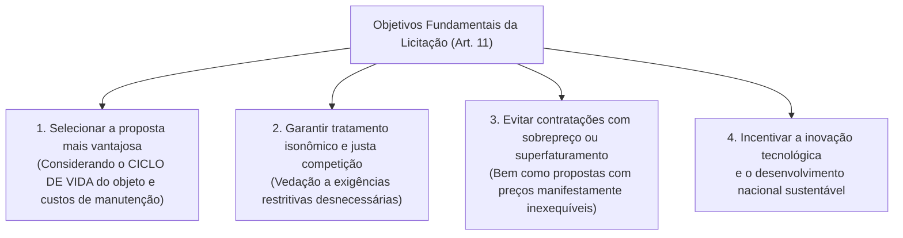
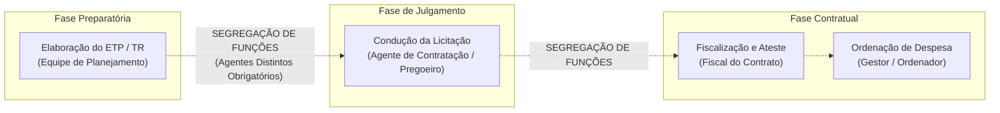
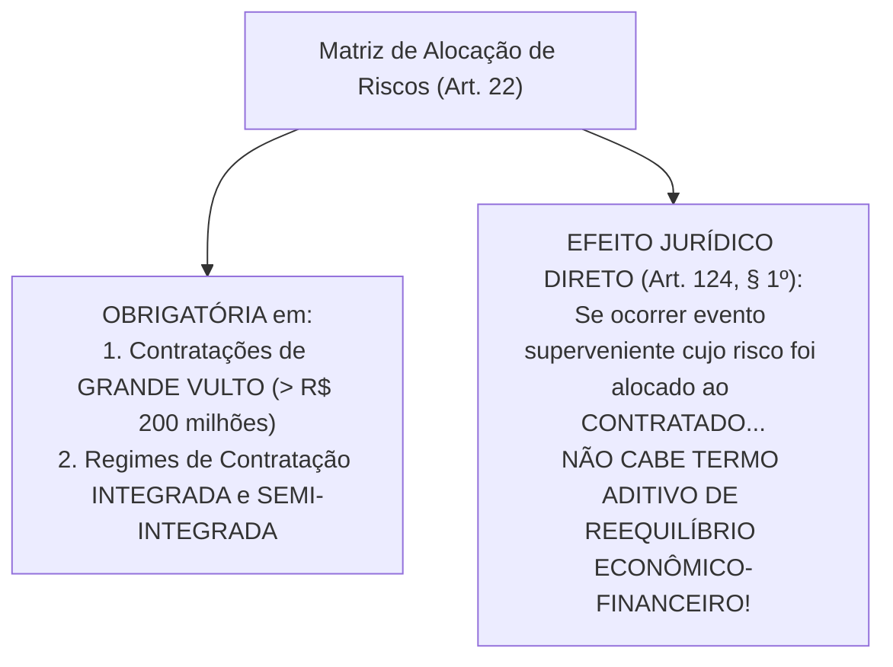

# 01 - Governança, Planejamento da Contratação, ETP, TR e Matriz de Riscos (Lei 14.133/2021)

> **Matéria:** Licitações e Contratos Administrativos  
> **Cargo:** A01 – Técnico de Controle Externo – Especialidade: Técnico Administrativo  
> **Arquivo:** `01_governanca_planejamento_etp_tr_e_matriz_riscos.md`  

---

## 📌 Ementa / Itens do Edital
- Princípios gerais e regime da Lei Federal nº 14.133/2021 (Nova Lei de Licitações e Contratos Administrativos - NLLC)
- Governança das contratações públicas e gestão por competências
- Agentes públicos na licitação: Agente de Contratação, Pregoeiro, Equipe de Apoio e Comissão de Contratação
- Princípio da Segregação de Funções e vedação de conflito de interesses
- Planejamento das contratações públicas: Plano de Contratações Anual (PCA)
- Estudo Técnico Preliminar (ETP): conceito, conteúdo obrigatório e facultativo
- Termo de Referência (TR), Projeto Básico e Projeto Executivo
- Matriz de Alocação de Riscos: conceito, finalidade e equilíbrio econômico-financeiro originário
- Portal Nacional de Contratações Públicas (PNCP): natureza, atribuições e publicidade centralizada

---

## 🧭 Sumário

1. [Princípios Gerais e Regime da Lei Federal nº 14.133/2021 (NLLC)](#1-principios-gerais-e-regime-da-lei-federal-no-141332021-nllc)
    1. [Âmbito de Aplicação Subjetivo e Objetos Abrangidos](#11-ambito-de-aplicacao-subjetivo-e-objetos-abrangidos)
    2. [Os Objetivos Fundamentais do Processo Licitatório (Art. 11)](#12-os-objetivos-fundamentais-do-processo-licitatorio-art-11)
    3. [Governança das Contratações e Gestão por Competências](#13-governanca-das-contratacoes-e-gestao-por-competencias)
    4. [Teste 066](#Teste-066)
    5. [Teste 067](#Teste-067)
2. [Agentes Públicos da Contratação e Segregação de Funções](#2-agentes-publicos-da-contratacao-e-segregacao-de-funcoes)
    1. [O Agente de Contratação e o Pregoeiro](#21-o-agente-de-contratacao-e-o-pregoeiro)
    2. [Comissão de Contratação e a Regra do Diálogo Competitivo](#22-comissao-de-contratacao-e-a-regra-do-dialogo-competitivo)
    3. [O Princípio da Segregação de Funções e Conflito de Interesses](#23-o-principio-da-segregacao-de-funcoes-e-conflito-de-interesses)
    4. [Defesa Jurídica Institucional dos Agentes (Art. 10)](#24-defesa-juridica-institucional-dos-agentes-art-10)
    5. [Teste 068](#Teste-068)
    6. [Teste 069](#Teste-069)
    7. [Teste 070](#Teste-070)
    8. [Teste 071](#Teste-071)
3. [Planejamento das Contratações e Instrumentos Preparatórios](#3-planejamento-das-contratacoes-e-instrumentos-preparatorios)
    1. [Plano de Contratações Anual (PCA) e Integração Orçamentária](#31-plano-de-contratacoes-anual-pca-e-integracao-orcamentaria)
    2. [Estudo Técnico Preliminar (ETP): Conceito e Elementos Obrigatórios](#32-estudo-tecnico-preliminar-etp-conceito-e-elementos-obrigatorios)
    3. [Termo de Referência vs. Projeto Básico e Projeto Executivo](#33-termo-de-referencia-vs-projeto-basico-e-projeto-executivo)
    4. [Matriz de Alocação de Riscos e Equilíbrio Econômico-Financeiro](#34-matriz-de-alocacao-de-riscos-e-equilibrio-economico-financeiro)
    5. [Teste 072](#Teste-072)
    6. [Teste 073](#Teste-073)
    7. [Teste 074](#Teste-074)
    8. [Teste 075](#Teste-075)
4. [O Portal Nacional de Contratações Públicas (PNCP)](#4-o-portal-nacional-de-contratacoes-publicas-pncp)
    1. [Natureza e Atribuições Centrais do Portal](#41-natureza-e-atribuicoes-centrais-do-portal)
    2. [A Divulgação no PNCP como Requisito Indispensável de Eficácia (Art. 94)](#42-a-divulgacao-no-pncp-como-requisito-indispensavel-de-eficacia-art-94)
    3. [Teste 076](#Teste-076)
5. [Fontes Recomendadas na Internet](#5-fontes-recomendadas-na-internet)

---

## 1. Princípios Gerais e Regime da Lei Federal nº 14.133/2021 (NLLC)

A **Lei Federal nº 14.133/2021** (Nova Lei de Licitações e Contratos Administrativos - NLLC) consolidou o regime jurídico das compras públicas no Brasil, revogando expressamente a Lei nº 8.666/1993, a Lei do Pregão (Lei nº 10.520/2002) e o Regime Diferenciado de Contratações Públicas (RDC - Lei nº 12.462/2011).

### 1.1 Âmbito de Aplicação Subjetivo e Objetos Abrangidos

- **Entes Abrangidos (Art. 1º):** Submetem-se aos seus comandos a Administração Pública direta, autárquica e fundacional de todos os entes federados (União, Estados, Distrito Federal e Municípios), abrangendo os Poderes Executivo, Legislativo e Judiciário, além do Tribunal de Contas e do Ministério Público no exercício de suas funções administrativas atípicas.
- **Ressalva das Empresas Estatais:** As empresas públicas e as sociedades de economia mista continuam submetidas ao seu regime licitatório e contratual próprio preconizado pela **Lei Federal nº 13.303/2016**, aplicando-se-lhes a NLLC apenas no capítulo referente aos crimes em licitações e contratos (arts. 337-E a 337-P do Código Penal, inseridos pelo art. 178 da Lei 14.133/2021).
- **Princípios Expressos (Art. 5º):** Legalidade, impessoalidade, moralidade, publicidade, eficiência, interesse público, probidade administrativa, igualdade, planejamento, transparência, eficácia, segregação de funções, motivação, vinculação ao edital, julgamento objetivo, segurança jurídica, razoabilidade, proporcionalidade, celeridade, economicidade e desenvolvimento nacional sustentável.

### 1.2 Os Objetivos Fundamentais do Processo Licitatório (Art. 11)

A NLLC inovou ao estruturar quatro objetivos finalísticos obrigatórios a serem perseguidos pela Administração:

### 1.3 Governança das Contratações e Gestão por Competências

A NLLC elevou a governança ao patamar de exigência legal expressa (art. 11, parágrafo único):

- A alta administração do órgão ou entidade é responsável pela implementação e fiscalização contínua de mecanismos de liderança, estratégia e controle;
- Exige **gestão por competências**, determinando que os agentes públicos designados para atuar na área de licitações possuam formação compatível ou qualificação atestada por certificação profissional emitida por escola de governo.

---

### Teste 066
**(FGV – TRT – Analista Judiciário - Tecnologia da Informação – 2024)**
Quanto ao plano de custeio atuarial e sua viabilidade, é incorreto 
afirmar que

* **A)** a viabilidade orçamentária de um plano de previdência é 
avaliada considerando a capacidade do plano de arrecadar 
contribuições suficientes, obter retornos de investimentos 
adequados e manter um equilíbrio atuarial que garanta o 
pagamento dos benefícios prometidos, assegurando a 
solvência e a sustentabilidade financeira a longo prazo.
* **B)** o custo normal em um plano refere -se às contribuições 
necessárias para financiar os benefícios futuros acumulados 
durante o período de serviço corrente dos participantes, 
garantindo que as reservas sejam suficientes para cobrir 
essas obrigações ao longo do tempo.
* **C)** o custo suplementar em um plano é necessário quando 
existem déficits atuariais, exigindo contribuições adicionais 
para garantir a solvência e o equilíbrio financeiro, e 
assegurando que os benefícios prometidos possam ser pagos.
* **D)** o plano de equacionamento do déficit atuarial é desenvolvido 
para estabelecer medidas específicas para corrigir déficits 
identificados em um plano de previdência, incluindo ajustes 
nas contribuições, mudanças nas premissas atuariais ou 
modificações nos benefícios, assegurando a solvência e a 
sustentabilidade do plano a longo prazo.
* **E)** o plano de equacionamento do déficit atuarial deve garantir 
não somente a solvência do plano, mas também preservar a 
viabilidade financeira, fiscal e orçamentária do ente público 
federativo patrocinador.

---

> **Comentário Detalhado:**
>
> - **A)** Correta. Representa com precisão a disciplina do tema e o entendimento pacificado adotado pela banca (FGV).
> - **B)** Incorreta. Discrepa das diretrizes normativas e jurisprudenciais aplicáveis ao tema objeto do item.
> - **C)** Incorreta. Discrepa das diretrizes normativas e jurisprudenciais aplicáveis ao tema objeto do item.
> - **D)** Incorreta. Discrepa das diretrizes normativas e jurisprudenciais aplicáveis ao tema objeto do item.
> - **E)** Incorreta. Discrepa das diretrizes normativas e jurisprudenciais aplicáveis ao tema objeto do item.
>
> **Gabarito: A**

---
### Teste 067
**(FGV – TCE-PA – Auditor de Controle Externo - Tecnologia da Informação – 2024)**
No exercício de suas atribuições como auditor de controle 
externo do Tribunal de Contas do Estado do Pará, para fins de 
elaboração de certos contratos administrativos, Ednardo foi 
instado a se manifestar acerca da existência de discricionariedade 
quanto à previsão de matriz de alocação de riscos entre 
contratante e contratado nos respectivos editais. 
Nesse contexto, diante do disposto na Lei nº 14.133/2021, 
Ednardo respondeu corretamente que

* **A)** a previsão de matriz de risco submete -se à discricionariedade 
da Administração em qualquer contrato, independente do 
objeto ou do regime de execução.
* **B)** há discricionariedade quanto à previsão de matriz de risco 
nos contratos de fornecimento, nas locações e nos contratos 
de obra, ainda que sejam realizados pelo regime da 
contratação semi-integrada.
* **C)** nos contratos de grande vulto, além de outras hipóteses 
especificadas na lei de regência, notadamente quanto ao 
regime de execução, não há discricionariedade com relação à 
previsão de matriz de risco.
* **D)** nas hipóteses de contratação pelos regimes de empreitada 
integral e empreitada por preço global não há 
discricionariedade da Administração acerca da previsão de 
matriz de risco.
* **E)** dentre os regimes de execução indireta previstos na norma 
de regência, não há discricionariedade da Administração 
quanto à previsão de matriz de risco apenas em relação ao da 
contratação integrada. 

Controle Externo

---

> **Comentário Detalhado:**
>
> - **A)** Incorreta. Discrepa das diretrizes normativas e jurisprudenciais aplicáveis ao tema objeto do item.
> - **B)** Incorreta. Discrepa das diretrizes normativas e jurisprudenciais aplicáveis ao tema objeto do item.
> - **C)** Correta. Representa com precisão a disciplina do tema e o entendimento pacificado adotado pela banca (FGV).
> - **D)** Incorreta. Discrepa das diretrizes normativas e jurisprudenciais aplicáveis ao tema objeto do item.
> - **E)** Incorreta. Discrepa das diretrizes normativas e jurisprudenciais aplicáveis ao tema objeto do item.
>
> **Gabarito: C**

---
## 2. Agentes Públicos da Contratação e Segregação de Funções

### 2.1 O Agente de Contratação e o Pregoeiro

O **Agente de Contratação** (art. 8º) é a pessoa física designada pela autoridade competente para tomar decisões, acompanhar o trâmite da licitação, dar impulso ao procedimento e executar quaisquer outras atividades necessárias ao bom andamento do certame até a homologação.

- **Requisito Obrigatório de Investidura:** Deve ser, preferencialmente, **servidor efetivo ou empregado público dos quadros permanentes** da Administração Pública.  
  > 🚨 **ALERTA CRÍTICO FCC:** É vedada a designação exclusiva de cidadão ocupante de cargo em comissão sem vínculo efetivo com o ente federado para atuar como Agente de Contratação!
- **Responsabilidade Individual:** Responde **individualmente** pelos atos que praticar na condução do procedimento, salvo quando for induzido a erro pela atuação de sua equipe de apoio ou comissão.
- **Pregoeiro:** É a denominação atribuída ao agente de contratação quando a licitação for processada na modalidade **Pregão** (art. 8º, § 5º).

### 2.2 Comissão de Contratação e a Regra do Diálogo Competitivo

A condução por comissão colegiada constitui exceção à regra geral do agente individual:

- **Composição da Comissão:** Composta por, no mínimo, **3 (três) membros**, sendo a maioria servidores efetivos ou empregados públicos permanentes. Os membros respondem solidariamente por todos os atos, ressalvado o membro que manifestar voto divergente registrado expressamente em ata (art. 8º, § 1º).
- **Hipóteses de Atuação:** Bens e serviços especiais; procedimentos auxiliares; e obrigatoriamente no **Diálogo Competitivo**.

> 💡 **Regra Canônica FCC:**  
> Na modalidade **Diálogo Competitivo**, a condução por **comissão de contratação de no mínimo 3 servidores efetivos** é **OBRIGATÓRIA** por expressa exigência do art. 32, inciso XI, da Lei nº 14.133/2021. Jamais pode ser conduzida por agente monocrático isolado!

### 2.3 O Princípio da Segregação de Funções e Conflito de Interesses

Positivado formalmente no art. 5º e detalhado no art. 7º, § 1º, da NLLC:

- **Conceito:** Impõe a repartição criteriosa de funções entre agentes públicos distintos, vedando expressamente a concentração de atribuições mais suscetíveis a riscos em uma mesma autoridade;
- **Aplicação Prática Inegociável:**
    1. O agente que elabora o Estudo Técnico Preliminar e o Termo de Referência (fase interna) **não deve conduzir o julgamento das propostas** como agente de contratação (fase externa);
    2. O agente que julga e adjudica a licitação **não pode atuar como fiscal ou gestor do contrato**, nem ser o responsável por atestar faturas e autorizar pagamentos financeiros.

### 2.4 Defesa Jurídica Institucional dos Agentes (Art. 10)

Se o agente público for demandado nas esferas judicial ou controladora (perante o Tribunal de Contas) em virtude de atos praticados em estrito cumprimento do dever legal na licitação, **terá direito à representação judicial pela Advocacia Pública** (Procuradoria do Estado), desde que sua conduta tenha sido previamente respaldada por parecer jurídico da assessoria do órgão.

---

### Teste 068
**(FGV – TCE-PA – Auditor de Controle Externo - Tecnologia da Informação – 2024)**
No exercício de suas atribuições como auditor de controle 
externo do Tribunal de Contas do Estado do Pará, para fins de 
elaboração de certos contratos administrativos, Ednardo foi 
instado a se manifestar acerca da existência de discricionariedade 
quanto à previsão de matriz de alocação de riscos entre 
contratante e contratado nos respectivos editais. 
Nesse contexto, diante do disposto na Lei nº 14.133/2021, 
Ednardo respondeu corretamente que

* **A)** a previsão de matriz de risco submete -se à discricionariedade 
da Administração em qualquer contrato, independente do 
objeto ou do regime de execução.
* **B)** há discricionariedade quanto à previsão de matriz de risco 
nos contratos de fornecimento, nas locações e nos contratos 
de obra, ainda que sejam realizados pelo regime da 
contratação semi-integrada.
* **C)** nos contratos de grande vulto, além de outras hipóteses 
especificadas na lei de regência, notadamente quanto ao 
regime de execução, não há discricionariedade com relação à 
previsão de matriz de risco.
* **D)** nas hipóteses de contratação pelos regimes de empreitada 
integral e empreitada por preço global não há 
discricionariedade da Administração acerca da previsão de 
matriz de risco.
* **E)** dentre os regimes de execução indireta previstos na norma 
de regência, não há discricionariedade da Administração 
quanto à previsão de matriz de risco apenas em relação ao da 
contratação integrada. 

Controle Externo

---

> **Comentário Detalhado:**
>
> - **A)** Incorreta. Discrepa das diretrizes normativas e jurisprudenciais aplicáveis ao tema objeto do item.
> - **B)** Incorreta. Discrepa das diretrizes normativas e jurisprudenciais aplicáveis ao tema objeto do item.
> - **C)** Correta. Representa com precisão a disciplina do tema e o entendimento pacificado adotado pela banca (FGV).
> - **D)** Incorreta. Discrepa das diretrizes normativas e jurisprudenciais aplicáveis ao tema objeto do item.
> - **E)** Incorreta. Discrepa das diretrizes normativas e jurisprudenciais aplicáveis ao tema objeto do item.
>
> **Gabarito: C**

---
### Teste 069
**(FGV – TRT – Analista Judiciário - Tecnologia da Informação – 2024)**
Para o licenciamento ambiental de uma obra, dois documentos 
que são produzidos: o EIA e o RIMA. 
A principal diferença entre eles é que

* **A)** o EIA se destina a obras de grande porte, enquanto o RIMA se 
destina a obras de grande porte.
* **B)** o EIA deve ser elaborado antes da execução da obra, 
enquanto o RIMA é elaborado após a conclusão da obra.
* **C)** o EIA é mais técnico e complexo, enquanto o RIMA é mais 
conciso e com linguajar mais adequado ao público geral.
* **D)** o EIA é elaborado por especialistas em meio ambiente, 
enquanto o RIMA é realizado por especialistas em engenharia 
civil.
* **E)** o EIA aborda os aspectos mais gerais de uma obra, enquanto 
o RIMA aborda aspectos mais específicos e que necessitam 
um melhor detalhamento.

---

> **Comentário Detalhado:**
>
> - **A)** Incorreta. Discrepa das diretrizes normativas e jurisprudenciais aplicáveis ao tema objeto do item.
> - **B)** Incorreta. Discrepa das diretrizes normativas e jurisprudenciais aplicáveis ao tema objeto do item.
> - **C)** Correta. Representa com precisão a disciplina do tema e o entendimento pacificado adotado pela banca (FGV).
> - **D)** Incorreta. Discrepa das diretrizes normativas e jurisprudenciais aplicáveis ao tema objeto do item.
> - **E)** Incorreta. Discrepa das diretrizes normativas e jurisprudenciais aplicáveis ao tema objeto do item.
>
> **Gabarito: C**

---
### Teste 070
**(FGV – TRT-DA 13-REGIÃO – Analista Judiciário - Tecnologia da Informação – 2022)**
Considere como verdadeiras as seguintes sentenças: 
 Se Gerson não é torcedor do Botafogo, então Luiz é torcedor 
do Treze. 
 Se Luiz é torcedor do Treze, então Débora não é torcedora do 
Campinense. 
 Se Débora não é torcedora do Campinense, então Lúcia é 
torcedora do Botafogo. 
 Lúcia não é torcedora do Botafogo. 
É correto concluir que

* **A)** Luiz é torcedor do Treze.
* **B)** Gerson é torcedor do Botafogo.
* **C)** Luiz não é torcedor do Botafogo.
* **D)** Débora é torcedora do Campinense.
* **E)** Lúcia é torcedora do Treze. 

Atualidades

---

> **Comentário Detalhado:**
>
> - **A)** Incorreta. Discrepa das diretrizes normativas e jurisprudenciais aplicáveis ao tema objeto do item.
> - **B)** Correta. Representa com precisão a disciplina do tema e o entendimento pacificado adotado pela banca (FGV).
> - **C)** Incorreta. Discrepa das diretrizes normativas e jurisprudenciais aplicáveis ao tema objeto do item.
> - **D)** Incorreta. Discrepa das diretrizes normativas e jurisprudenciais aplicáveis ao tema objeto do item.
> - **E)** Incorreta. Discrepa das diretrizes normativas e jurisprudenciais aplicáveis ao tema objeto do item.
>
> **Gabarito: B**

---
### Teste 071
**(FCC – TRT-2 – Analista Judiciário - Tecnologia da Informação – 2014)**
Durante procedimento licitatório, na fase de homologação,  o Poder Público apercebeu-se que a execução do serviço objeto da 
licitação não mais atendia ao interesse público que motivou a abertura do certame, em razão de situação incontornável, 
decorrente de fato superveniente à sua instauração, devidamente comprovado. Nessa condição, a autoridade competente 
superior, após receber o processo de licitação, deve

* **A)** revogar a licitação, por ato devidamente motivado, assegurando-se aos interessados o contraditório e a ampla defesa.
* **B)** anular o procedimento por razão de interesse público, não havendo obrigação de indenização, porque os licitantes não têm 
direito subjetivo à contratação.
* **C)** homologar o ato de resultado final da Comissão de Licitação, confirmando a validade do certame e adjudicando o objeto da 
licitação ao vencedor do certame, que tem direito subjetivo à contratação.
* **D)** anular o procedimento por razões de ordem administrativa, ficando a Administração obrigada a indenizar os participantes 
da licitação.
* **E)** revogar a licitação, por motivo de legalidade, não havendo obrigação legal de assegurar o contraditório e a ampla defesa, 
porque os licitantes não têm direito subjetivo à contratação.

---

> **Comentário Detalhado:**
>
> - **A)** Incorreta. Discrepa das diretrizes normativas e jurisprudenciais aplicáveis ao tema objeto do item.
> - **B)** Incorreta. Discrepa das diretrizes normativas e jurisprudenciais aplicáveis ao tema objeto do item.
> - **C)** Incorreta. Discrepa das diretrizes normativas e jurisprudenciais aplicáveis ao tema objeto do item.
> - **D)** Incorreta. Discrepa das diretrizes normativas e jurisprudenciais aplicáveis ao tema objeto do item.
> - **E)** Correta. Representa com precisão a disciplina do tema e o entendimento pacificado adotado pela banca (FCC).
>
> **Gabarito: E**

---
## 3. Planejamento das Contratações e Instrumentos Preparatórios

A Lei nº 14.133/2021 consagrou a centralidade da **fase preparatória**, superando a cultura de contratações improvisadas.

### 3.1 Plano de Contratações Anual (PCA) e Integração Orçamentária

- O art. 12, VII, preconiza a elaboração do **Plano de Contratações Anual (PCA)**, instrumento de governança que consolida todas as compras e contratações que o órgão pretende realizar no exercício financeiro subsequente.
- Seu objetivo primordial é racionalizar as compras públicas, viabilizar o ganho de escala e garantir a perfeita compatibilização das despesas com as metas do Plano Plurianual (PPA), da Lei de Diretrizes Orçamentárias (LDO) e da Lei Orçamentária Anual (LOA).

### 3.2 Estudo Técnico Preliminar (ETP): Conceito e Elementos Obrigatórios

O **Estudo Técnico Preliminar (ETP)** é o documento constitutivo da primeira etapa do planejamento de uma contratação. Ele evidencia o problema público a ser resolvido e avalia comparativamente as alternativas viáveis disponíveis no mercado para eleger a solução mais eficiente (art. 18).

#### Os 5 Elementos Obrigatórios do ETP (Art. 18, § 2º):
Embora o ETP contenha treze itens descritivos em seu roteiro geral, a NLLC fixou **cinco elementos com preenchimento obrigatório indispensável**:

1. Descrição da **necessidade da contratação**;
2. **Estimativa das quantidades** a serem contratadas, acompanhada de memória de cálculo detalhada;
3. **Estimativa do valor da contratação**, amparada em pesquisa prévia de preços;
4. **Justificativa para o parcelamento ou não** da solução de mercado;
5. **Posicionamento conclusivo** sobre a adequação da contratação para o atendimento da necessidade pública.

### 3.3 Termo de Referência vs. Projeto Básico e Projeto Executivo

- **Termo de Referência (TR - Art. 6º, XXIII):** Documento elaborado para a contratação de **bens e serviços em geral**, contendo os elementos técnicos necessários para caracterizar o objeto de forma clara, o modelo de execução, os critérios de medição e pagamento e os parâmetros de aceitabilidade das propostas.
- **Projeto Básico (Art. 6º, XXV):** Documento elaborado para **obras e serviços de engenharia**, contendo elementos técnicos precisos e consolidados que permitam a perfeita identificação do empreendimento e a estimativa de custos de cada etapa construtiva.
- **Projeto Executivo (Art. 6º, XXVI):** Conjunto dos elementos detalhados necessários e suficientes para a execução completa da obra civil.

### 3.4 Matriz de Alocação de Riscos e Equilíbrio Econômico-Financeiro

A **Matriz de Alocação de Riscos** (art. 6º, XXVII e art. 22) é a cláusula contratual que promove a divisão objetiva e contratual de encargos financeiros e riscos supervenientes entre a Administração Pública e o contratado.

- **Obrigatoriedade:** É obrigatória nas contratações de **grande vulto** (valor que ultrapassa R$ 200.000.000,00) e nos regimes de contratação integrada e semi-integrada.
- **Vedação ao Reequilíbrio Econômico-Financeiro (Art. 124, § 1º):** Se determinado evento imprevisível ou oscilação de mercado ocorrer, mas sua responsabilidade financeira tiver sido previamente alocada à contratada na matriz de riscos, **a empresa NÃO tem direito a aditivo de reequilíbrio econômico-financeiro**. O risco já foi precificado e assumido pela empresa em sua proposta licitatória originária.

---

### Teste 072
**(FGV – TRT-13 – Analista Judiciário - Tecnologia da Informação – 2022)**
Considere como verdadeiras as seguintes sentenças: 
 Se Gerson não é torcedor do Botafogo, então Luiz é torcedor 
do Treze. 
 Se Luiz é torcedor do Treze, então Débora não é torcedora do 
Campinense. 
 Se Débora não é torcedora do Campinense, então Lúcia é 
torcedora do Botafogo. 
 Lúcia não é torcedora do Botafogo. 
É correto concluir que

* **A)** Luiz é torcedor do Treze.
* **B)** Gerson é torcedor do Botafogo.
* **C)** Luiz não é torcedor do Botafogo.
* **D)** Débora é torcedora do Campinense.
* **E)** Lúcia é torcedora do Treze. 

Atualidades

---

> **Comentário Detalhado:**
>
> - **A)** Incorreta. Discrepa das diretrizes normativas e jurisprudenciais aplicáveis ao tema objeto do item.
> - **B)** Correta. Representa com precisão a disciplina do tema e o entendimento pacificado adotado pela banca (FGV).
> - **C)** Incorreta. Discrepa das diretrizes normativas e jurisprudenciais aplicáveis ao tema objeto do item.
> - **D)** Incorreta. Discrepa das diretrizes normativas e jurisprudenciais aplicáveis ao tema objeto do item.
> - **E)** Incorreta. Discrepa das diretrizes normativas e jurisprudenciais aplicáveis ao tema objeto do item.
>
> **Gabarito: B**

---
### Teste 073
**(FGV – TRF-1 – Analista Judiciário - Tecnologia da Informação – 2024)**
O TRF1 iniciou o planejamento da contratação para o 
desenvolvimento de uma nova solução tecnológica.  
A equipe de planejamento da contratação registrou, no estudo 
técnico preliminar, que a solução está aderente aos requisitos 
técnicos da plataforma digital do Poder Judiciário brasileiro 
(PDPJ-Br). 
Considerando a política pública para a governança e gestão do 
processo judicial eletrônico, a contratação da solução 
tecnológicas será proibida se:

* **A)** atender a peculiaridades regionais do Tribunal;
* **B)** causar redução dos custos com ações isoladas;
* **C)** causar dependência tecnológica do fornecedor;
* **D)** permitir o compartilhamento da solução na PDPJ-Br;
* **E)** permitir a coexistência com outras soluções da PDPJ-Br.

---

> **Comentário Detalhado:**
>
> - **A)** Incorreta. Discrepa das diretrizes normativas e jurisprudenciais aplicáveis ao tema objeto do item.
> - **B)** Incorreta. Discrepa das diretrizes normativas e jurisprudenciais aplicáveis ao tema objeto do item.
> - **C)** Correta. Representa com precisão a disciplina do tema e o entendimento pacificado adotado pela banca (FGV).
> - **D)** Incorreta. Discrepa das diretrizes normativas e jurisprudenciais aplicáveis ao tema objeto do item.
> - **E)** Incorreta. Discrepa das diretrizes normativas e jurisprudenciais aplicáveis ao tema objeto do item.
>
> **Gabarito: C**

---
### Teste 074
**(FGV – TRF-1 – Analista Judiciário - Tecnologia da Informação – 2024)**
Para além dos p rincípios previstos expressamente no Art. 37, 
caput, da CRFB/1988, as normas que versam sobre direito 
administrativo costumam elencar outros princípios relacionados 
às respectivas matérias (setoriais), tal como se observa no Art. 2º 
da Lei nº 9.784/1999, q ue trata do processo administrativo, e no 
Art. 5º da Lei nº 14.133/2021, que trata de licitações e contratos. 
Nesse contexto, os princípios que NÃO estão no aludido 
dispositivo constitucional, mas que constam textualmente das 
referidas normas, são, respectivamente:

* **A)** impessoalidade e vinculação ao edital;
* **B)** segregação de funções e moralidade;
* **C)** motivação e publicidade;
* **D)** proporcionalidade e planejamento;
* **E)** probidade administrativa e eficiência. 

Noções de Direito Constitucional

---

> **Comentário Detalhado:**
>
> - **A)** Incorreta. Discrepa das diretrizes normativas e jurisprudenciais aplicáveis ao tema objeto do item.
> - **B)** Incorreta. Discrepa das diretrizes normativas e jurisprudenciais aplicáveis ao tema objeto do item.
> - **C)** Correta. Representa com precisão a disciplina do tema e o entendimento pacificado adotado pela banca (FGV).
> - **D)** Incorreta. Discrepa das diretrizes normativas e jurisprudenciais aplicáveis ao tema objeto do item.
> - **E)** Incorreta. Discrepa das diretrizes normativas e jurisprudenciais aplicáveis ao tema objeto do item.
>
> **Gabarito: C**

---
### Teste 075
**(FCC – TRT – Analista Judiciário - Tecnologia da Informação – 2009)**
O conceito de serviço de atendimento a usuários costu-
mava se referir a uma orientação do bibliotecário para o 
usuário realizar uma pesquisa e localizar um item no 
espaço da biblioteca. Hoje conhecido como serviço de 
referência e informação, esse conceito evoluiu para a 
visão cuja essência está em

* **A)** acompanhar o usuário durante todo o processo de 
busca de informação.
* **B)** auxiliar leitores no momento da utilização de docu-
mentos com a finalidade de estudo e pesquisa.
* **C)** responder perguntas e orientar o consulente no uso 
das obras de referência.
* **D)** mostrar boa vontade para prestar qualquer serviço, 
criando um ambiente amistoso no qual o leitor se 
sinta à vontade.
* **E)** ligar pessoas com uma necessidade de informação 
a um serviço capacitado para satisfazer essa 
necessidade. 
_________________________________________________________

---

> **Comentário Detalhado:**
>
> - **A)** Incorreta. Discrepa das diretrizes normativas e jurisprudenciais aplicáveis ao tema objeto do item.
> - **B)** Incorreta. Discrepa das diretrizes normativas e jurisprudenciais aplicáveis ao tema objeto do item.
> - **C)** Correta. Representa com precisão a disciplina do tema e o entendimento pacificado adotado pela banca (FCC).
> - **D)** Incorreta. Discrepa das diretrizes normativas e jurisprudenciais aplicáveis ao tema objeto do item.
> - **E)** Incorreta. Discrepa das diretrizes normativas e jurisprudenciais aplicáveis ao tema objeto do item.
>
> **Gabarito: C**

---
## 4. O Portal Nacional de Contratações Públicas (PNCP)

### 4.1 Natureza e Atribuições Centrais do Portal

O **Portal Nacional de Contratações Públicas (PNCP)**, disciplinado pelos arts. 174 a 176 da Lei nº 14.133/2021, é o sítio eletrônico oficial único de divulgação de compras públicas gerido pelo Comitê Gestor da Rede Nacional de Contratações Públicas.

- Suas atribuições envolvem centralizar a publicação de editais, atas de registro de preços, planos anuais de contratações, catálogos eletrônicos de padronização e o cadastro unificado de fornecedores impedidos e inidôneos.

### 4.2 A Divulgação no PNCP como Requisito Indispensável de Eficácia (Art. 94)

> *"Art. 94. A divulgação no Portal Nacional de Contratações Públicas (PNCP) é **condição indispensável para a eficácia do contrato e de seus aditamentos** e deverá ocorrer nos seguintes prazos, contados da data de sua assinatura:*  
> *I - 20 (vinte) dias úteis, no caso de licitação;*  
> *II - 10 (dez) dias úteis, no caso de contratação direta."*

> 🚨 **ALERTA DE PROVA FCC:**  
> A publicação no Diário Oficial e em jornais de grande circulação não substitui a divulgação no PNCP. Sem a veiculação tempestiva no PNCP, o contrato administrativo é considerado inoperante, **carecendo de eficácia jurídica** para produzir obrigações e autorizar pagamentos com recursos públicos.

---

### Teste 076
**(FGV – TRT – Analista Judiciário - Tecnologia da Informação – 2024)**
De acordo com o Pronunciamento Técnico CPC 00 (R2) - Estrutura 
Conceitual para Relatório Financeiro, a Estrutura Conceitual 
estabelece a base para pronunciamentos que contribuem para a 
eficiência econômica, ajudando os investidores a

* **A)** conhecer talentos globalmente, aprimorando a qualidade de 
mão de obra.
* **B)** identificar oportunidades e riscos em todo o mundo, 
melhorando a alocação de capital.
* **C)** aumentar o conhecimento em relação a seus investimentos, 
diminuindo o risco de oportunidade.
* **D)** receber informações e relatórios com maior velocidade, 
aumentando a agilidade em suas escolhas.
* **E)** melhorar a comunicação com as suas investidas, 
desenvolvendo um relacionamento mais vantajoso.

---

> **Comentário Detalhado:**
>
> - **A)** Incorreta. Discrepa das diretrizes normativas e jurisprudenciais aplicáveis ao tema objeto do item.
> - **B)** Incorreta. Discrepa das diretrizes normativas e jurisprudenciais aplicáveis ao tema objeto do item.
> - **C)** Incorreta. Discrepa das diretrizes normativas e jurisprudenciais aplicáveis ao tema objeto do item.
> - **D)** Incorreta. Discrepa das diretrizes normativas e jurisprudenciais aplicáveis ao tema objeto do item.
> - **E)** Correta. Representa com precisão a disciplina do tema e o entendimento pacificado adotado pela banca (FGV).
>
> **Gabarito: E**

---
## 5. Fontes Recomendadas na Internet

- [Lei Federal nº 14.133/2021 - Arts. 1º a 27 e 174 a 176 (Governança, Planejamento e PNCP)](https://www.planalto.gov.br/ccivil_03/_ato2019-2022/2021/lei/l14133.htm#art1)  
  Texto legal nacional que rege os princípios da licitação, agentes de contratação, segregação de funções, ETP, matriz de riscos e o PNCP.
- [Lei Federal nº 14.133/2021 - Art. 94 (Divulgação Obrigatória no PNCP como Condição de Eficácia)](https://www.planalto.gov.br/ccivil_03/_ato2019-2022/2021/lei/l14133.htm#art94)  
  Dispositivo que fixa os prazos de 20 e 10 dias úteis para divulgação de contratos e aditamentos no Portal Nacional de Contratações Públicas.
- [Decreto Federal nº 10.947/2022 (Regulamento do Plano de Contratações Anual - PCA)](https://www.planalto.gov.br/ccivil_03/_ato2019-2022/2022/decreto/D10947.htm)  
  Normas de elaboração do calendário anual de contratações integradas ao planejamento estratégico e às leis orçamentárias.
- [Compras.gov.br - Instruções Normativas SEGES sobre a Fase Preparatória e ETP (Lei 14.133/2021)](https://www.gov.br/compras/pt-br/acesso-a-informacao/legislacao/instrucoes-normativas)  
  Repositório normativo oficial das Instruções Normativas federais sobre pesquisa de preços, Estudo Técnico Preliminar (ETP) e Termo de Referência (TR).
- [Constituição Federal de 1988 - Art. 37, XXI (Obrigatoriedade Constitucional de Licitar)](https://www.planalto.gov.br/ccivil_03/constituicao/constituicao.htm#art37)  
  Matriz constitucional do dever de licitar, da isonomia entre concorrentes e da manutenção das condições efetivas da proposta.
* JUSTEN FILHO, Marçal. **Comentários à Lei de Licitações e Contratações Administrativas: Lei 14.133/2021**. 2. ed. São Paulo: Thomson Reuters Brasil, 2023. (Comentários aos arts. 5º a 27 - Governança, Agentes de Contratação, Segregação de Funções e Fase Preparatória).
* DI PIETRO, Maria Sylvia Zanella. **Direito Administrativo**. 37. ed. Rio de Janeiro: Forense, 2024. (Cap. 9 - Licitação Pública: Princípios, Governança, ETP, Termo de Referência e Matriz de Riscos).
* NIEBUHR, Joel de Menezes. **Licitação Pública e Contrato Administrativo**. 6. ed. Belo Horizonte: Fórum, 2023. (Cap. 4 e Cap. 5 - Planejamento da Contratação, Estudo Técnico Preliminar e PNCP).
