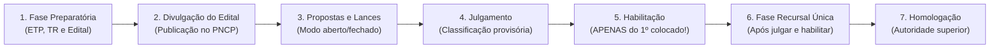
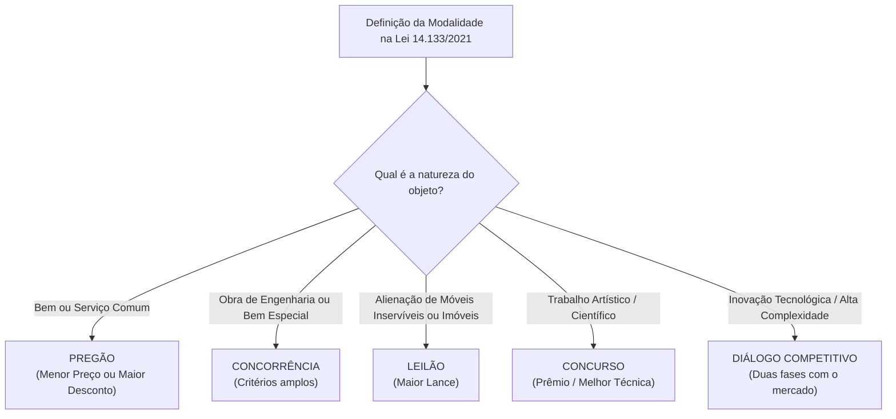

# 02 - Fases da Licitação, Modalidades e Critérios de Julgamento (Lei 14.133/2021)

> **Matéria:** Licitações e Contratos Administrativos  
> **Cargo:** A01 – Técnico de Controle Externo – Especialidade: Técnico Administrativo  
> **Arquivo:** `02_fases_modalidades_e_criterios_de_julgamento.md`  
> **Status:** 🟢 Teoria Aprofundada + 5 Questões FCC Comentadas (A a E)

---

## 📌 Ementa Oficial do Edital
- Sequência e fases do processo licitatório na Lei Federal nº 14.133/2021.
- A regra da inversão de fases (julgamento das propostas antes da habilitação) e fase recursal única.
- Modalidades de licitação: Pregão, Concorrência, Concurso, Leilão e Diálogo Competitivo.
- Extinção definitiva das modalidades Tomada de Preços e Convite.
- Diálogo Competitivo: conceito, pressupostos, rito procedimental e comissão especial.
- Critérios de julgamento das propostas: Menor Preço, Maior Desconto, Melhor Técnica ou Conteúdo Artístico, Técnica e Preço, Maior Lance e Maior Retorno Econômico.
- Modos de disputa: aberto, fechado e suas combinações.
- Prazos mínimos para apresentação de propostas e lances.

---

## 🌳 Classificação Hierárquica do Conteúdo

```text
2. Procedimento Licitatório, Novas Modalidades e Julgamento das Propostas
├── 2.1 As Fases da Licitação na Lei nº 14.133/2021 (Art. 17)
│   ├── Ordem Cronológica Canônica (Regra Geral):
│   │   ├── 1ª Fase: Preparatória (Planejamento, ETP, TR/PB, matriz de riscos, pesquisa)
│   │   ├── 2ª Fase: Divulgação do Edital de Licitação (Publicação no PNCP)
│   │   ├── 3ª Fase: Apresentação de Propostas e Lances
│   │   ├── 4ª Fase: Julgamento das Propostas (Classificação e desempate)
│   │   ├── 5ª Fase: Habilitação (Verificação documental apenas do primeiro colocado classificado)
│   │   ├── 6ª Fase: Recursal (Fase recursal ÚNICA ao final do certame)
│   │   └── 7ª Fase: Homologação e Adjudicação (Ato da autoridade competente)
│   └── Exceção de Inversão de Fases (Art. 17, § 1º): Habilitação prévia exige justificativa e edital
├── 2.2 As Cinco Modalidades Licitatórias Modernas (Art. 28)
│   ├── Pregão: Bens e serviços comuns (inclui serviços comuns de engenharia); Menor Preço ou Desconto
│   ├── Concorrência: Bens e serviços especiais, obras de engenharia; critérios amplos
│   ├── Concurso: Escolha de trabalho técnico, científico ou artístico; prêmio ou remuneração
│   ├── Leilão: Alienação de bens móveis inservíveis e QUAISQUER imóveis; Maior Lance
│   ├── Diálogo Competitivo (Art. 32): Inovação e complexidade; duas fases; comissão de 3 efetivos
│   └── Extinção Definitiva: Convite e Tomada de Preços foram formalmente eliminadas
├── 2.3 Critérios de Julgamento das Propostas (Art. 33)
│   ├── Menor Preço e Maior Desconto (Padrão para compras e pregão)
│   ├── Melhor Técnica ou Conteúdo Artístico (Concurso e projetos especiais)
│   ├── Técnica e Preço (Ponderação com limite de até 70% de peso para a técnica)
│   ├── Maior Lance (Exclusivo do Leilão)
│   └── Maior Retorno Econômico (Contratos de Eficiência com percentual de economia real gerada)
└── 2.4 Modos de Disputa e Prazos Mínimos do Edital
    ├── Modos de Disputa (Art. 56): Aberto, Fechado e combinações (Vedado fechado puro em menor preço)
    └── Prazos de Edital (Art. 55): 8 dias (bens comuns), 10 dias (serviços/obras comuns), 25/35 dias especiais
```

---

## 📖 Teoria Aprofundada e Pontos Críticos

### 1. Fases do Processo Licitatório (Art. 17 da NLLC)



#### A Lógica da Inversão de Fases e a Fase Recursal Única
- Na Lei nº 8.666/93, a regra geral era a habilitação prévia de todos os participantes, gerando morosidade extrema na conferência de dezenas de certidões de empresas que nem sequer tinham preços competitivos.
- Na **Lei nº 14.133/2021**, o julgamento dos preços antecede a habilitação:
  - Classifica-se o vencedor pelo preço/técnica.
  - O Agente de Contratação abre e confere a habilitação **exclusivamente do primeiro colocado classificado**.
  - Se o primeiro colocado for inabilitado, convoca-se o segundo colocado na ordem de classificação.
  - A **fase recursal é ÚNICA**: a manifestação de recorrer ocorre somente após a habilitação do vencedor, em peça concentrada abrangendo tanto o julgamento das propostas quanto a habilitação (art. 165).

---

### 2. Quadro Comparativo das Cinco Modalidades Licitatórias

| Modalidade | Natureza do Objeto | Critérios de Julgamento Permitidos | Condução |
|---|---|---|---|
| **Pregão** | Bens e serviços **comuns** (inclui serviços comuns de engenharia) | **Menor Preço** ou **Maior Desconto** | Pregoeiro + Equipe de Apoio |
| **Concorrência** | Bens/serviços **especiais**, Obras e Serviços de Engenharia comuns e especiais | Menor preço, Maior desconto, Melhor técnica, Técnica e preço, Maior retorno | Agente de Contratação ou Comissão |
| **Concurso** | Trabalho técnico, científico ou artístico | **Melhor técnica** ou conteúdo artístico (concessão de prêmio) | Comissão especial qualificada |
| **Leilão** | Bens móveis inservíveis e **quaisquer bens imóveis** do Poder Público | **Maior Lance** | Leiloeiro Oficial ou Servidor designado |
| **Diálogo Competitivo** | Inovação tecnológica, impossibilidade técnica de definir a solução ou alta complexidade | Menor preço, maior desconto, técnica e preço | **Comissão de no mínimo 3 servidores efetivos** |



> 🚨 **ALERTA DE PROVA / PEGADINHA FCC:**  
> **Não existem mais Tomada de Preços e Convite!** Na NLLC, as modalidades são fixadas pela **natureza do objeto**, e nunca pelo valor da contratação. Além disso, alienação de imóveis públicos agora é feita por **Leilão** (art. 28, § 2º), e não mais por Concorrência como ocorria no regime revogado da Lei 8.666/93.

---

### 3. Diálogo Competitivo em Detalhes (Art. 32)
Modalidade inspirada nas diretrizes da União Europeia para situações em que a Administração Pública não sabe exatamente qual solução tecnológica adotar:
1. **Fase 1 (Diálogos):** O edital preliminar divulga as necessidades do órgão. Os licitantes pré-selecionados participam de reuniões e rodadas de conversa com a comissão para conceber e amadurecer alternativas de solução técnica e metodológica.
2. **Fase 2 (Disputa de Propostas):** Concluído o diálogo, a Administração declara aberta a fase competitiva final, com publicação de edital definitivo para que todos os licitantes apresentem suas propostas finais de preço e técnica com base na solução construída.
3. **Condução Obrigatória:** Por comissão de contratação composta de **no mínimo 3 servidores efetivos** dos quadros permanentes.

---

### 4. Critério de Maior Retorno Econômico e Contratos de Eficiência (Art. 39)
- Utilizado exclusivamente para a celebração de **contratos de eficiência**, nos quais o particular se propõe a gerar economia de despesas correntes para o Poder Público (ex.: modernização de sistema elétrico predial com redução na conta de energia).
- O licitante apresenta proposta com duas componentes:
  1. A estimativa de economia financeira gerada para o órgão; e
  2. O percentual dessa economia que reterá como remuneração de seus serviços.
- Se a economia prometida não for alcançada, a diferença é descontada da remuneração do contratado.

---

## 🌐 Fontes Recomendadas na Internet
- [Lei Federal nº 14.133/2021 - Artigos 17 a 39](https://www.planalto.gov.br/ccivil_03/_ato2019-2022/2021/lei/l14133.htm#art17)
  - Dispositivos sobre rito procedimental, modalidades licitatórias e critérios de julgamento.
- [Enunciados do IBDA sobre a Nova Lei de Licitações](https://ibda.com.br/)
  - Interpretações doutrinárias sobre leilão de imóveis, diálogo competitivo e inversão de fases.
- [Instrução Normativa SEGES/ME nº 73/2022](https://www.gov.br/compras/pt-br/acesso-a-informacao/legislacao/instrucoes-normativas)
  - Regulamento sobre procedimentos dos critérios de julgamento e modos de disputa aberto e fechado.

---

## 📝 Questões Comentadas no Padrão FCC (Justificadas de A a E)

### Questão 1 (FCC - Analista de Controle Externo / Adaptada TCE-GO)
O Tribunal de Contas do Estado de Goiás necessita alienar 20 veículos oficiais de sua frota que se tornaram antieconômicos e inservíveis para a fiscalização, bem como dois imóveis urbanos desafetados de sua propriedade recebidos em dação em pagamento de penalidades aplicadas.

Considerando as modalidades de licitação positivadas na Lei Federal nº 14.133/2021:

A) A alienação dos veículos inservíveis deve ocorrer por Concorrência e a dos imóveis por Tomada de Preços.  
B) Ambos os bens (os veículos móveis inservíveis e os imóveis desafetados) devem ser alienados obrigatoriamente mediante a modalidade Leilão, cujo critério de julgamento exclusivo é o Maior Lance.  
C) A alienação de imóveis públicos exige a realização de Diálogo Competitivo com consórcios imobiliários privados.  
D) Os veículos inservíveis devem ser alienados por Pregão Eletrônico com critério de Maior Desconto.  
E) A alienação de patrimônio imobiliário de tribunais dispensa qualquer modalidade licitatória, ocorrendo por doação direta compulsória.  

> **Gabarito: B**  
>  
> **Comentário Analítico Passo a Passo:**  
> 1. Art. 28, § 2º c/c Art. 31 da Lei Federal nº 14.133/2021:  
>    O **Leilão** é a modalidade de licitação para alienação de bens imóveis ou de bens móveis inservíveis ou legalmente apreendidos a quem oferecer o **maior lance**.  
> 2. Diferentemente do regime da antiga Lei nº 8.666/93 (que exigia concorrência para imóveis), a NLLC **unificou** toda a alienação de patrimônio público (móveis inservíveis ou imóveis) sob a modalidade **Leilão**.  
> 3. O leilão pode ser conduzido por leiloeiro oficial ou por servidor público designado (art. 31, § 1º).  
>  
> **Análise das Alternativas:**  
> - **A) Incorreta:** Tomada de Preços foi extinta da ordem jurídica, e imóveis não são mais alienados por concorrência.  
> - **B) CORRETA:** Aplicação direta do art. 28, § 2º, e art. 31 da Lei nº 14.133/2021.  
> - **C) Incorreta:** Diálogo Competitivo destina-se a compras e serviços complexos e inovadores, não à venda de imóveis.  
> - **D) Incorreta:** Pregão é modalidade de compra e contratação de despesa, não de alienação de patrimônio.  
> - **E) Incorreta:** A alienação exige prévia autorização legal, avaliação e procedimento licitatório por leilão.

---

### Questão 2 (FCC - Técnico de Controle Externo / Administrativa)
Em um certame licitatório conduzido sob a modalidade Concorrência para contratação de serviços de conservação predial, encerrada a fase de envio de lances na plataforma eletrônica com 40 empresas participantes, o Agente de Contratação procedeu à abertura e conferência imediata das certidões e envelopes de habilitação de **todas as 40 empresas** licitantes, antes de julgar a aceitabilidade e os preços das propostas.

Em conformidade com a sequência de fases prevista no art. 17 da Lei Federal nº 14.133/2021:

A) A conduta do agente violou a regra geral procedimental da NLLC, que impõe o julgamento prévio das propostas e determina a análise dos documentos de habilitação exclusivamente do licitante primeiro colocado classificado.  
B) O agente agiu com estrito acerto, visto que a conferência de documentos de todos os licitantes antes dos preços é exigência imperativa de moralidade pública.  
C) A fase de habilitação foi extinta pela nova lei, bastando a apresentação de nota fiscal de serviços anteriores.  
D) A Lei nº 14.133/2021 proíbe a fase recursal única, exigindo recurso individualizado após cada lance.  
E) A inversão de fases é ato privativo do Poder Judiciário deferido em mandado de segurança preventivo.  

> **Gabarito: A**  
>  
> **Comentário Analítico Passo a Passo:**  
> 1. Art. 17 da Lei nº 14.133/2021:  
>    A sequência ordinária das fases do processo licitatório é:  
>    Preparatória $\rightarrow$ Divulgação $\rightarrow$ Apresentação de propostas e lances $\rightarrow$ **Julgamento** $\rightarrow$ **Habilitação** $\rightarrow$ Recursal $\rightarrow$ Homologação.  
> 2. Pela sistemática da NLLC, o julgamento das propostas financeiras antecede a fase de habilitação.  
> 3. Abrem-se e conferem-se os documentos de habilitação **unicamente do licitante primeiro colocado**. Abrir envelopes de habilitação de 40 participantes antes de julgar as propostas fere a celeridade e a economicidade do certame.  
>  
> **Análise das Alternativas:**  
> - **A) CORRETA:** Identifica com precisão a regra geral da inversão procedimental positivada na Lei 14.133/2021.  
> - **B) Incorreta:** A habilitação prévia de todos os participantes é resquício da Lei 8.666/93 superado pela NLLC.  
> - **C) Incorreta:** A habilitação continua obrigatória para o licitante vencedor.  
> - **D) Incorreta:** A NLLC adotou a fase recursal única ao final do certame (art. 165).  
> - **E) Incorreta:** A inversão excepcional de fases é ato administrativo do órgão licitante na fase preparatória (art. 17, § 1º).

---

### Questão 3 (FCC - Auditor de Controle Externo / Adaptada)
Determinada pasta do Poder Executivo estadual pretende licitar o desenvolvimento e implantação de uma solução pioneira e inovadora de inteligência artificial aplicada ao cruzamento automatizado de notas fiscais eletrônicas com imagens de satélite. A equipe de planejamento constatou que não dispõe de capacidade técnica para definir de antemão as especificações técnicas objetivas no edital, necessitando dialogar com os fornecedores especializados para identificar as melhores alternativas existentes no mercado.

Para a hipótese descrita, a modalidade de licitação adequada prevista na Lei Federal nº 14.133/2021 é:

A) Pregão Eletrônico com critério de Menor Preço  
B) Diálogo Competitivo  
C) Concurso com premiação pecuniária  
D) Leilão Administrativo  
E) Inexigibilidade compulsória de licitação sem disputa  

> **Gabarito: B**  
>  
> **Comentário Analítico Passo a Passo:**  
> 1. Art. 32 da Lei Federal nº 14.133/2021:  
>    O **Diálogo Competitivo** é a modalidade destinada a contratações que envolvam:  
>    - Inovação tecnológica ou técnica;  
>    - Impossibilidade de a Administração ter sua necessidade satisfeita sem a adaptação de soluções disponíveis no mercado;  
>    - Impossibilidade de as especificações técnicas serem definidas com precisão suficiente pela Administração.  
> 2. Como a pasta pública necessita construir a solução técnica mediante rodadas prévias de diálogo com especialistas do setor, o Diálogo Competitivo é a modalidade legalmente talhada para a situação.  
>  
> **Análise das Alternativas:**  
> - **A) Incorreta:** O pregão exige padrões de desempenho comuns pré-definidos no edital, inexistentes no caso de soluções inovadoras complexas.  
> - **B) CORRETA:** Subsunção impecável às hipóteses de cabimento do Diálogo Competitivo (art. 32).  
> - **C) Incorreta:** O concurso escolhe trabalho técnico/artístico já pronto e outorga prêmio, sem contratar a execução contínua de TI.  
> - **D) Incorreta:** Leilão é para alienação de bens.  
> - **E) Incorreta:** Havendo pluralidade de potenciais fornecedores no mercado, impõe-se o certame competitivo.

---

### Questão 4 (FCC - Analista de Gestão Pública)
O Departamento Estadual de Infraestrutura necessita contratar a execução de serviços de manutenção asfáltica rotineira e tapa-buracos em rodovias estaduais, cujos padrões de desempenho, traço asfáltico e metodologia operacional encontram-se rigorosamente padronizados em manuais técnicos usuais do mercado.

Nos termos do art. 29 da Lei Federal nº 14.133/2021, para a contratação de **serviços comuns de engenharia**:

A) É obrigatória a realização de Concurso Internacional com corpo de jurados.  
B) É obrigatório o uso do Pregão, admitindo-se subsidiariamente a Concorrência, com adoção dos critérios de menor preço ou maior desconto.  
C) É terminantemente vedada a utilização da modalidade Pregão para qualquer serviço de engenharia, sob pena de nulidade absoluta.  
D) A contratação deve ocorrer obrigatoriamente por Leilão com lances decrescentes.  
E) É dispensada a exigência de termo de referência ou projeto básico.  

> **Gabarito: B**  
>  
> **Comentário Analítico Passo a Passo:**  
> 1. Art. 29 da Lei Federal nº 14.133/2021:  
>    *"A licitação de bens e serviços comuns, incluídos os serviços comuns de engenharia, deverá ser realizada obrigatoriamente sob a modalidade pregão, admitida a concorrência se a administração assim o preferir."*  
> 2. Serviços comuns de engenharia são aqueles cujos padrões de desempenho e qualidade podem ser objetivamente definidos pelo edital por meio de especificações usuais de mercado (art. 6º, XXI, "a").  
> 3. Os critérios de julgamento admitidos no pregão são exclusivamente o **menor preço** ou o **maior desconto** (art. 34).  
>  
> **Análise das Alternativas:**  
> - **A) Incorreta:** Concurso não se aplica a obras ou reparos viários.  
> - **B) CORRETA:** Reflete a disciplina imperativa do art. 29 da Lei 14.133/2021.  
> - **C) Incorreta:** A NLLC pacifica expressamente o cabimento do pregão para serviços comuns de engenharia (superando antigas controvérsias da era da Lei 8.666).  
> - **D) Incorreta:** Leilão é modalidade de venda/alienação.  
> - **E) Incorreta:** O projeto básico ou termo de referência é peça obrigatória na fase preparatória.

---

### Questão 5 (FCC - Procurador do Estado / Adaptada)
Determinada entidade governamental pretende licitar a modernização do sistema de refrigeração e iluminação de seus prédios administrativos sob o regime de **Contrato de Eficiência**, no qual a contratada será remunerada mediante percentual da economia financeira efetivamente gerada na conta de energia do órgão.

Para essa contratação, a Lei Federal nº 14.133/2021 prescreve o critério de julgamento por:

A) Menor Preço puro, desconsiderando as estimativas de redução de consumo  
B) Maior Retorno Econômico, considerando a maior economia estimada para a Administração deduzida a remuneração proposta pelo licitante  
C) Melhor Técnica, avaliada unicamente por títulos acadêmicos dos engenheiros  
D) Maior Lance presencial em sessão pública conduzida por leiloeiro  
E) Maior Desconto linear sobre a tarifa comercial da distribuidora de energia  

> **Gabarito: B**  
>  
> **Comentário Analítico Passo a Passo:**  
> 1. Art. 33, VI, c/c Art. 39 da Lei Federal nº 14.133/2021:  
>    O critério de julgamento por **Maior Retorno Econômico** é utilizado exclusivamente para a celebração de **contratos de eficiência**.  
> 2. As propostas são julgadas pelo cálculo da maior vantagem econômica líquida para o órgão: a economia real estimada gerada para a Administração deduzida a parcela que o licitante cobrará a título de remuneração de seus serviços.  
> 3. Se a economia real for menor que a proposta pelo vencedor, a diferença é glosada de sua remuneração, garantindo a incolumidade do erário.  
>  
> **Análise das Alternativas:**  
> - **A) Incorreta:** O menor preço isolado não atende à dinâmica dos contratos de eficiência baseados em performance energética.  
> - **B) CORRETA:** Definição legal exata do critério do maior retorno econômico (art. 39 da Lei 14.133/2021).  
> - **C) Incorreta:** A remuneração depende do resultado financeiro mensurável, não apenas de capacidade técnica estática.  
> - **D) Incorreta:** Maior lance é exclusivo do leilão para alienação de bens.  
> - **E) Incorreta:** A concessionária de energia não é parte da licitação; o contrato é entre o órgão e a empresa de eficiência energética.
