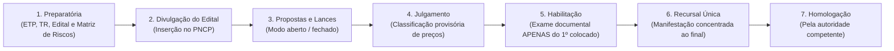
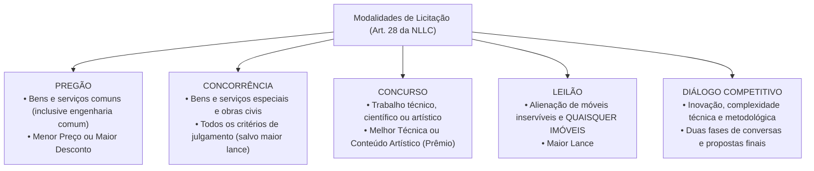

# 02 - Fases da Licitação, Modalidades e Critérios de Julgamento (Lei 14.133/2021)

> **Matéria:** Licitações e Contratos Administrativos  
> **Cargo:** A01 – Técnico de Controle Externo – Especialidade: Técnico Administrativo  
> **Arquivo:** `02_fases_modalidades_e_criterios_de_julgamento.md`  

---

## 📌 Ementa / Itens do Edital
- Sequência e fases do processo licitatório na Lei Federal nº 14.133/2021
- A regra da inversão de fases (julgamento das propostas antes da habilitação) e fase recursal única
- Modalidades de licitação: Pregão, Concorrência, Concurso, Leilão e Diálogo Competitivo
- Extinção definitiva das modalidades Tomada de Preços e Convite
- Diálogo Competitivo: conceito, pressupostos, rito procedimental e comissão especial
- Critérios de julgamento das propostas: Menor Preço, Maior Desconto, Melhor Técnica ou Conteúdo Artístico, Técnica e Preço, Maior Lance e Maior Retorno Econômico
- Modos de disputa: aberto, fechado e suas combinações
- Prazos mínimos para apresentação de propostas e lances

---

## 🧭 Sumário

- [1. Fases e Rito Procedimental na Lei Federal nº 14.133/2021](#1-fases-e-rito-procedimental-na-lei-federal-nº-141332021)
    - [1.1 Sequência Cronológica Canônica (Art. 17)](#11-sequência-cronológica-canônica-art-17)
    - [1.2 A Inversão de Fases e a Habilitação Exclusiva do Vencedor](#12-a-inversão-de-fases-e-a-habilitação-exclusiva-do-vencedor)
    - [1.3 Fase Recursal Única e Concentrada (Art. 165)](#13-fase-recursal-única-e-concentrada-art-165)
- [2. As Cinco Modalidades Licitatórias Modernas (Art. 28)](#2-as-cinco-modalidades-licitatórias-modernas-art-28)
    - [2.1 Pregão: Bens e Serviços Comuns de Engenharia e Consumo](#21-pregão-bens-e-serviços-comuns-de-engenharia-e-consumo)
    - [2.2 Concorrência: Bens e Serviços Especiais e Obras](#22-concorrência-bens-e-serviços-especiais-e-obras)
    - [2.3 Concurso: Premiação de Trabalhos Técnicos e Artísticos](#23-concurso-premiação-de-trabalhos-técnicos-e-artísticos)
    - [2.4 Leilão: A Nova Sistemática para Móveis Inservíveis e Imóveis](#24-leilão-a-nova-sistemática-para-móveis-inservíveis-e-imóveis)
    - [2.5 Diálogo Competitivo: Inovação, Rito e Comissão Efetiva (Art. 32)](#25-diálogo-competitivo-inovação-rito-e-comissão-efetiva-art-32)
    - [2.6 A Extinção Definitiva da Tomada de Preços e do Convite](#26-a-extinção-definitiva-da-tomada-de-preços-e-do-convite)
- [3. Critérios de Julgamento das Propostas (Art. 33)](#3-critérios-de-julgamento-das-propostas-art-33)
    - [3.1 Menor Preço e Maior Desconto](#31-menor-preço-e-maior-desconto)
    - [3.2 Melhor Técnica ou Conteúdo Artístico](#32-melhor-técnica-ou-conteúdo-artístico)
    - [3.3 Técnica e Preço e o Limite de Ponderação](#33-técnica-e-preço-e-o-limite-de-ponderação)
    - [3.4 Maior Lance (Privativo do Leilão)](#34-maior-lance-privativo-do-leilão)
    - [3.5 Maior Retorno Econômico e os Contratos de Eficiência (Art. 39)](#35-maior-retorno-econômico-e-os-contratos-de-eficiência-art-39)
- [4. Modos de Disputa e Prazos Mínimos de Divulgação do Edital](#4-modos-de-disputa-e-prazos-mínimos-de-divulgação-do-edital)
    - [4.1 Modos de Disputa: Aberto, Fechado e Combinações (Art. 56)](#41-modos-de-disputa-aberto-fechado-e-combinações-art-56)
    - [4.2 Prazos Mínimos de Apresentação de Propostas (Art. 55)](#42-prazos-mínimos-de-apresentação-de-propostas-art-55)
- [5. Fontes Recomendadas na Internet](#5-fontes-recomendadas-na-internet)
- [6. Questões Comentadas & Exemplos (Padrão FCC)](#6-questões-comentadas--exemplos-padrão-fcc)

---

## 1. Fases e Rito Procedimental na Lei Federal nº 14.133/2021

A Lei Federal nº 14.133/2021 reestruturou o procedimento licitatório com o objetivo de assegurar celeridade, eficiência e redução de custos burocráticos. A regra ordinária positivada pelo diploma superou definitivamente o rito rígido da antiga Lei nº 8.666/1993.

### 1.1 Sequência Cronológica Canônica (Art. 17)

O processo licitatório obedece rigorosamente às seguintes fases consecutivas:

1. **Fase Preparatória:** Concepção da necessidade, confecção do ETP, TR ou Projeto Básico, elaboração da matriz de riscos, pesquisa de preços e redação da minuta de edital e de contrato;
2. **Divulgação do Edital de Licitação:** Publicidade oficial e centralizada mediante inserção obrigatória no Portal Nacional de Contratações Públicas (PNCP);
3. **Apresentação de Propostas e Lances:** Sessão pública na qual os licitantes encaminham suas propostas financeiras e disputam lances sucessivos;
4. **Julgamento:** Verificação da conformidade formal da proposta e classificação provisória em ordem de vantajosidade conforme o critério adotado;
5. **Habilitação:** Conferência da idoneidade jurídica, fiscal, técnica e econômico-financeira;
6. **Fase Recursal:** Etapa única concentrada na qual os licitantes manifestam e fundamentam inconformismos contra o julgamento e a habilitação;
7. **Homologação:** Ato solene da autoridade superior que ratifica a legalidade de todo o certame e adjudica o objeto ao licitante vencedor.

### 1.2 A Inversão de Fases e a Habilitação Exclusiva do Vencedor

A maior inovação operacional da NLLC é a consagração definitiva da **inversão de fases como regra geral**:

- **Julgamento Antes da Habilitação:** Em vez de abrir os envelopes documentais de dezenas de licitantes antes de conhecer seus preços (modelo da Lei 8.666/93), a Administração Pública **classifica primeiro as propostas de preços/técnica**;
- **Conferência Exclusiva do 1º Colocado:** O Agente de Contratação abre e confere a documentação de habilitação **exclusivamente do licitante que obteve o primeiro lugar**. Se a documentação estiver regular, ele é declarado vencedor; se for inabilitado, o agente convoca o segundo colocado na ordem de classificação, e assim sucessivamente.
- **Exceção de Habilitação Prévia (Art. 17, § 1º):** A inversão pode ser excepcionada (realizando-se a habilitação antes do julgamento das propostas), desde que haja **motivação expressa de interesse público** na fase preparatória e prévia previsão no edital.

### 1.3 Fase Recursal Única e Concentrada (Art. 165)

Na sistemática da NLLC, os recursos administrativos não são mais interpostos de forma fracionada ao término de cada etapa:

- Existe uma **Fase Recursal ÚNICA e concentrada ao final do certame**, deflagrada logo após a declaração do vencedor habilitado;
- O licitante que discordar de qualquer decisão deve manifestar imediatamente sua intenção de recorrer sob pena de preclusão, dispondo do prazo de **3 (três) dias úteis** para apresentação das razões recursais, abrangendo indistintamente matérias de julgamento de propostas e de habilitação.

---

## 2. As Cinco Modalidades Licitatórias Modernas (Art. 28)

O art. 28 da Lei Federal nº 14.133/2021 estabelece um rol taxativo com cinco modalidades licitatórias aplicáveis a toda a Administração Pública brasileira:

### 2.1 Pregão: Bens e Serviços Comuns de Engenharia e Consumo

- **Objeto Mandatório (Art. 29):** Modalidade de contratação obrigatória para **bens e serviços comuns**, incluindo expressamente os **serviços comuns de engenharia** (assim entendidos aqueles cujos padrões de desempenho e qualidade podem ser objetivamente descritos pelo edital por especificações usuais de mercado);
- **Critérios de Julgamento Permitidos:** Unicamente **Menor Preço** ou **Maior Desconto**;
- **Condução:** Conduzido pelo Pregoeiro, com auxílio da equipe de apoio.

### 2.2 Concorrência: Bens e Serviços Especiais e Obras

- **Objeto:** Modalidade de licitação destinada à contratação de **bens e serviços especiais**, obras e serviços de engenharia comuns e especiais;
- **Critérios de Julgamento:** Ampla flexibilidade, admitindo Menor Preço, Maior Desconto, Melhor Técnica, Técnica e Preço e Maior Retorno Econômico.

### 2.3 Concurso: Premiação de Trabalhos Técnicos e Artísticos

- **Objeto:** Escolha de trabalho técnico, científico ou artístico, de arquitetura ou urbanismo;
- **Contraprestação:** Concessão de prêmio ou remuneração ao vencedor;
- **Critério de Julgamento:** Melhor Técnica ou Conteúdo Artístico, avaliado por comissão especial qualificada.

### 2.4 Leilão: A Nova Sistemática para Móveis Inservíveis e Imóveis

- **Objeto Unificado (Art. 28, § 2º c/c Art. 31):** Modalidade obrigatória para alienação de **bens móveis inservíveis ou apreendidos** e de **QUAISQUER BENS IMÓVEIS** pertencentes ao Poder Público;
- **Critério de Julgamento:** Exclusivamente **Maior Lance** (igual ou superior à avaliação prévia);
- **Condução:** Pode ser conduzido por Leiloeiro Oficial matriculado ou por servidor público designado pela autoridade.

> 🚨 **MUDANÇA RADICAL DA LEI 14.133/2021:**  
> Sob a revogada Lei 8.666/93, a alienação de bens imóveis exigia Concorrência. Na Nova Lei de Licitações, **TODOS os imóveis públicos são alienados por LEILÃO**! Atenção redobrada às pegadinhas da FCC que afirmam que imóveis dependem de Concorrência.

### 2.5 Diálogo Competitivo: Inovação, Rito e Comissão Efetiva (Art. 32)

Modalidade moderna instituída pela NLLC, restrita a contratações de alta complexidade em que a Administração identifica uma necessidade pública, mas **não possui capacidade técnica de definir previamente as especificações do objeto**:

- **Hipóteses de Cabimento:** Inovação tecnológica; complexidade de engenharia ou software; impossibilidade de adaptar soluções de mercado existentes;
- **Estrutura em Duas Fases:**
    1. *Fase de Diálogos:* O edital publica os objetivos do órgão; os licitantes pré-selecionados debatem com a comissão técnica em reuniões gravadas para construir alternativas metodológicas;
    2. *Fase Competitiva Final:* Concluído o diálogo, abre-se a disputa final de propostas comerciais e técnicas com base na solução construída;
- **Condução Obrigatória por Comissão Efetiva:** O Diálogo Competitivo deve ser conduzido **obrigatoriamente por comissão de contratação composta de, no mínimo, 3 (três) servidores efetivos ou empregados permanentes** (art. 32, XI).

### 2.6 A Extinção Definitiva da Tomada de Preços e do Convite

A NLLC **extinguiu formal e definitivamente as modalidades Tomada de Preços e Convite**. Na nova ordem jurídica, as modalidades são delimitadas estritamente pela **natureza do objeto**, e jamais pelo valor econômico da contratação.

---

## 3. Critérios de Julgamento das Propostas (Art. 33)

O art. 33 da Lei nº 14.133/2021 estabelece os critérios objetivos de julgamento que devem constar obrigatoriamente do edital:

### 3.1 Menor Preço e Maior Desconto

- **Menor Preço:** O vencedor é o licitante que apresenta o menor valor financeiro global ou unitário para a execução do objeto.
- **Maior Desconto:** O licitante oferece o maior percentual de abatimento linear sobre uma tabela referencial de preços previamente divulgada pelo órgão no edital (muito comum em manutenção automotiva e compra de medicamentos).

### 3.2 Melhor Técnica ou Conteúdo Artístico

Considera exclusivamente a pontuação atribuída à proposta técnica ou artística formulada pelo participante, fixando o edital previamente o valor do prêmio ou da remuneração que será outorgada. Utilizado no **Concurso**.

### 3.3 Técnica e Preço e o Limite de Ponderação

Pondera a pontuação da proposta técnica combinada com a proposta de preço dos licitantes, atribuindo-se pesos específicos no edital:

- **Limite Legal de Ponderação (Art. 36, § 1º):** A pontuação atribuída à valoração técnica **não pode ultrapassar o teto máximo de 70% (setenta por cento)** da pontuação total.

### 3.4 Maior Lance (Privativo do Leilão)

Exclusivo da modalidade **Leilão**, declarando vencedor o proponente que oferecer o maior valor financeiro para a aquisição do patrimônio público disponibilizado.

### 3.5 Maior Retorno Econômico e os Contratos de Eficiência (Art. 39)

Critério inovador privativo da celebração de **Contratos de Eficiência**:

- O contratado assume a execução de melhorias estruturais (ex.: retrofit elétrico, modernização hidráulica, inteligência em tecnologia) para gerar economia concreta nos custos operacionais do Poder Público;
- **Composição da Proposta:** A proposta do licitante traz:
    1. A estimativa de economia financeira gerada para a Administração; e
    2. O percentual dessa economia que reterá como remuneração de seus serviços;
- O julgamento apura a **maior vantagem econômica líquida**: maior economia estimada menos a remuneração cobrada. Se a economia real aferida for menor que a proposta pelo licitante, a diferença é glosada e descontada de sua fatura.

---

## 4. Modos de Disputa e Prazos Mínimos de Divulgação do Edital

### 4.1 Modos de Disputa: Aberto, Fechado e Combinações (Art. 56)

- **Modo Aberto:** Os licitantes encaminham lances públicos sucessivos em plataforma eletrônica, conhecendo em tempo real os lances dos concorrentes.
- **Modo Fechado:** As propostas permanecem em sigilo absoluto no sistema até a data e hora designadas para a abertura simultânea perante todos.
- **Modos Combinados:** Aberto-fechado ou fechado-aberto.
- **Vedações Expressas do Art. 56:**
    - É proibida a utilização isolada do modo de disputa fechado quando o critério de julgamento for **Menor Preço** ou **Maior Desconto**;
    - É vedada a utilização do modo aberto quando o critério de julgamento for **Melhor Técnica ou Conteúdo Artístico**.

### 4.2 Prazos Mínimos de Apresentação de Propostas (Art. 55)

Os prazos mínimos de divulgação do edital contam-se a partir da data de publicação no PNCP:

| Objeto da Licitação e Critério | Modalidade Típica | Prazo Mínimo de Edital |
| :--- | :--- | :---: |
| **Bens Comuns** (Menor Preço ou Maior Desconto) | Pregão | **8 dias úteis** |
| **Serviços Comuns e Obras Comuns de Engenharia** | Pregão ou Concorrência | **10 dias úteis** |
| **Bens Especiais e Serviços Especiais de Engenharia** | Concorrência | **15 dias úteis** |
| **Obras com Regime de Empreitada por Preço Global** | Concorrência | **25 dias úteis** |
| **Obras com Regime de Contratação Integrada** | Concorrência | **60 dias úteis** |
| **Licitações pelo Critério de Maior Retorno Econômico** | Concorrência | **35 dias úteis** |
| **Licitações pelo Critério de Técnica e Preço** | Concorrência | **35 dias úteis** |
| **Leilão de Bens Móveis e Imóveis** | Leilão | **15 dias úteis** |
| **Concurso de Projetos Técnicos/Artísticos** | Concurso | **35 dias úteis** |

---

## 5. Fontes Recomendadas na Internet

- [Lei Federal nº 14.133/2021 - Arts. 17 a 39 e 55 a 56](https://www.planalto.gov.br/ccivil_03/_ato2019-2022/2021/lei/l14133.htm#art17)  
  Dispositivos que disciplinam o rito das fases da licitação, modalidades e prazos de publicação.
- [Portal Nacional de Contratações Públicas (PNCP)](https://pncp.gov.br/)  
  Repositório oficial onde são veiculados os editais e lances de todas as modalidades da NLLC.
- [Instrução Normativa SEGES/ME nº 73/2022 (Modos de Disputa e Critérios)](https://www.gov.br/compras/pt-br/acesso-a-informacao/legislacao/instrucoes-normativas/instrucao-normativa-seges-me-no-73-de-30-de-setembro-de-2022)  
  Regulamento federal que disciplina a operacionalização dos modos aberto e fechado.
- [Enunciados do Instituto Brasileiro de Direito Administrativo (IBDA)](https://ibda.com.br/)  
  Teses doutrinárias aplicadas sobre a eliminação do convite e tomada de preços e o uso do leilão imobiliário.

---

## 6. Questões Comentadas & Exemplos (Padrão FCC)

### Questão 1 (FCC - Analista de Controle Externo / Adaptada TCE-GO)
O Tribunal de Contas do Estado de Goiás necessita alienar 20 veículos oficiais de sua frota que se tornaram antieconômicos e inservíveis para a fiscalização, bem como dois imóveis urbanos desafetados de sua propriedade recebidos em dação em pagamento de penalidades aplicadas.

Considerando as modalidades de licitação positivadas na Lei Federal nº 14.133/2021:

* **A)** A alienação dos veículos inservíveis deve ocorrer por Concorrência e a dos imóveis por Tomada de Preços.
* **B)** Ambos os bens (os veículos móveis inservíveis e os imóveis desafetados) devem ser alienados obrigatoriamente mediante a modalidade Leilão, cujo critério de julgamento exclusivo é o Maior Lance.
* **C)** A alienação de imóveis públicos exige a realização de Diálogo Competitivo com consórcios imobiliários privados.
* **D)** Os veículos inservíveis devem ser alienados por Pregão Eletrônico com critério de Maior Desconto.
* **E)** A alienação de patrimônio imobiliário de tribunais dispensa qualquer modalidade licitatória, ocorrendo por doação direta compulsória.

> **Comentário Detalhado:**
> - **A)** Incorreta. A Tomada de Preços foi formalmente extinta pela Lei nº 14.133/2021, e a Concorrência não é mais a modalidade aplicável para alienação de imóveis na NLLC.
> - **B)** Correta. De acordo com o art. 28, § 2º, c/c art. 31 da Lei Federal nº 14.133/2021, o **Leilão** é a modalidade de licitação obrigatória para a alienação de bens móveis inservíveis ou legalmente apreendidos e de **quaisquer bens imóveis** da Administração Pública. Seu critério de julgamento exclusivo é o **Maior Lance** (igual ou superior ao valor de avaliação prévia), unificando todo o procedimento de desinvestimento patrimonial do Estado.
> - **C)** Incorreta. O Diálogo Competitivo destina-se à contratação de soluções de alta tecnologia e obras complexas, não à venda de imóveis.
> - **D)** Incorreta. O pregão é modalidade de contratação de despesa pública (aquisição de bens e serviços comuns), não servindo para alienação patrimonial.
> - **E)** Incorreta. A alienação imobiliária depende de prévia autorização legal, avaliação oficial e licitação na modalidade leilão.
> 
> **Gabarito: B**

---

### Questão 2 (FCC - Técnico de Controle Externo / Administrativa)
Em um certame licitatório conduzido sob a modalidade Concorrência para contratação de serviços de conservação predial, encerrada a fase de envio de lances na plataforma eletrônica com 40 empresas participantes, o Agente de Contratação procedeu à abertura e conferência imediata das certidões e envelopes de habilitação de **todas as 40 empresas** licitantes, antes de julgar a aceitabilidade e os preços das propostas.

Em conformidade com a sequência de fases prevista no art. 17 da Lei Federal nº 14.133/2021:

* **A)** A conduta do agente violou a regra geral procedimental da NLLC, que impõe o julgamento prévio das propostas e determina a análise dos documentos de habilitação exclusivamente do licitante primeiro colocado classificado.
* **B)** O agente agiu com estrito acerto, visto que a conferência de documentos de todos os licitantes antes dos preços é exigência imperativa de moralidade pública.
* **C)** A fase de habilitação foi extinta pela nova lei, bastando a apresentação de nota fiscal de serviços anteriores.
* **D)** A Lei nº 14.133/2021 proíbe a fase recursal única, exigindo recurso individualizado após cada lance.
* **E)** A inversão de fases é ato privativo do Poder Judiciário deferido em mandado de segurança preventivo.

> **Comentário Detalhado:**
> - **A)** Correta. O art. 17 da Lei Federal nº 14.133/2021 estabelece a ordem cronológica legal das fases da licitação: Preparatória $\rightarrow$ Divulgação $\rightarrow$ Propostas e lances $\rightarrow$ **Julgamento** $\rightarrow$ **Habilitação** $\rightarrow$ Recursal $\rightarrow$ Homologação. A regra geral impõe a **inversão de fases**: primeiro classificam-se as propostas e, em seguida, procede-se ao exame da documentação de habilitação **exclusivamente do licitante que obteve o primeiro lugar**. Conferir previamente os documentos de 40 empresas viola a sistemática legal de eficiência e celeridade da NLLC.
> - **B)** Incorreta. A conferência prévia universal era a regra do regime revogado da Lei 8.666/93, superada pela NLLC.
> - **C)** Incorreta. A fase de habilitação permanece obrigatória para o primeiro colocado classificado.
> - **D)** Incorreta. O art. 165 da NLLC consagrou a fase recursal única ao final do certame.
> - **E)** Incorreta. A inversão excepcional (habilitação antes do julgamento) é ato administrativo discricionário motivado da própria Administração na fase interna, sem necessidade de provimento jurisdicional.
> 
> **Gabarito: A**

---

### Questão 3 (FCC - Auditor de Controle Externo / Adaptada)
Determinada pasta do Poder Executivo estadual pretende licitar o desenvolvimento e implantação de uma solução pioneira e inovadora de inteligência artificial aplicada ao cruzamento automatizado de notas fiscais eletrônicas com imagens de satélite. A equipe de planejamento constatou que não dispõe de capacidade técnica para definir de antemão as especificações técnicas objetivas no edital, necessitando dialogar com os fornecedores especializados para identificar as melhores alternativas existentes no mercado.

Para a hipótese descrita, a modalidade de licitação adequada prevista na Lei Federal nº 14.133/2021 é:

* **A)** Pregão Eletrônico com critério de Menor Preço
* **B)** Diálogo Competitivo
* **C)** Concurso com premiação pecuniária
* **D)** Leilão Administrativo
* **E)** Inexigibilidade compulsória de licitação sem disputa

> **Comentário Detalhado:**
> - **A)** Incorreta. O pregão pressupõe que o objeto seja comum e que suas especificações possam ser objetivamente pré-fixadas no edital, o que é inviável na contratação de soluções de vanguarda e alta complexidade tecnológica.
> - **B)** Correta. De acordo com o art. 32 da Lei Federal nº 14.133/2021, o **Diálogo Competitivo** é a modalidade própria para contratações que envolvam: I - inovação tecnológica ou técnica; II - impossibilidade de a Administração ter sua necessidade satisfeita sem a adaptação de soluções disponíveis no mercado; e III - impossibilidade de as especificações técnicas serem definidas com precisão suficiente pela Administração. O modelo desenvolve-se em duas etapas (diálogos estruturados seguidos de fase competitiva de propostas finais).
> - **C)** Incorreta. O concurso serve para escolher trabalhos prontos (projetos arquitetônicos, obras literárias) mediante concessão de prêmio, e não para contratar serviços integrados de TI.
> - **D)** Incorreta. O leilão é privativo de alienação patrimonial.
> - **E)** Incorreta. A existência de multiplicidade de fornecedores capazes de inovar impõe a disputa licitatória formal.
> 
> **Gabarito: B**

---

### Questão 4 (FCC - Analista de Gestão Pública)
O Departamento Estadual de Infraestrutura necessita contratar a execução de serviços de manutenção asfáltica rotineira e tapa-buracos em rodovias estaduais, cujos padrões de desempenho, traço asfáltico e metodologia operacional encontram-se rigorosamente padronizados em manuais técnicos usuais do mercado.

Nos termos do art. 29 da Lei Federal nº 14.133/2021, para a contratação de **serviços comuns de engenharia**:

* **A)** É obrigatória a realização de Concurso Internacional com corpo de jurados.
* **B)** É obrigatório o uso do Pregão, admitindo-se subsidiariamente a Concorrência, com adoção dos critérios de menor preço ou maior desconto.
* **C)** É terminantemente vedada a utilização da modalidade Pregão para qualquer serviço de engenharia, sob pena de nulidade absoluta.
* **D)** A contratação deve ocorrer obrigatoriamente por Leilão com lances decrescentes.
* **E)** É dispensada a exigência de termo de referência ou projeto básico.

> **Comentário Detalhado:**
> - **A)** Incorreta. Concurso é privativo de trabalhos técnicos, científicos ou artísticos com prêmio, não se aplicando a obras ou reformas viárias.
> - **B)** Correta. O art. 29 da Lei Federal nº 14.133/2021 estabelece categoricamente: *"A licitação de bens e serviços comuns, incluídos os serviços comuns de engenharia, deverá ser realizada obrigatoriamente sob a modalidade pregão, admitida a concorrência se a administração assim o preferir."* Se o serviço de engenharia é rotineiro e padronizado em manuais usuais de mercado (serviço comum de engenharia), o pregão é a modalidade mandatória, adotando-se exclusivamente os critérios de **Menor Preço** ou **Maior Desconto**.
> - **C)** Incorreta. A NLLC pacifica expressamente a admissibilidade do pregão para serviços comuns de engenharia, pondo fim a antigas controvérsias judiciais da vigência da Lei 8.666/93.
> - **D)** Incorreta. Leilão destina-se exclusivamente à venda e alienação de bens móveis e imóveis.
> - **E)** Incorreta. O termo de referência ou projeto básico é peça técnica mandatória na fase preparatória.
> 
> **Gabarito: B**

---

### Questão 5 (FCC - Procurador do Estado / Adaptada)
Determinada entidade governamental pretende licitar a modernização do sistema de refrigeração e iluminação de seus prédios administrativos sob o regime de **Contrato de Eficiência**, no qual a contratada será remunerada mediante percentual da economia financeira efetivamente gerada na conta de energia do órgão.

Para essa contratação, a Lei Federal nº 14.133/2021 prescreve o critério de julgamento por:

* **A)** Menor Preço puro, desconsiderando as estimativas de redução de consumo
* **B)** Maior Retorno Econômico, considerando a maior economia estimada para a Administração deduzida a remuneração proposta pelo licitante
* **C)** Melhor Técnica, avaliada unicamente por títulos acadêmicos dos engenheiros
* **D)** Maior Lance presencial em sessão pública conduzida por leiloeiro
* **E)** Maior Desconto linear sobre a tarifa comercial da distribuidora de energia

> **Comentário Detalhado:**
> - **A)** Incorreta. O menor preço avalia apenas o desembolso inicial, sendo inadequado para mensurar a eficiência energética futura gerada pela empresa.
> - **B)** Correta. O art. 33, inciso VI, c/c art. 39 da Lei Federal nº 14.133/2021 institui o critério de **Maior Retorno Econômico**, que é utilizado exclusivamente para a celebração de **contratos de eficiência**. As propostas são julgadas com base na maior vantagem econômica líquida para o Poder Público (a economia financeira estimada gerada para a Administração deduzida a parcela que o licitante cobrará a título de remuneração de seus serviços).
> - **C)** Incorreta. O julgamento vincula-se ao retorno econômico mensurável gerado nos custos do órgão, e não unicamente à capacitação técnica formal de currículos.
> - **D)** Incorreta. Maior lance é privativo do leilão para alienação patrimonial.
> - **E)** Incorreta. A distribuidora de energia não participa da disputa licitatória de modernização predial.
> 
> **Gabarito: B**
