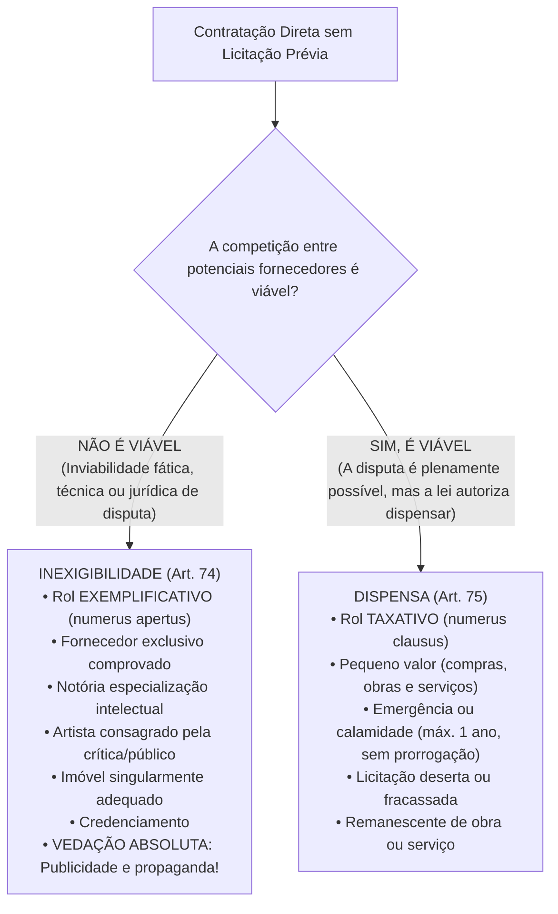
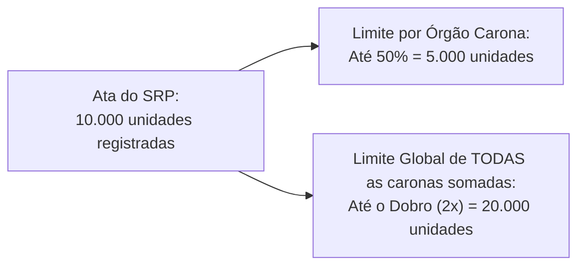

# 03 - Procedimentos Auxiliares e Contratação Direta (Dispensa e Inexigibilidade)

> **Matéria:** Licitações e Contratos Administrativos  
> **Cargo:** A01 – Técnico de Controle Externo – Especialidade: Técnico Administrativo  
> **Arquivo:** `03_procedimentos_auxiliares_e_contratacao_direta.md`  
> **Status:** 🟢 Teoria Aprofundada + 5 Questões FCC Comentadas (A a E)

---

## 📌 Ementa Oficial do Edital
- Procedimentos auxiliares das licitações e contratações (Art. 78 da Lei nº 14.133/2021).
- Credenciamento: hipóteses de cabimento e regras de remuneração.
- Pré-qualificação de fornecedores e produtos (pré-qualificação subjetiva e objetiva).
- Procedimento de Manifestação de Interesse (PMI).
- Sistema de Registro de Preços (SRP): órgão gerenciador, órgãos participantes e limites legais para órgãos não participantes ("caronas").
- Contratação Direta: processo de contratação direta e requisitos de instrução (Art. 72).
- Inexigibilidade de Licitação (Art. 74): inviabilidade de competição e rol exemplificativo.
- Serviços técnicos especializados de natureza predominantemente intelectual e notória especialização.
- Dispensa de Licitação (Art. 75): rol taxativo, dispensa por valor (pequeno valor), emergência, licitação deserta e fracassada.

---

## 🧭 Sumário

1. [Distinção Fundamental: Inexigibilidade x Dispensa de Licitação](#1-distincao-fundamental-inexigibilidade-x-dispensa-de-licitacao)
    1. [Teste 088](#Teste-088)
2. [Procedimentos Auxiliares da Lei nº 14.133/2021 (Art. 78)](#2-procedimentos-auxiliares-da-lei-no-141332021-art-78)
    1. [Credenciamento (Art. 79)](#21-credenciamento-art-79)
    2. [Pré-Qualificação Subjetiva e Objetiva (Art. 80)](#22-pre-qualificacao-subjetiva-e-objetiva-art-80)
    3. [Procedimento de Manifestação de Interesse - PMI (Art. 81)](#23-procedimento-de-manifestacao-de-interesse-pmi-art-81)
    4. [Sistema de Registro de Preços - SRP e Regras do Carona (Arts. 82 a 86)](#24-sistema-de-registro-de-precos-srp-e-regras-do-carona-arts-82-a-86)
    5. [Registro Cadastral Unificado (Art. 87)](#25-registro-cadastral-unificado-art-87)
    6. [Teste 089](#Teste-089)
    7. [Teste 090](#Teste-090)
    8. [Teste 091](#Teste-091)
    9. [Teste 092](#Teste-092)
3. [Processo Administrativo de Contratação Direta (Art. 72)](#3-processo-administrativo-de-contratacao-direta-art-72)
    1. [Teste 093](#Teste-093)
4. [Inexigibilidade de Licitação (Art. 74 - Inviabilidade de Competição)](#4-inexigibilidade-de-licitacao-art-74-inviabilidade-de-competicao)
    1. [Fornecedor e Prestador Exclusivo (Inciso I)](#41-fornecedor-e-prestador-exclusivo-inciso-i)
    2. [Profissional do Setor Artístico Consagrado (Inciso II)](#42-profissional-do-setor-artistico-consagrado-inciso-ii)
    3. [Serviços Técnicos Especializados e Notória Especialização (Inciso III)](#43-servicos-tecnicos-especializados-e-notoria-especializacao-inciso-iii)
    4. [Aquisição ou Locação de Imóvel Singular (Inciso V)](#44-aquisicao-ou-locacao-de-imovel-singular-inciso-v)
    5. [Teste 094](#Teste-094)
    6. [Teste 095](#Teste-095)
5. [Dispensa de Licitação (Art. 75 - Rol Taxativo)](#5-dispensa-de-licitacao-art-75-rol-taxativo)
    1. [Dispensa em Razão do Valor (Pequeno Valor - Incisos I e II)](#51-dispensa-em-razao-do-valor-pequeno-valor-incisos-i-e-ii)
    2. [Dispensa por Emergência ou Calamidade Pública (Inciso VIII)](#52-dispensa-por-emergencia-ou-calamidade-publica-inciso-viii)
    3. [Licitação Deserta, Fracassada e Remanescente de Contrato](#53-licitacao-deserta-fracassada-e-remanescente-de-contrato)
    4. [Teste 096](#Teste-096)
    5. [Teste 097](#Teste-097)
    6. [Teste 098](#Teste-098)
6. [🌐 Fontes Recomendadas na Internet](#fontes-recomendadas-na-internet)

---

## 1. Distinção Fundamental: Inexigibilidade x Dispensa de Licitação

A regra geral insculpida no art. 37, XXI, da CF/88 impõe a obrigatoriedade de licitar para obras, serviços, compras e alienações no setor público. Todavia, a própria Constituição ressalva "os casos especificados na legislação". A Nova Lei de Licitações (Lei nº 14.133/2021) estrutura a contratação direta sem certame competitivo em duas categorias nucleares: a **Inexigibilidade** e a **Dispensa**.

- **Inexigibilidade (Art. 74):** Configura-se sempre que houver **inviabilidade fática ou jurídica de competição**. Não há como comparar objetivamente propostas porque o objeto é único, o fornecedor é exclusivo ou a prestação decorre de dotes personalíssimos/intelectuais singulares. Por essa razão, a jurisprudência pacífica do TCU e a doutrina consagram que o rol do art. 74 é **exemplificativo** (*numerus apertus*), admitindo outros casos em que se comprove a impossibilidade fática de disputa.
- **Dispensa (Art. 75):** A disputa concorrencial é plenamente viável no plano fático e de mercado, porém o legislador, sopesando critérios de economicidade, celeridade ou interesse público primário, optou por autorizar a Administração a não licitar. Em face de seu caráter derrogatório da regra constitucional, o rol do art. 75 é **taxativo** (*numerus clausus*), vedada interpretação extensiva ou analógica para criar novas hipóteses de dispensa.

---

### Teste 088
**(FCC - Analista Judiciário - Área Administrativa)**
No âmbito das contratações públicas regidas pela Lei nº 14.133/2021, a contratação direta subdivide-se nas figuras jurídicas da inexigibilidade de licitação e da dispensa de licitação.

A respeito da distinção conceitual e dogmática entre esses dois institutos, assinale a afirmativa correta.

* **A)** A inexigibilidade de licitação ocorre quando a competição é perfeitamente viável do ponto de vista fático e jurídico, mas a lei autoriza a contratação direta por conveniência e oportunidade do administrador.
* **B)** A dispensa de licitação fundamenta-se na inviabilidade fática ou jurídica de competição, possuindo rol meramente exemplificativo na legislação de regência.
* **C)** Na inexigibilidade de licitação há inviabilidade de competição decorrente da exclusividade de fornecedor, da notoriedade técnica profissional ou da natureza singular do objeto, configurando o art. 74 um rol meramente exemplificativo; já na dispensa de licitação (art. 75), a competição seria viável em tese, mas o legislador optou por dispensá-la em rol estrito e taxativo.
* **D)** A dispensa de licitação dispensa a instauração de qualquer processo administrativo formal, bastando a emissão de nota de empenho imediata.
* **E)** Em ambos os casos, inexigibilidade e dispensa, a Administração Pública fica desobrigada de justificar a razoabilidade do preço contratado.

---

> **Comentário Detalhado:**
>
> - **A)** Incorreta. Onde a competição é viável, não cabe inexigibilidade; cabe licitação ou, excepcionalmente, dispensa de licitação se houver enquadramento taxativo em lei.
> - **B)** Incorreta. A inviabilidade de competição é a essência da **inexigibilidade**, cujo rol é exemplificativo. A dispensa pressupõe viabilidade teórica de concorrência com rol **taxativo (numerus clausus)**.
> - **C)** Correta. Dogmática clássica e unânime: na **inexigibilidade** (art. 74) a competição é impossível (fornecedor exclusivo, artista consagrado, serviço técnico especializado com profissional de notória especialização), tendo o legislador apresentado hipóteses exemplificativas ("em especial"); na **dispensa** (art. 75), a disputa seria em tese viável, mas a lei autoriza a não realização da licitação (licitação dispensável) por razões de modicidade do valor, urgência, ou desinteresse de mercado, em rol estritamente taxativo.
> - **D)** Incorreta. A contratação direta exige rigoroso processo administrativo prévio (art. 72 da Lei nº 14.133/2021).
> - **E)** Incorreta. A justificativa do preço é requisito obrigatório em toda contratação direta (art. 72, VII), para coibir superfaturamento.
>
> **Gabarito: C**

---

## 2. Procedimentos Auxiliares da Lei nº 14.133/2021 (Art. 78)

O art. 78 da Lei nº 14.133/2021 sistematizou cinco procedimentos auxiliares das licitações e contratações administrativas:

1. Credenciamento;
2. Pré-qualificação;
3. Procedimento de Manifestação de Interesse (PMI);
4. Sistema de Registro de Preços (SRP);
5. Registro Cadastral.

### 2.1 Credenciamento (Art. 79)
O credenciamento é o procedimento administrativo pelo qual a Administração convoca, mediante **edital de chamamento público com inscrições permanentemente abertas**, todos os interessados que preencham os requisitos previamente definidos para prestar serviços ou fornecer bens. 

No credenciamento, a Administração **não escolhe um único vencedor**: ela contrata **todos** os interessados habilitados, remunerando-os segundo uma tabela fixa de preços definida pelo próprio Poder Público. As hipóteses legais de cabimento são taxativas:

1. **Paralela e não excludente:** Caso em que é viável e vantajosa a contratação simultânea de vários prestadores para atender à demanda da Administração (ex.: credenciamento de laboratórios e clínicas de imagens para atender os segurados do plano de saúde dos servidores estaduais).
2. **Com seleção a critério de terceiros:** A definição do contratado compete ao próprio usuário final ou beneficiário do serviço (ex.: credenciamento de profissionais médicos em que o próprio paciente escolhe o especialista cadastrado, ou credenciamento de companhias aéreas em que o servidor escolhe o voo).
3. **Em mercados fluidos:** Hipótese em que a flutuação constante de preços e a exigência de rapidez tornam inviável a fixação antecipada por licitação tradicional, realizando-se cotação volátil em tempo real no momento de cada contratação (ex.: compra de combustíveis para abastecimento de frota pública em trânsito).

> 🚨 **ALERTA DE PROVA / FCC:**  
> A Lei nº 14.133/2021 tratou o credenciamento sob dupla face: no art. 78, como **procedimento auxiliar**, e no art. 74, inciso IV, como modalidade expressa de **inexigibilidade de licitação**. Como não há disputa concorrencial entre os credenciados (todos que cumprem os requisitos são credenciados sob tabela prefixada), há inviabilidade jurídica de competição, caracterizando a inexigibilidade formal da contratação.

### 2.2 Pré-Qualificação Subjetiva e Objetiva (Art. 80)
A pré-qualificação é o procedimento técnico-administrativo técnico permanente aberto a qualquer interessado para atestar antecipadamente:

- **Pré-qualificação Subjetiva:** A habilitação jurídica, técnica, fiscal e econômico-financeira de licitantes que reúnam condições de participar de futuras licitações;
- **Pré-qualificação Objetiva:** A conformidade técnica e operacional de bens, produtos ou serviços que atendam às exigências técnicas e padrões mínimos de desempenho da Administração.

A pré-qualificação é realizada mediante chamamento público aberto permanentemente. A validade da pré-qualificação é de **no máximo 1 (um) ano**, podendo ser atualizada a qualquer tempo pelos interessados ou revogada de ofício pela Administração quando comprovada perda dos requisitos originais. A pré-qualificação pode ser realizada em grupos ou segmentos determinados e sua existência permite agilizar certames posteriores com dispensa de reapresentação de documentos já convalidados.

### 2.3 Procedimento de Manifestação de Interesse - PMI (Art. 81)
O Procedimento de Manifestação de Interesse (PMI) é o chamamento público facultativo dirigido a pessoas físicas ou jurídicas de direito privado para a propositura e realização de estudos, investigações, levantamentos e projetos de soluções inovadoras que subsidiem futuras concessões comuns, parcerias público-privadas (PPPs), concessões de serviços públicos ou grandes projetos de infraestrutura.

Regras estruturais do PMI:

- O chamamento público define o escopo, as diretrizes e os critérios objetivos para aprovação dos projetos.
- A mera participação no PMI **não gera qualquer direito** a ressarcimento financeiro automático, indenização ou preferência no futuro certame licitatório.
- O autor do projeto selecionado e efetivamente utilizado na licitação só será ressarcido financeiramente **pelo vencedor da futura licitação**, sendo essa obrigação expressamente consignada no instrumento convocatório.

### 2.4 Sistema de Registro de Preços - SRP e Regras do Carona (Arts. 82 a 86)
O SRP é um conjunto de procedimentos para registro formal de preços relativos à prestação de serviços, obras e aquisição e locação de bens para contratações futuras e incertas. 

Adoção do SRP é recomendada quando:

- As demandas forem frequentes e rotineiras;
- For conveniente a aquisição parcelada para entregas contínuas;
- For impossível prever com exatidão prévia o quantitativo total a ser demandado no exercício financeiro.

A formalização do SRP ocorre por meio da **Ata de Registro de Preços (ARP)**, documento vinculativo e obrigacional com características de compromisso para futuras contratações.

**Regras de Vigência da Ata de Registro de Preços:**

- O prazo de vigência da ARP é de **1 (um) ano**, prorrogável por igual período (máximo de **2 anos**), desde que comprovada documentalmente a manutenção da vantajosidade dos preços registrados.

**Figuras do SRP:**

- **Órgão Gerenciador:** Responsável pela condução do certame licitatório e pelo gerenciamento global da ARP.
- **Órgão Participante:** Órgão que participou dos procedimentos iniciais do planejamento do certame e integrou a ata desde sua origem com quantitativos próprios estimados.
- **Órgão Não Participante ("Carona"):** Órgão que não participou do certame licitatório, mas solicita aderir tardiamente à ARP gerenciada por outro ente federativo ou órgão da Administração.

**Limites Imperativos para Adesão Tardia do Carona (Art. 86 da Lei 14.133/2021):**
A concessão de adesão exige autorização do órgão gerenciador, aceitação pelo fornecedor e demonstração analítica de vantagem econômica pelo carona. A NLLC impôs barreiras matemáticas severas contra abusos:

1. **Limite Individual por Órgão Não Participante (Art. 86, § 4º):** A contratação adicional não poderá exceder a **50% (cinquenta por cento)** dos quantitativos registrados na ata para o órgão gerenciador e para os órgãos participantes.
2. **Limite Global de TODAS as Adesões Somadas (Art. 86, § 5º):** O quantitativo total decorrente do conjunto de todas as caronas autorizadas não poderá ultrapassar, na totalidade, ao **dobro (200% ou 2x)** do quantitativo de cada item registrado na ata.

> ⚠️ **RESTRIÇÃO FEDERATIVA (Art. 86, § 8º):**  
> É vedada aos órgãos e entidades da Administração Pública Federal a adesão a ata de registro de preços gerenciada por órgão ou entidade estadual, distrital ou municipal. Em contrapartida, órgãos estaduais e municipais podem aderir a atas federais, desde que obedecidos os limites legais.

### 2.5 Registro Cadastral Unificado (Art. 87)
A Lei nº 14.133/2021 impõe a criação do sistema de registro cadastral unificado, operacionalizado no Portal Nacional de Contratações Públicas (PNCP), de acesso público e permanente. O registro cadastral simplifica a verificação de regularidade fiscal, trabalhista e qualificação econômico-financeira de licitantes, dispensando os inscritos da apresentação física de certidões válidas já integradas digitalmente ao sistema.

---

### Teste 089
**(FGV - Auditor de Controle Externo / TCE-GO)**
O credenciamento constitui procedimento auxiliar expressamente disciplinado no art. 79 da Lei nº 14.133/2021, vocacionado ao cadastramento prévio de interessados para eventual contratação pela Administração Pública.

Sobre as hipóteses e regras aplicáveis ao credenciamento, assinale a afirmativa correta.

* **A)** O credenciamento é admitido exclusivamente para a contratação de fornecedores exclusivos de medicamentos raros importados.
* **B)** A Administração Pública deve manter edital de credenciamento permanentemente aberto para o ingresso de novos interessados ao longo de toda a sua vigência, garantindo igualdade de condições a todos os que preencham os requisitos de habilitação.
* **C)** No credenciamento com contratações paralelas e não excludentes, a Administração Pública pode selecionar arbitrariamente qual dos credenciados executará o serviço a cada demanda.
* **D)** O valor a ser pago aos credenciados deve ser negociado individualmente com cada contratado no momento da emissão da ordem de serviço.
* **E)** O procedimento de credenciamento elimina a necessidade de comprovação de regularidade fiscal e trabalhista pelos interessados.

---

> **Comentário Detalhado:**
>
> - **A)** Incorreta. Fornecedor exclusivo é caso clássico de inexigibilidade comum (art. 74, I), e não de credenciamento.
> - **B)** Correta. O art. 79, parágrafo único, I, da Lei nº 14.133/2021 estabelece expressamente que a Administração deverá manter **edital de credenciamento permanentemente aberto** para a inscrição de eventuais interessados, garantindo a publicidade, a isonomia e a entrada contínua de novos profissionais ou empresas aptas.
> - **C)** Incorreta. Quando o objeto admitir contratações simultâneas mas demandar distribuição, a seleção deve basear-se em critérios objetivos prévios (como sorteio público, rodízio ou preferência do usuário do serviço público), vedada qualquer escolha subjetiva pelo gestor.
> - **D)** Incorreta. O preço do credenciamento é previamente tabelado e fixado de forma uniforme e pública pela própria Administração no edital convocatório (art. 79, parágrafo único, II).
> - **E)** Incorreta. A habilitação jurídica, fiscal, social e trabalhista é requisito indispensável para credenciamento.
>
> **Gabarito: B**

---

### Teste 090
**(FCC - Analista Judiciário)**
O Secretário de Saúde do Estado de Goiás necessita contratar serviços médicos ambulatoriais complementares de oftalmologia para zerar a fila de espera do SUS na região metropolitana de Goiânia. Como a demanda é muito superior à capacidade de atendimento de um único hospital privado, a pasta pretende credenciar todas as clínicas oftalmológicas que atendam aos requisitos técnicos estabelecidos em edital público permanente, fixando a remuneração por consulta e cirurgia conforme a tabela unificada do SUS, cabendo ao paciente a escolha do estabelecimento de sua preferência.

A sistemática adotada pela Secretaria de Saúde qualifica-se como:

* **A)** Concorrência Internacional com critério de técnica e preço
* **B)** Credenciamento, procedimento auxiliar caracterizado pelo chamamento público aberto com remuneração pré-fixada e contratação paralela não excludente a critério de terceiros
* **C)** Dispensa de licitação por fracionamento contínuo de despesa
* **D)** Sistema de Registro de Preços para contratação em lote fechado exclusivo
* **E)** Leilão invertido com disputa de lances decrescentes

---

> **Comentário Detalhado:**
>
> - **A) Incorreta:** A concorrência visa selecionar uma proposta vencedora excludente, enquanto no credenciamento todos os que preenchem as condições são contratados.
> - **B) CORRETA:** Configura fielmente o procedimento auxiliar de Credenciamento previsto nos arts. 78, I, e 79 da Lei nº 14.133/2021. Trata-se de hipótese paralela e não excludente com seleção a critério de terceiros (o usuário final do SUS escolhe o prestador) com remuneração tabelada e uniforme previamente fixada pelo Poder Público.
> - **C) Incorreta:** O credenciamento é procedimento legal e plenamente legítimo, não se confundindo com burla ou fracionamento indevido de dispensa.
> - **D) Incorreta:** O SRP destina-se ao registro de preços unitários para aquisições parceladas futuras mediante seleção concorrencial do menor preço, e não credenciamento de todos os interessados sob tabela pública.
> - **E) Incorreta:** O leilão destina-se à alienação de bens públicos para o maior lance.
> 
> **Gabarito: B**

---

### Teste 091
**(FCC - Técnico de Controle Externo / Administrativa)**
Uma autarquia estadual goiana pretende adquirir medicamentos essenciais para a rede ambulatorial aderindo, na condição de "órgão não participante" (carona), a uma Ata de Registro de Preços gerenciada pela Secretaria de Estado da Saúde de Goiás. Na ata em vigor, consta o quantitativo de 20.000 caixas de determinado antibiótico registrado para o órgão gerenciador.

De acordo com os limites objetivos estipulados pelo art. 86 da Lei Federal nº 14.133/2021 para a adesão de órgãos não participantes:

* **A)** A autarquia pode aderir à ata para adquirir até 100% do quantitativo original do órgão gerenciador.
* **B)** As aquisições ou contratações adicionais por órgão não participante não poderão exceder, por órgão ou entidade, a 50% dos quantitativos registrados na ata de registro de preços para o órgão gerenciador e participantes.
* **C)** A NLLC proibiu terminantemente qualquer adesão tardia por órgãos caronas no Sistema de Registro de Preços.
* **D)** O somatório de todas as caronas concedidas durante a validade da ata não possui teto financeiro ou quantitativo.
* **E)** O limite individual do carona é de 10% e o limite global é de 30% dos quantitativos registrados.

---

> **Comentário Detalhado:**
>
> - **A) Incorreta:** O limite individual fixado pela lei é de até 50% do quantitativo do item registrado, e não 100%.
> - **B) CORRETA:** De acordo com o art. 86, § 4º, da Lei nº 14.133/2021, as aquisições ou as contratações adicionais por órgão não participante não poderão exceder, por órgão ou entidade individual, a 50% (cinquenta por cento) dos quantitativos dos itens do instrumento convocatório e registrados na ata para o gerenciador e participantes.
> - **C) Incorreta:** A NLLC não proibiu a adesão tardia do carona, mas submeteu o instituto a rígidos limites objetivos (50% individual e 2x global).
> - **D) Incorreta:** Há teto global imperativo: conforme o art. 86, § 5º, a soma de todas as adesões de caronas não poderá exceder, na totalidade, ao dobro (200% ou 2x) do quantitativo de cada item registrado na ata.
> - **E) Incorreta:** Os limites estipulados pela Lei 14.133/2021 são de 50% individual e o dobro global, e não 10% e 30%.
> 
> **Gabarito: B**

---

### Teste 092
**(FCC - Procurador do Estado / Adaptada)**
No que se refere ao Sistema de Registro de Preços (SRP) e à utilização da ata de registro de preços por órgãos não participantes (figura do "carona"), em conformidade com o art. 86 da Lei nº 14.133/2021, assinale a afirmativa correta.

* **A)** Qualquer órgão público municipal pode aderir livremente como "carona" a atas de registro de preços geradas por outros municípios sem necessidade de consulta ou autorização do órgão gerenciador.
* **B)** As aquisições ou as contratações adicionais por órgãos não participantes ("caronas") não poderão exceder, por órgão ou entidade, a 50% (cinquenta por cento) dos quantitativos dos itens do instrumento convocatório registrados na ata para o órgão gerenciador.
* **C)** O quantitativo total decorrente de todas as adesões de órgãos não participantes a uma ata de registro de preços não possui limite global, admitindo adesões ilimitadas.
* **D)** É vedada em absoluto a realização de licitação sob o sistema de registro de preços para obras de engenharia padronizadas.
* **E)** A vigência da ata de registro de preços será de até cinco anos improrrogáveis.

---

> **Comentário Detalhado:**
>
> - **A)** Incorreta. A adesão de não participante depende de prévia consulta e autorização expressa do órgão gerenciador, além de demonstração da vantagem econômica e capacidade do fornecedor (art. 86, § 2º).
> - **B)** Correta. O art. 86, § 4º, da Lei nº 14.133/2021 estabelece que as aquisições ou contratações adicionais por órgão não participante não poderão exceder, por órgão ou entidade, a **50% (cinquenta por cento)** dos quantitativos dos itens registrados na ata de registro de preços para o órgão gerenciador e participantes.
> - **C)** Incorreta. Há teto global expresso: o quantitativo decorrente de todas as adesões não poderá exceder, na totalidade, ao **dobro (2x / 100%)** do quantitativo de cada item registrado (art. 86, § 5º).
> - **D)** Incorreta. A Lei nº 14.133/2021 (art. 85) autorizou expressamente o SRP para serviços de engenharia e obras padronizadas com projeto padrão.
> - **E)** Incorreta. O prazo de vigência da ata de registro de preços é de **1 (um) ano**, prorrogável por igual período, desde que comprovada a vantajosidade (art. 84).
>
> **Gabarito: B**

---

## 3. Processo Administrativo de Contratação Direta (Art. 72)

Tanto a dispensa quanto a inexigibilidade não significam informalidade ou ausência de procedimento. O art. 72 da Lei nº 14.133/2021 estabelece que o processo de contratação direta deve ser obrigatoriamente instruído com os seguintes elementos mínimos sob pena de nulidade:

1. Documento de formalização da demanda e, se for o caso, Estudo Técnico Preliminar (ETP);
2. Termo de Referência (TR), anteprojeto, projeto básico ou projeto executivo;
3. Estimativa de despesa calculada na forma do art. 23 da Lei;
4. Demonstração de previsão dos recursos orçamentários em dotação própria;
5. Comprovação de que o contratado preenche os requisitos de habilitação e qualificação mínima exigida;
6. Justificativa expressa de preço (comprovando compatibilidade com o mercado praticado);
7. Razão da escolha do contratado ou executante;
8. Parecer jurídico do órgão de assessoramento advocatício da Administração e eventuais pareceres técnicos;
9. Autorização expressa e motivação emanada da autoridade máxima competente.

> 📢 **Eficácia no PNCP (Art. 94 e Art. 72, parágrafo único):**  
> O ato que autoriza a contratação direta ou o respectivo extrato de contrato deve ser publicado e divulgado obrigatoriamente no **Portal Nacional de Contratações Públicas (PNCP)** no prazo de **10 (dez) dias úteis**, contado da data de sua assinatura, como condição indispensável para sua eficácia jurídica perante terceiros.

---

### Teste 093
**(FGV - Analista de Controle Externo / TCE-SC)**
O art. 72 da Lei nº 14.133/2021 estabelece a instrução processual obrigatória para os processos administrativos de contratação direta (inexigibilidade e dispensa).

Dentre os elementos e documentos indispensáveis que devem instruir obrigatoriamente o processo de contratação direta, destaca-se:

* **A)** A realização prévia de audiência pública com a presença de todos os sindicatos de classe do Estado.
* **B)** A demonstração da compatibilidade da previsão de recursos orçamentários com o compromisso a ser assumido e a justificativa fundamentada de que o preço ofertado é condizente com os valores praticados no mercado.
* **C)** A autorização expressa do plenário do Tribunal de Contas previamente à assinatura de qualquer contrato por dispensa.
* **D)** A dispensa de elaboração de parecer jurídico quando a contratação direta envolver serviços de assessoria contábil.
* **E)** A certidão de inexistência de ações populares ajuizadas contra o gestor ordenador da despesa.

---

> **Comentário Detalhado:**
>
> - **A)** Incorreta. Audiência pública obrigatória aplica-se a licitações de grande vulto (art. 21), não sendo requisito genérico de contratação direta.
> - **B)** Correta. O art. 72, V e VII, da Lei nº 14.133/2021 exige categoricamente como elementos indispensáveis da contratação direta: a comprovação de que o contratado preenche os requisitos de habilitação, a demonstração da compatibilidade orçamentária e a **justificativa do preço**, mediante pesquisa de mercado ou comparação com contratações similares.
> - **C)** Incorreta. O controle do Tribunal de Contas é externo e exercido a posteriori ou concomitantemente, inexistindo chancela prévia de validade pelo plenário do TC.
> - **D)** Incorreta. O parecer jurídico do órgão de assessoramento legal da Administração é **obrigatório** em todo processo de contratação direta (art. 72, III), salvo hipóteses de baixo valor regulamentadas pelo órgão.
> - **E)** Incorreta. Ação popular contra gestor não impede contratações administrativas regulares respaldadas em lei.
>
> **Gabarito: B**

---

## 4. Inexigibilidade de Licitação (Art. 74 - Inviabilidade de Competição)

A inexigibilidade é caracterizada pela inviabilidade fática ou jurídica de certame licitatório. O rol do art. 74 é **exemplificativo**. As hipóteses legais expressas são:

### 4.1 Fornecedor e Prestador Exclusivo (Inciso I)
- Aquisição de materiais, equipamentos ou gêneros, ou contratação de serviços que só possam ser fornecidos por produtor, empresa ou representante comercial exclusivo.
- **Comprovação Formal Obrigatória:** Atestado emitido pelo órgão de registro do comércio local, pelo sindicato, federação ou confederação patronal, ou entidade equivalente.
- **Vedação à Preferência de Marca:** É expressamente vedada a indicação de marca, modelo ou preferência injustificada na fase preparatória que venha a fabricar artificialmente uma exclusividade mercantil.

### 4.2 Profissional do Setor Artístico Consagrado (Inciso II)
- Contratação de profissional de qualquer setor artístico, diretamente ou por meio de empresário exclusivo.
- **Requisito Subjetivo:** O artista deve ser consagrado pela crítica especializada ou pela opinião pública regional/nacional.
- **Empresário Exclusivo:** A lei exige a representação por empresário exclusivo de fato (com contrato de exclusividade arquivado e de ampla duração), vedada a intermediação por agenciadores eventuais que recebem procurações de ocasião apenas para o evento licitado.

### 4.3 Serviços Técnicos Especializados e Notória Especialização (Inciso III)
A contratação direta sem licitação para serviços técnicos especializados exige cumulativamente três requisitos fundamentais:

1. Que o serviço seja de natureza **predominantemente intelectual** e enquadrado no rol do art. 67 (pareceres, perícias, laudos, assessorias técnicas, patrocínio ou defesa de causas judiciais e administrativas, auditorias financeiras e tributárias, restauração de obras de arte, treinamento e aperfeiçoamento de pessoal);
2. Que seja executado por profissional ou empresa de **notória especialização** (cujo conceito, histórico profissional, titulação, pesquisas e trabalhos anteriores permitam inferir que seu trabalho é indiscutivelmente o mais adequado e essencial à plena satisfação do objeto);
3. Que o serviço possua natureza **singular** (características peculiares que afastam a padronização comum de mercado).

> 🚫 **VEDAÇÃO ABSOLUTA DA NLLC (Art. 74, § 3º):**  
> É **vedada a inexigibilidade de licitação para serviços de publicidade e divulgação**. Campanhas publicitárias institucionais e propaganda governamental exigem compulsoriamente licitação com rito regulado pela Lei Federal nº 12.232/2010 (julgamento por melhor técnica ou técnica e preço, com subcomissão técnica imparcial).

### 4.4 Aquisição ou Locação de Imóvel Singular (Inciso V)
- Aquisição ou locação de imóvel cujas características de instalações e de localização tornem necessária sua escolha pela Administração.
- **Requisitos Formais:** Exige avaliação prévia de mercado, certificação da inexistência de imóveis públicos vagos adequados e justificativa técnica detalhada comprovando a singularidade do imóvel para o desempenho das atividades institucionais.

---

### Teste 094
**(FCC - Analista de Controle Externo / Adaptada TCE-GO)**
O Tribunal de Contas do Estado de Goiás necessita contratar com presteza parecer técnico-jurídico e patrocínio em processo contencioso de controle concentrado perante o Supremo Tribunal Federal, versando sobre as garantias orçamentárias constitucionais dos membros da Corte de Contas. A Presidência do Tribunal deliberou pela contratação direta de renomado jurista de projeção nacional, autor de clássicas obras doutrinárias e titular de cátedra universitária, reconhecido pela comunidade jurídica como expoente máximo na matéria constitucional controvertida.

Em face do regramento das contratações diretas na Lei Federal nº 14.133/2021:

* **A)** A hipótese caracteriza Inexigibilidade de Licitação, visto que envolve serviço técnico especializado de natureza predominantemente intelectual prestado por profissional de notória especialização, caracterizador de inviabilidade de competição.
* **B)** O caso configura típica hipótese de Dispensa de Licitação por emergência funcional de representação judicial.
* **C)** É obrigatória a deflagração de Concorrência de Menor Preço, sendo vedada a contratação direta de advogados e pareceristas pela Administração Pública.
* **D)** A contratação é nula, pois serviços técnicos intelectuais devem ser contratados exclusivamente mediante a modalidade Pregão Eletrônico.
* **E)** A hipótese deve ser processada obrigatoriamente por Leilão com lances decrescentes de honorários sucumbenciais.

---

> **Comentário Detalhado:**
>
> - **A) CORRETA:** Conforme o art. 74, inciso III, alínea "c", da Lei nº 14.133/2021, é inexigível a licitação para a contratação de serviços técnicos especializados de natureza predominantemente intelectual com profissionais ou empresas de notória especialização, notadamente para o patrocínio ou defesa de causas judiciais ou administrativas, bem como para emissão de pareceres e perícias (alínea "b"). A notória especialização e a natureza singular do debate constitucional inviabilizam a disputa por menor preço, justificando plenamente a inexigibilidade.
> - **B) Incorreta:** O fundamento não reside em dispensa emergencial (art. 75, VIII), mas na inviabilidade fática de comparação de propostas pelo mérito intelectual do especialista (inexigibilidade, art. 74).
> - **C) Incorreta:** A contratação direta de serviços técnicos jurídicos intelectuais por inexigibilidade é expressamente autorizada pela NLLC, não se exigindo concorrência.
> - **D) Incorreta:** O pregão destina-se a bens e serviços comuns com padrões objetivos de desempenho no mercado, não se aplicando a serviços intelectuais singulares de notória especialização.
> - **E) Incorreta:** O leilão é modalidade destinada à alienação de bens públicos a quem oferecer maior lance, descabendo para contratação de serviços intelectuais.
> 
> **Gabarito: A**

---

### Teste 095
**(FCC - Procurador do Estado / Adaptada)**
O Governador do Estado autorizou a contratação direta, mediante invocação de Inexigibilidade de Licitação por notória especialização, de uma famosa agência de publicidade sediada em São Paulo para criar e veicular em rede nacional uma campanha de divulgação dos atrativos turísticos de Goiás, dispensando a realização de certame licitatório.

Analisando a legalidade da contratação direta com base no regime da Lei Federal nº 14.133/2021:

* **A)** A contratação é válida, pois agências de publicidade premiadas internacionalmente qualificam-se automaticamente como profissionais de notória especialização intelectual.
* **B)** A contratação padece de ilegalidade manifesta, haja vista que a Lei Federal nº 14.133/2021 veda expressamente a inexigibilidade de licitação para serviços de publicidade e divulgação.
* **C)** A inexigibilidade é lícita desde que o valor total da campanha não ultrapasse R$ 5 milhões.
* **D)** A publicidade institucional dispensa qualquer licitação sempre que visar a divulgação de turismo regional.
* **E)** A contratação direta deveria ter ocorrido sob a modalidade Diálogo Competitivo com chancela do Tribunal de Contas.

---

> **Comentário Detalhado:**
>
> - **A) Incorreta:** Embora a agência possua reputação e prêmios, a lei veda de forma absoluta a inexigibilidade para publicidade e propaganda.
> - **B) CORRETA:** O art. 74, § 3º, da Lei nº 14.133/2021 estabelece taxativamente: *"É vedada a inexigibilidade de licitação para serviços de publicidade e divulgação."* Tais serviços exigem compulsoriamente certame licitatório regulado pela Lei Federal nº 12.232/2010.
> - **C) Incorreta:** A vedação é material e absoluta, não dependendo de teto ou valor da contratação.
> - **D) Incorreta:** Não existe hipótese de dispensa ou inexigibilidade genérica para publicidade governamental, ainda que de fomento ao turismo.
> - **E) Incorreta:** Diálogo Competitivo é modalidade licitatória destinada à inovação tecnológica e soluções complexas sem padrão de mercado, não se aplicando à veiculação ordinária de publicidade.
> 
> **Gabarito: B**

---

## 5. Dispensa de Licitação (Art. 75 - Rol Taxativo)

A dispensa de licitação ocorre em circunstâncias nas quais a competição entre particulares seria perfeitamente viável, mas a lei autoriza a Administração a contratar diretamente por razões de eficiência, utilidade ou conveniência coletiva. O rol do art. 75 é **taxativo** (*numerus clausus*).

### 5.1 Dispensa em Razão do Valor (Pequeno Valor - Incisos I e II)
- **Inciso I:** Obras e serviços de engenharia ou serviços de manutenção de veículos automotores (valor-base de R$ 100.000,00 na publicação da lei, reajustado anualmente por decreto federal).
- **Inciso II:** Outros serviços e compras em geral (valor-base de R$ 50.000,00 na publicação da lei, reajustado anualmente por decreto federal).
- **Vedação ao Fracionamento Ilícito (§ 1º do art. 75):** Para fins de aferição dos valores-limite, deve ser considerado o somatório do que for despendido no mesmo **exercício financeiro** pela mesma **unidade gestora** com objetos de **mesma natureza**, entendidos como aqueles relativos a contratações no mesmo ramo de atividade econômica.
- **Duplicação de Limites (§ 2º):** Os valores-limite são duplicados (2x) para contratações realizadas por consórcios públicos e agências executivas.

### 5.2 Dispensa por Emergência ou Calamidade Pública (Inciso VIII)
- Aplica-se em situações de emergência ou calamidade pública quando caracterizada urgência de atendimento de situação que possa ocasionar prejuízo ou comprometer a segurança de pessoas, obras, serviços, equipamentos e outros bens, públicos ou particulares.
- Destina-se exclusivamente à contratação de bens e serviços necessários ao atendimento da situação emergencial concreta, no limite do estritamente indispensável.

**Inovações Capitais da Lei 14.133/2021 sobre Emergência:**

1. **Prazo de Vigência Contratual:** O contrato emergencial terá prazo máximo de vigência de até **1 (um) ano**, contado da data de ocorrência da emergência (superando o antigo limite de 180 dias da Lei 8.666/93).
2. **Vedação Absoluta de Prorrogação:** É **expressamente proibida a prorrogação** dos contratos administrativos emergenciais firmados sob este inciso.
3. **Vedação de Recontratação da Empresa Causadora:** É expressamente vedada a recontratação de empresa que tenha dado causa à situação emergencial ou de calamidade por inexecução culposa ou inadimplemento de contrato anterior.

> 🚨 **ALERTA DE PROVA / FCC:**  
> A ocorrência de "emergência fabricada" — isto é, decorrente da desídia, inércia ou omissão de gestores públicos que deixaram de licitar a tempo um contrato continuado — **não impede** a contratação emergencial quando o interesse coletivo exigir a continuidade do serviço ou preservação de vidas. Todavia, a NLLC e a jurisprudência sumulada do TCU determinam que a autoridade deve determinar imediatamente a instauração de processo administrativo para apuração de responsabilidade dos agentes que deram causa à emergência por dolo ou negligência.

### 5.3 Licitação Deserta, Fracassada e Remanescente de Contrato
- **Licitação Deserta (Art. 75, III, "a"):** Licitação na qual não compareceu nenhum licitante interessado (ausência de propostas). A dispensa é autorizada se comprovado que nova licitação causaria prejuízo à Administração e desde que sejam mantidas todas as condições preestabelecidas no edital primitivo.
- **Licitação Fracassada (Art. 75, III, "b"):** Certame em que todas as propostas apresentadas foram desclassificadas (preços abusivos ou desconformidade técnica) ou todos os licitantes foram inabilitados. A dispensa exige a comprovação de prejuízo na repetição do certame e a estrita manutenção das condições do edital.
- **Remanescente de Obra, Serviço ou Fornecimento (Art. 75, VII):** Ocorre após a rescisão contratual de ajuste anterior. A contratação direta é facultada aos demais licitantes classificados no certame original, atendida a ordem de classificação originária e desde que o convocado aceite celebrar o contrato nas mesmas condições econômicas propostas pelo licitante vencedor original.

---

### Teste 096
**(FCC - Técnico de Controle Externo / Administrativa)**
Determinado Secretário Municipal de Obras realizou, no intervalo de quatro meses, cinco contratações diretas sucessivas de diferentes fornecedores para o mesmo serviço de reforma contínua de calçadas de uma única avenida, cada contratação orçada no valor de R$ 50.000,00, sob a justificativa formal de dispensa de licitação em razão do valor reduzido (art. 75, I, da Lei nº 14.133/2021).

Analisando a regularidade dessa conduta perante as regras da Nova Lei de Licitações e o controle exercido pelo Tribunal de Contas:

* **A)** A conduta é plenamente lícita, pois cada contrato individual permaneceu abaixo do limite financeiro estipulado em lei para a contratação direta.
* **B)** A conduta configura ilícito administrativo de fracionamento indevido de despesa, uma vez que o somatório das despesas de mesma natureza realizadas no exercício financeiro pela mesma unidade gestora ultrapassou o teto legal de dispensa por valor.
* **C)** O fracionamento de despesa só é ilícito se envolver a contratação de fornecedores sediados em outros entes da Federação.
* **D)** O gestor está isento de responsabilidade caso demonstre que os pagamentos foram liquidados em contas bancárias distintas.
* **E)** A Lei nº 14.133/2021 revogou a proibição ao fracionamento de despesa para permitir compras fragmentadas a critério exclusivo da autoridade local.

---

> **Comentário Detalhado:**
>
> - **A)** Incorreta. Avaliar o limite de dispensa contrato a contrato de forma isolada, ignorando a identidade de objeto e exercício financeiro, é a manobra clássica de burla denominada **fracionamento indevido**.
> - **B)** Correta. O art. 75, § 1º, da Lei nº 14.133/2021 prescreve expressamente que, para fins de aferição dos limites de dispensa de licitação em razão do valor, deverá ser considerado o **somatório do que for despendido no exercício financeiro pela respectiva unidade gestora com objetos de mesma natureza**, entendidos como tais aqueles relativos a contratações no mesmo ramo de atividade. A fragmentação artificial para fugir da concorrência constitui fraude à lei e ilegalidade punível pelo Tribunal de Contas.
> - **C)** Incorreta. O fracionamento é ilícito independentemente da localização geográfica das empresas contratadas.
> - **D)** Incorreta. A pluralidade de contas bancárias não elide a unicidade da despesa orçamentária e a burla à licitação.
> - **E)** Incorreta. A proibição do fracionamento de despesas foi expressa e severamente reforçada na Lei nº 14.133/2021.
>
> **Gabarito: B**

---

### Teste 097
**(FCC - Auditor de Controle Externo / Adaptada)**
Em razão de chuvas torrenciais atípicas que destruíram a principal ponte de acesso a determinado município goiano, isolando a população local, o Governo do Estado decretou situação de calamidade pública e contratou diretamente, com fundamento no art. 75, VIII, da Lei nº 14.133/2021, uma empreiteira para construir emergencialmente uma estrutura viária provisória e recompor o tráfego de ambulâncias e mantimentos.

Sobre o regime jurídico do contrato administrativo decorrente de **dispensa por emergência ou calamidade pública**, a Lei nº 14.133/2021 determina que:

* **A)** O contrato terá prazo máximo de vigência de até 1 (um) ano, contado da data de ocorrência da emergência, sendo expressamente vedada a sua prorrogação.
* **B)** O contrato emergencial pode ser prorrogado sucessivamente por até dez anos enquanto perdurarem os transtornos no tráfego municipal.
* **C)** É obrigatória a contratação da mesma empresa que construiu a ponte original que ruiu, independentemente de ter havido falha estrutural anterior.
* **D)** A dispensa emergencial exige a realização prévia de audiência pública presencial com prazo de 60 dias de antecedência.
* **E)** A vigência do contrato emergencial é fixada no prazo máximo improrrogável de 180 dias.

---

> **Comentário Detalhado:**
>
> - **A) CORRETA:** Conforme o art. 75, inciso VIII, da Lei nº 14.133/2021, nas contratações por emergência ou calamidade pública, a vigência do contrato administrativo é de no máximo 1 (um) ano, contado da ocorrência da emergência, sendo expressamente vedada a prorrogação dos respectivos contratos e vedada a recontratação de empresa que tenha dado causa à emergência.
> - **B) Incorreta:** A prorrogação de contrato emergencial é terminantemente proibida pela Lei 14.133/2021, inexistindo possibilidade de prorrogação decenal.
> - **C) Incorreta:** Se a empresa anterior deu causa culposa ou estrutural ao colapso, sua recontratação é expressamente proibida pelo art. 75, VIII.
> - **D) Incorreta:** A natureza urgente e inadiável da calamidade pública repele audiências públicas prévias com prazos dilatados de 60 dias.
> - **E) Incorreta:** O prazo de 180 dias era a regra da antiga Lei nº 8.666/1993; a NLLC inovou expressamente fixando o teto em até 1 ano improrrogável.
> 
> **Gabarito: A**

---

### Teste 098
**(FGV - Analista de Controle Externo / TCE-GO)**
A dispensa de licitação para contratação de obras e serviços em casos de emergência ou de calamidade pública, disciplinada pelo art. 75, VIII, da Lei nº 14.133/2021, destina-se a afastar o risco de dano a bens e pessoas.

A respeito dos limites e condicionamentos legais dessa hipótese de contratação direta emergencial, assinale a afirmativa correta.

* **A)** O contrato administrativo emergencial pode ter vigência de até cinco anos, permitida prorrogação sucessiva por conveniência do governante.
* **B)** A contratação emergencial fica restrita aos bens e serviços estritamente necessários ao atendimento da situação emergencial, com prazo máximo de um ano de vigência contratual, sendo expressamente vedada a prorrogação do contrato.
* **C)** A emergência fabricada decorrente de negligência continuada de gestores públicos convalida o contrato emergencial e extingue qualquer apuração disciplinar do servidor faltoso.
* **D)** Nas compras emergenciais por calamidade pública, a Administração está autorizada a recontratar a mesma empresa por dispensa emergencial consecutiva indefinidamente.
* **E)** A contratação direta por emergência dispensa a demonstração da adequação orçamentária prévia.

---

> **Comentário Detalhado:**
>
> - **A)** Incorreta. O teto legal da contratação emergencial na Lei nº 14.133/2021 é de **1 (um) ano**, sendo vedada qualquer prorrogação.
> - **B)** Correta. O art. 75, VIII, da Lei nº 14.133/2021 estatui que a dispensa de licitação nos casos de emergência ou calamidade pública aplica-se exclusivamente aos bens necessários ao atendimento da situação fática concreta, devendo a parcela de obras e serviços ser concluída no prazo máximo de **1 (um) ano**, contado da data de ocorrência da emergência, sendo **vedada a prorrogação dos respectivos contratos** e a recontratação de empresa já contratada com base no mesmo inciso.
> - **C)** Incorreta. O art. 75, § 6º, prevê que a caracterização de situação emergencial provocada pela inércia ou omissão de agentes públicos impõe a apuração de responsabilidade de quem deu causa à situação de desídia ("emergência fabricada").
> - **D)** Incorreta. A recontratação da mesma empresa sob o pálio da mesma emergência é expressamente proibida pela lei.
> - **E)** Incorreta. A regularidade orçamentária é requisito constitucional indeclinável de qualquer contratação pública (art. 167 da CF/88 e art. 72, V, da NLLC).
>
> **Gabarito: B**

---

## 🌐 Fontes Recomendadas na Internet

- [Lei Federal nº 14.133/2021 - Artigos 72 a 75 (Processo de Contratação Direta, Inexigibilidade e Dispensa)](https://www.planalto.gov.br/ccivil_03/_ato2019-2022/2021/lei/l14133.htm#art72)  
  Normas legais completas sobre instrução do processo de contratação direta, hipóteses exemplificativas de inexigibilidade e rol taxativo de dispensa.
- [Lei Federal nº 14.133/2021 - Artigos 78 a 88 (Procedimentos Auxiliares das Licitações)](https://www.planalto.gov.br/ccivil_03/_ato2019-2022/2021/lei/l14133.htm#art78)  
  Disciplina legal do credenciamento, pré-qualificação, procedimento de manifestação de interesse (PMI), sistema de registro de preços (SRP) e registro cadastral.
- [Decreto Federal nº 11.462/2023 (Regulamento do Sistema de Registro de Preços na Lei 14.133/2021)](https://www.planalto.gov.br/ccivil_03/_ato2023-2026/2023/decreto/d11462.htm)  
  Regulamenta os arts. 82 a 86 da NLLC quanto à gestão da Ata de Registro de Preços, vigência prorrogável e limites de 50% e 200% para adesão de caronas.
- [Compras.gov.br - Instruções Normativas SEGES sobre Dispensa Eletrônica e Procedimentos Auxiliares](https://www.gov.br/compras/pt-br/acesso-a-informacao/legislacao/instrucoes-normativas)  
  Acervo de atos normativos federais sobre cotação eletrônica de dispensa por pequeno valor, credenciamento e registro cadastral unificado.
- [Lei Federal nº 12.232/2010 (Vedação de Contratação Direta e Pregão para Publicidade)](https://www.planalto.gov.br/ccivil_03/_ato2007-2010/2010/lei/l12232.htm)  
  Regramento especial dos serviços de publicidade governamental em harmonia com a vedação de inexigibilidade do art. 74, § 3º, da Lei 14.133/2021.
* JUSTEN FILHO, Marçal. **Comentários à Lei de Licitações e Contratações Administrativas: Lei 14.133/2021**. 2. ed. São Paulo: Thomson Reuters Brasil, 2023. (Comentários aos arts. 72 a 88 - Contratação Direta e Procedimentos Auxiliares).
* DI PIETRO, Maria Sylvia Zanella. **Direito Administrativo**. 37. ed. Rio de Janeiro: Forense, 2024. (Cap. 9 - Dispensa, Inexigibilidade de Licitação e Instrumentos Auxiliares na Lei 14.133/2021).
* JACOBY FERNANDES, Jorge Ulisses. **Contratação Direta sem Licitação na Nova Lei de Licitações: Lei nº 14.133/2021**. 11. ed. Belo Horizonte: Fórum, 2022. (Cap. 2 a Cap. 5 - Inexigibilidade e Dispensa de Licitação).
