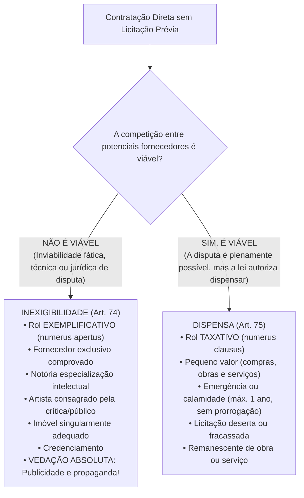
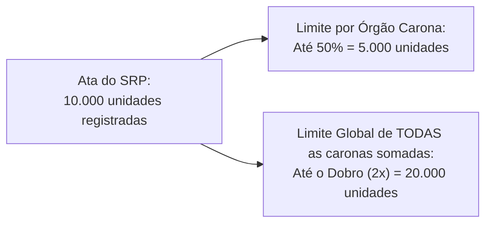

# 03 - Procedimentos Auxiliares e Contratação Direta (Dispensa e Inexigibilidade)

> **Matéria:** Licitações e Contratos Administrativos  
> **Cargo:** A01 – Técnico de Controle Externo – Especialidade: Técnico Administrativo  
> **Arquivo:** `03_procedimentos_auxiliares_e_contratacao_direta.md`  
> **Status:** 🟢 Teoria Aprofundada + 5 Questões FCC Comentadas (A a E)

---

## 📌 Ementa Oficial do Edital
- Procedimentos auxiliares das licitações e contratações (Art. 78 da Lei nº 14.133/2021).
- Credenciamento: hipóteses de cabimento e regras de remuneração.
- Pré-qualificação de fornecedores e produtos (pré-qualificação subjetiva e objetiva).
- Procedimento de Manifestação de Interesse (PMI).
- Sistema de Registro de Preços (SRP): órgão gerenciador, órgãos participantes e limites legais para órgãos não participantes ("caronas").
- Contratação Direta: processo de contratação direta e requisitos de instrução (Art. 72).
- Inexigibilidade de Licitação (Art. 74): inviabilidade de competição e rol exemplificativo.
- Serviços técnicos especializados de natureza predominantemente intelectual e notória especialização.
- Dispensa de Licitação (Art. 75): rol taxativo, dispensa por valor (pequeno valor), emergência, licitação deserta e fracassada.

---

## 🧭 Sumário

1. [Distinção Fundamental: Inexigibilidade x Dispensa de Licitação](#1-distincao-fundamental-inexigibilidade-x-dispensa-de-licitacao)
    1. [Teste 088](#Teste-088)
2. [Procedimentos Auxiliares da Lei nº 14.133/2021 (Art. 78)](#2-procedimentos-auxiliares-da-lei-no-141332021-art-78)
    1. [Credenciamento (Art. 79)](#21-credenciamento-art-79)
    2. [Pré-Qualificação Subjetiva e Objetiva (Art. 80)](#22-pre-qualificacao-subjetiva-e-objetiva-art-80)
    3. [Procedimento de Manifestação de Interesse - PMI (Art. 81)](#23-procedimento-de-manifestacao-de-interesse-pmi-art-81)
    4. [Sistema de Registro de Preços - SRP e Regras do Carona (Arts. 82 a 86)](#24-sistema-de-registro-de-precos-srp-e-regras-do-carona-arts-82-a-86)
    5. [Registro Cadastral Unificado (Art. 87)](#25-registro-cadastral-unificado-art-87)
    6. [Teste 089](#Teste-089)
    7. [Teste 090](#Teste-090)
    8. [Teste 091](#Teste-091)
    9. [Teste 092](#Teste-092)
3. [Processo Administrativo de Contratação Direta (Art. 72)](#3-processo-administrativo-de-contratacao-direta-art-72)
    1. [Teste 093](#Teste-093)
4. [Inexigibilidade de Licitação (Art. 74 - Inviabilidade de Competição)](#4-inexigibilidade-de-licitacao-art-74-inviabilidade-de-competicao)
    1. [Fornecedor e Prestador Exclusivo (Inciso I)](#41-fornecedor-e-prestador-exclusivo-inciso-i)
    2. [Profissional do Setor Artístico Consagrado (Inciso II)](#42-profissional-do-setor-artistico-consagrado-inciso-ii)
    3. [Serviços Técnicos Especializados e Notória Especialização (Inciso III)](#43-servicos-tecnicos-especializados-e-notoria-especializacao-inciso-iii)
    4. [Aquisição ou Locação de Imóvel Singular (Inciso V)](#44-aquisicao-ou-locacao-de-imovel-singular-inciso-v)
    5. [Teste 094](#Teste-094)
    6. [Teste 095](#Teste-095)
5. [Dispensa de Licitação (Art. 75 - Rol Taxativo)](#5-dispensa-de-licitacao-art-75-rol-taxativo)
    1. [Dispensa em Razão do Valor (Pequeno Valor - Incisos I e II)](#51-dispensa-em-razao-do-valor-pequeno-valor-incisos-i-e-ii)
    2. [Dispensa por Emergência ou Calamidade Pública (Inciso VIII)](#52-dispensa-por-emergencia-ou-calamidade-publica-inciso-viii)
    3. [Licitação Deserta, Fracassada e Remanescente de Contrato](#53-licitacao-deserta-fracassada-e-remanescente-de-contrato)
    4. [Teste 096](#Teste-096)
    5. [Teste 097](#Teste-097)
    6. [Teste 098](#Teste-098)
6. [🌐 Fontes Recomendadas na Internet](#fontes-recomendadas-na-internet)

---

## 1. Distinção Fundamental: Inexigibilidade x Dispensa de Licitação

A regra geral insculpida no art. 37, XXI, da CF/88 impõe a obrigatoriedade de licitar para obras, serviços, compras e alienações no setor público. Todavia, a própria Constituição ressalva "os casos especificados na legislação". A Nova Lei de Licitações (Lei nº 14.133/2021) estrutura a contratação direta sem certame competitivo em duas categorias nucleares: a **Inexigibilidade** e a **Dispensa**.

- **Inexigibilidade (Art. 74):** Configura-se sempre que houver **inviabilidade fática ou jurídica de competição**. Não há como comparar objetivamente propostas porque o objeto é único, o fornecedor é exclusivo ou a prestação decorre de dotes personalíssimos/intelectuais singulares. Por essa razão, a jurisprudência pacífica do TCU e a doutrina consagram que o rol do art. 74 é **exemplificativo** (*numerus apertus*), admitindo outros casos em que se comprove a impossibilidade fática de disputa.
- **Dispensa (Art. 75):** A disputa concorrencial é plenamente viável no plano fático e de mercado, porém o legislador, sopesando critérios de economicidade, celeridade ou interesse público primário, optou por autorizar a Administração a não licitar. Em face de seu caráter derrogatório da regra constitucional, o rol do art. 75 é **taxativo** (*numerus clausus*), vedada interpretação extensiva ou analógica para criar novas hipóteses de dispensa.

---

### Teste 088
**(Questão Inédita / Simulada Estilo FCC – Nível: Controle Externo / TI)**  
No âmbito das contratações públicas regidas pela Lei nº 14.133/2021, o legislador disciplinou no art. 78 os procedimentos auxiliares das licitações e das contratações. Constituem procedimentos auxiliares expressamente previstos no referido dispositivo legal:

* **A)** credenciamento, pré-qualificação, PMI, sistema de registro de preços e registro cadastral.
* **B)** concurso de projetos, leilão presencial, pregão eletrônico, tomada de preços e registro geral de fornecedores.
* **C)** audiência pública prévia, consulta pública eletrônica, diálogo competitivo e comissão de contratação especial.
* **D)** credenciamento simplificado, dispensa eletrônica por valor, inexigibilidade formal e pregão simplificado.
* **E)** matriz de riscos, estudo técnico preliminar, termo de referência e projeto básico executivo de obras.

---

> **Comentário Detalhado:**
>
> - **A)** **Correto**. O art. 78 da Lei nº 14.133/2021 estabelece taxativamente: "São procedimentos auxiliares das licitações e das contratações regidas por esta Lei: I - credenciamento; II - pré-qualificação; III - procedimento de manifestação de interesse; IV - sistema de registro de preços; V - registro cadastral".
> - **B)** **Incorreto**. Concurso, leilão e pregão são modalidades de licitação; tomada de preços foi extinta na NLLC.
> - **C)** **Incorreto**. Audiência e consulta pública são instrumentos de participação social na fase preparatória.
> - **D)** **Incorreto**. Dispensa e inexigibilidade são hipóteses de contratação direta, não procedimentos auxiliares.
> - **E)** **Incorreto**. ETP, TR e Projeto Básico são artefatos de planejamento preparatório.
>
> **Gabarito: A**
## 2. Procedimentos Auxiliares da Lei nº 14.133/2021 (Art. 78)

O art. 78 da Lei nº 14.133/2021 sistematizou cinco procedimentos auxiliares das licitações e contratações administrativas:

1. Credenciamento;
2. Pré-qualificação;
3. Procedimento de Manifestação de Interesse (PMI);
4. Sistema de Registro de Preços (SRP);
5. Registro Cadastral.

### 2.1 Credenciamento (Art. 79)
O credenciamento é o procedimento administrativo pelo qual a Administração convoca, mediante **edital de chamamento público com inscrições permanentemente abertas**, todos os interessados que preencham os requisitos previamente definidos para prestar serviços ou fornecer bens. 

No credenciamento, a Administração **não escolhe um único vencedor**: ela contrata **todos** os interessados habilitados, remunerando-os segundo uma tabela fixa de preços definida pelo próprio Poder Público. As hipóteses legais de cabimento são taxativas:

1. **Paralela e não excludente:** Caso em que é viável e vantajosa a contratação simultânea de vários prestadores para atender à demanda da Administração (ex.: credenciamento de laboratórios e clínicas de imagens para atender os segurados do plano de saúde dos servidores estaduais).
2. **Com seleção a critério de terceiros:** A definição do contratado compete ao próprio usuário final ou beneficiário do serviço (ex.: credenciamento de profissionais médicos em que o próprio paciente escolhe o especialista cadastrado, ou credenciamento de companhias aéreas em que o servidor escolhe o voo).
3. **Em mercados fluidos:** Hipótese em que a flutuação constante de preços e a exigência de rapidez tornam inviável a fixação antecipada por licitação tradicional, realizando-se cotação volátil em tempo real no momento de cada contratação (ex.: compra de combustíveis para abastecimento de frota pública em trânsito).

> 🚨 **ALERTA DE PROVA / FCC:**  
> A Lei nº 14.133/2021 tratou o credenciamento sob dupla face: no art. 78, como **procedimento auxiliar**, e no art. 74, inciso IV, como modalidade expressa de **inexigibilidade de licitação**. Como não há disputa concorrencial entre os credenciados (todos que cumprem os requisitos são credenciados sob tabela prefixada), há inviabilidade jurídica de competição, caracterizando a inexigibilidade formal da contratação.

### 2.2 Pré-Qualificação Subjetiva e Objetiva (Art. 80)
A pré-qualificação é o procedimento técnico-administrativo técnico permanente aberto a qualquer interessado para atestar antecipadamente:

- **Pré-qualificação Subjetiva:** A habilitação jurídica, técnica, fiscal e econômico-financeira de licitantes que reúnam condições de participar de futuras licitações;
- **Pré-qualificação Objetiva:** A conformidade técnica e operacional de bens, produtos ou serviços que atendam às exigências técnicas e padrões mínimos de desempenho da Administração.

A pré-qualificação é realizada mediante chamamento público aberto permanentemente. A validade da pré-qualificação é de **no máximo 1 (um) ano**, podendo ser atualizada a qualquer tempo pelos interessados ou revogada de ofício pela Administração quando comprovada perda dos requisitos originais. A pré-qualificação pode ser realizada em grupos ou segmentos determinados e sua existência permite agilizar certames posteriores com dispensa de reapresentação de documentos já convalidados.

### 2.3 Procedimento de Manifestação de Interesse - PMI (Art. 81)
O Procedimento de Manifestação de Interesse (PMI) é o chamamento público facultativo dirigido a pessoas físicas ou jurídicas de direito privado para a propositura e realização de estudos, investigações, levantamentos e projetos de soluções inovadoras que subsidiem futuras concessões comuns, parcerias público-privadas (PPPs), concessões de serviços públicos ou grandes projetos de infraestrutura.

Regras estruturais do PMI:

- O chamamento público define o escopo, as diretrizes e os critérios objetivos para aprovação dos projetos.
- A mera participação no PMI **não gera qualquer direito** a ressarcimento financeiro automático, indenização ou preferência no futuro certame licitatório.
- O autor do projeto selecionado e efetivamente utilizado na licitação só será ressarcido financeiramente **pelo vencedor da futura licitação**, sendo essa obrigação expressamente consignada no instrumento convocatório.

### 2.4 Sistema de Registro de Preços - SRP e Regras do Carona (Arts. 82 a 86)
O SRP é um conjunto de procedimentos para registro formal de preços relativos à prestação de serviços, obras e aquisição e locação de bens para contratações futuras e incertas. 

Adoção do SRP é recomendada quando:

- As demandas forem frequentes e rotineiras;
- For conveniente a aquisição parcelada para entregas contínuas;
- For impossível prever com exatidão prévia o quantitativo total a ser demandado no exercício financeiro.

A formalização do SRP ocorre por meio da **Ata de Registro de Preços (ARP)**, documento vinculativo e obrigacional com características de compromisso para futuras contratações.

**Regras de Vigência da Ata de Registro de Preços:**

- O prazo de vigência da ARP é de **1 (um) ano**, prorrogável por igual período (máximo de **2 anos**), desde que comprovada documentalmente a manutenção da vantajosidade dos preços registrados.

**Figuras do SRP:**

- **Órgão Gerenciador:** Responsável pela condução do certame licitatório e pelo gerenciamento global da ARP.
- **Órgão Participante:** Órgão que participou dos procedimentos iniciais do planejamento do certame e integrou a ata desde sua origem com quantitativos próprios estimados.
- **Órgão Não Participante ("Carona"):** Órgão que não participou do certame licitatório, mas solicita aderir tardiamente à ARP gerenciada por outro ente federativo ou órgão da Administração.

**Limites Imperativos para Adesão Tardia do Carona (Art. 86 da Lei 14.133/2021):**
A concessão de adesão exige autorização do órgão gerenciador, aceitação pelo fornecedor e demonstração analítica de vantagem econômica pelo carona. A NLLC impôs barreiras matemáticas severas contra abusos:

1. **Limite Individual por Órgão Não Participante (Art. 86, § 4º):** A contratação adicional não poderá exceder a **50% (cinquenta por cento)** dos quantitativos registrados na ata para o órgão gerenciador e para os órgãos participantes.
2. **Limite Global de TODAS as Adesões Somadas (Art. 86, § 5º):** O quantitativo total decorrente do conjunto de todas as caronas autorizadas não poderá ultrapassar, na totalidade, ao **dobro (200% ou 2x)** do quantitativo de cada item registrado na ata.

> ⚠️ **RESTRIÇÃO FEDERATIVA (Art. 86, § 8º):**  
> É vedada aos órgãos e entidades da Administração Pública Federal a adesão a ata de registro de preços gerenciada por órgão ou entidade estadual, distrital ou municipal. Em contrapartida, órgãos estaduais e municipais podem aderir a atas federais, desde que obedecidos os limites legais.

### 2.5 Registro Cadastral Unificado (Art. 87)
A Lei nº 14.133/2021 impõe a criação do sistema de registro cadastral unificado, operacionalizado no Portal Nacional de Contratações Públicas (PNCP), de acesso público e permanente. O registro cadastral simplifica a verificação de regularidade fiscal, trabalhista e qualificação econômico-financeira de licitantes, dispensando os inscritos da apresentação física de certidões válidas já integradas digitalmente ao sistema.

---

### Teste 089
**(Questão Inédita / Simulada Estilo FCC – Nível: Controle Externo / TI)**  
O credenciamento constitui procedimento auxiliar expressamente disciplinado no art. 79 da Lei Federal nº 14.133/2021. A respeito das hipóteses de cabimento e das regras operacionais do credenciamento, assinale a opção correta:

* **A)** O credenciamento é cabível quando for viável a contratação simultânea de todos os qualificados.
* **B)** O credenciamento exige a realização de leilão público prévio para fixar a tabela de remuneração dos serviços.
* **C)** O credenciamento veda o credenciamento de novos interessados durante todo o prazo de vigência do edital aberto.
* **D)** O credenciamento aplica-se prioritariamente a obras de grande vulto com regime de contratação semi-integrada.
* **E)** O credenciamento autoriza a autoridade a fixar preços diferenciados com base na data de inscrição do profissional.

---

> **Comentário Detalhado:**
>
> - **A)** **Correto**. O art. 79, I, da Lei nº 14.133/2021 prevê o credenciamento para "paralela e não excludente: caso em que é viável e vantajosa para a Administração a realização de contratações simultâneas em condições padronizadas", bem como com seleção a critério de terceiros (inciso II) e em mercados fluidos (inciso III). Todos os interessados qualificados são credenciados sob tarifa única.
> - **B)** **Incorreto**. O edital de credenciamento fixa previamente o valor remuneratório padrão, sem leilão.
> - **C)** **Incorreto**. O credenciamento permanece permanentemente aberto a novos interessados enquanto vigente o edital.
> - **D)** **Incorreto**. O credenciamento destina-se a serviços médicos, laboratoriais, perícias e passagens, não a obras integradas.
> - **E)** **Incorreto**. O valor da remuneração é estritamente isonômico e tabelado para todos os credenciados.
>
> **Gabarito: A**
### Teste 090
**(Questão Inédita / Simulada Estilo FCC – Nível: Controle Externo / TI)**  
O Secretário de Saúde necessita adquirir insumos hospitalares complexos e optou por instaurar procedimento auxiliar de pré-qualificação. Nos termos do art. 80 da Lei Federal nº 14.133/2021, o procedimento auxiliar de pré-qualificação:

* **A)** Presta-se a pré-qualificar licitantes e certificar a qualidade técnica de bens.
* **B)** É procedimento sigiloso restrito a empresas estatais convidadas pelo órgão promotor da futura licitação.
* **C)** Tem validade máxima de cinco anos improrrogáveis para fornecedores estrangeiros sem sede no país.
* **D)** Substitui a necessidade de realização de licitação posterior para contratações de valor expressivo.
* **E)** Veda a participação de empresas que não tenham participado de procedimentos licitatórios anteriores.

---

> **Comentário Detalhado:**
>
> - **A)** **Correto**. O art. 80 da Lei nº 14.133/2021 estabelece que a pré-qualificação é o procedimento técnico-administrativo para selecionar previamente: I - licitantes que reúnam condições de habilitação exigidas para o fornecimento de bem ou execução de serviço; e II - bens que atendam às exigências técnicas e de qualidade da administração. Pode ser subjetiva (empresas) ou objetiva (produtos/marcas).
> - **B)** **Incorreto**. O procedimento é estritamente público e aberto permanentemente a qualquer interessado (art. 80, § 1º).
> - **C)** **Incorreto**. A validade da pré-qualificação é de, no máximo, 1 (um) ano, podendo ser atualizada a qualquer tempo (art. 80, § 2º).
> - **D)** **Incorreto**. A pré-qualificação não contrata; apenas agiliza as licitações futuras que serão obrigatoriamente deflagradas.
> - **E)** **Incorreto**. É vedada qualquer cláusula discriminatória ou restritiva que afaste novos competidores.
>
> **Gabarito: A**
### Teste 091
**(Questão Inédita / Simulada Estilo FCC – Nível: Controle Externo / TI)**  
Uma autarquia estadual goiana pretende adquirir medicamentos essenciais para distribuição hospitalar continuada mediante utilização do Sistema de Registro de Preços (SRP). De acordo com as disposições do art. 82 da Lei Federal nº 14.133/2021:

* **A)** O SRP obriga a Administração a adquirir integralmente os quantitativos registrados na Ata de Registro de Preços.
* **B)** A licitação para registro de preços pode ser realizada exclusivamente na modalidade diálogo competitivo com lances.
* **C)** A ata de registro de preços gera mera expectativa de fornecimento, não conferindo direito subjetivo à contratação.
* **D)** O prazo de vigência da ata de registro de preços é de até cinco anos ininterruptos, vedadas prorrogações no período.
* **E)** É proibida a alteração de preços registrados na ata mesmo diante de expressiva elevação dos insumos no mercado.

---

> **Comentário Detalhado:**
>
> - **A)** **Incorreto**. A existência de preços registrados não obriga a Administração a firmar as contratações correlatas (art. 83).
> - **B)** **Incorreto**. O SRP é operacionalizado nas modalidades pregão ou concorrência (art. 82, caput).
> - **C)** **Correto**. O art. 83 da Lei nº 14.133/2021 consagra a regra tradicional: "A existência de preços registrados implicará compromisso de fornecimento nas condições estabelecidas, mas não obrigará a Administração a contratar, facultada a realização de licitação específica para a aquisição pretendida, desde que devidamente justificada". O particular tem o dever de manter o preço, mas a Administração tem discricionariedade de compra.
> - **D)** **Incorreto**. O prazo de vigência da ata de registro de preços é de 1 (um) ano, prorrogável por igual período (art. 84).
> - **E)** **Incorreto**. A ata admite negociação e readequação de preços em decorrência de variações do mercado (art. 82, § 5º, IV).
>
> **Gabarito: C**
### Teste 092
**(Questão Inédita / Simulada Estilo FCC – Nível: Controle Externo / TI)**  
No que se refere ao Sistema de Registro de Preços (SRP) e à utilização da ata por órgão não participante (figura do "carona"), com fundamento no art. 86 da Lei Federal nº 14.133/2021, a adesão à ata de outro ente federado:

* **A)** Exige prévia consulta e concordância expressa do órgão gerenciador e demonstração da vantajabilidade econômica.
* **B)** É ilimitada quanto aos quantitativos totais que cada órgão não participante pode adquirir na vigência da ata.
* **C)** Dispensa a anuência do fornecedor beneficiário da ata quando a adesão for realizada por órgão estadual ou municipal.
* **D)** Permite que órgãos da Administração Federal adiram livremente a atas originárias de Municípios de pequeno porte.
* **E)** Veda a aquisição de bens comuns de tecnologia da informação e comunicação por adesão a atas de registro de preços.

---

> **Comentário Detalhado:**
>
> - **A)** **Correto**. O art. 86, § 2º da Lei nº 14.133/2021 estabelece que a adesão pelo não participante exige: 1) apresentação de justificativa da vantagem da adesão; 2) demonstração de que os valores registrados são compatíveis com os praticados no mercado; 3) prévias consulta e aceitação do órgão ou entidade gerenciadora e do fornecedor.
> - **B)** **Incorreto**. O art. 86, § 4º e § 5º fixa limites estritos individuais (até 50% dos quantitativos da ata) e globais (o dobro do quantitativo original da ata).
> - **C)** **Incorreto**. A anuência formal do fornecedor beneficiário da ata é condição indispensável (art. 86, § 2º, III).
> - **D)** **Incorreto**. O art. 86, § 8º veda a adesão de órgãos federais a atas lavradas por órgãos estaduais, distritais ou municipais.
> - **E)** **Incorreto**. O SRP é plenamente aplicável e rotineiramente utilizado para soluções de TI.
>
> **Gabarito: A**
## 3. Processo Administrativo de Contratação Direta (Art. 72)

Tanto a dispensa quanto a inexigibilidade não significam informalidade ou ausência de procedimento. O art. 72 da Lei nº 14.133/2021 estabelece que o processo de contratação direta deve ser obrigatoriamente instruído com os seguintes elementos mínimos sob pena de nulidade:

1. Documento de formalização da demanda e, se for o caso, Estudo Técnico Preliminar (ETP);
2. Termo de Referência (TR), anteprojeto, projeto básico ou projeto executivo;
3. Estimativa de despesa calculada na forma do art. 23 da Lei;
4. Demonstração de previsão dos recursos orçamentários em dotação própria;
5. Comprovação de que o contratado preenche os requisitos de habilitação e qualificação mínima exigida;
6. Justificativa expressa de preço (comprovando compatibilidade com o mercado praticado);
7. Razão da escolha do contratado ou executante;
8. Parecer jurídico do órgão de assessoramento advocatício da Administração e eventuais pareceres técnicos;
9. Autorização expressa e motivação emanada da autoridade máxima competente.

> 📢 **Eficácia no PNCP (Art. 94 e Art. 72, parágrafo único):**  
> O ato que autoriza a contratação direta ou o respectivo extrato de contrato deve ser publicado e divulgado obrigatoriamente no **Portal Nacional de Contratações Públicas (PNCP)** no prazo de **10 (dez) dias úteis**, contado da data de sua assinatura, como condição indispensável para sua eficácia jurídica perante terceiros.

---

### Teste 093
**(Questão Inédita / Simulada Estilo FCC – Nível: Controle Externo / TI)**  
O art. 72 da Lei nº 14.133/2021 estabelece a instrução processual obrigatória que deve instruir os processos de contratação direta por inexigibilidade ou por dispensa de licitação. Constitui requisito indispensável do processo de contratação direta:

* **A)** A demonstração da dotação orçamentária compatível com a despesa a ser assumida.
* **B)** A comprovação prévia de realização de pregão eletrônico deserto no mesmo exercício financeiro da contratação.
* **C)** A autorização expressa e unânime do plenário da Assembleia Legislativa estadual em audiência temática pública.
* **D)** A renúncia formal do contratado a qualquer pedido de reequilíbrio econômico-financeiro futuro no contrato.
* **E)** O depósito prévio de caução em títulos da dívida pública no valor correspondente a cinquenta por cento do ajuste.

---

> **Comentário Detalhado:**
>
> - **A)** **Correto**. O art. 72 da Lei nº 14.133/2021 elenca os documentos de instrução obrigatória: I - documento de formalização de demanda (DFD); II - estimativa de despesa calculada na forma da lei; III - parecer jurídico e pareceres técnicos; IV - demonstração da compatibilidade orçamentária; V - comprovação de que o contratado preenche os requisitos de habilitação e qualificação mínima; VI - razão da escolha do contratado; VII - justificativa de preço.
> - **B)** **Incorreto**. Pregão deserto é apenas uma das hipóteses de dispensa (art. 75, III), não sendo requisito universal das contratações diretas.
> - **C)** **Incorreto**. Contratação direta é ato de gestão do Executivo, dispensando chancela parlamentar.
> - **D)** **Incorreto**. O reequilíbrio econômico-financeiro é garantia constitucional inafastável (art. 37, XXI da CF).
> - **E)** **Incorreto**. Exigência totalmente desprovida de previsão legal.
>
> **Gabarito: A**
## 4. Inexigibilidade de Licitação (Art. 74 - Inviabilidade de Competição)

A inexigibilidade é caracterizada pela inviabilidade fática ou jurídica de certame licitatório. O rol do art. 74 é **exemplificativo**. As hipóteses legais expressas são:

### 4.1 Fornecedor e Prestador Exclusivo (Inciso I)
- Aquisição de materiais, equipamentos ou gêneros, ou contratação de serviços que só possam ser fornecidos por produtor, empresa ou representante comercial exclusivo.
- **Comprovação Formal Obrigatória:** Atestado emitido pelo órgão de registro do comércio local, pelo sindicato, federação ou confederação patronal, ou entidade equivalente.
- **Vedação à Preferência de Marca:** É expressamente vedada a indicação de marca, modelo ou preferência injustificada na fase preparatória que venha a fabricar artificialmente uma exclusividade mercantil.

### 4.2 Profissional do Setor Artístico Consagrado (Inciso II)
- Contratação de profissional de qualquer setor artístico, diretamente ou por meio de empresário exclusivo.
- **Requisito Subjetivo:** O artista deve ser consagrado pela crítica especializada ou pela opinião pública regional/nacional.
- **Empresário Exclusivo:** A lei exige a representação por empresário exclusivo de fato (com contrato de exclusividade arquivado e de ampla duração), vedada a intermediação por agenciadores eventuais que recebem procurações de ocasião apenas para o evento licitado.

### 4.3 Serviços Técnicos Especializados e Notória Especialização (Inciso III)
A contratação direta sem licitação para serviços técnicos especializados exige cumulativamente três requisitos fundamentais:

1. Que o serviço seja de natureza **predominantemente intelectual** e enquadrado no rol do art. 67 (pareceres, perícias, laudos, assessorias técnicas, patrocínio ou defesa de causas judiciais e administrativas, auditorias financeiras e tributárias, restauração de obras de arte, treinamento e aperfeiçoamento de pessoal);
2. Que seja executado por profissional ou empresa de **notória especialização** (cujo conceito, histórico profissional, titulação, pesquisas e trabalhos anteriores permitam inferir que seu trabalho é indiscutivelmente o mais adequado e essencial à plena satisfação do objeto);
3. Que o serviço possua natureza **singular** (características peculiares que afastam a padronização comum de mercado).

> 🚫 **VEDAÇÃO ABSOLUTA DA NLLC (Art. 74, § 3º):**  
> É **vedada a inexigibilidade de licitação para serviços de publicidade e divulgação**. Campanhas publicitárias institucionais e propaganda governamental exigem compulsoriamente licitação com rito regulado pela Lei Federal nº 12.232/2010 (julgamento por melhor técnica ou técnica e preço, com subcomissão técnica imparcial).

### 4.4 Aquisição ou Locação de Imóvel Singular (Inciso V)
- Aquisição ou locação de imóvel cujas características de instalações e de localização tornem necessária sua escolha pela Administração.
- **Requisitos Formais:** Exige avaliação prévia de mercado, certificação da inexistência de imóveis públicos vagos adequados e justificativa técnica detalhada comprovando a singularidade do imóvel para o desempenho das atividades institucionais.

---

### Teste 094
**(Questão Inédita / Simulada Estilo FCC – Nível: Controle Externo / TI)**  
O Tribunal de Contas do Estado necessita contratar com profissional do setor artístico consagrado pela crítica especializada para apresentação cultural em simpósio comemorativo. À luz das regras sobre Inexigibilidade de Licitação (art. 74 da Lei nº 14.133/2021):

* **A)** A inexigibilidade aplica-se exclusivamente às situações expressamente tipificadas nos incisos do art. 74 em rol taxativo.
* **B)** A contratação de artista consagrado é inexigível pela inviabilidade de disputa objetiva.
* **C)** A contratação artística exige licitação na modalidade concurso com julgamento por menor tarifa de cachê negociada.
* **D)** A inexigibilidade afasta a necessidade de justificativa de preço, podendo o artista estipular livremente a remuneração.
* **E)** O contrato artístico decorrente de inexigibilidade pode ser celebrado por empresário sem exclusividade de representação.

---

> **Comentário Detalhado:**
>
> - **A)** **Incorreto**. O caput do art. 74 consagra que o rol de inexigibilidade é EXEMPLIFICATIVO ("é inexigível a licitação quando inviável a competição, em especial nos casos de...").
> - **B)** **Correto**. O art. 74, II, da Lei nº 14.133/2021 prevê expressamente a inexigibilidade para "contratação de profissional do setor artístico, diretamente ou por meio de empresário exclusivo, desde que consagrado pela crítica especializada ou pela opinião pública". A singularidade estética do artista inviabiliza a comparação matemática de preços em licitação.
> - **C)** **Incorreto**. Concurso não se presta à contratação direta de shows artísticos comemorativos.
> - **D)** **Incorreto**. A justificativa de preço é obrigatória na contratação direta (art. 72, VII), comprovando-se a razoabilidade do cachê por contratos pretéritos.
> - **E)** **Incorreto**. A representação deve ser por empresário exclusivo comprovado (art. 74, § 2º).
>
> **Gabarito: B**
### Teste 095
**(Questão Inédita / Simulada Estilo FCC – Nível: Controle Externo / TI)**  
A Administração Pública tem necessidade de contratar profissional de notória especialização para emitir parecer jurídico de alta complexidade constitucional em processo judicial de relevante interesse financeiro do Estado. A respeito da inexigibilidade para contratação de serviços técnicos especializados (art. 74, III da Lei nº 14.133/2021):

* **A)** Exige serviço técnico especializado, caráter intelectual e notória especialização.
* **B)** Veda a contratação direta caso existam outros profissionais de renome no mercado atuando no mesmo ramo doutrinário.
* **C)** Admite a inexigibilidade para a contratação rotineira de serviços de publicidade institucional e propaganda governamental.
* **D)** A notória especialização afasta a obrigação de justificar a economicidade do valor dos honorários propostos pelo jurista.
* **E)** A caracterização da notória especialização exige que o profissional seja professor titular de universidade pública federal.

---

> **Comentário Detalhado:**
>
> - **A)** **Correto**. O art. 74, III, da Lei nº 14.133/2021 autoriza a inexigibilidade para "contratação dos seguintes serviços técnicos especializados de natureza predominantemente intelectual com profissionais ou empresas de notória especialização, vedada a inexigibilidade para serviços de publicidade e divulgação". São três requisitos cumulativos: serviço técnico do rol legal (ex: pareceres), natureza predominantemente intelectual e notória especialização do profissional (art. 74, § 3º).
> - **B)** **Incorreto**. A existência de outros especialistas no mercado não descaracteriza a inexigibilidade, pois o juízo de confiança e singularidade do profissional é prerrogativa motivada do gestor (Tema 265 do STF).
> - **C)** **Incorreto**. É expressamente vedada a inexigibilidade para serviços de publicidade e divulgação (art. 74, III in fine).
> - **D)** **Incorreto**. A justificativa de preços por confronto com contratações anteriores do profissional é exigência inafastável.
> - **E)** **Incorreto**. A notória especialização comprova-se por desempenho anterior, estudos, publicações e reputação (art. 74, § 3º).
>
> **Gabarito: A**
## 5. Dispensa de Licitação (Art. 75 - Rol Taxativo)

A dispensa de licitação ocorre em circunstâncias nas quais a competição entre particulares seria perfeitamente viável, mas a lei autoriza a Administração a contratar diretamente por razões de eficiência, utilidade ou conveniência coletiva. O rol do art. 75 é **taxativo** (*numerus clausus*).

### 5.1 Dispensa em Razão do Valor (Pequeno Valor - Incisos I e II)
- **Inciso I:** Obras e serviços de engenharia ou serviços de manutenção de veículos automotores (valor-base de R$ 100.000,00 na publicação da lei, reajustado anualmente por decreto federal).
- **Inciso II:** Outros serviços e compras em geral (valor-base de R$ 50.000,00 na publicação da lei, reajustado anualmente por decreto federal).
- **Vedação ao Fracionamento Ilícito (§ 1º do art. 75):** Para fins de aferição dos valores-limite, deve ser considerado o somatório do que for despendido no mesmo **exercício financeiro** pela mesma **unidade gestora** com objetos de **mesma natureza**, entendidos como aqueles relativos a contratações no mesmo ramo de atividade econômica.
- **Duplicação de Limites (§ 2º):** Os valores-limite são duplicados (2x) para contratações realizadas por consórcios públicos e agências executivas.

### 5.2 Dispensa por Emergência ou Calamidade Pública (Inciso VIII)
- Aplica-se em situações de emergência ou calamidade pública quando caracterizada urgência de atendimento de situação que possa ocasionar prejuízo ou comprometer a segurança de pessoas, obras, serviços, equipamentos e outros bens, públicos ou particulares.
- Destina-se exclusivamente à contratação de bens e serviços necessários ao atendimento da situação emergencial concreta, no limite do estritamente indispensável.

**Inovações Capitais da Lei 14.133/2021 sobre Emergência:**

1. **Prazo de Vigência Contratual:** O contrato emergencial terá prazo máximo de vigência de até **1 (um) ano**, contado da data de ocorrência da emergência (superando o antigo limite de 180 dias da Lei 8.666/93).
2. **Vedação Absoluta de Prorrogação:** É **expressamente proibida a prorrogação** dos contratos administrativos emergenciais firmados sob este inciso.
3. **Vedação de Recontratação da Empresa Causadora:** É expressamente vedada a recontratação de empresa que tenha dado causa à situação emergencial ou de calamidade por inexecução culposa ou inadimplemento de contrato anterior.

> 🚨 **ALERTA DE PROVA / FCC:**  
> A ocorrência de "emergência fabricada" — isto é, decorrente da desídia, inércia ou omissão de gestores públicos que deixaram de licitar a tempo um contrato continuado — **não impede** a contratação emergencial quando o interesse coletivo exigir a continuidade do serviço ou preservação de vidas. Todavia, a NLLC e a jurisprudência sumulada do TCU determinam que a autoridade deve determinar imediatamente a instauração de processo administrativo para apuração de responsabilidade dos agentes que deram causa à emergência por dolo ou negligência.

### 5.3 Licitação Deserta, Fracassada e Remanescente de Contrato
- **Licitação Deserta (Art. 75, III, "a"):** Licitação na qual não compareceu nenhum licitante interessado (ausência de propostas). A dispensa é autorizada se comprovado que nova licitação causaria prejuízo à Administração e desde que sejam mantidas todas as condições preestabelecidas no edital primitivo.
- **Licitação Fracassada (Art. 75, III, "b"):** Certame em que todas as propostas apresentadas foram desclassificadas (preços abusivos ou desconformidade técnica) ou todos os licitantes foram inabilitados. A dispensa exige a comprovação de prejuízo na repetição do certame e a estrita manutenção das condições do edital.
- **Remanescente de Obra, Serviço ou Fornecimento (Art. 75, VII):** Ocorre após a rescisão contratual de ajuste anterior. A contratação direta é facultada aos demais licitantes classificados no certame original, atendida a ordem de classificação originária e desde que o convocado aceite celebrar o contrato nas mesmas condições econômicas propostas pelo licitante vencedor original.

---

### Teste 096
**(Questão Inédita / Simulada Estilo FCC – Nível: Controle Externo / TI)**  
Tendo em vista que determinada unidade administrativa necessita adquirir materiais de consumo de pronto atendimento e serviços de manutenção predial com despesas estimadas abaixo dos limites legais do art. 75, I e II, da Lei nº 14.133/2021, o Diretor questionou se o órgão poderia licitar ou realizar contratação direta. 

A respeito da dispensa de licitação em razão do valor e das regras sobre fracionamento de despesa, é correto afirmar que:

* **A)** a realização de licitação é vedada pela NLLC quando o valor do objeto situar-se abaixo dos patamares de dispensa.
* **B)** a dispensa de licitação por valor é faculdade da Administração, sendo plenamente cabível licitar se for conveniente.
* **C)** o limite de valor para compras e serviços é cumulado e compartilhado indistintamente com o limite de obras de engenharia.
* **D)** a aferição do limite financeiro para dispensa desconsidera outras compras da mesma natureza ao longo do exercício financeiro.
* **E)** a contratação direta por valor dispensa a verificação de regularidade fiscal e trabalhista do fornecedor contratado.

---

> **Comentário Detalhado:**
>
> - **A)** **Incorreto**. A dispensa de licitação é uma faculdade conferida pela lei à Administração, e não um dever cogente de não licitar.
> - **B)** **Correto**. Conforme a jurisprudência pacífica e a doutrina, a Administração Pública tem a discricionariedade de dispensar a licitação por baixo valor (art. 75 da NLLC) para conferir celeridade e economicidade, mas pode perfeitamente optar por deflagrar o processo licitatório (como pregão eletrônico) quando avaliar que a ampla disputa trará proposta mais vantajosa para o erário.
> - **C)** **Incorreto**. O art. 75, I e II fixa tetos diferenciados e autônomos: inciso I para obras e serviços de engenharia; inciso II para outros serviços e compras.
> - **D)** **Incorreto**. O art. 75, § 1º, I impõe o somatório de todas as despesas da mesma natureza realizadas no exercício financeiro pela mesma unidade gestora, vedando o fracionamento ilegal de compras.
> - **E)** **Incorreto**. A habilitação jurídica, fiscal e trabalhista mínima do contratado é obrigatória (art. 72, V).
>
> **Gabarito: B**
### Teste 097
**(Questão Inédita / Simulada Estilo FCC – Nível: Controle Externo / TI)**  
Em razão de chuvas torrenciais atípicas que destruíram a principal ponte de acesso a determinado município goiano, isolando a população local, o Governador do Estado autorizou a contratação emergencial de empresa de engenharia para reconstrução da via com base no art. 75, VIII da Lei nº 14.133/2021. Sobre a dispensa emergencial:

* **A)** O contrato emergencial pode ter vigência de até um ano contado da emergência, vedada a sua prorrogação contratual.
* **B)** A contratação emergencial pode perdurar por até dois anos consecutivos desde que o estado de calamidade persista.
* **C)** A contratação emergencial admite a inclusão de obras de embelezamento urbano e ampliação paisagística da rodovia.
* **D)** A comprovação de emergência fabricada pela inércia culposa do gestor obsta a contratação direta das obras essenciais.
* **E)** O fornecedor contratado emergencialmente fica liberado da execução das parcelas contratadas se houver atraso na LOA.

---

> **Comentário Detalhado:**
>
> - **A)** **Correto**. O art. 75, VIII, da Lei Federal nº 14.133/2021 consagra que a contratação emergencial ou calamitosa terá como limite: "para as parcelas de obras e serviços que possam ser concluídas no prazo máximo de 1 (um) ano, contado da data de ocorrência da emergência, vedadas a prorrogação dos respectivos contratos e a recontratação de empresa já contratada com base no mesmo dispositivo". A nova lei ampliou o prazo da Lei 8.666 (que era de 180 dias) para até 1 ano, mas proibiu peremptoriamente qualquer aditivo de prorrogação.
> - **B)** **Incorreto**. O prazo máximo improrrogável é de 1 (um) ano.
> - **C)** **Incorreto**. A dispensa limita-se estritamente às obras e serviços necessários ao atendimento da situação emergencial (art. 75, VIII).
> - **D)** **Incorreto**. Pelo entendimento do TCU e STJ, mesmo na "emergência fabricada" pelo gestor desidioso, a contratação direta é mantida para afastar o perigo à vida e à comunidade, apurando-se a responsabilidade pessoal do agente que gerou a inércia.
> - **E)** **Incorreto**. O contratado responde pelas obrigações pactuadas sob as penas contratuais e legais cabíveis.
>
> **Gabarito: A**
### Teste 098
**(Questão Inédita / Simulada Estilo FCC – Nível: Controle Externo / TI)**  
Determinada pasta estadual deflagrou licitação sob a modalidade pregão eletrônico para aquisição de combustíveis. Na data designada na sessão pública, nenhum licitante compareceu ou encaminhou propostas (licitação deserta). Diante disso, a respeito das providências cabíveis com base no art. 75, III, "a" da Lei nº 14.133/2021:

* **A)** A Administração pode contratar diretamente mantendo as condições do edital deserto.
* **B)** A realização de licitação deserta obriga a autoridade a elevar em cinquenta por cento o preço estimado para nova sessão.
* **C)** A dispensa de licitação é automática e dispensa justificativa da inviabilidade de repetição do procedimento licitatório.
* **D)** O fenômeno narrado consubstancia licitação fracassada, em que todos os licitantes foram desclassificados por preço.
* **E)** A licitação deserta impõe o arquivamento definitivo da demanda de compras públicas do órgão no exercício corrente.

---

> **Comentário Detalhado:**
>
> - **A)** **Correto**. O art. 75, III, "a" da Lei nº 14.133/2021 estabelece que é dispensável a licitação: "para a contratação que mantenha todas as condições preestabelecidas em edital de licitação realizada há menos de 1 (um) ano, quando se verificar que naquela licitação: a) não surgiram licitantes interessados ou não foram apresentadas propostas válidas [licitação deserta]; b) as propostas apresentadas consignaram preços manifestamente superiores aos praticados no mercado [licitação fracassada]". Exige-se justificativa de que a repetição do certame traria prejuízos à Administração e a manutenção integral das condições originais.
> - **B)** **Incorreto**. É vedada a alteração de condições materiais ou elevação arbitrária de preços para dispensar.
> - **C)** **Incorreto**. A contratação direta exige justificativa formal da inviabilidade ou prejuízo de republicação do edital.
> - **D)** **Incorreto**. Ocorrência em que nenhum licitante comparece é licitação deserta; licitação fracassada ocorre quando aparecem interessados, mas todos são inabilitados ou desclassificados.
> - **E)** **Incorreto**. O órgão deve suprir sua necessidade pública contratando diretamente com base no edital deserto.
>
> **Gabarito: A**
