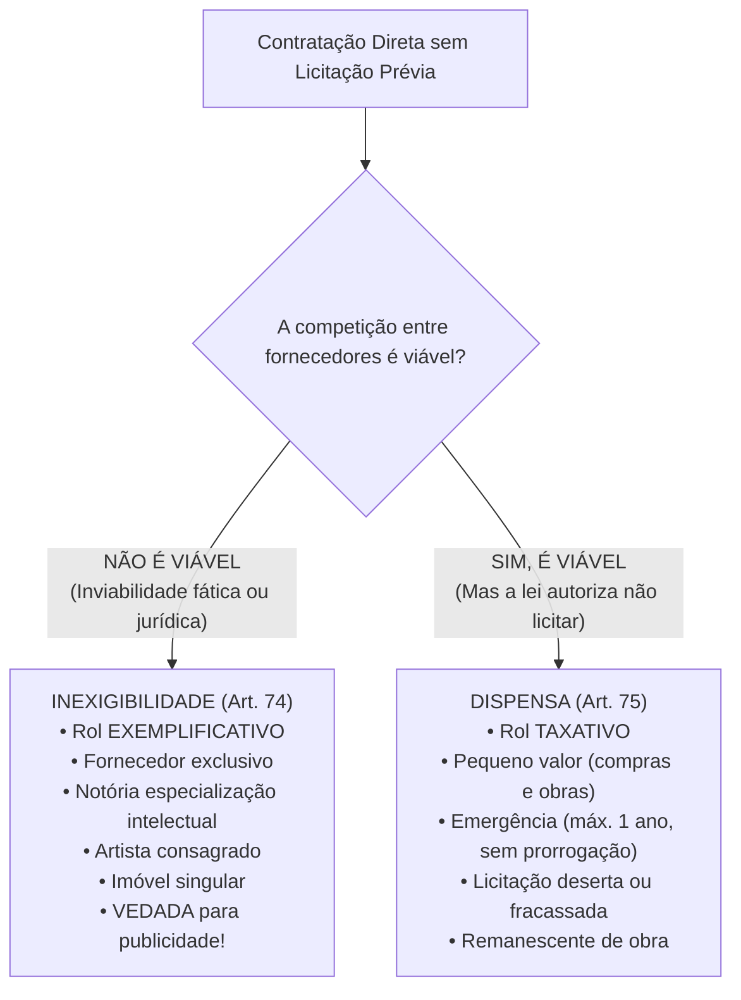
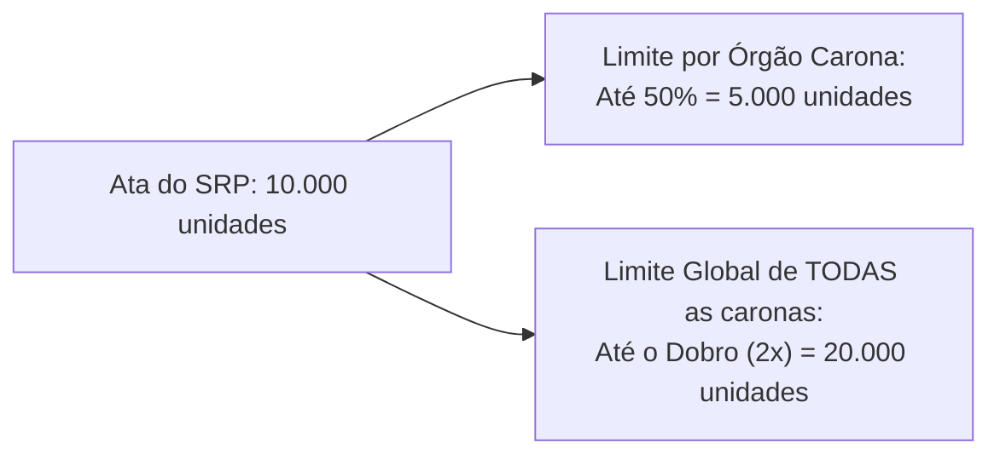

# 03 - Procedimentos Auxiliares e Contratação Direta (Dispensa e Inexigibilidade)

> **Matéria:** Licitações e Contratos Administrativos  
> **Cargo:** A01 – Técnico de Controle Externo – Especialidade: Técnico Administrativo  
> **Arquivo:** `03_procedimentos_auxiliares_e_contratacao_direta.md`  
> **Status:** 🟢 Teoria Aprofundada + 5 Questões FCC Comentadas (A a E)

---

## 📌 Ementa Oficial do Edital
- Procedimentos auxiliares das licitações e contratações (Art. 78 da Lei nº 14.133/2021).
- Credenciamento: hipóteses de cabimento e regras de remuneração.
- Pré-qualificação de fornecedores e produtos (pré-qualificação subjetiva e objetiva).
- Procedimento de Manifestação de Interesse (PMI).
- Sistema de Registro de Preços (SRP): órgão gerenciador, órgãos participantes e limites legais para órgãos não participantes ("caronas").
- Contratação Direta: processo de contratação direta e requisitos de instrução (Art. 72).
- Inexigibilidade de Licitação (Art. 74): inviabilidade de competição e rol exemplificativo.
- Serviços técnicos especializados de natureza predominantemente intelectual e notória especialização.
- Dispensa de Licitação (Art. 75): rol taxativo, dispensa por valor (pequeno valor), emergência, licitação deserta e fracassada.

---

## 🌳 Classificação Hierárquica do Conteúdo

```text
3. Procedimentos Auxiliares e Regime da Contratação Direta (Lei nº 14.133/2021)
├── 3.1 Procedimentos Auxiliares das Licitações (Art. 78)
│   ├── Credenciamento (Art. 79): Chamamento aberto e remuneração pré-fixada
│   │   ├── Paralela e não excludente: Vários prestadores simultâneos (ex.: clínicas e laboratórios)
│   │   ├── A critério de terceiros: Usuário escolhe o credenciado (ex.: passagens aéreas e médicos)
│   │   └── Mercados fluidos: Cotação volátil em tempo real (ex.: combustíveis e commodities)
│   ├── Pré-Qualificação (Art. 80): Subjetiva (habilitação técnica) e Objetiva (bens) - Validade: 1 ano
│   ├── Procedimento de Manifestação de Interesse - PMI (Art. 81): Estudos de particulares para concessões
│   └── Sistema de Registro de Preços - SRP (Arts. 82 a 86):
│       ├── Ata de Registro de Preços (ARP): Validade de 1 ano, prorrogável por mais 1 (máx. 2 anos)
│       └── Regras Restritivas para Caronas (Art. 86): Limite individual de 50% e limite global do dobro (2x)
├── 3.2 O Processo Administrativo de Contratação Direta (Art. 72)
│   ├── Instrução Obrigatória: Demanda, ETP, TR/PB, estimativa de valor, dotação, certidões e pareceres
│   └── Publicidade no PNCP no prazo de 10 dias úteis como condição de eficácia
├── 3.3 Inexigibilidade de Licitação (Art. 74 - Inviabilidade de Competição)
│   ├── Natureza do Rol: ROL EXEMPLIFICATIVO (inviabilidade fática de disputa)
│   ├── Fornecedor Exclusivo (Inciso I): Atestado oficial de entidade setorial; vedada preferência de marca
│   ├── Artista Consagrado (Inciso II): Reconhecido pela crítica especializada ou opinião pública
│   ├── Serviços Técnicos Especializados de Natureza Predominantemente Intelectual (Inciso III):
│   │   ├── Notória especialização em pareceres, defesas judiciais, auditorias e treinamentos
│   │   └── VEDAÇÃO EXPRESSA (Art. 74, § 3º): É proibida a inexigibilidade para serviços de publicidade!
│   └── Aquisição ou Locação de Imóvel Específico (Inciso V): Singularidade de instalações e localização
└── 3.4 Dispensa de Licitação (Art. 75 - Licitação Viável, mas Dispensada por Lei)
    ├── Natureza do Rol: ROL TAXATIVO (numerus clausus - permissão legal expressa)
    ├── Dispensa em Razão do Valor (Pequeno Valor - Incisos I e II):
    │   ├── Obras e serviços de engenharia e manutenção de veículos (limite atualizado anualmente)
    │   ├── Compras e outros serviços gerais (limite atualizado anualmente)
    │   └── Vedação ao Fracionamento: Somatório do exercício financeiro da mesma natureza
    └── Principais Hipóteses Materiais:
        ├── Emergência e Calamidade Pública (Inciso VIII): Contrato máximo de 1 ano; vedada prorrogação!
        ├── Licitação Deserta (Inciso III): Nenhum interessado acudiu à licitação anterior
        ├── Licitação Fracassada: Todos foram inabilitados ou desclassificados
        └── Remanescente de Obra ou Serviço (Inciso VII): Convocação na ordem do certame anterior
```

---

## 📖 Teoria Aprofundada e Pontos Críticos

### 1. Inexigibilidade x Dispensa de Licitação



---

### 2. Procedimentos Auxiliares da Lei nº 14.133/2021 (Art. 78)

1. **Credenciamento (Art. 79):** Procedimento aberto em que a Administração credencia **todos os interessados** que preencham as condições do edital permanente. A remuneração é tabelada e prefixada pela Administração. Três hipóteses de cabimento:
   - *Paralela e não excludente:* Vários credenciados atendem ao mesmo tempo (ex.: credenciamento de laboratórios para exames do Ipasgo).
   - *A critério de terceiros:* O próprio cidadão atendido escolhe o prestador cadastrado (ex.: escolha de médico ou emissão de passagens).
   - *Mercados fluidos:* Flutuação contínua e volátil de preços (ex.: combustíveis de frotas).
2. **Pré-Qualificação (Art. 80):** Procedimento permanente para atestar previamente a qualificação técnica de licitantes (*subjetiva*) ou de bens e materiais (*objetiva*). A pré-qualificação é válida por no máximo **1 ano**.
3. **Procedimento de Manifestação de Interesse - PMI (Art. 81):** Chamamento aberto a empresas e consultorias privadas para elaboração de projetos, levantamentos e estudos de viabilidade para futuras concessões ou PPPs. O autor do estudo **só é ressarcido pelo vencedor** da futura licitação, caso o projeto seja efetivamente utilizado.
4. **Sistema de Registro de Preços - SRP (Arts. 82 a 86):** Procedimento para registrar formalmente preços para aquisições futuras.
   - **Vigência da Ata:** **1 ano**, prorrogável por igual período até o máximo de **2 anos**.
   - **Regras para o "Carona" (Órgão Não Participante - Art. 86):**
     - Exige autorização prévia do órgão gerenciador e estudo de vantajosismo econômico;
     - Limite individual por órgão não participante: até **50% dos quantitativos** da ata;
     - Limite global de todas as caronas somadas: no máximo o **dobro (200% ou 2x)** do quantitativo de cada item registrado na ata.



---

### 3. Principais Hipóteses de Dispensa de Licitação (Art. 75)

#### 3.1 Dispensa em Razão do Valor (Incisos I e II)
- Obras e serviços de engenharia ou manutenção de veículos automotores (valor atualizado periodicamente por decreto).
- Compras em geral e outros serviços (valor atualizado periodicamente por decreto).
- **Proibição de Fracionamento:** O limite deve ser verificado considerando o somatório de todas as despesas da mesma natureza realizadas no mesmo exercício financeiro pela respectiva unidade gestora.
- Os limites são **duplicados** para compras realizadas por consórcios públicos e agências executivas.

#### 3.2 Dispensa por Emergência ou Calamidade Pública (Inciso VIII)
- Destinada a afastar risco de danos a pessoas, obras, serviços ou bens públicos.
- **Duração Máxima:** Contratos firmados sob esta hipótese vigoram pelo prazo máximo de **1 (um) ano** contado da data de ocorrência da emergência.
- **VEDAÇÕES ABSOLUTAS:**
  1. É **terminantemente proibida a prorrogação** dos contratos emergenciais;
  2. É **proibida a recontratação de empresa** que deu causa à emergência por inexecução culposa de contrato anterior.

> 🚨 **ALERTA DE PROVA / PEGADINHA FCC:**  
> A emergência fabricada por inércia ou omissão de gestores públicos **não impede** a contratação emergencial necessária para evitar dano à população, mas impõe a abertura de processo de apuração de responsabilidade para punir os agentes omissos que deram causa à emergência.

---

## 🌐 Fontes Recomendadas na Internet
- [Lei Federal nº 14.133/2021 - Artigos 71 a 86 (Contratação Direta e SRP)](https://www.planalto.gov.br/ccivil_03/_ato2019-2022/2021/lei/l14133.htm#art71)
  - Dispositivos completos sobre inexigibilidade, dispensa, credenciamento e adesão tardia ao SRP.
- [Decreto Federal nº 11.462/2023 (Regulamento Federal do SRP)](https://www.planalto.gov.br/ccivil_03/_ato2023-2026/2023/decreto/D11462.htm)
  - Normas regulamentares do Sistema de Registro de Preços e limites do carona.
- [Jurisprudência Selecionada do TCU sobre Contratações Diretas](https://pesquisa.apps.tcu.gov.br/)
  - Entendimentos fixados sobre comprovação de notória especialização e vedação de fracionamento de despesa.

---

## 📝 Questões Comentadas no Padrão FCC (Justificadas de A a E)

### Questão 1 (FCC - Analista de Controle Externo / Adaptada TCE-GO)
O Tribunal de Contas do Estado de Goiás necessita contratar com presteza parecer técnico-jurídico e patrocínio em processo contencioso de controle concentrado perante o Supremo Tribunal Federal, versando sobre as garantias orçamentárias constitucionais dos membros da Corte de Contas. A Presidência do Tribunal deliberou pela contratação direta de renomado jurista de projeção nacional, autor de clássicas obras doutrinárias e titular de cátedra universitária, reconhecido pela comunidade jurídica como expoente máximo na matéria constitucional controvertida.

Em face do regramento das contratações diretas na Lei Federal nº 14.133/2021:

A) A hipótese caracteriza Inexigibilidade de Licitação, visto que envolve serviço técnico especializado de natureza predominantemente intelectual prestado por profissional de notória especialização, caracterizador de inviabilidade de competição.  
B) O caso configura típica hipótese de Dispensa de Licitação por emergência funcional de representação judicial.  
C) É obrigatória a deflagração de Concorrência de Menor Preço, sendo vedada a contratação direta de advogados e pareceristas pela Administração Pública.  
D) A contratação é nula, pois serviços técnicos intelectuais devem ser contratados exclusivamente mediante a modalidade Pregão Eletrônico.  
E) A hipótese deve ser processada obrigatoriamente por Leilão com lances decrescentes de honorários sucumbenciais.  

> **Gabarito: A**  
>  
> **Comentário Analítico Passo a Passo:**  
> 1. Art. 74, inciso III, alínea "c", da Lei Federal nº 14.133/2021:  
>    É **inexigível** a licitação para a contratação de serviços técnicos especializados de natureza predominantemente intelectual com profissionais ou empresas de **notória especialização**, especificamente para: *"patrocínio ou defesa de causas judiciais ou administrativas"*, bem como pareceres e perícias (alínea "b").  
> 2. Pelo conceito do art. 6º, XIX, considera-se de notória especialização o profissional cujo conceito no campo de sua especialidade decorre de desempenho anterior, estudos, experiências e publicações que permitam inferir que seu trabalho é essencial e indiscutivelmente o mais adequado à plena satisfação do objeto.  
> 3. Trata-se de hipótese clássica de inviabilidade de competição por critérios objetivos de menor preço, qualificando a **inexigibilidade de licitação**.  
>  
> **Análise das Alternativas:**  
> - **A) CORRETA:** Subsunção literal ao art. 74, III, da Lei nº 14.133/2021.  
> - **B) Incorreta:** Não é caso de dispensa (art. 75), mas sim de inviabilidade de disputa por inexigibilidade (art. 74).  
> - **C) Incorreta:** A contratação direta de serviços jurídicos por notória especialização é expressamente autorizada pela lei.  
> - **D) Incorreta:** Serviços intelectuais com notória especialização não se enquadram em pregão de serviços comuns.  
> - **E) Incorreta:** Leilão é modalidade de alienação de bens.

---

### Questão 2 (FCC - Técnico de Controle Externo / Administrativa)
Uma autarquia estadual goiana pretende adquirir medicamentos essenciais para a rede ambulatorial aderindo, na condição de "órgão não participante" (carona), a uma Ata de Registro de Preços gerenciada pela Secretaria de Estado da Saúde de Goiás. Na ata em vigor, consta o quantitativo de 20.000 caixas de determinado antibiótico registrado para o órgão gerenciador.

De acordo com os limites objetivos estipulados pelo art. 86 da Lei Federal nº 14.133/2021 para a adesão de órgãos não participantes:

A) A autarquia pode aderir à ata para adquirir até 100% do quantitativo original do órgão gerenciador.  
B) As aquisições ou contratações adicionais por órgão não participante não poderão exceder, por órgão ou entidade, a 50% dos quantitativos registrados na ata de registro de preços para o órgão gerenciador e participantes.  
C) A NLLC proibiu terminantemente qualquer adesão tardia por órgãos caronas no Sistema de Registro de Preços.  
D) O somatório de todas as caronas concedidas durante a validade da ata não possui teto financeiro ou quantitativo.  
E) O limite individual do carona é de 10% e o limite global é de 30% dos quantitativos registrados.  

> **Gabarito: B**  
>  
> **Comentário Analítico Passo a Passo:**  
> 1. Art. 86, § 4º, da Lei Federal nº 14.133/2021:  
>    *"As aquisições ou as contratações adicionais a que se refere o § 2º deste artigo não poderão exceder, por órgão ou entidade, a **50% (cinquenta por cento)** dos quantitativos dos itens do instrumento convocatório e registrados na ata de registro de preços para o órgão gerenciador e para os órgãos participantes."*  
> 2. Além disso, o § 5º estabelece que o quantitativo decorrente de todas as adesões não poderá exceder, na totalidade, ao **dobro** do quantitativo de cada item registrado na ata.  
> 3. Logo, para a autarquia consulente, o teto máximo de aquisição por adesão individual corresponde a 50% de 20.000 caixas, ou seja, 10.000 caixas.  
>  
> **Análise das Alternativas:**  
> - **A) Incorreta:** O limite individual é de 50%, e não 100%.  
> - **B) CORRETA:** Reproduz fielmente a regra expressa do art. 86, § 4º, da Lei 14.133/2021.  
> - **C) Incorreta:** A figura do carona continua permitida, mas submetida a limites objetivos estritos.  
> - **D) Incorreta:** Há limite global acumulado imperativo fixado no dobro dos quantitativos da ata.  
> - **E) Incorreta:** Percentuais incorretos.

---

### Questão 3 (FCC - Auditor de Controle Externo / Adaptada)
Em razão de chuvas torrenciais atípicas que destruíram a principal ponte de acesso a determinado município goiano, isolando a população local, o Governo do Estado decretou situação de calamidade pública e contratou diretamente, com fundamento no art. 75, VIII, da Lei nº 14.133/2021, uma empreiteira para construir emergencialmente uma estrutura viária provisória e recompor o tráfego de ambulâncias e mantimentos.

Sobre o regime jurídico do contrato administrativo decorrente de **dispensa por emergência ou calamidade pública**, a Lei nº 14.133/2021 determina que:

A) O contrato terá prazo máximo de vigência de até 1 (um) ano, contado da data de ocorrência da emergência, sendo expressamente vedada a sua prorrogação.  
B) O contrato emergencial pode ser prorrogado sucessivamente por até dez anos enquanto perdurarem os transtornos no tráfego municipal.  
C) É obrigatória a contratação da mesma empresa que construiu a ponte original que ruiu, independentemente de ter havido falha estrutural anterior.  
D) A dispensa emergencial exige a realização prévia de audiência pública presencial com prazo de 60 dias de antecedência.  
E) A vigência do contrato emergencial é fixada no prazo máximo improrrogável de 180 dias.  

> **Gabarito: A**  
>  
> **Comentário Analítico Passo a Passo:**  
> 1. Art. 75, inciso VIII, da Lei Federal nº 14.133/2021:  
>    É dispensável a licitação nos casos de emergência ou calamidade pública para a contratação das parcelas que possam ser concluídas no prazo máximo de **1 (um) ano**, contado da data de ocorrência da emergência da qual decorreu a contratação.  
> 2. A NLLC inovou expressamente em relação à antiga Lei 8.666/93:  
>    - O prazo máximo passou de 180 dias para **1 ano**;  
>    - A lei proibiu categoricamente: *"vedada a prorrogação dos respectivos contratos e a recontratação de empresa já contratada com base no disposto neste inciso."*  
>  
> **Análise das Alternativas:**  
> - **A) CORRETA:** Expressão literal das regras do art. 75, VIII, da Lei 14.133/2021 (prazo de 1 ano e vedação absoluta de prorrogação).  
> - **B) Incorreta:** A prorrogação de contrato emergencial é terminantemente proibida pela NLLC.  
> - **C) Incorreta:** É vedada a recontratação de empresa que tenha dado causa à emergência por inexecução anterior.  
> - **D) Incorreta:** A emergência é incompatível com ritos delongados de audiências prévias.  
> - **E) Incorreta:** 180 dias era a regra da antiga Lei 8.666/93; a NLLC fixou o prazo em 1 ano.

---

### Questão 4 (FCC - Procurador do Estado / Adaptada)
O Governador do Estado autorizou a contratação direta, mediante invocação de Inexigibilidade de Licitação por notória especialização, de uma famosa agência de publicidade sediada em São Paulo para criar e veicular em rede nacional uma campanha de divulgação dos atrativos turísticos de Goiás, dispensando a realização de certame licitatório.

Analisando a legalidade da contratação direta com base no regime da Lei Federal nº 14.133/2021:

A) A contratação é válida, pois agências de publicidade premiadas internacionalmente qualificam-se automaticamente como profissionais de notória especialização intelectual.  
B) A contratação padece de ilegalidade manifesta, haja vista que a Lei Federal nº 14.133/2021 veda expressamente a inexigibilidade de licitação para serviços de publicidade e divulgação.  
C) A inexigibilidade é lícita desde que o valor total da campanha não ultrapasse R$ 5 milhões.  
D) A publicidade institucional dispensa qualquer licitação sempre que visar a divulgação de turismo regional.  
E) A contratação direta deveria ter ocorrido sob a modalidade Diálogo Competitivo com chancela do Tribunal de Contas.  

> **Gabarito: B**  
>  
> **Comentário Analítico Passo a Passo:**  
> 1. Art. 74, § 3º, da Lei Federal nº 14.133/2021:  
>    *"É vedada a inexigibilidade de licitação para serviços de publicidade e divulgação."*  
> 2. O legislador nacional vedou expressamente a contratação direta por inexigibilidade de serviços de publicidade e propaganda, obrigando o Poder Público a realizar licitação sob as normas da Lei Federal nº 12.232/2010 (julgamento por melhor técnica ou técnica e preço, com subcomissão técnica imparcial).  
> 3. Trata-se de vedação absoluta e taxativa, sendo nulo o ato de contratação direta.  
>  
> **Análise das Alternativas:**  
> - **A) Incorreta:** Por vedação legal expressa do § 3º do art. 74, serviços de publicidade jamais admitem inexigibilidade de licitação.  
> - **B) CORRETA:** Aplicação direta do art. 74, § 3º, da Lei nº 14.133/2021.  
> - **C) Incorreta:** A proibição legal independe do valor econômico da campanha.  
> - **D) Incorreta:** Publicidade governamental submete-se compulsoriamente a certame licitatório.  
> - **E) Incorreta:** Diálogo Competitivo é modalidade de licitação, não contratação direta sem disputa.

---

### Questão 5 (FCC - Analista Judiciário)
O Secretário de Saúde do Estado de Goiás necessita contratar serviços médicos ambulatoriais complementares de oftalmologia para zerar a fila de espera do SUS na região metropolitana de Goiânia. Como a demanda é muito superior à capacidade de atendimento de um único hospital privado, a pasta pretende credenciar todas as clínicas oftalmológicas que atendam aos requisitos técnicos estabelecidos em edital público permanente, fixando a remuneração por consulta e cirurgia conforme a tabela unificada do SUS, cabendo ao paciente a escolha do estabelecimento de sua preferência.

A sistemática adotada pela Secretaria de Saúde qualifica-se como:

A) Concorrência Internacional com critério de técnica e preço  
B) Credenciamento, procedimento auxiliar caracterizado pelo chamamento público aberto com remuneração pré-fixada e contratação paralela não excludente a critério de terceiros  
C) Dispensa de licitação por fracionamento contínuo de despesa  
D) Sistema de Registro de Preços para contratação em lote fechado exclusivo  
E) Leilão invertido com disputa de lances decrescentes  

> **Gabarito: B**  
>  
> **Comentário Analítico Passo a Passo:**  
> 1. Art. 79 da Lei Federal nº 14.133/2021:  
>    O **Credenciamento** é o procedimento auxiliar de contratação em que a Administração convoca, por meio de edital público permanentemente aberto, todos os interessados que preencham os requisitos previamente definidos.  
> 2. Hipótese legal específica atendida (art. 79, I e II):  
>    - *Paralela e não excludente:* Há viabilidade e necessidade de contratação simultânea de múltiplos prestadores para o mesmo serviço;  
>    - *A critério de terceiros:* A determinação do prestador do serviço compete ao próprio usuário final (o cidadão/paciente atendido escolhe onde deseja consultar).  
> 3. A remuneração é uniforme e tabelada previamente pelo Poder Público.  
>  
> **Análise das Alternativas:**  
> - **A) Incorreta:** Concorrência pressupõe seleção excludente do vencedor com proposta mais vantajosa.  
> - **B) CORRETA:** Definição doutrinária e legal precisa do procedimento auxiliar de Credenciamento (art. 79 da NLLC).  
> - **C) Incorreta:** Trata-se de procedimento auxiliar regular de credenciamento, e não de fracionamento ilícito de dispensa.  
> - **D) Incorreta:** No SRP há disputa competitiva de preços com seleção do fornecedor registrado.  
> - **E) Incorreta:** Leilão é para alienação de bens com maior lance.
