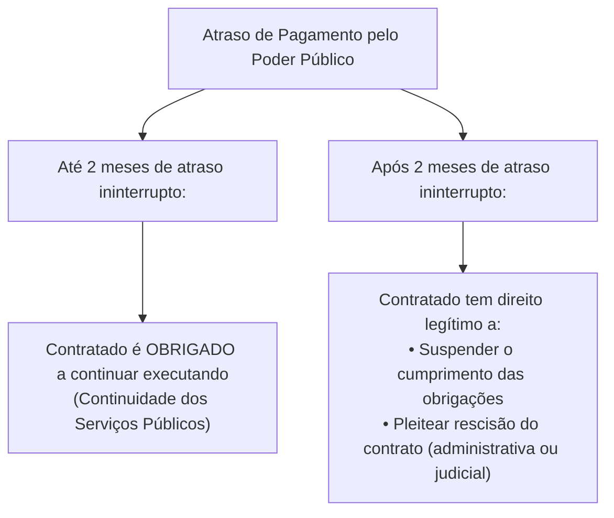
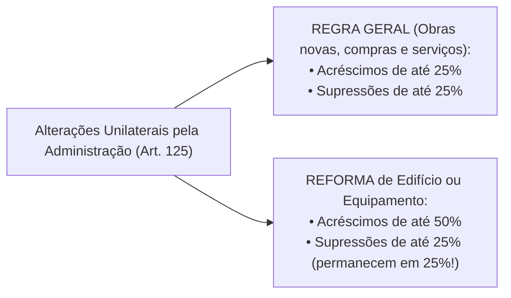

# 04 - Contratos Administrativos: Execução, Alterações, Equilíbrio e Sanções (Lei 14.133/2021)

> **Matéria:** Licitações e Contratos Administrativos  
> **Cargo:** A01 – Técnico de Controle Externo – Especialidade: Técnico Administrativo  
> **Arquivo:** `04_contratos_administrativos_fiscalizacao_alteracoes_e_sancoes.md`  
> **Status:** 🟢 Teoria Aprofundada + 5 Questões FCC Comentadas (A a E)

---

## 📌 Ementa Oficial do Edital
- Contratos administrativos: conceito, características, formalização e cláusulas exorbitantes.
- Garantias contratuais (caução, fiança bancária e seguro-garantia com cláusula de retomada / *step-in rights*).
- Duração dos contratos administrativos: prazos de vigência ordinários e contratações contínuas (até 5 anos, prorrogáveis até 10 anos).
- Gestão e fiscalização contratual: atribuições do gestor e fiscais (técnico, administrativo e setorial).
- Responsabilidade trabalhista da Administração Pública e Tema 246 do STF (ADC 16 - comprovação de culpa *in vigilando*).
- Recebimento provisório e definitivo do objeto.
- Alterações contratuais unilaterais e consensuais: limites de 25% e 50%.
- Equilíbrio econômico-financeiro: reajuste por índice, repactuação e revisão/reequilíbrio (*álea* extraordinária).
- Sanções administrativas: advertência, multa, impedimento de licitar e declaração de inidoneidade.
- Processo administrativo sancionador e reabilitação.

---

## 🧭 Sumário
- [1. Conceito, Características e Cláusulas Exorbitantes dos Contratos Administrativos](#1-conceito-caracteristicas-e-clausulas-exorbitantes-dos-contratos-administrativos)
    - [1.1 Características Fundamentais e Formalização](#11-caracteristicas-fundamentais-e-formalizacao)
    - [1.2 Cláusulas Exorbitantes e Restrição à Exceção do Contrato Não Cumprido](#12-clausulas-exorbitantes-e-restricao-a-excecao-do-contrato-nao-cumprido)
- [2. Garantias Contratuais e Seguro-Garantia com Cláusula de Retomada (Step-in Rights)](#2-garantias-contratuais-e-seguro-garantia-com-clausula-de-retomada-step-in-rights)
- [3. Duração e Prorrogação dos Contratos Administrativos](#3-duracao-e-prorrogacao-dos-contratos-administrativos)
    - [3.1 Serviços e Fornecimentos Contínuos (Regra 5 + 5 = Até 10 Anos)](#31-servicos-e-fornecimentos-continuos-regra-5-5-ate-10-anos)
    - [3.2 Contratos por Escopo](#32-contratos-por-escopo)
- [4. Gestão, Fiscalização e Responsabilidade Trabalhista do Estado](#4-gestao-fiscalizacao-e-responsabilidade-trabalhista-do-estado)
    - [4.1 Estrutura de Gestão e Fiscalização Contratual](#41-estrutura-de-gestao-e-fiscalizacao-contratual)
    - [4.2 Responsabilidade Trabalhista e Previdenciária: O Tema 246 do STF](#42-responsabilidade-trabalhista-e-previdenciaria-o-tema-246-do-stf)
    - [4.3 Recebimento Provisório e Definitivo do Objeto](#43-recebimento-provisorio-e-definitivo-do-objeto)
- [5. Alterações Contratuais e Manutenção do Equilíbrio Econômico-Financeiro](#5-alteracoes-contratuais-e-manutencao-do-equilibrio-economico-financeiro)
    - [5.1 Alterações Unilaterais e Consensuais: Limites de 25% e 50%](#51-alteracoes-unilaterais-e-consensuais-limites-de-25-e-50)
    - [5.2 Instrumentos de Recomposição: Reajuste, Repactuação e Revisão](#52-instrumentos-de-recomposicao-reajuste-repactuacao-e-revisao)
- [6. Infrações, Sistema Sancionador e Processo de Reabilitação](#6-infracoes-sistema-sancionador-e-processo-de-reabilitacao)
- [7. Fontes Recomendadas na Internet](#fontes-recomendadas-na-internet)
- [8. Questões Comentadas no Padrão FCC (Justificadas de A a E)](#questoes-comentadas-no-padrao-fcc-justificadas-de-a-a-e)

---

## 📖 Teoria Aprofundada e Pontos Críticos

### 1. Conceito, Características e Cláusulas Exorbitantes dos Contratos Administrativos

O contrato administrativo é o ajuste bilateral de vontades celebrado entre a Administração Pública (atuando nessa qualidade revestida do regime de direito público) e o particular ou outra entidade pública, tendo por objetivo a consecução de uma utilidade de interesse público, sob condições reguladas pela legislação e pelo instrumento convocatório.

#### 1.1 Características Fundamentais e Formalização
- **Consensual:** Aperfeiçoa-se com o consentimento mútuo manifestado na assinatura do ajuste, não dependendo da entrega física imediata da coisa para sua existência.
- **Formal:** A forma escrita é solene e obrigatória. O art. 95 da Lei nº 14.133/2021 estabelece que o instrumento de contrato é obrigatório, admitindo sua substituição por outros instrumentos hábeis (carta-contrato, nota de empenho de despesa, autorização de compra ou ordem de execução de serviço) apenas em dispensas de pequeno valor ou compras com entrega imediata e integral sem obrigações futuras. É nulo e de nenhum efeito o contrato verbal com a Administração, ressalvadas pequenas compras de pronto pagamento feitas em regime de adiantamento (suprimento de fundos) de valor irrisório.
- **Bilateral (ou Sinalagmático):** Gera direitos e obrigações recíprocas e interdependentes para ambas as partes.
- **Oneroso:** Impõe sacrifício patrimonial proporcional a ambas as partes contratantes.
- **Comutativo:** As prestações das partes são certas, conhecidas e tidas como equivalentes no momento da pactuação original.
- **Personalíssimo (*intuitu personae*):** Celebrado em função das qualidades subjetivas e habilitações demonstradas pelo licitante vencedor no certame, limitando-se a subcontratação às estritas balizas do edital e com prévia anuência da Administração.

#### 1.2 Cláusulas Exorbitantes e Restrição à Exceção do Contrato Não Cumprido
As cláusulas exorbitantes (art. 104 da Lei nº 14.133/2021) conferem prerrogativas extraordinárias que extrapolam o direito privado comum, justificadas pela supremacia do interesse público sobre o privado:

1. **Modificação unilateral do contrato:** A Administração pode alterar qualitativa ou quantitativamente as cláusulas de serviço para melhor adequação técnica ao interesse público;
2. **Extinção unilateral do contrato:** Rescisão decorrente de inadimplemento do contratado ou por razões de interesse público de alta relevância;
3. **Fiscalização contínua da execução:** Acompanhamento técnico, administrativo e financeiro pelo Poder Público;
4. **Aplicação direta de sanções administrativas:** Imposição de sanções pelo próprio órgão contratante sem necessidade de intervenção prévia do Poder Judiciário;
5. **Ocupação provisória de bens e serviços:** Utilização de bens móveis, imóveis e pessoal do contratado necessários à continuidade de serviços públicos essenciais paralisados;
6. **Atenuação da *Exceptio Non Adimpleti Contractus* (Exceção do Contrato Não Cumprido):**
    - No direito civil comum, se um contratante deixa de pagar, o outro pode imediatamente paralisar suas atividades contratuais.
    - No regime jurídico-administrativo, em virtude do **princípio da continuidade do serviço público**, o contratado **não pode paralisar imediatamente** as obras ou serviços em caso de inadimplemento financeiro do Estado.
    - Pelo art. 137, § 2º, inciso IV, da Lei nº 14.133/2021, o particular é obrigado a continuar executando o contrato até o limite de **2 (dois) meses de atraso ininterrupto** nos pagamentos devidos pela Administração Pública. Somente após transcorridos 2 meses contínuos de inadimplemento é que assiste ao particular o direito de suspender a execução de suas obrigações ou requerer a extinção do contrato.

---

### 2. Garantias Contratuais e Seguro-Garantia com Cláusula de Retomada (Step-in Rights)

A critério da autoridade competente, em cada contratação a Administração pode exigir do contratado a prestação de garantia (art. 96). Caberá ao **contratado optar** por uma das seguintes modalidades:

1. **Caução em dinheiro ou em títulos da dívida pública;**
2. **Fiança bancária** emitida por banco ou instituição financeira autorizada pelo Banco Central;
3. **Seguro-garantia** emitido por seguradora autorizada pela SUSEP.

**Limites Ordinários de Garantia:**

- **Regra Geral:** O percentual de garantia contratual será de até **5% (cinco por cento)** do valor inicial do contrato (art. 98).
- **Contratos de Alta Complexidade Técnica ou Riscos Elevados:** A garantia pode ser fixada em até **10% (dez por cento)** do valor do contrato, desde que expressamente motivada na fase preparatória (art. 98, § 1º).

#### Seguro-Garantia com Cláusula de Retomada (*Step-in Rights* - Art. 102)
Para combater o problema crônico nacional de paralisação e abandono de obras públicas, a Nova Lei de Licitações introduziu uma inovação profunda inspirada no modelo norte-americano (*performance bond*):

- Em contratações de obras e serviços de engenharia de **grande vulto** (valor superior a R$ 200 milhões na edição da lei, atualizado anualmente), o edital pode prever a obrigatoriedade de seguro-garantia com previsão expressa de **cláusula de retomada** (*step-in rights*).
- Nessa modalidade, o valor da garantia pode alcançar até **30% (trinta por cento)** do valor inicial do contrato.
- **Funcionamento:** Em caso de inadimplemento, atraso grave ou abandono por parte da construtora, a seguradora é notificada para intervir diretamente. A seguradora assume a administração do canteiro de obras e conclui a execução do objeto contratado, diretamente ou mediante subcontratação de terceiros idôneos aprovados pelo Poder Público.
- Concluída a obra pela seguradora, ela fica liberada da obrigação de pagar a indenização em dinheiro correspondente à apólice.

---

### 3. Duração e Prorrogação dos Contratos Administrativos

A regra orçamentária tradicional vinculava a vigência contratual aos créditos orçamentários do respectivo exercício financeiro (regra do ano civil). A Lei nº 14.133/2021 flexibilizou essa sistemática com regras modernas de planejamento (arts. 105 a 114):

#### 3.1 Serviços e Fornecimentos Contínuos (Regra 5 + 5 = Até 10 Anos)
O art. 106 da NLLC estabelece uma revolução para os contratos de serviços e fornecimentos contínuos (limpeza, vigilância, suporte de TI, manutenção predial, locação de equipamentos):

- Podem ser celebrados com prazo de vigência inicial de **até 5 (cinco) anos**.
- A Administração pode prorrogar sucessivamente a contratação até o limite máximo total de **10 (dez) anos**, desde que comprovada documentalmente a vantajosidade econômica das condições e a manutenção da qualidade da execução.
- Permite amortização mais eficiente de investimentos e redução substantiva dos custos de transação causados por licitações repetitivas anuais.

#### 3.2 Contratos por Escopo
- Nos contratos cujo objeto é a entrega de um produto ou realização de obra certa e predeterminada (contratos por escopo predeterminado), o prazo de vigência original deve corresponder ao cronograma de execução física.
- Conforme o art. 111, o prazo de vigência será **automaticamente prorrogado** quando o seu objeto não for concluído no período inicialmente firmado por razões imputáveis à Administração ou por fatos supervenientes de caso fortuito/força maior, assegurando-se a conclusão da obra e a apuração de responsabilidades caso o atraso decorra de culpa exclusiva do contratado.

---

### 4. Gestão, Fiscalização e Responsabilidade Trabalhista do Estado

#### 4.1 Estrutura de Gestão e Fiscalização Contratual
A execução do contrato deve ser acompanhada e fiscalizada permanentemente por um ou mais fiscais do contrato, auxiliados por gestores, atendendo ao princípio da segregação de funções (art. 117):

- **Gestor do Contrato:** Servidor responsável pela coordenação global dos atos administrativos, prorrogações, reajustes e controle financeiro macro.
- **Fiscal Técnico:** Servidor responsável pelo acompanhamento prático, rotineiro e presencial da conformidade dos serviços e obras executados em relação às especificações do projeto.
- **Fiscal Administrativo:** Servidor responsável pela fiscalização da documentação fiscal, previdenciária e trabalhista da mão de obra terceirizada.
- **Fiscal Setorial / do Público Usuário:** Servidores designados em unidades descentralizadas ou comissões de usuários para atestar a efetiva entrega dos bens ou serviços.

#### 4.2 Responsabilidade Trabalhista e Previdenciária: O Tema 246 do STF
A responsabilidade do Estado perante terceiros na terceirização de serviços é tema de alta incidência na jurisprudência e concursos:

- **Encargos Fiscais e Comerciais:** A inadimplência do contratado não transfere em hipótese alguma a responsabilidade ao Poder Público (art. 121, § 1º).
- **Encargos Previdenciários:** O Estado responde solidariamente pelos débitos previdenciários nos moldes do art. 31 da Lei nº 8.212/91 e art. 121, § 2º.
- **Encargos Trabalhistas e o Tema 246 do STF (ADC 16 e RE 760.931):**
    - O art. 121, § 1º, da NLLC reforça que o inadimplemento trabalhista da empresa terceirizada **não transfere automaticamente** a responsabilidade de pagamento ao Poder Público tomador de serviços.
    - O STF, ao julgar com repercussão geral o **Tema 246**, consolidou que o Estado **não possui responsabilidade objetiva** nem responde automaticamente.
    - A condenação subsidiária da Administração Pública só é admitida se restar cabalmente demonstrada nos autos processuais a sua **culpa *in vigilando*** — caracterizada pela omissão reiterada e culposa do dever legal de fiscalizar mensalmente o adimplemento dos salários, recolhimento de FGTS e verbas da folha pela contratada.
    - O encargo probatório dessa conduta omissiva recai sobre o trabalhador reclamante, sendo vedada presunção automática de culpa contra a Fazenda Pública.

#### 4.3 Recebimento Provisório e Definitivo do Objeto
O art. 140 da NLLC disciplina as fases de entrega do objeto contratado:

- **Recebimento Provisório:** Realizado pelo **fiscal do contrato**, mediante termo circunstanciado, para efeito de posterior verificação da conformidade do material ou serviço com as especificações exigidas.
- **Recebimento Definitivo:** Realizado por **servidor ou comissão designada pela autoridade competente**, mediante termo circunstanciado que comprove a perfeita adequação do objeto aos termos contratuais e técnicos.
- O recebimento provisório ou definitivo não exclui a responsabilidade civil do contratado pela solidez e segurança da obra ou serviço durante o prazo legal de 5 anos (art. 618 do Código Civil), nem por vícios ocultos.

---

### 5. Alterações Contratuais e Manutenção do Equilíbrio Econômico-Financeiro

#### 5.1 Alterações Unilaterais e Consensuais: Limites de 25% e 50%
Os contratos administrativos podem ser alterados unilateralmente pela Administração (quando houver modificação de projeto ou adequação quantitativa) ou consensualmente por acordo mútuo entre as partes (para substituição de garantia ou repactuação) — art. 124.

O art. 125 estipula os limites legais obrigatórios que o contratado é obrigado a aceitar nas alterações unilaterais:

- **Regra Geral (Compras, Serviços e Obras):** O contratado fica obrigado a aceitar, nas mesmas condições contratuais, acréscimos ou supressões de até **25% (vinte e cinco por cento)** do valor inicial atualizado do contrato.
- **Exceção Específica para REFORMAS de Edifícios ou Equipamentos:** O limite para **acréscimos será de até 50% (cinquenta por cento)** do valor inicial atualizado do contrato.

> 🚨 **ALERTA DE PROVA / PEGADINHA FCC:**  
>
> 1. O limite ampliado de **até 50% é exclusivo para acréscimos em reformas** de edifícios ou de equipamentos. Obras novas ou ampliações submetem-se ao teto de 25%.  
> 2. **Para supressões (reduções quantitativas), o limite legal é sempre de 25%**, inclusive em reformas de edifícios!  
> 3. É **terminantemente proibida a compensação matemática** entre acréscimos e supressões para efeito de cumprimento dos limites legais (ex.: acrescer 40% em um item e suprimir 40% em outro configura ilegalidade manifesta pelo "jogo de planilhas").

#### 5.2 Instrumentos de Recomposição: Reajuste, Repactuação e Revisão
A garantia da equação econômico-financeira original é direito fundamental do contratado previsto no art. 37, XXI, da CF/88. A Lei nº 14.133/2021 distingue com clareza três institutos:

| Instituto Jurídico | Hipótese de Aplicação | Periodicidade Mínima | Base de Cálculo / Fundamento |
|---|---|:---:|---|
| **Reajuste em Sentido Estrito** | Variação inflacionária ordinária do custo dos insumos e produtos | **1 ano** (interregno mínimo) | Aplicação automática de índice oficial de correção de preços previsto no edital (ex.: IPCA, INCC, IGP-M). |
| **Repactuação** | Serviços contínuos com **dedicação exclusiva de mão de obra** | **1 ano** (interregno mínimo) | Demonstração analítica da variação de custos decorrente de nova **Convenção Coletiva de Trabalho (CCT)** ou Dissídio Coletivo. |
| **Revisão (Reequilíbrio em Sentido Estrito)** | Fatos imprevisíveis, caso fortuito, força maior, fato do príncipe ou fato da administração (**álea extraordinária**) | **A qualquer tempo** (não exige interregno anual) | Teoria da Imprevisão; recomposição integral da margem econômica desequilibrada por evento extraordinário e extracontratual. |

---

### 6. Infrações, Sistema Sancionador e Processo de Reabilitação

O cometimento de infrações administrativas elencadas no art. 155 da Lei nº 14.133/2021 (dar causa à inexecução parcial ou total, fraudar a licitação, praticar ato ilícito com vistas a frustrar os objetivos do certame, comportar-se de modo inidôneo) sujeita o licitante ou contratado a quatro sanções administrativas (art. 156):

| Sanção Administrativa | Prazo de Duração | Abrangência Territorial e Subjetiva | Autoridade Competente para Aplicação |
|---|:---:|---|---|
| **Advertência** | Aplicada imediatamente à falta leve | Restrita àquele contrato específico | Autoridade designada em regulamento |
| **Multa** | Cobrada de imediato (0,5% a 30% do valor do contrato) | Pecuniária; pode ser cumulada com outras sanções | Autoridade designada em regulamento |
| **Impedimento de Licitar e Contratar** | **Até 3 (três) anos** | No âmbito da Administração Pública direta e indireta do **ente federativo sancionador** (ex.: apenas no Estado de Goiás) | Autoridade competente do respectivo órgão |
| **Declaração de Inidoneidade** | **De 3 (três) a 6 (seis) anos** | **Toda a Administração Pública** direta e indireta de **todos os entes federativos** do país (União, Estados, DF e Municípios) | **Ministro de Estado**, **Secretário de Estado** ou **Secretário Municipal** |

> 🚨 **ALERTA DE PROVA / FCC:**  
> A declaração de inidoneidade da NLLC inovou ao fixar prazo mínimo de 3 anos e máximo de 6 anos, estabelecendo eficácia extensiva nacional compulsória. Sua aplicação é ato privativo da autoridade superior (Secretário ou Ministro), exigindo instrução técnica e parecer jurídico vinculante.

**Reabilitação do Sancionado (Art. 163):**
A reabilitação perante a Administração exige cumulativamente:

1. Reparação integral do dano causado ao erário;
2. Pagamento da multa aplicada;
3. Transcurso do prazo mínimo de **1 ano** da aplicação de impedimento de licitar ou **3 anos** da declaração de inidoneidade;
4. Cumprimento das condições de reabilitação e implantação ou aperfeiçoamento de **programa de integridade (*compliance*)**, exigido compulsoriamente nas sanções por atos de corrupção ou fraude da Lei Anticorrupção.

---

## 🌐 Fontes Recomendadas na Internet
- [Lei Federal nº 14.133/2021 - Artigos 89 a 163 (Contratos e Sanções)](https://www.planalto.gov.br/ccivil_03/_ato2019-2022/2021/lei/l14133.htm#art89)
    - Normas legais sobre garantias, vigência contratual decenal, alterações e penalidades administrativas.
- [STF - Tema 246 da Repercussão Geral (ADC 16 e RE 760.931)](https://portal.stf.jus.br/jurisprudencia/repercussaoGeral/tema.asp?num=246)
    - Jurisprudência vinculante do Supremo afastando a responsabilidade objetiva da Administração Pública na terceirização.
- [Tribunal de Contas da União (TCU) - Jurisprudência sobre Sanções e Retomada de Obras](https://pesquisa.apps.tcu.gov.br/)
    - Acórdãos sobre limites de alteração contratual unilateral e efetividade dos *step-in rights*.

---

## 📝 Questões Comentadas no Padrão FCC (Justificadas de A a E)

### Questão 1 (FCC - Analista de Controle Externo / Adaptada TCE-GO)
O Tribunal de Contas do Estado de Goiás formalizou contrato administrativo para a reforma predial integral das instalações do edifício de sua sede em Goiânia, pelo valor original de R$ 4.000.000,00. Após o início dos serviços de demolição, os engenheiros detectaram falhas geológicas estruturais nas fundações do subsolo não previstas no projeto original, que exigem obras emergenciais de estaqueamento e contenção, orçadas em R$ 1.600.000,00 adicionais.

Em face dos limites de alteração unilateral estabelecidos no art. 125 da Lei Federal nº 14.133/2021:

* **A)** O acréscimo pretendido é ilegal, visto que a NLLC fixou o teto inflexível de 25% para qualquer alteração contratual no setor público.
* **B)** O aditivo de valor é juridicamente admitido, tendo em vista que, no caso de reforma de edifício ou de equipamento, o limite legal para os acréscimos unilaterais é de até 50% do valor inicial atualizado do contrato.
* **C)** As reformas prediais admitem acréscimos unilaterais ilimitados, desde que autorizados pelo Conselho de Engenharia (CREA).
* **D)** A Administração é obrigada a anular o contrato e instaurar concurso público para contratação de novos operários.
* **E)** O limite de 50% aplica-se apenas caso a empreiteira comprove que o aço foi importado de país membro do Mercosul.

> **Comentário Detalhado:**
>
> - **A) Incorreta:** Desconsidera a regra específica do art. 125 que autoriza teto de até 50% exclusivamente para acréscimos em reformas de edifícios ou equipamentos.
> - **B) CORRETA:** Conforme o art. 125 da Lei nº 14.133/2021, o contratado fica obrigado a aceitar, nas mesmas condições contratuais, acréscimos ou supressões de até 25% do valor inicial do contrato, mas, no caso de reforma de edifício ou de equipamento, o limite para os acréscimos será de até 50% (cinquenta por cento). Como o contrato original era de R$ 4 milhões, o teto de 50% equivale a R$ 2 milhões adicionais; logo, o aditivo de R$ 1,6 milhão (40%) é perfeitamente lícito.
> - **C) Incorreta:** Não existe permissão legal para alterações unilaterais ilimitadas, e o CREA não possui competência para derrogar o teto legal de 50%.
> - **D) Incorreta:** Havendo previsão expressa na Lei para aditamentos qualitativos e quantitativos, a continuidade do contrato é a via regular, descabendo anulação.
> - **E) Incorreta:** Condição exótica sem qualquer respaldo legal no regramento licitatório brasileiro.
> 
> **Gabarito: B**

---

### Questão 2 (FCC - Técnico de Controle Externo / TCE-GO)
Durante a execução de um contrato administrativo de fornecimento de sistemas de segurança eletrônica celebrado por uma Secretaria de Estado, apurou-se em processo sancionador que a empresa contratada cometeu fraude dolosa ao apresentar certidões negativas tributárias ideologicamente falsas e tentar subornar o fiscal do contrato. O Secretário de Estado aplicou à infratora a penalidade de **Declaração de Inidoneidade para Licitar ou Contratar**.

À luz do regime sancionatório da Lei Federal nº 14.133/2021, a sanção aplicada:

* **A)** Produz efeitos restritos ao órgão contratante, permitindo que a empresa continue licitando com outros órgãos do Estado de Goiás e com Municípios.
* **B)** Impede o responsável de licitar ou contratar no âmbito da Administração Pública direta e indireta de todos os entes federativos (União, Estados, DF e Municípios), pelo prazo de 3 a 6 anos.
* **C)** Tem vigência perpétua e irreversível, sendo vedada qualquer reabilitação jurídica do sancionado.
* **D)** Pode ser aplicada monocraticamente pelo fiscal administrativo do contrato em despacho ordinário.
* **E)** Extingue-se automaticamente caso a empresa altere sua denominação social e seu quadro de sócios.

> **Comentário Detalhado:**
>
> - **A) Incorreta:** A sanção que se restringe à esfera do próprio ente federativo é o "Impedimento de licitar e contratar" (art. 156, III). A declaração de inidoneidade tem efeito nacional amplo.
> - **B) CORRETA:** De acordo com o art. 156, § 5º, da Lei nº 14.133/2021, a sanção de declaração de inidoneidade para licitar ou contratar impedirá o responsável de licitar ou contratar no âmbito da Administração Pública direta e indireta de todos os entes federativos (União, Estados, Distrito Federal e Municípios), pelo prazo mínimo de 3 (três) anos e máximo de 6 (seis) anos.
> - **C) Incorreta:** A sanção não é perpétua e admite processo de reabilitação após cumprido o prazo mínimo de 3 anos, reparado o dano e atendidas exigências de integridade (art. 163).
> - **D) Incorreta:** A declaração de inidoneidade é privativa de Ministro de Estado, Secretário de Estado ou Secretário Municipal, não podendo ser aplicada por fiscal de contrato.
> - **E) Incorreta:** A fraude de sucessão societária atrai o instituto da desconsideração da personalidade jurídica (art. 160), estendendo as sanções aos novos sócios.
> 
> **Gabarito: B**

---

### Questão 3 (FCC - Procurador do Estado / Adaptada)
Um empregado terceirizado que prestava serviços de vigilância armada no prédio do Tribunal de Contas ajuizou reclamação trabalhista perante a Justiça do Trabalho em face da empresa terceirizada e do Estado de Goiás, postulando o pagamento de horas extras e verbas rescisórias inadimplidas pela empregadora. O magistrado trabalhista condenou o Estado de forma subsidiária automática, fundamentando a decisão apenas no fato objetivo de a Administração ter se beneficiado da força de trabalho do reclamante.

Diante do art. 121, § 1º, da Lei Federal nº 14.133/2021 e da tese de repercussão geral fixada pelo Supremo Tribunal Federal no **Tema 246**:

* **A)** A condenação foi escorreita, visto que a responsabilidade trabalhista do Poder Público tomador de serviços terceirizados é objetiva e prescinde de qualquer prova de culpa.
* **B)** A condenação subsidiária do ente público é indevida sem a comprovação cabal de sua culpa *in vigilando* na fiscalização do cumprimento das obrigações contratuais e trabalhistas da empresa prestadora de serviços.
* **C)** O Estado responde de forma solidária primária, equiparando-se o terceirizado a servidor público concursado.
* **D)** A Lei nº 14.133/2021 extinguiu qualquer possibilidade de condenação da Fazenda Pública na Justiça do Trabalho.
* **E)** O ônus de provar a regularidade fiscalização das guias de FGTS transfere-se automaticamente para o Ministério Público do Trabalho.

> **Comentário Detalhado:**
>
> - **A) Incorreta:** O STF fixou expressamente no RE 760.931 (Tema 246) que o inadimplemento trabalhista do contratado não transfere responsabilidade objetiva ao Estado.
> - **B) CORRETA:** Pelo art. 121, § 1º, da Lei 14.133/2021 c/c o Tema 246 da Repercussão Geral do STF, a responsabilidade subsidiária da Administração Pública não opera por transferência automática. É indispensável a comprovação inequívoca nos autos de conduta culposa da Administração no dever de fiscalizar (culpa *in vigilando*), ônus probatório que recai sobre o trabalhador postulante.
> - **C) Incorreta:** Não há solidariedade em matéria de verbas trabalhistas de terceirizados nem equiparação funcional com servidores efetivos.
> - **D) Incorreta:** A responsabilidade subsidiária subsiste quando houver prova da omissão culposa da fiscalização pública.
> - **E) Incorreta:** O MPT não assume o encargo probatório da fiscalização do FGTS em reclamatórias trabalhistas individuais.
> 
> **Gabarito: B**

---

### Questão 4 (FCC - Auditor de Controle Externo / Adaptada)
Durante a execução de um contrato administrativo de serviços de limpeza e conservação predial com dedicação exclusiva de mão de obra celebrado por determinado órgão estadual, ocorreu a homologação de nova Convenção Coletiva de Trabalho da categoria dos trabalhadores da limpeza, com reajuste salarial de 8% nos pisos da categoria. Paralelamente, em outro contrato de fornecimento de combustíveis para viaturas oficiais, a cotação internacional do barril de petróleo subiu extraordinariamente em virtude de eclosão de conflito armado imprevisível no exterior.

Os institutos jurídicos cabíveis para a recomposição financeira dos contratos de limpeza e de combustíveis são, respectivamente:

* **A)** Reajuste em sentido estrito e repactuação
* **B)** Repactuação e revisão (reequilíbrio econômico-financeiro)
* **C)** Revisão e reajuste por índice inflacionário
* **D)** Supressão unilateral e rescisão consensual
* **E)** Encampação e caducidade contratual

> **Comentário Detalhado:**
>
> - **A) Incorreta:** O reajuste em sentido estrito adota índices oficiais de preços prefixados para cobrir a inflação ordinária, não se aplicando à majoração decorrente de CCT nem ao caso de guerra imprevisível.
> - **B) CORRETA:** Nos contratos com dedicação exclusiva de mão de obra (como o de limpeza), a variação de custos decorrente de Convenção Coletiva de Trabalho (CCT) é recomposta por meio do instituto da **Repactuação** (art. 135 da Lei nº 14.133/2021). Já o aumento extraordinário e imprevisível de combustíveis por guerra externa caracteriza álea extraordinária, ensejando a **Revisão** (Reequilíbrio Econômico-Financeiro em sentido estrito - art. 124, II, "d").
> - **C) Incorreta:** Inverte a ordem dos institutos aplicáveis aos dois contratos apresentados.
> - **D) Incorreta:** Supressão unilateral e rescisão consensual são atos de extinção ou diminuição de escopo contratual, e não modalidades de recomposição pecuniária.
> - **E) Incorreta:** Encampação e caducidade são modalidades de extinção unilateral de concessões de serviços públicos (Lei nº 8.987/95).
> 
> **Gabarito: B**

---

### Questão 5 (FCC - Analista Judiciário)
Em uma licitação de obra pública de grande vulto (orçada em R$ 300 milhões) para construção de um complexo penitenciário de segurança máxima, o edital estabeleceu a obrigatoriedade de contratação de seguro-garantia com previsão de cláusula de retomada (*step-in rights*).

De acordo com o art. 102 da Lei Federal nº 14.133/2021, a **cláusula de retomada no seguro-garantia**:

* **A)** Limita a garantia a 1% do valor do contrato e proíbe a seguradora de ingressar no canteiro de obras.
* **B)** Pode prever garantia de até 30% do valor inicial do contrato, ficando a seguradora obrigada, em caso de inadimplemento do contratado, a assumir a execução e concluir o objeto do contrato.
* **C)** Exige que a seguradora execute a obra diretamente por seus próprios corretores de seguros.
* **D)** Isenta a seguradora de qualquer responsabilidade caso a construtora entre em recuperação judicial.
* **E)** Transfere a titularidade da obra para a seguradora em regime de dação em pagamento definitiva.

> **Comentário Detalhado:**
>
> - **A) Incorreta:** O limite de garantia com cláusula de retomada pode atingir até 30% do valor inicial do contrato, e o propósito basilar do dispositivo é autorizar a intervenção direta da seguradora para terminar a obra.
> - **B) CORRETA:** Conforme o art. 102 da Lei nº 14.133/2021, na contratação de obras e serviços de engenharia de grande vulto, o edital pode prever a obrigatoriedade de seguro-garantia com percentual de até 30% do valor inicial do contrato com previsão de cláusula de retomada (*step-in rights*), pela qual a seguradora, em caso de inadimplemento do contratado, assume a execução e conclui a obra, diretamente ou por meio de terceiros subcontratados.
> - **C) Incorreta:** A seguradora assume a gestão jurídica da execução, podendo contratar empresas e engenheiros especializados para os serviços práticos de engenharia.
> - **D) Incorreta:** O descumprimento por inadimplência ou quebra da construtora é precisamente o fato ensejador da execução do seguro e da ativação da retomada.
> - **E) Incorreta:** Não ocorre dação em pagamento ou alienação do bem público à seguradora; o bem permanece público e a seguradora apenas cumpre a prestação de fazer assumida na apólice.
> 
> **Gabarito: B**
