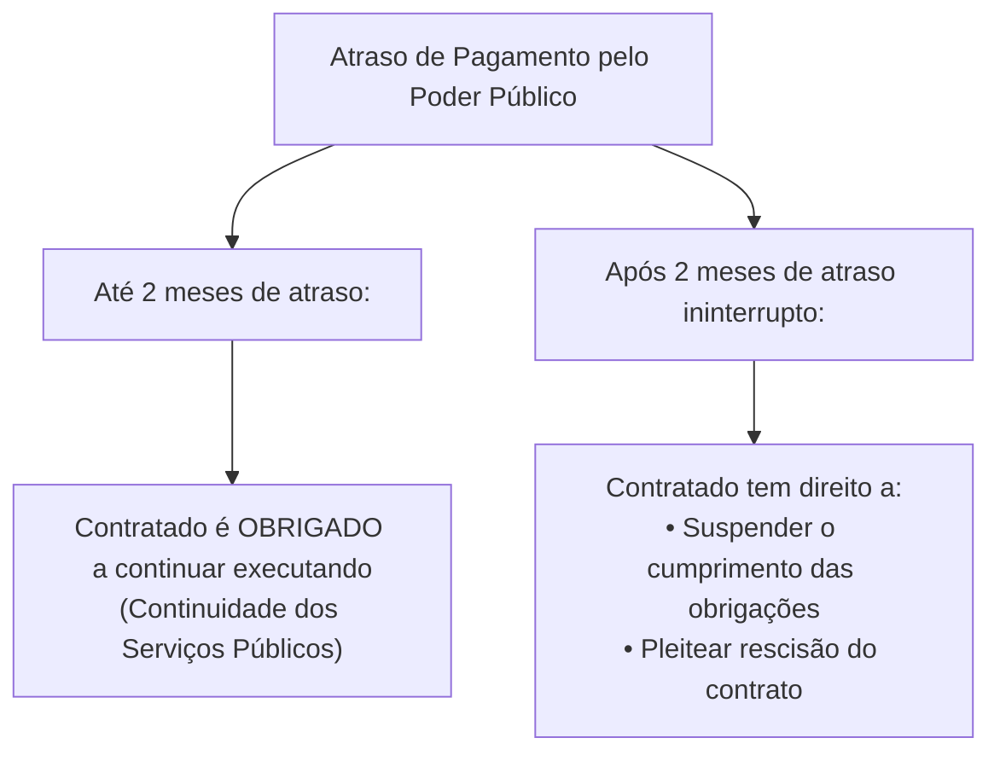
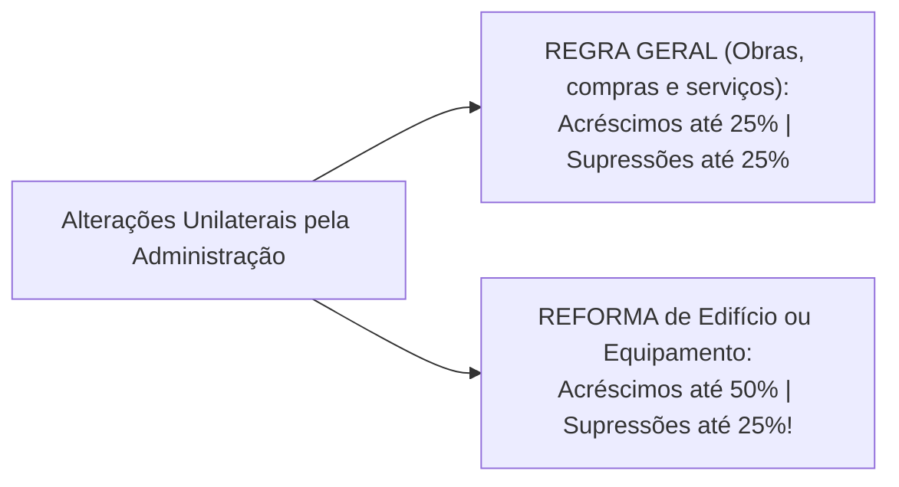

# 04 - Contratos Administrativos: Execução, Alterações, Equilíbrio e Sanções (Lei 14.133/2021)

> **Matéria:** Licitações e Contratos Administrativos  
> **Cargo:** A01 – Técnico de Controle Externo – Especialidade: Técnico Administrativo  
> **Arquivo:** `04_contratos_administrativos_fiscalizacao_alteracoes_e_sancoes.md`  
> **Status:** 🟢 Teoria Aprofundada + 5 Questões FCC Comentadas (A a E)

---

## 📌 Ementa Oficial do Edital
- Contratos administrativos: conceito, características, formalização e cláusulas exorbitantes.
- Garantias contratuais (caução, fiança bancária e seguro-garantia com cláusula de retomada / *step-in rights*).
- Duração dos contratos administrativos: prazos de vigência ordinários e contratações contínuas (até 5 anos, prorrogáveis até 10 anos).
- Gestão e fiscalização contratual: atribuições do gestor e fiscais (técnico, administrativo e setorial).
- Responsabilidade trabalhista da Administração Pública e Tema 246 do STF (ADC 16 - comprovação de culpa *in vigilando*).
- Recebimento provisório e definitivo do objeto.
- Alterações contratuais unilaterais e consensuais: limites de 25% e 50%.
- Equilíbrio econômico-financeiro: reajuste por índice, repactuação e revisão/reequilíbrio (*álea* extraordinária).
- Sanções administrativas: advertência, multa, impedimento de licitar e declaração de inidoneidade.
- Processo administrativo sancionador e reabilitação.

---

## 🌳 Classificação Hierárquica do Conteúdo

```text
4. Regime Jurídico dos Contratos Administrativos e Sistema Sancionador (Lei nº 14.133/2021)
├── 4.1 Teoria Geral e Cláusulas Exorbitantes dos Contratos Administrativos
│   ├── Características Fundamentais: Consensual, formal, bilateral, oneroso e comutativo
│   ├── Cláusulas Exorbitantes (Art. 104):
│   │   ├── Modificação e rescisão unilateral pela Administração
│   │   ├── Fiscalização e aplicação direta de sanções administrativas
│   │   ├── Ocupação provisória de bens vinculados a serviços essenciais
│   │   └── Restrição à Exceção do Contrato Não Cumprido: Suspensão apenas após 2 MESES de atraso
│   ├── Garantias Contratuais e Seguro com Cláusula de Retomada (Arts. 96 a 102):
│   │   ├── Modalidades: Caução em dinheiro/títulos, Fiança bancária e Seguro-garantia
│   │   ├── Limite Ordinário: Até 5% (ou até 10% em alta complexidade/risco)
│   │   └── Step-in Rights (Art. 102): Até 30% em grande vulto com assunção da obra pela seguradora
│   └── Prazos de Vigência Contratual (Arts. 105 a 114):
│       ├── Serviços e Fornecimentos Contínuos (Art. 106): Até 5 anos, prorrogável até 10 anos
│       └── Contratos por Escopo (Art. 111): Vigência prorrogada automaticamente até a entrega final
├── 4.2 Execução, Fiscalização e Responsabilidade Trabalhista
│   ├── Gestão e Fiscalização (Art. 117): Gestor, Fiscal Técnico, Administrativo e Setorial
│   ├── Responsabilidade Trabalhista da Administração (Art. 121 c/c Tema 246 do STF):
│   │   ├── Inadimplemento da empresa terceirizada NÃO transfere responsabilidade automática
│   │   └── Responsabilidade subsidiária depende de comprovação de culpa in vigilando
│   └── Recebimento Provisório (pelo fiscal) e Recebimento Definitivo (por comissão designada)
├── 4.3 Alterações Contratuais e Manutenção do Equilíbrio Econômico-Financeiro
│   ├── Alterações Unilaterais (Art. 125):
│   │   ├── Regra Geral: Acréscimos ou supressões de até 25% do valor inicial atualizado
│   │   ├── Exceção para Reformas de Edifícios/Equipamentos: Acréscimos de até 50% (supressões: 25%)
│   │   └── Proibição de Compensação Matemática entre acréscimos e supressões
│   └── Mecanismos de Recomposição Econômica:
│       ├── Reajuste por Índice: Inflação ordinária anual por índices oficiais (IPCA/INCC)
│       ├── Repactuação: Mão de obra exclusiva com convenção coletiva de trabalho (CCT anual)
│       └── Revisão / Reequilíbrio: Álea extraordinária imprevisível a qualquer tempo
└── 4.4 Infrações, Sanções Administrativas e Reabilitação (Arts. 155 a 163)
    ├── As Quatro Sanções da NLLC (Art. 156):
    │   ├── Advertência: Falhas leves de execução sem prejuízos relevantes
    │   ├── Multa: Percentual de 0,5% a 30% do valor do contrato (isolada ou cumulada)
    │   ├── Impedimento de Licitar: Até 3 anos (efeito restrito ao ENTE FEDERATIVO sancionador)
    │   └── Declaração de Inidoneidade: De 3 a 6 anos (abrangência NACIONAL em todos os entes)
    └── Processo Sancionador e Reabilitação (Art. 163): Prazos mínimos, ressarcimento e compliance
```

---

## 📖 Teoria Aprofundada e Pontos Críticos

### 1. Cláusulas Exorbitantes e Restrição à Exceção do Contrato Não Cumprido

As cláusulas exorbitantes conferem prerrogativas extraordinárias de direito público à Administração Pública (art. 104 da Lei nº 14.133/2021).
- **Atenuação da *Exceptio Non Adimpleti Contractus* (Art. 137, § 2º, IV):**
  - No direito privado, se uma parte atrasa o pagamento, a outra pode suspender imediatamente a prestação do serviço.
  - No contrato administrativo, em razão do **princípio da continuidade dos serviços públicos**, o contratado particular é obrigado a continuar executando suas obrigações por até **2 (dois) meses** de inadimplemento do Poder Público. Somente após 2 meses contínuos de atraso financeiro é lícito ao contratado paralisar a execução dos serviços ou requerer a rescisão judicial do contrato.



---

### 2. Duração dos Contratos Contínuos: A Regra dos "5 + 5 = 10 Anos"

A Lei nº 14.133/2021 modernizou profundamente os prazos de vigência:
- Na lei anterior (Lei 8.666/93), o prazo inicial era de 12 meses, prorrogável até 60 meses (5 anos).
- Na **Lei nº 14.133/2021 (art. 106)**:
  - Contratos de serviços e fornecimentos contínuos podem ser celebrados com prazo inicial de **até 5 (cinco) anos**.
  - Podem ser prorrogados sucessivamente respeitado o limite máximo de **até 10 (dez) anos**, desde que a autoridade ateste a vantajosidade econômica das condições contratadas.

---

### 3. Alterações Contratuais: Limites de 25% e 50% (Art. 125)



> 🚨 **ALERTA DE PROVA / PEGADINHA FCC:**  
> O limite expandido de **até 50% aplica-se unicamente para acréscimos em reformas** de edifícios ou de equipamentos. Para construções novas ou compras, o limite de acréscimo é sempre 25%. Além disso, **para supressões (reduções), o limite legal é sempre de 25%**, mesmo em reformas! E é terminantemente vedada a compensação entre acréscimos e supressões para contornar esses percentuais legais.

---

### 4. Responsabilidade Trabalhista do Estado (Tema 246 do STF)
- O art. 121, § 1º, da Lei nº 14.133/2021 reproduz a norma constitucional de que a inadimplência do contratado com referência aos encargos trabalhistas, fiscais e comerciais **não transfere à Administração Pública a responsabilidade por seu pagamento**.
- **Tese do STF no Tema 246 (RE 760.931 e ADC 16):**
  - O Estado não responde de forma automática ou objetiva pelos débitos trabalhistas do terceirizado.
  - A condenação subsidiária da Administração exige a **comprovação cabal de sua culpa in vigilando** (omissão no dever de fiscalizar o cumprimento das obrigações laborais pela empresa prestadora).
  - O ônus da prova dessa negligência incumbe ao empregado terceirizado demandante.

---

### 5. Quadro Sancionatório da Lei nº 14.133/2021 (Art. 156)

| Sanção Administrativa | Prazo de Duração | Abrangência Territorial | Competência de Aplicação |
|---|:---:|---|---|
| **Advertência** | Imediata | Restrita ao contrato | Autoridade designada em regulamento |
| **Multa** | Conforme edital (0,5% a 30%) | Pecuniária | Autoridade designada em regulamento |
| **Impedimento de Licitar e Contratar** | **Até 3 anos** | No âmbito do **ente federativo** sancionador (ex.: Estado de Goiás) | Autoridade competente do órgão |
| **Declaração de Inidoneidade** | **De 3 a 6 anos** | **Toda a Administração Pública** de **todos os entes federativos** do Brasil | **Ministro de Estado**, **Secretário de Estado** ou **Secretário Municipal** |

---

## 🌐 Fontes Recomendadas na Internet
- [Lei Federal nº 14.133/2021 - Artigos 89 a 163 (Contratos e Sanções)](https://www.planalto.gov.br/ccivil_03/_ato2019-2022/2021/lei/l14133.htm#art89)
  - Capítulos sobre duração até 10 anos, cláusulas exorbitantes, garantias e processo sancionador.
- [STF - Tema 246 da Repercussão Geral (ADC 16 e RE 760.931)](https://portal.stf.jus.br/jurisprudencia/repercussaoGeral/tema.asp?num=246)
  - Precedente vinculante afastando a transferência automática de encargos trabalhistas ao ente público.
- [Tribunal de Contas da União - Jurisprudência sobre Aditivos e Step-in Rights](https://portal.tcu.gov.br/)
  - Decisões consolidadas sobre os limites de 25% e 50% e a aplicação do seguro-garantia com retomada de obra.

---

## 📝 Questões Comentadas no Padrão FCC (Justificadas de A a E)

### Questão 1 (FCC - Analista de Controle Externo / Adaptada TCE-GO)
O Tribunal de Contas do Estado de Goiás formalizou contrato administrativo para a reforma predial integral das instalações do edifício de sua sede em Goiânia, pelo valor original de R$ 4.000.000,00. Após o início dos serviços de demolição, os engenheiros detectaram falhas geológicas estruturais nas fundações do subsolo não previstas no projeto original, que exigem obras emergenciais de estaqueamento e contenção, orçadas em R$ 1.600.000,00 adicionais.

Em face dos limites de alteração unilateral estabelecidos no art. 125 da Lei Federal nº 14.133/2021:

A) O acréscimo pretendido é ilegal, visto que a NLLC fixou o teto inflexível de 25% para qualquer alteração contratual no setor público.  
B) O aditivo de valor é juridicamente admitido, tendo em vista que, no caso de reforma de edifício ou de equipamento, o limite legal para os acréscimos unilaterais é de até 50% do valor inicial atualizado do contrato.  
C) As reformas prediais admitem acréscimos unilaterais ilimitados, desde que autorizados pelo Conselho de Engenharia (CREA).  
D) A Administração é obrigada a anular o contrato e instaurar concurso público para contratação de novos operários.  
E) O limite de 50% aplica-se apenas caso a empreiteira comprove que o aço foi importado de país membro do Mercosul.  

> **Gabarito: B**  
>  
> **Comentário Analítico Passo a Passo:**  
> 1. Art. 125 da Lei Federal nº 14.133/2021:  
>    Nas alterações unilaterais da Administração, o contratado é obrigado a aceitar, nas mesmas condições contratuais, acréscimos ou supressões de até **25%** do valor inicial atualizado do contrato em obras, serviços ou compras.  
>    Contudo, a parte final do dispositivo estabelece exceção expressa:  
>    *"e, no caso de **reforma de edifício ou de equipamento**, o limite para os **acréscimos será de até 50% (cinquenta por cento)**."*  
> 2. O contrato trata especificamente de **reforma predial**, com valor original de R$ 4.000.000,00. O limite de 50% permite acréscimos de até R$ 2.000.000,00.  
> 3. Como o acréscimo necessário foi de R$ 1.600.000,00 (correspondente a 40% do contrato), ele está plenamente resguardado pelo limite legal de até 50%.  
>  
> **Análise das Alternativas:**  
> - **A) Incorreta:** Ignora a exceção legal expressa que autoriza acréscimo de até 50% para reformas de edifícios.  
> - **B) CORRETA:** Aplicação direta do art. 125 da Lei 14.133/2021.  
> - **C) Incorreta:** Não há acréscimo ilimitado unilateral; o teto legal de 50% é estrito.  
> - **D) Incorreta:** O aditivo regular de reforma afasta a anulação.  
> - **E) Incorreta:** Condição inexistente no ordenamento licitatório.

---

### Questão 2 (FCC - Técnico de Controle Externo / TCE-GO)
Durante a execução de um contrato administrativo de fornecimento de sistemas de segurança eletrônica celebrado por uma Secretaria de Estado, apurou-se em processo sancionador que a empresa contratada cometeu fraude dolosa ao apresentar certidões negativas tributárias ideologicamente falsas e tentar subornar o fiscal do contrato. O Secretário de Estado aplicou à infratora a penalidade de **Declaração de Inidoneidade para Licitar ou Contratar**.

À luz do regime sancionatório da Lei Federal nº 14.133/2021, a sanção aplicada:

A) Produz efeitos restritos ao órgão contratante, permitindo que a empresa continue licitando com outros órgãos do Estado de Goiás e com Municípios.  
B) Impede o responsável de licitar ou contratar no âmbito da Administração Pública direta e indireta de todos os entes federativos (União, Estados, DF e Municípios), pelo prazo de 3 a 6 anos.  
C) Tem vigência perpétua e irreversível, sendo vedada qualquer reabilitação jurídica do sancionado.  
D) Pode ser aplicada monocraticamente pelo fiscal administrativo do contrato em despacho ordinário.  
E) Extingue-se automaticamente caso a empresa altere sua denominação social e seu quadro de sócios.  

> **Gabarito: B**  
>  
> **Comentário Analítico Passo a Passo:**  
> 1. Art. 156, § 5º, da Lei Federal nº 14.133/2021:  
>    A sanção de **declaração de inidoneidade para licitar ou contratar** impedirá o responsável de licitar ou contratar no âmbito da Administração Pública direta e indireta de **todos os entes federativos**, pelo prazo **mínimo de 3 (três) anos e máximo de 6 (seis) anos**.  
> 2. Diferença vital entre as sanções da NLLC:  
>    - **Impedimento de licitar (inciso III):** até 3 anos; eficácia restrita ao **ente federativo** sancionador;  
>    - **Declaração de inidoneidade (inciso IV):** de 3 a 6 anos; eficácia em **todo o território nacional** (União, Estados, DF e Municípios); competência privativa de Ministro ou Secretário de Estado/Municipal (§ 6º).  
>  
> **Análise das Alternativas:**  
> - **A) Incorreta:** Descreve a sanção de impedimento de licitar, e não a declaração de inidoneidade, que tem alcance nacional.  
> - **B) CORRETA:** Reproduz literalmente os termos do art. 156, § 5º, da Lei nº 14.133/2021.  
> - **C) Incorreta:** A NLLC admite reabilitação após 3 anos mediante ressarcimento integral do dano e cumprimento de programa de compliance (art. 163).  
> - **D) Incorreta:** A aplicação é competência exclusiva de Secretário de Estado ou Ministro.  
> - **E) Incorreta:** A sanção estende-se aos sócios e a pessoas jurídicas sucessoras em caso de fraude (desconsideração da personalidade jurídica - art. 160).

---

### Questão 3 (FCC - Procurador do Estado / Adaptada)
Um empregado terceirizado que prestava serviços de vigilância armada no prédio do Tribunal de Contas ajuizou reclamação trabalhista perante a Justiça do Trabalho em face da empresa terceirizada e do Estado de Goiás, postulando o pagamento de horas extras e verbas rescisórias inadimplidas pela empregadora. O magistrado trabalhista condenou o Estado de forma subsidiária automática, fundamentando a decisão apenas no fato objetivo de a Administração ter se beneficiado da força de trabalho do reclamante.

Diante do art. 121, § 1º, da Lei Federal nº 14.133/2021 e da tese de repercussão geral fixada pelo Supremo Tribunal Federal no **Tema 246**:

A) A condenação foi escorreita, visto que a responsabilidade trabalhista do Poder Público tomador de serviços terceirizados é objetiva e prescinde de qualquer prova de culpa.  
B) A condenação subsidiária do ente público é indevida sem a comprovação cabal de sua culpa *in vigilando* na fiscalização do cumprimento das obrigações contratuais e trabalhistas da empresa prestadora de serviços.  
C) O Estado responde de forma solidária primária, equiparando-se o terceirizado a servidor público concursado.  
D) A Lei nº 14.133/2021 extinguiu qualquer possibilidade de condenação da Fazenda Pública na Justiça do Trabalho.  
E) O ônus de provar a regularidade fiscalização das guias de FGTS transfere-se automaticamente para o Ministério Público do Trabalho.  

> **Gabarito: B**  
>  
> **Comentário Analítico Passo a Passo:**  
> 1. Art. 121, § 1º, da Lei Federal nº 14.133/2021:  
>    A inadimplência do contratado em relação aos encargos trabalhistas, fiscais e comerciais não transfere à Administração Pública a responsabilidade por seu pagamento.  
> 2. Tese vinculante fixada pelo STF no RE 760.931 (Tema 246 da Repercussão Geral c/c ADC 16):  
>    *"O inadimplemento dos encargos trabalhistas dos empregados do contratado não transfere automaticamente ao Poder Público contratante a responsabilidade pelo seu pagamento, seja em caráter solidário ou subsidiário, nos termos do art. 71, § 1º, da Lei nº 8.666/93 [atual art. 121, § 1º, da Lei 14.133/2021]."*  
> 3. A condenação subsidiária do Estado exige a **demonstração efetiva de culpa in vigilando** (omissão no dever de fiscalizar), cujo encargo probatório cabe ao autor da demanda, sendo inconstitucional a condenação fundada em mera presunção de culpa ou responsabilidade objetiva.  
>  
> **Análise das Alternativas:**  
> - **A) Incorreta:** O STF baniu a responsabilidade objetiva do Estado em matéria trabalhista de terceirizados.  
> - **B) CORRETA:** Expressão literal da tese fixada pelo STF no Tema 246 e reafirmada na Lei 14.133/2021.  
> - **C) Incorreta:** Não há solidariedade nem equiparação funcional.  
> - **D) Incorreta:** A responsabilidade subsidiária ainda é possível, desde que comprovada a omissão culposa do ente público na fiscalização.  
> - **E) Incorreta:** O ônus probatório da conduta omissiva incumbe ao reclamante na ação judicial.

---

### Questão 4 (FCC - Auditor de Controle Externo / Adaptada)
Durante a execução de um contrato administrativo de serviços de limpeza e conservação predial com dedicação exclusiva de mão de obra celebrado por determinado órgão estadual, ocorreu a homologação de nova Convenção Coletiva de Trabalho da categoria dos trabalhadores da limpeza, com reajuste salarial de 8% nos pisos da categoria. Paralelamente, em outro contrato de fornecimento de combustíveis para viaturas oficiais, a cotação internacional do barril de petróleo subiu extraordinariamente em virtude de eclosão de conflito armado imprevisível no exterior.

Os institutos jurídicos cabíveis para a recomposição financeira dos contratos de limpeza e de combustíveis são, respectivamente:

A) Reajuste em sentido estrito e repactuação  
B) Repactuação e revisão (reequilíbrio econômico-financeiro)  
C) Revisão e reajuste por índice inflacionário  
D) Supressão unilateral e rescisão consensual  
E) Encampação e caducidade contratual  

> **Gabarito: B**  
>  
> **Comentário Analítico Passo a Passo:**  
> 1. **Contrato de Limpeza (Serviço contínuo com dedicação exclusiva de mão de obra):**  
>    - A alteração decorre da variação dos custos da folha salarial pactuada em **Convenção Coletiva de Trabalho (CCT)**.  
>    - O instituto jurídico específico previsto no art. 135 da Lei nº 14.133/2021 para atualizar a planilha analítica de custos de mão de obra em razão de convenção sindical é a **REPACTUAÇÃO**.  
> 2. **Contrato de Combustíveis:**  
>    - A oscilação decorre de evento extraordinário, imprevisível e externo às partes (guerra internacional), caracterizando a Teoria da Imprevisão e a álea extraordinária.  
>    - O instituto jurídico aplicável para recompor a equação econômico-financeira originária rompida por fato imprevisto de grandes proporções é a **REVISÃO** (ou **Reequilíbrio Econômico-Financeiro** em sentido estrito - art. 124, II, "d").  
>  
> **Análise das Alternativas:**  
> - **A) Incorreta:** Reajuste em sentido estrito baseia-se em índices gerais de preços (como IPCA), e não em convenção coletiva ou evento de guerra.  
> - **B) CORRETA:** Identifica perfeitamente os dois institutos: Repactuação (CCT de mão de obra) e Revisão/Reequilíbrio (álea extraordinária).  
> - **C) Incorreta:** Inverteu os conceitos dos dois contratos.  
> - **D) Incorreta:** Supressão e rescisão não são mecanismos de recomposição remuneratória da prestação.  
> - **E) Incorreta:** Encampação e caducidade são formas de extinção de concessão de serviço público.

---

### Questão 5 (FCC - Analista Judiciário)
Em uma licitação de obra pública de grande vulto (orçada em R$ 300 milhões) para construção de um complexo penitenciário de segurança máxima, o edital estabeleceu a obrigatoriedade de contratação de seguro-garantia com previsão de cláusula de retomada (*step-in rights*).

De acordo com o art. 102 da Lei Federal nº 14.133/2021, a **cláusula de retomada no seguro-garantia**:

A) Limita a garantia a 1% do valor do contrato e proíbe a seguradora de ingressar no canteiro de obras.  
B) Pode prever garantia de até 30% do valor inicial do contrato, ficando a seguradora obrigada, em caso de inadimplemento do contratado, a assumir a execução e concluir o objeto do contrato.  
C) Exige que a seguradora execute a obra diretamente por seus próprios corretores de seguros.  
D) Isenta a seguradora de qualquer responsabilidade caso a construtora entre em recuperação judicial.  
E) Transfere a titularidade da obra para a seguradora em regime de dação em pagamento definitiva.  

> **Gabarito: B**  
>  
> **Comentário Analítico Passo a Passo:**  
> 1. Art. 102 da Lei Federal nº 14.133/2021:  
>    Na contratação de obras e serviços de engenharia de grande vulto, o edital poderá prever a obrigatoriedade de implantação de seguro-garantia com **cláusula de retomada**, com percentual de até **30% (trinta por cento)** do valor inicial do contrato.  
> 2. Pela cláusula de retomada (*step-in rights*), se o contratado descumprir as obrigações e abandonar a obra:  
>    - A seguradora é intimada pelo Poder Público para assumir a execução do contrato;  
>    - A seguradora conclui a obra (diretamente ou subcontratando terceiros aprovados pela Administração), ficando isenta de pagar indenização pecuniária se entregar a obra concluída.  
> 3. Trata-se de uma das maiores inovações da NLLC para evitar o problema crônico de obras públicas inacabadas no Brasil.  
>  
> **Análise das Alternativas:**  
> - **A) Incorreta:** O percentual pode alcançar até 30% do valor do contrato, e o objetivo é justamente fazer a seguradora assumir a obra.  
> - **B) CORRETA:** Subsunção literal ao art. 102 da Lei nº 14.133/2021.  
> - **C) Incorreta:** A seguradora assume a gestão jurídica e pode subcontratar empresa de engenharia especializada para a execução física.  
> - **D) Incorreta:** A recuperação judicial ou falência do contratado é precisamente o gatilho da execução da garantia.  
> - **E) Incorreta:** Não há transferência de propriedade do bem público à seguradora.
