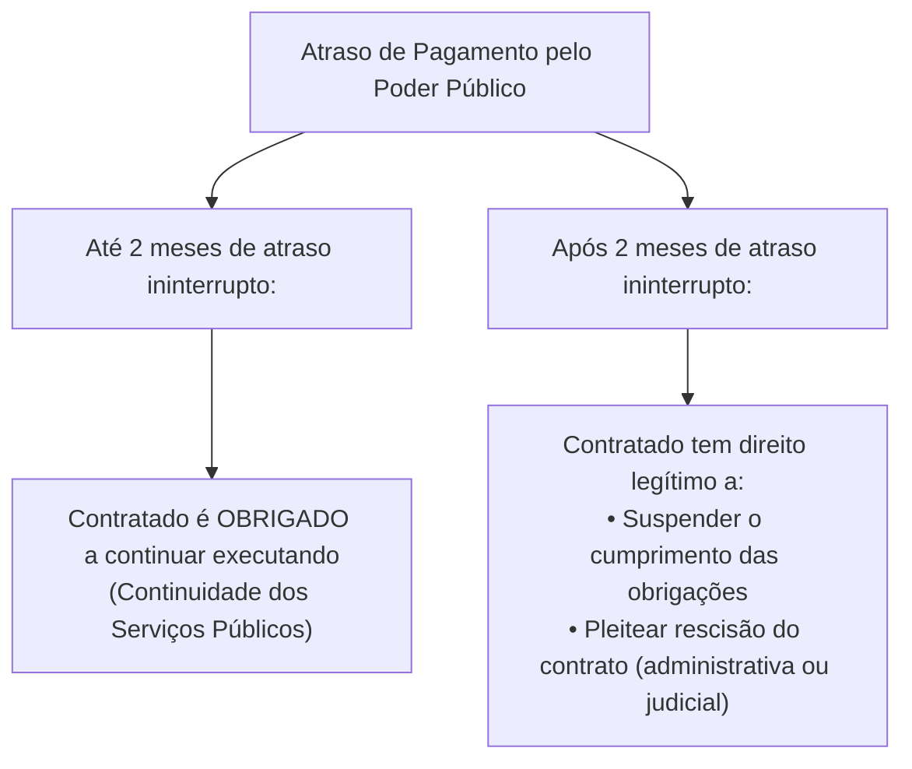
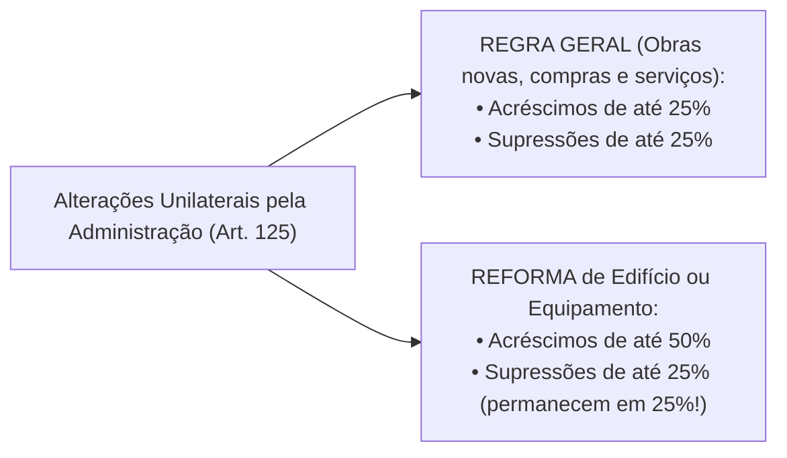

# 04 - Contratos Administrativos: Execução, Alterações, Equilíbrio e Sanções (Lei 14.133/2021)

> **Matéria:** Licitações e Contratos Administrativos  
> **Cargo:** A01 – Técnico de Controle Externo – Especialidade: Técnico Administrativo  
> **Arquivo:** `04_contratos_administrativos_fiscalizacao_alteracoes_e_sancoes.md`  
> **Status:** 🟢 Teoria Aprofundada + 5 Questões FCC Comentadas (A a E)

---

## 📌 Ementa Oficial do Edital
- Contratos administrativos: conceito, características, formalização e cláusulas exorbitantes.
- Garantias contratuais (caução, fiança bancária e seguro-garantia com cláusula de retomada / *step-in rights*).
- Duração dos contratos administrativos: prazos de vigência ordinários e contratações contínuas (até 5 anos, prorrogáveis até 10 anos).
- Gestão e fiscalização contratual: atribuições do gestor e fiscais (técnico, administrativo e setorial).
- Responsabilidade trabalhista da Administração Pública e Tema 246 do STF (ADC 16 - comprovação de culpa *in vigilando*).
- Recebimento provisório e definitivo do objeto.
- Alterações contratuais unilaterais e consensuais: limites de 25% e 50%.
- Equilíbrio econômico-financeiro: reajuste por índice, repactuação e revisão/reequilíbrio (*álea* extraordinária).
- Sanções administrativas: advertência, multa, impedimento de licitar e declaração de inidoneidade.
- Processo administrativo sancionador e reabilitação.

---

## 🧭 Sumário

1. [Conceito, Características e Cláusulas Exorbitantes dos Contratos Administrativos](#1-conceito-caracteristicas-e-clausulas-exorbitantes-dos-contratos-administrativos)
    1. [Características Fundamentais e Formalização](#11-caracteristicas-fundamentais-e-formalizacao)
    2. [Cláusulas Exorbitantes e Restrição à Exceção do Contrato Não Cumprido](#12-clausulas-exorbitantes-e-restricao-a-excecao-do-contrato-nao-cumprido)
    3. [Teste 099](#Teste-099)
2. [Garantias Contratuais e Seguro-Garantia com Cláusula de Retomada (Step-in Rights)](#2-garantias-contratuais-e-seguro-garantia-com-clausula-de-retomada-step-in-rights)
    1. [Teste 100](#Teste-100)
3. [Duração e Prorrogação dos Contratos Administrativos](#3-duracao-e-prorrogacao-dos-contratos-administrativos)
    1. [Serviços e Fornecimentos Contínuos (Regra 5 + 5 = Até 10 Anos)](#31-servicos-e-fornecimentos-continuos-regra-5-5-ate-10-anos)
    2. [Contratos por Escopo](#32-contratos-por-escopo)
    3. [Teste 101](#Teste-101)
4. [Gestão, Fiscalização e Responsabilidade Trabalhista do Estado](#4-gestao-fiscalizacao-e-responsabilidade-trabalhista-do-estado)
    1. [Estrutura de Gestão e Fiscalização Contratual](#41-estrutura-de-gestao-e-fiscalizacao-contratual)
    2. [Responsabilidade Trabalhista e Previdenciária: O Tema 246 do STF](#42-responsabilidade-trabalhista-e-previdenciaria-o-tema-246-do-stf)
    3. [Recebimento Provisório e Definitivo do Objeto](#43-recebimento-provisorio-e-definitivo-do-objeto)
    4. [Teste 102](#Teste-102)
    5. [Teste 103](#Teste-103)
5. [Alterações Contratuais e Manutenção do Equilíbrio Econômico-Financeiro](#5-alteracoes-contratuais-e-manutencao-do-equilibrio-economico-financeiro)
    1. [Alterações Unilaterais e Consensuais: Limites de 25% e 50%](#51-alteracoes-unilaterais-e-consensuais-limites-de-25-e-50)
    2. [Instrumentos de Recomposição: Reajuste, Repactuação e Revisão](#52-instrumentos-de-recomposicao-reajuste-repactuacao-e-revisao)
    3. [Teste 104](#Teste-104)
    4. [Teste 105](#Teste-105)
    5. [Teste 106](#Teste-106)
6. [Infrações, Sistema Sancionador e Processo de Reabilitação](#6-infracoes-sistema-sancionador-e-processo-de-reabilitacao)
    1. [Teste 107](#Teste-107)
    2. [Teste 108](#Teste-108)
    3. [Teste 109](#Teste-109)
7. [🌐 Fontes Recomendadas na Internet](#fontes-recomendadas-na-internet)

---

## 1. Conceito, Características e Cláusulas Exorbitantes dos Contratos Administrativos

O contrato administrativo é o ajuste bilateral de vontades celebrado entre a Administração Pública (atuando nessa qualidade revestida do regime de direito público) e o particular ou outra entidade pública, tendo por objetivo a consecução de uma utilidade de interesse público, sob condições reguladas pela legislação e pelo instrumento convocatório.

### 1.1 Características Fundamentais e Formalização
- **Consensual:** Aperfeiçoa-se com o consentimento mútuo manifestado na assinatura do ajuste, não dependendo da entrega física imediata da coisa para sua existência.
- **Formal:** A forma escrita é solene e obrigatória. O art. 95 da Lei nº 14.133/2021 estabelece que o instrumento de contrato é obrigatório, admitindo sua substituição por outros instrumentos hábeis (carta-contrato, nota de empenho de despesa, autorização de compra ou ordem de execução de serviço) apenas em dispensas de pequeno valor ou compras com entrega imediata e integral sem obrigações futuras. É nulo e de nenhum efeito o contrato verbal com a Administração, ressalvadas pequenas compras de pronto pagamento feitas em regime de adiantamento (suprimento de fundos) de valor irrisório.
- **Bilateral (ou Sinalagmático):** Gera direitos e obrigações recíprocas e interdependentes para ambas as partes.
- **Oneroso:** Impõe sacrifício patrimonial proporcional a ambas as partes contratantes.
- **Comutativo:** As prestações das partes são certas, conhecidas e tidas como equivalentes no momento da pactuação original.
- **Personalíssimo (*intuitu personae*):** Celebrado em função das qualidades subjetivas e habilitações demonstradas pelo licitante vencedor no certame, limitando-se a subcontratação às estritas balizas do edital e com prévia anuência da Administração.

### 1.2 Cláusulas Exorbitantes e Restrição à Exceção do Contrato Não Cumprido
As cláusulas exorbitantes (art. 104 da Lei nº 14.133/2021) conferem prerrogativas extraordinárias que extrapolam o direito privado comum, justificadas pela supremacia do interesse público sobre o privado:

1. **Modificação unilateral do contrato:** A Administração pode alterar qualitativa ou quantitativamente as cláusulas de serviço para melhor adequação técnica ao interesse público;
2. **Extinção unilateral do contrato:** Rescisão decorrente de inadimplemento do contratado ou por razões de interesse público de alta relevância;
3. **Fiscalização contínua da execução:** Acompanhamento técnico, administrativo e financeiro pelo Poder Público;
4. **Aplicação direta de sanções administrativas:** Imposição de sanções pelo próprio órgão contratante sem necessidade de intervenção prévia do Poder Judiciário;
5. **Ocupação provisória de bens e serviços:** Utilização de bens móveis, imóveis e pessoal do contratado necessários à continuidade de serviços públicos essenciais paralisados;
6. **Atenuação da *Exceptio Non Adimpleti Contractus* (Exceção do Contrato Não Cumprido):**
    - No direito civil comum, se um contratante deixa de pagar, o outro pode imediatamente paralisar suas atividades contratuais.
    - No regime jurídico-administrativo, em virtude do **princípio da continuidade do serviço público**, o contratado **não pode paralisar imediatamente** as obras ou serviços em caso de inadimplemento financeiro do Estado.
    - Pelo art. 137, § 2º, inciso IV, da Lei nº 14.133/2021, o particular é obrigado a continuar executando o contrato até o limite de **2 (dois) meses de atraso ininterrupto** nos pagamentos devidos pela Administração Pública. Somente após transcorridos 2 meses contínuos de inadimplemento é que assiste ao particular o direito de suspender a execução de suas obrigações ou requerer a extinção do contrato.

---

### Teste 099
**(FGV – TRF-1ª Região – Analista Judiciário - 2024)**  
As chamadas cláusulas exorbitantes correspondem às prerrogativas conferidas pelo ordenamento jurídico à Administração Pública na celebração e execução dos contratos administrativos (art. 104 da Lei nº 14.133/2021). A respeito dessas prerrogativas especiais, é correto afirmar que:

* **A)** A Administração pode rescindir unilateralmente o contrato em caso de inexecução culposa da contratada.
* **B)** A alteração unilateral das cláusulas contratuais pelo Estado autoriza a modificação substancial do objeto pactuado.
* **C)** A aplicação de sanções administrativas cominatórias prescinde de prévio processo administrativo com contraditório.
* **D)** A ocupação provisória de bens do contratado aplica-se unicamente aos contratos de locação imobiliária comum.
* **E)** As cláusulas exorbitantes conferem à Administração a faculdade de suspender indefinidamente pagamentos devidos.

---

> **Comentário Detalhado:**
>
> - **A)** **Correto**. O art. 104, II c/c art. 137 da Lei nº 14.133/2021 estabelece expressamente a prerrogativa exorbitante da Administração Pública de extinguir unilateralmente o contrato administrativo nos casos especificados em lei, notadamente pelo não cumprimento culposo de cláusulas contratuais, especificações, projetos ou prazos pelo contratado.
> - **B)** **Incorreto**. A alteração unilateral é restrita aos limites legais (art. 125) e jamais pode transfigurar a natureza do objeto licitado.
> - **C)** **Incorreto**. A aplicação de qualquer penalidade exige a observância do devido processo legal e ampla defesa (art. 156, § 1º).
> - **D)** **Incorreto**. A ocupação e utilização temporária de bens móveis, imóveis e pessoal do contratado destina-se a serviços essenciais para evitar a interrupção da atividade pública (art. 104, V).
> - **E)** **Incorreto**. O atraso injustificado no pagamento enseja direito do particular à suspensão ou extinção contratual (art. 137, § 2º, IV).
>
> **Gabarito: A**
## 2. Garantias Contratuais e Seguro-Garantia com Cláusula de Retomada (Step-in Rights)

A critério da autoridade competente, em cada contratação a Administração pode exigir do contratado a prestação de garantia (art. 96). Caberá ao **contratado optar** por uma das seguintes modalidades:

1. **Caução em dinheiro ou em títulos da dívida pública;**
2. **Fiança bancária** emitida por banco ou instituição financeira autorizada pelo Banco Central;
3. **Seguro-garantia** emitido por seguradora autorizada pela SUSEP.

**Limites Ordinários de Garantia:**

- **Regra Geral:** O percentual de garantia contratual será de até **5% (cinco por cento)** do valor inicial do contrato (art. 98).
- **Contratos de Alta Complexidade Técnica ou Riscos Elevados:** A garantia pode ser fixada em até **10% (dez por cento)** do valor do contrato, desde que expressamente motivada na fase preparatória (art. 98, § 1º).

#### Seguro-Garantia com Cláusula de Retomada (*Step-in Rights* - Art. 102)
Para combater o problema crônico nacional de paralisação e abandono de obras públicas, a Nova Lei de Licitações introduziu uma inovação profunda inspirada no modelo norte-americano (*performance bond*):

- Em contratações de obras e serviços de engenharia de **grande vulto** (valor superior a R$ 200 milhões na edição da lei, atualizado anualmente), o edital pode prever a obrigatoriedade de seguro-garantia com previsão expressa de **cláusula de retomada** (*step-in rights*).
- Nessa modalidade, o valor da garantia pode alcançar até **30% (trinta por cento)** do valor inicial do contrato.
- **Funcionamento:** Em caso de inadimplemento, atraso grave ou abandono por parte da construtora, a seguradora é notificada para intervir diretamente. A seguradora assume a administração do canteiro de obras e conclui a execução do objeto contratado, diretamente ou mediante subcontratação de terceiros idôneos aprovados pelo Poder Público.
- Concluída a obra pela seguradora, ela fica liberada da obrigação de pagar a indenização em dinheiro correspondente à apólice.

---

### Teste 100
**(FCC – Analista Judiciário – TRT / Simulado)**  
Em uma licitação de obra pública de grande vulto (orçada em trezentos milhões de reais), a Administração incluiu no edital a exigência de seguro-garantia com cláusula de retomada (step-in rights). Conforme disciplinado nos arts. 96 a 102 da Lei nº 14.133/2021:

* **A)** O seguro-garantia em obras de grande vulto pode atingir até 30% do valor inicial do contrato.
* **B)** A seguradora assume a obrigação de indenizar o erário em dinheiro, sendo-lhe vedado assumir a execução direta da obra.
* **C)** A exigência de garantia contratual é compulsória em todos os contratos administrativos, inclusive compras imediatas.
* **D)** A modalidade de caução em dinheiro não admite a utilização de títulos da dívida pública emitidos pelo Tesouro Nacional.
* **E)** A garantia contratual pode ser retida definitivamente pelo Estado sem prévia apuração de prejuízos causados na execução.

---

> **Comentário Detalhado:**
>
> - **A)** **Correto**. O art. 99 da Lei nº 14.133/2021 prevê expressamente que, nas contratações de obras e serviços de engenharia de grande vulto, poderá ser exigida a prestação de garantia, na modalidade seguro-garantia, com cláusula de retomada da execução contratual (step-in rights), em percentual de até 30% (trinta por cento) do valor inicial do contrato, hipótese em que a seguradora conclui a obra inadimplida pela contratada originária.
> - **B)** **Incorreto**. A inovação da cláusula de retomada autoriza justamente a seguradora a assumir a execução do contrato (art. 102).
> - **C)** **Incorreto**. A exigência de garantia é faculdade da autoridade competente (art. 96, caput), sendo usualmente dispensada em entregas imediatas.
> - **D)** **Incorreto**. O art. 96, § 1º, I autoriza expressamente títulos da dívida pública emitidos sob a forma escritural.
> - **E)** **Incorreto**. A retenção de garantia exige prévia apuração do valor do dano e contraditório administrativo.
>
> **Gabarito: A**
## 3. Duração e Prorrogação dos Contratos Administrativos

A regra orçamentária tradicional vinculava a vigência contratual aos créditos orçamentários do respectivo exercício financeiro (regra do ano civil). A Lei nº 14.133/2021 flexibilizou essa sistemática com regras modernas de planejamento (arts. 105 a 114):

### 3.1 Serviços e Fornecimentos Contínuos (Regra 5 + 5 = Até 10 Anos)
O art. 106 da NLLC estabelece uma revolução para os contratos de serviços e fornecimentos contínuos (limpeza, vigilância, suporte de TI, manutenção predial, locação de equipamentos):

- Podem ser celebrados com prazo de vigência inicial de **até 5 (cinco) anos**.
- A Administração pode prorrogar sucessivamente a contratação até o limite máximo total de **10 (dez) anos**, desde que comprovada documentalmente a vantajosidade econômica das condições e a manutenção da qualidade da execução.
- Permite amortização mais eficiente de investimentos e redução substantiva dos custos de transação causados por licitações repetitivas anuais.

### 3.2 Contratos por Escopo
- Nos contratos cujo objeto é a entrega de um produto ou realização de obra certa e predeterminada (contratos por escopo predeterminado), o prazo de vigência original deve corresponder ao cronograma de execução física.
- Conforme o art. 111, o prazo de vigência será **automaticamente prorrogado** quando o seu objeto não for concluído no período inicialmente firmado por razões imputáveis à Administração ou por fatos supervenientes de caso fortuito/força maior, assegurando-se a conclusão da obra e a apuração de responsabilidades caso o atraso decorra de culpa exclusiva do contratado.

---

### Teste 101
**(FCC – TRT-1ª Região – Analista Judiciário - 2014)**  
A disciplina da duração e da prorrogação dos contratos administrativos de serviços contínuos sofreu relevante modernização na Lei Federal nº 14.133/2021 (arts. 106 e 107). A respeito dos prazos de vigência desses contratos, é correto afirmar que:

* **A)** Os contratos de serviços e fornecimentos contínuos podem ser celebrados pelo prazo inicial de até cinco anos.
* **B)** O contrato de serviço contínuo vincula-se obrigatoriamente à vigência dos créditos orçamentários do exercício.
* **C)** A duração máxima total do contrato contínuo com prorrogações sucessivas não pode ultrapassar trinta e seis meses.
* **D)** A prorrogação contratual independe da demonstração da vantajabilidade econômica dos preços para a Administração.
* **E)** Os contratos com vigência plurianual exigem a reabertura integral do procedimento licitatório no segundo exercício.

---

> **Comentário Detalhado:**
>
> - **A)** **Correto**. O art. 106 da Lei nº 14.133/2021 estabelece que a Administração poderá celebrar contratos de serviços e fornecimentos contínuos pelo prazo de até 5 (cinco) anos. Além disso, o art. 107 preceitua que tais contratos poderão ser prorrogados sucessivamente, respeitada a vigência máxima decenal (até 10 anos), desde que haja previsão no edital e atestada a vantajabilidade econômica.
> - **B)** **Incorreto**. A regra anterior de adstrição estrita ao exercício financeiro (art. 57 da Lei 8.666) foi superada para serviços contínuos.
> - **C)** **Incorreto**. O limite máximo decenal é de até 10 (dez) anos (art. 107 da NLLC).
> - **D)** **Incorreto**. A comprovação de que as condições permanecem vantajosas para a Administração é requisito obrigatório para a prorrogação.
> - **E)** **Incorreto**. A plurianualidade dispensa nova licitação anual, desde que respeitados os requisitos da LRF e do contrato.
>
> **Gabarito: A**
## 4. Gestão, Fiscalização e Responsabilidade Trabalhista do Estado

### 4.1 Estrutura de Gestão e Fiscalização Contratual
A execução do contrato deve ser acompanhada e fiscalizada permanentemente por um ou mais fiscais do contrato, auxiliados por gestores, atendendo ao princípio da segregação de funções (art. 117):

- **Gestor do Contrato:** Servidor responsável pela coordenação global dos atos administrativos, prorrogações, reajustes e controle financeiro macro.
- **Fiscal Técnico:** Servidor responsável pelo acompanhamento prático, rotineiro e presencial da conformidade dos serviços e obras executados em relação às especificações do projeto.
- **Fiscal Administrativo:** Servidor responsável pela fiscalização da documentação fiscal, previdenciária e trabalhista da mão de obra terceirizada.
- **Fiscal Setorial / do Público Usuário:** Servidores designados em unidades descentralizadas ou comissões de usuários para atestar a efetiva entrega dos bens ou serviços.

### 4.2 Responsabilidade Trabalhista e Previdenciária: O Tema 246 do STF
A responsabilidade do Estado perante terceiros na terceirização de serviços é tema de alta incidência na jurisprudência e concursos:

- **Encargos Fiscais e Comerciais:** A inadimplência do contratado não transfere em hipótese alguma a responsabilidade ao Poder Público (art. 121, § 1º).
- **Encargos Previdenciários:** O Estado responde solidariamente pelos débitos previdenciários nos moldes do art. 31 da Lei nº 8.212/91 e art. 121, § 2º.
- **Encargos Trabalhistas e o Tema 246 do STF (ADC 16 e RE 760.931):**
    - O art. 121, § 1º, da NLLC reforça que o inadimplemento trabalhista da empresa terceirizada **não transfere automaticamente** a responsabilidade de pagamento ao Poder Público tomador de serviços.
    - O STF, ao julgar com repercussão geral o **Tema 246**, consolidou que o Estado **não possui responsabilidade objetiva** nem responde automaticamente.
    - A condenação subsidiária da Administração Pública só é admitida se restar cabalmente demonstrada nos autos processuais a sua **culpa *in vigilando*** — caracterizada pela omissão reiterada e culposa do dever legal de fiscalizar mensalmente o adimplemento dos salários, recolhimento de FGTS e verbas da folha pela contratada.
    - O encargo probatório dessa conduta omissiva recai sobre o trabalhador reclamante, sendo vedada presunção automática de culpa contra a Fazenda Pública.

### 4.3 Recebimento Provisório e Definitivo do Objeto
O art. 140 da NLLC disciplina as fases de entrega do objeto contratado:

- **Recebimento Provisório:** Realizado pelo **fiscal do contrato**, mediante termo circunstanciado, para efeito de posterior verificação da conformidade do material ou serviço com as especificações exigidas.
- **Recebimento Definitivo:** Realizado por **servidor ou comissão designada pela autoridade competente**, mediante termo circunstanciado que comprove a perfeita adequação do objeto aos termos contratuais e técnicos.
- O recebimento provisório ou definitivo não exclui a responsabilidade civil do contratado pela solidez e segurança da obra ou serviço durante o prazo legal de 5 anos (art. 618 do Código Civil), nem por vícios ocultos.

---

### Teste 102
**(FCC – Procurador do Estado – PGE-GO / Simulado)**  
Na terceirização de serviços continuados de limpeza e vigilância predial no âmbito estadual, a autoridade administrativa designou fiscais para acompanhar a execução contratual. Segundo o art. 117 da Lei Federal nº 14.133/2021:

* **A)** A fiscalização do contrato pode ser exercida por particular terceirizado contratado para substituir a comissão oficial.
* **B)** O fiscal técnico acompanha a prestação e o fiscal administrativo monitora os encargos trabalhistas.
* **C)** O fiscal do contrato responde objetiva e solidariamente pelas dívidas tributárias da sociedade empresária prestadora.
* **D)** As anotações de irregularidades feitas pelo fiscal do contrato dispensam notificação ao preposto da empresa contratada.
* **E)** O recebimento provisório do serviço cabe privativamente ao gestor do contrato, vedada a atuação do fiscal setorial.

---

> **Comentário Detalhado:**
>
> - **A)** **Incorreto**. A fiscalização é função pública exclusiva; terceiros podem ser contratados unicamente para assistir e subsidiar o fiscal oficial (art. 117, § 4º).
> - **B)** **Correto**. O art. 117 da Lei nº 14.133/2021 institucionalizou as atribuições segregadas: o fiscal técnico acompanha a execução material do objeto (qualidade e quantidade dos serviços), enquanto o fiscal administrativo acompanha os aspectos previdenciários, fiscais e trabalhistas das obrigações da empresa contratada.
> - **C)** **Incorreto**. O servidor fiscal não responde pelas obrigações tributárias da empresa; sua responsabilidade é funcional e subjetiva por desídia comprovada.
> - **D)** **Incorreto**. O fiscal deve registrar todas as ocorrências e notificar formalmente o preposto da contratada para correção (art. 117, § 1º).
> - **E)** **Incorreto**. O recebimento provisório é atribuição típica do fiscal do contrato (art. 140, I, "a").
>
> **Gabarito: B**
### Teste 103
**(FGV – TRT – Analista Judiciário - 2025)**  
Empregado terceirizado que prestava serviços de vigilância desarmada a órgão público ajuizou reclamação trabalhista postulando a condenação subsidiária da Administração Pública pelo inadimplemento de verbas rescisórias da empresa terceirizada. À luz do art. 121, § 1º da Lei nº 14.133/2021 e da tese vinculante fixada pelo STF no Tema nº 246 (ADC 16 e RE 760.931):

* **A)** O inadimplemento da empresa terceirizada transfere automaticamente a responsabilidade pelo pagamento ao erário.
* **B)** A responsabilidade subsidiária do Poder Público exige comprovação cabal de sua conduta culposa na fiscalização.
* **C)** O Estado é solidariamente responsável com o empregador por todas as verbas salariais decorrentes da terceirização.
* **D)** A fiscalização efetiva dos encargos trabalhistas pelo órgão público atrai a sua responsabilidade civil patrimonial.
* **E)** A Justiça do Trabalho carece de competência jurisdicional para examinar a culpa in vigilando do ente federado contratante.

---

> **Comentário Detalhado:**
>
> - **A)** **Incorreto**. O art. 121, § 1º da Lei nº 14.133/2021 e o art. 71, § 1º da Lei 8.666/93 estabelecem que a inadimplência do contratado não transfere automaticamente à Administração Pública a responsabilidade pelo pagamento dos encargos trabalhistas.
> - **B)** **Correto**. Tese Vinculante do Tema nº 246 do STF: "O inadimplemento dos encargos trabalhistas dos empregados do contratado não transfere automaticamente ao Poder Público contratante a responsabilidade pelo seu pagamento, seja em caráter solidário ou subsidiário, nos termos do art. 71, § 1º, da Lei nº 8.666/93". O STF assentou que a condenação subsidiária do ente público somente é legítima quando houver prova inequívoca e cabal de sua conduta culposa e desidiosa (culpa in vigilando) na fiscalização do contrato.
> - **C)** **Incorreto**. Não há responsabilidade solidária em hipótese alguma na terceirização lícita regular.
> - **D)** **Incorreto**. A fiscalização diligente e tempestiva exime o ente público de qualquer condenação subsidiária.
> - **E)** **Incorreto**. A Justiça do Trabalho é competente para processar e julgar a responsabilidade subsidiária da Administração (Súmula 331 do TST).
>
> **Gabarito: B**
## 5. Alterações Contratuais e Manutenção do Equilíbrio Econômico-Financeiro

### 5.1 Alterações Unilaterais e Consensuais: Limites de 25% e 50%
Os contratos administrativos podem ser alterados unilateralmente pela Administração (quando houver modificação de projeto ou adequação quantitativa) ou consensualmente por acordo mútuo entre as partes (para substituição de garantia ou repactuação) — art. 124.

O art. 125 estipula os limites legais obrigatórios que o contratado é obrigado a aceitar nas alterações unilaterais:

- **Regra Geral (Compras, Serviços e Obras):** O contratado fica obrigado a aceitar, nas mesmas condições contratuais, acréscimos ou supressões de até **25% (vinte e cinco por cento)** do valor inicial atualizado do contrato.
- **Exceção Específica para REFORMAS de Edifícios ou Equipamentos:** O limite para **acréscimos será de até 50% (cinquenta por cento)** do valor inicial atualizado do contrato.

> 🚨 **ALERTA DE PROVA / PEGADINHA FCC:**  
>
> 1. O limite ampliado de **até 50% é exclusivo para acréscimos em reformas** de edifícios ou de equipamentos. Obras novas ou ampliações submetem-se ao teto de 25%.  
> 2. **Para supressões (reduções quantitativas), o limite legal é sempre de 25%**, inclusive em reformas de edifícios!  
> 3. É **terminantemente proibida a compensação matemática** entre acréscimos e supressões para efeito de cumprimento dos limites legais (ex.: acrescer 40% em um item e suprimir 40% em outro configura ilegalidade manifesta pelo "jogo de planilhas").

### 5.2 Instrumentos de Recomposição: Reajuste, Repactuação e Revisão
A garantia da equação econômico-financeira original é direito fundamental do contratado previsto no art. 37, XXI, da CF/88. A Lei nº 14.133/2021 distingue com clareza três institutos:

| Instituto Jurídico | Hipótese de Aplicação | Periodicidade Mínima | Base de Cálculo / Fundamento |
|---|---|:---:|---|
| **Reajuste em Sentido Estrito** | Variação inflacionária ordinária do custo dos insumos e produtos | **1 ano** (interregno mínimo) | Aplicação automática de índice oficial de correção de preços previsto no edital (ex.: IPCA, INCC, IGP-M). |
| **Repactuação** | Serviços contínuos com **dedicação exclusiva de mão de obra** | **1 ano** (interregno mínimo) | Demonstração analítica da variação de custos decorrente de nova **Convenção Coletiva de Trabalho (CCT)** ou Dissídio Coletivo. |
| **Revisão (Reequilíbrio em Sentido Estrito)** | Fatos imprevisíveis, caso fortuito, força maior, fato do príncipe ou fato da administração (**álea extraordinária**) | **A qualquer tempo** (não exige interregno anual) | Teoria da Imprevisão; recomposição integral da margem econômica desequilibrada por evento extraordinário e extracontratual. |

---

### Teste 104
**(FGV – Analista de Controle Externo – TCE-GO / Simulado)**  
Durante a execução de um contrato administrativo de pavimentação asfáltica, a Secretaria de Obras constatou a necessidade de realizar acréscimos quantitativos na extensão da via e ajustes qualitativos no traçado do projeto básico. Nos termos do art. 125 da Lei Federal nº 14.133/2021:

* **A)** O contratado fica obrigado a aceitar acréscimos ou supressões de até 25% do valor inicial atualizado do contrato.
* **B)** O contratado pode recusar acréscimos unilaterais caso o valor da parcela adicionada ultrapasse dez por cento da obra.
* **C)** Os limites de 25% para acréscimo e de 25% para supressão podem ser compensados contabilmente entre si na planilha.
* **D)** Em reformas de edifícios públicos, o limite máximo de acréscimo obrigatório que o contratado deve aceitar é de 25%.
* **E)** As alterações contratuais qualitativas dispensam termo aditivo formal quando houver prévio empenho da despesa.

---

> **Comentário Detalhado:**
>
> - **A)** **Correto**. O art. 125 da Lei nº 14.133/2021 preceitua expressamente: "Nas alterações unilaterais a que se refere o inciso I do caput do art. 124 desta Lei, o contratado será obrigado a aceitar, nas mesmas condições contratuais, acréscimos ou supressões de até 25% (vinte e cinco por cento) do valor inicial atualizado do contrato que se fizerem nas obras, nos serviços ou nas compras".
> - **B)** **Incorreto**. A aceitação de acréscimos de até 25% é dever legal vinculante e obrigatório da empresa contratada.
> - **C)** **Incorreto**. O art. 125 veda expressamente a compensação entre acréscimos e supressões; os limites incidem isoladamente sobre cada alteração.
> - **D)** **Incorreto**. Para reforma de edifício ou de equipamento, o limite de acréscimo legal é de até 50% (cinquenta por cento), conforme o art. 125 in fine.
> - **E)** **Incorreto**. Toda e qualquer alteração contratual deve ser obrigatoriamente formalizada por termo aditivo (art. 132).
>
> **Gabarito: A**
### Teste 105
**(FCC – Analista de Controle Externo – TCE-GO / Simulado)**  
O Tribunal de Contas formalizou contrato administrativo de serviços de tecnologia com prazo de três anos. A respeito dos institutos jurídicos da recomposição (revisão), do reajuste em sentido estrito e da repactuação contratual na Lei nº 14.133/2021:

* **A)** O reajuste em sentido estrito aplica-se a serviços com dedicação exclusiva de mão de obra para repassar convenção coletiva.
* **B)** A repactuação decorre da variação de custos decorrente de acordo, convenção ou dissídio coletivo de trabalho.
* **C)** A revisão (reequilíbrio) subordina-se à observância do interregno temporal mínimo de um ano contado da proposta.
* **D)** A criação de novo tributo incidente sobre o contrato que majore os encargos não autoriza a revisão do ajuste público.
* **E)** A repactuação de serviços com mão de obra exclusiva dispensa a demonstração analítica de aumento de custos em planilha.

---

> **Comentário Detalhado:**
>
> - **A)** **Incorreto**. Para serviços com mão de obra exclusiva de mão de obra aplica-se a repactuação (art. 135), e não o reajuste por índice geral.
> - **B)** **Correto**. Conforme estabelece o art. 135 da Lei nº 14.133/2021, a repactuação é a espécie de reajustamento voltada para serviços contínuos prestados com regime de dedicação exclusiva de mão de obra, devendo ser demonstrada a variação efetiva dos custos de mão de obra por meio de planilha de custos, motivada pela celebração de acordo, convenção coletiva de trabalho ou dissídio.
> - **C)** **Incorreto**. A revisão (reequilíbrio por álea extraordinária - art. 124, II, "d") pode ser concedida a qualquer tempo, sem exigência de vacância anual.
> - **D)** **Incorreto**. A criação ou majoração de tributos e encargos legais configura fato do príncipe (art. 134) e impõe obrigatória revisão contratual.
> - **E)** **Incorreto**. A demonstração analítica da variação de custos por planilha analítica é pressuposto legal indeclinável.
>
> **Gabarito: B**
### Teste 106
**(FCC – Auditor de Controle Externo – TCE-GO / Simulado)**  
Durante a execução de um contrato administrativo de serviços de limpeza urbana, a Fazenda Pública municipal atrasou injustificadamente o pagamento das faturas devidas à empresa contratada. De acordo com o art. 137, § 2º, IV, da Lei Federal nº 14.133/2021, o contratado tem o direito de suspender o cumprimento de suas obrigações caso o atraso nos pagamentos ultrapasse:

* **A)** dois meses da nota fiscal, salvo calamidade pública ou grave perturbação da ordem.
* **B)** trinta dias contados da liquidação da despesa, devendo rescindir unilateralmente o contrato sem aviso formal.
* **C)** noventa dias consecutivos, independentemente de qualquer justificativa estatal quanto ao atraso financeiro.
* **D)** seis meses corridos, não podendo suspender a prestação se a avença envolver serviços públicos essenciais.
* **E)** um ano ininterrupto, cabendo-lhe pleitear unicamente correção monetária pelo índice oficial de inflação.

---

> **Comentário Detalhado:**
>
> - **A)** **Correto**. O art. 137, § 2º, IV, da Lei nº 14.133/2021 inovou em favor do contratado ao prever que ele tem direito à extinção ou à suspensão da execução contratual por "atraso superior a 2 (dois) meses, contado da emissão da nota fiscal, dos pagamentos ou de parcelas de pagamentos devidos pela Administração por despesas de obras, serviços ou fornecimentos", salvo em caso de calamidade pública, grave perturbação da ordem interna ou guerra. Na lei revogada (Lei 8.666/93, art. 78, XV), o prazo era de 90 dias.
> - **B)** **Incorreto**. O prazo na Nova Lei de Licitações é de 2 (dois) meses, e a extinção exige notificação e contraditório.
> - **C)** **Incorreto**. O prazo de 90 dias era da legislação antiga (Lei 8.666/93), reduzido pela NLLC para 2 meses.
> - **D)** **Incorreto**. O prazo fixado no texto vigente é de 2 meses.
> - **E)** **Incorreto**. Prazo totalmente descabido e sem qualquer previsão no direito positivo.
>
> **Gabarito: A**
## 6. Infrações, Sistema Sancionador e Processo de Reabilitação

O cometimento de infrações administrativas elencadas no art. 155 da Lei nº 14.133/2021 (dar causa à inexecução parcial ou total, fraudar a licitação, praticar ato ilícito com vistas a frustrar os objetivos do certame, comportar-se de modo inidôneo) sujeita o licitante ou contratado a quatro sanções administrativas (art. 156):

| Sanção Administrativa | Prazo de Duração | Abrangência Territorial e Subjetiva | Autoridade Competente para Aplicação |
|---|:---:|---|---|
| **Advertência** | Aplicada imediatamente à falta leve | Restrita àquele contrato específico | Autoridade designada em regulamento |
| **Multa** | Cobrada de imediato (0,5% a 30% do valor do contrato) | Pecuniária; pode ser cumulada com outras sanções | Autoridade designada em regulamento |
| **Impedimento de Licitar e Contratar** | **Até 3 (três) anos** | No âmbito da Administração Pública direta e indireta do **ente federativo sancionador** (ex.: apenas no Estado de Goiás) | Autoridade competente do respectivo órgão |
| **Declaração de Inidoneidade** | **De 3 (três) a 6 (seis) anos** | **Toda a Administração Pública** direta e indireta de **todos os entes federativos** do país (União, Estados, DF e Municípios) | **Ministro de Estado**, **Secretário de Estado** ou **Secretário Municipal** |

> 🚨 **ALERTA DE PROVA / FCC:**  
> A declaração de inidoneidade da NLLC inovou ao fixar prazo mínimo de 3 anos e máximo de 6 anos, estabelecendo eficácia extensiva nacional compulsória. Sua aplicação é ato privativo da autoridade superior (Secretário ou Ministro), exigindo instrução técnica e parecer jurídico vinculante.

**Reabilitação do Sancionado (Art. 163):**
A reabilitação perante a Administração exige cumulativamente:

1. Reparação integral do dano causado ao erário;
2. Pagamento da multa aplicada;
3. Transcurso do prazo mínimo de **1 ano** da aplicação de impedimento de licitar ou **3 anos** da declaração de inidoneidade;
4. Cumprimento das condições de reabilitação e implantação ou aperfeiçoamento de **programa de integridade (*compliance*)**, exigido compulsoriamente nas sanções por atos de corrupção ou fraude da Lei Anticorrupção.

---

### Teste 107
**(FCC – Auditor de Controle Externo – TCE-GO / Simulado)**  
A respeito do sistema sancionatório previsto no art. 156 da Lei nº 14.133/2021, a Administração Pública poderá aplicar aos licitantes ou contratados inadimplentes diversas sanções administrativas cominatórias. Constituem sanções expressamente estabelecidas no referido dispositivo:

* **A)** advertência, multa, impedimento de licitar e declaração de inidoneidade para licitar/contratar.
* **B)** repreensão verbal, suspensão temporária de três meses, retenção integral da garantia e perdimento de bens.
* **C)** multa diária cominatória, perda de registro societário, cassação de inscrição na Junta e intervenção judicial.
* **D)** advertência solene, cancelamento de alvará comercial e apreensão compulsória do maquinário da empresa.
* **E)** declaração de inidoneidade, suspensão de direitos políticos do administrador e indisponibilidade de ativos.

---

> **Comentário Detalhado:**
>
> - **A)** **Correto**. O art. 156 da Lei nº 14.133/2021 estabelece taxativamente as 4 (quatro) sanções administrativas cabíveis: "I - advertência; II - multa; III - impedimento de licitar e contratar; IV - declaração de inidoneidade para licitar ou contratar". A antiga "suspensão temporária de participação em licitação" da Lei 8.666 foi substituída pelo impedimento de licitar e contratar (art. 156, III).
> - **B)** **Incorreto**. Repreensão verbal e perdimento patrimonial de bens não são sanções administrativas da NLLC.
> - **C)** **Incorreto**. A Administração Pública não tem poder para cassar registro mercantil em processo de licitação.
> - **D)** **Incorreto**. Apreensão de maquinário e cassação de alvará não integram o rol do art. 156 da NLLC.
> - **E)** **Incorreto**. Suspensão de direitos políticos decorre de ação de improbidade julgada pelo Judiciário (LIA), não de sanção do art. 156.
>
> **Gabarito: A**
### Teste 108
**(FCC – Técnico de Controle Externo – TCE-GO / Simulado)**  
Durante a execução de um contrato administrativo de fornecimento de ambulâncias para o Estado de Goiás, restou comprovado que a empresa contratada cometeu fraude dolosa ao entregar veículos usados com hodômetros adulterados. Diante da gravidade da infração, a autoridade instaurou processo de declaração de inidoneidade. A respeito dessa sanção (art. 156, § 6º da Lei nº 14.133/2021):

* **A)** A inidoneidade é competência exclusiva do Secretário de Estado e tem eficácia em toda a Federação.
* **B)** A sanção de inidoneidade pode ser aplicada por qualquer fiscal de contrato, produzindo efeitos no órgão contratante.
* **C)** A declaração de inidoneidade tem prazo fixo de seis meses, após o qual a reabilitação da empresa é automática.
* **D)** A inidoneidade impede a participação em licitações apenas perante o Município onde a fraude material foi consumada.
* **E)** O sancionado com inidoneidade pode participar livremente de certames licitatórios promovidos pela Administração Federal.

---

> **Comentário Detalhado:**
>
> - **A)** **Correto**. O art. 156, § 6º, da Lei nº 14.133/2021 determina que a sanção de declaração de inidoneidade para licitar ou contratar é de competência EXCLUSIVA de Ministro de Estado, de Secretário Estadual ou de Secretário Municipal. Ademais, o § 5º estabelece que a inidoneidade produz efeitos no âmbito de TODA a Administração Pública direta e indireta de TODOS os entes federativos (União, Estados, DF e Municípios), pelo prazo mínimo de 3 (três) anos e máximo de 6 (seis) anos.
> - **B)** **Incorreto**. A competência é privativa e indelegável da autoridade de cúpula ministerial ou de secretaria.
> - **C)** **Incorreto**. O prazo legal é de 3 a 6 anos, e a reabilitação exige o cumprimento dos requisitos do art. 163 (ressarcimento integral e cumprimento das condições).
> - **D)** **Incorreto**. A inidoneidade na NLLC tem alcance nacional e abrange todos os órgãos federativos.
> - **E)** **Incorreto**. O impedimento gerado pela declaração de inidoneidade alcança a esfera federal e todas as demais.
>
> **Gabarito: A**
### Teste 109
**(FGV – Analista Jurídico – PGE-GO / Simulado)**  
O art. 160 da Lei nº 14.133/2021 estabelece os requisitos e o procedimento para a aplicação da desconsideração da personalidade jurídica no âmbito das licitações e dos contratos administrativos. A respeito desse instituto, é correto afirmar que:

* **A)** A desconsideração pode ser aplicada para estender as sanções de inidoneidade aos sócios e administradores com poderes.
* **B)** A aplicação da desconsideração da personalidade jurídica dispensa a observância do contraditório e da ampla defesa.
* **C)** A medida cabe apenas quando houver decisão judicial transitada em julgado proferida por vara de falências e concordatas.
* **D)** A extensão dos efeitos punitivos atinge exclusivamente os acionistas minoritários sem poder de gestão societária.
* **E)** A desconsideração impede a cobrança das multas administrativas aplicadas pelo órgão governamental lesado.

---

> **Comentário Detalhado:**
>
> - **A)** **Correto**. O art. 160 da Lei nº 14.133/2021 preconiza expressamente: "A personalidade jurídica poderá ser desconsiderada sempre que utilizada com abuso do direito para facilitar, encobrir ou dissimular a prática dos atos ilícitos previstos nesta Lei ou para provocar confusão patrimonial, e, nesse caso, todos os efeitos das sanções aplicadas à pessoa jurídica serão estendidos aos seus administradores e de sócios com poderes de administração". Visa coibir a criação fraudulenta de novas empresas para burlar sanções de inidoneidade (figura da empresa de fachada).
> - **B)** **Incorreto**. O contraditório prévio e a ampla defesa com prazo de 15 dias úteis são mandatórios (art. 160, parágrafo único).
> - **C)** **Incorreto**. A desconsideração da personalidade jurídica para fins de sanções licitatórias pode ser aplicada na via administrativa pelo ente público lesado.
> - **D)** **Incorreto**. A extensão recai especificamente sobre administradores e sócios com poderes de administração.
> - **E)** **Incorreto**. A desconsideração viabiliza justamente a cobrança patrimonial perante o patrimônio pessoal dos sócios administradores.
>
> **Gabarito: A**
