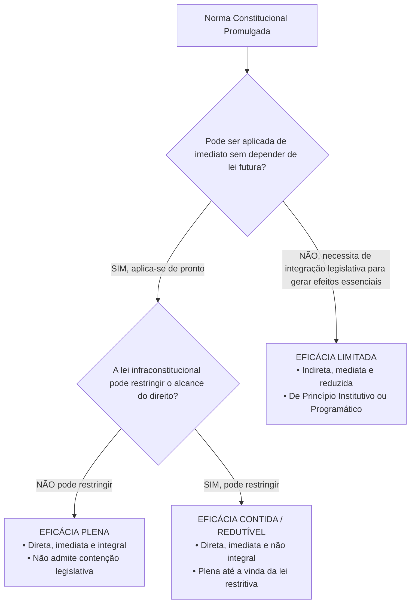
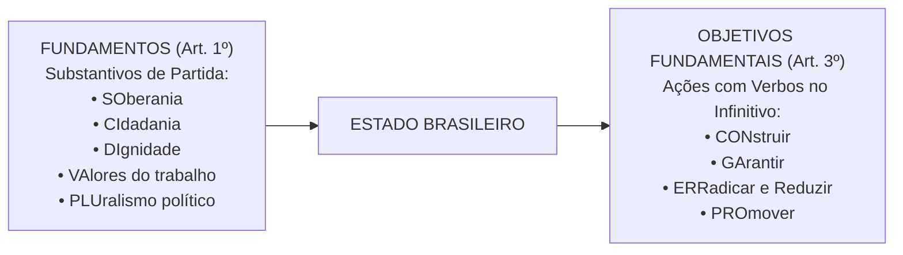

# 01 - Aplicabilidade das Normas Constitucionais e Princípios Fundamentais

> **Matéria:** Noções de Direito Constitucional  
> **Cargo:** A01 – Técnico de Controle Externo – Especialidade: Técnico Administrativo  
> **Arquivo:** `01_aplicabilidade_das_normas_e_principios_fundamentais.md`  
> **Status:** 🟢 Teoria Aprofundada + 5 Questões FCC Comentadas (A a E)

---

## 📌 Ementa Oficial do Edital
- Da aplicabilidade das normas constitucionais (Classificação de José Afonso da Silva).
- Normas constitucionais de eficácia plena, contida e limitada.
- Normas constitucionais programáticas e princípio da reserva do possível vs. mínimo existencial.
- Princípios Fundamentais da Constituição da República Federativa do Brasil de 1988 (Artigos 1º a 4º).
- Fundamentos da República Federativa do Brasil (Artigo 1º).
- Teoria da Separação dos Poderes e o sistema de freios e contrapesos (*Checks and Balances* - Artigo 2º).
- Objetivos fundamentais da República Federativa do Brasil (Artigo 3º).
- Princípios que regem a República Federativa do Brasil em suas relações internacionais (Artigo 4º).

---

## 🧭 Sumário
- [1. Eficácia e Aplicabilidade das Normas Constitucionais](#1-eficacia-e-aplicabilidade-das-normas-constitucionais)
    - [1.1 Classificação Tripartite de José Afonso da Silva](#11-classificacao-tripartite-de-jose-afonso-da-silva)
    - [1.2 Eficácia Mínima das Normas Limitadas e Remédios contra Omissão](#12-eficacia-minima-das-normas-limitadas-e-remedios-contra-omissao)
    - [1.3 Reserva do Possível versus Mínimo Existencial](#13-reserva-do-possivel-versus-minimo-existencial)
- [2. Princípios Fundamentais da CF/88 (Título I - Arts. 1º a 4º)](#2-principios-fundamentais-da-cf88-titulo-i-arts-1o-a-4o)
    - [2.1 Forma de Estado, Forma de Governo e Regime Político](#21-forma-de-estado-forma-de-governo-e-regime-politico)
    - [2.2 Fundamentos da República Federativa do Brasil (Art. 1º)](#22-fundamentos-da-republica-federativa-do-brasil-art-1o)
    - [2.3 Separação dos Poderes e o Sistema de Freios e Contrapesos (Art. 2º)](#23-separacao-dos-poderes-e-o-sistema-de-freios-e-contrapesos-art-2o)
    - [2.4 Objetivos Fundamentais da República (Art. 3º)](#24-objetivos-fundamentais-da-republica-art-3o)
    - [2.5 Princípios nas Relações Internacionais e Integração Latino-Americana (Art. 4º)](#25-principios-nas-relacoes-internacionais-e-integracao-latino-americana-art-4o)
- [3. Fontes Recomendadas na Internet](#fontes-recomendadas-na-internet)

---

## 📖 Teoria Aprofundada e Pontos Críticos

### 1. Eficácia e Aplicabilidade das Normas Constitucionais

O estudo da aplicabilidade das normas constitucionais investiga o grau de aptidão que cada preceito da Lei Fundamental possui para produzir efeitos jurídicos no mundo dos fatos desde a sua promulgação. No direito público brasileiro, a doutrina amplamente majoritária e a jurisprudência pacífica do Supremo Tribunal Federal (STF) consagram a classificação tripartite formulada pelo professor José Afonso da Silva.

#### 1.1 Classificação Tripartite de José Afonso da Silva

| Classificação da Norma | Aplicabilidade | Depende de Lei Infraconstitucional? | Pode Ser Restringida por Lei? | Exemplos Canônicos na CF/88 |
|---|:---:|:---:|:---:|---|
| **Eficácia Plena** | **Direta, Imediata e Integral** | **NÃO** | **NÃO** | Art. 2º (Separação dos Poderes); Art. 5º, III (Vedação da tortura); Art. 5º, LVI (Inadmissibilidade de provas ilícitas). |
| **Eficácia Contida (ou Redutível)** | **Direta, Imediata e NÃO Integral** | **NÃO** (produz efeitos plenos desde a promulgação) | **SIM** (a lei infraconstitucional pode restringir seu alcance) | Art. 5º, XIII (Liberdade de exercício profissional atendidas qualificações da lei); Art. 5º, XII (Inviolabilidade de sigilo telefônico salvo ordem judicial). |
| **Eficácia Limitada** | **Indireta, Mediata e Reduzida** | **SIM** (depende de atuação integradora do legislador ordinário) | Não se aplica (o direito nasce contido e depende de ampliação legal) | Art. 37, VII (Direito de greve dos servidores públicos civis); Art. 196 (Direito à saúde como dever do Estado mediante políticas públicas). |

- **Normas de Eficácia Plena:** São aquelas que desde a promulgação da Constituição receberam do constituinte uma normatividade suficiente para serem aplicadas de pronto a situações concretas. Não dependem de qualquer regulamentação legal ulterior para produzirem todos os seus efeitos e não podem ser restringidas pelo legislador ordinário.
- **Normas de Eficácia Contida (ou Redutível / Prospectiva):** São normas que também produzem efeitos plenos e imediatos a partir da promulgação, mas nas quais o constituinte deixou expressa ou implicitamente uma cláusula de contenção (*"na forma da lei"*, *"atendidas as qualificações que a lei estabelecer"*, *"salvo disposição em contrário"*). Enquanto o legislador ordinário não editar a norma restritiva, o exercício do direito é pleno e irrestrito.
- **Normas de Eficácia Limitada:** Não produzem seus efeitos fundamentais de imediato, dependendo da interferência do legislador infraconstitucional para conferir densidade e viabilizar o exercício prático da prerrogativa. Subdividem-se em:
    1. *Normas de Princípio Institutivo (ou Organizatório):* Aquelas pelas quais o constituinte traça o esquema geral de criação e organização de órgãos, entidades ou instituições do Estado (ex.: art. 88 da CF/88, que dispõe que a lei disporá sobre a criação e extinção de Ministérios);
    2. *Normas de Princípio Programático:* Aquelas que estabelecem metas, programas sociais, diretrizes socioeconômicas e fins de interesse público a serem alcançados pelos poderes públicos (ex.: saúde, erradicação do analfabetismo, proteção ao meio ambiente).

---

### Questão 01 (FCC - Analista Judiciário / Adaptada)
O art. 5º, inciso XIII, da Constituição Federal de 1988 dispõe que *"é livre o exercício de qualquer trabalho, ofício ou profissão, atendidas as qualificações profissionais que a lei estabelecer"*.

De acordo com a classificação das normas constitucionais desenvolvida pelo constitucionalista José Afonso da Silva, o preceito citado qualifica-se como norma de eficácia:

* **A)** Plena, pois independe de qualquer intermediação legislativa e seu alcance não pode sofrer nenhum tipo de contenção por lei ordinária.
* **B)** Contida (ou redutível), uma vez que possui aplicabilidade direta e imediata, assegurando o exercício irrestrito da atividade profissional desde logo, mas permitindo que a lei posterior imponha restrições ou requisitos de qualificação técnica.
* **C)** Limitada programática, visto que não gera efeitos jurídicos até que o Congresso Nacional aprove o estatuto de cada uma das profissões existentes.
* **D)** Diferida absoluta, cuja aplicabilidade condiciona-se à prévia autorização administrativa de conselhos corporativos de classe.
* **E)** Ineficaz, por se tratar de mera exortação moral sem força cogente vinculante.

> **Comentário Detalhado:**
>
> - **A) Incorreta:** Se fosse de eficácia plena, o exercício da profissão não poderia sofrer nenhuma restrição ou condição posterior por lei infraconstitucional.
> - **B) CORRETA:** Conforme a consagrada classificação de José Afonso da Silva, as normas de eficácia contida (ou redutíveis) possuem aplicabilidade direta e imediata, operando de pronto a proteção ao direito; contudo, o próprio texto constitucional autoriza que lei superveniente venha a conter, limitar ou restringir o seu alcance (ex.: exigência de diploma ou inscrição em conselho de classe para certas profissões). Enquanto a lei não sobrevier, a liberdade é ampla e plena.
> - **C) Incorreta:** Se a norma fosse de eficácia limitada, o cidadão estaria impedido de trabalhar até que sobreviesse lei regulamentando cada profissão, o que contraria o postulado da liberdade profissional.
> - **D) Incorreta:** A classificação doutrinária não contempla a categoria "diferida absoluta" como modalidade autônoma nesse contexto.
> - **E) Incorreta:** As normas constitucionais detêm imperatividade e eficácia jurídica formal e material, não sendo meros conselhos morais.
> 
> **Gabarito: B**

---

### Questão 02 (FCC - Procurador do Estado / Adaptada)
O art. 37, inciso VII, da Constituição Federal prevê que *"o direito de greve será exercido nos termos e nos limites definidos em lei específica"*. Passadas décadas sem que o Congresso Nacional editasse a respectiva lei, servidores públicos impetraram Mandado de Injunção perante o Supremo Tribunal Federal buscando o exercício do direito.

À luz da eficácia das normas constitucionais e da jurisprudência do STF:

* **A)** Trata-se de norma de eficácia plena, prescindindo de lei regulamentadora para qualquer efeito.
* **B)** Trata-se de norma constitucional de eficácia limitada de princípio institutivo, cuja ausência de lei torna o direito inexistente até que o Legislativo delibere soberanamente.
* **C)** Trata-se de norma de eficácia limitada, cuja omissão legislativa inconstitucional autoriza o manejo de Mandado de Injunção, tendo o STF decidido aplicar por analogia a lei de greve do setor privado (Lei nº 7.783/1989) aos servidores públicos civis até a edição de lei específica.
* **D)** Trata-se de norma de eficácia contida, vigorando a proibição absoluta de greve até que venha a lei autorizativa.
* **E)** A norma é programática e desprovida de qualquer eficácia jurídica, não vinculando o legislador nem o Judiciário.

> **Comentário Detalhado:**
>
> - **A) Incorreta:** A norma subordina o exercício a termos e limites estabelecidos em lei específica, possuindo eficácia mediata e dependente de integração legislativa.
> - **B) Incorreta:** A ausência de lei não aniquila o direito fundamental nem impede a intervenção concretista do Judiciário para sanar a omissão.
> - **C) CORRETA:** O art. 37, VII, é norma de eficácia limitada. Diante da inércia do Congresso Nacional, o STF, no julgamento conjunto dos Mandados de Injunção nº 670, 708 e 712, adotou a teoria concretista geral, suprindo a lacuna mediante a aplicação por analogia da Lei Federal nº 7.783/89 (que regula a greve na iniciativa privada) aos servidores civis, ressalvadas as carreiras ligadas diretamente à segurança pública armada.
> - **D) Incorreta:** Nas normas contidas o exercício do direito é pleno desde a promulgação até que advenha a restrição; no caso da greve do servidor, o exercício dependia da própria lei instituidora.
> - **E) Incorreta:** As normas constitucionais possuem eficácia normativa vinculante e geram o dever constitucional de legislar, sujeito a controle judicial via mandado de injunção.
> 
> **Gabarito: C**

---

#### 1.2 Eficácia Mínima das Normas Limitadas e Remédios contra Omissão
Embora as normas de eficácia limitada não confiram exigibilidade imediata da prestação originária sem integração legislativa, é incorreto afirmar que elas são desprovidas de valor jurídico. A doutrina e a jurisprudência reconhecem a **eficácia jurídica mínima** dessas normas:

- **Eficácia Revogatória (ou Negativa):** Revogam automaticamente toda a legislação anterior que com elas seja materialmente incompatível (não recepção).
- **Eficácia Impeditiva:** Impedem a edição de leis futuras que contrariem seus vetores teleológicos, sob pena de inconstitucionalidade direta.
- **Eficácia Hermenêutica / Interpretativa:** Servem de vetor interpretativo obrigatório para juízes e administradores públicos.
- **Remédios Constitucionais contra a Omissão Inconstitucional:** Para combater a mora legislativa que inviabiliza o exercício de direitos previstos em normas de eficácia limitada, a Constituição consagrou o **Mandado de Injunção** (art. 5º, LXXI, e Lei nº 13.300/2016) e a **Ação Direta de Inconstitucionalidade por Omissão (ADO)** (art. 103, § 2º).

#### 1.3 Reserva do Possível versus Mínimo Existencial
No controle judicial de políticas públicas decorrentes de normas programáticas (saúde, fornecimento de medicamentos de alto custo, vagas em creches):

- **Reserva do Possível (*Vorbehalt des Möglichen*):** Tese frequentemente invocada pela Fazenda Pública segundo a qual a efetivação dos direitos sociais condiciona-se à existência de capacidade orçamentária e financeira do Estado, bem como à discricionariedade do administrador na alocação de recursos escassos.
- **Mínimo Existencial:** Entendimento consolidado pelo STF no sentido de que a reserva do possível encontra limite intransponível no **núcleo essencial dos direitos fundamentais indispensáveis a uma vida digna** (mínimo existencial). Quando estiver em jogo a própria sobrevivência ou a integridade biológica do indivíduo, a alegação de insuficiência de recursos orçamentários torna-se inoponível ao cidadão.

---

### 2. Princípios Fundamentais da CF/88 (Título I - Arts. 1º a 4º)

O Título I da Constituição Federal delimita as decisões políticas estruturantes do Estado brasileiro.

#### 2.1 Forma de Estado, Forma de Governo e Regime Político
- **Forma de Estado: Federação.** Caracteriza-se pela descentralização política, coexistência de esferas federativas autônomas (União, Estados, Distrito Federal e Municípios), vedação ao direito de secessão e proteção sob cláusula pétrea explícita (art. 60, § 4º, I).
- **Forma de Governo: República.** Caracteriza-se pela eletividade e temporariedade dos mandatos dos governantes, pela responsabilidade política e jurídica dos agentes públicos e pelo dever republicano de prestar contas perante a sociedade e as Cortes de Contas.
- **Regime Político: Democracia Semidireta (ou Participativa).** Conforme o art. 1º, parágrafo único: *"Todo o poder emana do povo, que o exerce por meio de representantes eleitos ou diretamente, nos termos desta Constituição."* O exercício direto manifesta-se por meio do **plebiscito**, do **referendo** e da **iniciativa popular** de leis (art. 14, I, II e III).

#### 2.2 Fundamentos da República Federativa do Brasil (Art. 1º)
Os fundamentos consubstanciam as bases estruturais sobre as quais se erige o Estado brasileiro. São expressos por substantivos e memorizados pelo consagrado mnemônico **SO-CI-DI-VA-PLU**:

1. **SOberania:** Poder supremo no plano interno e independente na ordem internacional;
2. **CIdadania:** Prerrogativa de participação ativa na vida política do país e na formação das decisões estatais;
3. **DIgnidade da Pessoa Humana:** Matriz axiológica de todo o ordenamento jurídico, que coloca o ser humano como fim primordial do Estado, e não mero instrumento;
4. **VAlores Sociais do Trabalho e da Livre Iniciativa:** Reconhecimento concomitante do trabalho como fonte de emancipação social e da liberdade econômica de mercado como motor da produção de riquezas;
5. **PLUralismo Político:** Abertura para a livre manifestação e convivência harmoniosa de diferentes correntes ideológicas, filosóficas e políticas.

> 🚨 **ALERTA DE PROVA / PEGADINHA FCC:**  
> A banca FCC frequentemente tenta confundir o candidato trocando **pluralismo político** por **pluripartidarismo**. O pluripartidarismo (liberdade de criação de partidos políticos) é apenas uma das dimensões instrumentais do pluralismo político, que é um conceito infinitamente mais amplo de liberdade de pensamento e de cosmovisão.

#### 2.3 Separação dos Poderes e o Sistema de Freios e Contrapesos (Art. 2º)
O art. 2º da Carta Magna estabelece: *"São Poderes da União, independentes e harmônicos entre si, o Legislativo, o Executivo e o Judiciário."*

No modelo do constitucionalismo contemporâneo:

- **Não há separação estanque ou absoluta:** Cada Poder desempenha uma **função típica preponderante** e **funções atípicas secundárias** expressamente delimitadas pela Constituição:
    - **Poder Executivo:** Função típica: governar e administrar a coisa pública; Funções atípicas: legislar (ao editar medidas provisórias e leis delegadas) e julgar (ao decidir processos administrativos e disciplinares).
    - **Poder Legislativo:** Funções típicas: legislar (elaborar normas gerais e abstratas) e fiscalizar (controle financeiro e contábil externo com auxílio dos Tribunais de Contas); Funções atípicas: administrar (gerir seu quadro funcional e contratos) e julgar (o Senado julga o Presidente da República e Ministros do STF em crimes de responsabilidade).
    - **Poder Judiciário:** Função típica: jurisdicional (dizer o direito no caso concreto com definitividade); Funções atípicas: administrar (realizar licitações e prover cargos) e legislar (elaborar os regimentos internos de seus tribunais).
- **Sistema de Freios e Contrapesos (*Checks and Balances*):** Mecanismo de controle recíproco em que um Poder limita e fiscaliza a atuação do outro, prevenindo abusos e garantindo a harmonia institucional (ex.: veto do Presidente a projetos de lei; sabatina e aprovação de ministros pelo Senado; controle de constitucionalidade de leis e atos do Executivo exercido pelo Judiciário).

---

### Questão 03 (FCC - Analista Judiciário)
O art. 2º da Constituição Federal consagra que *"são Poderes da União, independentes e harmônicos entre si, o Legislativo, o Executivo e o Judiciário"*.

A respeito da **Teoria da Separação dos Poderes** e do sistema de freios e contrapesos (*checks and balances*):

* **A)** A separação de poderes é absoluta, sendo terminantemente vedado a qualquer Poder o exercício de funções atípicas.
* **B)** O Poder Judiciário exerce unicamente a função de julgar, sendo nulos quaisquer atos administrativos de gestão de seus próprios servidores.
* **C)** Cada Poder exerce uma função típica preponderante inerente à sua natureza, mas a Constituição atribui a todos eles o exercício de funções atípicas e mecanismos recíprocos de controle e fiscalização.
* **D)** O sistema de freios e contrapesos autoriza o Poder Executivo a revogar sentenças judiciais transitadas em julgado por motivos de conveniência financeira.
* **E)** A independência entre os Poderes impede que o Tribunal de Contas fiscalize despesas realizadas pela Assembleia Legislativa.

> **Comentário Detalhado:**
>
> - **A) Incorreta:** A separação dos poderes não é absoluta nem estanque, pois a própria Carta Magna encarrega cada Poder de exercer certas funções atípicas secundárias.
> - **B) Incorreta:** O Judiciário exerce atipicamente a função administrativa ao organizar seus órgãos, licitar e gerir seus servidores (CF, art. 96).
> - **C) CORRETA:** O princípio da separação dos poderes organiza o Estado conferindo a cada órgão uma função típica prioritária (legislar, julgar ou administrar), sem prejuízo de desempenharem funções atípicas e mecanismos mútuos de contenção e controle no âmbito do sistema de freios e contrapesos (*checks and balances*).
> - **D) Incorreta:** Decisões judiciais transitadas em julgado revestem-se da garantia da coisa julgada (art. 5º, XXXVI), sendo insuscetíveis de revogação pelo Executivo.
> - **E) Incorreta:** Por mandamento do art. 70 da CF/88, o controle financeiro e orçamentário externo exercido com o auxílio do Tribunal de Contas alcança os três Poderes, inclusive o Poder Legislativo.
> 
> **Gabarito: C**

---

#### 2.4 Objetivos Fundamentais da República (Art. 3º)
Os objetivos fundamentais consubstanciam as metas de chegada e as finalidades que o Estado brasileiro deve perseguir. Diferenciam-se dos fundamentos porque começam invariavelmente por **VERBOS NO INFINITIVO** (Mnemônico **CON-GA-ERRA-PRO**):

1. **CON**struir uma sociedade livre, justa e solidária;
2. **GA**rantir o desenvolvimento nacional;
3. **ERRA**dicar a pobreza e a marginalização e **reduzir as desigualdades sociais e regionais**;
4. **PRO**mover o bem de todos, sem preconceitos de origem, raça, sexo, cor, idade e quaisquer outras formas de discriminação.

---

### Questão 04 (FCC - Técnico de Controle Externo / TCE-GO)
Considere as seguintes assertivas a respeito dos Princípios Fundamentais consagrados nos artigos 1º a 4º da Constituição Federal de 1988:

I. O pluralismo político e a dignidade da pessoa humana são fundamentos expressos da República Federativa do Brasil.  

II. Erradicar a pobreza e a marginalização e reduzir as desigualdades sociais e regionais consubstanciam objetivos fundamentais do Estado brasileiro.  

III. A prevalência dos direitos humanos e a concessão de asilo político regem o Brasil em suas relações internacionais.  

Está correto o que se afirma em:

* **A)** I e II, apenas
* **B)** I e III, apenas
* **C)** II e III, apenas
* **D)** I, II e III
* **E)** I, apenas

> **Comentário Detalhado:**
>
> - **A) Incorreta:** A assertiva III também está plenamente correta nos termos do art. 4º, II e X, da CF/88.
> - **B) Incorreta:** A assertiva II também é verdadeira de acordo com o art. 3º, III, da CF/88.
> - **C) Incorreta:** A assertiva I também expressa preceitos constitucionais exatos do art. 1º, III e V, da CF/88.
> - **D) CORRETA:** Todas as assertivas são corretas: I reproduz fundamentos do art. 1º (SO-CI-DI-VA-PLU); II reproduz objetivos fundamentais do art. 3º (CON-GA-ERRA-PRO); III reproduz princípios de relações internacionais do art. 4º.
> - **E) Incorreta:** Há outras proposições verdadeiras no rol examinado.
> 
> **Gabarito: D**

---

#### 2.5 Princípios nas Relações Internacionais e Integração Latino-Americana (Art. 4º)
A República Federativa do Brasil rege-se em suas relações internacionais pelos seguintes princípios:

1. Independência nacional;
2. Prevalência dos direitos humanos;
3. Autodeterminação dos povos;
4. Não intervenção;
5. Igualdade entre os Estados;
6. Defesa da paz;
7. Solução pacífica dos conflitos;
8. Repúdio ao terrorismo e ao racismo;
9. Cooperação entre os povos para o progresso da humanidade;
10. Concessão de asilo político.

- **Parágrafo Único do Art. 4º:** Estabelece expressamente que o Brasil buscará a **integração econômica, política, social e cultural dos povos da América Latina**, visando à formação de uma **comunidade latino-americana de nações**.

> 🚨 **ALERTA DE PROVA / PEGADINHA FCC:**  
> A banca examinadora costuma substituir ardilosamente a expressão constitucional **América Latina** por "América do Sul", "Mercosul" ou "países lusófonos". Atenção máxima: a redação do parágrafo único do art. 4º consagra expressamente a **América Latina**!

---

### Questão 05 (FCC - Analista de Controle Externo)
Em conformidade com o parágrafo único do art. 4º da Constituição da República Federativa do Brasil de 1988, o Brasil buscará a integração econômica, política, social e cultural dos povos:

* **A)** Do hemisfério ocidental, visando à formação de uma zona de livre comércio transcontinental.
* **B)** Dos países signatários do Tratado do Atlântico Norte.
* **C)** Da América Latina, visando à formação de uma comunidade latino-americana de nações.
* **D)** Do Mercosul exclusivamente, vedada qualquer aliança com nações não lindeiras.
* **E)** Dos países de língua oficial portuguesa (CPLP) em caráter preferencial e excludente.

> **Comentário Detalhado:**
>
> - **A) Incorreta:** A Constituição não alude a hemisfério ocidental ou zona de comércio transcontinental.
> - **B) Incorreta:** Refere-se à OTAN, aliança militar do hemisfério norte da qual o Brasil não faz parte.
> - **C) CORRETA:** O parágrafo único do art. 4º da CF/88 dispõe textualmente: *"A República Federativa do Brasil buscará a integração econômica, política, social e cultural dos povos da América Latina, visando à formação de uma comunidade latino-americana de nações."*
> - **D) Incorreta:** A diretriz constitucional alcança toda a América Latina, e não unicamente os países membros do Mercosul.
> - **E) Incorreta:** A cooperação com a comunidade de língua portuguesa é relevante, mas o comando constitucional integrativo expresso do art. 4º reporta-se aos povos latino-americanos.
> 
> **Gabarito: C**

---

## 6. Fontes Recomendadas na Internet

* [Constituição Federal de 1988 - Arts. 1º a 4º (Princípios Fundamentais)](https://www.planalto.gov.br/ccivil_03/constituicao/constituicao.htm#art1) - Texto oficial que consagra os fundamentos da República Federativa do Brasil, a separação dos poderes e os objetivos fundamentais.
* [Constituição do Estado de Goiás - Título I e Título II](https://legisla.casacivil.go.gov.br/constituicao-estadual) - Princípios fundamentais e organização do Estado no âmbito goiano.
* [STF Súmula Vinculante 13 (Vedação ao Nepotismo)](https://portal.stf.jus.br/jurisprudencia/sumarios/sumulavinculante.asp?seq=13) - Enunciado vinculante do STF sobre aplicação direta dos princípios da moralidade e impessoalidade na nomeação de cargos em comissão.
* [STF Súmula 473 (Princípio da Autotutela Administrativa)](https://portal.stf.jus.br/jurisprudencia/sumarios/sumula.asp?seq=473) - Jurisprudência histórica que garante à Administração o poder-dever de anular seus próprios atos ilegais e revogar os inconvenientes.
* [Decreto-Lei nº 4.657/1942 - LINDB Compilada](https://www.planalto.gov.br/ccivil_03/decreto-lei/del4657compilado.htm) - Lei de Introdução às Normas do Direito Brasileiro, com as alterações da Lei nº 13.655/2018 sobre segurança jurídica e interpretação de normas públicas.
* MENDES, Gilmar Ferreira; BRANCO, Paulo Gustavo Gonet. **Curso de Direito Constitucional**. 19. ed. São Paulo: SaraivaJur, 2024. (Cap. 1 - Teoria da Constituição; Cap. 2 - Aplicabilidade e Eficácia das Normas Constitucionais).
* MORAES, Alexandre de. **Direito Constitucional**. 40. ed. São Paulo: Atlas, 2024. (Cap. 1 - Princípios Fundamentais da Constituição Federal).
* SILVA, José Afonso da. **Aplicabilidade das Normas Constitucionais**. 8. ed. São Paulo: Malheiros, 2012. (Cap. III - Normas Constitucionais de Eficácia Plena, Contida e Limitada).
