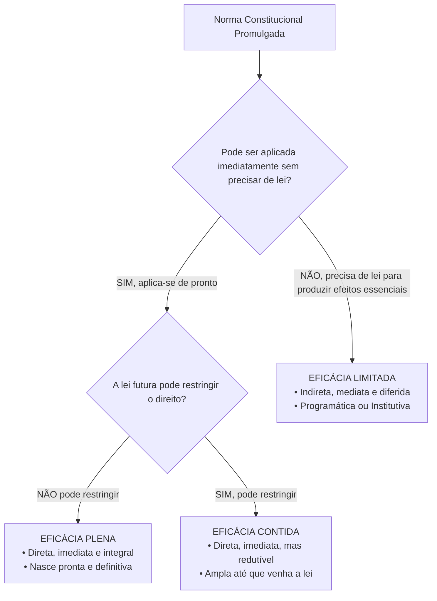
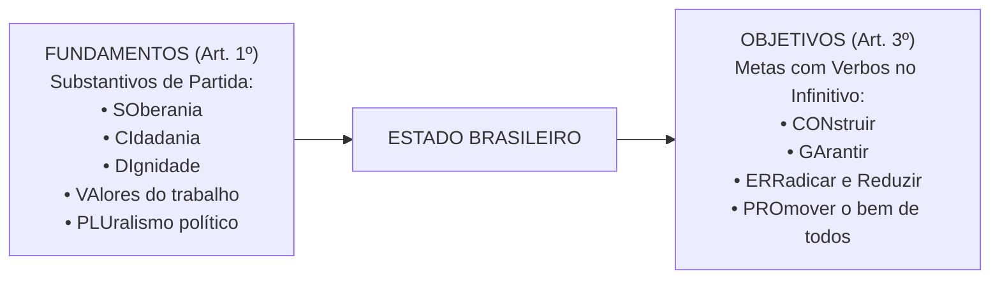

# 01 - Aplicabilidade das Normas Constitucionais e Princípios Fundamentais

> **Matéria:** Noções de Direito Constitucional  
> **Cargo:** A01 – Técnico de Controle Externo – Especialidade: Técnico Administrativo  
> **Arquivo:** `01_aplicabilidade_das_normas_e_principios_fundamentais.md`  
> **Status:** 🟢 Teoria Aprofundada + 5 Questões FCC Comentadas (A a E)

---

## 📌 Ementa Oficial do Edital
- Da aplicabilidade das normas constitucionais (Classificação de José Afonso da Silva).
- Normas constitucionais de eficácia plena, contida e limitada.
- Normas constitucionais programáticas e princípio da reserva do possível vs. mínimo existencial.
- Princípios Fundamentais da Constituição da República Federativa do Brasil de 1988 (Artigos 1º a 4º).
- Fundamentos da República Federativa do Brasil (Artigo 1º).
- Teoria da Separação dos Poderes e o sistema de freios e contrapesos (*Checks and Balances* - Artigo 2º).
- Objetivos fundamentais da República Federativa do Brasil (Artigo 3º).
- Princípios que regem a República Federativa do Brasil em suas relações internacionais (Artigo 4º).

---

## 🌳 Classificação Hierárquica do Conteúdo

```text
1. Teoria da Norma Constitucional e Princípios Fundamentais da CF/88
├── 1.1 Classificação das Normas Constitucionais Quanto à Eficácia (José Afonso da Silva)
│   ├── Normas de Eficácia Plena: Direta, imediata e integral (autoaplicáveis e insuscetíveis de contenção)
│   ├── Normas de Eficácia Contida / Redutível: Direta, imediata e NÃO integral (plena até a vinda da lei)
│   │   └── Exemplo clássico: Art. 5º, XIII (liberdade de profissão atendidas qualificações da lei)
│   ├── Normas de Eficácia Limitada: Indireta, mediata e reduzida (dependem de integração legislativa)
│   │   ├── De Princípio Institutivo / Organizatório: Estruturação de órgãos e entidades
│   │   └── De Princípio Programático: Traçam diretrizes sociais, metas e políticas públicas
│   ├── Eficácia Jurídica Mínima das Normas Limitadas: Eficácia revogatória/negativa e hermenêutica
│   └── Conflito Constitucional: Reserva do Possível vs. Núcleo Intangível do Mínimo Existencial
├── 1.2 Princípios Fundamentais da CF/88 (Título I - Arts. 1º a 4º)
│   ├── Forma de Estado: Federação (Cláusula pétrea - Art. 60, § 4º, I)
│   ├── Forma de Governo: República (Eletividade, temporariedade e dever de prestar contas)
│   ├── Regime Político: Democracia Semidireta / Participativa (Art. 1º, parágrafo único)
│   ├── Fundamentos da República (Art. 1º - Mnemônico SO-CI-DI-VA-PLU):
│   │   ├── Soberania, Cidadania, Dignidade da Pessoa Humana
│   │   ├── Valores Sociais do Trabalho e da Livre Iniciativa
│   │   └── Pluralismo Político (Distinção entre pluralismo de ideias e pluripartidarismo partidário)
│   ├── Separação dos Poderes e Freios e Contrapesos (Art. 2º): Funções típicas e atípicas
│   ├── Objetivos Fundamentais (Art. 3º - Ações com Verbos no Infinitivo: CON-GA-ERRA-PRO):
│   │   ├── Construir uma sociedade livre, justa e solidária
│   │   ├── Garantir o desenvolvimento nacional
│   │   ├── Erradicar a pobreza/marginalização e reduzir as desigualdades sociais e regionais
│   │   └── Promover o bem de todos, sem preconceitos de origem, raça, sexo, cor e idade
│   └── Relações Internacionais (Art. 4º): Prevalência dos direitos humanos, não intervenção, asilo político
│       └── Parágrafo Único: Integração econômica, política e cultural da América Latina
```

---

## 📖 Teoria Aprofundada e Pontos Críticos

### 1. Eficácia e Aplicabilidade das Normas Constitucionais

A doutrina brasileira consagra a divisão tripartite formulada pelo professor José Afonso da Silva:

| Classificação da Norma | Aplicabilidade | Depende de Lei Infraconstitucional? | Pode Ser Restringida por Lei? | Exemplos Canônicos na CF/88 |
|---|:---:|:---:|:---:|---|
| **Eficácia Plena** | **Direta, Imediata e Integral** | **NÃO** | **NÃO** | Art. 2º (Poderes independentes); Art. 5º, III (Vedação da tortura); Art. 5º, LVI (Proibição de provas ilícitas). |
| **Eficácia Contida** | **Direta, Imediata e NÃO Integral** | **NÃO** (já produz efeitos plenos desde a promulgação) | **SIM** (a lei posterior pode restringir seu alcance) | Art. 5º, XIII (Liberdade de exercício profissional); Art. 5º, XII (Sigilo de correspondência salvo ordem judicial). |
| **Eficácia Limitada** | **Indireta, Mediata e Reduzida** | **SIM** (exige lei regulamentadora para viabilizar o exercício) | Não se aplica | Art. 37, VII (Direito de greve dos servidores públicos); Art. 196 (Direito à saúde como política pública). |



#### 1.1 Normas Programáticas, Reserva do Possível e Mínimo Existencial
- **Normas Programáticas:** Espécie de norma de eficácia limitada que traça objetivos sociais e fins a serem perseguidos pelos poderes públicos (saúde, educação, moradia).
- **Eficácia Mínima Negativa:** Embora dependam de políticas públicas, revogam a legislação anterior que lhes for contrária e obstam a edição de leis futuras incompatíveis.
- **Reserva do Possível x Mínimo Existencial (STF):** O Estado não pode alegar de forma genérica a limitação orçamentária ("reserva do possível") para justificar o descumprimento de prestações sociais indispensáveis à preservação do núcleo intangível do **mínimo existencial** (dignidade da pessoa humana).

---

### 2. Princípios Fundamentais (Arts. 1º a 4º da CF/88)

#### 2.1 Fundamentos x Objetivos da República (A Pegadinha Clássica da FCC)
A banca FCC troca rotineiramente os conceitos dos artigos 1º e 3º para confundir o candidato:
- **Fundamentos (Art. 1º - Mnemônico SO-CI-DI-VA-PLU):** São valores estruturais de partida expressos por **substantivos**:
  - **SO**berania;
  - **CI**dadania;
  - **DI**gnidade da pessoa humana;
  - **VA**lores sociais do trabalho e da livre iniciativa;
  - **PLU**ralismo político (*cuidado: pluralismo de ideias políticas/filosóficas, e não mero pluripartidarismo!*).
- **Objetivos Fundamentais (Art. 3º - Mnemônico CON-GA-ERRA-PRO):** São metas de chegada que começam sempre com **VERBOS NO INFINITIVO**:
  - **CON**struir uma sociedade livre, justa e solidária;
  - **GA**rantir o desenvolvimento nacional;
  - **ERRA**dicar a pobreza e a marginalização e reduzir as desigualdades sociais e regionais;
  - **PRO**mover o bem de todos, sem preconceitos de origem, raça, sexo, cor, idade e quaisquer outras formas de discriminação.



#### 2.2 Princípios nas Relações Internacionais (Art. 4º)
A República Federativa do Brasil rege-se em suas relações internacionais pelos seguintes princípios:
1. Independência nacional;
2. Prevalência dos direitos humanos;
3. Autodeterminação dos povos;
4. Não intervenção;
5. Igualdade entre os Estados;
6. Defesa da paz;
7. Solução pacífica dos conflitos;
8. Repúdio ao terrorismo e ao racismo;
9. Cooperação entre os povos para o progresso da humanidade;
10. Concessão de asilo político.
- **Parágrafo Único:** A República Federativa do Brasil buscará a **integração econômica, política, social e cultural dos povos da América Latina**, visando à formação de uma **comunidade latino-americana de nações**.

> 🚨 **ALERTA DE PROVA / PEGADINHA FCC:**  
> A banca frequentemente troca "América Latina" por "América do Sul" ou "Mercosul". O texto constitucional expresso fala textualmente em **América Latina**!

---

## 🌐 Fontes Recomendadas na Internet
- [Constituição da República Federativa do Brasil de 1988 - Arts. 1º a 4º](https://www.planalto.gov.br/ccivil_03/constituicao/constituicao.htm#art1)
  - Texto oficial e consolidado do Título I da Constituição.
- [Supremo Tribunal Federal - Mandado de Injunção nº 670 (Direito de Greve)](https://portal.stf.jus.br/)
  - Decisão paradigmática sobre a aplicabilidade prática de normas de eficácia limitada.
- [Lei Federal nº 13.300/2016 (Regulamenta o Mandado de Injunção)](https://www.planalto.gov.br/ccivil_03/_ato2015-2018/2016/lei/l13300.htm)
  - Marco processual contra a omissão do poder público na regulamentação de normas constitucionais.

---

## 📝 Questões Comentadas no Padrão FCC (Justificadas de A a E)

### Questão 1 (FCC - Analista Judiciário / Adaptada)
O art. 5º, inciso XIII, da Constituição Federal de 1988 dispõe que *"é livre o exercício de qualquer trabalho, ofício ou profissão, atendidas as qualificações profissionais que a lei estabelecer"*.

De acordo com a classificação das normas constitucionais desenvolvida pelo constitucionalista José Afonso da Silva, o preceito citado qualifica-se como norma de eficácia:

A) Plena, pois independe de qualquer intermediação legislativa e seu alcance não pode sofrer nenhum tipo de contenção por lei ordinária.  
B) Contida (ou redutível), uma vez que possui aplicabilidade direta e imediata, assegurando o exercício irrestrito da atividade profissional desde logo, mas permitindo que a lei posterior imponha restrições ou requisitos de qualificação técnica.  
C) Limitada programática, visto que não gera efeitos jurídicos até que o Congresso Nacional aprove o estatuto de cada uma das profissões existentes.  
D) Diferida absoluta, cuja aplicabilidade condiciona-se à prévia autorização administrativa de conselhos corporativos de classe.  
E) Ineficaz, por se tratar de mera exortação moral sem força cogente vinculante.  

> **Gabarito: B**  
>  
> **Comentário Analítico Passo a Passo:**  
> 1. Pela classificação de José Afonso da Silva:  
>    - **Normas de Eficácia Plena:** aplicabilidade direta, imediata e integral (não admitem restrição legal infraconstitucional).  
>    - **Normas de Eficácia Contida:** aplicabilidade direta, imediata, mas **não integral** (produzem efeitos desde a promulgação, porém o constituinte autorizou o legislador ordinário a restringir ou limitar o direito).  
>    - **Normas de Eficácia Limitada:** aplicabilidade indireta, mediata e reduzida (não produzem seus efeitos fundamentais até que venha a lei regulamentadora).  
> 2. O art. 5º, XIII, é o exemplo clássico de **norma de eficácia contida**: qualquer indivíduo pode exercer qualquer atividade laboral livremente; contudo, se o legislador entender conveniente estabelecer exigências de qualificação (como exame de ordem para advogados ou diploma para médicos), ele editará lei restritiva. Enquanto a lei não existir, o exercício é pleno.  
>  
> **Análise das Alternativas:**  
> - **A) Incorreta:** Se fosse de eficácia plena, a lei não poderia restringir o exercício exigindo qualificações profissionais.  
> - **B) CORRETA:** Definição doutrinária e jurídica exata da norma de eficácia contida.  
> - **C) Incorreta:** Se fosse limitada, ninguém poderia trabalhar até que saísse a lei de cada profissão.  
> - **D) Incorreta:** Categoria inexistente na taxonomia constitucional brasileira.  
> - **E) Incorreta:** Todas as normas constitucionais possuem eficácia jurídica vinculante.

---

### Questão 2 (FCC - Técnico de Controle Externo / TCE-GO)
Considere as seguintes assertivas a respeito dos Princípios Fundamentais consagrados nos artigos 1º a 4º da Constituição Federal de 1988:

I. O pluralismo político e a dignidade da pessoa humana são fundamentos expressos da República Federativa do Brasil.  
II. Erradicar a pobreza e a marginalização e reduzir as desigualdades sociais e regionais consubstanciam objetivos fundamentais do Estado brasileiro.  
III. A prevalência dos direitos humanos e a concessão de asilo político regem o Brasil em suas relações internacionais.  

Está correto o que se afirma em:

A) I e II, apenas  
B) I e III, apenas  
C) II e III, apenas  
D) I, II e III  
E) I, apenas  

> **Gabarito: D**  
>  
> **Comentário Analítico Passo a Passo:**  
> 1. **Item I (Correto):** O art. 1º, incisos III e V, da CF/88 estabelece que a dignidade da pessoa humana e o pluralismo político integram o rol dos **fundamentos** da República (SO-CI-DI-VA-PLU).  
> 2. **Item II (Correto):** O art. 3º, inciso III, da CF/88 consagra como **objetivo fundamental** do Brasil *"erradicar a pobreza e a marginalização e reduzir as desigualdades sociais e regionais"*.  
> 3. **Item III (Correto):** O art. 4º, incisos II e X, da CF/88 estabelece a prevalência dos direitos humanos e a concessão de asilo político como **princípios nas relações internacionais**.  
> Todos os três enunciados são verdadeiros.  
>  
> **Análise das Alternativas:**  
> - **A) Incorreta:** O item III também está correto.  
> - **B) Incorreta:** O item II também está correto.  
> - **C) Incorreta:** O item I também está correto.  
> - **D) CORRETA:** Todos os itens I, II e III correspondem fielmente aos dispositivos constitucionais.  
> - **E) Incorreta:** Os itens II e III também são verdadeiros.

---

### Questão 3 (FCC - Procurador do Estado / Adaptada)
O art. 37, inciso VII, da Constituição Federal prevê que *"o direito de greve será exercido nos termos e nos limites definidos em lei específica"*. Passadas décadas sem que o Congresso Nacional editasse a respectiva lei, servidores públicos impetraram Mandado de Injunção perante o Supremo Tribunal Federal buscando o exercício do direito.

À luz da eficácia das normas constitucionais e da jurisprudência do STF:

A) Trata-se de norma de eficácia plena, prescindindo de lei regulamentadora para qualquer efeito.  
B) Trata-se de norma constitucional de eficácia limitada de princípio institutivo, cuja ausência de lei torna o direito inexistente até que o Legislativo delibere soberanamente.  
C) Trata-se de norma de eficácia limitada, cuja omissão legislativa inconstitucional autoriza o manejo de Mandado de Injunção, tendo o STF decidido aplicar por analogia a lei de greve do setor privado (Lei nº 7.783/1989) aos servidores públicos civis até a edição de lei específica.  
D) Trata-se de norma de eficácia contida, vigorando a proibição absoluta de greve até que venha a lei autorizativa.  
E) A norma é programática e desprovida de qualquer eficácia jurídica, não vinculando o legislador nem o Judiciário.  

> **Gabarito: C**  
>  
> **Comentário Analítico Passo a Passo:**  
> 1. O art. 37, VII, da CF/88 é exemplo clássico de **norma de eficácia limitada**: o direito existe constitucionalmente, mas a sua aplicabilidade prática subordina-se à edição de lei específica pelo Congresso Nacional.  
> 2. Diante da prolongada inércia do legislador, o STF, no julgamento histórico dos Mandados de Injunção nº 670, 708 e 712, adotou a posição concretista geral: reconheceu a mora legislativa inconstitucional e determinou a aplicação analógica da Lei de Greve dos trabalhadores privados (Lei nº 7.783/89) aos servidores públicos civis.  
>  
> **Análise das Alternativas:**  
> - **A) Incorreta:** A norma subordina o exercício a limites previstos em lei específica, sendo limitada.  
> - **B) Incorreta:** A omissão não torna o direito inexistente nem imune a controle pelo STF via Mandado de Injunção.  
> - **C) CORRETA:** Síntese perfeita da classificação de eficácia limitada e do precedente vinculante do STF no MI 670.  
> - **D) Incorreta:** Na norma contida o direito é pleno até a vinda da lei; na limitada o direito depende da lei.  
> - **E) Incorreta:** Toda norma constitucional possui eficácia jurídica mínima vinculante e revogatória.

---

### Questão 4 (FCC - Analista de Controle Externo)
Em conformidade com o parágrafo único do art. 4º da Constituição da República Federativa do Brasil de 1988, o Brasil buscará a integração econômica, política, social e cultural dos povos:

A) Do hemisfério ocidental, visando à formação de uma zona de livre comércio transcontinental.  
B) Dos países signatários do Tratado do Atlântico Norte.  
C) Da América Latina, visando à formação de uma comunidade latino-americana de nações.  
D) Do Mercosul exclusivamente, vedada qualquer aliança com nações não lindeiras.  
E) Dos países de língua oficial portuguesa (CPLP) em caráter preferencial e excludente.  

> **Gabarito: C**  
>  
> **Comentário Analítico Passo a Passo:**  
> 1. Texto do art. 4º, parágrafo único, da CF/88:  
>    *"A República Federativa do Brasil buscará a integração econômica, política, social e cultural dos povos da América Latina, visando à formação de uma comunidade latino-americana de nações."*  
> 2. O constituinte fixou expressamente o escopo geográfico e geopolítico de integração regional prioritária com a **América Latina**, com o objetivo transcendente de formar uma comunidade de nações irmãs.  
>  
> **Análise das Alternativas:**  
> - **A) Incorreta:** Não menciona "hemisfério ocidental".  
> - **B) Incorreta:** O Brasil não integra a aliança militar do Atlântico Norte (OTAN).  
> - **C) CORRETA:** Reprodução literal do art. 4º, parágrafo único, da CF/88.  
> - **D) Incorreta:** A norma constitucional refere-se à América Latina como um todo, e não apenas ao Mercosul.  
> - **E) Incorreta:** A cooperação com países lusófonos é importante, mas o parágrafo único do art. 4º vincula a integração à América Latina.

---

### Questão 5 (FCC - Analista Judiciário)
O art. 2º da Constituição Federal consagra que *"são Poderes da União, independentes e harmônicos entre si, o Legislativo, o Executivo e o Judiciário"*.

A respeito da **Teoria da Separação dos Poderes** e do sistema de freios e contrapesos (*checks and balances*):

A) A separação de poderes é absoluta, sendo terminantemente vedado a qualquer Poder o exercício de funções atípicas.  
B) O Poder Judiciário exerce unicamente a função de julgar, sendo nulos quaisquer atos administrativos de gestão de seus próprios servidores.  
C) Cada Poder exerce uma função típica preponderante inerente à sua natureza, mas a Constituição atribui a todos eles o exercício de funções atípicas e mecanismos recíprocos de controle e fiscalização.  
D) O sistema de freios e contrapesos autoriza o Poder Executivo a revogar sentenças judiciais transitadas em julgado por motivos de conveniência financeira.  
E) A independência entre os Poderes impede que o Tribunal de Contas fiscalize despesas realizadas pela Assembleia Legislativa.  

> **Gabarito: C**  
>  
> **Comentário Analítico Passo a Passo:**  
> 1. A separação de poderes no constitucionalismo contemporâneo não é estanque nem absoluta:  
>    - Cada Poder possui uma **função típica** (Executivo administra; Legislativo legisla e fiscaliza; Judiciário julga com definitividade).  
>    - Paralelamente, todos os Poderes exercem **funções atípicas** expressamente outorgadas pela Constituição (ex.: o Judiciário administra seus serviços e realiza licitações; o Senado julga o Presidente em crimes de responsabilidade; o Executivo edita medidas provisórias com força de lei).  
> 2. O sistema de **freios e contrapesos** (*checks and balances*) garante que nenhum Poder se sobreponha aos demais, estabelecendo controles recíprocos balizados na própria Constituição (ex.: veto presidencial a projetos de lei; aprovação de ministros pelo Senado; controle de constitucionalidade pelo Judiciário).  
>  
> **Análise das Alternativas:**  
> - **A) Incorreta:** A separação não é absoluta; admite o exercício de funções atípicas previstas na CF.  
> - **B) Incorreta:** O Judiciário exerce atipicamente a função de administrar seus próprios recursos, servidores e contratos.  
> - **C) CORRETA:** Síntese perfeita da dinâmica moderna entre funções típicas, atípicas e sistema de freios e contrapesos.  
> - **D) Incorreta:** O Executivo jamais pode desconstituir decisões judiciais transitadas em julgado.  
> - **E) Incorreta:** O Tribunal de Contas fiscaliza a execução orçamentária de todos os Poderes, inclusive do Legislativo e Judiciário (CF, art. 70).
