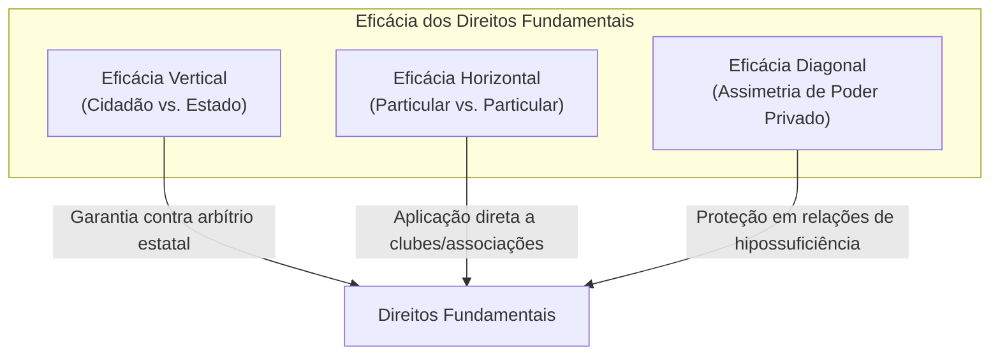
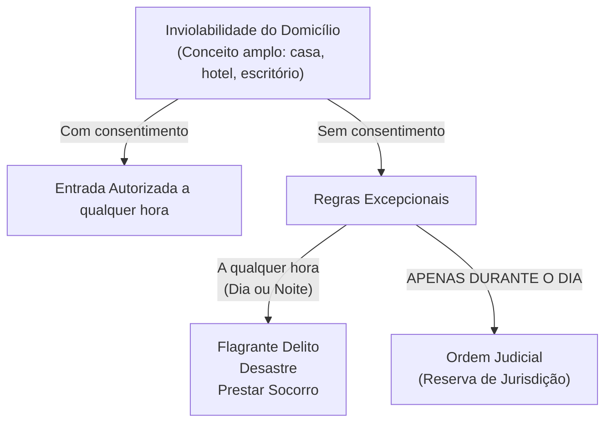
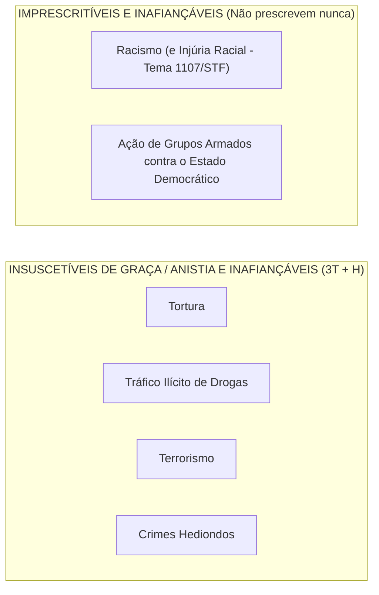
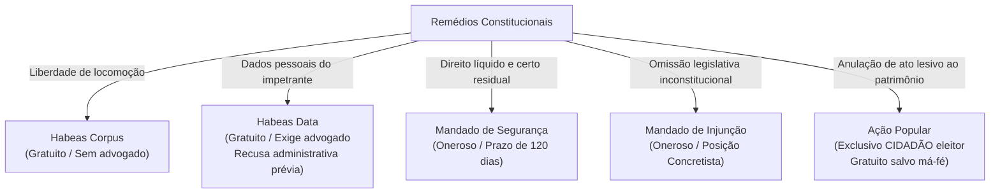
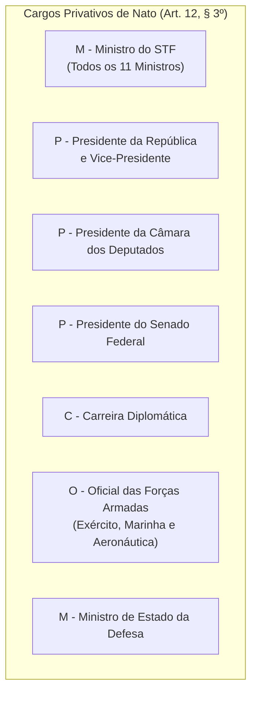
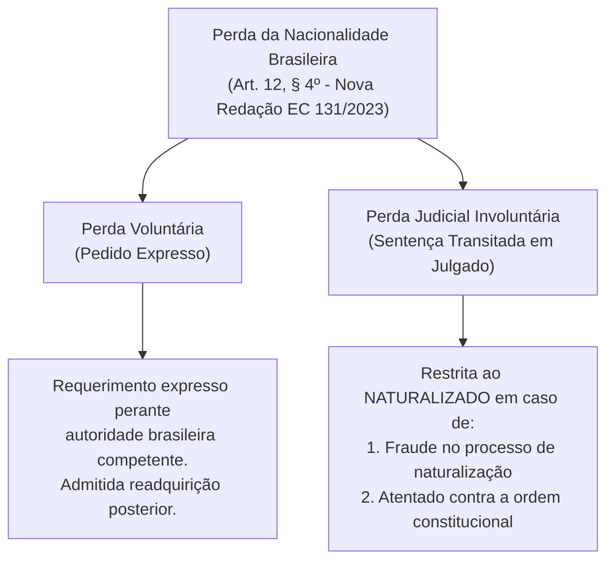
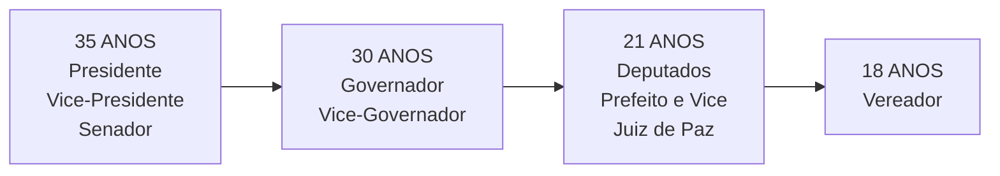

# 02 - Direitos Fundamentais, Remédios Constitucionais, Nacionalidade e Direitos Políticos

> **Matéria:** Noções de Direito Constitucional  
> **Cargo:** A01 – Técnico de Controle Externo – Especialidade: Técnico Administrativo  
> **Arquivo:** `02_direitos_e_garantias_fundamentais_e_politicos.md`  
> **Status:** 🟢 Teoria Aprofundada + 5 Questões FCC Comentadas (A a E)

---

## 📌 Ementa / Itens do Edital

- Dos direitos e deveres individuais e coletivos (Artigo 5º da CF/88): princípios reitores, direitos em espécie, garantias processuais e penais.
- Remédios constitucionais (*Writs*): *Habeas Corpus*, *Habeas Data*, Mandado de Segurança individual e coletivo, Mandado de Injunção e Ação Popular.
- Dos direitos sociais (Artigos 6º a 11 da CF/88): rol dos direitos fundamentais sociais, direitos dos trabalhadores urbanos e rurais, direito de greve e liberdade sindical.
- Da nacionalidade (Artigos 12 e 13 da CF/88): critérios originários e derivados, quase-nacionalidade, cargos privativos de brasileiro nato (art. 12, § 3º) e o novo regime de perda e readquisição da nacionalidade (Emenda Constitucional nº 131/2023).
- Dos direitos políticos (Artigos 14 a 16 da CF/88): instrumentos de soberania popular, alistabilidade eleitoral, condições de elegibilidade e idades mínimas, inelegibilidades absolutas e relativas (inelegibilidade reflexa e Súmula Vinculante 18).
- Perda e suspensão dos direitos políticos (Artigo 15 da CF/88): vedação absoluta de cassação e hipóteses constitucionais taxativas.
- Dos partidos políticos (Artigo 17 da CF/88): preceitos constitucionais, cláusula de barreira, financiamento e autonomia partidária.

---

## 🧭 Sumário
- [1. Teoria Geral e Direitos Individuais e Coletivos (Art. 5º da CF/88)](#1-teoria-geral-e-direitos-individuais-e-coletivos-art-5o-da-cf88)
    - [1.1 Características Fundamentais e Dimensões de Eficácia](#11-caracteristicas-fundamentais-e-dimensoes-de-eficacia)
    - [1.2 Inviolabilidade do Domicílio (Art. 5º, XI)](#12-inviolabilidade-do-domicilio-art-5o-xi)
    - [1.3 Inviolabilidade das Comunicações e Reserva de Jurisdição (Art. 5º, XII)](#13-inviolabilidade-das-comunicacoes-e-reserva-de-jurisdicao-art-5o-xii)
    - [1.4 Liberdade de Associação e Limites Estatais (Art. 5º, XVII a XXI)](#14-liberdade-de-associacao-e-limites-estatais-art-5o-xvii-a-xxi)
    - [1.5 Tratamento Constitucional dos Crimes: O Quarteto Penal da FCC](#15-tratamento-constitucional-dos-crimes-o-quarteto-penal-da-fcc)
- [2. Remédios Constitucionais (Writs de Garantia)](#2-remedios-constitucionais-writs-de-garantia)
    - [2.1 Análise Comparativa dos Remédios Constitucionais](#21-analise-comparativa-dos-remedios-constitucionais)
- [3. Direitos Sociais (Arts. 6º a 11)](#3-direitos-sociais-arts-6o-a-11)
- [4. Teoria da Nacionalidade e a Nova Disciplina da Perda (Arts. 12 e 13)](#4-teoria-da-nacionalidade-e-a-nova-disciplina-da-perda-arts-12-e-13)
    - [4.1 Espécies de Nacionalidade Originária (Brasileiro Nato)](#41-especies-de-nacionalidade-originaria-brasileiro-nato)
    - [4.2 Brasileiro Naturalizado](#42-brasileiro-naturalizado)
    - [4.3 Cargos Privativos de Brasileiro Nato (Art. 12, § 3º - MP3.COM)](#43-cargos-privativos-de-brasileiro-nato-art-12-3o-mp3com)
    - [4.4 Perda da Nacionalidade: O Novo Regime da EC nº 131/2023](#44-perda-da-nacionalidade-o-novo-regime-da-ec-no-1312023)
- [5. Direitos Políticos e Sistema Partidário (Arts. 14 a 17)](#5-direitos-politicos-e-sistema-partidario-arts-14-a-17)
    - [5.1 Alistamento Eleitoral e Voto](#51-alistamento-eleitoral-e-voto)
    - [5.2 Idades Mínimas de Elegibilidade (Capacidade Eleitoral Passiva)](#52-idades-minimas-de-elegibilidade-capacidade-eleitoral-passiva)
    - [5.3 Inelegibilidade Reflexa (Art. 14, § 7º) e Súmula Vinculante 18](#53-inelegibilidade-reflexa-art-14-7o-e-sumula-vinculante-18)
    - [5.4 Perda e Suspensão dos Direitos Políticos (Art. 15 da CF/88)](#54-perda-e-suspensao-dos-direitos-politicos-art-15-da-cf88)
- [6. Fontes Oficiais & Doutrinárias Recomendadas](#fontes-oficiais-doutrinarias-recomendadas)

---

## 📖 Conteúdo Teórico Aprofundado

### 1. Teoria Geral e Direitos Individuais e Coletivos (Art. 5º da CF/88)

#### 1.1 Características Fundamentais e Dimensões de Eficácia
- **Inexistência de Direitos Absolutos (Relatividade):** Nenhum direito fundamental possui caráter absoluto. Todos encontram limites na coexistência harmoniosa com outros direitos fundamentais protegidos pela ordem constitucional. Nem mesmo o direito à vida é absoluto, haja vista a admissibilidade constitucional da pena de morte em caso de guerra declarada (art. 5º, XLVII, "a").
- **Eficácia Vertical vs. Eficácia Horizontal (*Drittwirkung*):**
    - *Eficácia Vertical:* Relação tradicional entre o indivíduo e o Estado, funcionando como escudo protetor contra o arbítrio estatal.
    - *Eficácia Horizontal:* Incidência direta e imediata dos direitos fundamentais nas relações jurídicas entre particulares (ex.: respeito à ampla defesa e ao contraditório para expulsão de sócio de clube ou cooperativa privada - STF).
    - *Eficácia Diagonal:* Relação entre particulares caracterizada por flagrante assimetria fática e jurídica (ex.: relações de trabalho e contratos de consumo).

#### 1.2 Inviolabilidade do Domicílio (Art. 5º, XI)
> *"A casa é asilo inviolável do indivíduo, ninguém nela podendo penetrar sem consentimento do morador, salvo em caso de flagrante delito ou desastre, ou para prestar socorro, ou, durante o dia, por determinação judicial."*

> 🚨 **ALERTA DE PROVA / PEGADINHA FCC:**  
>
> 1. **Conceito de Domicílio:** O STF adota interpretação abrangente de "casa", incluindo escritórios profissionais, consultórios médicos, trailers habitados e quartos de hotel ocupados. Áreas abertas ao público (como o salão de um restaurante) não configuram domicílio protegido durante o horário comercial.  
> 2. **Determinação Judicial:** O cumprimento de mandado de busca e apreensão domiciliar **só pode ocorrer durante o dia**. Não existe hipótese de ingresso com ordem judicial durante a noite sem o consentimento do morador! O critério consagrado pela Lei de Abuso de Autoridade (Lei nº 13.869/2019) veda o cumprimento de mandado domiciliar entre 21h e 5h.  
> 3. **Flagrante Delito em Tráfico Ilícito de Drogas (Tema 280/STF):** O ingresso forçado em domicílio sem mandado judicial, mesmo em caso de crime permanente como o tráfico de drogas, exige fundadas razões (justa causa) devidamente justificadas *a posteriori*, sob pena de nulidade absoluta das provas.

---

### Questão 01 (FCC - Analista Judiciário - Área Judiciária)
A Constituição Federal de 1988 consagra, em seu art. 5º, XI, que 'a casa é asilo inviolável do indivíduo, ninguém nela podendo penetrar sem consentimento do morador, salvo em caso de flagrante delito ou desastre, ou para prestar socorro, ou, durante o dia, por determinação judicial'.

Sobre a interpretação dada a essa garantia fundamental pelo Supremo Tribunal Federal (Tema 280 de Repercussão Geral), assinale a afirmativa correta.

* **A)** A entrada forçada em domicílio sem mandado judicial é lícita em qualquer horário quando amparada em fundada suspeita, justificada a posteriori mediante a apreensão efetiva de entorpecentes no local.
* **B)** A entrada forçada em domicílio sem mandado judicial, mesmo em caso de crime permanente, só é lícita quando amparada em fundadas razões, devidamente justificadas pelas circunstâncias do caso concreto que indiquem a ocorrência de flagrante delito no interior da residência.
* **C)** O conceito constitucional de 'casa' abrange unicamente residências habitadas de forma definitiva por famílias, excluindo quartos de hotel ocupados e escritórios profissionais.
* **D)** A determinação judicial autoriza a invasão domiciliar por agentes policiais a qualquer hora da noite sem consentimento do morador.
* **E)** Fiscais tributários e auditores de controle externo podem ingressar em domicílio privado durante o dia com base em seu poder de polícia, independentemente de autorização judicial.

> **Comentário Detalhado:**
>
> - **A)** Incorreta. A ilicitude da invasão não é convalidada pelo encontro fortuito posterior de drogas. A justa causa deve existir e ser demonstrável **antes** do ingresso forçado.
> - **B)** Correta. Tese fixada pelo STF no **Tema 280 de Repercussão Geral** (RE 603.616): *"A entrada forçada em domicílio sem mandado judicial só é lícita, mesmo em período noturno, quando amparada em fundadas razões, devidamente justificadas a posteriori, que indiquem que dentro da casa ocorre situação de flagrante delito, sob pena de responsabilidade disciplinar, civil e penal do agente ou da autoridade e de nulidade dos atos praticados"*.
> - **C)** Incorreta. O conceito de casa no direito constitucional é amplo: abrange residência, quarto de hotel ocupado, trailers, consultórios e escritórios profissionais fechados ao público (art. 150, § 4º, do Código Penal).
> - **D)** Incorreta. O mandado judicial autoriza ingresso **estritamente durante o dia** (critério cronológico ou físico-astronômico do nascer ao pôr do sol).
> - **E)** Incorreta. Fiscais e auditores administrativos não possuem poder para ingressar contra a vontade do morador sem mandado judicial.
>
> **Gabarito: B**

---

### Questão 02 (FCC - Adaptada / Procuradoria Municipal)
Com base na jurisprudência pacificada do Supremo Tribunal Federal e no texto da Constituição Federal de 1988 a respeito dos direitos e garantias individuais, analise as afirmativas a seguir:

I. A dissolução da sociedade conjugal no curso do mandato do Chefe do Poder Executivo cessa imediatamente a inelegibilidade reflexa de seu ex-cônjuge para concorrer a mandato eletivo no mesmo município na eleição seguinte.  

II. A casa é asilo inviolável do indivíduo, ninguém nela podendo penetrar sem consentimento do morador, salvo durante o dia, por determinação judicial, ou a qualquer hora do dia ou da noite, em caso de flagrante delito, desastre ou para prestar socorro.  

III. A prática do racismo e a ação de grupos armados, civis ou militares, contra a ordem constitucional e o Estado Democrático constituem crimes inafiançáveis e imprescritíveis.  

Está correto o que se afirma em:

* **A)** I e II, apenas.
* **B)** II e III, apenas.
* **C)** I e III, apenas.
* **D)** I, apenas.
* **E)** I, II e III.

> **Comentário Detalhado:**
>
> - **A) Incorreta:** O item I é incorreto nos termos da Súmula Vinculante nº 18 do STF.
> - **B) CORRETA:**  
>     - *Item I (Falso):* Conforme o teor da **Súmula Vinculante nº 18 do STF**, a dissolução da sociedade ou do vínculo conjugal no curso do mandato eletivo **não afasta** a inelegibilidade reflexa prevista no art. 14, § 7º, da CF/88.  
>     - *Item II (Verdadeiro):* Reproduz integralmente o art. 5º, XI, da CF/88. A determinação judicial só autoriza o ingresso durante o dia, enquanto as situações de emergência (flagrante delito, desastre ou prestar socorro) legitimam a entrada tanto de dia quanto de noite.  
>     - *Item III (Verdadeiro):* De acordo com o art. 5º, incisos XLII e XLIV, da CF/88, o racismo e a ação de grupos armados são os dois únicos grupos de crimes taxados pela Constituição como concomitantemente **inafiançáveis e imprescritíveis**.  
> - **C) Incorreta:** O item I é falso.
> - **D) Incorreta:** O item I é falso e os itens II e III são verdadeiros.
> - **E) Incorreta:** O item I é falso.
> 
> **Gabarito: B**

---

### Questão 03 (FGV - Auditor Fiscal da Receita Estadual)
O art. 5º, XII, da Constituição Federal estabelece que 'é inviolável o sigilo da correspondência e das comunicações telegráficas, de dados e das comunicações telefônicas, salvo, no último caso, por ordem judicial, nas hipóteses e na forma que a lei estabelecer para fins de investigação criminal ou instrução processual penal'.

À luz do texto constitucional e da jurisprudência do STF, assinale a afirmativa correta.

* **A)** A interceptação de comunicações telefônicas pode ser decretada pelo juiz competente em processo administrativo disciplinar ou em ação civil pública patrimonial.
* **B)** A interceptação telefônica depende de ordem judicial fundamentada e destina-se exclusivamente à investigação criminal ou instrução processual penal, não se admitindo em processos de natureza cível ou administrativa originária.
* **C)** O sigilo fiscal e bancário é absoluto, sendo vedado à Receita Federal e ao Tribunal de Contas ter acesso a dados financeiros mesmo nos termos da Lei Complementar nº 105/2001.
* **D)** A gravação clandestina realizada por um dos interlocutores sem o conhecimento do outro é considerada prova ilícita em qualquer circunstância.
* **E)** A interceptação telefônica pode ser autorizada sem prazo fixado, perdurando por tempo indeterminado a critério do delegado de polícia.

> **Comentário Detalhado:**
>
> - **A)** Incorreta. A Constituição é taxativa: interceptação telefônica somente é autorizada para fins de **investigação criminal ou instrução processual penal** (art. 5º, XII c/c Lei nº 9.296/1996). O que se admite, após produzida no processo penal, é o empréstimo da prova (prova emprestada) para o PAD.
> - **B)** Correta. A quebra do sigilo das comunicações telefônicas (interceptação da conversa em tempo real) submete-se à estrita reserva de jurisdição e restringe-se materialmente à seara criminal/penal.
> - **C)** Incorreta. O sigilo bancário não é absoluto; o STF (ADI 2.390 e RE 601.314/Tema 225) declarou a constitucionalidade do acesso direto da Receita Federal a dados bancários nos termos da LC nº 105/2001.
> - **D)** Incorreta. Conforme firme jurisprudência do STF (Tema 98 de Repercussão Geral), a gravação ambiental ou telefônica realizada por um dos interlocutores (gravação clandestina) é **lícita**, inclusive sem o conhecimento do outro, em legítima defesa de direitos.
> - **E)** Incorreta. O prazo legal é de 15 dias, prorrogável justificadamente (art. 5º da Lei nº 9.296/1996).
>
> **Gabarito: B**

---

#### 1.3 Inviolabilidade das Comunicações e Reserva de Jurisdição (Art. 5º, XII)
> *"É inviolável o sigilo da correspondência e das comunicações telegráficas, de dados e das comunicações telefônicas, salvo, no último caso, por ordem judicial, nas hipóteses e na forma que a lei estabelecer para fins de investigação criminal ou instrução processual penal."*

- **Interceptação Telefônica:** Exige cláusula de **reserva de jurisdição estrita** (apenas o juiz competente pode determinar). É vedada em processos cíveis ou administrativos disciplinares (PAD). Contudo, a prova obtida licitamente no juízo criminal pode ser compartilhada como prova emprestada no PAD disciplinar (STJ/STF).
- **Sigilo Fiscal e Bancário:** Pode ser quebrado por determinação judicial e também diretamente por Comissões Parlamentares de Inquérito (CPIs federais e estaduais), com base nos poderes de investigação próprios das autoridades judiciais (art. 58, § 3º). O Fisco pode requisitar dados cadastrais e movimentações bancárias diretamente sem prévia autorização judicial (STF, ADI 2.390 e LC 105/2001).

---

#### 1.4 Liberdade de Associação e Limites Estatais (Art. 5º, XVII a XXI)
| Aspecto Constitucional | Regra / Limite | Exigência Processual |
| :--- | :--- | :--- |
| **Criação da Associação** | Plena liberdade para fins lícitos | **Independe de autorização** estatal; vedada interferência na administração |
| **Atividades Paramilitares** | **Vedação absoluta** | Proibição categórica |
| **Suspensão das Atividades** | Interrupção provisória | Exige **decisão judicial** (mesmo cautelar/liminar) |
| **Dissolução Compulsória** | Extinção definitiva da pessoa jurídica | Exige **decisão judicial transitada em julgado** |
| **Representação Processual** | Defesa dos filiados em juízo | Exige **autorização expressa** (individual ou assemblear - Tema 82/STF) |

> ⭐ **IMPORTANTE:**  
> A FCC adora trocar as exigências para suspensão e dissolução compulsória. Memorize: para **suspender**, basta mera **decisão judicial**; para **dissolver compulsoriamente**, exige-se **trânsito em julgado**. Nenhuma autoridade administrativa tem competência para ordenar a paralisação ou encerramento de associação!

---

#### 1.5 Tratamento Constitucional dos Crimes: O Quarteto Penal da FCC
Para gabaritar qualquer prova da Fundação Carlos Chagas, a tabela a seguir é de memorização compulsória:

| Categoria do Crime | Tipos Penais Abrangidos | Fiança? | Prescrição? | Graça / Anistia / Indulto? |
| :--- | :--- | :--- | :--- | :--- |
| **Racismo & Injúria Racial** | Prática de racismo (Lei 7.716/89) e Injúria racial (STF HC 154.248 e Lei 14.532/23) | **Inafiançável** | **Imprescritível** | Admite |
| **Ação de Grupos Armados** | Civis ou militares contra a ordem constitucional e o Estado Democrático | **Inafiançável** | **Imprescritível** | Admite |
| **3T + Hediondos** | **T**ortura, **T**ráfico ilícito de drogas, **T**errorismo e Crimes **H**ediondos | **Inafiançável** | Prescritível | **Insuscetíveis de graça ou anistia** |

---

### 2. Remédios Constitucionais (*Writs* de Garantia)

A Constituição Federal consagra ações constitucionais de rito especial para proteger direitos fundamentais violados ou ameaçados por ilegalidade ou abuso de poder.

#### 2.1 Análise Comparativa dos Remédios Constitucionais

| Remédio Constitucional | Objeto Jurídico Tutelado | Legitimidade Ativa | Gratuidade / Custas? | Capacidade Postulatória (Advogado)? | Peculiaridades de Prova FCC |
| :--- | :--- | :--- | :--- | :--- | :--- |
| **Habeas Corpus (HC)** | Liberdade física de locomoção (ir, vir e permanecer) | Qualquer pessoa física ou jurídica em favor de pessoa física | **Gratuito** (Art. 5º, LXXVII) | **Dispensa advogado** | Não cabe para questionar punição disciplinar militar quanto ao mérito, mas cabe quanto à legalidade formal do ato. |
| **Habeas Data (HD)** | Conhecimento, retificação ou anotação de informações pessoais do impetrante | Titular dos dados (natureza personalíssima) | **Gratuito** (Art. 5º, LXXVII) | **Exige advogado** | Exige recusa formal prévia da autoridade administrativa (Súmula 2 do STJ). Não serve para obter certidões ou vistas de processos de terceiros (neste caso, cabe MS). |
| **Mandado de Segurança (MS)** | Direito líquido e certo não amparado por HC ou HD | Pessoa física ou jurídica titular do direito lesionado | **Oneroso** (salvo gratuidade de justiça) | **Exige advogado** | Prazo decadencial improrrogável de **120 dias** contados da ciência formal do ato. Não comporta dilação probatória (exige prova documental pré-constituída). |
| **Mandado de Injunção (MI)** | Suprimento de omissão legislativa que torne inviável direito fundamental | Titular do direito prejudicado pela falta de norma | **Oneroso** (salvo gratuidade de justiça) | **Exige advogado** | STF e Lei 13.300/2016 adotam a teoria concretista: o Judiciário fixa as condições de exercício do direito até a edição da lei. |
| **Ação Popular (AP)** | Anular ato lesivo ao patrimônio público, moralidade, meio ambiente e patrimônio histórico | **Exclusivamente o CIDADÃO** (brasileiro eleitor com título de eleitor) | **Gratuita**, salvo comprovada má-fé | **Exige advogado** | Pessoa jurídica **não** pode ajuizar (Súmula 365/STF). Prazo prescricional de 5 anos (Lei 4.717/65). Não há honorários de sucumbência para o autor salvo má-fé. |

> 🚨 **ALERTA DE PROVA / PEGADINHA FCC:**  
>
> - **Habeas Data vs. Certidão Pública:** Para obter informações de interesse geral ou certidões para defesa de direitos (art. 5º, XXXIII e XXXIV, "b"), o remédio adequado é o **Mandado de Segurança**, e não o Habeas Data! O Habeas Data é restrito a dados cadastrais e assentamentos **relativos à própria pessoa do impetrante** (*habeas data* é remédio personalíssimo).  
> - **Mandado de Segurança Coletivo (Art. 5º, LXX):** Pode ser impetrado por partido político **com representação no Congresso Nacional** (basta 1 deputado federal ou 1 senador) ou por organização sindical, entidade de classe ou associação legalmente constituída e em funcionamento há pelo menos **1 ano**, em defesa dos interesses de seus membros ou associados (dispensada autorização especial dos associados).

---

### Questão 04 (FCC - Adaptada / Analista Judiciário)
Determinado servidor público estadual lotado no Tribunal de Contas teve ciência de que existem registros funcionais desabonadores a seu respeito nos bancos de dados informatizados de caráter público do órgão, contendo incorreções fáticas quanto à apuração de sua assiduidade e conduta funcional. O servidor formulou requerimento formal solicitando a retificação de seus dados cadastrais, pedido que foi expressamente indeferido pela autoridade administrativa sem qualquer fundamentação jurídica plausível.

Diante da recusa administrativa formal, o instrumento processual constitucional adequado, cabível e gratuito para assegurar a retificação desses dados perante o Poder Judiciário é o:

* **A)** Mandado de Segurança, impetrado no prazo improrrogável de cento e vinte dias contados da ciência da decisão denegatória.
* **B)** Habeas Data, cuja ação é constitucionalmente gratuita e se destina especificamente a assegurar o conhecimento e a retificação de informações relativas à pessoa do impetrante constantes de entidades governamentais ou de caráter público.
* **C)** Mandado de Injunção, em virtude da omissão do órgão público em editar portaria disciplinadora do assentamento funcional.
* **D)** Ação Popular, promovida pelo servidor em face da autoridade coatora com pedido de indenização civil por danos morais.
* **E)** Habeas Corpus, haja vista que a inserção de anotações incorretas tolhe indiretamente a liberdade de locomoção do servidor público.

> **Comentário Detalhado:**
>
> - **A) Incorreta:** O Mandado de Segurança é cabível para proteção de direito líquido e certo não amparado por *Habeas Corpus* ou *Habeas Data* (caráter residual expresso no art. 5º, LXIX). Existindo remédio específico (*Habeas Data* para retificação de dados próprios), o MS não tem cabimento, além de não ser constitucionalmente gratuito.  
> - **B) CORRETA:** Conforme o art. 5º, LXXII, "b", da CF/88, o *Habeas Data* concede-se para a retificação de dados, quando não se prefira fazê-lo por processo sigiloso. O art. 5º, LXXVII, garante expressamente a gratuidade das ações de *Habeas Data*. Ademais, a Súmula 2 do STJ exige a comprovação da recusa ao requerimento administrativo, requisito plenamente atendido no caso fático.  
> - **C) Incorreta:** O Mandado de Injunção (art. 5º, LXXI) presta-se exclusivamente a sanar a falta de norma regulamentadora que torne inviável o exercício dos direitos e liberdades constitucionais. Não é instrumento para retificar dados cadastrais existentes.  
> - **D) Incorreta:** A Ação Popular (art. 5º, LXXIII) visa a anular ato lesivo ao patrimônio público, moralidade administrativa, meio ambiente ou patrimônio histórico/cultural, não possuindo como objeto a tutela individual de dados cadastrais funcionais de servidor nem pretensão indenizatória estritamente privada.  
> - **E) Incorreta:** O *Habeas Corpus* (art. 5º, LXVIII) tutela tão somente a liberdade de locomoção física (direito de ir, vir e ficar). Problemas de cadastro funcional não afetam a locomoção do cidadão.
> 
> **Gabarito: B**

---

### Questão 05 (FCC - Procurador do Estado / Adaptada)
A respeito dos remédios constitucionais, compare a disciplina do Mandado de Injunção (art. 5º, LXXI, e Lei nº 13.300/2016) e do Habeas Data (art. 5º, LXXII, e Lei nº 9.507/1997).

Assinale a afirmativa correta.

* **A)** O mandado de injunção é a ação constitucional cabível para obter a retificação de dados pessoais em registros de entidades governamentais.
* **B)** O habeas data prescinde de prévia recusa da via administrativa, podendo ser impetrado diretamente em juízo mesmo sem consulta ao órgão detentor dos dados.
* **C)** Conceder-se-á mandado de injunção sempre que a falta de norma regulamentadora torne inviável o exercício dos direitos e liberdades constitucionais e das prerrogativas inerentes à nacionalidade, à soberania e à cidadania.
* **D)** A impetração de habeas data está sujeita ao pagamento prévio de custas processuais fixadas pelo regimento interno do tribunal.
* **E)** O mandado de injunção não admite a modalidade coletiva, sendo ação personalíssima e de titularidade estritamente individual.

> **Comentário Detalhado:**
>
> - **A)** Incorreta. A retificação de dados pessoais é objeto precípuo do **Habeas Data** (art. 5º, LXXII, 'b').
> - **B)** Incorreta. O STJ e o STF pacificaram (Súmula 2 do STJ): *"Não cabe o habeas data (HD) se não houve recusa de informações por parte da autoridade administrativa"*. Exige-se interesse de agir demonstrado pela recusa expressa ou mora administrativa injustificada.
> - **C)** Correta. O art. 5º, LXXI, da CF/88 estatui literalmente: *"conceder-se-á mandado de injunção sempre que a falta de norma regulamentadora torne inviável o exercício dos direitos e liberdades constitucionais e das prerrogativas inerentes à nacionalidade, à soberania e à cidadania"*.
> - **D)** Incorreta. O art. 5º, LXXIII, da CF/88 prevê a **gratuidade das ações de habeas corpus e habeas data**.
> - **E)** Incorreta. O mandado de injunção coletivo é expressamente disciplinado nos arts. 12 e 13 da Lei nº 13.300/2016.
>
> **Gabarito: C**

---

### 3. Direitos Sociais (Arts. 6º a 11)

- **Rol Exemplificativo do Art. 6º:** São direitos sociais a educação, a saúde, a alimentação, o trabalho, a moradia, o transporte, o lazer, a segurança, a previdência social, a proteção à maternidade e à infância, e a assistência aos desamparados.
- **Direitos dos Trabalhadores Urbanos e Rurais (Art. 7º):**
    - *Salário Mínimo:* Fixado em lei, nacionalmente unificado, capaz de atender às necessidades vitais básicas do trabalhador e de sua família, com reajustes periódicos; vedada sua vinculação para qualquer fim (Súmula Vinculante 4 do STF).
    - *Jornada de Trabalho:* Não superior a 8 horas diárias e 44 horas semanais, facultada a compensação de horários e a redução da jornada mediante acordo ou convenção coletiva. Para turnos ininterruptos de revezamento: jornada de 6 horas, salvo negociação coletiva.
    - *Repouso Semanal Remunerado:* Preferencialmente aos domingos.
    - *Férias:* Anuais remuneradas com, pelo menos, um terço a mais do que o salário normal (terço constitucional).
    - *Licenças:* Maternidade sem prejuízo do emprego e do salário, com duração de 120 dias; licença-paternidade nos termos da lei (atualmente 5 dias, prorrogável por mais 15 dias no programa Empresa Cidadã).
- **Direito de Greve:**
    - *Trabalhadores da iniciativa privada (Art. 9º):* Exercício assegurado, competindo aos trabalhadores definir a oportunidade de exercer e os interesses a defender.
    - *Servidores públicos civis (Art. 37, VII):* Depende de lei ordinária regulamentadora. Por força do Tema 23 e MI 670/STF, aplica-se aos servidores públicos a Lei de Greve da iniciativa privada (Lei nº 7.783/1989), com possibilidade de desconto dos dias parados (salvo se a greve foi deflagrada por conduta ilícita do Poder Público).
    - *Militares (Art. 142, § 3º, IV):* Proibição absoluta de greve e sindicalização. Aplica-se também a policiais civis e guardas municipais que atuam na segurança pública armada (STF, ARE 654.432).

---

### Questão 06 (FGV - Analista de Controle Externo / TCE-GO)
Os Direitos Sociais encontram-se insculpidos no art. 6º da Constituição da República de 1988, integrando o núcleo dos direitos fundamentais de segunda dimensão (prestações positivas do Estado).

Sobre a disciplina jurídica dos direitos sociais e a jurisprudência constitucional, assinale a afirmativa correta.

* **A)** O rol dos direitos sociais do art. 6º da CF/88 é taxativo, sendo vedada a inclusão de novos direitos por meio de emendas constitucionais.
* **B)** São direitos sociais previstos expressamente no art. 6º da CF/88 a educação, a saúde, a alimentação, o trabalho, a moradia, o transporte, o lazer, a segurança, a previdência social, a proteção à maternidade e à infância e a assistência aos desamparados.
* **C)** O princípio da reserva do possível autoriza o gestor público a descumprir o mínimo existencial de saúde e educação sem qualquer justificativa orçamentária ou técnica.
* **D)** O direito de greve dos servidores públicos civis (art. 37, VII) é autoaplicável e prescinde de qualquer integração legislativa ou analogia.
* **E)** Os direitos trabalhistas previstos no art. 7º da CF/88 não admitem qualquer flexibilização por negociação coletiva de trabalho.

> **Comentário Detalhado:**
>
> - **A)** Incorreta. O rol é exemplificativo e tem sido ampliado pelo constituinte derivado (foram incluídos moradia pela EC 26/00, alimentação pela EC 64/10 e transporte pela EC 90/15).
> - **B)** Correta. O art. 6º da CF/88 enumera: *"São direitos sociais a educação, a saúde, a alimentação, o trabalho, a moradia, o transporte, o lazer, a segurança, a previdência social, a proteção à maternidade e à infância, a assistência aos desamparados, na forma desta Constituição"*.
> - **C)** Incorreta. Conforme jurisprudência do STF (ADPF 45 e Tema 698/STF), a cláusula da reserva do possível não pode ser invocada de modo genérico para esvaziar o núcleo do mínimo existencial (como leitos hospitalares e medicamentos vitais).
> - **D)** Incorreta. O STF (MI 670, MI 708 e MI 712) determinou a aplicação analógica da lei de greve do setor privado (Lei nº 7.783/1989) aos servidores públicos civis ante a mora legislativa.
> - **E)** Incorreta. Diversos direitos trabalhistas admitem redução e compensação por convenção ou acordo coletivo (art. 7º, VI, XIII e XIV da CF/88 c/c Tema 1.046/STF).
>
> **Gabarito: B**

---

### 4. Teoria da Nacionalidade e a Nova Disciplina da Perda (Arts. 12 e 13)

#### 4.1 Espécies de Nacionalidade Originária (Brasileiro Nato)
1. **Critério Territorial (*Jus Soli* - Art. 12, I, "a"):** Nascidos no Brasil, ainda que de pais estrangeiros, desde que estes não estejam a serviço do país de sua nacionalidade.
2. **Critério Funcional (*Jus Sanguinis* - Art. 12, I, "b"):** Nascidos no estrangeiro, de pai brasileiro ou mãe brasileira, desde que qualquer deles esteja a serviço da República Federativa do Brasil (União, Estados, DF, Municípios ou suas autarquias/fundações).
3. **Critério Potestativo / Registro Consular (*Jus Sanguinis* - Art. 12, I, "c"):** Nascidos no estrangeiro de pai brasileiro ou de mãe brasileira, desde que sejam registrados em repartição consular brasileira competente ou venham a residir no Brasil e optem, em qualquer tempo, depois de atingida a maioridade, pela nacionalidade brasileira.

#### 4.2 Brasileiro Naturalizado
- **Naturalização Ordinária (Art. 12, II, "a"):** Para originários de países de língua portuguesa: residência por **1 ano ininterrupto** e idoneidade moral. Para os demais estrangeiros: preenchimento dos requisitos da Lei de Migração (Lei nº 13.445/2017).
- **Naturalização Extraordinária / Quinzenária (Art. 12, II, "b"):** Estrangeiros de qualquer nacionalidade, residentes no Brasil há mais de **15 anos ininterruptos** e sem condenação penal, desde que requeiram a nacionalidade brasileira.

#### 4.3 Cargos Privativos de Brasileiro Nato (Art. 12, § 3º - MP3.COM)
A Carta Magna proíbe distinções entre brasileiros natos e naturalizados, salvo nos casos expressamente previstos no próprio texto constitucional. A lista taxativa de cargos privativos é resumida pelo mnemônico consagrado **MP3.COM**:

> 🚨 **ALERTA DE PROVA / PEGADINHA FCC:**  
>
> - **Deputados e Senadores Comuns:** Podem ser brasileiros naturalizados! Apenas os cargos de **Presidente da Câmara** e **Presidente do Senado** são privativos de natos, pois figuram na linha de substituição presidencial sucessória (art. 80 da CF).  
> - **Tribunais Superiores e Tribunais de Contas:** Ministros do STJ, Ministros do TST, Ministros do STM e Conselheiros/Ministros de Tribunais de Contas (TCU e TCE-GO) **podem ser brasileiros naturalizados**. Apenas os 11 Ministros do STF devem ser natos!  
> - **Ministros de Estado:** Apenas o **Ministro da Defesa** precisa ser nato. Todos os demais Ministros de Estado (Fazenda, Justiça, Planejamento etc.) podem ser naturalizados.

---

### Questão 07 (FCC - Adaptada / Técnico de Controle Externo - TCE-GO)
A respeito das condições de elegibilidade e da disciplina constitucional das nacionalidades, considere as seguintes situações hipotéticas:

I. Arthur, brasileiro nato, com 32 anos de idade, pretende concorrer ao cargo de Governador do Estado de Goiás no próximo pleito.  

II. Beatriz, brasileira naturalizada, com 28 anos de idade e pleno gozo dos direitos políticos, pretende concorrer ao cargo de Deputada Federal.  

III. Cláudio, brasileiro naturalizado, com 50 anos de idade, notável saber jurídico e reputação ilibada, foi indicado e nomeado para o cargo de Ministro do Supremo Tribunal Federal (STF).  

À luz das normas constitucionais em vigor:

* **A)** Apenas as situações I e II são juridicamente viáveis perante a Constituição Federal.
* **B)** As situações I, II e III são plenamente permitidas pelo texto constitucional.
* **C)** Apenas a situação II é viável, pois a idade mínima para Governador de Estado é de 35 anos.
* **D)** Apenas a situação III é admitida, sendo vedado o mandato de Deputado Federal a brasileiros naturalizados.
* **E)** Todas as três situações são expressamente vedadas pela Carta Magna.

> **Comentário Detalhado:**
>
> - **A) CORRETA:**  
>     - *Situação I é válida:* O art. 14, § 3º, VI, "b", da CF/88 fixa a idade mínima de 30 anos para Governador e Vice-Governador de Estado e do DF. Arthur possui 32 anos e é nato, preenchendo todos os requisitos.  
>     - *Situação II é válida:* Apenas o cargo de *Presidente da Câmara dos Deputados* é privativo de brasileiro nato (art. 12, § 3º, II). Deputados Federais comuns podem ser brasileiros naturalizados, e a idade mínima exigida é de 21 anos (art. 14, § 3º, VI, "c"), atendida por Beatriz (28 anos).  
>     - *Situação III é inconstitucional:* Todos os 11 cargos de Ministro do Supremo Tribunal Federal são privativos de **brasileiro nato** (art. 12, § 3º, IV). Cláudio, sendo naturalizado, jamais poderá assumir cadeira no STF.  
> - **B) Incorreta:** Erra ao incluir a situação III, manifestamente inconstitucional.  
> - **C) Incorreta:** A idade mínima para Governador é 30 anos, e não 35 anos (35 anos é para Presidente, Vice e Senador).  
> - **D) Incorreta:** Deputados Federais podem ser naturalizados; apenas a presidência da Casa legislativa exige nacionalidade originária.  
> - **E) Incorreta:** As situações I e II cumprem perfeitamente os ditames constitucionais.
> 
> **Gabarito: A**

---

#### 4.4 Perda da Nacionalidade: O Novo Regime da EC nº 131/2023
A Emenda Constitucional nº 131, promulgada no final de 2023, reformulou integralmente o regime de perda da nacionalidade:

> ⭐ **IMPORTANTE (MUDANÇA LEGISLATIVA HISTÓRICA):**  
> Antes da EC nº 131/2023, o brasileiro que adquirisse outra nacionalidade por vontade própria perdia automaticamente a nacionalidade brasileira, salvo se decorresse de reconhecimento de nacionalidade originária ou de imposição de residência.  
> **Com a EC 131/2023, a aquisição voluntária de outra nacionalidade NUNCA MAIS gera perda automática da nacionalidade brasileira!** A perda a pedido depende de ato formal e expresso de renúncia (não sendo aceita a renúncia se tornar a pessoa apátrida). Além disso, o brasileiro nato nunca mais perde sua nacionalidade de forma involuntária!

---

### Questão 08 (FCC - Adaptada / Analista de Gestão Pública)
Com relação ao regime da nacionalidade instituído pela Constituição Federal de 1988 e suas alterações posteriores, considere que Marcos, brasileiro nato, aos trinta anos de idade, mudou-se para a França e, após cumprir os requisitos legais franceses, requereu e obteve voluntariamente a cidadania francesa, sem que houvesse exigência de permanência no país nem reconhecimento de nacionalidade de origem.

Considerando o texto constitucional vigente com as alterações promovidas pela Emenda Constitucional nº 131/2023, Marcos:

* **A)** Perdeu automaticamente a nacionalidade brasileira no momento da formalização do deferimento da cidadania francesa.
* **B)** Poderá perder a nacionalidade brasileira apenas se houver representação formal do Ministério das Relações Exteriores aprovada pelo Congresso Nacional.
* **C)** Não perde a nacionalidade brasileira pela mera aquisição voluntária da cidadania estrangeira, somente ocorrendo a perda se declarar expressamente por escrito perante autoridade brasileira competente que renuncia à nacionalidade brasileira.
* **D)** Passará automaticamente à condição de brasileiro naturalizado, perdendo o direito de concorrer a qualquer cargo eletivo no Brasil.
* **E)** Perderá compulsoriamente a nacionalidade brasileira por sentença do juiz federal competente, por ter adotado fidelidade política a nação estrangeira.

> **Comentário Detalhado:**
>
> - **A) Incorreta:** A regra da perda automática da nacionalidade pela aquisição voluntária de outra foi expressamente revogada pela Emenda Constitucional nº 131/2023. Atualmente, a aquisição voluntária de outra nacionalidade não afeta a condição de brasileiro nato.  
> - **B) Incorreta:** O Congresso Nacional e o MRE não possuem atribuição constitucional para decretar a perda de nacionalidade por representação política.  
> - **C) CORRETA:** Com a nova redação dada ao art. 12, § 4º, da Constituição pela EC nº 131/2023, o brasileiro só perde a nacionalidade originária se fizer pedido expresso de renúncia perante autoridade brasileira competente, desde que essa renúncia não o transforme em apátrida. A aquisição de nacionalidade estrangeira não gera mais perda automática!  
> - **D) Incorreta:** A Constituição não prevê "rebaixamento" de brasileiro nato para naturalizado. Marcos continua sendo brasileiro nato com todos os seus direitos políticos e civis resguardados.  
> - **E) Incorreta:** O cancelamento de nacionalidade por sentença judicial por atividade nociva ao interesse nacional / atentado contra a ordem constitucional aplica-se exclusivamente aos **brasileiros naturalizados** (art. 12, § 4º, I). O brasileiro nato nunca perde a nacionalidade por sentença judicial.
> 
> **Gabarito: C**

---

### Questão 09 (FCC - Analista de Controle Externo / Adaptada)
A Emenda Constitucional nº 131/2023 alterou substancialmente a disciplina da perda da nacionalidade brasileira constante no art. 12, § 4º, da Constituição Federal.

De acordo com o texto constitucional vigente com a redação dada pela EC nº 131/2023, será declarada a perda da nacionalidade do brasileiro que:

* **A)** Adquirir outra nacionalidade por naturalização voluntária, perdendo automaticamente a nacionalidade brasileira no dia da concessão do passaporte estrangeiro.
* **B)** Tiver cancelada sua naturalização, por sentença judicial, em virtude de fraude relacionada ao processo de naturalização ou de atentado contra a ordem constitucional e o Estado Democrático; ou fizer pedido expresso de perda da nacionalidade brasileira perante autoridade brasileira competente, ressalvadas situações que acarretem apatridia.
* **C)** Residir no exterior por mais de cinco anos ininterruptos sem comparecer ao consulado brasileiro.
* **D)** Casar-se com cidadão estrangeiro em país que não reconheça a dupla cidadania.
* **E)** Aceitar emprego remunerado em empresa privada sediada em país estrangeiro sem autorização do Presidente da República.

> **Comentário Detalhado:**
>
> - **A)** Incorreta. A EC nº 131/2023 **revogou a perda automática** da nacionalidade brasileira pela aquisição voluntária de outra nacionalidade. Hoje o brasileiro pode ter dupla ou múltipla cidadania sem perder a brasileira.
> - **B)** Correta. O art. 12, § 4º, da CF/88 (redação da EC nº 131/2023) estabelece que será declarada a perda da nacionalidade do brasileiro que: I - tiver cancelada sua naturalização, por sentença judicial, em virtude de fraude relacionada ao processo de naturalização ou de atentado contra a ordem constitucional e o Estado Democrático; II - fizer **pedido expresso de perda da nacionalidade brasileira** perante autoridade brasileira competente, ressalvadas situações que acarretem apatridia (ninguém pode se tornar apátrida). Ademais, a renúncia não impede a readquisição posterior.
> - **C)** Incorreta. A residência no exterior não acarreta perda da nacionalidade.
> - **D)** Incorreta. O casamento com estrangeiro jamais gerou perda de nacionalidade brasileira.
> - **E)** Incorreta. Não existe restrição constitucional para trabalho de brasileiros em empresas privadas no exterior.
>
> **Gabarito: B**

---

### 5. Direitos Políticos e Sistema Partidário (Arts. 14 a 17)

#### 5.1 Alistamento Eleitoral e Voto
- **Voto no Brasil:** É direto, secreto, universal e periódico, com igual valor para todos.
- **Obrigatoriedade:**
    - *Obrigatório:* Maiores de 18 anos e menores de 70 anos alfabetizados.
    - *Facultativo:* Maiores de 70 anos; maiores de 16 e menores de 18 anos; analfabetos.
    - *Inalistáveis (não podem se alistar nem votar):* Estrangeiros e, durante o período de serviço militar obrigatório, os conscritos.

#### 5.2 Idades Mínimas de Elegibilidade (Capacidade Eleitoral Passiva)
As idades mínimas constitucionais devem ser aferidas na data da **posse**, exceto para a idade de 18 anos (vereador), que deve estar preenchida na data-limite do registro de candidatura (Lei nº 9.504/1997 e Súmula 53 do TSE):

#### 5.3 Inelegibilidade Reflexa (Art. 14, § 7º) e Súmula Vinculante 18
> *"São inelegíveis, no território de jurisdição do titular, o cônjuge e os parentes consanguíneos ou afins, até o segundo grau ou por adoção, do Presidente da República, de Governador de Estado ou Território, do Distrito Federal, e de Prefeito, ou de quem os haja substituído dentro dos seis meses anteriores ao pleito, salvo se já titular de mandato eletivo e candidato à reeleição."*

> 🚨 **ALERTA DE PROVA / PEGADINHA FCC (SÚMULA VINCULANTE Nº 18 DO STF):**  
> *"A dissolução da sociedade ou do vínculo conjugal, no curso do mandato eletivo, não afasta a inelegibilidade prevista no § 7º do artigo 14 da Constituição Federal."*  
> A intenção do constituinte e do STF é impedir fraudes como o divórcio de fachada para contornar a vedação da reeleição perpétua do mesmo clã familiar no município ou estado! A única exceção admitida pela jurisprudência é o falecimento do cônjuge mandatário durante o mandato.

---

#### 5.4 Perda e Suspensão dos Direitos Políticos (Art. 15 da CF/88)
A Constituição Federal estabelece: **"É VEDADA a cassação de direitos políticos"**, admitindo apenas hipóteses taxativas de perda ou suspensão:

| Hipótese Constitucional | Efeito Jurídico | Momento / Requisito |
| :--- | :--- | :--- |
| **Cancelamento da Naturalização** | **Perda** definitiva | Sentença judicial transitada em julgado |
| **Incapacidade Civil Absoluta** | **Suspensão** | Decorrente de decisão judicial |
| **Condenação Criminal** | **Suspensão** | Sentença judicial transitada em julgado, enquanto durarem seus efeitos (mesmo com sursis ou pena restritiva de direitos - Súmula 9 do TSE) |
| **Recusa de Obrigação a Todos Imposta (Escusa de Consciência)** | **Perda ou Suspensão** (divergência doutrinária; prova segue a literalidade) | Recusa de prestar obrigação legal e da prestação alternativa (Art. 5º, VIII) |
| **Improbidade Administrativa** | **Suspensão** | Sentença transitada em julgado (Art. 37, § 4º) |

---

### Questão 10 (FCC - Adaptada / Auditor de Controle Externo)
À luz das disposições constitucionais sobre os direitos políticos, a perda e suspensão de tais prerrogativas e a organização partidária, assinale a opção correta:

* **A)** É permitida a cassação de direitos políticos mediante processo administrativo com contraditório e ampla defesa instaurado pelo Tribunal Superior Eleitoral.
* **B)** O militar alistável que contar com mais de dez anos de serviço será afastado definitivamente da atividade militar no momento do registro de sua candidatura.
* **C)** A condenação criminal transitada em julgado acarreta a suspensão dos direitos políticos do condenado enquanto durarem seus efeitos, mesmo nos casos em que ocorra a concessão de livramento condicional ou sursis.
* **D)** A criação de associação de moradores independe de autorização do Poder Público, mas suas atividades podem ser compulsoriamente dissolvidas por ato motivado do Secretário de Segurança Pública.
* **E)** São condições de elegibilidade para o cargo de Vereador a nacionalidade brasileira, o alistamento eleitoral, o domicílio eleitoral na circunscrição e a idade mínima de vinte e um anos completos.

> **Comentário Detalhado:**
>
> - **A) Incorreta:** O *caput* do art. 15 da CF/88 determina expressamente: **"É vedada a cassação de direitos políticos"**. O ordenamento brasileiro não admite a cassação sob nenhuma hipótese.  
> - **B) Incorreta:** Conforme o art. 14, § 8º, I e II, da CF/88, o militar com *menos de dez anos* de serviço deverá afastar-se definitivamente da atividade; já o militar com *mais de dez anos* de serviço será agregado pela autoridade superior e, se eleito, passará automaticamente, no ato da diplomação, para a inatividade.  
> - **C) CORRETA:** O art. 15, III, da CF/88 estabelece a suspensão dos direitos políticos em decorrência de condenação criminal transitada em julgado enquanto durarem seus efeitos. Conforme pacificado pelo STF e pelo TSE (Súmula 9/TSE), a suspensão é efeito automático da condenação e persiste durante todo o cumprimento da pena, alcançando inclusive os beneficiados por sursis, livramento condicional ou pena restritiva de direitos.  
> - **D) Incorreta:** Conforme o art. 5º, XIX, da CF/88, a dissolução compulsória de associações exige **decisão judicial transitada em julgado**, sendo terminantemente vedada a dissolução por ato administrativo de autoridade do Poder Executivo.  
> - **E) Incorreta:** A idade mínima para o cargo de Vereador é de **18 anos** (art. 14, § 3º, VI, "d"), e não 21 anos.
> 
> **Gabarito: C**

---

### Questão 11 (FGV - Analista Jurídico de Controle Externo / TCE-GO)
Sobre os direitos políticos e o regime de inelegibilidades positivado no art. 14 da Constituição Federal de 1988, assinale a afirmativa correta.

* **A)** O alistamento eleitoral e o voto são facultativos para os analfabetos, para os maiores de setenta anos e para os maiores de dezesseis e menores de dezoito anos.
* **B)** O estrangeiro e os conscritos, durante o período de serviço militar obrigatório, podem alistar-se livremente como eleitores desde que comprovem residência fixa.
* **C)** A idade mínima de trinta e cinco anos é condição constitucional de elegibilidade para os cargos de Governador e Vice-Governador de Estado e do Distrito Federal.
* **D)** São inelegíveis, no território de jurisdição do titular, o cônjuge e os parentes consanguíneos ou afins, até o terceiro grau, do Presidente da República, de Governador de Estado ou de Prefeito.
* **E)** O militar alistável é inelegível se contar com mais de dez anos de serviço na corporação.

> **Comentário Detalhado:**
>
> - **A)** Correta. O art. 14, § 1º, II, da CF/88 dispõe que o alistamento eleitoral e o voto são **facultativos**: 'a' - para os analfabetos; 'b' - para os maiores de setenta anos; 'c' - para os maiores de dezesseis e menores de dezoito anos. Para os maiores de 18 anos são obrigatórios.
> - **B)** Incorreta. O art. 14, § 2º, estabelece que os estrangeiros e, durante o período do serviço militar obrigatório, os conscritos **não podem alistar-se como eleitores** (são inalistáveis e, portanto, inelegíveis).
> - **C)** Incorreta. A idade mínima para Governador e Vice-Governador é de **30 (trinta) anos** (art. 14, § 3º, VI, 'b'); 35 anos aplica-se a Presidente, Vice-Presidente e Senador.
> - **D)** Incorreta. A inelegibilidade reflexa alcança parentes até o **segundo grau** (consanguíneos ou afins) ou por adoção (art. 14, § 7º da CF/88 e Súmula Vinculante 18), e não até o terceiro grau.
> - **E)** Incorreta. Se o militar tiver mais de 10 anos de serviço, será agregado pela autoridade e, se eleito, passará automaticamente, no ato da diplomação, para a inatividade (art. 14, § 8º, II).
>
> **Gabarito: A**

---

## 🌐 Fontes Oficiais & Doutrinárias Recomendadas

* [Constituição Federal de 1988 - Art. 5º (Direitos e Deveres Individuais e Coletivos)](https://www.planalto.gov.br/ccivil_03/constituicao/constituicao.htm#art5) - Catálogo fundamental de direitos, garantias constitucionais e remédios constitucionais (Habeas Corpus, Mandado de Segurança, etc.).
* [Constituição Federal de 1988 - Arts. 6º a 11 (Direitos Sociais)](https://www.planalto.gov.br/ccivil_03/constituicao/constituicao.htm#art6) - Direitos à educação, saúde, trabalho, segurança e previdência social.
* [Constituição Federal de 1988 - Arts. 14 a 17 (Direitos Políticos e Partidos Políticos)](https://www.planalto.gov.br/ccivil_03/constituicao/constituicao.htm#art14) - Soberania popular, sufrágio universal, condições de elegibilidade e inelegibilidades constitucionais.
* [Lei nº 12.016/2009 (Lei do Mandado de Segurança)](https://www.planalto.gov.br/ccivil_03/_ato2007-2010/2009/lei/l12016.htm) - Disciplina o mandado de segurança individual e coletivo para proteção de direito líquido e certo.
* [Lei nº 12.527/2011 (Lei de Acesso à Informação - LAI)](https://www.planalto.gov.br/ccivil_03/_ato2011-2014/2011/lei/l12527.htm) - Regulamenta o direito constitucional de acesso a informações públicas previsto no art. 5º, XXXIII da CF/88.
* MENDES, Gilmar Ferreira; BRANCO, Paulo Gustavo Gonet. **Curso de Direito Constitucional**. 19. ed. São Paulo: SaraivaJur, 2024. (Cap. 5 - Direitos Individuais; Cap. 7 - Direitos Políticos).
* MORAES, Alexandre de. **Direito Constitucional**. 40. ed. São Paulo: Atlas, 2024. (Cap. 2 - Direitos e Garantias Fundamentais; Cap. 3 - Remédios Constitucionais).
* SARLET, Ingo Wolfgang. **A Eficácia dos Direitos Fundamentais: Uma Teoria Geral dos Direitos Fundamentais na Perspectiva Constitucional**. 13. ed. Porto Alegre: Livraria do Advogado, 2018. (Cap. 4 - As Dimensões dos Direitos Fundamentais).
