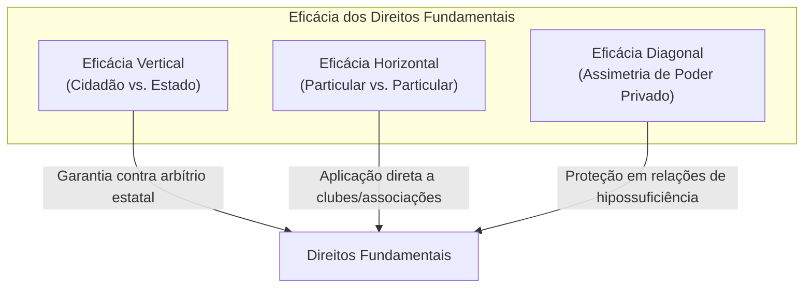
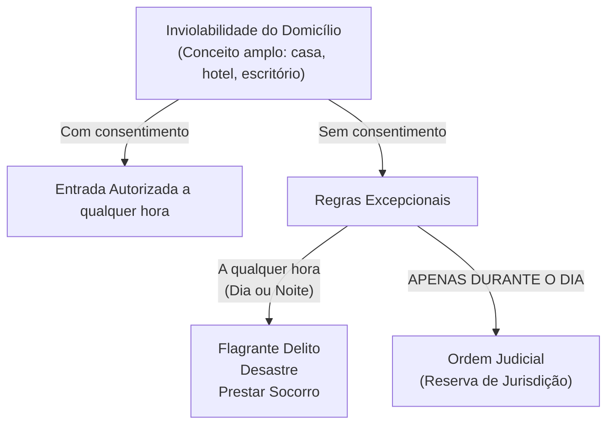
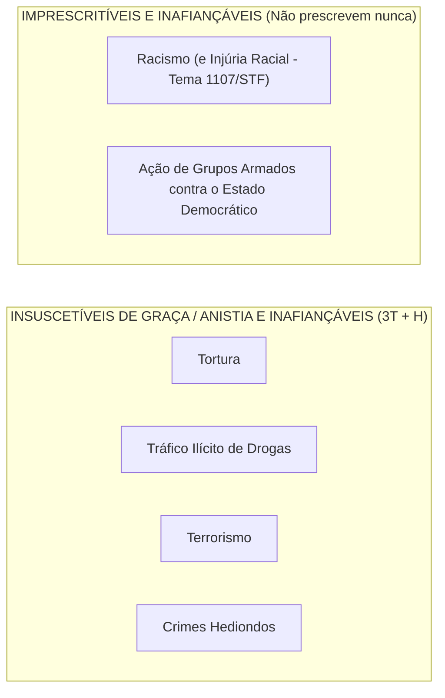

# 02 - Direitos Fundamentais, Remédios Constitucionais, Nacionalidade e Direitos Políticos

> **Matéria:** Noções de Direito Constitucional  
> **Cargo:** A01 – Técnico de Controle Externo – Especialidade: Técnico Administrativo  
> **Arquivo:** `02_direitos_e_garantias_fundamentais_e_politicos.md`  
> **Status:** 🟢 Teoria Aprofundada + 5 Questões FCC Comentadas (A a E)

---

## 📌 Ementa / Itens do Edital

- Dos direitos e deveres individuais e coletivos (Artigo 5º da CF/88): princípios reitores, direitos em espécie, garantias processuais e penais.
- Remédios constitucionais (*Writs*): *Habeas Corpus*, *Habeas Data*, Mandado de Segurança individual e coletivo, Mandado de Injunção e Ação Popular.
- Dos direitos sociais (Artigos 6º a 11 da CF/88): rol dos direitos fundamentais sociais, direitos dos trabalhadores urbanos e rurais, direito de greve e liberdade sindical.
- Da nacionalidade (Artigos 12 e 13 da CF/88): critérios originários e derivados, quase-nacionalidade, cargos privativos de brasileiro nato (art. 12, § 3º) e o novo regime de perda e readquisição da nacionalidade (Emenda Constitucional nº 131/2023).
- Dos direitos políticos (Artigos 14 a 16 da CF/88): instrumentos de soberania popular, alistabilidade eleitoral, condições de elegibilidade e idades mínimas, inelegibilidades absolutas e relativas (inelegibilidade reflexa e Súmula Vinculante 18).
- Perda e suspensão dos direitos políticos (Artigo 15 da CF/88): vedação absoluta de cassação e hipóteses constitucionais taxativas.
- Dos partidos políticos (Artigo 17 da CF/88): preceitos constitucionais, cláusula de barreira, financiamento e autonomia partidária.

---

## 🧭 Sumário

1. [Teoria Geral e Direitos Individuais e Coletivos (Art. 5º da CF/88)](#1-teoria-geral-e-direitos-individuais-e-coletivos-art-5o-da-cf88)
    1. [Características Fundamentais e Dimensões de Eficácia](#11-caracteristicas-fundamentais-e-dimensoes-de-eficacia)
    2. [Inviolabilidade do Domicílio (Art. 5º, XI)](#12-inviolabilidade-do-domicilio-art-5o-xi)
    3. [Inviolabilidade das Comunicações e Reserva de Jurisdição (Art. 5º, XII)](#13-inviolabilidade-das-comunicacoes-e-reserva-de-jurisdicao-art-5o-xii)
    4. [Liberdade de Associação e Limites Estatais (Art. 5º, XVII a XXI)](#14-liberdade-de-associacao-e-limites-estatais-art-5o-xvii-a-xxi)
    5. [Tratamento Constitucional dos Crimes: O Quarteto Penal da FCC](#15-tratamento-constitucional-dos-crimes-o-quarteto-penal-da-fcc)
    6. [Teste 121](#Teste-121)
    7. [Teste 122](#Teste-122)
    8. [Teste 123](#Teste-123)
2. [Remédios Constitucionais (*Writs* de Garantia)](#2-remedios-constitucionais-writs-de-garantia)
    1. [Análise Comparativa dos Remédios Constitucionais](#21-analise-comparativa-dos-remedios-constitucionais)
    2. [Teste 124](#Teste-124)
    3. [Teste 125](#Teste-125)
3. [Direitos Sociais (Arts. 6º a 11)](#3-direitos-sociais-arts-6o-a-11)
    1. [Teste 126](#Teste-126)
4. [Teoria da Nacionalidade e a Nova Disciplina da Perda (Arts. 12 e 13)](#4-teoria-da-nacionalidade-e-a-nova-disciplina-da-perda-arts-12-e-13)
    1. [Espécies de Nacionalidade Originária (Brasileiro Nato)](#41-especies-de-nacionalidade-originaria-brasileiro-nato)
    2. [Brasileiro Naturalizado](#42-brasileiro-naturalizado)
    3. [Cargos Privativos de Brasileiro Nato (Art. 12, § 3º - MP3.COM)](#43-cargos-privativos-de-brasileiro-nato-art-12-3o-mp3com)
    4. [Perda da Nacionalidade: O Novo Regime da EC nº 131/2023](#44-perda-da-nacionalidade-o-novo-regime-da-ec-no-1312023)
    5. [Teste 127](#Teste-127)
    6. [Teste 128](#Teste-128)
    7. [Teste 129](#Teste-129)
5. [Direitos Políticos e Sistema Partidário (Arts. 14 a 17)](#5-direitos-politicos-e-sistema-partidario-arts-14-a-17)
    1. [Alistamento Eleitoral e Voto](#51-alistamento-eleitoral-e-voto)
    2. [Idades Mínimas de Elegibilidade (Capacidade Eleitoral Passiva)](#52-idades-minimas-de-elegibilidade-capacidade-eleitoral-passiva)
    3. [Inelegibilidade Reflexa (Art. 14, § 7º) e Súmula Vinculante 18](#53-inelegibilidade-reflexa-art-14-7o-e-sumula-vinculante-18)
    4. [Perda e Suspensão dos Direitos Políticos (Art. 15 da CF/88)](#54-perda-e-suspensao-dos-direitos-politicos-art-15-da-cf88)
    5. [Teste 130](#Teste-130)
    6. [Teste 131](#Teste-131)
6. [🌐 Fontes Oficiais & Doutrinárias Recomendadas](#fontes-oficiais-doutrinarias-recomendadas)

---

## 1. Teoria Geral e Direitos Individuais e Coletivos (Art. 5º da CF/88)

### 1.1 Características Fundamentais e Dimensões de Eficácia
- **Inexistência de Direitos Absolutos (Relatividade):** Nenhum direito fundamental possui caráter absoluto. Todos encontram limites na coexistência harmoniosa com outros direitos fundamentais protegidos pela ordem constitucional. Nem mesmo o direito à vida é absoluto, haja vista a admissibilidade constitucional da pena de morte em caso de guerra declarada (art. 5º, XLVII, "a").
- **Eficácia Vertical vs. Eficácia Horizontal (*Drittwirkung*):**
    - *Eficácia Vertical:* Relação tradicional entre o indivíduo e o Estado, funcionando como escudo protetor contra o arbítrio estatal.
    - *Eficácia Horizontal:* Incidência direta e imediata dos direitos fundamentais nas relações jurídicas entre particulares (ex.: respeito à ampla defesa e ao contraditório para expulsão de sócio de clube ou cooperativa privada - STF).
    - *Eficácia Diagonal:* Relação entre particulares caracterizada por flagrante assimetria fática e jurídica (ex.: relações de trabalho e contratos de consumo).

### 1.2 Inviolabilidade do Domicílio (Art. 5º, XI)
> *"A casa é asilo inviolável do indivíduo, ninguém nela podendo penetrar sem consentimento do morador, salvo em caso de flagrante delito ou desastre, ou para prestar socorro, ou, durante o dia, por determinação judicial."*

> 🚨 **ALERTA DE PROVA / PEGADINHA FCC:**  
>
> 1. **Conceito de Domicílio:** O STF adota interpretação abrangente de "casa", incluindo escritórios profissionais, consultórios médicos, trailers habitados e quartos de hotel ocupados. Áreas abertas ao público (como o salão de um restaurante) não configuram domicílio protegido durante o horário comercial.  
> 2. **Determinação Judicial:** O cumprimento de mandado de busca e apreensão domiciliar **só pode ocorrer durante o dia**. Não existe hipótese de ingresso com ordem judicial durante a noite sem o consentimento do morador! O critério consagrado pela Lei de Abuso de Autoridade (Lei nº 13.869/2019) veda o cumprimento de mandado domiciliar entre 21h e 5h.  
> 3. **Flagrante Delito em Tráfico Ilícito de Drogas (Tema 280/STF):** O ingresso forçado em domicílio sem mandado judicial, mesmo em caso de crime permanente como o tráfico de drogas, exige fundadas razões (justa causa) devidamente justificadas *a posteriori*, sob pena de nulidade absoluta das provas.

### 1.3 Inviolabilidade das Comunicações e Reserva de Jurisdição (Art. 5º, XII)
> *"É inviolável o sigilo da correspondência e das comunicações telegráficas, de dados e das comunicações telefônicas, salvo, no último caso, por ordem judicial, nas hipóteses e na forma que a lei estabelecer para fins de investigação criminal ou instrução processual penal."*

- **Interceptação Telefônica:** Exige cláusula de **reserva de jurisdição estrita** (apenas o juiz competente pode determinar). É vedada em processos cíveis ou administrativos disciplinares (PAD). Contudo, a prova obtida licitamente no juízo criminal pode ser compartilhada como prova emprestada no PAD disciplinar (STJ/STF).
- **Sigilo Fiscal e Bancário:** Pode ser quebrado por determinação judicial e também diretamente por Comissões Parlamentares de Inquérito (CPIs federais e estaduais), com base nos poderes de investigação próprios das autoridades judiciais (art. 58, § 3º). O Fisco pode requisitar dados cadastrais e movimentações bancárias diretamente sem prévia autorização judicial (STF, ADI 2.390 e LC 105/2001).

### 1.4 Liberdade de Associação e Limites Estatais (Art. 5º, XVII a XXI)
| Aspecto Constitucional | Regra / Limite | Exigência Processual |
| :--- | :--- | :--- |
| **Criação da Associação** | Plena liberdade para fins lícitos | **Independe de autorização** estatal; vedada interferência na administração |
| **Atividades Paramilitares** | **Vedação absoluta** | Proibição categórica |
| **Suspensão das Atividades** | Interrupção provisória | Exige **decisão judicial** (mesmo cautelar/liminar) |
| **Dissolução Compulsória** | Extinção definitiva da pessoa jurídica | Exige **decisão judicial transitada em julgado** |
| **Representação Processual** | Defesa dos filiados em juízo | Exige **autorização expressa** (individual ou assemblear - Tema 82/STF) |

> ⭐ **IMPORTANTE:**  
> A FCC adora trocar as exigências para suspensão e dissolução compulsória. Memorize: para **suspender**, basta mera **decisão judicial**; para **dissolver compulsoriamente**, exige-se **trânsito em julgado**. Nenhuma autoridade administrativa tem competência para ordenar a paralisação ou encerramento de associação!

### 1.5 Tratamento Constitucional dos Crimes: O Quarteto Penal da FCC
Para gabaritar qualquer prova da Fundação Carlos Chagas, a tabela a seguir é de memorização compulsória:

| Categoria do Crime | Tipos Penais Abrangidos | Fiança? | Prescrição? | Graça / Anistia / Indulto? |
| :--- | :--- | :--- | :--- | :--- |
| **Racismo & Injúria Racial** | Prática de racismo (Lei 7.716/89) e Injúria racial (STF HC 154.248 e Lei 14.532/23) | **Inafiançável** | **Imprescritível** | Admite |
| **Ação de Grupos Armados** | Civis ou militares contra a ordem constitucional e o Estado Democrático | **Inafiançável** | **Imprescritível** | Admite |
| **3T + Hediondos** | **T**ortura, **T**ráfico ilícito de drogas, **T**errorismo e Crimes **H**ediondos | **Inafiançável** | Prescritível | **Insuscetíveis de graça ou anistia** |

---

### Teste 121
**(FCC – TRT-2ª Região – Analista Judiciário - 2014)**  
Considere as seguintes afirmativas:

I. O direito de reunião em locais abertos ao público deve ser exercido, segundo o texto constitucional, de forma pacífica, sem armas, com prévio aviso à autoridade competente, desde que não frustre outra reunião anteriormente convocada para o mesmo local.  
II. É livre a manifestação do pensamento, sendo vedado o anonimato.  
III. São gratuitas as ações de *habeas corpus* e mandado de segurança, e, na forma da lei, os atos necessários ao exercício da cidadania.  

Está correto o que se afirma APENAS em:

* **A)** II.
* **B)** I, II e III.
* **C)** I e III.
* **D)** II e III.
* **E)** I e II.

---

> **Comentário Detalhado:**
>
> - **A)** **Incorreto**. O item I também está inteiramente correto nos termos da CF/88.
> - **B)** **Incorreto**. O item III está errado, pois o mandado de segurança não é ação constitucional gratuita por expressa disposição da CF/88.
> - **C)** **Incorreto**. O item II é expressamente verdadeiro e o item III é falso.
> - **D)** **Incorreto**. O item III contém vício quanto à gratuidade do mandado de segurança.
> - **E)** **Correto**. O item I reproduz com fidelidade o art. 5º, XVI, da CF/88 (reunião pacífica, sem armas, em locais abertos ao público, independentemente de autorização, desde que não frustrem outra reunião anteriormente convocada para o mesmo local, sendo apenas exigido prévio aviso à autoridade competente). O item II reproduz com literalidade o art. 5º, IV, da CF/88 ("é livre a manifestação do pensamento, sendo vedado o anonimato"). O item III é falso porque, consoante o art. 5º, LXXVII, da CF/88, "são gratuitas as ações de *habeas-corpus* e *habeas-data*, e, na forma da lei, os atos necessários ao exercício da cidadania" — o mandado de segurança exige o recolhimento regular de custas processuais.
>
> **Gabarito: E**

### Teste 122
**(FGV – TRT – Analista Judiciário - 2022)**  
Joana, jovem e renomada escritora de livros infantis, faleceu. O mais velho dos seus herdeiros, com 18 anos de idade, preocupado com a situação dos livros, que geravam uma elevada renda para Joana, questionou um advogado a respeito da proteção constitucional oferecida a direitos dessa natureza.  
O advogado respondeu corretamente que aos autores pertence o direito exclusivo de utilização, publicação ou reprodução de suas obras, transmissível aos herdeiros:

* **A)** de modo exclusivo e em caráter perpétuo, aos herdeiros.
* **B)** de modo exclusivo e pelo tempo que a lei fixar, aos herdeiros.
* **C)** ao poder público, não aos herdeiros, com participação financeira.
* **D)** ao público em geral, não aos herdeiros, mantida participação.
* **E)** aos herdeiros e ao poder público conjuntamente, rateando os lucros.

---

> **Comentário Detalhado:**
>
> - **A)** **Incorreto**. A transmissibilidade aos herdeiros não se dá em caráter perpétuo, mas temporário, adstrita ao prazo fixado na legislação ordinária.
> - **B)** **Correto**. Nos exatos termos do art. 5º, XXVII, da Constituição Federal: "aos autores pertence o direito exclusivo de utilização, publicação ou reprodução de suas obras, transmissível aos herdeiros pelo tempo que a lei fixar". A Lei nº 9.610/1998 (Lei de Direitos Autorais) estabelece, em regra, a duração de 70 anos contados de 1º de janeiro do ano subsequente ao falecimento do autor.
> - **C)** **Incorreto**. Os direitos patrimoniais transmitem-se aos sucessores legítimos do autor, não ao poder público.
> - **D)** **Incorreto**. A obra somente cai em domínio público após o transcurso do lapso legal de proteção post mortem.
> - **E)** **Incorreto**. Não há cotitularidade forçada ou rateio de direitos autorais com o poder público.
>
> **Gabarito: B**

### Teste 123
**(FGV – Auditor Fiscal da Receita Estadual / Simulado)**  
O art. 5º, XII, da Constituição Federal estabelece que "é inviolável o sigilo da correspondência e das comunicações telegráficas, de dados e das comunicações telefônicas, salvo, no último caso, por ordem judicial, nas hipóteses e na forma que a lei estabelecer para fins de investigação criminal ou instrução processual penal". À luz da jurisprudência do STF e do STJ sobre a quebra de sigilo bancário e fiscal, é correto afirmar:

* **A)** A quebra do sigilo fiscal pelo Fisco exige autorização judicial prévia sob pena de nulidade absoluta.
* **B)** O Fisco pode requisitar diretamente informações a instituições bancárias sem autorização judicial prévia.
* **C)** As CPIs estaduais podem determinar busca e apreensão domiciliar na pendência de inquérito administrativo.
* **D)** A interceptação de comunicações telefônicas é admitida em processos administrativos de natureza disciplinar.
* **E)** As mensagens trocadas via correio eletrônico corporativo são imunes ao controle exercido pelo empregador.

---

> **Comentário Detalhado:**
>
> - **A)** **Incorreto**. Conforme julgamento conjunto das ADIs 2.390, 2.386, 2.365 e 2.859 e do RE 601.314/SP (Tema 225 do STF), o art. 6º da Lei Complementar nº 105/2001 é plenamente constitucional. Não há propriamente "quebra", mas transferência do dever de sigilo bancário das instituições financeiras para o Fisco, sem necessidade de autorização judicial prévia.
> - **B)** **Correto**. O Plenário do STF firmou tese de repercussão geral no sentido de que a transferência do sigilo bancário ao Fisco, no âmbito de procedimento fiscalizatório devidamente instaurado e sob garantia de preservação do segredo fiscal, não viola a cláusula de reserva de jurisdição.
> - **C)** **Incorreto**. CPIs (mesmo as federais) possuem poderes de instrução próprios das autoridades judiciais, mas não detêm reserva absoluta de jurisdição (não podem determinar busca e apreensão domiciliar nem interceptação telefônica).
> - **D)** **Incorreto**. A interceptação de comunicações telefônicas (gravação de conversas alheias sem ciência) é restrita estritamente a investigação criminal ou instrução processual penal.
> - **E)** **Incorreto**. O TST e o STJ admitem a fiscalização de e-mail corporativo fornecido exclusivamente para fins funcionais.
>
> **Gabarito: B**

### Teste 124
**(FGV – TRT-1ª Região – Analista Judiciário - 2024)**  
Ana, servidora aposentada do município Alfa, solicitou à autoridade competente que fossem fornecidas as informações relativas à sua pessoa constantes dos respectivos assentamentos funcionais. Ao preencher o respectivo formulário, informou, no campo da justificativa, que o motivo era "pessoal", o que motivou o indeferimento do pleito com base no argumento de que a motivação não era juridicamente idônea.  
Considerando a narrativa e a sistemática constitucional afeta à matéria, é correto afirmar que:

* **A)** o acesso às informações postuladas pressupõe a comprovação de interesse público juridicamente tutelado.
* **B)** as informações requeridas decorrem do vínculo funcional pretérito e exigem prévia autorização judicial.
* **C)** as informações deveriam ter sido fornecidas a Ana, sendo cabível impetração de mandado de segurança se houver certidão.
* **D)** a negativa estatal é plenamente legítima porque todo cidadão deve justificar o motivo para consulta a banco de dados.
* **E)** a servidora deveria ajuizar ação popular perante o juízo da Fazenda Pública para anular a recusa administrativa.

---

> **Comentário Detalhado:**
>
> - **A)** **Incorreto**. O fornecimento de informações de interesse pessoal independe de demonstração de utilidade pública coletiva.
> - **B)** **Incorreto**. O acesso a dados individuais da própria pessoa junto à administração não depende de prévia chancela judicial.
> - **C)** **Correto**. Conforme o art. 5º, XXXIII, da CF/88, "todos têm direito a receber dos órgãos públicos informações de seu interesse particular, ou de interesse coletivo ou geral, que serão prestadas no prazo da lei, sob pena de responsabilidade". Ademais, diante da recusa formal e ilegal de fornecimento de certidão de assentamentos funcionais, há direito líquido e certo tutelável via mandado de segurança (art. 5º, LXIX, CF/88) ou obtenção de certidões (art. 5º, XXXIV, 'b', CF/88).
> - **D)** **Incorreto**. A exigência de justificativa para fornecimento de certidões ou dados próprios é ilegítima e abusiva.
> - **E)** **Incorreto**. A ação popular visa anular ato lesivo ao patrimônio público, moralidade, meio ambiente ou patrimônio histórico, não sendo via para obter certidões funcionais individuais.
>
> **Gabarito: C**

### Teste 125
**(FCC – Procurador do Estado / Simulado)**  
A respeito da legitimação ativa e dos requisitos de admissibilidade dos remédios constitucionais, analise a disciplina do Mandado de Segurança Coletivo e da Ação Popular. É correto afirmar que:

* **A)** Qualquer pessoa jurídica legalmente constituída possui legitimidade para propor ação popular.
* **B)** O mandado de segurança coletivo impetrado por partido exige representação parlamentar no Congresso.
* **C)** As associações civis necessitam de autorização assemblear específica para impetrar mandado de segurança coletivo.
* **D)** A desistência da ação popular pelo autor originário acarreta a extinção imediata do processo sem julgamento de mérito.
* **E)** A concessão de medida liminar em mandado de segurança prescinde da demonstração de perigo de dano irreparável.

---

> **Comentário Detalhado:**
>
> - **A)** **Incorreto**. A teor do art. 5º, LXXIII, da CF/88 e da Súmula 365 do STF, "qualquer cidadão é parte legítima para propor ação popular". Pessoa jurídica não possui condição de cidadão e não pode ajuizar ação popular.
> - **B)** **Correto**. O art. 5º, LXX, 'a', da CF/88 confere legitimidade ativa para o mandado de segurança coletivo a "partido político com representação no Congresso Nacional" (basta possuir um único Deputado Federal ou Senador da República no momento da propositura).
> - **C)** **Incorreto**. Conforme a Súmula 629 do STF, "a impetração de mandado de segurança coletivo por entidade de classe em favor dos associados independe da autorização destes", atuando como substituta processual (art. 21 da Lei nº 12.016/2009).
> - **D)** **Incorreto**. Desistindo o autor originário da ação popular, o Ministério Público ou qualquer outro cidadão pode assumir o polo ativo (art. 9º da Lei nº 4.717/1965).
> - **E)** **Incorreto**. A liminar em mandado de segurança exige a concorrência dos dois requisitos essenciais: fundamento relevante (*fumus boni iuris*) e risco de ineficácia da medida (*periculum in mora*).
>
> **Gabarito: B**

### Teste 126
**(FCC – TRT – Analista Judiciário - 2009)**  
Ao dispor sobre os direitos dos trabalhadores urbanos e rurais, a Constituição da República admite, expressamente, que seja objeto de acordo ou convenção coletiva de trabalho:

* **A)** a concessão de seguro-desemprego em caso de desemprego involuntário.
* **B)** a redução proporcional do salário mediante negociação coletiva.
* **C)** o décimo-terceiro salário com base na remuneração integral do empregado.
* **D)** o prazo prescricional para ajuizamento de ação relativa a créditos.
* **E)** a redução dos riscos inerentes ao trabalho por normas de higiene e saúde.

---

> **Comentário Detalhado:**
>
> - **A)** **Incorreto**. O seguro-desemprego é direito irrenunciável previsto no art. 7º, II, da CF/88, sem previsão de redução ou flexibilização por negociação coletiva.
> - **B)** **Correto**. Nos termos do art. 7º, VI, da CF/88, é direito dos trabalhadores urbanos e rurais a "irredutibilidade do salário, salvo o disposto em convenção ou acordo coletivo". A própria Carta Magna autoriza expressamente a mitigação da irredutibilidade por meio de negociação coletiva de trabalho.
> - **C)** **Incorreto**. O décimo-terceiro salário (art. 7º, VIII) constitui garantia de indisponibilidade absoluta, vedada a supressão sindical.
> - **D)** **Incorreto**. Os prazos de prescrição trabalhista (art. 7º, XXIX) são matéria de ordem pública constitucional.
> - **E)** **Incorreto**. As normas de saúde, higiene e segurança do trabalho (art. 7º, XXII) constituem garantias mínimas indisponíveis tuteladas pelo princípio da dignidade da pessoa humana.
>
> **Gabarito: B**

### Teste 127
**(FCC – TRT-9ª Região – Analista Judiciário - 2015)**  
Considere os seguintes direitos dos trabalhadores:

I. Seguro-desemprego.  
II. Piso salarial proporcional à extensão e à complexidade do trabalho.  
III. Remuneração do trabalho noturno superior à do diurno.  
IV. Repouso semanal remunerado, preferencialmente aos domingos.  

Nos termos da Constituição Federal, são estendidos aos trabalhadores domésticos os direitos indicados APENAS em:

* **A)** I, II, III e IV.
* **B)** II, III e IV.
* **C)** I e II.
* **D)** III e IV.
* **E)** II.

---

> **Comentário Detalhado:**
>
> - **A)** **Correto**. A Emenda Constitucional nº 72/2013 ("PEC das Domésticas") alterou profundamente o parágrafo único do art. 7º da CF/88, estendendo aos trabalhadores domésticos tanto os direitos de eficácia imediata — repouso semanal remunerado (XV), remuneração do trabalho noturno superior à do diurno (IX) — quanto os direitos condicionados à regulamentação legal posterior — seguro-desemprego (II) e piso salarial fixado em lei (V), ambos efetivamente disciplinados pela Lei Complementar nº 150/2015. Logo, todos os quatro itens listados são direitos constitucionais titularizados pelos trabalhadores domésticos.
> - **B)** **Incorreto**. O seguro-desemprego (item I) foi expressamente conferido aos trabalhadores domésticos pela EC 72/2013 e regulamentado pela LC 150/2015.
> - **C)** **Incorreto**. Os itens III e IV também são garantias plenamente aplicáveis aos trabalhadores domésticos.
> - **D)** **Incorreto**. Os itens I e II também estão integrados ao patrimônio jurídico dos empregados domésticos.
> - **E)** **Incorreto**. A tutela constitucional dos domésticos abrange amplamente o catálogo examinado.
>
> **Gabarito: A**

### Teste 128
**(FGV – TRT-1ª Região – Analista Judiciário - 2024)**  
Maria nasceu no território brasileiro quando seus pais, Juan e Ane, de cidadania espanhola, ali se encontravam a serviço da embaixada espanhola. Após ter vivido por cinco anos no Brasil, mudou-se para a Austrália juntamente com seus pais, que passaram a atuar na iniciativa privada. Logo após atingir a maioridade, Maria cometeu um crime comum em solo australiano e fugiu para o Brasil, onde foi presa. O governo da Austrália requereu a sua extradição.  
Considerando a narrativa e a sistemática constitucional afeta à nacionalidade, é correto afirmar que Maria é:

* **A)** estrangeira, sendo plenamente possível o deferimento de sua extradição pelo Supremo Tribunal Federal.
* **B)** brasileira nata, o que obsta de modo peremptório o deferimento de qualquer pedido de extradição.
* **C)** estrangeira, mas a opção posterior pela nacionalidade brasileira impede a consumação da extradição requerida.
* **D)** brasileira nata, mas a gravidade do crime doloso cometido na juventude autoriza a entrega ao Estado requerente.
* **E)** brasileira naturalizada, cabendo ao Chefe do Poder Executivo decidir discricionariamente sobre sua extradição.

---

> **Comentário Detalhado:**
>
> - **A)** **Correto**. O art. 12, I, 'a', da CF/88 estipula que são brasileiros natos "os nascidos na República Federativa do Brasil, ainda que de pais estrangeiros, desde que estes não estejam a serviço de seu país". Como Juan e Ane estavam a serviço diplomático da Espanha no momento do nascimento, incide a ressalva constitucional: Maria é estrangeira perante o direito brasileiro. Não sendo brasileira nata, Maria pode ser legitimamente extraditada pelo STF por crime comum praticado no exterior (art. 5º, LI, CF/88).
> - **B)** **Incorreto**. Maria não é brasileira nata em razão da excludente do serviço diplomático de país estrangeiro.
> - **C)** **Incorreto**. A naturalização superveniente não impede a extradição por crime comum praticado antes da naturalização (art. 5º, LI, CF/88).
> - **D)** **Incorreto**. Brasileiros natos jamais podem ser extraditados do território nacional sob hipótese alguma.
> - **E)** **Incorreto**. Maria é estrangeira e a deliberação sobre a legalidade da extradição é matéria de competência jurisdicional exclusiva do STF (art. 102, I, 'g', CF/88).
>
> **Gabarito: A**

### Teste 129
**(FGV – TRT – Analista Judiciário - 2024)**  
Mara, de nacionalidade brasileira, casou com Stevenson, de nacionalidade holandesa, e passou a viver na Áustria. Com o objetivo de facilitar sua integração no país em que residia, não como requisito para a fruição de direitos civis, Mara decidiu se naturalizar austríaca.  
Após alguns anos, Mara decidiu que almejava ter apenas a nacionalidade austríaca, não mais a brasileira.  
Considerando a disciplina constitucional da nacionalidade brasileira após as alterações implementadas pela Emenda Constitucional nº 131/2023, é correto afirmar que:

* **A)** ao casar com Stevenson, em razão do casamento civil, ela adquiriu a nacionalidade holandesa de ofício.
* **B)** ao se naturalizar austríaca, nas circunstâncias indicadas, ela perdeu automaticamente a nacionalidade brasileira.
* **C)** não será possível a perda da nacionalidade brasileira, por configurar direito fundamental de natureza perpétua.
* **D)** a perda da nacionalidade brasileira exigirá pedido formal e expresso de Mara perante a autoridade competente.
* **E)** ela será privada da nacionalidade brasileira apenas se for condenada por crime doloso na ordem jurídica austríaca.

---

> **Comentário Detalhado:**
>
> - **A)** **Incorreto**. A ordem constitucional não adota o *jus nuptias* de forma automática para outorga originária de nacionalidade.
> - **B)** **Incorreto**. A EC nº 131/2023 extinguiu a hipótese de perda automática da nacionalidade pela mera aquisição voluntária de outra nacionalidade no exterior.
> - **C)** **Incorreto**. A nacionalidade brasileira não é forçada nem irrevogável: o cidadão que possua outra nacionalidade pode expressamente renunciar à brasileira.
> - **D)** **Correto**. Com a nova redação conferida ao art. 12, § 4º, II, da CF/88 pela EC 131/2023, somente será declarada a perda da nacionalidade do brasileiro que "fizer pedido expresso de perda da nacionalidade brasileira perante autoridade competente, ressalvadas situações que acarretem apatridia". Portanto, para ter apenas a nacionalidade austríaca, Mara deverá formular pedido expresso de renúncia.
> - **E)** **Incorreto**. A condenação judicial no estrangeiro não é causa constitucional de perda da nacionalidade brasileira.
>
> **Gabarito: D**

### Teste 130
**(FCC – TCE-GO – Analista de Controle Externo - 2009)**  
Será considerado inelegível, nos termos da Constituição da República:

* **A)** o Governador de Estado que, pretendendo a reeleição para o mesmo cargo, não renunciar até seis meses antes do pleito.
* **B)** o Deputado Federal no exercício de segundo mandato parlamentar consecutivo que pretenda reeleger-se.
* **C)** quem tenha sido condenado criminalmente em decisão judicial colegiada enquanto durarem seus efeitos.
* **D)** brasileiro naturalizado que pretenda concorrer legitimamente a uma vaga para o Senado Federal.
* **E)** o filho adotivo do Governador do Estado que pretenda concorrer ao cargo de Prefeito da Capital desse mesmo Estado.

---

> **Comentário Detalhado:**
>
> - **A)** **Incorreto**. Conforme o art. 14, § 5º, da CF/88, o Presidente, os Governadores e os Prefeitos podem ser reeleitos para um único período subsequente sem necessidade de desincompatibilização prévia.
> - **B)** **Incorreto**. Membros do Poder Legislativo não se submetem a limite de mandatos consecutivos, podendo reeleger-se indefinidamente.
> - **C)** **Incorreto**. A suspensão de direitos políticos pelo art. 15, III, da CF/88 exige "condenação criminal transitada em julgado, enquanto durarem seus efeitos".
> - **D)** **Incorreto**. O cargo de Senador da República não é privativo de brasileiro nato (art. 12, § 3º, da CF/88 elenca apenas Presidente e Vice-Presidente da República, Presidente da Câmara dos Deputados, Presidente do Senado Federal, Ministro do STF, carreira diplomática, oficial das Forças Armadas e Ministro de Estado da Defesa). Logo, o brasileiro naturalizado pode ser Senador.
> - **E)** **Correto**. Incide a regra da inelegibilidade reflexa insculpida no art. 14, § 7º, da CF/88: "São inelegíveis, no território de jurisdição do titular, o cônjuge e os parentes consangüíneos ou afins, até o segundo grau ou por adoção, do Presidente da República, de Governador de Estado ou Território, do Distrito Federal, de Prefeito ou de quem os haja substituído dentro dos seis meses anteriores ao pleito, salvo se já titular de mandato eletivo e candidato à reeleição". O Governador tem como território de sua jurisdição todo o respectivo Estado (o que abrange a Capital); logo, seu filho adotivo (parente por adoção de 1º grau) é absolutamente inelegível para o cargo de Prefeito naquele Estado.
>
> **Gabarito: E**

### Teste 131
**(FGV – TRT – Analista Judiciário - 2024)**  
Maria, Joana e Antônio, respectivamente, brasileira nata, brasileira naturalizada e ugandense residente no território brasileiro, consultaram um especialista em relação à existência, ou não, de distinção em relação à situação jurídica de cada qual considerando os direitos fundamentais e os direitos políticos.  
O especialista respondeu corretamente que:

* **A)** os três possuem os mesmos direitos fundamentais civis, mas apenas Maria e Joana podem votar e ser votadas no país.
* **B)** Maria e Joana possuem exatamente os mesmos direitos políticos, sem distinção de elegibilidade para quaisquer cargos públicos.
* **C)** diferentemente de Maria e Joana, Antônio é destituído de direitos fundamentais por não possuir a nacionalidade brasileira.
* **D)** os direitos políticos decorrem automaticamente da concessão de asilo ou residência no território da República Federativa.
* **E)** Maria e Joana não compartilham os mesmos direitos fundamentais, sendo vedada a filiação partidária de cidadãos naturalizados.

---

> **Comentário Detalhado:**
>
> - **A)** **Correto**. Conforme o caput do art. 5º da CF/88, os direitos fundamentais são assegurados a brasileiros e estrangeiros residentes no País (e, segundo jurisprudência do STF, até a estrangeiros em trânsito). No entanto, o alistamento eleitoral e a capacidade eleitoral passiva (direitos políticos) são privativos de cidadãos brasileiros (art. 14 da CF/88), sendo vedado o alistamento a estrangeiros (art. 14, § 2º, CF/88). Logo, Antônio não detém direitos políticos, cabendo estes privativamente a Maria e Joana.
> - **B)** **Incorreto**. Embora ambas possuam direitos políticos, Maria (nata) pode concorrer a cargos privativos de brasileiro nato previstos no art. 12, § 3º, da CF/88 (como Presidência da República), vedados a Joana (naturalizada).
> - **C)** **Incorreto**. O art. 5º assegura direitos fundamentais individuais a estrangeiros residentes no Brasil.
> - **D)** **Incorreto**. A aquisição de direitos políticos depende de nacionalidade e alistamento eleitoral.
> - **E)** **Incorreto**. Brasileiros naturalizados podem filiar-se a partidos políticos e exercer plenamente mandatos eletivos não vedados pelo art. 12, § 3º.
>
> **Gabarito: A**

