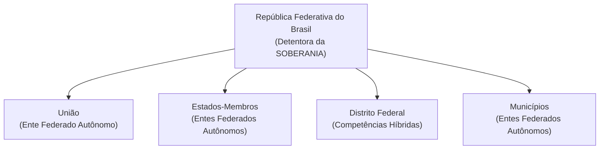
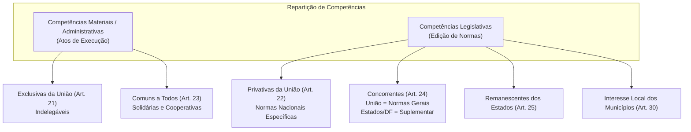
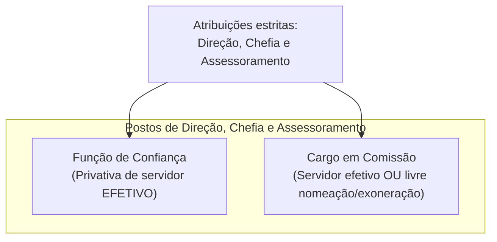
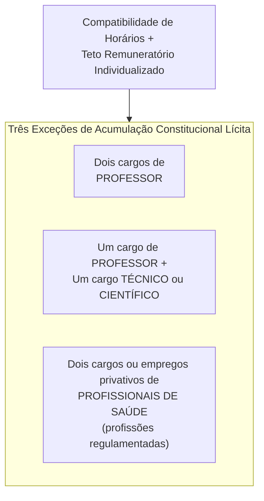
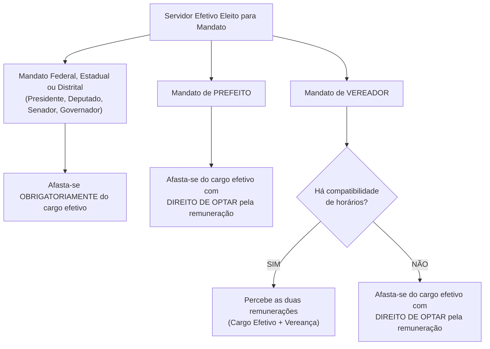
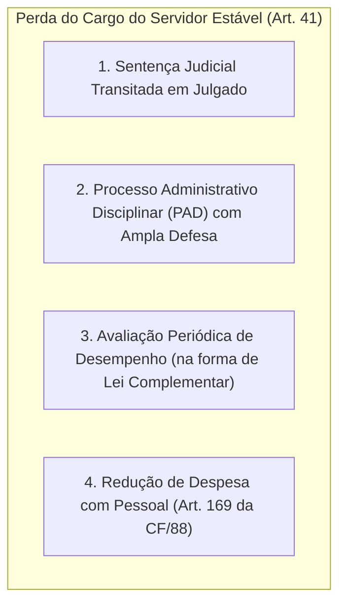

# 03 - Organização do Estado, Repartição de Competências e Servidores Públicos

> **Matéria:** Noções de Direito Constitucional  
> **Cargo:** A01 – Técnico de Controle Externo – Especialidade: Técnico Administrativo  
> **Arquivo:** `03_organizacao_do_estado_e_reparticao_de_competencias.md`  
> **Status:** 🟢 Teoria Aprofundada + 5 Questões FCC Comentadas (A a E)

---

## 📌 Ementa / Itens do Edital

- Da organização político-administrativa do Estado brasileiro (Artigos 18 e 19 da CF/88): forma federativa, autonomia dos entes e vedações federativas.
- Da União, dos Estados Federados, do Distrito Federal e dos Municípios: bens públicos, criação e desmembramento de entes, e competências materiais e legislativas.
- Repartição constitucional de competências:
    - Competências materiais exclusivas da União (Art. 21) e comuns de todos os entes (Art. 23);
    - Competências legislativas privativas da União (Art. 22) e concorrentes entre União, Estados e DF (Art. 24);
    - Competências remanescentes/residuais dos Estados (Art. 25) e competências de interesse local dos Municípios (Art. 30).
- Intervenção Federal e Estadual (Artigos 34 a 36 da CF/88): hipóteses, princípios sensíveis e procedimento.
- Regime constitucional da Administração Pública (Artigo 37 da CF/88): princípios fundamentais, concurso público, cargos em comissão e funções de confiança, teto remuneratório e regras de acumulação de cargos.
- Servidores públicos civis (Artigos 38 a 41 da CF/88): exercício de mandato eletivo, estágio probatório, estabilidade aos 3 anos, avaliação especial de desempenho e hipóteses constitucionais taxativas de perda do cargo público estável.

---

## 🧭 Sumário
1. [Forma Federativa e Organização Político-Administrativa](#1-forma-federativa-e-organização-político-administrativa)
    - 1.1 [Características da Federação Brasileira e Autonomia dos Entes](#11-características-da-federação-brasileira-e-autonomia-dos-entes)
    - 1.2 [Vedações Constitucionais Federativas (Art. 19)](#12-vedações-constitucionais-federativas-art-19)
    - 1.3 [Bens Públicos Constitucionais e Criação de Novos Entes](#13-bens-públicos-constitucionais-e-criação-de-novos-entes)
2. [O Modelo Constitucional de Repartição de Competências](#2-o-modelo-constitucional-de-repartição-de-competências)
    - 2.1 [Competências Legislativas: Privativa da União versus Concorrente](#21-competências-legislativas-privativa-da-união-versus-concorrente)
    - 2.2 [Competências Administrativas: Exclusivas e Comuns](#22-competências-administrativas-exclusivas-e-comuns)
    - 2.3 [Competências dos Estados e Municípios](#23-competências-dos-estados-e-municípios)
3. [Mecanismos Excepcionais de Equilíbrio: Intervenção Federal e Estadual](#3-mecanismos-excepcionais-de-equilíbrio-intervenção-federal-e-estadual)
4. [Regime Constitucional da Administração Pública e Servidores (Arts. 37 a 41)](#4-regime-constitucional-da-administração-pública-e-servidores-arts-37-a-41)
    - 4.1 [Concurso Público, Funções de Confiança e Cargos em Comissão](#41-concurso-público-funções-de-confiança-e-cargos-em-comissão)
    - 4.2 [Regra Constitucional da Não-Acumulação e Exceções (Art. 37, XVI)](#42-regra-constitucional-da-não-acumulação-e-exceções-art-37-xvi)
    - 4.3 [Exercício de Mandato Eletivo pelo Servidor Público (Art. 38)](#43-exercício-de-mandato-eletivo-pelo-servidor-público-art-38)
    - 4.4 [Estabilidade e Perda do Cargo do Servidor Estável (Art. 41)](#44-estabilidade-e-perda-do-cargo-do-servidor-estável-art-41)
5. [Fontes Oficiais & Doutrinárias Recomendadas](#5-fontes-oficiais--doutrinárias-recomendadas)
6. [Questões Comentadas no Padrão FCC (Justificadas de A a E)](#6-questões-comentadas-no-padrão-fcc-justificadas-de-a-a-e)

---

## 📖 Conteúdo Teórico Aprofundado

### 1. Forma Federativa e Organização Político-Administrativa

#### 1.1 Características da Federação Brasileira e Autonomia dos Entes
A República Federativa do Brasil é formada pela união indissolúvel dos Estados e Municípios e do Distrito Federal (Art. 18, *caput*).
- **Origem Histórica:** Formou-se por **desagregação** (ou segregação), decorrente de um movimento **centrífugo** (o Estado unitário imperial descentralizou poderes políticos para as províncias que se transformaram em Estados-membros).
- **Indissolubilidade do Vínculo Federativo:** Não existe o direito de secessão (nenhum Estado ou Município pode se separar do Brasil). A tentativa de desmembramento justifica a intervenção federal imediata (art. 34, I) e constitui crime inafiançável e imprescritível (art. 5º, XLIV).
- **Soberania vs. Autonomia:**
    - A **Soberania** é atributo exclusivo da **República Federativa do Brasil** no plano internacional.
    - A **Autonomia** é outorgada aos entes federados (União, Estados, DF e Municípios), manifestando-se pela tríplice capacidade de auto-organização (Constituições e Leis Orgânicas), autogoverno (eleição de chefes dos poderes) e autoadministração (gestão e tributação próprias).

#### 1.2 Vedações Constitucionais Federativas (Art. 19)
O art. 19 da Carta da República veda à União, aos Estados, ao Distrito Federal e aos Municípios:

1. **Estabelecer cultos religiosos ou igrejas, subvencioná-los, embaraçar-lhes o funcionamento ou manter com eles ou seus representantes relações de dependência ou aliança**, ressalvada, na forma da lei, a colaboração de interesse público *(Princípio da Laicidade Estatal)*.
2. **Recusar fé aos documentos públicos** *(Eficácia probatória nacional dos documentos emitidos por órgãos oficiais)*.
3. **Criar distinções entre brasileiros ou preferências entre si** *(Proibição de discriminação tributária, previdenciária ou funcional com base na origem regional)*.

#### 1.3 Bens Públicos Constitucionais e Criação de Novos Entes
- **Bens da União (Art. 20):** Terras devolutas indispensáveis à defesa das fronteiras, recursos minerais (inclusive do subsolo), potenciais de energia hidráulica, mar territorial, terrenos de marinha e terras tradicionalmente ocupadas pelos índios.
- **Bens dos Estados (Art. 26):** Águas superficiais ou subterrâneas fluentes nos seus territórios, ilhas fluviais e lacustres não pertencentes à União e terras devolutas não compreendidas entre as da União.
- **Criação de Estados (Art. 18, § 3º):** Exige aprovação da população diretamente interessada por meio de **plebiscito** e edição de **Lei Complementar Federal** pelo Congresso Nacional.
- **Criação de Municípios (Art. 18, § 4º):** Depende de **Lei Complementar Federal** (definindo o período temporal), divulgação prévia dos Estudos de Viabilidade Municipal, consulta prévia por **plebiscito** às populações dos municípios envolvidos e promulgação de **Lei Ordinária Estadual**.

---

### 2. O Modelo Constitucional de Repartição de Competências

A Constituição Federal de 1988 adotou o **princípio da predominância do interesse**:

- **União:** Matérias de interesse nacional e geral.
- **Estados:** Matérias de interesse regional.
- **Municípios:** Matérias de predominante interesse local.
- **Distrito Federal:** Acumula competências legislativas e materiais atribuídas aos Estados e aos Municípios (vedada sua divisão em Municípios - art. 32).

#### 2.1 Competências Legislativas: Privativa da União versus Concorrente

Esta é a distinção mais exigida pela banca FCC. Analise as características de cada modalidade:

| Modalidade Legislativa | Entes Competentes | Ramos do Direito Abrangidos | Regra de Delegação / Suplementação |
| :--- | :--- | :--- | :--- |
| **Privativa da União (Art. 22)** | **Apenas a União** (Congresso Nacional) | Civil, Comercial, Penal, Processual, Eleitoral, Agrário, Marítimo, Aeronáutico, Espacial e do Trabalho; além de Trânsito/Transporte, Diretrizes da Educação e Normas Gerais de Licitação. | **Lei Complementar Federal** pode autorizar os Estados a legislar sobre questões específicas dessas matérias (Art. 22, parágrafo único). |
| **Concorrente (Art. 24)** | **União, Estados e Distrito Federal** *(Municípios NÃO participam formalmente do art. 24)* | Direito **P**enitenciário, **U**rbanístico, **F**inanceiro, **E**conômico e **T**ributário (**Mnemônico: PUFET**), além de Orçamento, Meio Ambiente, Florestas e Proteção ao Consumidor. | **União:** limita-se a fixar **Normas Gerais**. **Estados/DF:** exercem competência **Suplementar**. Se a União não editar norma geral, o Estado adquire competência plena. |

> 🚨 **ALERTA DE PROVA / PEGADINHA FCC:**  
> - **Direito Processual vs. Direito Penitenciário / Custas Forenses:**  
>   - Direito **Processual** é competência **privativa da União** (Art. 22, I). Leis estaduais que criem prazos ou ritos processuais judiciais são formalmente inconstitucionais!  
>   - Direito **Penitenciário** e custas dos serviços forenses são competências **concorrentes** (Art. 24, I e IV).  
> - **Superveniência de Lei Federal sobre Normas Gerais (Art. 24, § 4º):**  
>   A superveniência de lei federal contendo normas gerais **NÃO REVOGA** a lei estadual anterior contrária; ela apenas **SUSPENDE A SUA EFICÁCIA** naquilo que for incompatível. Se a lei federal for declarada inconstitucional ou revogada, a lei estadual volta a produzir efeitos normalmente!

#### 2.2 Competências Administrativas: Exclusivas e Comuns
- **Exclusivas da União (Art. 21):** São indelegáveis a outros entes políticos. Envolvem a emissão de moeda, administração das reservas cambiais, manutenção das relações diplomáticas, defesa nacional e fiscalização nuclear.
- **Comuns de Todos os Entes (Art. 23):** Competências materiais que devem ser exercidas de forma cooperativa e solidária por União, Estados, DF e Municípios: zelar pela guarda da Constituição, cuidar da saúde e assistência pública, proteger o meio ambiente, combater a poluição e preservar o patrimônio histórico. Leis complementares fixam normas para a cooperação entre a União e os entes subnacionais (art. 23, parágrafo único).

#### 2.3 Competências dos Estados e Municípios
- **Estados-Membros (Art. 25, § 1º):** Possuem competência **remanescente (residual)**: são reservadas aos Estados todas as competências que não lhes sejam vedadas pela Constituição e que não pertençam expressamente à União ou aos Municípios. Além disso, cabe aos Estados explorar diretamente ou mediante concessão os serviços locais de gás canalizado (art. 25, § 2º, vedada edição de MP para sua regulamentação).
- **Municípios (Art. 30):**
    1. Legislar sobre assuntos de **interesse local**;
    2. Suplementar a legislação federal e estadual no que couber;
    3. Instituir e arrecadar os tributos municipais e aplicar suas rendas;
    4. Organizar e prestar, diretamente ou sob concessão/permissão, os serviços públicos de interesse local, incluído o de **transporte coletivo**, de caráter essencial.

> ⭐ **IMPORTANTE (SÚMULA VINCULANTE 38 DO STF):**  
> *"É competente o Município para fixar o horário de funcionamento de estabelecimento comercial."*  
> Em contrapartida, conforme a Súmula Vinculante 49, leis municipais que impedem a instalação de estabelecimentos do mesmo ramo em determinada área violam a liberdade de concorrência.

---

### 3. Mecanismos Excepcionais de Equilíbrio: Intervenção Federal e Estadual

A não-intervenção é a regra geral da federação. A intervenção consubstancia medida drástica e temporária que suspende a autonomia do ente subnacional para resguardar a integridade da ordem federativa.
- **Intervenção Federal nos Estados e DF (Art. 34):** Cabível para manter a integridade nacional, repelir invasão estrangeira ou de uma unidade na outra, pôr termo a grave comprometimento da ordem pública, garantir o livre exercício de qualquer dos Poderes, reorganizar as finanças do Estado (se suspender pagamento de dívida por mais de 2 anos consecutivos) ou assegurar a observância dos **princípios constitucionais sensíveis** (forma republicana, direitos da pessoa humana, regime democrático, prestação de contas da administração e aplicação dos mínimos em saúde e educação).
- **Intervenção Estadual nos Municípios (Art. 35):** Decretada pelo Governador do Estado quando o Município deixar de pagar sua dívida fundada por dois anos consecutivos, não prestar contas devidas, não aplicar o mínimo constitucional em saúde e educação ou quando o Tribunal de Justiça der provimento a representação para garantir a observância de princípios da Constituição Estadual ou prover a execução de lei ou ordem judicial.

---

### 4. Regime Constitucional da Administração Pública e Servidores (Arts. 37 a 41)

#### 4.1 Concurso Público, Funções de Confiança e Cargos em Comissão
- **Validade do Concurso (Art. 37, III):** Validade de **até 2 (dois) anos**, prorrogável uma única vez, por igual período. O edital pode fixar validade inferior (ex.: 6 meses prorrogável por mais 6 meses).
- **Funções de Confiança vs. Cargos em Comissão (Art. 37, V):**
    - *Funções de Confiança:* Exercidas **exclusivamente** por servidores ocupantes de cargo de provimento efetivo.
    - *Cargos em Comissão:* Preenchidos por servidores de carreira nos casos, condições e percentuais mínimos previstos em lei, ou por pessoas sem vínculo (comissionados puros).
    - Ambos destinam-se exclusivamente às atribuições de **direção, chefia e assessoramento** (vedada a criação para atribuições técnicas, operacionais ou burocráticas subalternas - Súmula Vinculante 37).

#### 4.2 Regra Constitucional da Não-Acumulação e Exceções (Art. 37, XVI)
A regra é a proibição categórica de acumulação remunerada de cargos, empregos e funções públicas no âmbito da administração direta, autárquica, fundacional e empresas estatais.  
Exigem-se cumulativamente: **compatibilidade de horários** + **observância do teto remuneratório constitucional**. As únicas 3 exceções constitucionais são:

> 🚨 **ALERTA DE PROVA / PEGADINHA FCC:**  
> - **Teto Remuneratório na Acumulação Lícita (Tema 377/STF):** No caso de acumulação constitucional legítima de cargos, o teto remuneratório constitucional incide **isoladamente sobre cada um dos cargos**, e não sobre o somatório das remunerações!  
> - **Cargo Técnico:** Para fins de acumulação com professor, considera-se técnico o cargo que exige conhecimentos técnicos específicos ou formação superior determinada, como o cargo de Analista e Técnico de Controle Externo do TCE-GO.

#### 4.3 Exercício de Mandato Eletivo pelo Servidor Público (Art. 38)
Tratamento constitucional aplicável ao servidor público da administração direta, autárquica e fundacional no exercício de mandato político:

- Para contagem de tempo de serviço: o tempo de mandato é contado para todos os efeitos legais, **exceto para promoção por merecimento** (computa-se apenas por antiguidade).
- Previdência Social: os valores são recolhidos como se estivesse no exercício efetivo do cargo.

#### 4.4 Estabilidade e Perda do Cargo do Servidor Estável (Art. 41)
- **Aquisição da Estabilidade:** São estáveis após **3 (três) anos** de efetivo exercício os servidores nomeados para cargo de provimento efetivo em virtude de concurso público.
- **Condição Obrigatória:** É obrigatória a aprovação prévia em **avaliação especial de desempenho** realizada por comissão instituída especificamente para essa finalidade (art. 41, § 4º).
- **As Quatro Hipóteses Exaustivas de Perda do Cargo do Servidor Estável:**
    1. Em virtude de **sentença judicial transitada em julgado**;
    2. Mediante **processo administrativo disciplinar (PAD)** no qual lhe seja assegurada ampla defesa;
    3. Mediante **procedimento de avaliação periódica de desempenho**, na forma de lei complementar federal, assegurada ampla defesa;
    4. Para cumprimento dos **limites com despesas de pessoal** (art. 169, § 4º da CF/88), caso as medidas anteriores (corte de cargos em comissão e exoneração de servidores não estáveis) sejam insuficientes.

---

## 🌐 Fontes Oficiais & Doutrinárias Recomendadas

- [Constituição Federal de 1988 - Título III (Da Organização do Estado)](https://www.planalto.gov.br/ccivil_03/constituicao/constituicao.htm#art18)
    - Dispositivos completos sobre competências dos entes federados e estatuto dos servidores públicos.
- [Supremo Tribunal Federal - Súmula Vinculante nº 38](https://portal.stf.jus.br/jurisprudencia/sumarios/sumulavinculante.asp?seq=38)
    - Competência municipal para fixação de horário de comércio.
- [Supremo Tribunal Federal - Tema 377 de Repercussão Geral (Teto na Acumulação Lícita)](https://portal.stf.jus.br/)
    - Fixação de que o teto constitucional incide sobre cada remuneração individualmente considerada.
- [Supremo Tribunal Federal - Tema 280 (Violação de Domicílio e Tráfico)](https://portal.stf.jus.br/)
    - Critérios constitucionais de controle da atuação estatal e repartição de poderes.

---

## 📝 Questões Comentadas no Padrão FCC (Justificadas de A a E)

### Questão 1 (FCC - Adaptada / Analista de Controle Externo)
A Assembleia Legislativa do Estado de Goiás aprovou projeto de lei que disciplina matérias relativas ao direito tributário e financeiro estadual, estabelecendo regras inovadoras de arrecadação e fiscalização orçamentária no âmbito de seu território, na ausência de lei federal veiculando normas gerais sobre aquele tema específico. Dois anos depois, o Congresso Nacional promulgou lei federal contendo normas gerais sobre a mesma matéria, cujos dispositivos colidem diretamente com três artigos da referida lei estadual goiana.

Considerando o modelo constitucional brasileiro de repartição de competências legislativas concorrentes (art. 24 da CF/88):

* **A)** A lei estadual goiana era originariamente inconstitucional, pois aos Estados Federados é terminantemente vedado legislar sobre direito financeiro e tributário sem expressa autorização em lei complementar federal.
* **B)** O Estado de Goiás exerceu legitimamente competência legislativa plena ante a omissão originária da União; todavia, a superveniência da lei federal sobre normas gerais suspende a eficácia da lei estadual no que lhe for contrário.
* **C)** A lei federal posterior padece de inconstitucionalidade formal, por invadir competência reservada originariamente ao Estado-membro.
* **D)** A lei estadual goiana foi formalmente revogada e extinta do ordenamento jurídico, tendo em vista o princípio da hierarquia absoluta da União sobre os Estados Federados.
* **E)** A antinomia entre as duas leis impõe a anulação simultânea de ambas pelo Tribunal de Justiça, competindo aos Municípios legislar de forma residual.

> **Comentário Detalhado:**
> - **A) Incorreta:** O art. 24, I, da CF/88 consagra competência concorrente sobre direito tributário e financeiro. Inexistindo lei federal de normas gerais, o Estado exerce competência legislativa plena (art. 24, § 3º), sem necessidade de lei complementar delegatória.  
> - **B) CORRETA:** O texto do art. 24, § 3º, confere ao Estado competência legislativa plena perante a inércia da União. O § 4º do mesmo artigo prescreve expressamente: *"A superveniência de lei federal sobre normas gerais suspende a eficácia da lei estadual, no que lhe for contrário."*  
> - **C) Incorreta:** A União tem competência constitucional originária para editar normas gerais a qualquer tempo no âmbito concorrente.  
> - **D) Incorreta:** Não existe hierarquia entre leis federais e leis estaduais no federalismo brasileiro. Por essa razão técnica, a lei federal **não revoga** a lei estadual, mas apenas **suspende a sua eficácia**.  
> - **E) Incorreta:** A Constituição prevê expressamente o mecanismo da suspensão da eficácia, sem declaração de anulação recíproca.
> 
> **Gabarito: B**

---

### Questão 2 (FCC - Adaptada / Técnico de Controle Externo - TCE-GO)
Um servidor público ocupante do cargo de provimento efetivo de Técnico de Controle Externo do Tribunal de Contas do Estado de Goiás, com formação acadêmica superior em Direito, foi aprovado em regular concurso público municipal para o cargo de Professor de Direito Constitucional na Faculdade Municipal de Ensino Superior de Goiânia.

Considerando as normas constitucionais que regem a acumulação remunerada de cargos públicos (art. 37, XVI da CF/88) e comprovada a plena compatibilidade de horários entre as jornadas de trabalho:

* **A)** A acumulação é constitucionalmente admitida, por envolver o exercício de um cargo técnico ou científico com outro cargo de professor.
* **B)** A acumulação é ilícita, pois a Constituição Federal veda expressamente a cumulação de vínculos com entes federativos distintos (Estado e Município).
* **C)** O servidor deve obrigatoriamente optar pela remuneração de apenas um dos cargos, prestando serviços de docência de maneira voluntária.
* **D)** Apenas servidores estáveis com mais de dez anos de serviço podem exercer a prerrogativa excepcional de acumulação remunerada.
* **E)** A acumulação é permitida exclusivamente para dois cargos privativos de profissionais de saúde, sendo vedada a docência por técnicos de controle externo.

> **Comentário Detalhado:**
> - **A) CORRETA:** O art. 37, XVI, "b", da CF/88 excepciona a vedação de acumulação permitindo a de um cargo de professor com outro técnico ou científico, desde que haja compatibilidade de horários. O cargo de Técnico de Controle Externo possui inequívoca natureza de cargo técnico.  
> - **B) Incorreta:** A cumulação constitucional pode envolver cargos de qualquer ente federativo (União, Estados, DF ou Municípios), inclusive estendendo-se à administração indireta (art. 37, XVII).  
> - **C) Incorreta:** Na acumulação lícita com compatibilidade de horários, o servidor percebe a remuneração integral de ambos os cargos (respeitados os tetos individuais).  
> - **D) Incorreta:** Não há exigência temporal de tempo de serviço nem de estágio probatório para exercer o direito de acumulação lícita.  
> - **E) Incorreta:** A acumulação na área da saúde é apenas uma das três hipóteses; a docência acumulada com cargo técnico é modalidade plenamente autônoma e válida.
> 
> **Gabarito: A**

---

### Questão 3 (FCC - Adaptada / Analista Judiciário)
Sobre o regime constitucional de estabilidade dos servidores públicos civis e as hipóteses de perda do cargo público efetivo previstas na Constituição da República, analise as proposições a seguir:

I. São estáveis após dois anos de efetivo exercício os servidores nomeados para cargo de provimento efetivo em virtude de concurso público.  
II. Como condição para a aquisição da estabilidade, é obrigatória a avaliação especial de desempenho por comissão instituída para essa finalidade.  
III. O servidor público estável poderá perder o cargo mediante procedimento de avaliação periódica de desempenho, na forma de lei complementar, assegurada a ampla defesa.  

Está correto o que se afirma em:

* **A)** I e II, apenas.
* **B)** II e III, apenas.
* **C)** I e III, apenas.
* **D)** I, apenas.
* **E)** I, II e III.

> **Comentário Detalhado:**
> - **A) Incorreta:** O item I é incorreto, pois o prazo constitucional de estágio probatório é de 3 anos de efetivo exercício.
> - **B) CORRETA:**  
>   - *Item I (Falso):* Desde a Emenda Constitucional nº 19/1998, o prazo constitucional de estágio probatório para a aquisição de estabilidade é de **3 (três) anos de efetivo exercício**, e não dois anos (art. 41, *caput*).  
>   - *Item II (Verdadeiro):* O § 4º do art. 41 da CF/88 estabelece que *"é obrigatória a avaliação especial de desempenho por comissão instituída para essa finalidade"* como condição imprescindível para a estabilidade.  
>   - *Item III (Verdadeiro):* O art. 41, § 1º, III, da CF/88 prescreve expressamente que o servidor público estável só perderá o cargo, dentre outras hipóteses, *"mediante procedimento de avaliação periódica de desempenho, na forma de lei complementar, assegurada ampla defesa"*.  
> - **C) Incorreta:** O item I é falso.
> - **D) Incorreta:** Os itens II e III são verdadeiros.
> - **E) Incorreta:** O item I é falso.
> 
> **Gabarito: B**

---

### Questão 4 (FCC - Adaptada / Auditor Governamental)
Determinado servidor público efetivo do Tribunal de Contas estadual decidiu concorrer a mandato eletivo político, sagrando-se vitorioso nas eleições municipais para o mandato de Vereador. No caso concreto, os horários das sessões ordinárias e comissões da Câmara Municipal coincidem parcialmente com o expediente de trabalho regular desempenhado no Tribunal de Contas.

De acordo com o regime constitucional do servidor em exercício de mandato eletivo (art. 38 da CF/88):

* **A)** O servidor deverá obrigatoriamente renunciar ao cargo efetivo no Tribunal de Contas no ato da posse, assumindo dedicação exclusiva no parlamento.
* **B)** O servidor acumulará compulsoriamente os subsídios integrais de ambos os cargos, devendo cumprir sua jornada técnica em regime de plantão no final de semana.
* **C)** Inexistindo compatibilidade de horários, o servidor será afastado do cargo de Técnico de Controle Externo, sendo-lhe facultado optar pela sua remuneração funcional.
* **D)** O tempo de exercício do mandato eletivo será computado para todos os efeitos funcionais, inclusive para promoção compulsória por merecimento.
* **E)** O servidor não pode assumir o mandato de Vereador sob pena de demissão imediata a bem do serviço público.

> **Comentário Detalhado:**
> - **A) Incorreta:** Servidor público eleito para qualquer mandato jamais é obrigado a renunciar ou perder o cargo de provimento efetivo; ele apenas se afasta das funções durante a legislatura.  
> - **B) Incorreta:** A percepção cumulativa das vantagens somente é admitida se houver estrita compatibilidade de horários (art. 38, III). O enunciado frisou que os horários coincidem parcialmente (incompatíveis).  
> - **C) CORRETA:** De acordo com o art. 38, III, da CF/88, investido no mandato de Vereador, *"havendo compatibilidade de horários, perceberá as vantagens de seu cargo, emprego ou função, sem prejuízo da remuneração do cargo eletivo, e, não havendo compatibilidade, será aplicada a norma do inciso anterior"* (ou seja, afasta-se do cargo público, sendo-lhe facultado optar pela sua remuneração).  
> - **D) Incorreta:** O art. 38, IV, prescreve que o tempo de serviço será contado para todos os efeitos legais, **exceto para promoção por merecimento**.  
> - **E) Incorreta:** O exercício de mandato político é um direito político fundamental plenamente assegurado aos servidores públicos.
> 
> **Gabarito: C**

---

### Questão 5 (FCC - Adaptada / Procuradoria Legislativa)
Em tema de repartição constitucional de competências legislativas entre os entes federados, a competência para legislar sobre **Direito do Trabalho**, **Direito Processual** e **Trânsito e Transporte** pertence:

* **A)** Concorrentemente à União, aos Estados e ao Distrito Federal.
* **B)** Privativamente aos Estados Federados, cabendo aos Municípios suplementar as peculiaridades locais.
* **C)** Privativamente à União, podendo lei complementar federal autorizar os Estados a legislar sobre questões específicas dessas matérias.
* **D)** Exclusivamente à União, sendo vedada qualquer hipótese de delegação de competência aos Estados-membros.
* **E)** Concorrentemente à União e aos Municípios, ficando os Estados restritos às normas de interesse regional.

> **Comentário Detalhado:**
> - **A) Incorreta:** Essas três matérias não integram o rol da competência concorrente do art. 24 da CF/88.  
> - **B) Incorreta:** Estados não têm competência privativa originária sobre tais matérias substantivas federais.  
> - **C) CORRETA:** As matérias Direito do Trabalho e Direito Processual estão arroladas no art. 22, I, da CF/88, e Trânsito e Transporte no art. 22, XI, da CF/88, configurando competências privativas da União. O parágrafo único do art. 22 prescreve expressamente: *"Lei complementar poderá autorizar os Estados a legislar sobre questões específicas das matérias relacionadas neste artigo."*  
> - **D) Incorreta:** A competência legislativa privativa admite delegação para questões específicas mediante Lei Complementar Federal (art. 22, parágrafo único). A indelegabilidade aplica-se às competências administrativas *exclusivas* do art. 21.  
> - **E) Incorreta:** Municípios sequer participam formalmente das competências concorrentes do art. 24, e tais matérias são privativas federais.
> 
> **Gabarito: C**
