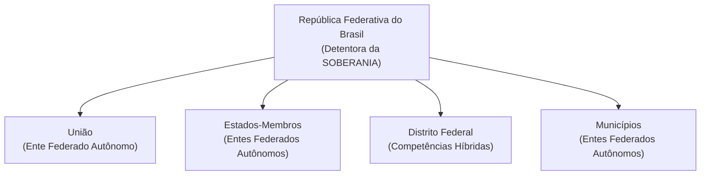

# 03 - Organização do Estado, Repartição de Competências e Servidores Públicos

> **Matéria:** Noções de Direito Constitucional  
> **Cargo:** A01 – Técnico de Controle Externo – Especialidade: Técnico Administrativo  
> **Arquivo:** `03_organizacao_do_estado_e_reparticao_de_competencias.md`  
> **Status:** 🟢 Teoria Aprofundada + 5 Questões FCC Comentadas (A a E)

---

## 📌 Ementa / Itens do Edital

- Da organização político-administrativa do Estado brasileiro (Artigos 18 e 19 da CF/88): forma federativa, autonomia dos entes e vedações federativas.
- Da União, dos Estados Federados, do Distrito Federal e dos Municípios: bens públicos, criação e desmembramento de entes, e competências materiais e legislativas.
- Repartição constitucional de competências:
    - Competências materiais exclusivas da União (Art. 21) e comuns de todos os entes (Art. 23);
    - Competências legislativas privativas da União (Art. 22) e concorrentes entre União, Estados e DF (Art. 24);
    - Competências remanescentes/residuais dos Estados (Art. 25) e competências de interesse local dos Municípios (Art. 30).
- Intervenção Federal e Estadual (Artigos 34 a 36 da CF/88): hipóteses, princípios sensíveis e procedimento.
- Regime constitucional da Administração Pública (Artigo 37 da CF/88): princípios fundamentais, concurso público, cargos em comissão e funções de confiança, teto remuneratório e regras de acumulação de cargos.
- Servidores públicos civis (Artigos 38 a 41 da CF/88): exercício de mandato eletivo, estágio probatório, estabilidade aos 3 anos, avaliação especial de desempenho e hipóteses constitucionais taxativas de perda do cargo público estável.

---

## 🧭 Sumário

1. [Forma Federativa e Organização Político-Administrativa](#1-forma-federativa-e-organizacao-politico-administrativa)
    1. [Características da Federação Brasileira e Autonomia dos Entes](#11-caracteristicas-da-federacao-brasileira-e-autonomia-dos-entes)
    2. [Vedações Constitucionais Federativas (Art. 19)](#12-vedacoes-constitucionais-federativas-art-19)
    3. [Bens Públicos Constitucionais e Criação de Novos Entes](#13-bens-publicos-constitucionais-e-criacao-de-novos-entes)
    4. [Teste 132](#Teste-132)
2. [O Modelo Constitucional de Repartição de Competências](#2-o-modelo-constitucional-de-reparticao-de-competencias)
    1. [Competências Legislativas: Privativa da União versus Concorrente](#21-competencias-legislativas-privativa-da-uniao-versus-concorrente)
    2. [Competências Administrativas: Exclusivas e Comuns](#22-competencias-administrativas-exclusivas-e-comuns)
    3. [Competências dos Estados e Municípios](#23-competencias-dos-estados-e-municipios)
    4. [Teste 133](#Teste-133)
    5. [Teste 134](#Teste-134)
    6. [Teste 135](#Teste-135)
    7. [Teste 136](#Teste-136)
3. [Mecanismos Excepcionais de Equilíbrio: Intervenção Federal e Estadual](#3-mecanismos-excepcionais-de-equilibrio-intervencao-federal-e-estadual)
    1. [Teste 137](#Teste-137)
4. [Regime Constitucional da Administração Pública e Servidores (Arts. 37 a 41)](#4-regime-constitucional-da-administracao-publica-e-servidores-arts-37-a-41)
    1. [Concurso Público, Funções de Confiança e Cargos em Comissão](#41-concurso-publico-funcoes-de-confianca-e-cargos-em-comissao)
    2. [Regra Constitucional da Não-Acumulação e Exceções (Art. 37, XVI)](#42-regra-constitucional-da-nao-acumulacao-e-excecoes-art-37-xvi)
    3. [Exercício de Mandato Eletivo pelo Servidor Público (Art. 38)](#43-exercicio-de-mandato-eletivo-pelo-servidor-publico-art-38)
    4. [Estabilidade e Perda do Cargo do Servidor Estável (Art. 41)](#44-estabilidade-e-perda-do-cargo-do-servidor-estavel-art-41)
    5. [Teste 138](#Teste-138)
    6. [Teste 139](#Teste-139)
    7. [Teste 140](#Teste-140)
    8. [Teste 141](#Teste-141)
    9. [Teste 142](#Teste-142)
5. [🌐 Fontes Oficiais & Doutrinárias Recomendadas](#fontes-oficiais-doutrinarias-recomendadas)

---

## 1. Forma Federativa e Organização Político-Administrativa

### 1.1 Características da Federação Brasileira e Autonomia dos Entes
A República Federativa do Brasil é formada pela união indissolúvel dos Estados e Municípios e do Distrito Federal (Art. 18, *caput*).

- **Origem Histórica:** Formou-se por **desagregação** (ou segregação), decorrente de um movimento **centrífugo** (o Estado unitário imperial descentralizou poderes políticos para as províncias que se transformaram em Estados-membros).
- **Indissolubilidade do Vínculo Federativo:** Não existe o direito de secessão (nenhum Estado ou Município pode se separar do Brasil). A tentativa de desmembramento justifica a intervenção federal imediata (art. 34, I) e constitui crime inafiançável e imprescritível (art. 5º, XLIV).
- **Soberania vs. Autonomia:**
    - A **Soberania** é atributo exclusivo da **República Federativa do Brasil** no plano internacional.
    - A **Autonomia** é outorgada aos entes federados (União, Estados, DF e Municípios), manifestando-se pela tríplice capacidade de auto-organização (Constituições e Leis Orgânicas), autogoverno (eleição de chefes dos poderes) e autoadministração (gestão e tributação próprias).

### 1.2 Vedações Constitucionais Federativas (Art. 19)
O art. 19 da Carta da República veda à União, aos Estados, ao Distrito Federal e aos Municípios:

1. **Estabelecer cultos religiosos ou igrejas, subvencioná-los, embaraçar-lhes o funcionamento ou manter com eles ou seus representantes relações de dependência ou aliança**, ressalvada, na forma da lei, a colaboração de interesse público *(Princípio da Laicidade Estatal)*.
2. **Recusar fé aos documentos públicos** *(Eficácia probatória nacional dos documentos emitidos por órgãos oficiais)*.
3. **Criar distinções entre brasileiros ou preferências entre si** *(Proibição de discriminação tributária, previdenciária ou funcional com base na origem regional)*.

### 1.3 Bens Públicos Constitucionais e Criação de Novos Entes
- **Bens da União (Art. 20):** Terras devolutas indispensáveis à defesa das fronteiras, recursos minerais (inclusive do subsolo), potenciais de energia hidráulica, mar territorial, terrenos de marinha e terras tradicionalmente ocupadas pelos índios.
- **Bens dos Estados (Art. 26):** Águas superficiais ou subterrâneas fluentes nos seus territórios, ilhas fluviais e lacustres não pertencentes à União e terras devolutas não compreendidas entre as da União.
- **Criação de Estados (Art. 18, § 3º):** Exige aprovação da população diretamente interessada por meio de **plebiscito** e edição de **Lei Complementar Federal** pelo Congresso Nacional.
- **Criação de Municípios (Art. 18, § 4º):** Depende de **Lei Complementar Federal** (definindo o período temporal), divulgação prévia dos Estudos de Viabilidade Municipal, consulta prévia por **plebiscito** às populações dos municípios envolvidos e promulgação de **Lei Ordinária Estadual**.

---

### Teste 132
**(FGV – TJ-AP – Analista Judiciário - Segurança da Informação – 2023)**
Nair, servidora pública ocupante de cargo de provimento efetivo, 
logrou ser eleita vereadora no município em que é domiciliada.  
Preocupada com a possibilidade de conciliar o cargo público com 
a vereança, analisou os balizamentos estabelecidos pela 
Constituição da República, tendo concluído corretamente que:

* **A)** deve ser afastada do cargo de provimento efetivo durante o 
mandato;
* **B)** deve optar por um ou outro, pois a acumulação de cargos 
públicos é vedada;
* **C)** deve receber a contraprestação estipendial correspondente a 
ambos, caso acumule os cargos;
* **D)** pode acumular ambos os cargos caso tenha obtido a 
estabilidade no cargo de provimento efetivo;
* **E)** tem o direito subjetivo de acumular os cargos, 
independentemente do cumprimento de qualquer requisito 
específico.

---

> **Comentário Detalhado:**
>
> - **A)** Incorreta. Discrepa das diretrizes normativas e jurisprudenciais aplicáveis ao tema objeto do item.
> - **B)** Incorreta. Discrepa das diretrizes normativas e jurisprudenciais aplicáveis ao tema objeto do item.
> - **C)** Correta. Representa com precisão a disciplina do tema e o entendimento pacificado adotado pela banca (FGV).
> - **D)** Incorreta. Discrepa das diretrizes normativas e jurisprudenciais aplicáveis ao tema objeto do item.
> - **E)** Incorreta. Discrepa das diretrizes normativas e jurisprudenciais aplicáveis ao tema objeto do item.
>
> **Gabarito: C**

---
### Teste 133
**(FCC – TRT-2 – Analista Judiciário - Tecnologia da Informação – 2014)**  
É competência privativa da União legislar sobre as matérias de direito:

* **A)** agrário, direito econômico, sistema estatístico e registros públicos.
* **B)** do trabalho, propaganda comercial, metalurgia e proteção à infância e à juventude.
* **C)** penal, direito penitenciário, cidadania e sistema cartográfico nacional.
* **D)** espacial, desapropriação, propaganda comercial e crimes de responsabilidade.
* **E)** agrário, direito penitenciário, metalurgia e sistema cartográfico oficial.

---

> **Comentário Detalhado:**
>
> - **A)** **Incorreto**. Direito econômico é de competência concorrente entre União, Estados e DF (art. 24, I, CF/88).
> - **B)** **Incorreto**. Proteção à infância e à juventude é competência concorrente (art. 24, XV, CF/88).
> - **C)** **Incorreto**. Direito penitenciário é de competência legislativa concorrente (art. 24, I, CF/88).
> - **D)** **Correto**. Todos os ramos e matérias listados inserem-se na competência privativa da União: direito espacial (art. 22, I), desapropriação (art. 22, II), propaganda comercial (art. 22, XXIX) e competência para definir crimes de responsabilidade e processo correspondente (Súmula Vinculante 46 do STF / art. 22, I e art. 85, CF/88).
> - **E)** **Incorreto**. Direito penitenciário é matéria de competência concorrente (art. 24, I, CF/88).
>
> **Gabarito: D**

### Teste 134
**(FGV – TJ-AP – Analista Judiciário - Banco de Dados – 2023)**
Nair, servidora pública ocupante de cargo de provimento efetivo, 
logrou ser eleita vereadora no município em que é domiciliada.  
Preocupada com a possibilidade de conciliar o cargo público com 
a vereança, analisou os balizamentos estabelecidos pela 
Constituição da República, tendo concluído corretamente que:

* **A)** deve ser afastada do cargo de provimento efetivo durante o 
mandato;
* **B)** deve optar por um ou outro, pois a acumulação de cargos 
públicos é vedada;
* **C)** deve receber a contraprestação estipendial correspondente a 
ambos, caso acumule os cargos;
* **D)** pode acumular ambos os cargos caso tenha obtido a 
estabilidade no cargo de provimento efetivo;
* **E)** tem o direito subjetivo de acumular os cargos, 
independentemente do cumprimento de qualquer requisito 
específico.

---

> **Comentário Detalhado:**
>
> - **A)** Incorreta. Discrepa das diretrizes normativas e jurisprudenciais aplicáveis ao tema objeto do item.
> - **B)** Incorreta. Discrepa das diretrizes normativas e jurisprudenciais aplicáveis ao tema objeto do item.
> - **C)** Correta. Representa com precisão a disciplina do tema e o entendimento pacificado adotado pela banca (FGV).
> - **D)** Incorreta. Discrepa das diretrizes normativas e jurisprudenciais aplicáveis ao tema objeto do item.
> - **E)** Incorreta. Discrepa das diretrizes normativas e jurisprudenciais aplicáveis ao tema objeto do item.
>
> **Gabarito: C**

---
### Teste 135
**(FGV – TRT – Analista Judiciário - Tecnologia da Informação – 2024)**
Um município brasileiro fictício promulgou lei instituindo nova 
modalidade de licitação denominada pife. Em seguimento, a novel 
legislação foi regulamentada pelo Prefeito Municipal e três editais 
de licitação, com a nova modalidade, foram publicados com o 
objetivo de contratar obras públicas. 
O Corpo de Auditoria do Tribunal de Contas com jurisdição sobre 
o município examinou o caso e, considerando o disposto no artigo 
22, XXVII da C onstituição Federal que atribui competência 
privativa à União para legislar sobre normas gerais de licitação e 
contratação, em todas as modalidades, para as administrações 
públicas diretas e indireta de todos os entes federados, 
representou ao Plenário quanto a constitucionalidade da norma. 
Tendo por orientação o prescrito na Súmula 347 do Supremo 
Tribunal Federal, é correto afirmar que a representação deve ser

* **A)** conhecida, uma vez cumprir os requisitos de legitimidade, 
porém não provida, uma vez que falece competência aos 
Tribunais de Contas para apreciação da constitucionalidade de 
leis.
* **B)** conhecida, uma vez cumprir os requisitos de legitimidade, e 
parcialmente provida, uma vez que o Tribunal de Contas 
poderá determinar a sustação dos editais de licitação, contudo 
não poderá se pronunciar quanto a lei e o decreto, haja vista 
falecer competência para apreciação da constitucionalidade.
* **C)** conhecida, uma vez cumprir os requisitos de legitimidade, e 
provida, determinando-se a sustação dos três editais e que a 
Administração Pública se abstenha de aplicar as referidas lei e 
regulamentação às suas licitações, uma vez que atos 
doravante praticados com base nos referidos normativos 
serão considerados como irregulares e implicarão na 
responsabilização pessoal dos agentes que lhes derem causa.
* **D)** conhecida, uma vez cumprir os requisitos de legitimidade, e 
provida, determinando-se a sustação dos três editais e, quanto 
as normas, somente sendo possível, representar ao poder 
competente à apreciação da inconstitucionalidade.
* **E)** conhecida e provida, sendo declarada a inconstitucionalidade 
da norma com efeito erga omnes.

---

> **Comentário Detalhado:**
>
> - **A)** Incorreta. Discrepa das diretrizes normativas e jurisprudenciais aplicáveis ao tema objeto do item.
> - **B)** Incorreta. Discrepa das diretrizes normativas e jurisprudenciais aplicáveis ao tema objeto do item.
> - **C)** Correta. Representa com precisão a disciplina do tema e o entendimento pacificado adotado pela banca (FGV).
> - **D)** Incorreta. Discrepa das diretrizes normativas e jurisprudenciais aplicáveis ao tema objeto do item.
> - **E)** Incorreta. Discrepa das diretrizes normativas e jurisprudenciais aplicáveis ao tema objeto do item.
>
> **Gabarito: C**

---
### Teste 136
**(FCC – TRT – Analista Judiciário - Tecnologia da Informação – 2009)**
Incluem-se entre os bens dos Estados

* **A)** as terras devolutas indispensáveis à defesa das 
fronteiras, das fortificações e construções militares.
* **B)** o mar territorial, os terrenos de marinha e seus 
acrescidos.
* **C)** as terras tradicionalmente ocupadas pelos índios.
* **D)** as ilhas fluviais e lacustres não-pertencentes à 
União.
* **E)** os potenciais de energia hidráulica. 
_________________________________________________________

---

> **Comentário Detalhado:**
>
> - **A)** Incorreta. Discrepa das diretrizes normativas e jurisprudenciais aplicáveis ao tema objeto do item.
> - **B)** Incorreta. Discrepa das diretrizes normativas e jurisprudenciais aplicáveis ao tema objeto do item.
> - **C)** Incorreta. Discrepa das diretrizes normativas e jurisprudenciais aplicáveis ao tema objeto do item.
> - **D)** Incorreta. Discrepa das diretrizes normativas e jurisprudenciais aplicáveis ao tema objeto do item.
> - **E)** Correta. Representa com precisão a disciplina do tema e o entendimento pacificado adotado pela banca (FCC).
>
> **Gabarito: E**

---
### Teste 137
**(FGV – TRT – Analista Judiciário - Tecnologia da Informação – 2024)**
O Estado Alfa editou a Lei nº X, em matéria de competência 
legislativa concorrente com a União, em momento no qual este 
ente federativo ainda não tinha editado nenhuma norma a 
respeito da temática. Apesar desse diploma normativo ter sido 
enaltecido pela coletividade, muitos argumentavam com a sua 
inconstitucionalidade. 
À luz da sistemática constitucional vigente, é correto afirmar que 
o Estado Alfa

* **A)** não poderia ter editado a Lei nº X enquanto a União não 
legislasse sobre a temática.
* **B)** somente poderia legislar sobre a temática se houvesse lei 
complementar autorizando-o.
* **C)** editou corretamente a Lei nº X, e, caso colida com norma geral 
que venha a ser editada pela União, continuará válida, mas se 
tornará ineficaz.
* **D)** tinha competência legislativa plena para legislar sobre a 
temática, sendo que a Lei nº X será tida como revogada 
quando sobrevier a lei da União.
* **E)** pode legislar sobre a temática, sendo que a Lei nº X tem 
preeminência, no âmbito do seu território, em relação às 
normas gerais que venham a ser editadas pela União.

---

> **Comentário Detalhado:**
>
> - **A)** Incorreta. Discrepa das diretrizes normativas e jurisprudenciais aplicáveis ao tema objeto do item.
> - **B)** Incorreta. Discrepa das diretrizes normativas e jurisprudenciais aplicáveis ao tema objeto do item.
> - **C)** Incorreta. Discrepa das diretrizes normativas e jurisprudenciais aplicáveis ao tema objeto do item.
> - **D)** Incorreta. Discrepa das diretrizes normativas e jurisprudenciais aplicáveis ao tema objeto do item.
> - **E)** Correta. Representa com precisão a disciplina do tema e o entendimento pacificado adotado pela banca (FGV).
>
> **Gabarito: E**

---
### Teste 138
**(FGV – TRT – Analista Judiciário - Tecnologia da Informação – 2024)**
O Estado Alfa editou a Lei nº X, em matéria de competência 
legislativa concorrente com a União, em momento no qual este 
ente federativo ainda não tinha editado nenhuma norma a 
respeito da temática. Apesar desse diploma normativo ter sido 
enaltecido pela coletividade, muitos argumentavam com a sua 
inconstitucionalidade. 
À luz da sistemática constitucional vigente, é correto afirmar que 
o Estado Alfa

* **A)** não poderia ter editado a Lei nº X enquanto a União não 
legislasse sobre a temática.
* **B)** somente poderia legislar sobre a temática se houvesse lei 
complementar autorizando-o.
* **C)** editou corretamente a Lei nº X, e, caso colida com norma geral 
que venha a ser editada pela União, continuará válida, mas se 
tornará ineficaz.
* **D)** tinha competência legislativa plena para legislar sobre a 
temática, sendo que a Lei nº X será tida como revogada 
quando sobrevier a lei da União.
* **E)** pode legislar sobre a temática, sendo que a Lei nº X tem 
preeminência, no âmbito do seu território, em relação às 
normas gerais que venham a ser editadas pela União.

---

> **Comentário Detalhado:**
>
> - **A)** Incorreta. Discrepa das diretrizes normativas e jurisprudenciais aplicáveis ao tema objeto do item.
> - **B)** Incorreta. Discrepa das diretrizes normativas e jurisprudenciais aplicáveis ao tema objeto do item.
> - **C)** Incorreta. Discrepa das diretrizes normativas e jurisprudenciais aplicáveis ao tema objeto do item.
> - **D)** Incorreta. Discrepa das diretrizes normativas e jurisprudenciais aplicáveis ao tema objeto do item.
> - **E)** Correta. Representa com precisão a disciplina do tema e o entendimento pacificado adotado pela banca (FGV).
>
> **Gabarito: E**

---
### Teste 139
**(FGV – TJ-AP – Analista Judiciário - Tecnologia da Informação – 2023)**  
Nair, servidora pública ocupante de cargo de provimento efetivo, logrou ser eleita vereadora no município em que é domiciliada.  
Preocupada com a possibilidade de conciliar o cargo público com a vereança, analisou os balizamentos estabelecidos pela Constituição da República, tendo concluído corretamente que:

* **A)** deve ser compulsoriamente afastada do cargo efetivo durante o exercício do mandato eletivo.
* **B)** deve optar por um ou outro estipêndio, pois a acumulação pecuniária de mandatos é sempre vedada.
* **C)** havendo compatibilidade de horários, perceberá as vantagens de seu cargo, sem prejuízo da remuneração do mandato.
* **D)** pode acumular ambos os cargos somente se tiver cumprido o estágio probatório com estabilidade.
* **E)** tem o direito de acumular ambos os cargos mesmo que haja incompatibilidade absoluta de jornadas.

---

> **Comentário Detalhado:**
>
> - **A)** **Incorreto**. O afastamento compulsório aplica-se ao mandato de Prefeito (art. 38, II) e aos federais/estaduais (art. 38, I). Para o mandato de Vereador, havendo compatibilidade, não há afastamento.
> - **B)** **Incorreto**. A regra da opção remuneratória aplica-se quando há incompatibilidade de horários ou no mandato de Prefeito.
> - **C)** **Correto**. Conforme o art. 38, III, da Constituição Federal: "investido no mandato de Vereador, havendo compatibilidade de horários, perceberá as vantagens de seu cargo, emprego ou função, sem prejuízo da remuneração do cargo eletivo, e, não havendo compatibilidade, será aplicada a norma do inciso anterior" (afastamento do cargo e opção pela remuneração).
> - **D)** **Incorreto**. A Constituição não condiciona o exercício do mandato eletivo à prévia estabilidade funcional.
> - **E)** **Incorreto**. Se houver incompatibilidade de horários, a acumulação física e remuneratória é vedada, devendo a servidora afastar-se do cargo efetivo.
>
> **Gabarito: C**

### Teste 140
**(FGV – TRF-1 – Analista Judiciário - Tecnologia da Informação – 2024)**  
Maria, servidora pública federal, foi condenada, em sentença penal transitada em julgado, pela prática de infração penal. No momento em que o regime de cumprimento da pena passou para o aberto, procurou se informar em relação aos atos da cidadania que poderia, ou não, praticar enquanto estivesse cumprindo a pena.  
Ao final, Maria concluiu corretamente que, na perspectiva das eleições para cargos dos Poderes Executivo e Legislativo:

* **A)** não pode votar nem concorrer a cargo eletivo durante o período de cumprimento da reprimenda penal imposta.
* **B)** pode exercer regularmente o direito ao voto, mas encontra-se temporariamente impedida de concorrer a cargo eletivo.
* **C)** pode votar e concorrer apenas a cargos eletivos municipais onde resida, vedadas candidaturas estaduais e federais.
* **D)** pode concorrer a cargo eletivo desde que obtenha autorização expressa do juízo de execuções penais competente.
* **E)** pode votar e ser votada normalmente porque a progressão para o regime prisional aberto restabelece a plenitude cidadã.

---

> **Comentário Detalhado:**
>
> - **A)** **Correto**. O art. 15, III, da CF/88 impõe a suspensão dos direitos políticos em decorrência de "condenação criminal transitada em julgado, enquanto durarem seus efeitos". Essa suspensão é autoaplicável e atinge tanto a capacidade eleitoral passiva (direito de ser votado / elegibilidade) quanto a capacidade eleitoral ativa (direito de votar / alistabilidade), independentemente da modalidade de pena (privativa de liberdade, restritiva de direitos ou regime aberto) ou da espécie do crime (Súmula 9 do TSE e entendimento pacificado do STF).
> - **B)** **Incorreto**. A suspensão atinge a cidadania em sua integralidade, retirando também o direito ao sufrágio ativo (voto).
> - **C)** **Incorreto**. A suspensão dos direitos políticos tem eficácia nacional e impede a participação em quaisquer pleitos eletivos.
> - **D)** **Incorreto**. O juízo da execução penal não tem competência para afastar a suspensão constitucional de direitos políticos.
> - **E)** **Incorreto**. A progressão para o regime aberto não extingue a punibilidade nem os efeitos condenatórios da sentença.
>
> **Gabarito: A**

### Teste 141
**(FGV – TRT – Analista Judiciário - Tecnologia da Informação – 2024)**
Um município brasileiro fictício promulgou lei instituindo nova 
modalidade de licitação denominada pife. Em seguimento, a novel 
legislação foi regulamentada pelo Prefeito Municipal e três editais 
de licitação, com a nova modalidade, foram publicados com o 
objetivo de contratar obras públicas. 
O Corpo de Auditoria do Tribunal de Contas com jurisdição sobre 
o município examinou o caso e, considerando o disposto no artigo 
22, XXVII da C onstituição Federal que atribui competência 
privativa à União para legislar sobre normas gerais de licitação e 
contratação, em todas as modalidades, para as administrações 
públicas diretas e indireta de todos os entes federados, 
representou ao Plenário quanto a constitucionalidade da norma. 
Tendo por orientação o prescrito na Súmula 347 do Supremo 
Tribunal Federal, é correto afirmar que a representação deve ser

* **A)** conhecida, uma vez cumprir os requisitos de legitimidade, 
porém não provida, uma vez que falece competência aos 
Tribunais de Contas para apreciação da constitucionalidade de 
leis.
* **B)** conhecida, uma vez cumprir os requisitos de legitimidade, e 
parcialmente provida, uma vez que o Tribunal de Contas 
poderá determinar a sustação dos editais de licitação, contudo 
não poderá se pronunciar quanto a lei e o decreto, haja vista 
falecer competência para apreciação da constitucionalidade.
* **C)** conhecida, uma vez cumprir os requisitos de legitimidade, e 
provida, determinando-se a sustação dos três editais e que a 
Administração Pública se abstenha de aplicar as referidas lei e 
regulamentação às suas licitações, uma vez que atos 
doravante praticados com base nos referidos normativos 
serão considerados como irregulares e implicarão na 
responsabilização pessoal dos agentes que lhes derem causa.
* **D)** conhecida, uma vez cumprir os requisitos de legitimidade, e 
provida, determinando-se a sustação dos três editais e, quanto 
as normas, somente sendo possível, representar ao poder 
competente à apreciação da inconstitucionalidade.
* **E)** conhecida e provida, sendo declarada a inconstitucionalidade 
da norma com efeito erga omnes.

---

> **Comentário Detalhado:**
>
> - **A)** Incorreta. Discrepa das diretrizes normativas e jurisprudenciais aplicáveis ao tema objeto do item.
> - **B)** Incorreta. Discrepa das diretrizes normativas e jurisprudenciais aplicáveis ao tema objeto do item.
> - **C)** Correta. Representa com precisão a disciplina do tema e o entendimento pacificado adotado pela banca (FGV).
> - **D)** Incorreta. Discrepa das diretrizes normativas e jurisprudenciais aplicáveis ao tema objeto do item.
> - **E)** Incorreta. Discrepa das diretrizes normativas e jurisprudenciais aplicáveis ao tema objeto do item.
>
> **Gabarito: C**

---
### Teste 142
**(FGV – TRT – Analista Judiciário - Tecnologia da Informação – 2024)**
O Estado Alfa editou a Lei nº X, em matéria de competência 
legislativa concorrente com a União, em momento no qual este 
ente federativo ainda não tinha editado nenhuma norma a 
respeito da temática. Apesar desse diploma normativo ter sido 
enaltecido pela coletividade, muitos argumentavam com a sua 
inconstitucionalidade. 
À luz da sistemática constitucional vigente, é correto afirmar que 
o Estado Alfa

* **A)** não poderia ter editado a Lei nº X enquanto a União não 
legislasse sobre a temática.
* **B)** somente poderia legislar sobre a temática se houvesse lei 
complementar autorizando-o.
* **C)** editou corretamente a Lei nº X, e, caso colida com norma geral 
que venha a ser editada pela União, continuará válida, mas se 
tornará ineficaz.
* **D)** tinha competência legislativa plena para legislar sobre a 
temática, sendo que a Lei nº X será tida como revogada 
quando sobrevier a lei da União.
* **E)** pode legislar sobre a temática, sendo que a Lei nº X tem 
preeminência, no âmbito do seu território, em relação às 
normas gerais que venham a ser editadas pela União.

---

> **Comentário Detalhado:**
>
> - **A)** Incorreta. Discrepa das diretrizes normativas e jurisprudenciais aplicáveis ao tema objeto do item.
> - **B)** Incorreta. Discrepa das diretrizes normativas e jurisprudenciais aplicáveis ao tema objeto do item.
> - **C)** Incorreta. Discrepa das diretrizes normativas e jurisprudenciais aplicáveis ao tema objeto do item.
> - **D)** Incorreta. Discrepa das diretrizes normativas e jurisprudenciais aplicáveis ao tema objeto do item.
> - **E)** Correta. Representa com precisão a disciplina do tema e o entendimento pacificado adotado pela banca (FGV).
>
> **Gabarito: E**

---
