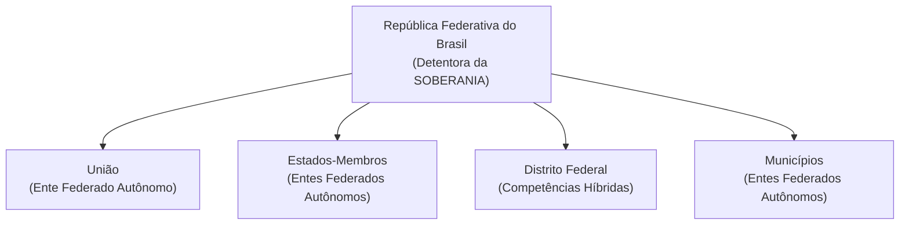

# 03 - Organização do Estado, Repartição de Competências e Servidores Públicos

> **Matéria:** Noções de Direito Constitucional  
> **Cargo:** A01 – Técnico de Controle Externo – Especialidade: Técnico Administrativo  
> **Arquivo:** `03_organizacao_do_estado_e_reparticao_de_competencias.md`  
> **Status:** 🟢 Teoria Aprofundada + 5 Questões FCC Comentadas (A a E)

---

## 📌 Ementa / Itens do Edital

- Da organização político-administrativa do Estado brasileiro (Artigos 18 e 19 da CF/88): forma federativa, autonomia dos entes e vedações federativas.
- Da União, dos Estados Federados, do Distrito Federal e dos Municípios: bens públicos, criação e desmembramento de entes, e competências materiais e legislativas.
- Repartição constitucional de competências:
    - Competências materiais exclusivas da União (Art. 21) e comuns de todos os entes (Art. 23);
    - Competências legislativas privativas da União (Art. 22) e concorrentes entre União, Estados e DF (Art. 24);
    - Competências remanescentes/residuais dos Estados (Art. 25) e competências de interesse local dos Municípios (Art. 30).
- Intervenção Federal e Estadual (Artigos 34 a 36 da CF/88): hipóteses, princípios sensíveis e procedimento.
- Regime constitucional da Administração Pública (Artigo 37 da CF/88): princípios fundamentais, concurso público, cargos em comissão e funções de confiança, teto remuneratório e regras de acumulação de cargos.
- Servidores públicos civis (Artigos 38 a 41 da CF/88): exercício de mandato eletivo, estágio probatório, estabilidade aos 3 anos, avaliação especial de desempenho e hipóteses constitucionais taxativas de perda do cargo público estável.

---

## 🧭 Sumário

1. [Forma Federativa e Organização Político-Administrativa](#1-forma-federativa-e-organizacao-politico-administrativa)
    1. [Características da Federação Brasileira e Autonomia dos Entes](#11-caracteristicas-da-federacao-brasileira-e-autonomia-dos-entes)
    2. [Vedações Constitucionais Federativas (Art. 19)](#12-vedacoes-constitucionais-federativas-art-19)
    3. [Bens Públicos Constitucionais e Criação de Novos Entes](#13-bens-publicos-constitucionais-e-criacao-de-novos-entes)
    4. [Teste 132](#Teste-132)
2. [O Modelo Constitucional de Repartição de Competências](#2-o-modelo-constitucional-de-reparticao-de-competencias)
    1. [Competências Legislativas: Privativa da União versus Concorrente](#21-competencias-legislativas-privativa-da-uniao-versus-concorrente)
    2. [Competências Administrativas: Exclusivas e Comuns](#22-competencias-administrativas-exclusivas-e-comuns)
    3. [Competências dos Estados e Municípios](#23-competencias-dos-estados-e-municipios)
    4. [Teste 133](#Teste-133)
    5. [Teste 134](#Teste-134)
    6. [Teste 135](#Teste-135)
    7. [Teste 136](#Teste-136)
3. [Mecanismos Excepcionais de Equilíbrio: Intervenção Federal e Estadual](#3-mecanismos-excepcionais-de-equilibrio-intervencao-federal-e-estadual)
    1. [Teste 137](#Teste-137)
4. [Regime Constitucional da Administração Pública e Servidores (Arts. 37 a 41)](#4-regime-constitucional-da-administracao-publica-e-servidores-arts-37-a-41)
    1. [Concurso Público, Funções de Confiança e Cargos em Comissão](#41-concurso-publico-funcoes-de-confianca-e-cargos-em-comissao)
    2. [Regra Constitucional da Não-Acumulação e Exceções (Art. 37, XVI)](#42-regra-constitucional-da-nao-acumulacao-e-excecoes-art-37-xvi)
    3. [Exercício de Mandato Eletivo pelo Servidor Público (Art. 38)](#43-exercicio-de-mandato-eletivo-pelo-servidor-publico-art-38)
    4. [Estabilidade e Perda do Cargo do Servidor Estável (Art. 41)](#44-estabilidade-e-perda-do-cargo-do-servidor-estavel-art-41)
    5. [Teste 138](#Teste-138)
    6. [Teste 139](#Teste-139)
    7. [Teste 140](#Teste-140)
    8. [Teste 141](#Teste-141)
    9. [Teste 142](#Teste-142)
5. [🌐 Fontes Oficiais & Doutrinárias Recomendadas](#fontes-oficiais-doutrinarias-recomendadas)

---

## 1. Forma Federativa e Organização Político-Administrativa

### 1.1 Características da Federação Brasileira e Autonomia dos Entes
A República Federativa do Brasil é formada pela união indissolúvel dos Estados e Municípios e do Distrito Federal (Art. 18, *caput*).

- **Origem Histórica:** Formou-se por **desagregação** (ou segregação), decorrente de um movimento **centrífugo** (o Estado unitário imperial descentralizou poderes políticos para as províncias que se transformaram em Estados-membros).
- **Indissolubilidade do Vínculo Federativo:** Não existe o direito de secessão (nenhum Estado ou Município pode se separar do Brasil). A tentativa de desmembramento justifica a intervenção federal imediata (art. 34, I) e constitui crime inafiançável e imprescritível (art. 5º, XLIV).
- **Soberania vs. Autonomia:**
    - A **Soberania** é atributo exclusivo da **República Federativa do Brasil** no plano internacional.
    - A **Autonomia** é outorgada aos entes federados (União, Estados, DF e Municípios), manifestando-se pela tríplice capacidade de auto-organização (Constituições e Leis Orgânicas), autogoverno (eleição de chefes dos poderes) e autoadministração (gestão e tributação próprias).

### 1.2 Vedações Constitucionais Federativas (Art. 19)
O art. 19 da Carta da República veda à União, aos Estados, ao Distrito Federal e aos Municípios:

1. **Estabelecer cultos religiosos ou igrejas, subvencioná-los, embaraçar-lhes o funcionamento ou manter com eles ou seus representantes relações de dependência ou aliança**, ressalvada, na forma da lei, a colaboração de interesse público *(Princípio da Laicidade Estatal)*.
2. **Recusar fé aos documentos públicos** *(Eficácia probatória nacional dos documentos emitidos por órgãos oficiais)*.
3. **Criar distinções entre brasileiros ou preferências entre si** *(Proibição de discriminação tributária, previdenciária ou funcional com base na origem regional)*.

### 1.3 Bens Públicos Constitucionais e Criação de Novos Entes
- **Bens da União (Art. 20):** Terras devolutas indispensáveis à defesa das fronteiras, recursos minerais (inclusive do subsolo), potenciais de energia hidráulica, mar territorial, terrenos de marinha e terras tradicionalmente ocupadas pelos índios.
- **Bens dos Estados (Art. 26):** Águas superficiais ou subterrâneas fluentes nos seus territórios, ilhas fluviais e lacustres não pertencentes à União e terras devolutas não compreendidas entre as da União.
- **Criação de Estados (Art. 18, § 3º):** Exige aprovação da população diretamente interessada por meio de **plebiscito** e edição de **Lei Complementar Federal** pelo Congresso Nacional.
- **Criação de Municípios (Art. 18, § 4º):** Depende de **Lei Complementar Federal** (definindo o período temporal), divulgação prévia dos Estudos de Viabilidade Municipal, consulta prévia por **plebiscito** às populações dos municípios envolvidos e promulgação de **Lei Ordinária Estadual**.

---

### Teste 132
**(Questão Inédita / Simulada Estilo FCC – Nível: Controle Externo / TI)**  
Incluem-se entre os bens dos Estados:

* **A)** as terras devolutas indispensáveis à defesa das fronteiras e fortificações militares.
* **B)** o mar territorial, os terrenos de marinha e seus acrescidos pela maré.
* **C)** as terras tradicionalmente ocupadas pelas comunidades indígenas nacionais.
* **D)** as ilhas fluviais e lacustres não pertencentes à União.
* **E)** os potenciais de energia hidráulica e os recursos minerais do subsolo.

---

> **Comentário Detalhado:**
>
> - **A)** **Incorreto**. Conforme o art. 20, II, da CF/88, as terras devolutas indispensáveis à defesa das fronteiras, das fortificações e construções militares são bens da União.
> - **B)** **Incorreto**. O mar territorial e os terrenos de marinha pertencem à União (art. 20, VI e VII, CF/88).
> - **C)** **Incorreto**. As terras tradicionalmente ocupadas pelos índios são bens dominicais da União (art. 20, XI, CF/88).
> - **D)** **Correto**. Conforme o art. 26, III, da Constituição Federal, incluem-se expressamente entre os bens dos Estados federados "as ilhas fluviais e lacustres não pertencentes à União".
> - **E)** **Incorreto**. Os potenciais de energia hidráulica e recursos minerais pertencem à União (art. 20, VIII e IX, CF/88).
>
> **Gabarito: D**

### Teste 133
**(FCC – TRT-2 – Analista Judiciário - Tecnologia da Informação – 2014)**  
É competência privativa da União legislar sobre as matérias de direito:

* **A)** agrário, direito econômico, sistema estatístico e registros públicos.
* **B)** do trabalho, propaganda comercial, metalurgia e proteção à infância e à juventude.
* **C)** penal, direito penitenciário, cidadania e sistema cartográfico nacional.
* **D)** espacial, desapropriação, propaganda comercial e crimes de responsabilidade.
* **E)** agrário, direito penitenciário, metalurgia e sistema cartográfico oficial.

---

> **Comentário Detalhado:**
>
> - **A)** **Incorreto**. Direito econômico é de competência concorrente entre União, Estados e DF (art. 24, I, CF/88).
> - **B)** **Incorreto**. Proteção à infância e à juventude é competência concorrente (art. 24, XV, CF/88).
> - **C)** **Incorreto**. Direito penitenciário é de competência legislativa concorrente (art. 24, I, CF/88).
> - **D)** **Correto**. Todos os ramos e matérias listados inserem-se na competência privativa da União: direito espacial (art. 22, I), desapropriação (art. 22, II), propaganda comercial (art. 22, XXIX) e competência para definir crimes de responsabilidade e processo correspondente (Súmula Vinculante 46 do STF / art. 22, I e art. 85, CF/88).
> - **E)** **Incorreto**. Direito penitenciário é matéria de competência concorrente (art. 24, I, CF/88).
>
> **Gabarito: D**

### Teste 134
**(Questão Inédita / Simulada Estilo FCC – Nível: Controle Externo / TI)**  
O Estado Alfa, à míngua de normas da União disciplinando a respectiva temática, editou a Lei estadual nº X. Em momento posterior, a União editou a Lei nº Y, em sentido diametralmente oposto ao da Lei estadual nº X.  
Considerando os balizamentos estabelecidos pela ordem constitucional, é correto afirmar que a Lei nº Y:

* **A)** não deve ser aplicada no território de Alfa, enquanto a Lei estadual nº X permanecer formalmente vigente.
* **B)** revoga a Lei estadual nº X, mas apenas se a temática estiver inserida na competência privativa da União.
* **C)** deve ser considerada nula de pleno direito, considerando o princípio federativo da especialização legal.
* **D)** suspende a eficácia da Lei estadual nº X, caso veicule normas gerais e a matéria seja concorrente.
* **E)** revoga expressamente a Lei estadual nº X por força da soberania hierárquica conferida à legislação federal.

---

> **Comentário Detalhado:**
>
> - **A)** **Incorreto**. Em matéria concorrente, inexistindo lei federal sobre normas gerais, o Estado exerce a competência legislativa plena (art. 24, § 3º, CF/88). Porém, vindo a União a editar norma geral, o preceito estadual com ela incompatível tem sua eficácia suspensa.
> - **B)** **Incorreto**. No federalismo brasileiro não há revogação de lei estadual por lei federal em competência concorrente; ocorre apenas a suspensão da eficácia.
> - **C)** **Incorreto**. A União possui competência legítima para fixar normas gerais em matérias do art. 24 da CF/88.
> - **D)** **Correto**. Nos exatos termos do art. 24, § 4º, da Constituição Federal: "A superveniência de lei federal sobre normas gerais suspende a eficácia da lei estadual, no que lhe for contrário".
> - **E)** **Incorreto**. Não se opera a figura da revogação, mas sim a suspensão de eficácia no ponto incompatível.
>
> **Gabarito: D**

### Teste 135
**(Questão Inédita / Simulada Estilo FCC – Nível: Controle Externo / TI)**  
Em tema de repartição constitucional de competências legislativas e materiais dos Municípios (art. 30 da CF/88), analise as proposições à luz da jurisprudência consolidada do STF:

* **A)** É constitucional lei municipal que fixa horário de funcionamento de agências bancárias locais.
* **B)** É inconstitucional lei municipal que impõe a instalação de portas de segurança e biombos em agências.
* **C)** Compete exclusivamente ao Estado membro disciplinar o tempo máximo de espera em filas bancárias.
* **D)** Os Municípios possuem competência originária e plena para legislar sobre matéria de direito penal e civil.
* **E)** É nula lei municipal que determina a obrigatoriedade de cinto de segurança em transportes coletivos.

---

> **Comentário Detalhado:**
>
> - **A)** **Incorreto**. Conforme a Súmula Vinculante 19 do STF: "A fixação do horário de funcionamento de estabelecimentos bancários é da competência da União" (competência do Banco Central / União ligada ao sistema financeiro nacional).
> - **B)** **Incorreto**. Conforme a jurisprudência pacífica do STF (Tema 178 e Súmula Vinculante 38), é constitucional a lei municipal que determina a instalação de equipamentos de segurança e conforto em agências (como biombos e banheiros), por ser matéria de interesse local e proteção ao consumidor.
> - **C)** **Incorreto**. A regulação do tempo de atendimento em filas de agências bancárias insere-se no interesse local municipal (art. 30, I, CF/88 e RE 610.221/SC).
> - **D)** **Incorreto**. Direito penal e civil inserem-se na competência privativa da União (art. 22, I, CF/88).
> - **E)** **Correto**. Compete privativamente à União legislar sobre trânsito e transporte (art. 22, XI, CF/88). Por conseguinte, lei municipal ou estadual que institua exigências sobre equipamentos de trânsito (como obrigatoriedade de cinto ou capacete específico) padece de inconstitucionalidade formal (Súmula 130 do STF e Súmula Vinculante 2).
>
> **Gabarito: E**

### Teste 136
**(Questão Inédita / Simulada Estilo FCC – Nível: Controle Externo / TI)**  
A criação, a incorporação, a fusão e o desmembramento de Municípios dependem de observância a um complexo rito constitucional previsto no art. 18, § 4º, da Constituição Federal. De acordo com o texto constitucional vigente, tais transformações:

* **A)** dependem de decreto legislativo do Congresso Nacional aprovado por maioria absoluta dos parlamentares.
* **B)** far-se-ão por lei ordinária da União, após consulta plebiscitária aos eleitores da Capital do Estado.
* **C)** prescindem de estudos de viabilidade municipal se aprovadas por dois terços dos membros da Assembleia.
* **D)** far-se-ão por lei estadual, dentro do período determinado por Lei Complementar Federal, após plebiscito.
* **E)** exigem aprovação popular mediante referendo ratificador convocado privativamente pelo Governador estadual.

---

> **Comentário Detalhado:**
>
> - **A)** **Incorreto**. A criação é efetivada por lei estadual, e não por decreto legislativo do Congresso.
> - **B)** **Incorreto**. A lei instituidora é estadual e o plebiscito consulta as populações dos Municípios diretamente envolvidos.
> - **C)** **Incorreto**. Os Estudos de Viabilidade Municipal são obrigatórios e devem ser apresentados e publicados na forma da lei.
> - **D)** **Correto**. O art. 18, § 4º, da CF/88 (com redação da EC nº 15/1996) preconiza: "A criação, a incorporação, a fusão e o desmembramento de Municípios, far-se-ão por lei estadual, dentro do período determinado por Lei Complementar Federal, e dependerão de consulta prévia, mediante plebiscito, às populações dos Municípios envolvidos, após divulgação dos Estudos de Viabilidade Municipal, apresentados e publicados na forma da lei".
> - **E)** **Incorreto**. A consulta popular exigida é prévia (plebiscito), e não posterior (referendo).
>
> **Gabarito: D**

### Teste 137
**(Questão Inédita / Simulada Estilo FCC – Nível: Controle Externo / TI)**  
A intervenção federal nos Estados e no Distrito Federal (art. 34 da CF/88) é medida excepcional que suspende temporariamente a autonomia do ente federativo. Sobre as hipóteses e o procedimento da intervenção federal, é correto afirmar:

* **A)** A intervenção para prover a execução de lei federal depende de representação do Procurador-Geral da República.
* **B)** O Presidente da República pode decretar de ofício a intervenção para repelir invasão estrangeira no território nacional.
* **C)** A recusa à execução de decisão judiciária dispensa qualquer provocação dos órgãos integrantes do Poder Judiciário.
* **D)** O decreto de intervenção é dispensado de apreciação pelo Congresso Nacional quando versar sobre defesa da ordem pública.
* **E)** Cessados os motivos da intervenção, as autoridades afastadas retornam de imediato somente se houver autorização legislativa.

---

> **Comentário Detalhado:**
>
> - **A)** **Incorreto**. A intervenção para prover a execução de lei federal depende de representação do Procurador-Geral da República ao Superior Tribunal de Justiça (STJ), conforme art. 36, III, da CF/88. Já para assegurar princípios constitucionais sensíveis ou prover a execução de ordem judiciária, atua perante o STF.
> - **B)** **Correto**. As hipóteses do art. 34, incisos I (repelir invasão estrangeira ou de uma unidade na outra), II (reorganizar as finanças), III (pôr termo a grave comprometimento da ordem pública) e V (garantir o livre exercício de qualquer dos Poderes nas unidades da Federação, quando solicitada pelo Executivo ou Legislativo) autorizam a decretação espontânea (de ofício) pelo Presidente da República, dispensando requisição jurisdicional prévia.
> - **C)** **Incorreto**. A desobediência a ordem judiciária exige requisição do STF, STJ ou TSE (art. 36, II, CF/88).
> - **D)** **Incorreto**. Conforme o art. 36, § 1º, da CF/88, o decreto de intervenção será submetido à apreciação do Congresso Nacional no prazo de vinte e quatro horas, exceto quando decorrente de requisição judicial para execução de ordem judicial.
> - **E)** **Incorreto**. Cessados os motivos, as autoridades afastadas retornam aos seus cargos de pleno direito, independentemente de autorização congressual (art. 36, § 4º, CF/88).
>
> **Gabarito: B**

### Teste 138
**(Questão Inédita / Simulada Estilo FCC – Nível: Controle Externo / TI)**  
No âmbito do regime constitucional da Administração Pública e da disciplina remuneratória dos agentes estatais (art. 37 da CF/88), considere as seguintes regras sobre o teto remuneratório e acumulação de cargos:

* **A)** O subsídio dos Deputados Estaduais serve como limite único para todos os servidores públicos estaduais.
* **B)** É permitida a percepção simultânea de proventos de aposentadoria decorrentes de três cargos de professor público.
* **C)** No âmbito municipal, o teto remuneratório geral aplicável a todos os Poderes corresponde ao subsídio do Prefeito.
* **D)** A vedação de acumulação remunerada de cargos públicos não alcança os empregados de empresas públicas e sociedades de economia mista.
* **E)** A fixação de vencimentos dos cargos do Poder Legislativo estadual independe de lei específica se houver resolução da Mesa.

---

> **Comentário Detalhado:**
>
> - **A)** **Incorreto**. Nos Estados, adota-se o teto escalonado por Poder: no Executivo, o subsídio do Governador; no Legislativo, o subsídio dos Deputados Estaduais; no Judiciário (e MP, Defensoria e Procuradorias), o subsídio dos Desembargadores do TJ (art. 37, XI, CF/88).
> - **B)** **Incorreto**. A acumulação remunerada é permitida para no máximo dois cargos de professor, ou um de professor com outro técnico/científico, ou dois da saúde (art. 37, XVI, CF/88). Três cargos é expressamente vedado.
> - **C)** **Correto**. Nos termos do art. 37, XI, parte final, da CF/88, nos Municípios, o teto remuneratório geral é único para todos os servidores e agentes de quaisquer Poderes e órgãos, correspondendo ao subsídio mensal do Prefeito Municipal.
> - **D)** **Incorreto**. O art. 37, XVII, da CF/88 estende expressamente a proibição de acumular cargos, empregos e funções a autarquias, fundações, empresas públicas, sociedades de economia mista, suas subsidiárias e sociedades controladas direta ou indiretamente pelo poder público.
> - **E)** **Incorreto**. A remuneração dos servidores públicos somente pode ser fixada ou alterada por lei específica (art. 37, X, CF/88).
>
> **Gabarito: C**

### Teste 139
**(FGV – TJ-AP – Analista Judiciário - Tecnologia da Informação – 2023)**  
Nair, servidora pública ocupante de cargo de provimento efetivo, logrou ser eleita vereadora no município em que é domiciliada.  
Preocupada com a possibilidade de conciliar o cargo público com a vereança, analisou os balizamentos estabelecidos pela Constituição da República, tendo concluído corretamente que:

* **A)** deve ser compulsoriamente afastada do cargo efetivo durante o exercício do mandato eletivo.
* **B)** deve optar por um ou outro estipêndio, pois a acumulação pecuniária de mandatos é sempre vedada.
* **C)** havendo compatibilidade de horários, perceberá as vantagens de seu cargo, sem prejuízo da remuneração do mandato.
* **D)** pode acumular ambos os cargos somente se tiver cumprido o estágio probatório com estabilidade.
* **E)** tem o direito de acumular ambos os cargos mesmo que haja incompatibilidade absoluta de jornadas.

---

> **Comentário Detalhado:**
>
> - **A)** **Incorreto**. O afastamento compulsório aplica-se ao mandato de Prefeito (art. 38, II) e aos federais/estaduais (art. 38, I). Para o mandato de Vereador, havendo compatibilidade, não há afastamento.
> - **B)** **Incorreto**. A regra da opção remuneratória aplica-se quando há incompatibilidade de horários ou no mandato de Prefeito.
> - **C)** **Correto**. Conforme o art. 38, III, da Constituição Federal: "investido no mandato de Vereador, havendo compatibilidade de horários, perceberá as vantagens de seu cargo, emprego ou função, sem prejuízo da remuneração do cargo eletivo, e, não havendo compatibilidade, será aplicada a norma do inciso anterior" (afastamento do cargo e opção pela remuneração).
> - **D)** **Incorreto**. A Constituição não condiciona o exercício do mandato eletivo à prévia estabilidade funcional.
> - **E)** **Incorreto**. Se houver incompatibilidade de horários, a acumulação física e remuneratória é vedada, devendo a servidora afastar-se do cargo efetivo.
>
> **Gabarito: C**

### Teste 140
**(FGV – TRF-1 – Analista Judiciário - Tecnologia da Informação – 2024)**  
Maria, servidora pública federal, foi condenada, em sentença penal transitada em julgado, pela prática de infração penal. No momento em que o regime de cumprimento da pena passou para o aberto, procurou se informar em relação aos atos da cidadania que poderia, ou não, praticar enquanto estivesse cumprindo a pena.  
Ao final, Maria concluiu corretamente que, na perspectiva das eleições para cargos dos Poderes Executivo e Legislativo:

* **A)** não pode votar nem concorrer a cargo eletivo durante o período de cumprimento da reprimenda penal imposta.
* **B)** pode exercer regularmente o direito ao voto, mas encontra-se temporariamente impedida de concorrer a cargo eletivo.
* **C)** pode votar e concorrer apenas a cargos eletivos municipais onde resida, vedadas candidaturas estaduais e federais.
* **D)** pode concorrer a cargo eletivo desde que obtenha autorização expressa do juízo de execuções penais competente.
* **E)** pode votar e ser votada normalmente porque a progressão para o regime prisional aberto restabelece a plenitude cidadã.

---

> **Comentário Detalhado:**
>
> - **A)** **Correto**. O art. 15, III, da CF/88 impõe a suspensão dos direitos políticos em decorrência de "condenação criminal transitada em julgado, enquanto durarem seus efeitos". Essa suspensão é autoaplicável e atinge tanto a capacidade eleitoral passiva (direito de ser votado / elegibilidade) quanto a capacidade eleitoral ativa (direito de votar / alistabilidade), independentemente da modalidade de pena (privativa de liberdade, restritiva de direitos ou regime aberto) ou da espécie do crime (Súmula 9 do TSE e entendimento pacificado do STF).
> - **B)** **Incorreto**. A suspensão atinge a cidadania em sua integralidade, retirando também o direito ao sufrágio ativo (voto).
> - **C)** **Incorreto**. A suspensão dos direitos políticos tem eficácia nacional e impede a participação em quaisquer pleitos eletivos.
> - **D)** **Incorreto**. O juízo da execução penal não tem competência para afastar a suspensão constitucional de direitos políticos.
> - **E)** **Incorreto**. A progressão para o regime aberto não extingue a punibilidade nem os efeitos condenatórios da sentença.
>
> **Gabarito: A**

### Teste 141
**(Questão Inédita / Simulada Estilo FCC – Nível: Controle Externo / TI)**  
Sobre o regime constitucional de estabilidade dos servidores públicos ocupantes de cargo de provimento efetivo (art. 41 da CF/88), analise as hipóteses de aquisição e perda do cargo público estável. É correto afirmar que:

* **A)** O servidor adquire estabilidade após dois anos de efetivo exercício, prescindindo de avaliação de desempenho.
* **B)** O servidor estável somente pode perder o cargo em virtude de sentença judicial transitada em julgado.
* **C)** A perda do cargo por avaliação periódica de desempenho exige procedimento em que se assegure ampla defesa.
* **D)** Invalidada por sentença a demissão do estável, o ocupante da vaga é exonerado sem qualquer indenização funcional.
* **E)** A exoneração para cumprimento de limite com despesa de pessoal atinge o servidor estável antes do não estável.

---

> **Comentário Detalhado:**
>
> - **A)** **Incorreto**. A estabilidade é adquirida após três anos de efetivo exercício (art. 41, caput, CF/88) e é condição obrigatória para sua aquisição a avaliação especial de desempenho por comissão instituída para essa finalidade (art. 41, § 4º).
> - **B)** **Incorreto**. O art. 41, § 1º, da CF/88 prevê quatro hipóteses de perda do cargo: sentença judicial transitada em julgado, processo administrativo disciplinar com ampla defesa, procedimento de avaliação periódica de desempenho (na forma de lei complementar) e excesso de despesas com pessoal (art. 169, § 4º).
> - **C)** **Correto**. O art. 41, § 1º, III, da CF/88 autoriza a perda do cargo do servidor estável "mediante procedimento de avaliação periódica de desempenho, na forma de lei complementar, assegurada ampla defesa".
> - **D)** **Incorreto**. Invalidada por sentença judicial a demissão do servidor estável, ele será reintegrado, e o eventual ocupante da vaga, se estável, reconduzido ao cargo de origem, sem direito a indenização, aproveitado em outro cargo ou posto em disponibilidade com remuneração proporcional ao tempo de serviço (art. 41, § 2º, CF/88).
> - **E)** **Incorreto**. Conforme o art. 169, §§ 3º e 4º, da CF/88, para redução de despesas com pessoal demite-se primeiro os cargos em comissão, depois os servidores não estáveis, e somente em último caso os estáveis.
>
> **Gabarito: C**

### Teste 142
**(Questão Inédita / Simulada Estilo FCC – Nível: Controle Externo / TI)**  
A estabilidade no serviço público é direito constitucional assegurado aos servidores nomeados para cargo de provimento efetivo em virtude de concurso público. A respeito da extinção do cargo ou declaração de sua desnecessidade, é correto afirmar:

* **A)** O servidor estável cujo cargo for extinto será sumariamente demitido do serviço público com indenização pecuniária.
* **B)** Extinto o cargo ou declarada sua desnecessidade, o estável ficará em disponibilidade com remuneração proporcional ao tempo.
* **C)** O servidor em disponibilidade não poderá ser aproveitado em outro cargo mesmo que apresente atribuições compatíveis.
* **D)** A remuneração do servidor em disponibilidade é integral e calculada sempre com base no subsídio do cargo em comissão.
* **E)** O retorno do servidor estável ao serviço ativo por reintegração independe de anulação formal da demissão anterior.

---

> **Comentário Detalhado:**
>
> - **A)** **Incorreto**. A extinção do cargo de servidor estável não autoriza demissão sumária. O servidor é amparado pelo instituto da disponibilidade remunerada.
> - **B)** **Correto**. Nos termos precisos do art. 41, § 3º, da Constituição Federal: "Extinto o cargo ou declarada a sua desnecessidade, o servidor estável ficará em disponibilidade, com remuneração proporcional ao tempo de serviço, até seu adequado aproveitamento em outro cargo".
> - **C)** **Incorreto**. O servidor em disponibilidade tem o dever de ser aproveitado em cargo de atribuições e vencimentos compatíveis tão logo surja vaga.
> - **D)** **Incorreto**. A remuneração na disponibilidade é proporcional ao tempo de contribuição/serviço, e não integral.
> - **E)** **Incorreto**. A reintegração pressupõe necessariamente a invalidação (administrativa ou judicial) do ato de demissão anterior.
>
> **Gabarito: B**

