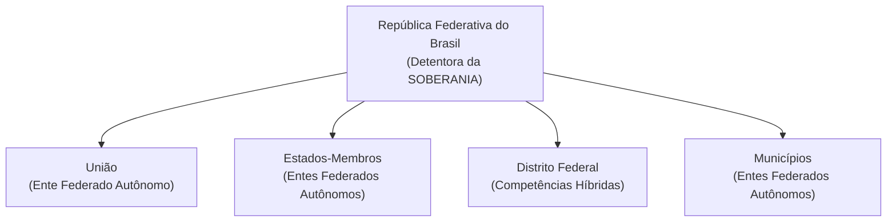
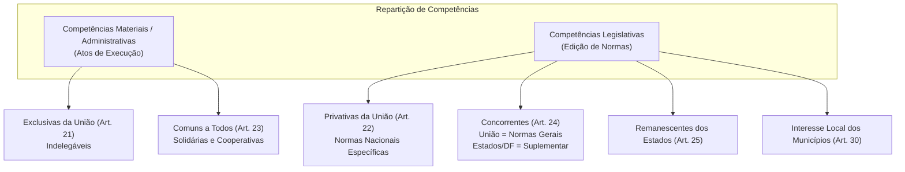
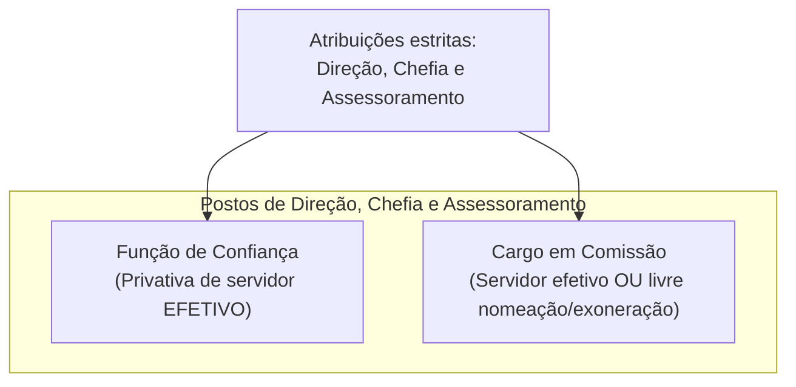
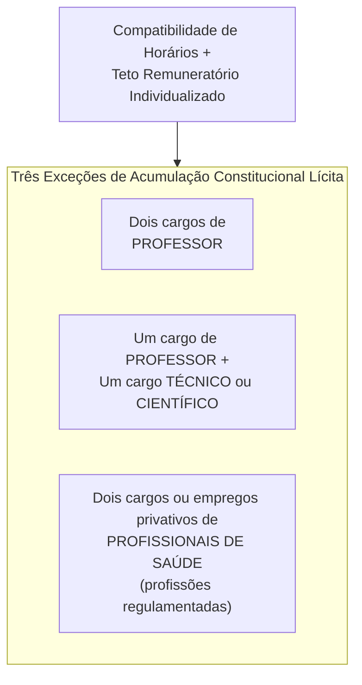
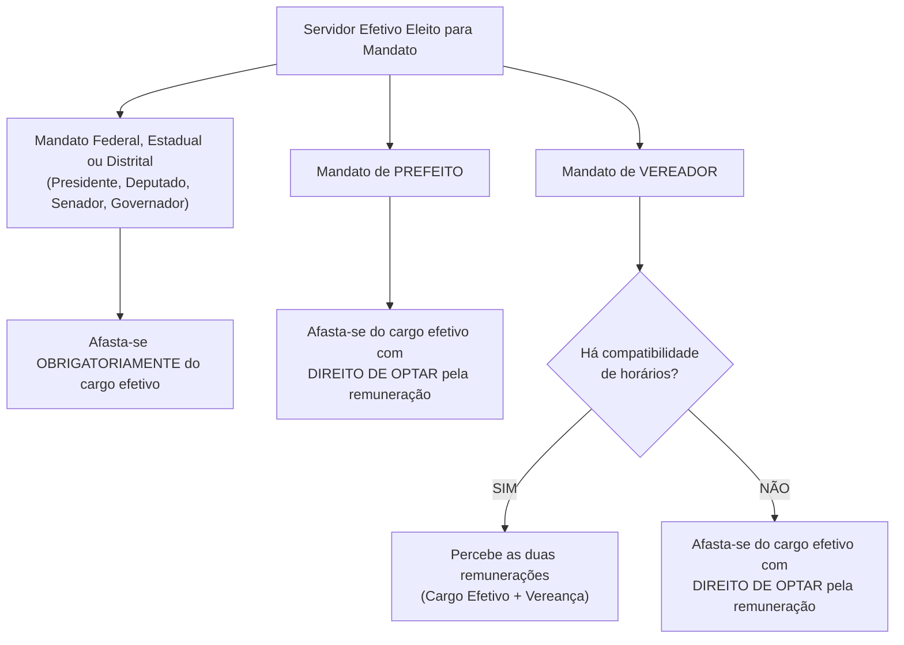
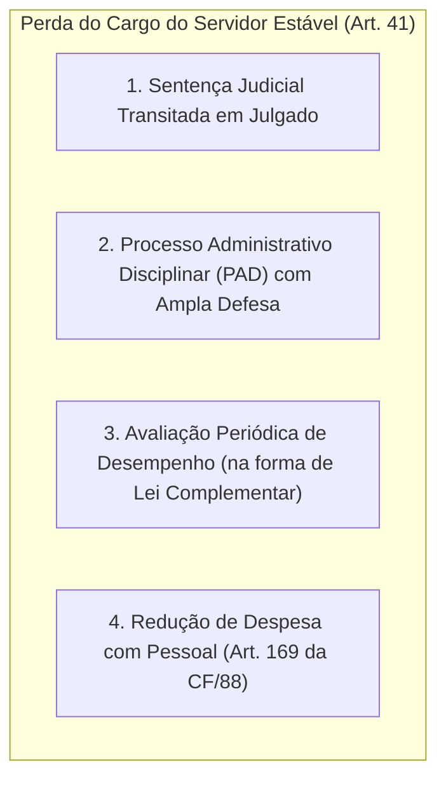

# 03 - Organização do Estado, Repartição de Competências e Servidores Públicos

> **Matéria:** Noções de Direito Constitucional  
> **Cargo:** A01 – Técnico de Controle Externo – Especialidade: Técnico Administrativo  
> **Arquivo:** `03_organizacao_do_estado_e_reparticao_de_competencias.md`  
> **Status:** 🟢 Teoria Aprofundada + 5 Questões FCC Comentadas (A a E)

---

## 📌 Ementa / Itens do Edital

- Da organização político-administrativa do Estado brasileiro (Artigos 18 e 19 da CF/88): forma federativa, autonomia dos entes e vedações federativas.
- Da União, dos Estados Federados, do Distrito Federal e dos Municípios: bens públicos, criação e desmembramento de entes, e competências materiais e legislativas.
- Repartição constitucional de competências:
    - Competências materiais exclusivas da União (Art. 21) e comuns de todos os entes (Art. 23);
    - Competências legislativas privativas da União (Art. 22) e concorrentes entre União, Estados e DF (Art. 24);
    - Competências remanescentes/residuais dos Estados (Art. 25) e competências de interesse local dos Municípios (Art. 30).
- Intervenção Federal e Estadual (Artigos 34 a 36 da CF/88): hipóteses, princípios sensíveis e procedimento.
- Regime constitucional da Administração Pública (Artigo 37 da CF/88): princípios fundamentais, concurso público, cargos em comissão e funções de confiança, teto remuneratório e regras de acumulação de cargos.
- Servidores públicos civis (Artigos 38 a 41 da CF/88): exercício de mandato eletivo, estágio probatório, estabilidade aos 3 anos, avaliação especial de desempenho e hipóteses constitucionais taxativas de perda do cargo público estável.

---

## 🧭 Sumário

1. [Conteúdo Teórico Aprofundado](#conteudo-teorico-aprofundado)
    1. [Forma Federativa e Organização Político-Administrativa](#1-forma-federativa-e-organizacao-politico-administrativa)
    2. [Teste 132](#Teste-132)
    3. [O Modelo Constitucional de Repartição de Competências](#2-o-modelo-constitucional-de-reparticao-de-competencias)
    4. [Teste 133](#Teste-133)
    5. [Teste 134](#Teste-134)
    6. [Teste 135](#Teste-135)
    7. [Teste 136](#Teste-136)
    8. [Mecanismos Excepcionais de Equilíbrio: Intervenção Federal e Estadual](#3-mecanismos-excepcionais-de-equilibrio-intervencao-federal-e-estadual)
    9. [Teste 137](#Teste-137)
    10. [Regime Constitucional da Administração Pública e Servidores (Arts. 37 a 41)](#4-regime-constitucional-da-administracao-publica-e-servidores-arts-37-a-41)
    11. [Teste 138](#Teste-138)
    12. [Teste 139](#Teste-139)
    13. [Teste 140](#Teste-140)
    14. [Teste 141](#Teste-141)
    15. [Teste 142](#Teste-142)
2. [Fontes Oficiais & Doutrinárias Recomendadas](#fontes-oficiais-doutrinarias-recomendadas)

---

## 📖 Conteúdo Teórico Aprofundado

### 1. Forma Federativa e Organização Político-Administrativa

#### 1.1 Características da Federação Brasileira e Autonomia dos Entes
A República Federativa do Brasil é formada pela união indissolúvel dos Estados e Municípios e do Distrito Federal (Art. 18, *caput*).

- **Origem Histórica:** Formou-se por **desagregação** (ou segregação), decorrente de um movimento **centrífugo** (o Estado unitário imperial descentralizou poderes políticos para as províncias que se transformaram em Estados-membros).
- **Indissolubilidade do Vínculo Federativo:** Não existe o direito de secessão (nenhum Estado ou Município pode se separar do Brasil). A tentativa de desmembramento justifica a intervenção federal imediata (art. 34, I) e constitui crime inafiançável e imprescritível (art. 5º, XLIV).
- **Soberania vs. Autonomia:**
    - A **Soberania** é atributo exclusivo da **República Federativa do Brasil** no plano internacional.
    - A **Autonomia** é outorgada aos entes federados (União, Estados, DF e Municípios), manifestando-se pela tríplice capacidade de auto-organização (Constituições e Leis Orgânicas), autogoverno (eleição de chefes dos poderes) e autoadministração (gestão e tributação próprias).

#### 1.2 Vedações Constitucionais Federativas (Art. 19)
O art. 19 da Carta da República veda à União, aos Estados, ao Distrito Federal e aos Municípios:

1. **Estabelecer cultos religiosos ou igrejas, subvencioná-los, embaraçar-lhes o funcionamento ou manter com eles ou seus representantes relações de dependência ou aliança**, ressalvada, na forma da lei, a colaboração de interesse público *(Princípio da Laicidade Estatal)*.
2. **Recusar fé aos documentos públicos** *(Eficácia probatória nacional dos documentos emitidos por órgãos oficiais)*.
3. **Criar distinções entre brasileiros ou preferências entre si** *(Proibição de discriminação tributária, previdenciária ou funcional com base na origem regional)*.

#### 1.3 Bens Públicos Constitucionais e Criação de Novos Entes
- **Bens da União (Art. 20):** Terras devolutas indispensáveis à defesa das fronteiras, recursos minerais (inclusive do subsolo), potenciais de energia hidráulica, mar territorial, terrenos de marinha e terras tradicionalmente ocupadas pelos índios.
- **Bens dos Estados (Art. 26):** Águas superficiais ou subterrâneas fluentes nos seus territórios, ilhas fluviais e lacustres não pertencentes à União e terras devolutas não compreendidas entre as da União.
- **Criação de Estados (Art. 18, § 3º):** Exige aprovação da população diretamente interessada por meio de **plebiscito** e edição de **Lei Complementar Federal** pelo Congresso Nacional.
- **Criação de Municípios (Art. 18, § 4º):** Depende de **Lei Complementar Federal** (definindo o período temporal), divulgação prévia dos Estudos de Viabilidade Municipal, consulta prévia por **plebiscito** às populações dos municípios envolvidos e promulgação de **Lei Ordinária Estadual**.

---

### Teste 132
**(FCC - Analista Judiciário - Área Administrativa)**
A República Federativa do Brasil, formada pela união indissolúvel dos Estados e Municípios e do Distrito Federal, constitui-se em Estado Democrático de Direito (art. 1º, caput, da CF/88).

A respeito da forma de Estado federativa e da organização político-administrativa brasileira, assinale a afirmativa correta.

* **A)** Os Estados-membros da Federação brasileira possuem direito de secessão, sendo-lhes lícito desmembrarem-se unilateralmente da União mediante plebiscito local.
* **B)** A autonomia dos entes federados (União, Estados, Distrito Federal e Municípios) compreende as capacidades de auto-organização, autogoverno, autolegislação e autoadministração, nos estritos limites delineados pela Constituição Federal.
* **C)** Os Territórios Federais integram a Federação brasileira como entes autônomos dotados de representação própria no Senado Federal.
* **D)** A criação de um novo Município prescinde de consulta plebiscitária às populações dos Municípios envolvidos, dependendo apenas de parecer prévio do Tribunal de Contas do Estado.
* **E)** A soberania é atributo partilhado de forma idêntica entre a União e os Municípios brasileiros.

---

> **Comentário Detalhado:**
>
> - **A)** Incorreta. O princípio republicano federativo brasileiro assenta-se no dogma da **indissolubilidade do vínculo federativo**, sendo terminantemente vedado o direito de secessão (passível de intervenção federal, art. 34, I).
> - **B)** Correta. A federação brasileira é dotada de entes autônomos que possuem a chamada quádrupla capacidade: auto-organização (elaboração de Constituições Estaduais e Leis Orgânicas), autogoverno (eleição de seus próprios mandatários), autolegislação (edição de leis locais) e autoadministração (prestação de serviços e gestão tributária), tudo sob a supremacia da CF/88.
> - **C)** Incorreta. Os Territórios Federais não são entes federados autônomos; integram a União como meras descentralizações administrativas territoriais (art. 18, § 2º).
> - **D)** Incorreta. A criação de municípios exige: lei complementar federal de período, Estudos de Viabilidade Municipal, plebiscito obrigatório e lei ordinária estadual (art. 18, § 4º).
> - **E)** Incorreta. A **soberania** pertence exclusivamente à República Federativa do Brasil (o Estado brasileiro no plano internacional); os entes federados internos gozam apenas de **autonomia**.
>
> **Gabarito: B**

---

### 2. O Modelo Constitucional de Repartição de Competências

A Constituição Federal de 1988 adotou o **princípio da predominância do interesse**:

- **União:** Matérias de interesse nacional e geral.
- **Estados:** Matérias de interesse regional.
- **Municípios:** Matérias de predominante interesse local.
- **Distrito Federal:** Acumula competências legislativas e materiais atribuídas aos Estados e aos Municípios (vedada sua divisão em Municípios - art. 32).

#### 2.1 Competências Legislativas: Privativa da União versus Concorrente

Esta é a distinção mais exigida pela banca FCC. Analise as características de cada modalidade:

| Modalidade Legislativa | Entes Competentes | Ramos do Direito Abrangidos | Regra de Delegação / Suplementação |
| :--- | :--- | :--- | :--- |
| **Privativa da União (Art. 22)** | **Apenas a União** (Congresso Nacional) | Civil, Comercial, Penal, Processual, Eleitoral, Agrário, Marítimo, Aeronáutico, Espacial e do Trabalho; além de Trânsito/Transporte, Diretrizes da Educação e Normas Gerais de Licitação. | **Lei Complementar Federal** pode autorizar os Estados a legislar sobre questões específicas dessas matérias (Art. 22, parágrafo único). |
| **Concorrente (Art. 24)** | **União, Estados e Distrito Federal** *(Municípios NÃO participam formalmente do art. 24)* | Direito **P**enitenciário, **U**rbanístico, **F**inanceiro, **E**conômico e **T**ributário (**Mnemônico: PUFET**), além de Orçamento, Meio Ambiente, Florestas e Proteção ao Consumidor. | **União:** limita-se a fixar **Normas Gerais**. **Estados/DF:** exercem competência **Suplementar**. Se a União não editar norma geral, o Estado adquire competência plena. |

> 🚨 **ALERTA DE PROVA / PEGADINHA FCC:**  
>
> - **Direito Processual vs. Direito Penitenciário / Custas Forenses:**  
>     - Direito **Processual** é competência **privativa da União** (Art. 22, I). Leis estaduais que criem prazos ou ritos processuais judiciais são formalmente inconstitucionais!  
>     - Direito **Penitenciário** e custas dos serviços forenses são competências **concorrentes** (Art. 24, I e IV).  
> - **Superveniência de Lei Federal sobre Normas Gerais (Art. 24, § 4º):**  
>   A superveniência de lei federal contendo normas gerais **NÃO REVOGA** a lei estadual anterior contrária; ela apenas **SUSPENDE A SUA EFICÁCIA** naquilo que for incompatível. Se a lei federal for declarada inconstitucional ou revogada, a lei estadual volta a produzir efeitos normalmente!

---

### Teste 133
**(FGV - Auditor de Controle Externo / TCE-GO)**
O art. 24 da Constituição Federal estabelece que compete à União, aos Estados e ao Distrito Federal legislar concorrentemente sobre direito tributário, financeiro, penitenciário, econômico e urbanístico.

A respeito da dinâmica da competência legislativa concorrente, assinale a afirmativa correta.

* **A)** No âmbito da legislação concorrente, a competência da União limita-se a estabelecer normas gerais, cabendo aos Estados e ao DF a competência suplementar.
* **B)** A inexistência de lei federal sobre normas gerais impede os Estados de exercerem qualquer competência legislativa sobre a matéria até a manifestação do Congresso Nacional.
* **C)** A superveniência de lei federal sobre normas gerais revoga integralmente a lei estadual anterior que dispôs sobre a mesma matéria.
* **D)** A competência legislativa concorrente estende-se expressamente aos Municípios para fixação de normas gerais nacionais de direito econômico.
* **E)** Os Estados possuem competência privativa para editar normas gerais sobre direito financeiro e orçamentos públicos.

---

> **Comentário Detalhado:**
>
> - **A)** Correta. O art. 24, § 1º e § 2º, da CF/88 determina que, no âmbito da legislação concorrente, a competência da União limitar-se-á a estabelecer **normas gerais**, não excluindo a competência suplementar dos Estados para preencher as lacunas e particularidades regionais.
> - **B)** Incorreta. Inexistindo lei federal sobre normas gerais, os Estados exercerão a **competência legislativa plena**, para atender a suas peculiaridades (art. 24, § 3º).
> - **C)** Incorreta. Conforme o art. 24, § 4º, a superveniência de lei federal sobre normas gerais **suspende a eficácia** (e não revoga) da lei estadual, no que lhe for contrário.
> - **D)** Incorreta. O art. 24 não inclui os Municípios na competência concorrente; a competência municipal é suplementar no que couber (art. 30, II).
> - **E)** Incorreta. Normas gerais financeiras competem à União (art. 24, I c/c art. 163).
>
> **Gabarito: A**

---

### Teste 134
**(FCC - Adaptada / Analista de Controle Externo)**
A Assembleia Legislativa do Estado de Goiás aprovou projeto de lei que disciplina matérias relativas ao direito tributário e financeiro estadual, estabelecendo regras inovadoras de arrecadação e fiscalização orçamentária no âmbito de seu território, na ausência de lei federal veiculando normas gerais sobre aquele tema específico. Dois anos depois, o Congresso Nacional promulgou lei federal contendo normas gerais sobre a mesma matéria, cujos dispositivos colidem diretamente com três artigos da referida lei estadual goiana.

Considerando o modelo constitucional brasileiro de repartição de competências legislativas concorrentes (art. 24 da CF/88):

* **A)** A lei estadual goiana era originariamente inconstitucional, pois aos Estados Federados é terminantemente vedado legislar sobre direito financeiro e tributário sem expressa autorização em lei complementar federal.
* **B)** O Estado de Goiás exerceu legitimamente competência legislativa plena ante a omissão originária da União; todavia, a superveniência da lei federal sobre normas gerais suspende a eficácia da lei estadual no que lhe for contrário.
* **C)** A lei federal posterior padece de inconstitucionalidade formal, por invadir competência reservada originariamente ao Estado-membro.
* **D)** A lei estadual goiana foi formalmente revogada e extinta do ordenamento jurídico, tendo em vista o princípio da hierarquia absoluta da União sobre os Estados Federados.
* **E)** A antinomia entre as duas leis impõe a anulação simultânea de ambas pelo Tribunal de Justiça, competindo aos Municípios legislar de forma residual.

---

> **Comentário Detalhado:**
>
> - **A) Incorreta:** O art. 24, I, da CF/88 consagra competência concorrente sobre direito tributário e financeiro. Inexistindo lei federal de normas gerais, o Estado exerce competência legislativa plena (art. 24, § 3º), sem necessidade de lei complementar delegatória.  
> - **B) CORRETA:** O texto do art. 24, § 3º, confere ao Estado competência legislativa plena perante a inércia da União. O § 4º do mesmo artigo prescreve expressamente: *"A superveniência de lei federal sobre normas gerais suspende a eficácia da lei estadual, no que lhe for contrário."*  
> - **C) Incorreta:** A União tem competência constitucional originária para editar normas gerais a qualquer tempo no âmbito concorrente.  
> - **D) Incorreta:** Não existe hierarquia entre leis federais e leis estaduais no federalismo brasileiro. Por essa razão técnica, a lei federal **não revoga** a lei estadual, mas apenas **suspende a sua eficácia**.  
> - **E) Incorreta:** A Constituição prevê expressamente o mecanismo da suspensão da eficácia, sem declaração de anulação recíproca.
> 
> **Gabarito: B**

---

### Teste 135
**(FCC - Adaptada / Procuradoria Legislativa)**
Em tema de repartição constitucional de competências legislativas entre os entes federados, a competência para legislar sobre **Direito do Trabalho**, **Direito Processual** e **Trânsito e Transporte** pertence:

* **A)** Concorrentemente à União, aos Estados e ao Distrito Federal.
* **B)** Privativamente aos Estados Federados, cabendo aos Municípios suplementar as peculiaridades locais.
* **C)** Privativamente à União, podendo lei complementar federal autorizar os Estados a legislar sobre questões específicas dessas matérias.
* **D)** Exclusivamente à União, sendo vedada qualquer hipótese de delegação de competência aos Estados-membros.
* **E)** Concorrentemente à União e aos Municípios, ficando os Estados restritos às normas de interesse regional.

---

> **Comentário Detalhado:**
>
> - **A) Incorreta:** Essas três matérias não integram o rol da competência concorrente do art. 24 da CF/88.  
> - **B) Incorreta:** Estados não têm competência privativa originária sobre tais matérias substantivas federais.  
> - **C) CORRETA:** As matérias Direito do Trabalho e Direito Processual estão arroladas no art. 22, I, da CF/88, e Trânsito e Transporte no art. 22, XI, da CF/88, configurando competências privativas da União. O parágrafo único do art. 22 prescreve expressamente: *"Lei complementar poderá autorizar os Estados a legislar sobre questões específicas das matérias relacionadas neste artigo."*  
> - **D) Incorreta:** A competência legislativa privativa admite delegação para questões específicas mediante Lei Complementar Federal (art. 22, parágrafo único). A indelegabilidade aplica-se às competências administrativas *exclusivas* do art. 21.  
> - **E) Incorreta:** Municípios sequer participam formalmente das competências concorrentes do art. 24, e tais matérias são privativas federais.
> 
> **Gabarito: C**

---

### Teste 136
**(FCC - Procurador do Estado / Adaptada)**
A Câmara Municipal de determinado Município aprovou lei local disciplinando o horário de funcionamento de estabelecimentos bancários situados em seu território, bem como exigindo a instalação de portas de segurança eletrônicas e banheiros para os clientes nas agências.

À luz da jurisprudência consolidada do Supremo Tribunal Federal e do Superior Tribunal de Justiça, a referida lei municipal é:

* **A)** Integralmente inconstitucional, uma vez que o sistema financeiro nacional é de competência legislativa privativa da União (art. 22, VI e VII, CF/88).
* **B)** Constitucional quanto aos itens de conforto, segurança e tempo de atendimento ao consumidor (como banheiros e portas eletrônicas), mas inconstitucional quanto à fixação do horário de funcionamento bancário, cuja competência é privativa da União (Súmula Vinculante nº 38 do STF).
* **C)** Válida em sua integralidade, inclusive para fixar o horário de compensação nacional de cheques.
* **D)** Nula de pleno direito por violar a competência concorrente dos Estados-membros em matéria de direito comercial.
* **E)** Inconstitucional exclusivamente quanto à exigência de portas de segurança, por configurar matéria de segurança nacional do Exército Brasileiro.

---

> **Comentário Detalhado:**
>
> - **A)** Incorreta. O STF distingue o funcionamento do sistema financeiro (privativo da União) das regras de atendimento, conforto e segurança local do consumidor (competência municipal de interesse local, art. 30, I).
> - **B)** Correta. Jurisprudência pacificada nas súmulas dos Tribunais Superiores: (1) **Súmula Vinculante nº 38 do STF**: *"É inconstitucional a lei municipal que fixa o horário de funcionamento de estabelecimento bancário"* (competência da União, Súmula 19/STJ); e (2) **Súmula 469 do STJ / Tema 145 do STF**: O Município tem competência para legislar sobre segurança, instalação de sanitários, bebedouros e tempo razoável de espera em filas nas agências bancárias, por se tratar de matéria de interesse local e proteção ao consumidor.
> - **C)** Incorreta. Fixar horário de abertura e fechamento das agências bancárias é matéria privativa da União.
> - **D)** Incorreta. Matéria consumerista local insere-se no interesse local municipal.
> - **E)** Incorreta. Segurança física das agências e porta giratória são temas de competência municipal válidos.
>
> **Gabarito: B**

---

#### 2.2 Competências Administrativas: Exclusivas e Comuns
- **Exclusivas da União (Art. 21):** São indelegáveis a outros entes políticos. Envolvem a emissão de moeda, administração das reservas cambiais, manutenção das relações diplomáticas, defesa nacional e fiscalização nuclear.
- **Comuns de Todos os Entes (Art. 23):** Competências materiais que devem ser exercidas de forma cooperativa e solidária por União, Estados, DF e Municípios: zelar pela guarda da Constituição, cuidar da saúde e assistência pública, proteger o meio ambiente, combater a poluição e preservar o patrimônio histórico. Leis complementares fixam normas para a cooperação entre a União e os entes subnacionais (art. 23, parágrafo único).

#### 2.3 Competências dos Estados e Municípios
- **Estados-Membros (Art. 25, § 1º):** Possuem competência **remanescente (residual)**: são reservadas aos Estados todas as competências que não lhes sejam vedadas pela Constituição e que não pertençam expressamente à União ou aos Municípios. Além disso, cabe aos Estados explorar diretamente ou mediante concessão os serviços locais de gás canalizado (art. 25, § 2º, vedada edição de MP para sua regulamentação).
- **Municípios (Art. 30):**
    1. Legislar sobre assuntos de **interesse local**;
    2. Suplementar a legislação federal e estadual no que couber;
    3. Instituir e arrecadar os tributos municipais e aplicar suas rendas;
    4. Organizar e prestar, diretamente ou sob concessão/permissão, os serviços públicos de interesse local, incluído o de **transporte coletivo**, de caráter essencial.

> ⭐ **IMPORTANTE (SÚMULA VINCULANTE 38 DO STF):**  
> *"É competente o Município para fixar o horário de funcionamento de estabelecimento comercial."*  
> Em contrapartida, conforme a Súmula Vinculante 49, leis municipais que impedem a instalação de estabelecimentos do mesmo ramo em determinada área violam a liberdade de concorrência.

---

### 3. Mecanismos Excepcionais de Equilíbrio: Intervenção Federal e Estadual

A não-intervenção é a regra geral da federação. A intervenção consubstancia medida drástica e temporária que suspende a autonomia do ente subnacional para resguardar a integridade da ordem federativa.

- **Intervenção Federal nos Estados e DF (Art. 34):** Cabível para manter a integridade nacional, repelir invasão estrangeira ou de uma unidade na outra, pôr termo a grave comprometimento da ordem pública, garantir o livre exercício de qualquer dos Poderes, reorganizar as finanças do Estado (se suspender pagamento de dívida por mais de 2 anos consecutivos) ou assegurar a observância dos **princípios constitucionais sensíveis** (forma republicana, direitos da pessoa humana, regime democrático, prestação de contas da administração e aplicação dos mínimos em saúde e educação).
- **Intervenção Estadual nos Municípios (Art. 35):** Decretada pelo Governador do Estado quando o Município deixar de pagar sua dívida fundada por dois anos consecutivos, não prestar contas devidas, não aplicar o mínimo constitucional em saúde e educação ou quando o Tribunal de Justiça der provimento a representação para garantir a observância de princípios da Constituição Estadual ou prover a execução de lei ou ordem judicial.

---

### Teste 137
**(FGV - Analista de Controle Externo / TCE-GO)**
A intervenção federal nos Estados e no Distrito Federal (art. 34 da CF/88) configura medida excepcional de supressão temporária da autonomia política do ente federado.

A respeito dos pressupostos materiais e procedimentais da intervenção federal, assinale a afirmativa correta.

* **A)** O Presidente da República pode decretar a intervenção federal em qualquer Estado sem controle político do Congresso Nacional se o Governador for filiado a partido de oposição.
* **B)** A intervenção federal para assegurar a observância dos princípios constitucionais sensíveis (como a forma republicana, o sistema representativo, os direitos humanos e a prestação de contas da administração pública) depende de provimento pelo Supremo Tribunal Federal de representação interventiva ajuizada pelo Procurador-Geral da República (ADI interventiva).
* **C)** O Tribunal de Contas da União pode decretar diretamente a intervenção em Estado que atrasar o repasse de verbas do SUS aos municípios.
* **D)** O decreto de intervenção federal dispensa a indicação da amplitude, do prazo e das condições de execução, cabendo ao interventor poderes soberanos ilimitados.
* **E)** Cessados os motivos da intervenção, as autoridades estaduais afastadas de seus cargos não poderão reassumi-los, devendo ser convocadas novas eleições gerais imediatas.

---

> **Comentário Detalhado:**
>
> - **A)** Incorreta. A intervenção é estritamente vinculada às hipóteses taxativas do art. 34 da CF/88 e submete-se ao controle político obrigatório do Congresso Nacional em até 24 horas (art. 36, § 1º).
> - **B)** Correta. Nos termos do art. 36, III, da CF/88, no caso de desrespeito aos chamados **princípios constitucionais sensíveis** (art. 34, VII: forma republicana, direitos da pessoa humana, prestação de contas, aplicação dos mínimos em saúde/educação), a intervenção federal depende de **provimento pelo STF de representação interventiva ajuizada privativamente pelo Procurador-Geral da República (PGR)**.
> - **C)** Incorreta. Decretar intervenção é competência privativa e indelegável do Presidente da República (art. 84, X).
> - **D)** Incorreta. O art. 36, § 1º, exige que o decreto de intervenção especifique a amplitude, o prazo, as condições de execução e a nomeação do interventor.
> - **E)** Incorreta. O art. 36, § 4º, estabelece que, cessados os motivos da intervenção, as autoridades afastadas reassumirão seus cargos, salvo impedimento legal.
>
> **Gabarito: B**

---

### 4. Regime Constitucional da Administração Pública e Servidores (Arts. 37 a 41)

#### 4.1 Concurso Público, Funções de Confiança e Cargos em Comissão
- **Validade do Concurso (Art. 37, III):** Validade de **até 2 (dois) anos**, prorrogável uma única vez, por igual período. O edital pode fixar validade inferior (ex.: 6 meses prorrogável por mais 6 meses).
- **Funções de Confiança vs. Cargos em Comissão (Art. 37, V):**
    - *Funções de Confiança:* Exercidas **exclusivamente** por servidores ocupantes de cargo de provimento efetivo.
    - *Cargos em Comissão:* Preenchidos por servidores de carreira nos casos, condições e percentuais mínimos previstos em lei, ou por pessoas sem vínculo (comissionados puros).
    - Ambos destinam-se exclusivamente às atribuições de **direção, chefia e assessoramento** (vedada a criação para atribuições técnicas, operacionais ou burocráticas subalternas - Súmula Vinculante 37).

#### 4.2 Regra Constitucional da Não-Acumulação e Exceções (Art. 37, XVI)
A regra é a proibição categórica de acumulação remunerada de cargos, empregos e funções públicas no âmbito da administração direta, autárquica, fundacional e empresas estatais.  
Exigem-se cumulativamente: **compatibilidade de horários** + **observância do teto remuneratório constitucional**. As únicas 3 exceções constitucionais são:

> 🚨 **ALERTA DE PROVA / PEGADINHA FCC:**  
>
> - **Teto Remuneratório na Acumulação Lícita (Tema 377/STF):** No caso de acumulação constitucional legítima de cargos, o teto remuneratório constitucional incide **isoladamente sobre cada um dos cargos**, e não sobre o somatório das remunerações!  
> - **Cargo Técnico:** Para fins de acumulação com professor, considera-se técnico o cargo que exige conhecimentos técnicos específicos ou formação superior determinada, como o cargo de Analista e Técnico de Controle Externo do TCE-GO.

---

### Teste 138
**(FCC - Técnico de Controle Externo / Administrativa)**
No âmbito do regime constitucional da Administração Pública e de seus servidores (arts. 37 a 41 da CF/88), a remuneração e o subsídio dos ocupantes de cargos, funções e empregos públicos submetem-se ao teto remuneratório constitucional.

A esse respeito, assinale a afirmativa correta.

* **A)** O teto remuneratório no âmbito do Poder Executivo dos Estados e do Distrito Federal tem como limite o subsídio mensal dos Desembargadores do Tribunal de Justiça.
* **B)** O teto remuneratório constitucional no âmbito dos Estados e do DF corresponde: no Poder Executivo, ao subsídio mensal do Governador; no Poder Legislativo, ao subsídio dos Deputados Estaduais; e no Poder Judiciário, ao subsídio dos Desembargadores do Tribunal de Justiça, limitado a 90,25% do subsídio dos Ministros do STF.
* **C)** As verbas de caráter indenizatório expressamente previstas em lei submetem-se integralmente ao teto remuneratório constitucional.
* **D)** A acumulação lícita de dois cargos públicos de médico autoriza a Administração a somar os vencimentos para aplicação do teto de forma global unificada.
* **E)** Servidores públicos ocupantes exclusivamente de cargos em comissão estão imunes ao teto remuneratório constitucional.

---

> **Comentário Detalhado:**
>
> - **A)** Incorreta. No Poder Executivo estadual o teto é o subsídio do **Governador do Estado** (art. 37, XI da CF/88).
> - **B)** Correta. O art. 37, XI, da CF/88 estabelece o sistema de tetos remuneratórios no plano estadual: (1) no **Poder Executivo**, o subsídio do Governador; (2) no **Poder Legislativo**, o subsídio dos Deputados Estaduais; (3) no **Poder Judiciário**, o subsídio dos Desembargadores do Tribunal de Justiça (limitado a 90,25% do subsídio dos Ministros do STF), limite este aplicável aos membros do Ministério Público, aos Procuradores e aos Defensores Públicos.
> - **C)** Incorreta. O art. 37, § 11, da CF/88 exclui expressamente do cômputo do teto as **parcelas de caráter indenizatório** previstas em lei (ex.: diárias, ajuda de custo).
> - **D)** Incorreta. Tese fixada pelo STF no Tema 377 e Tema 384: nos casos de acumulação lícita de cargos (como dois cargos de saúde), o teto remuneratório constitucional deve incidir **isoladamente sobre a remuneração de cada um dos cargos**, e não sobre o somatório de ambos.
> - **E)** Incorreta. O teto atinge a todos os agentes públicos, efetivos ou comissionados.
>
> **Gabarito: B**

---

### Teste 139
**(FCC - Adaptada / Técnico de Controle Externo - TCE-GO)**
Um servidor público ocupante do cargo de provimento efetivo de Técnico de Controle Externo do Tribunal de Contas do Estado de Goiás, com formação acadêmica superior em Direito, foi aprovado em regular concurso público municipal para o cargo de Professor de Direito Constitucional na Faculdade Municipal de Ensino Superior de Goiânia.

Considerando as normas constitucionais que regem a acumulação remunerada de cargos públicos (art. 37, XVI da CF/88) e comprovada a plena compatibilidade de horários entre as jornadas de trabalho:

* **A)** A acumulação é constitucionalmente admitida, por envolver o exercício de um cargo técnico ou científico com outro cargo de professor.
* **B)** A acumulação é ilícita, pois a Constituição Federal veda expressamente a cumulação de vínculos com entes federativos distintos (Estado e Município).
* **C)** O servidor deve obrigatoriamente optar pela remuneração de apenas um dos cargos, prestando serviços de docência de maneira voluntária.
* **D)** Apenas servidores estáveis com mais de dez anos de serviço podem exercer a prerrogativa excepcional de acumulação remunerada.
* **E)** A acumulação é permitida exclusivamente para dois cargos privativos de profissionais de saúde, sendo vedada a docência por técnicos de controle externo.

---

> **Comentário Detalhado:**
>
> - **A) CORRETA:** O art. 37, XVI, "b", da CF/88 excepciona a vedação de acumulação permitindo a de um cargo de professor com outro técnico ou científico, desde que haja compatibilidade de horários. O cargo de Técnico de Controle Externo possui inequívoca natureza de cargo técnico.  
> - **B) Incorreta:** A cumulação constitucional pode envolver cargos de qualquer ente federativo (União, Estados, DF ou Municípios), inclusive estendendo-se à administração indireta (art. 37, XVII).  
> - **C) Incorreta:** Na acumulação lícita com compatibilidade de horários, o servidor percebe a remuneração integral de ambos os cargos (respeitados os tetos individuais).  
> - **D) Incorreta:** Não há exigência temporal de tempo de serviço nem de estágio probatório para exercer o direito de acumulação lícita.  
> - **E) Incorreta:** A acumulação na área da saúde é apenas uma das três hipóteses; a docência acumulada com cargo técnico é modalidade plenamente autônoma e válida.
> 
> **Gabarito: A**

---

#### 4.3 Exercício de Mandato Eletivo pelo Servidor Público (Art. 38)
Tratamento constitucional aplicável ao servidor público da administração direta, autárquica e fundacional no exercício de mandato político:

- Para contagem de tempo de serviço: o tempo de mandato é contado para todos os efeitos legais, **exceto para promoção por merecimento** (computa-se apenas por antiguidade).
- Previdência Social: os valores são recolhidos como se estivesse no exercício efetivo do cargo.

---

### Teste 140
**(FCC - Adaptada / Auditor Governamental)**
Determinado servidor público efetivo do Tribunal de Contas estadual decidiu concorrer a mandato eletivo político, sagrando-se vitorioso nas eleições municipais para o mandato de Vereador. No caso concreto, os horários das sessões ordinárias e comissões da Câmara Municipal coincidem parcialmente com o expediente de trabalho regular desempenhado no Tribunal de Contas.

De acordo com o regime constitucional do servidor em exercício de mandato eletivo (art. 38 da CF/88):

* **A)** O servidor deverá obrigatoriamente renunciar ao cargo efetivo no Tribunal de Contas no ato da posse, assumindo dedicação exclusiva no parlamento.
* **B)** O servidor acumulará compulsoriamente os subsídios integrais de ambos os cargos, devendo cumprir sua jornada técnica em regime de plantão no final de semana.
* **C)** Inexistindo compatibilidade de horários, o servidor será afastado do cargo de Técnico de Controle Externo, sendo-lhe facultado optar pela sua remuneração funcional.
* **D)** O tempo de exercício do mandato eletivo será computado para todos os efeitos funcionais, inclusive para promoção compulsória por merecimento.
* **E)** O servidor não pode assumir o mandato de Vereador sob pena de demissão imediata a bem do serviço público.

---

> **Comentário Detalhado:**
>
> - **A) Incorreta:** Servidor público eleito para qualquer mandato jamais é obrigado a renunciar ou perder o cargo de provimento efetivo; ele apenas se afasta das funções durante a legislatura.  
> - **B) Incorreta:** A percepção cumulativa das vantagens somente é admitida se houver estrita compatibilidade de horários (art. 38, III). O enunciado frisou que os horários coincidem parcialmente (incompatíveis).  
> - **C) CORRETA:** De acordo com o art. 38, III, da CF/88, investido no mandato de Vereador, *"havendo compatibilidade de horários, perceberá as vantagens de seu cargo, emprego ou função, sem prejuízo da remuneração do cargo eletivo, e, não havendo compatibilidade, será aplicada a norma do inciso anterior"* (ou seja, afasta-se do cargo público, sendo-lhe facultado optar pela sua remuneração).  
> - **D) Incorreta:** O art. 38, IV, prescreve que o tempo de serviço será contado para todos os efeitos legais, **exceto para promoção por merecimento**.  
> - **E) Incorreta:** O exercício de mandato político é um direito político fundamental plenamente assegurado aos servidores públicos.
> 
> **Gabarito: C**

---

#### 4.4 Estabilidade e Perda do Cargo do Servidor Estável (Art. 41)
- **Aquisição da Estabilidade:** São estáveis após **3 (três) anos** de efetivo exercício os servidores nomeados para cargo de provimento efetivo em virtude de concurso público.
- **Condição Obrigatória:** É obrigatória a aprovação prévia em **avaliação especial de desempenho** realizada por comissão instituída especificamente para essa finalidade (art. 41, § 4º).
- **As Quatro Hipóteses Exaustivas de Perda do Cargo do Servidor Estável:**
    1. Em virtude de **sentença judicial transitada em julgado**;
    2. Mediante **processo administrativo disciplinar (PAD)** no qual lhe seja assegurada ampla defesa;
    3. Mediante **procedimento de avaliação periódica de desempenho**, na forma de lei complementar federal, assegurada ampla defesa;
    4. Para cumprimento dos **limites com despesas de pessoal** (art. 169, § 4º da CF/88), caso as medidas anteriores (corte de cargos em comissão e exoneração de servidores não estáveis) sejam insuficientes.

---

### Teste 141
**(FCC - Adaptada / Analista Judiciário)**
Sobre o regime constitucional de estabilidade dos servidores públicos civis e as hipóteses de perda do cargo público efetivo previstas na Constituição da República, analise as proposições a seguir:

I. São estáveis após dois anos de efetivo exercício os servidores nomeados para cargo de provimento efetivo em virtude de concurso público.  

II. Como condição para a aquisição da estabilidade, é obrigatória a avaliação especial de desempenho por comissão instituída para essa finalidade.  

III. O servidor público estável poderá perder o cargo mediante procedimento de avaliação periódica de desempenho, na forma de lei complementar, assegurada a ampla defesa.  

Está correto o que se afirma em:

* **A)** I e II, apenas.
* **B)** II e III, apenas.
* **C)** I e III, apenas.
* **D)** I, apenas.
* **E)** I, II e III.

---

> **Comentário Detalhado:**
>
> - **A) Incorreta:** O item I é incorreto, pois o prazo constitucional de estágio probatório é de 3 anos de efetivo exercício.
> - **B) CORRETA:**  
>     - *Item I (Falso):* Desde a Emenda Constitucional nº 19/1998, o prazo constitucional de estágio probatório para a aquisição de estabilidade é de **3 (três) anos de efetivo exercício**, e não dois anos (art. 41, *caput*).  
>     - *Item II (Verdadeiro):* O § 4º do art. 41 da CF/88 estabelece que *"é obrigatória a avaliação especial de desempenho por comissão instituída para essa finalidade"* como condição imprescindível para a estabilidade.  
>     - *Item III (Verdadeiro):* O art. 41, § 1º, III, da CF/88 prescreve expressamente que o servidor público estável só perderá o cargo, dentre outras hipóteses, *"mediante procedimento de avaliação periódica de desempenho, na forma de lei complementar, assegurada ampla defesa"*.  
> - **C) Incorreta:** O item I é falso.
> - **D) Incorreta:** Os itens II e III são verdadeiros.
> - **E) Incorreta:** O item I é falso.
> 
> **Gabarito: B**

---

### Teste 142
**(FGV - Analista de Controle Externo / Auditoria)**
A estabilidade no serviço público é direito constitucional assegurado aos servidores nomeados para cargo de provimento efetivo em virtude de concurso público, nos termos do art. 41 da Constituição Federal de 1988.

Sobre as condições e regras da estabilidade funcional, assinale a afirmativa correta.

* **A)** São estáveis após dois anos de efetivo exercício os servidores nomeados para cargo efetivo, independentemente de avaliação especial de desempenho.
* **B)** Como condição obrigatória para a aquisição da estabilidade, é indispensável a aprovação do servidor em avaliação especial de desempenho por comissão instituída para essa finalidade, após três anos de efetivo exercício.
* **C)** O servidor público estável não pode perder o cargo em hipótese alguma, gozando de garantia absoluta de permanência no serviço público.
* **D)** Invalidada por sentença judicial a demissão do servidor estável, ele será reintegrado, e o eventual ocupante da vaga, se estável, será compulsoriamente demitido sem direito a indenização.
* **E)** Em caso de extinção do cargo ou declaração de sua desnecessidade, o servidor público estável será imediatamente exonerado sem remuneração.

---

> **Comentário Detalhado:**
>
> - **A)** Incorreta. A EC nº 19/1998 ampliou o prazo do estágio probatório para **3 (três) anos** de efetivo exercício e tornou obrigatória a avaliação especial de desempenho.
> - **B)** Correta. O art. 41, caput e § 4º, da Constituição Federal prescreve que são estáveis após 3 (três) anos de efetivo exercício os servidores concursados, sendo condição obrigatória para aquisição da estabilidade a prévia aprovação em **avaliação especial de desempenho** por comissão constituída para essa finalidade.
> - **C)** Incorreta. O servidor estável pode perder o cargo em 4 hipóteses constitucionais (art. 41, § 1º c/c art. 169, § 4º): (1) sentença judicial transitada em julgado; (2) processo administrativo com ampla defesa; (3) avaliação periódica de desempenho (lei complementar); (4) excesso de despesas com pessoal.
> - **D)** Incorreta. O eventual ocupante da vaga reconduzido ao cargo de origem, aproveitado em outro cargo ou posto em disponibilidade com remuneração proporcional, **jamais demitido sem indenização** (art. 41, § 2º).
> - **E)** Incorreta. Extinto o cargo, o servidor estável ficará em **disponibilidade**, com remuneração proporcional ao tempo de contribuição, até seu adequado aproveitamento em outro cargo (art. 41, § 3º).
>
> **Gabarito: B**

---

## 🌐 Fontes Oficiais & Doutrinárias Recomendadas

* [Constituição Federal de 1988 - Arts. 18 a 36 (Organização Político-Administrativa)](https://www.planalto.gov.br/ccivil_03/constituicao/constituicao.htm#art18) - Estrutura federativa brasileira, autonomia dos entes e regras de intervenção federal e estadual.
* [Constituição Federal de 1988 - Arts. 21 a 24 (Repartição de Competências)](https://www.planalto.gov.br/ccivil_03/constituicao/constituicao.htm#art21) - Competências exclusivas, privativas da União, comuns e concorrentes dos Estados federados.
* [Constituição Federal de 1988 - Arts. 37 a 41 (Administração Pública)](https://www.planalto.gov.br/ccivil_03/constituicao/constituicao.htm#art37) - Princípios expressos do LIMPE, regras de concurso público, acumulação de cargos e estabilidade dos servidores.
* [Constituição do Estado de Goiás - Título III (Da Organização do Estado)](https://legisla.casacivil.go.gov.br/constituicao-estadual) - Competências do Estado de Goiás, bens estaduais e municípios goianos.
* [STF Súmula Vinculante 37 (Vedação de Aumento Salarial pelo Judiciário)](https://portal.stf.jus.br/jurisprudencia/sumarios/sumulavinculante.asp?seq=37) - Enunciado vinculante sobre o princípio da legalidade estrita e separação dos poderes na remuneração de servidores.
* MENDES, Gilmar Ferreira; BRANCO, Paulo Gustavo Gonet. **Curso de Direito Constitucional**. 19. ed. São Paulo: SaraivaJur, 2024. (Cap. 8 - A Organização do Estado Federal; Cap. 9 - Repartição de Competências).
* MORAES, Alexandre de. **Direito Constitucional**. 40. ed. São Paulo: Atlas, 2024. (Cap. 6 - Organização do Estado; Cap. 7 - Administração Pública).
* MEIRELLES, Hely Lopes. **Direito Administrativo Brasileiro**. 44. ed. São Paulo: Malheiros, 2020. (Cap. 2 - Administração Pública e Servidores Públicos).
