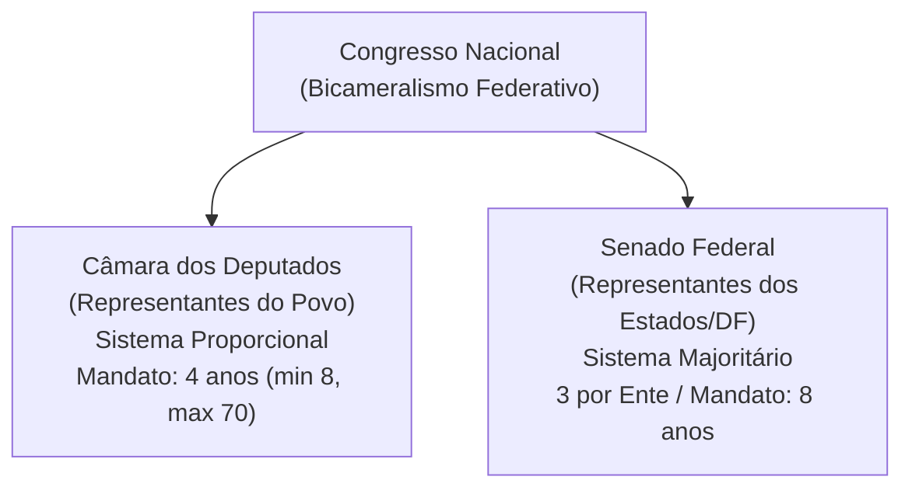

# 04 - Poder Legislativo, Processo Legislativo e Controle Externo (Arts. 70 a 75 da CF/88)

> **Matéria:** Noções de Direito Constitucional  
> **Cargo:** A01 – Técnico de Controle Externo – Especialidade: Técnico Administrativo  
> **Arquivo:** `04_poder_legislativo_processo_legislativo_e_fiscalizacao_tce.md`  
> **Status:** 🟢 Teoria Aprofundada + 5 Questões FCC Comentadas (A a E)

---

## 📌 Ementa / Itens do Edital

- Do Poder Legislativo: estrutura bicameral federal (Câmara dos Deputados e Senado Federal) e unicameral estadual/distrital/municipal.
- Atribuições do Congresso Nacional e competências privativas da Câmara dos Deputados (Art. 51) e do Senado Federal (Art. 52).
- Estatuto dos congressistas: imunidade material (inviolabilidade civil e penal) e imunidade formal/processual (prisão e prerrogativa de foro - Art. 53).
- Do processo legislativo (Artigos 59 a 69 da CF/88):
    - Emendas à Constituição (Art. 60): iniciativa restrita, rito qualificado de aprovação, inexistência de sanção/veto e limitações circunstanciais e materiais (cláusulas pétreas);
    - Leis Complementares vs. Leis Ordinárias (quórum e reserva de matéria);
    - Medidas Provisórias (Art. 62): pressupostos constitucionais, prazos e vedações temáticas absolutas.
- Da fiscalização contábil, financeira, orçamentária, operacional e patrimonial (Artigos 70 a 75 da CF/88):
    - Controle externo titularizado pelo Poder Legislativo com auxílio do Tribunal de Contas;
    - Competências do Tribunal de Contas (Art. 71 da CF/88);
    - Duplo regime de contas: Contas de Governo (parecer prévio opinativo) vs. Contas de Gestão/Ordenadores de Despesa (julgamento técnico definitivo);
    - Julgamento das contas de Prefeito Municipal (Art. 31, § 2º e Tema 835 do STF);
    - Sustação de atos administrativos ilegais vs. sustação de contratos administrativos (Art. 71, X e §§ 1º e 2º);
    - Eficácia de título executivo extrajudicial das decisões do Tribunal de Contas (Art. 71, § 3º da CF/88);
    - Princípio da simetria constitucional (Art. 75 da CF/88) e o Ministério Público de Contas (Art. 130 da CF/88).

---

## 🧭 Sumário

1. [Estrutura Bicameral e Atribuições das Casas Legislativas](#1-estrutura-bicameral-e-atribuicoes-das-casas-legislativas)
    1. [Modelo Bicameral Federal e Unicameral Estadual/Municipal](#11-modelo-bicameral-federal-e-unicameral-estadualmunicipal)
    2. [Repartição de Competências no Congresso Nacional](#12-reparticao-de-competencias-no-congresso-nacional)
    3. [Estatuto dos Congressistas e Imunidades Parlamentares](#13-estatuto-dos-congressistas-e-imunidades-parlamentares)
    4. [Teste 143](#Teste-143)
    5. [Teste 144](#Teste-144)
    6. [Teste 145](#Teste-145)
2. [O Processo Legislativo Constitucional](#2-o-processo-legislativo-constitucional)
    1. [Emendas à Constituição (Art. 60) e Limitações ao Poder de Reforma](#21-emendas-a-constituicao-art-60-e-limitacoes-ao-poder-de-reforma)
    2. [Leis Complementares versus Leis Ordinárias](#22-leis-complementares-versus-leis-ordinarias)
    3. [Medidas Provisórias (Art. 62): Prazos e Vedações Temáticas](#23-medidas-provisorias-art-62-prazos-e-vedacoes-tematicas)
    4. [Teste 146](#Teste-146)
    5. [Teste 147](#Teste-147)
    6. [Teste 148](#Teste-148)
3. [Fiscalização e Controle Externo pelos Tribunais de Contas (Arts. 70 a 75)](#3-fiscalizacao-e-controle-externo-pelos-tribunais-de-contas-arts-70-a-75)
    1. [Abrangência e Critérios da Fiscalização Financeira](#31-abrangencia-e-criterios-da-fiscalizacao-financeira)
    2. [O Julgamento de Contas Públicas: Contas de Governo versus Contas de Gestão](#32-o-julgamento-de-contas-publicas-contas-de-governo-versus-contas-de-gestao)
    3. [Sustação de Atos Ilegais versus Sustação de Contratos Administrativos](#33-sustacao-de-atos-ilegais-versus-sustacao-de-contratos-administrativos)
    4. [Eficácia das Decisões Condenatórias e Título Executivo Extrajudicial](#34-eficacia-das-decisoes-condenatorias-e-titulo-executivo-extrajudicial)
    5. [Simetria Federativa (Art. 75) e o Ministério Público de Contas (Art. 130)](#35-simetria-federativa-art-75-e-o-ministerio-publico-de-contas-art-130)
    6. [Teste 149](#Teste-149)
    7. [Teste 150](#Teste-150)
    8. [Teste 151](#Teste-151)
    9. [Teste 152](#Teste-152)
    10. [Teste 153](#Teste-153)
4. [🌐 Fontes Oficiais & Jurisprudenciais Recomendadas](#fontes-oficiais-jurisprudenciais-recomendadas)

---

## 1. Estrutura Bicameral e Atribuições das Casas Legislativas

O Poder Legislativo da União é exercido pelo Congresso Nacional, que se compõe da Câmara dos Deputados e do Senado Federal (modelo bicameral federativo):

- **Câmara dos Deputados (Art. 45):** Representa o **povo brasileiro**. Os deputados são eleitos pelo sistema eleitoral proporcional, para mandato de **4 anos** (uma legislatura). O número total de deputados por Estado e DF é proporcional à população, com piso mínimo de **8** e teto máximo de **70 deputados**.
- **Senado Federal (Art. 46):** Representa os **Estados e o Distrito Federal**. Cada unidade federada elege **3 senadores**, pelo sistema majoritário, com mandato de **8 anos** (duas legislaturas). A representação é renovada de quatro em quatro anos, alternadamente, por **um terço (1/3)** e **dois terços (2/3)**.

### 1.1 Modelo Bicameral Federal e Unicameral Estadual/Municipal
Enquanto na esfera federal vigora o bicameralismo, nos demais entes da Federação o Poder Legislativo adota compulsoriamente a estrutura **unicameral**:

- **Estados-Membros:** Assembleias Legislativas, compostas por Deputados Estaduais (art. 27);
- **Distrito Federal:** Câmara Legislativa do Distrito Federal, composta por Deputados Distritais (art. 32, § 2º);
- **Municípios:** Câmaras Municipais, compostas por Vereadores (art. 29, IV).

### 1.2 Repartição de Competências no Congresso Nacional
É fundamental distinguir os três tipos de atribuições legislativas federais:

1. **Competências com Sanção Presidencial (Art. 48):** Matérias deliberadas pelo Congresso Nacional que geram leis e demandam envio ao Presidente da República para sanção ou veto (ex.: sistema tributário, planos orçamentários, criação e extinção de cargos públicos).
2. **Competências Exclusivas do Congresso Nacional sem Sanção (Art. 49):** Deliberadas em sessão conjunta ou separada e formalizadas por **Decreto Legislativo**, sem qualquer interferência presidencial (ex.: sustar atos normativos do Executivo que exorbitem do poder regulamentar; autorizar o Presidente a declarar guerra ou celebrar a paz; julgar anualmente as contas prestadas pelo Presidente da República).
3. **Competências Privativas de Cada Casa (Arts. 51 e 52):** Formalizadas por **Resolução**, sem envio ao Presidente:
    - *Câmara dos Deputados (Art. 51, I):* Autorizar, por **dois terços** de seus membros, a instauração de processo contra o Presidente e o Vice-Presidente da República e os Ministros de Estado.
    - *Senado Federal (Art. 52, I e II):* Processar e julgar o Presidente e Vice-Presidente nos **crimes de responsabilidade**, bem como os Ministros do STF, os membros do CNJ e CNMP, o Procurador-Geral da República e o Advogado-Geral da União; sabatinar e aprovar a escolha de magistrados, Ministros do TCU e chefes de missão diplomática; suspender a execução, no todo ou em parte, de lei declarada inconstitucional por decisão definitiva do STF em controle difuso.

### 1.3 Estatuto dos Congressistas e Imunidades Parlamentares
O art. 53 da Constituição consagra o plexo de garantias institucionais dos membros do Congresso Nacional:

- **Imunidade Material (Real ou Substantiva):** Os Deputados e Senadores são invioláveis, civil e penalmente, por quaisquer de suas opiniões, palavras e votos. Exige conexão (nexo de causalidade) com o desempenho das funções parlamentares, sendo absoluta quando manifestada dentro do recinto do parlamento.
- **Imunidade Formal (Processual) quanto à Prisão (Art. 53, § 2º):** Desde a expedição do diploma, os membros do Congresso Nacional **não poderão ser presos**, salvo em flagrante de crime inafiançável. Nesse caso, os autos serão remetidos dentro de vinte e quatro horas à Casa respectiva, para que, pelo voto da maioria de seus membros, resolva sobre a prisão.
- **Foro por Prerrogativa de Função (Art. 53, § 1º):** Os Deputados e Senadores serão submetidos a julgamento perante o STF desde a expedição do diploma. Conforme tese firmada pelo STF na AP 937 e reafirmada pelo plenário, o foro especial aplica-se apenas aos crimes cometidos durante o exercício do mandato e relacionados com as funções parlamentares.

---

### Teste 143
**(FCC – TRT – Analista Judiciário - Tecnologia da Informação – 2009)**
Compete ao Congresso Nacional, com a sanção do Pre-
sidente da República,

* **A)** dispor sobre fixação do subsídio dos Ministros do 
Supremo Tribunal Federal.
* **B)** apreciar os atos de concessão e renovação de con-
cessão de emissoras de rádio e televisão.
* **C)** escolher dois terços dos membros do Tribunal de 
Contas da União.
* **D)** autorizar referendo e convocar plebiscito.
* **E)** autorizar, em terras indígenas, a exploração e o 
aproveitamento de recursos hídricos e a pesquisa e 
lavra de riquezas minerais. 
_________________________________________________________

---

> **Comentário Detalhado:**
>
> - **A)** Incorreta. Discrepa das diretrizes normativas e jurisprudenciais aplicáveis ao tema objeto do item.
> - **B)** Incorreta. Discrepa das diretrizes normativas e jurisprudenciais aplicáveis ao tema objeto do item.
> - **C)** Incorreta. Discrepa das diretrizes normativas e jurisprudenciais aplicáveis ao tema objeto do item.
> - **D)** Correta. Representa com precisão a disciplina do tema e o entendimento pacificado adotado pela banca (FCC).
> - **E)** Incorreta. Discrepa das diretrizes normativas e jurisprudenciais aplicáveis ao tema objeto do item.
>
> **Gabarito: D**

---
### Teste 144
**(FCC – TRT – Analista Judiciário - Tecnologia da Informação – 2009)**  
Compete ao Congresso Nacional, com a sanção do Presidente da República:

* **A)** dispor sobre fixação do subsídio dos Ministros do Supremo Tribunal Federal por lei específica.
* **B)** apreciar os atos de outorga e renovação de concessão de emissoras de rádio e televisão.
* **C)** escolher dois terços dos membros que compõem o Tribunal de Contas da União.
* **D)** autorizar previamente a realização de referendo e convocar plebiscito nacional.
* **E)** autorizar, em terras indígenas, a exploração e o aproveitamento de recursos hídricos.

---

> **Comentário Detalhado:**
>
> - **A)** **Correto**. O art. 48, XV, da CF/88 estabelece que cabe ao Congresso Nacional, com a sanção do Presidente da República (mediante lei ordinária federal de iniciativa conjunta dos Poderes), dispor sobre a "fixação do subsídio dos Ministros do Supremo Tribunal Federal". As matérias do art. 48 exigem sanção presidencial.
> - **B)** **Incorreto**. A apreciação de atos de concessão e renovação de emissoras de rádio e televisão é competência exclusiva do Congresso Nacional (art. 49, XII, CF/88), formalizada por decreto legislativo, sem sanção presidencial.
> - **C)** **Incorreto**. Escolher dois terços dos membros do TCU é competência exclusiva do Congresso Nacional (art. 49, XIII, CF/88).
> - **D)** **Incorreto**. Autorizar referendo e convocar plebiscito é competência exclusiva do Congresso Nacional (art. 49, XV, CF/88).
> - **E)** **Incorreto**. Autorizar a exploração de recursos hídricos e minerais em terras indígenas é competência exclusiva do Congresso Nacional (art. 49, XVI, CF/88).
>
> **Gabarito: A**

### Teste 145
**(FCC – TRT – Analista Judiciário - Tecnologia da Informação – 2009)**  
Ao organizar o Poder Legislativo na esfera federal, a Constituição da República prevê que:

* **A)** a Câmara dos Deputados será composta de representantes eleitos pelo sistema proporcional em cada unidade federada.
* **B)** o Senado Federal será composto de representantes dos Estados e do Distrito Federal, eleitos segundo o princípio proporcional.
* **C)** a representação de cada Estado no Senado Federal será renovada de quatro em quatro anos pelo critério de um terço fixo.
* **D)** as deliberações de cada Casa Legislativa serão tomadas pela unanimidade de seus membros, salvo disposição regimental.
* **E)** o número total de Senadores varia proporcionalmente à população de cada Estado apurada pelo Censo oficial da União.

---

> **Comentário Detalhado:**
>
> - **A)** **Correto**. Conforme o art. 45 da CF/88: "A Câmara dos Deputados compõe-se de representantes do povo, eleitos, pelo sistema proporcional, em cada Estado, em cada Território e no Distrito Federal".
> - **B)** **Incorreto**. O Senado Federal é composto por representantes eleitos segundo o princípio majoritário (art. 46, caput, CF/88).
> - **C)** **Incorreto**. A representação no Senado é renovada de quatro em quatro anos, alternadamente, por um e dois terços (art. 46, § 2º, CF/88).
> - **D)** **Incorreto**. As deliberações são tomadas, em regra, por maioria simples (maioria dos votos, presente a maioria absoluta de seus membros - art. 47, CF/88).
> - **E)** **Incorreto**. Cada Estado e o Distrito Federal elegem exatamente três Senadores, com representação paritária e fixa que não varia com a população (art. 46, § 1º, CF/88).
>
> **Gabarito: A**

### Teste 146
**(FGV – TCE-GO – Analista de Controle Externo - Controle Externo – 2024)**
Um município brasileiro fictício promulgou lei instituindo nova 
modalidade de licitação denominada pife. Em seguimento, a novel 
legislação foi regulamentada pelo Prefeito Municipal e três editais 
de licitação, com a nova modalidade, foram publicados com o 
objetivo de contratar obras públicas. 
O Corpo de Auditoria do Tribunal de Contas com jurisdição sobre 
o município examinou o caso e, considerando o disposto no artigo 
22, XXVII da C onstituição Federal que atribui competência 
privativa à União para legislar sobre normas gerais de licitação e 
contratação, em todas as modalidades, para as administrações 
públicas diretas e indireta de todos os entes federados, 
representou ao Plenário quanto a constitucionalidade da norma. 
Tendo por orientação o prescrito na Súmula 347 do Supremo 
Tribunal Federal, é correto afirmar que a representação deve ser

* **A)** conhecida, uma vez cumprir os requisitos de legitimidade, 
porém não provida, uma vez que falece competência aos 
Tribunais de Contas para apreciação da constitucionalidade de 
leis.
* **B)** conhecida, uma vez cumprir os requisitos de legitimidade, e 
parcialmente provida, uma vez que o Tribunal de Contas 
poderá determinar a sustação dos editais de licitação, contudo 
não poderá se pronunciar quanto a lei e o decreto, haja vista 
falecer competência para apreciação da constitucionalidade.
* **C)** conhecida, uma vez cumprir os requisitos de legitimidade, e 
provida, determinando-se a sustação dos três editais e que a 
Administração Pública se abstenha de aplicar as referidas lei e 
regulamentação às suas licitações, uma vez que atos 
doravante praticados com base nos referidos normativos 
serão considerados como irregulares e implicarão na 
responsabilização pessoal dos agentes que lhes derem causa.
* **D)** conhecida, uma vez cumprir os requisitos de legitimidade, e 
provida, determinando-se a sustação dos três editais e, quanto 
as normas, somente sendo possível, representar ao poder 
competente à apreciação da inconstitucionalidade.
* **E)** conhecida e provida, sendo declarada a inconstitucionalidade 
da norma com efeito erga omnes.

---

> **Comentário Detalhado:**
>
> - **A)** Incorreta. Discrepa das diretrizes normativas e jurisprudenciais aplicáveis ao tema objeto do item.
> - **B)** Incorreta. Discrepa das diretrizes normativas e jurisprudenciais aplicáveis ao tema objeto do item.
> - **C)** Correta. Representa com precisão a disciplina do tema e o entendimento pacificado adotado pela banca (FGV).
> - **D)** Incorreta. Discrepa das diretrizes normativas e jurisprudenciais aplicáveis ao tema objeto do item.
> - **E)** Incorreta. Discrepa das diretrizes normativas e jurisprudenciais aplicáveis ao tema objeto do item.
>
> **Gabarito: C**

---
### Teste 147
**(FGV – TCE-GO – Analista de Controle Externo - Controle Externo – 2024)**
O Sistema de Controle Externo, conforme estabelecido na 
Constituição do Estado de Goiás, é essencial para garantir a 
fiscalização efetiva e transparente da aplicação dos recursos 
públicos. 
Assinale a opção que indica a instituição que exerce o 
assessoramento no controle externo do Poder Legislativo.

* **A)** Procuradoria-Geral da Assembleia Legislativa.
* **B)** Prefeitura Municipal.
* **C)** Secretaria Estadual de Planejamento.
* **D)** Câmara Municipal.
* **E)** Controladoria do Estado.

---

> **Comentário Detalhado:**
>
> - **A)** Correta. Representa com precisão a disciplina do tema e o entendimento pacificado adotado pela banca (FGV).
> - **B)** Incorreta. Discrepa das diretrizes normativas e jurisprudenciais aplicáveis ao tema objeto do item.
> - **C)** Incorreta. Discrepa das diretrizes normativas e jurisprudenciais aplicáveis ao tema objeto do item.
> - **D)** Incorreta. Discrepa das diretrizes normativas e jurisprudenciais aplicáveis ao tema objeto do item.
> - **E)** Incorreta. Discrepa das diretrizes normativas e jurisprudenciais aplicáveis ao tema objeto do item.
>
> **Gabarito: A**

---
### Teste 148
**(FGV – TRT – Analista Judiciário - Tecnologia da Informação – 2024)**
O artigo 31 da Constituição Federal do Brasil estabelece que a 
fiscalização no âmbito municipal será conduzida pelo Poder 
Legislativo Municipal, por meio de controle externo, e pelos 
sistemas de controle interno do Poder Executivo Municipal, 
conforme determinado pela legislação.  
Assinale a opção que indica o órgão que auxilia o controle externo 
da Câmara Municipal.

* **A)** Controladoria do Estado.
* **B)** Tribunal de Contas do Estado.
* **C)** Secretaria da Fazenda.
* **D)** Secretaria de Auditoria.
* **E)** Conselho de Controle.

---

> **Comentário Detalhado:**
>
> - **A)** Incorreta. Discrepa das diretrizes normativas e jurisprudenciais aplicáveis ao tema objeto do item.
> - **B)** Correta. Representa com precisão a disciplina do tema e o entendimento pacificado adotado pela banca (FGV).
> - **C)** Incorreta. Discrepa das diretrizes normativas e jurisprudenciais aplicáveis ao tema objeto do item.
> - **D)** Incorreta. Discrepa das diretrizes normativas e jurisprudenciais aplicáveis ao tema objeto do item.
> - **E)** Incorreta. Discrepa das diretrizes normativas e jurisprudenciais aplicáveis ao tema objeto do item.
>
> **Gabarito: B**

---
### Teste 149
**(FGV – TRT – Analista Judiciário - Tecnologia da Informação – 2024)**  
O artigo 31 da Constituição Federal do Brasil estabelece que a fiscalização no âmbito municipal será conduzida pelo Poder Legislativo Municipal, por meio de controle externo, e pelos sistemas de controle interno do Poder Executivo Municipal, conforme determinado pela legislação.  
Assinale a opção que indica o órgão que auxilia o controle externo da Câmara Municipal:

* **A)** Controladoria-Geral do Estado federado.
* **B)** Tribunal de Contas do Estado competente.
* **C)** Secretaria da Fazenda e Planejamento.
* **D)** Secretaria Municipal de Auditoria Interna.
* **E)** Conselho Comunitário de Controle Social.

---

> **Comentário Detalhado:**
>
> - **A)** **Incorreto**. As controladorias executivas atuam no controle interno de seus respectivos entes federativos.
> - **B)** **Correto**. Conforme o art. 31, § 1º, da Constituição Federal: "O controle externo da Câmara Municipal será exercido com o auxílio dos Tribunais de Contas dos Estados ou do Município ou dos Conselhos ou Tribunais de Contas dos Municípios, onde houver". No caso de Goiás, o controle das contas municipais era historicamente exercido com o auxílio do TCM-GO e, no plano geral dos Estados que não possuem tribunal municipal, pelo respectivo Tribunal de Contas do Estado (TCE).
> - **C)** **Incorreto**. A Fazenda é órgão executivo integrante da administração direta municipal.
> - **D)** **Incorreto**. A secretaria de auditoria integra a estrutura de controle interno do Executivo.
> - **E)** **Incorreto**. Conselhos comunitários realizam controle social, sem caráter de órgão técnico auxiliar constitucional.
>
> **Gabarito: B**

### Teste 150
**(FGV – TCE-GO – Analista de Controle Externo - Tecnologia da Informação – 2024)**
O Sistema de Controle Externo, conforme estabelecido na 
Constituição do Estado de Goiás, é essencial para garantir a 
fiscalização efetiva e transparente da aplicação dos recursos 
públicos. 
Assinale a opção que indica a instituição que exerce o 
assessoramento no controle externo do Poder Legislativo.

* **A)** Procuradoria-Geral da Assembleia Legislativa.
* **B)** Prefeitura Municipal.
* **C)** Secretaria Estadual de Planejamento.
* **D)** Câmara Municipal.
* **E)** Controladoria do Estado.

---

> **Comentário Detalhado:**
>
> - **A)** Correta. Representa com precisão a disciplina do tema e o entendimento pacificado adotado pela banca (FGV).
> - **B)** Incorreta. Discrepa das diretrizes normativas e jurisprudenciais aplicáveis ao tema objeto do item.
> - **C)** Incorreta. Discrepa das diretrizes normativas e jurisprudenciais aplicáveis ao tema objeto do item.
> - **D)** Incorreta. Discrepa das diretrizes normativas e jurisprudenciais aplicáveis ao tema objeto do item.
> - **E)** Incorreta. Discrepa das diretrizes normativas e jurisprudenciais aplicáveis ao tema objeto do item.
>
> **Gabarito: A**

---
### Teste 151
**(FCC – TRT – Analista Judiciário - Tecnologia da Informação – 2009)**  
Compete ao Tribunal de Contas do Estado de Goiás:

* **A)** julgar as contas dos administradores e demais responsáveis por bens públicos da administração direta e indireta.
* **B)** apreciar as contas dos gestores e ordenadores de despesas exclusivamente dos órgãos da administração direta.
* **C)** processar e julgar o Governador e o Vice-Governador por crimes de responsabilidade e infrações político-administrativas.
* **D)** julgar, anualmente, as contas prestadas pelo Governador do Estado com força executiva condenatória.
* **E)** proceder à tomada de contas do Governador quando não prestadas dentro de sessenta dias da abertura da sessão.

---

> **Comentário Detalhado:**
>
> - **A)** **Correto**. Nos termos do art. 71, II, da CF/88 (reproduzido na Constituição Estadual de Goiás): compete ao Tribunal de Contas "julgar as contas dos administradores e demais responsáveis por dinheiros, bens e valores públicos da administração direta e indireta, incluídas as fundações e sociedades instituídas e mantidas pelo Poder Público estadual, e as contas daqueles que derem causa a perda, extravio ou outra irregularidade de que resulte prejuízo ao erário público".
> - **B)** **Incorreto**. A competência abrange indistintamente os responsáveis pela administração direta e indireta, e não apenas a direta. Ademais, o ato sobre tais gestores é de *julgar*, e não meramente apreciar.
> - **C)** **Incorreto**. O julgamento do Governador por crime de responsabilidade compete a Tribunal Especial (ou Assembleia Legislativa), jamais ao Tribunal de Contas.
> - **D)** **Incorreto**. O Tribunal de Contas não *julga* as contas do Chefe do Executivo; compete-lhe emitir *parecer prévio* anual (art. 71, I, CF/88), cabendo o julgamento político exclusivamente ao Poder Legislativo.
> - **E)** **Incorreto**. Proceder à tomada de contas do Governador na omissão deste é competência privativa da Assembleia Legislativa (art. 51, II c/c art. 84, XXIV, CF/88).
>
> **Gabarito: A**

### Teste 152
**(FGV – TCE-GO – Analista de Controle Externo - Controle Externo – 2024)**
O artigo 31 da Constituição Federal do Brasil estabelece que a 
fiscalização no âmbito municipal será conduzida pelo Poder 
Legislativo Municipal, por meio de controle externo, e pelos 
sistemas de controle interno do Poder Executivo Municipal, 
conforme determinado pela legislação.  
Assinale a opção que indica o órgão que auxilia o controle externo 
da Câmara Municipal.

* **A)** Controladoria do Estado.
* **B)** Tribunal de Contas do Estado.
* **C)** Secretaria da Fazenda.
* **D)** Secretaria de Auditoria.
* **E)** Conselho de Controle.

---

> **Comentário Detalhado:**
>
> - **A)** Incorreta. Discrepa das diretrizes normativas e jurisprudenciais aplicáveis ao tema objeto do item.
> - **B)** Correta. Representa com precisão a disciplina do tema e o entendimento pacificado adotado pela banca (FGV).
> - **C)** Incorreta. Discrepa das diretrizes normativas e jurisprudenciais aplicáveis ao tema objeto do item.
> - **D)** Incorreta. Discrepa das diretrizes normativas e jurisprudenciais aplicáveis ao tema objeto do item.
> - **E)** Incorreta. Discrepa das diretrizes normativas e jurisprudenciais aplicáveis ao tema objeto do item.
>
> **Gabarito: B**

---
### Teste 153
**(FGV – TCE-GO – Analista de Controle Externo - Ciências Contábeis – 2024)**
Um município brasileiro fictício promulgou lei instituindo nova 
modalidade de licitação denominada pife. Em seguimento, a novel 
legislação foi regulamentada pelo Prefeito Municipal e três editais 
de licitação, com a nova modalidade, foram publicados com o 
objetivo de contratar obras públicas. 
O Corpo de Auditoria do Tribunal de Contas com jurisdição sobre 
o município examinou o caso e, considerando o disposto no artigo 
22, XXVII da C onstituição Federal que atribui competência 
privativa à União para legislar sobre normas gerais de licitação e 
contratação, em todas as modalidades, para as administrações 
públicas diretas e indireta de todos os entes federados, 
representou ao Plenário quanto a constitucionalidade da norma. 
Tendo por orientação o prescrito na Súmula 347 do Supremo 
Tribunal Federal, é correto afirmar que a representação deve ser

* **A)** conhecida, uma vez cumprir os requisitos de legitimidade, 
porém não provida, uma vez que falece competência aos 
Tribunais de Contas para apreciação da constitucionalidade de 
leis.
* **B)** conhecida, uma vez cumprir os requisitos de legitimidade, e 
parcialmente provida, uma vez que o Tribunal de Contas 
poderá determinar a sustação dos editais de licitação, contudo 
não poderá se pronunciar quanto a lei e o decreto, haja vista 
falecer competência para apreciação da constitucionalidade.
* **C)** conhecida, uma vez cumprir os requisitos de legitimidade, e 
provida, determinando-se a sustação dos três editais e que a 
Administração Pública se abstenha de aplicar as referidas lei e 
regulamentação às suas licitações, uma vez que atos 
doravante praticados com base nos referidos normativos 
serão considerados como irregulares e implicarão na 
responsabilização pessoal dos agentes que lhes derem causa.
* **D)** conhecida, uma vez cumprir os requisitos de legitimidade, e 
provida, determinando-se a sustação dos três editais e, quanto 
as normas, somente sendo possível, representar ao poder 
competente à apreciação da inconstitucionalidade.
* **E)** conhecida e provida, sendo declarada a inconstitucionalidade 
da norma com efeito erga omnes.

---

> **Comentário Detalhado:**
>
> - **A)** Incorreta. Discrepa das diretrizes normativas e jurisprudenciais aplicáveis ao tema objeto do item.
> - **B)** Incorreta. Discrepa das diretrizes normativas e jurisprudenciais aplicáveis ao tema objeto do item.
> - **C)** Correta. Representa com precisão a disciplina do tema e o entendimento pacificado adotado pela banca (FGV).
> - **D)** Incorreta. Discrepa das diretrizes normativas e jurisprudenciais aplicáveis ao tema objeto do item.
> - **E)** Incorreta. Discrepa das diretrizes normativas e jurisprudenciais aplicáveis ao tema objeto do item.
>
> **Gabarito: C**

---
