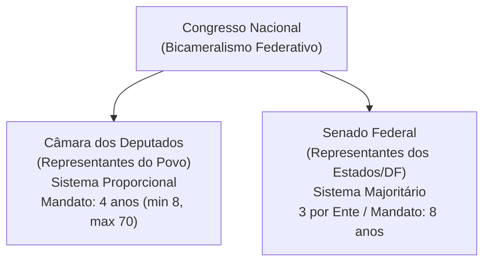

# 04 - Poder Legislativo, Processo Legislativo e Controle Externo (Arts. 70 a 75 da CF/88)

> **Matéria:** Noções de Direito Constitucional  
> **Cargo:** A01 – Técnico de Controle Externo – Especialidade: Técnico Administrativo  
> **Arquivo:** `04_poder_legislativo_processo_legislativo_e_fiscalizacao_tce.md`  
> **Status:** 🟢 Teoria Aprofundada + 5 Questões FCC Comentadas (A a E)

---

## 📌 Ementa / Itens do Edital

- Do Poder Legislativo: estrutura bicameral federal (Câmara dos Deputados e Senado Federal) e unicameral estadual/distrital/municipal.
- Atribuições do Congresso Nacional e competências privativas da Câmara dos Deputados (Art. 51) e do Senado Federal (Art. 52).
- Estatuto dos congressistas: imunidade material (inviolabilidade civil e penal) e imunidade formal/processual (prisão e prerrogativa de foro - Art. 53).
- Do processo legislativo (Artigos 59 a 69 da CF/88):
    - Emendas à Constituição (Art. 60): iniciativa restrita, rito qualificado de aprovação, inexistência de sanção/veto e limitações circunstanciais e materiais (cláusulas pétreas);
    - Leis Complementares vs. Leis Ordinárias (quórum e reserva de matéria);
    - Medidas Provisórias (Art. 62): pressupostos constitucionais, prazos e vedações temáticas absolutas.
- Da fiscalização contábil, financeira, orçamentária, operacional e patrimonial (Artigos 70 a 75 da CF/88):
    - Controle externo titularizado pelo Poder Legislativo com auxílio do Tribunal de Contas;
    - Competências do Tribunal de Contas (Art. 71 da CF/88);
    - Duplo regime de contas: Contas de Governo (parecer prévio opinativo) vs. Contas de Gestão/Ordenadores de Despesa (julgamento técnico definitivo);
    - Julgamento das contas de Prefeito Municipal (Art. 31, § 2º e Tema 835 do STF);
    - Sustação de atos administrativos ilegais vs. sustação de contratos administrativos (Art. 71, X e §§ 1º e 2º);
    - Eficácia de título executivo extrajudicial das decisões do Tribunal de Contas (Art. 71, § 3º da CF/88);
    - Princípio da simetria constitucional (Art. 75 da CF/88) e o Ministério Público de Contas (Art. 130 da CF/88).

---

## 🧭 Sumário

1. [Estrutura Bicameral e Atribuições das Casas Legislativas](#1-estrutura-bicameral-e-atribuicoes-das-casas-legislativas)
    1. [Modelo Bicameral Federal e Unicameral Estadual/Municipal](#11-modelo-bicameral-federal-e-unicameral-estadualmunicipal)
    2. [Repartição de Competências no Congresso Nacional](#12-reparticao-de-competencias-no-congresso-nacional)
    3. [Estatuto dos Congressistas e Imunidades Parlamentares](#13-estatuto-dos-congressistas-e-imunidades-parlamentares)
    4. [Teste 143](#Teste-143)
    5. [Teste 144](#Teste-144)
    6. [Teste 145](#Teste-145)
2. [O Processo Legislativo Constitucional](#2-o-processo-legislativo-constitucional)
    1. [Emendas à Constituição (Art. 60) e Limitações ao Poder de Reforma](#21-emendas-a-constituicao-art-60-e-limitacoes-ao-poder-de-reforma)
    2. [Leis Complementares versus Leis Ordinárias](#22-leis-complementares-versus-leis-ordinarias)
    3. [Medidas Provisórias (Art. 62): Prazos e Vedações Temáticas](#23-medidas-provisorias-art-62-prazos-e-vedacoes-tematicas)
    4. [Teste 146](#Teste-146)
    5. [Teste 147](#Teste-147)
    6. [Teste 148](#Teste-148)
3. [Fiscalização e Controle Externo pelos Tribunais de Contas (Arts. 70 a 75)](#3-fiscalizacao-e-controle-externo-pelos-tribunais-de-contas-arts-70-a-75)
    1. [Abrangência e Critérios da Fiscalização Financeira](#31-abrangencia-e-criterios-da-fiscalizacao-financeira)
    2. [O Julgamento de Contas Públicas: Contas de Governo versus Contas de Gestão](#32-o-julgamento-de-contas-publicas-contas-de-governo-versus-contas-de-gestao)
    3. [Sustação de Atos Ilegais versus Sustação de Contratos Administrativos](#33-sustacao-de-atos-ilegais-versus-sustacao-de-contratos-administrativos)
    4. [Eficácia das Decisões Condenatórias e Título Executivo Extrajudicial](#34-eficacia-das-decisoes-condenatorias-e-titulo-executivo-extrajudicial)
    5. [Simetria Federativa (Art. 75) e o Ministério Público de Contas (Art. 130)](#35-simetria-federativa-art-75-e-o-ministerio-publico-de-contas-art-130)
    6. [Teste 149](#Teste-149)
    7. [Teste 150](#Teste-150)
    8. [Teste 151](#Teste-151)
    9. [Teste 152](#Teste-152)
    10. [Teste 153](#Teste-153)
4. [🌐 Fontes Oficiais & Jurisprudenciais Recomendadas](#fontes-oficiais-jurisprudenciais-recomendadas)

---

## 1. Estrutura Bicameral e Atribuições das Casas Legislativas

O Poder Legislativo da União é exercido pelo Congresso Nacional, que se compõe da Câmara dos Deputados e do Senado Federal (modelo bicameral federativo):

- **Câmara dos Deputados (Art. 45):** Representa o **povo brasileiro**. Os deputados são eleitos pelo sistema eleitoral proporcional, para mandato de **4 anos** (uma legislatura). O número total de deputados por Estado e DF é proporcional à população, com piso mínimo de **8** e teto máximo de **70 deputados**.
- **Senado Federal (Art. 46):** Representa os **Estados e o Distrito Federal**. Cada unidade federada elege **3 senadores**, pelo sistema majoritário, com mandato de **8 anos** (duas legislaturas). A representação é renovada de quatro em quatro anos, alternadamente, por **um terço (1/3)** e **dois terços (2/3)**.

### 1.1 Modelo Bicameral Federal e Unicameral Estadual/Municipal
Enquanto na esfera federal vigora o bicameralismo, nos demais entes da Federação o Poder Legislativo adota compulsoriamente a estrutura **unicameral**:

- **Estados-Membros:** Assembleias Legislativas, compostas por Deputados Estaduais (art. 27);
- **Distrito Federal:** Câmara Legislativa do Distrito Federal, composta por Deputados Distritais (art. 32, § 2º);
- **Municípios:** Câmaras Municipais, compostas por Vereadores (art. 29, IV).

### 1.2 Repartição de Competências no Congresso Nacional
É fundamental distinguir os três tipos de atribuições legislativas federais:

1. **Competências com Sanção Presidencial (Art. 48):** Matérias deliberadas pelo Congresso Nacional que geram leis e demandam envio ao Presidente da República para sanção ou veto (ex.: sistema tributário, planos orçamentários, criação e extinção de cargos públicos).
2. **Competências Exclusivas do Congresso Nacional sem Sanção (Art. 49):** Deliberadas em sessão conjunta ou separada e formalizadas por **Decreto Legislativo**, sem qualquer interferência presidencial (ex.: sustar atos normativos do Executivo que exorbitem do poder regulamentar; autorizar o Presidente a declarar guerra ou celebrar a paz; julgar anualmente as contas prestadas pelo Presidente da República).
3. **Competências Privativas de Cada Casa (Arts. 51 e 52):** Formalizadas por **Resolução**, sem envio ao Presidente:
    - *Câmara dos Deputados (Art. 51, I):* Autorizar, por **dois terços** de seus membros, a instauração de processo contra o Presidente e o Vice-Presidente da República e os Ministros de Estado.
    - *Senado Federal (Art. 52, I e II):* Processar e julgar o Presidente e Vice-Presidente nos **crimes de responsabilidade**, bem como os Ministros do STF, os membros do CNJ e CNMP, o Procurador-Geral da República e o Advogado-Geral da União; sabatinar e aprovar a escolha de magistrados, Ministros do TCU e chefes de missão diplomática; suspender a execução, no todo ou em parte, de lei declarada inconstitucional por decisão definitiva do STF em controle difuso.

### 1.3 Estatuto dos Congressistas e Imunidades Parlamentares
O art. 53 da Constituição consagra o plexo de garantias institucionais dos membros do Congresso Nacional:

- **Imunidade Material (Real ou Substantiva):** Os Deputados e Senadores são invioláveis, civil e penalmente, por quaisquer de suas opiniões, palavras e votos. Exige conexão (nexo de causalidade) com o desempenho das funções parlamentares, sendo absoluta quando manifestada dentro do recinto do parlamento.
- **Imunidade Formal (Processual) quanto à Prisão (Art. 53, § 2º):** Desde a expedição do diploma, os membros do Congresso Nacional **não poderão ser presos**, salvo em flagrante de crime inafiançável. Nesse caso, os autos serão remetidos dentro de vinte e quatro horas à Casa respectiva, para que, pelo voto da maioria de seus membros, resolva sobre a prisão.
- **Foro por Prerrogativa de Função (Art. 53, § 1º):** Os Deputados e Senadores serão submetidos a julgamento perante o STF desde a expedição do diploma. Conforme tese firmada pelo STF na AP 937 e reafirmada pelo plenário, o foro especial aplica-se apenas aos crimes cometidos durante o exercício do mandato e relacionados com as funções parlamentares.

---

### Teste 143
**(Questão Inédita / Simulada Estilo FCC – Nível: Controle Externo / TI)**  
As Comissões Parlamentares de Inquérito (CPIs), previstas no art. 58, § 3º, da Constituição Federal, possuem poderes de investigação próprios das autoridades judiciais, além de outros previstos nos regimentos das respectivas Casas. A respeito dos limites constitucionais de atuação das CPIs, é correto afirmar que:

* **A)** podem decretar a quebra do sigilo bancário e fiscal de investigados fundamentadamente.
* **B)** possuem competência originária para determinar a interceptação de comunicações telefônicas.
* **C)** podem expedir mandado de busca e apreensão domiciliar na pendência de recesso parlamentar.
* **D)** detêm poder de decretar a prisão preventiva de investigados em caso de fundado perigo de fuga.
* **E)** suas conclusões condenam criminalmente os indiciados independentemente de ação do Ministério Público.

---

> **Comentário Detalhado:**
>
> - **A)** **Correto**. As CPIs federais e estaduais (art. 58, § 3º, CF/88) possuem poderes de instrução próprios das autoridades judiciais, podendo determinar diretamente a quebra dos sigilos bancário, fiscal e de dados telefônicos (registros de chamadas), desde que o façam mediante decisão fundamentada tomada pela maioria de seus membros (Súmula Vinculante 10 e jurisprudência pacífica do STF).
> - **B)** **Incorreto**. A interceptação telefônica (escuta de conversas) submete-se à cláusula de reserva absoluta de jurisdição (art. 5º, XII, CF/88), sendo privativa de magistrado.
> - **C)** **Incorreto**. A busca e apreensão domiciliar sem consentimento exige determinação judicial (art. 5º, XI, CF/88).
> - **D)** **Incorreto**. As CPIs não podem decretar prisões cautelares (preventiva ou temporária), ressalvada unicamente a prisão em flagrante delito.
> - **E)** **Incorreto**. As conclusões da CPI são encaminhadas ao Ministério Público ou à Advocacia-Geral para que promovam a responsabilidade civil ou criminal dos infratores.
>
> **Gabarito: A**

### Teste 144
**(FCC – TRT – Analista Judiciário - Tecnologia da Informação – 2009)**  
Compete ao Congresso Nacional, com a sanção do Presidente da República:

* **A)** dispor sobre fixação do subsídio dos Ministros do Supremo Tribunal Federal por lei específica.
* **B)** apreciar os atos de outorga e renovação de concessão de emissoras de rádio e televisão.
* **C)** escolher dois terços dos membros que compõem o Tribunal de Contas da União.
* **D)** autorizar previamente a realização de referendo e convocar plebiscito nacional.
* **E)** autorizar, em terras indígenas, a exploração e o aproveitamento de recursos hídricos.

---

> **Comentário Detalhado:**
>
> - **A)** **Correto**. O art. 48, XV, da CF/88 estabelece que cabe ao Congresso Nacional, com a sanção do Presidente da República (mediante lei ordinária federal de iniciativa conjunta dos Poderes), dispor sobre a "fixação do subsídio dos Ministros do Supremo Tribunal Federal". As matérias do art. 48 exigem sanção presidencial.
> - **B)** **Incorreto**. A apreciação de atos de concessão e renovação de emissoras de rádio e televisão é competência exclusiva do Congresso Nacional (art. 49, XII, CF/88), formalizada por decreto legislativo, sem sanção presidencial.
> - **C)** **Incorreto**. Escolher dois terços dos membros do TCU é competência exclusiva do Congresso Nacional (art. 49, XIII, CF/88).
> - **D)** **Incorreto**. Autorizar referendo e convocar plebiscito é competência exclusiva do Congresso Nacional (art. 49, XV, CF/88).
> - **E)** **Incorreto**. Autorizar a exploração de recursos hídricos e minerais em terras indígenas é competência exclusiva do Congresso Nacional (art. 49, XVI, CF/88).
>
> **Gabarito: A**

### Teste 145
**(FCC – TRT – Analista Judiciário - Tecnologia da Informação – 2009)**  
Ao organizar o Poder Legislativo na esfera federal, a Constituição da República prevê que:

* **A)** a Câmara dos Deputados será composta de representantes eleitos pelo sistema proporcional em cada unidade federada.
* **B)** o Senado Federal será composto de representantes dos Estados e do Distrito Federal, eleitos segundo o princípio proporcional.
* **C)** a representação de cada Estado no Senado Federal será renovada de quatro em quatro anos pelo critério de um terço fixo.
* **D)** as deliberações de cada Casa Legislativa serão tomadas pela unanimidade de seus membros, salvo disposição regimental.
* **E)** o número total de Senadores varia proporcionalmente à população de cada Estado apurada pelo Censo oficial da União.

---

> **Comentário Detalhado:**
>
> - **A)** **Correto**. Conforme o art. 45 da CF/88: "A Câmara dos Deputados compõe-se de representantes do povo, eleitos, pelo sistema proporcional, em cada Estado, em cada Território e no Distrito Federal".
> - **B)** **Incorreto**. O Senado Federal é composto por representantes eleitos segundo o princípio majoritário (art. 46, caput, CF/88).
> - **C)** **Incorreto**. A representação no Senado é renovada de quatro em quatro anos, alternadamente, por um e dois terços (art. 46, § 2º, CF/88).
> - **D)** **Incorreto**. As deliberações são tomadas, em regra, por maioria simples (maioria dos votos, presente a maioria absoluta de seus membros - art. 47, CF/88).
> - **E)** **Incorreto**. Cada Estado e o Distrito Federal elegem exatamente três Senadores, com representação paritária e fixa que não varia com a população (art. 46, § 1º, CF/88).
>
> **Gabarito: A**

### Teste 146
**(Questão Inédita / Simulada Estilo FCC – Nível: Controle Externo / TI)**  
A respeito dos limites ao poder constituinte derivado reformador no processo legislativo de emendas à Constituição (art. 60 da CF/88), analise as regras constitucionais. É correto afirmar que:

* **A)** A proposta de emenda deve ser votada em sessão unicameral conjunta do Congresso Nacional.
* **B)** O Presidente da República possui prerrogativa de apor veto jurídico ou político à PEC aprovada.
* **C)** A matéria constante de proposta de emenda rejeitada poderá ser reapresentada na mesma sessão.
* **D)** O voto obrigatório e o regime presidencialista constituem cláusulas pétreas expressas da CF/88.
* **E)** A emenda aprovada será promulgada pelas Mesas da Câmara dos Deputados e do Senado Federal.

---

> **Comentário Detalhado:**
>
> - **A)** **Incorreto**. A proposta será discutida e votada em cada Casa do Congresso Nacional, em dois turnos (art. 60, § 2º, CF/88).
> - **B)** **Incorreto**. Não há sanção ou veto do Presidente da República em propostas de emenda constitucional.
> - **C)** **Incorreto**. Conforme o art. 60, § 5º, da CF/88, a matéria constante de proposta de emenda rejeitada ou havida por prejudicada não pode ser objeto de nova proposta na mesma sessão legislativa.
> - **D)** **Incorreto**. O art. 60, § 4º, II, tutela a forma federativa, o voto direto, secreto, universal e periódico (não o voto obrigatório). O presidencialismo não é cláusula pétrea expressa.
> - **E)** **Correto**. Nos termos do art. 60, § 3º, da CF/88: "A emenda à Constituição será promulgada pelas Mesas da Câmara dos Deputados e do Senado Federal, com o respectivo número de ordem".
>
> **Gabarito: E**

### Teste 147
**(Questão Inédita / Simulada Estilo FCC – Nível: Controle Externo / TI)**  
Acerca do processo legislativo ordinário disciplinado na Constituição Federal (arts. 61 a 67 da CF/88), analise as regras sobre iniciativa e veto presidencial. É correto afirmar que:

* **A)** O veto parcial do Presidente da República deve abranger o texto integral de artigo, de parágrafo, de inciso ou de alínea.
* **B)** O silêncio do Presidente da República no prazo de quinze dias úteis importará em veto tácito ao projeto aprovado.
* **C)** O veto presidencial somente pode ser rejeitado pelo voto de dois terços dos membros de cada Casa parlamentar.
* **D)** É admitida emenda parlamentar que aumente a despesa prevista nos projetos de iniciativa exclusiva do Presidente.
* **E)** A matéria de projeto de lei rejeitado jamais poderá ser renovada na mesma sessão legislativa sob qualquer hipótese.

---

> **Comentário Detalhado:**
>
> - **A)** **Correto**. Conforme expressa o art. 66, § 2º, da Constituição Federal: "O veto parcial somente abrangerá texto integral de artigo, de parágrafo, de inciso ou de alínea" (vedado expressamente o veto a palavras ou expressões isoladas).
> - **B)** **Incorreto**. Decorrido o prazo de 15 dias úteis, o silêncio do Presidente da República importará em sanção tácita (art. 66, § 3º, CF/88).
> - **C)** **Incorreto**. O veto será apreciado em sessão conjunta e só pode ser rejeitado pelo voto da maioria absoluta dos Deputados e Senadores (art. 66, § 4º, CF/88).
> - **D)** **Incorreto**. É vedado aumento de despesa nos projetos de iniciativa exclusiva do Presidente da República (art. 63, I, CF/88), ressalvadas as emendas ao orçamento (art. 166).
> - **E)** **Incorreto**. O projeto rejeitado pode ser renovado na mesma sessão legislativa mediante proposta da maioria absoluta dos membros de qualquer das Casas (art. 67, CF/88).
>
> **Gabarito: A**

### Teste 148
**(Questão Inédita / Simulada Estilo FCC – Nível: Controle Externo / TI)**  
O art. 62 da Constituição da República autoriza o Presidente a adotar medidas provisórias, com força de lei, em caso de relevância e urgência. A respeito do regime constitucional das medidas provisórias, é correto afirmar:

* **A)** É permitida a edição de medida provisória que discipline matéria afeta a direito penal e processo penal.
* **B)** É vedada a edição de medida provisória sobre matéria reservada a lei complementar ou de direito eleitoral.
* **C)** A medida provisória perde a eficácia desde a edição se não for convertida em lei no prazo fatal de trinta dias.
* **D)** A prorrogação da vigência da medida provisória por igual período de sessenta dias depende de votação em Plenário.
* **E)** Se a medida provisória não for apreciada em quarenta e cinco dias, ocorrerá a sua imediata rejeição tácita.

---

> **Comentário Detalhado:**
>
> - **A)** **Incorreto**. O art. 62, § 1º, I, 'b', da CF/88 veda expressamente a edição de medidas provisórias sobre direito penal, processual penal e processual civil.
> - **B)** **Correto**. O art. 62, § 1º, da CF/88 veda a edição de medida provisória que verse sobre nacionalidade, cidadania, direitos políticos, partidos políticos e direito eleitoral (inciso I, 'a'), bem como matéria reservada a lei complementar (inciso III).
> - **C)** **Incorreto**. O prazo inicial de vigência é de sessenta dias, prorrogável uma única vez por igual período (art. 62, §§ 3º e 7º, CF/88).
> - **D)** **Incorreto**. A prorrogação por sessenta dias dá-se de forma automática quando a medida não tiver sua votação encerrada nas duas Casas (art. 62, § 7º, CF/88).
> - **E)** **Incorreto**. Não sendo votada em até 45 dias da publicação, a MP entrará em regime de urgência, ficando sobrestadas as demais deliberações legislativas da Casa (trancamento da pauta - art. 62, § 6º, CF/88).
>
> **Gabarito: B**

### Teste 149
**(FGV – TRT – Analista Judiciário - Tecnologia da Informação – 2024)**  
O artigo 31 da Constituição Federal do Brasil estabelece que a fiscalização no âmbito municipal será conduzida pelo Poder Legislativo Municipal, por meio de controle externo, e pelos sistemas de controle interno do Poder Executivo Municipal, conforme determinado pela legislação.  
Assinale a opção que indica o órgão que auxilia o controle externo da Câmara Municipal:

* **A)** Controladoria-Geral do Estado federado.
* **B)** Tribunal de Contas do Estado competente.
* **C)** Secretaria da Fazenda e Planejamento.
* **D)** Secretaria Municipal de Auditoria Interna.
* **E)** Conselho Comunitário de Controle Social.

---

> **Comentário Detalhado:**
>
> - **A)** **Incorreto**. As controladorias executivas atuam no controle interno de seus respectivos entes federativos.
> - **B)** **Correto**. Conforme o art. 31, § 1º, da Constituição Federal: "O controle externo da Câmara Municipal será exercido com o auxílio dos Tribunais de Contas dos Estados ou do Município ou dos Conselhos ou Tribunais de Contas dos Municípios, onde houver". No caso de Goiás, o controle das contas municipais era historicamente exercido com o auxílio do TCM-GO e, no plano geral dos Estados que não possuem tribunal municipal, pelo respectivo Tribunal de Contas do Estado (TCE).
> - **C)** **Incorreto**. A Fazenda é órgão executivo integrante da administração direta municipal.
> - **D)** **Incorreto**. A secretaria de auditoria integra a estrutura de controle interno do Executivo.
> - **E)** **Incorreto**. Conselhos comunitários realizam controle social, sem caráter de órgão técnico auxiliar constitucional.
>
> **Gabarito: B**

### Teste 150
**(Questão Inédita / Simulada Estilo FCC – Nível: Controle Externo / TI)**  
A Câmara Municipal de determinado município goiano recebeu o parecer prévio desfavorável emitido pelo Tribunal de Contas sobre as contas anuais de governo prestadas pelo Prefeito. Considerando a jurisprudência fixada pelo STF em repercussão geral (Temas 157 e 835), analise as regras de julgamento:

* **A)** O parecer prévio do Tribunal de Contas tem natureza vinculante imediata e gera a inelegibilidade automática.
* **B)** As contas do chefe do Executivo que atue como ordenador de despesas são julgadas em definitivo pelo Tribunal de Contas.
* **C)** A Câmara de Vereadores só pode rejeitar o parecer prévio pelo voto da maioria simples dos parlamentares presentes.
* **D)** Compete exclusivamente à Câmara Municipal o julgamento das contas do Prefeito, atuando o TC como órgão de auxílio.
* **E)** O parecer prévio do Tribunal de Contas deixa de prevalecer se for impugnado por recurso de iniciativa popular local.

---

> **Comentário Detalhado:**
>
> - **A)** **Incorreto**. O parecer prévio tem caráter técnico-opinativo e não vincula de forma absoluta o Legislativo municipal.
> - **B)** **Incorreto**. O STF fixou nos Temas 157 e 835 que, para fins de inelegibilidade (art. 1º, I, 'g', da LC 64/90), a competência para julgar TODAS as contas prestadas por Prefeito (sejam contas de governo ou de gestão/ordenador de despesas) é exclusiva da Câmara Municipal.
> - **C)** **Incorreto**. Conforme o art. 31, § 2º, da CF/88, o parecer prévio somente deixará de prevalecer por decisão de dois terços dos membros da Câmara Municipal (maioria qualificada).
> - **D)** **Correto**. Consoante a tese vinculante do STF: para os fins da Lei Complementar nº 64/1990, a apreciação das contas de Prefeito, tanto as de governo quanto as de gestão, é de competência exclusiva do Poder Legislativo municipal, atuando o Tribunal de Contas apenas como órgão técnico auxiliar de assessoramento prévio.
> - **E)** **Incorreto**. A derrubada do parecer técnico exige estritamente a deliberação qualificada de 2/3 dos vereadores.
>
> **Gabarito: D**

### Teste 151
**(FCC – TRT – Analista Judiciário - Tecnologia da Informação – 2009)**  
Compete ao Tribunal de Contas do Estado de Goiás:

* **A)** julgar as contas dos administradores e demais responsáveis por bens públicos da administração direta e indireta.
* **B)** apreciar as contas dos gestores e ordenadores de despesas exclusivamente dos órgãos da administração direta.
* **C)** processar e julgar o Governador e o Vice-Governador por crimes de responsabilidade e infrações político-administrativas.
* **D)** julgar, anualmente, as contas prestadas pelo Governador do Estado com força executiva condenatória.
* **E)** proceder à tomada de contas do Governador quando não prestadas dentro de sessenta dias da abertura da sessão.

---

> **Comentário Detalhado:**
>
> - **A)** **Correto**. Nos termos do art. 71, II, da CF/88 (reproduzido na Constituição Estadual de Goiás): compete ao Tribunal de Contas "julgar as contas dos administradores e demais responsáveis por dinheiros, bens e valores públicos da administração direta e indireta, incluídas as fundações e sociedades instituídas e mantidas pelo Poder Público estadual, e as contas daqueles que derem causa a perda, extravio ou outra irregularidade de que resulte prejuízo ao erário público".
> - **B)** **Incorreto**. A competência abrange indistintamente os responsáveis pela administração direta e indireta, e não apenas a direta. Ademais, o ato sobre tais gestores é de *julgar*, e não meramente apreciar.
> - **C)** **Incorreto**. O julgamento do Governador por crime de responsabilidade compete a Tribunal Especial (ou Assembleia Legislativa), jamais ao Tribunal de Contas.
> - **D)** **Incorreto**. O Tribunal de Contas não *julga* as contas do Chefe do Executivo; compete-lhe emitir *parecer prévio* anual (art. 71, I, CF/88), cabendo o julgamento político exclusivamente ao Poder Legislativo.
> - **E)** **Incorreto**. Proceder à tomada de contas do Governador na omissão deste é competência privativa da Assembleia Legislativa (art. 51, II c/c art. 84, XXIV, CF/88).
>
> **Gabarito: A**

### Teste 152
**(Questão Inédita / Simulada Estilo FCC – Nível: Controle Externo / TI)**  
O Plenário do Tribunal de Contas do Estado de Goiás, ao fiscalizar a legalidade da folha de pagamento de determinado órgão estadual, deparou-se com gratificação instituída por lei cuja compatibilidade com o teto constitucional era duvidosa. À luz da Súmula 347 do STF e da jurisprudência recente da Suprema Corte sobre o tema, analise a atuação da Corte de Contas:

* **A)** O Tribunal de Contas pode declarar formalmente a inconstitucionalidade de lei estadual com efeitos erga omnes.
* **B)** O Tribunal de Contas pode afastar incidenter tantum a aplicação de lei manifestamente contrária à Constituição.
* **C)** É vedado ao Tribunal de Contas recusar a aplicação de ato normativo estadual mesmo diante de ofensa à Carta Magna.
* **D)** O Tribunal de Contas exerce fiscalização abstrata de constitucionalidade quando provocado por representação da Mesa.
* **E)** A recusa de aplicação de ato legislativo pela Corte de Contas depende de autorização do Tribunal de Justiça estadual.

---

> **Comentário Detalhado:**
>
> - **A)** **Incorreto**. O Tribunal de Contas não integra o Poder Judiciário e não realiza controle concentrado ou abstrato de constitucionalidade com eficácia erga omnes.
> - **B)** **Correto**. Conforme o enunciado da Súmula 347 do STF: "O Tribunal de Contas, no exercício de suas atribuições, pode apreciar a constitucionalidade das leis e dos atos do Poder Público". Embora o STF venha modulando esse poder em precedentes recentes (como nos mandados de segurança sobre declaração geral de inconstitucionalidade), a jurisprudência tradicional das bancas de concurso reconhece a prerrogativa do Tribunal de Contas de afastar, incidentalmente e para o caso concreto sob seu exame, a aplicação de lei incompatível com a CF/88.
> - **C)** **Incorreto**. O controle difuso/incidental no exercício da atividade fiscalizatória é assegurado pela Súmula 347.
> - **D)** **Incorreto**. A fiscalização abstrata é exclusiva do Poder Judiciário via ADI perante o TJ ou STF.
> - **E)** **Incorreto**. A apreciação incidental pelo Tribunal de Contas independe de autorização do Poder Judiciário.
>
> **Gabarito: B**

### Teste 153
**(Questão Inédita / Simulada Estilo FCC – Nível: Controle Externo / TI)**  
A fiscalização dos municípios é exercida pelo Poder Legislativo com o auxílio do Tribunal de Contas competente. Em relação à organização dos Tribunais de Contas municipais no direito brasileiro e à vedação expressa do art. 31, § 4º, da Constituição Federal, é correto afirmar:

* **A)** É permitida a criação de novos Tribunais de Contas municipais em cidades com mais de dois milhões de habitantes.
* **B)** É vedada a criação de novos Tribunais, Conselhos ou órgãos de Contas Municipais após a promulgação da CF/88.
* **C)** Os Tribunais de Contas dos Municípios do Rio de Janeiro e de São Paulo foram compulsoriamente extintos pela CF/88.
* **D)** O Estado federado não pode criar Tribunal de Contas dos Municípios dotado de jurisdição estadual compartilhada.
* **E)** A competência fiscalizatória dos Tribunais de Contas estaduais sobre os Municípios foi delegada a conselhos distritais.

---

> **Comentário Detalhado:**
>
> - **A)** **Incorreto**. A proibição da CF/88 é categórica e independe do número de habitantes ou da capacidade orçamentária do Município.
> - **B)** **Correto**. O art. 31, § 4º, da Constituição Federal dispõe taxativamente: "É vedada a criação de Tribunais, Conselhos ou órgãos de Contas Municipais". A vedação aplica-se a quaisquer novos órgãos municipais de contas criados a partir de 5 de outubro de 1988.
> - **C)** **Incorreto**. Os Tribunais de Contas dos Municípios de São Paulo e do Rio de Janeiro já existiam antes de 1988 e foram recepcionados pela ordem constitucional vigente.
> - **D)** **Incorreto**. A jurisprudência do STF autoriza a existência de Tribunais de Contas dos Municípios (órgãos estaduais com competência sobre os municípios, como ocorria na Bahia, Pará e Goiás), desde que instituídos antes de restrições ou conforme a ordem constitucional.
> - **E)** **Incorreto**. A fiscalização é exercida diretamente pelos Tribunais de Contas constitucionais.
>
> **Gabarito: B**

