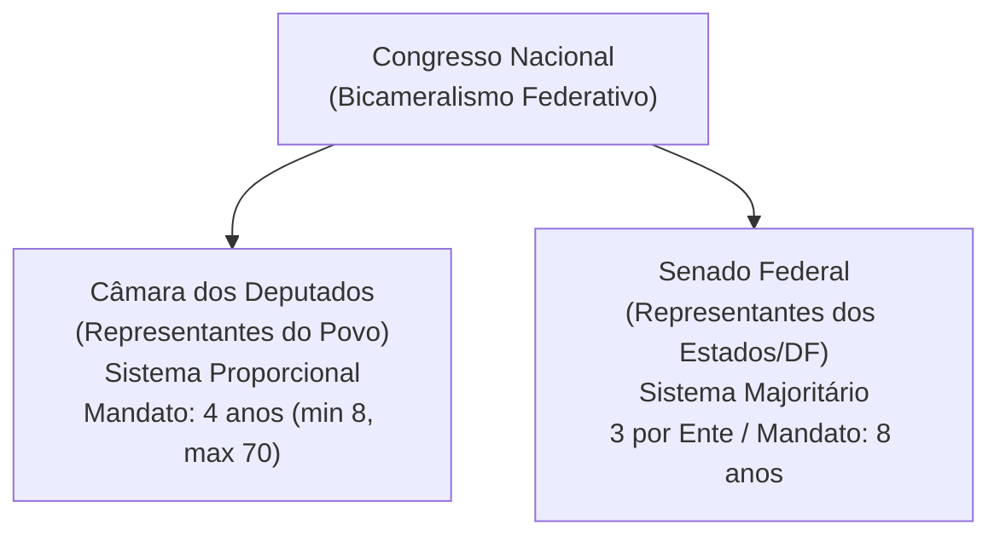
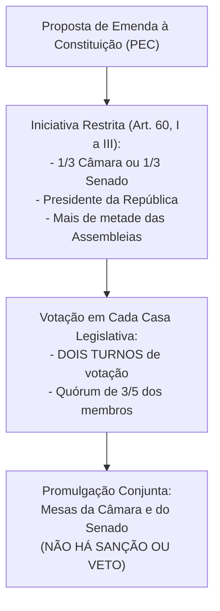
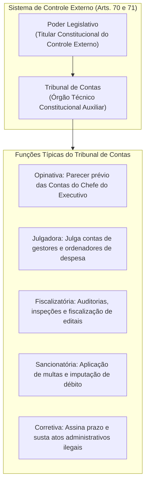
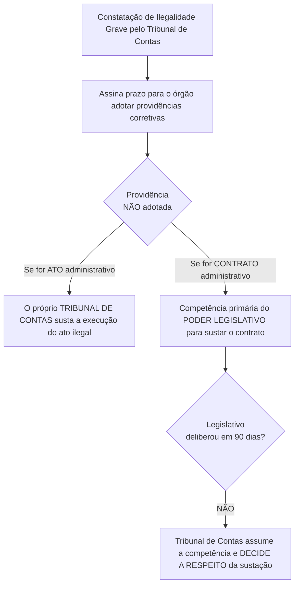

# 04 - Poder Legislativo, Processo Legislativo e Controle Externo (Arts. 70 a 75 da CF/88)

> **Matéria:** Noções de Direito Constitucional  
> **Cargo:** A01 – Técnico de Controle Externo – Especialidade: Técnico Administrativo  
> **Arquivo:** `04_poder_legislativo_processo_legislativo_e_fiscalizacao_tce.md`  

---

## 📌 Ementa / Itens do Edital

- Do Poder Legislativo: estrutura bicameral federal (Câmara dos Deputados e Senado Federal) e unicameral estadual/distrital/municipal.
- Atribuições do Congresso Nacional e competências privativas da Câmara dos Deputados (Art. 51) e do Senado Federal (Art. 52).
- Estatuto dos congressistas: imunidade material (inviolabilidade civil e penal) e imunidade formal/processual (prisão e prerrogativa de foro - Art. 53).
- Do processo legislativo (Artigos 59 a 69 da CF/88):
  - Emendas à Constituição (Art. 60): iniciativa restrita, rito qualificado de aprovação, inexistência de sanção/veto e limitações circunstanciais e materiais (cláusulas pétreas);
  - Leis Complementares vs. Leis Ordinárias (quórum e reserva de matéria);
  - Medidas Provisórias (Art. 62): pressupostos constitucionais, prazos e vedações temáticas absolutas.
- Da fiscalização contábil, financeira, orçamentária, operacional e patrimonial (Artigos 70 a 75 da CF/88):
  - Controle externo titularizado pelo Poder Legislativo com auxílio do Tribunal de Contas;
  - Competências do Tribunal de Contas (Art. 71 da CF/88);
  - Duplo regime de contas: Contas de Governo (parecer prévio opinativo) vs. Contas de Gestão/Ordenadores de Despesa (julgamento técnico definitivo);
  - Julgamento das contas de Prefeito Municipal (Art. 31, § 2º e Tema 835 do STF);
  - Sustação de atos administrativos ilegais vs. sustação de contratos administrativos (Art. 71, X e §§ 1º e 2º);
  - Eficácia de título executivo extrajudicial das decisões do Tribunal de Contas (Art. 71, § 3º da CF/88);
  - Princípio da simetria constitucional (Art. 75 da CF/88) e o Ministério Público de Contas (Art. 130 da CF/88).

---

## 🌳 Classificação Hierárquica

```text
4. Organização do Poder Legislativo, Processo Legislativo e Fiscalização pelo Tribunal de Contas
├── 4.1 Estrutura e Atribuições do Poder Legislativo
│   ├── 4.1.1 Modelo Bicameral Federal (Art. 44):
│   │   ├── Câmara dos Deputados (Art. 45): Representantes do povo; sistema proporcional; mandato de 4 anos; bancadas proporcionais (mínimo 8 e máximo 70 deputados)
│   │   └── Senado Federal (Art. 46): Representantes dos Estados e do DF; sistema majoritário; 3 senadores por Estado/DF; mandato de 8 anos (renovação alternada por 1/3 e 2/3 a cada 4 anos)
│   ├── 4.1.2 Modelo Unicameral nos Demais Entes:
│   │   ├── Assembleias Legislativas dos Estados: Deputados estaduais (Art. 27)
│   │   ├── Câmara Legislativa do DF: Deputados distritais (Art. 32, § 2º)
│   │   └── Câmaras Municipais: Vereadores (Art. 29, IV)
│   ├── 4.1.3 Competências das Casas Legislativas Federais:
│   │   ├── Competência Exclusiva do Congresso Nacional (Art. 49): Atos consubstanciados em Decreto Legislativo, sem sanção ou veto presidencial (aprovação de tratados, autorização de guerra, sustação de atos normativos do Executivo)
│   │   ├── Competência Privativa da Câmara dos Deputados (Art. 51): Autorizar instauração de processo contra o Presidente/Vice por 2/3 de seus membros
│   │   └── Competência Privativa do Senado Federal (Art. 52): Processar e julgar o Presidente da República e Ministros do STF em crimes de responsabilidade; aprovar escolha de ministros de tribunais superiores, ministros do TCU e diplomatas; suspender a execução de lei declarada inconstitucional pelo STF em controle difuso
│   └── 4.1.4 Estatuto dos Congressistas e Imunidades Parlamentares (Art. 53):
│       ├── Imunidade Material / Real: Inviolabilidade civil e penal por quaisquer de suas opiniões, palavras e votos (exige nexo com as funções parlamentares)
│       ├── Imunidade Formal / Processual para Prisão: Desde a expedição do diploma, parlamentares NÃO podem ser presos, SALVO em flagrante de crime inafiançável (remessa dos autos em 24h para deliberação pela maioria da Casa)
│       └── Foro por Prerrogativa de Função: Perante o STF para crimes cometidos no exercício do mandato e em razão das funções desempenhadas
├── 4.2 O Processo Legislativo Constitucional (Arts. 59 a 69)
│   ├── 4.2.1 Espécies Normativas Primárias (Art. 59): Emendas à Constituição, Leis Complementares, Leis Ordinárias, Leis Delegadas, Medidas Provisórias, Decretos Legislativos e Resoluções
│   ├── 4.2.2 Emendas à Constituição - PEC (Art. 60):
│   │   ├── Legitimidade Restrita de Proposta (Art. 60, I a III): 1/3 da Câmara OU 1/3 do Senado; Presidente da República; ou mais da metade das Assembleias Legislativas (por maioria relativa)
│   │   │   └── 🚨 Pegadinha FCC: NÃO EXISTE iniciativa popular de Proposta de Emenda à Constituição!
│   │   ├── Procedimento e Quórum Qualificado: Discussão e votação em DOIS TURNOS em cada Casa, aprovada por 3/5 (três quintos) dos membros
│   │   ├── Promulgação: Realizada pelas Mesas da Câmara e do Senado conjuntamente (NÃO HÁ sanção nem veto do Presidente da República)
│   │   └── Limitações ao Poder Constituinte Derivado Reformador:
│   │       ├── Limitações Circunstanciais: Vedada alteração na vigência de intervenção federal, estado de defesa ou estado de sítio
│   │       ├── Limitações Temporais / Irrepetibilidade: Matéria rejeitada ou havida por prejudicada NÃO pode ser renovada na mesma sessão legislativa
│   │       └── Limitações Materiais (Cláusulas Pétreas - Art. 60, § 4º): 1. Forma federativa de Estado; 2. Voto direto, secreto, universal e periódico; 3. Separação dos Poderes; 4. Direitos e garantias individuais
│   ├── 4.2.3 Leis Complementares vs. Leis Ordinárias:
│   │   ├── Lei Complementar: Exige MAIORIA ABSOLUTA de ambas as Casas para aprovação; matérias taxativamente reservadas pela CF
│   │   └── Lei Ordinária: Exige MAIORIA SIMPLES (maioria dos presentes com presença da maioria absoluta); caráter residual
│   └── 4.2.4 Medidas Provisórias (Art. 62):
│       ├── Requisitos de Admissibilidade: Relevância e urgência avaliadas pelo Presidente da República
│       ├── Vigência e Trancamento: Prazo de 60 dias prorrogável uma vez por 60 dias (total de 120 dias); se não apreciada em 45 dias, entra em regime de urgência trancando a pauta
│       └── Vedações Temáticas Absolutas: Direito penal, processual penal e processual civil; nacionalidade e direitos políticos; direito eleitoral; detenção ou sequestro de bens/poupança; matérias reservadas a lei complementar; orçamento, PPA, LDO e LOA (ressalvada abertura de créditos extraordinários)
└── 4.3 Fiscalização Contábil, Financeira, Orçamentária e Operacional (Arts. 70 a 75)
    ├── 4.3.1 Amplitude do Controle da Gestão Pública (Art. 70):
    │   ├── Critérios da Fiscalização: Legalidade, legitimidade, economicidade, aplicação das subvenções e renúncia de receitas
    │   ├── Sujeitos do Controle: Qualquer pessoa física ou jurídica, pública ou privada, que utilize, arrecade, guarde, gerencie ou administre dinheiros, bens e valores públicos
    │   └── Dualidade do Controle: Controle Externo (Poder Legislativo com auxílio do Tribunal de Contas) e Controle Interno (integrado em cada Poder)
    ├── 4.3.2 Competências Constitucionais dos Tribunais de Contas (Art. 71):
    │   ├── Apreciação das Contas do Chefe do Executivo (Art. 71, I): Emissão de PARECER PRÉVIO em 60 dias (órgão opinativo/auxiliar)
    │   ├── Julgamento das Contas dos Administradores e Ordenadores de Despesa (Art. 71, II): Julgamento técnico com decisão definitiva
    │   ├── Apreciação da Legalidade de Admissões e Aposentadorias (Art. 71, III): Atos complexos de pessoal (prazo decadencial de 5 anos pelo Tema 445/STF)
    │   ├── Realização de Inspeções e Auditorias por iniciativa própria ou a pedido do Legislativo (Art. 71, IV)
    │   ├── Aplicação de Sanções Administrativas e Pecuniárias (Art. 71, VIII): Multas e imputação de débito
    │   └── Sustação de Atos e Contratos Ilegais (Art. 71, X e §§ 1º e 2º):
    │       ├── Sustação de ATO administrativo ilegal: Praticada DIRETAMENTE pelo Tribunal de Contas (se a autoridade não corrigir no prazo)
    │       └── Sustação de CONTRATO administrativo: Praticada originariamente pelo PODER LEGISLATIVO; o Tribunal de Contas só decide caso o Legislativo não delibere em 90 dias
    ├── 4.3.3 Duplo Regime das Contas Públicas (Tema 835 do STF):
    │   ├── 1. Contas de Governo: Prestadas anualmente pelo Chefe do Executivo -> Julgadas pelo Poder Legislativo com parecer prévio do Tribunal de Contas
    │   └── 2. Contas do Prefeito Municipal Ordenador de Despesas: STF pacificou que o julgamento de TODAS as contas de Prefeito compete à Câmara Municipal (com parecer prévio do Tribunal de Contas que só cai por 2/3 dos votos)
    ├── 4.3.4 Eficácia das Decisões Condenatórias (Art. 71, § 3º):
    │   └── Título Executivo Extrajudicial: As decisões que imputam débito ou multa dispensam ação de conhecimento e são executadas via Execução Fiscal pela Procuradoria da Fazenda
    ├── 4.3.5 Princípio da Simetria Constitucional Federativa (Art. 75):
    │   └── O modelo de organização e fiscalização do TCU aplica-se compulsoriamente aos Tribunais de Contas dos Estados (TCE-GO) e Municípios
    └── 4.3.6 Ministério Público de Contas (Art. 130):
        ├── Órgão ministerial especializado com atuação privativa perante o respectivo Tribunal de Contas
        └── Mesmas prerrogativas, garantias de vitaliciedade, inamovibilidade e vedações dos membros do Ministério Público comum
```

---

## 📖 Conteúdo Teórico Aprofundado

### 1. Estrutura Bicameral e Atribuições das Casas Legislativas

O Poder Legislativo da União é exercido pelo Congresso Nacional, que se compõe da Câmara dos Deputados e do Senado Federal (modelo bicameral federativo):
- **Câmara dos Deputados (Art. 45):** Representa o **povo brasileiro**. Os deputados são eleitos pelo sistema eleitoral proporcional, para mandato de **4 anos** (uma legislatura). O número total de deputados por Estado e DF é proporcional à população, com piso mínimo de **8** e teto máximo de **70 deputados**.
- **Senado Federal (Art. 46):** Representa os **Estados e o Distrito Federal**. Cada unidade federada elege **3 senadores**, pelo sistema majoritário, com mandato de **8 anos** (duas legislaturas). A representação é renovada de quatro em quatro anos, alternadamente, por **um terço (1/3)** e **dois terços (2/3)**.



---

#### 1.1 Repartição de Competências no Congresso Nacional
É fundamental distinguir os três tipos de atribuições legislativas federais:
1. **Competências com Sanção Presidencial (Art. 48):** Matérias deliberadas pelo Congresso Nacional que geram leis e demandam envio ao Presidente da República para sanção ou veto (ex.: sistema tributário, planos orçamentários, criação de cargos públicos).
2. **Competências Exclusivas do Congresso Nacional sem Sanção (Art. 49):** Deliberadas em sessão conjunta ou separada e formalizadas por **Decreto Legislativo**, sem qualquer interferência presidencial (ex.: sustar atos normativos do Executivo que exorbitem do poder regulamentar; autorizar o Presidente a declarar guerra ou celebrar a paz; julgar anualmente as contas prestadas pelo Presidente da República).
3. **Competências Privativas de Cada Casa (Arts. 51 e 52):** Formalizadas por **Resolução**, sem envio ao Presidente:
   - *Câmara dos Deputados (Art. 51, I):* Autorizar, por **dois terços** de seus membros, a instauração de processo contra o Presidente e o Vice-Presidente da República e os Ministros de Estado.
   - *Senado Federal (Art. 52, I e II):* Processar e julgar o Presidente e Vice-Presidente nos **crimes de responsabilidade**, bem como os Ministros do STF, os membros do CNJ e CNMP, o Procurador-Geral da República e o Advogado-Geral da União; sabatinar e aprovar a escolha de magistrados, Ministros do TCU e chefes de missão diplomática; suspender a execução, no todo ou em parte, de lei declarada inconstitucional por decisão definitiva do STF.

---

### 2. O Processo Legislativo e as Emendas Constitucionais

#### 2.1 Emendas à Constituição (Art. 60)
As Emendas Constitucionais manifestam o exercício do **Poder Constituinte Derivado Reformador**, sujeitando-se a limites formais e materiais rigorosos.



> 🚨 **ALERTA DE PROVA / PEGADINHA FCC:**  
> 1. **Iniciativa Popular de PEC:** NÃO existe iniciativa popular para propor Emenda à Constituição! A iniciativa popular no Brasil (art. 61, § 2º) é restrita a projetos de **lei ordinária** e **lei complementar**.  
> 2. **Sanção e Veto Presidencial:** O Presidente da República **NÃO sanciona nem veta** Emendas à Constituição. Uma vez aprovada por 3/5 em dois turnos na Câmara e no Senado, a PEC é promulgada diretamente pelas Mesas da Câmara dos Deputados e do Senado Federal.  
> 3. **Cláusulas Pétreas (Art. 60, § 4º):** Não será objeto de deliberação a proposta de emenda tendente a abolir:
>    - I - a forma federativa de Estado;
>    - II - o voto direto, secreto, universal e periódico;
>    - III - a separação dos Poderes;
>    - IV - os direitos e garantias individuais.

---

#### 2.2 Medidas Provisórias (Art. 62)
- **Requisitos Constitucionais:** Adotadas pelo Presidente da República em casos de **relevância e urgência**, com força de lei imediata.
- **Vigência:** Vigoram por **60 dias**, prorrogáveis uma única vez por mais 60 dias (prazo total máximo de **120 dias**). Se não forem apreciadas em até **45 dias** da publicação, entram em regime de urgência, ficando sobrestadas (trancadas) todas as demais deliberações legislativas da Casa.
- **Vedações Materiais Categóricas (Art. 62, § 1º):** É terminantemente vedada a edição de Medidas Provisórias sobre:
  - Nacionalidade, cidadania, direitos políticos, partidos políticos e direito eleitoral;
  - Direito penal, processual penal e processual civil;
  - Organização do Poder Judiciário e do Ministério Público, a carreira e a garantia de seus membros;
  - Planos plurianuais (PPA), diretrizes orçamentárias (LDO), orçamento anual (LOA) e créditos adicionais (ressalvada a abertura de **créditos extraordinários** para despesas urgentes e imprevistas decorrentes de guerra, calamidade pública ou comoção interna - Art. 167, § 3º);
  - Detenção ou sequestro de bens, poupança ou qualquer outro ativo financeiro;
  - Matéria reservada a **Lei Complementar**.

---

### 3. Fiscalização e Controle Externo pelos Tribunais de Contas (Arts. 70 a 75)

#### 3.1 Abrangência e Objetivos da Fiscalização Financeira
Conforme o art. 70 da CF/88, a fiscalização contábil, financeira, orçamentária, operacional e patrimonial da Administração Pública e de qualquer entidade que utilize recursos públicos será exercida pelo Congresso Nacional (ou Assembleia Legislativa estadual), mediante **controle externo**, e pelos sistemas de **controle interno** de cada Poder.
- **Aspectos Controlados:**
  - *Legalidade:* Conformidade com as leis e a Constituição.
  - *Legitimidade:* Atendimento ao interesse público e à moralidade administrativa.
  - *Economicidade:* Relação custo-benefício e eficiência na alocação dos recursos públicos.
  - *Aplicação de Subvenções e Renúncia de Receitas:* Verificação de benefícios fiscais, isenções, incentivos e repasses voluntários.



---

#### 3.2 O Julgamento de Contas Públicas: Distinção Essencial FCC

Esta distinção conceitual é uma das favoritas da FCC para cargos de tribunais de contas:

| Critério de Comparação | Contas de Governo (Art. 71, I) | Contas de Gestão / Ordenador (Art. 71, II) | Contas do Prefeito Municipal (Tema 835/STF) |
| :--- | :--- | :--- | :--- |
| **Responsável** | Chefe do Poder Executivo (Presidente, Governador, Prefeito) agindo como gestor político geral | Todos os demais administradores, secretários de Estado, presidentes de estatais e ordenadores de despesas | Prefeito Municipal (inclusive quando atua na ordenação direta de despesas) |
| **Papel do Tribunal de Contas** | Emite **Parecer Prévio** (opinativo) no prazo constitucional de 60 dias | **Julga definitivamente** as contas em decisão técnica e administrativa | Emite **Parecer Prévio** sobre todas as contas do Prefeito |
| **Quem Proferirá o Julgamento?** | O **Poder Legislativo** competente (Congresso, Assembleia ou Câmara de Vereadores) | O próprio **Tribunal de Contas** | Exclusivamente a **Câmara Municipal de Vereadores** |
| **Quórum para Afastar Parecer** | No Município, exige-se quórum qualificado de **2/3 dos Vereadores** para derrubar o parecer do Tribunal de Contas (Art. 31, § 2º) | Inaplicável (o TC profere acórdão definitivo, sem parecer submetido ao parlamento) | O parecer do TC só deixa de prevalecer por deliberação de **2/3 dos membros da Câmara Municipal** |

> 🚨 **ALERTA DE PROVA / PEGADINHA FCC (TEMA 835 DA REPERCUSSÃO GERAL DO STF):**  
> *"Para os fins do art. 1º, inciso I, alínea 'g', da Lei Complementar nº 64/1990 (Lei da Ficha Limpa), a apreciação das contas de prefeitos, tanto as de governo quanto as de gestão, será exercida pelas Câmaras Municipais, com o auxílio dos Tribunais de Contas competentes, cujo parecer prévio somente deixará de prevalecer por decisão de 2/3 dos vereadores."*  
> Portanto, mesmo que o Prefeito tenha agido como ordenador direto de despesas e o Tribunal de Contas tenha emitido parecer pela rejeição das contas, o Prefeito só se torna inelegível se a Câmara Municipal julgar e mantiver a rejeição dessas contas!

---

#### 3.3 Sustação de Atos Ilegais vs. Sustação de Contratos (Art. 71, X e §§ 1º e 2º)

A Constituição Federal estabelece uma distinção procedimental nítida entre atos administrativos e contratos administrativos:



> ⭐ **IMPORTANTE:**  
> O Tribunal de Contas **tem poder para sustar diretamente atos administrativos ilegais**, mas **NÃO tem competência primária para sustar contratos administrativos**. A sustação originária do contrato compete ao Poder Legislativo. O TC só ganha competência subsidiária caso o Congresso/Assembleia não tome providências no prazo de **90 dias**!

---

#### 3.4 Eficácia das Decisões Condenatórias e Título Executivo (Art. 71, § 3º)
- **Natureza Jurídica:** As decisões dos Tribunais de Contas que imputam débito (dever de ressarcir o erário) ou cominam multa possuem **eficácia de título executivo extrajudicial**.
- **Cobrança Judicial:** O Tribunal de Contas não executa suas próprias decisões. A certidão de crédito/julgamento é encaminhada à **Procuradoria-Geral do Estado** (ou Procuradoria do Município lesado), que promove o ajuizamento de **Ação de Execução Fiscal** perante as Varas da Fazenda Pública.
- **Prescritibilidade:** O STF fixou (Tema 899 de Repercussão Geral) que a pretensão de ressarcimento ao erário fundada em decisão de Tribunal de Contas é **prescritível** no prazo quinquenal (5 anos), aplicando-se a Lei nº 9.873/1999 e o Decreto 20.910/1932.

---

## 🌐 Fontes Oficiais & Jurisprudenciais Recomendadas

- [Constituição Federal de 1988 - Artigos 44 a 75 (Poder Legislativo e Fiscalização Contábil)](https://www.planalto.gov.br/ccivil_03/constituicao/constituicao.htm#art44)
  - Estrutura completa do Congresso Nacional, processo legislativo e competências dos Tribunais de Contas.
- [Supremo Tribunal Federal - Tema 835 de Repercussão Geral (Julgamento das Contas de Prefeito)](https://portal.stf.jus.br/jurisprudencia/repercussaoGeral/tema.asp?num=835)
  - Competência da Câmara de Vereadores para julgamento de contas de gestão e de governo do Chefe do Executivo municipal.
- [Supremo Tribunal Federal - Tema 899 de Repercussão Geral (Prescritibilidade da Execução de Decisões do TC)](https://portal.stf.jus.br/)
  - Fixação do prazo quinquenal para cobrança de títulos executivos extrajudiciais oriundos de Tribunais de Contas.
- [Supremo Tribunal Federal - Tema 445 de Repercussão Geral (Prazo Decadencial de Aposentadoria no TC)](https://portal.stf.jus.br/)
  - Prazo de 5 anos para que o Tribunal de Contas aprecie a legalidade do ato concessivo de aposentadoria ou pensão.

---

## 📝 Questões Comentadas no Padrão FCC

### Questão 1 (FCC - Adaptada / Analista de Controle Externo - TCE-GO)
A Câmara Municipal de determinado município goiano recebeu o parecer prévio conclusivo emitido pelo Tribunal de Contas do Estado recomendando, de forma unânime e fundamentada, a rejeição das contas anuais prestadas pelo Prefeito Municipal relativas ao exercício financeiro anterior, diante da constatação de descumprimento dos limites constitucionais de aplicação em educação e saúde. Submetido o parecer a deliberação em plenário, 60% dos vereadores votaram pela aprovação das contas do Chefe do Executivo.

Nos termos do artigo 31, § 2º da Constituição Federal de 1988 e da jurisprudência consolidada do Supremo Tribunal Federal sobre o julgamento das contas municipais:

A) As contas foram aprovadas, uma vez que o parecer prévio do Tribunal de Contas possui natureza meramente opinativa e somente deixará de prevalecer por decisão de dois terços dos membros da Câmara Municipal.  
B) As contas foram rejeitadas, haja vista que o parecer do Tribunal de Contas que conclui pela rejeição de contas possui eficácia jurisdicional definitiva e impositiva perante os órgãos municipais.  
C) O parecer prévio do Tribunal de Contas somente deixaria de prevalecer por decisão unânime de todos os vereadores componentes do parlamento municipal.  
D) As contas foram rejeitadas, pois a maioria simples de votos de 60% não alcançou o quórum qualificado constitucional de dois terços (2/3) necessário para derrubar a conclusão do parecer prévio do Tribunal de Contas.  
E) Caberá ao Presidente do Tribunal de Justiça do Estado de Goiás desempatar a votação e proferir a decisão terminativa sobre as contas do Chefe do Executivo.  

> **Gabarito: D**  
>
> **Análise detalhada de cada alternativa:**  
> - **A) INCORRETA:** A alternativa inverteu a lógica constitucional. O parecer prévio recomendou a **rejeição**. Para aprovar as contas contrariando a manifestação técnica do Tribunal de Contas, a Câmara precisaria de no mínimo 2/3 (66,66%) dos votos. Com apenas 60%, a Câmara não conseguiu afastar o parecer.  
> - **B) INCORRETA:** O parecer prévio não possui eficácia executiva jurisdicional impositiva em relação às contas do Chefe do Executivo, pois o julgamento é constitucionalmente atribuído à Casa Legislativa.  
> - **C) INCORRETA:** A Constituição exige o quórum qualificado de dois terços (2/3) dos membros da Câmara Municipal (art. 31, § 2º), e não votação unânime.  
> - **D) CORRETA:** O art. 31, § 2º da CF/88 prescreve solenemente: *"O parecer prévio, emitido pelo órgão competente sobre as contas que o Prefeito deve anualmente prestar, só deixará de prevalecer por decisão de dois terços dos membros da Câmara Municipal."* Como o parecer opinou pela rejeição e a votação de aprovação obteve apenas 60% dos sufrágios (inferior a 2/3), o parecer prevaleceu e as contas foram formalmente **rejeitadas**.  
> - **E) INCORRETA:** O Poder Judiciário não possui competência para intervir no julgamento político de contas do Poder Legislativo como voto de desempate.

---

### Questão 2 (FCC - Adaptada / Técnico de Controle Externo - TCE-GO)
O Plenário do Tribunal de Contas do Estado de Goiás, ao julgar irregular a prestação de contas de determinado dirigente de entidade pública autárquica estadual em virtude de sobrepreço comprovado em contratação emergencial de serviços de tecnologia, imputou-lhe o dever de ressarcir o erário no valor de R$ 400.000,00 e cominou-lhe multa punitiva de R$ 40.000,00. Regularmente notificado, o responsável não recolheu os valores devidos e não interpôs recursos regimentais.

Diante do regramento inserto no artigo 71, § 3º da Constituição Federal de 1988 (aplicável aos Tribunais de Contas estaduais por força do art. 75):

A) A decisão condenatória do Tribunal de Contas possui eficácia de título executivo extrajudicial, sendo cobrada perante o Poder Judiciário mediante ação de execução fiscal promovida pela Procuradoria-Geral do Estado.  
B) O Tribunal de Contas possui competência jurisdicional plena para deflagrar, em sua própria Secretaria de Execuções, a expropriação forçada de bens do devedor.  
C) A Administração Pública estadual deverá propor Ação Ordinária de Cobrança perante a Vara da Fazenda Pública para demonstrar a liquidez e a certeza da obrigação em primeira instância.  
D) A eficácia da condenação depende de prévia ratificação e homologação por decreto do Governador do Estado para constituir a dívida ativa.  
E) O débito imputado prescreve compulsoriamente no prazo de noventa dias contados do encerramento da sessão plenária de julgamento.  

> **Gabarito: A**  
>
> **Análise detalhada de cada alternativa:**  
> - **A) CORRETA:** O art. 71, § 3º da CF/88 dispõe que: *"As decisões do Tribunal de que resulte imputação de débito ou multa terão eficácia de título executivo."* Trata-se de título executivo extrajudicial que dispensa fase de conhecimento judicial, sendo encaminhado à Procuradoria-Geral do Estado para ajuizamento de execução fiscal.  
> - **B) INCORRETA:** Os Tribunais de Contas não possuem capacidade postulatória própria para executar suas condenações judiciais e tampouco exercem função jurisdicional executiva coercitiva.  
> - **C) INCORRETA:** A existência do título executivo extrajudicial afasta integralmente a necessidade de ação de conhecimento ordinária de cobrança.  
> - **D) INCORRETA:** A decisão do Tribunal de Contas goza de autonomia constitucional e tem força executiva própria, sendo prescindível qualquer homologação pelo Chefe do Poder Executivo.  
> - **E) INCORRETA:** A prescrição da pretensão de ressarcimento fundada em decisão de Tribunal de Contas opera-se no prazo de cinco anos (Tema 899 do STF).

---

### Questão 3 (FCC - Adaptada / Analista Legislativo)
Acerca do processo legislativo federal disciplinado na Constituição Federal de 1988, notadamente em relação às propostas de emenda à Constituição (PEC) e às medidas provisórias (MP), analise as afirmativas a seguir:

I. A Constituição poderá ser emendada mediante proposta de um terço, no mínimo, dos membros da Câmara dos Deputados ou do Senado Federal, do Presidente da República ou de mais da metade das Assembleias Legislativas das unidades da Federação.  
II. Não será admitida Proposta de Emenda à Constituição proposta por iniciativa popular de cidadãos, ainda que subscrita por mais de um por cento do eleitorado nacional.  
III. É admitida a edição de medida provisória sobre matéria relativa a direito processual civil e direito eleitoral, desde que configurados os pressupostos formais de relevância e urgência.  

Está correto o que se afirma em:

A) I e II, apenas.  
B) II e III, apenas.  
C) I e III, apenas.  
D) I, apenas.  
E) I, II e III.  

> **Gabarito: A**  
>
> **Análise detalhada de cada alternativa:**  
> - **Item I - VERDADEIRO:** Trata-se do rol taxativo de legitimados para deflagrar Proposta de Emenda à Constituição (art. 60, incisos I a III da CF/88).  
> - **Item II - VERDADEIRO:** A iniciativa popular está prevista no art. 61, § 2º da CF/88 restrita a **leis ordinárias e complementares**, inexistindo previsão de iniciativa popular de Emenda à Constituição no ordenamento jurídico brasileiro.  
> - **Item III - FALSO:** Conforme expressamente estabelece o art. 62, § 1º, I, "a" e "b" da CF/88, é vedada a edição de medidas provisórias sobre matéria relativa a direito eleitoral, direito penal, processual penal e **processual civil**.  
> - Logo, estão corretos apenas os itens I e II (Alternativa A).

---

### Questão 4 (FCC - Adaptada / Auditor de Controle Externo)
Durante fiscalização de rotina em órgão da administração direta estadual, a equipe de auditoria do Tribunal de Contas constatou irregularidade formal insanável em contrato administrativo de prestação de serviços continuados de vigilância, bem como ilegalidade flagrante em ato administrativo unilateral de designação de servidor comissionado. Diante disso, o Tribunal assinou prazo de trinta dias para que o Secretário de Estado responsável adotasse as providências necessárias ao exato cumprimento da lei, o qual, contudo, permaneceu inerte.

De acordo com o sistema de competências do controle externo estabelecido no artigo 71, incisos IX e X e §§ 1º e 2º da CF/88:

A) O Tribunal de Contas tem competência direta e imediata para decretar a anulação do contrato administrativo e afastar o Secretário de Estado de suas atribuições ministeriais.  
B) O próprio Tribunal de Contas sustará a execução do ato impugnado; já no caso do contrato, o ato de sustação será adotado diretamente pelo Poder Legislativo, que solicitará, de imediato, ao Poder Executivo as medidas cabíveis.  
C) A sustação do ato administrativo e do contrato administrativo compete privativamente ao Poder Judiciário mediante ajuizamento de ação civil pública pelo Ministério Público Estadual.  
D) Se o Poder Executivo não sustar o contrato administrativo no prazo de quinze dias, o ato convalidar-se-á compulsoriamente por decurso de prazo.  
E) O Tribunal de Contas não pode adotar qualquer medida sobre atos já aperfeiçoados, cabendo-lhe apenas comunicar o fato à Ouvidoria Geral.  

> **Gabarito: B**  
>
> **Análise detalhada de cada alternativa:**  
> - **A) INCORRETA:** O Tribunal de Contas não possui competência originária para sustar diretamente contratos administrativos e não pode afastar agentes políticos de suas pastas sem expressa previsão legal e decisão judicial.  
> - **B) CORRETA:** Reproduz fielmente a divisão constitucional entre ato e contrato: no caso do ato administrativo não corrigido, o Tribunal de Contas sustará a sua execução (art. 71, X); no caso de contrato, o ato de sustação será adotado diretamente pelo Poder Legislativo (art. 71, § 1º). Se o Poder Legislativo ou o Poder Executivo não efetivarem a medida no prazo de noventa dias, o Tribunal de Contas decidirá a respeito (art. 71, § 2º).  
> - **C) INCORRETA:** A sustação administrativa é poder conferido diretamente pela Constituição aos órgãos de controle (Legislativo e Tribunal de Contas).  
> - **D) INCORRETA:** O prazo conferido pela CF/88 ao Poder Legislativo/Executivo para deliberar sobre a sustação do contrato é de noventa dias (§ 2º do art. 71), após o qual a competência defere-se ao Tribunal de Contas, jamais convalidando a ilicitude.  
> - **E) INCORRETA:** O Tribunal de Contas exerce fiscalização repressiva e corretiva com amplos poderes constitucionais.

---

### Questão 5 (FCC - Adaptada / Procuradoria Legislativa)
No que tange às competências privativas das Casas Legislativas no âmbito do Congresso Nacional e às imunidades parlamentares previstas no texto constitucional, assinale a afirmativa correta:

A) Compete privativamente à Câmara dos Deputados processar e julgar os Ministros do Supremo Tribunal Federal e o Procurador-Geral da República nos crimes de responsabilidade.  
B) A aprovação da escolha de Ministros do Tribunal de Contas da União indicados pelo Presidente da República compete privativamente ao Senado Federal, após arguição pública.  
C) Os Deputados e Senadores podem ser presos preventivamente a qualquer tempo desde a diplomação por determinação fundamentada de juiz de primeiro grau.  
D) As imunidades de Deputados ou Senadores subsistem durante o estado de sítio, não podendo ser suspensas sob nenhuma circunstância pelo voto parlamentar.  
E) Compete exclusivamente ao Congresso Nacional, com necessária sanção do Presidente da República, fixar a remuneração de seus próprios membros ao final de cada legislatura.  

> **Gabarito: B**  
>
> **Análise detalhada de cada alternativa:**  
> - **A) INCORRETA:** Processar e julgar Ministros do STF e o Procurador-Geral da República em crimes de responsabilidade é competência privativa do **Senado Federal** (Art. 52, II da CF/88), e não da Câmara dos Deputados.  
> - **B) CORRETA:** Conforme o art. 52, III, "b" da CF/88, compete privativamente ao Senado Federal aprovar previamente, por voto secreto, após arguição pública, a escolha de Ministros do Tribunal de Contas da União indicados pelo Presidente da República.  
> - **C) INCORRETA:** Conforme o art. 53, § 2º da CF/88, desde a expedição do diploma, os membros do Congresso Nacional não poderão ser presos, **salvo em flagrante de crime inafiançável**. Prisão preventiva ordinária contra parlamentar diplomado é constitucionalmente vedada.  
> - **D) INCORRETA:** De acordo com o art. 53, § 8º da CF/88, as imunidades parlamentares subsistem durante o estado de sítio, mas podem ser suspensas mediante o voto de dois terços dos membros da Casa respectiva, nos casos de atos praticados fora do recinto do Congresso que sejam incompatíveis com a execução da medida excepcional.  
> - **E) INCORRETA:** A fixação de subsídios de deputados e senadores dá-se por ato próprio do Poder Legislativo sem sanção presidencial (competência exclusiva do Congresso Nacional, art. 49, VII e VIII).
