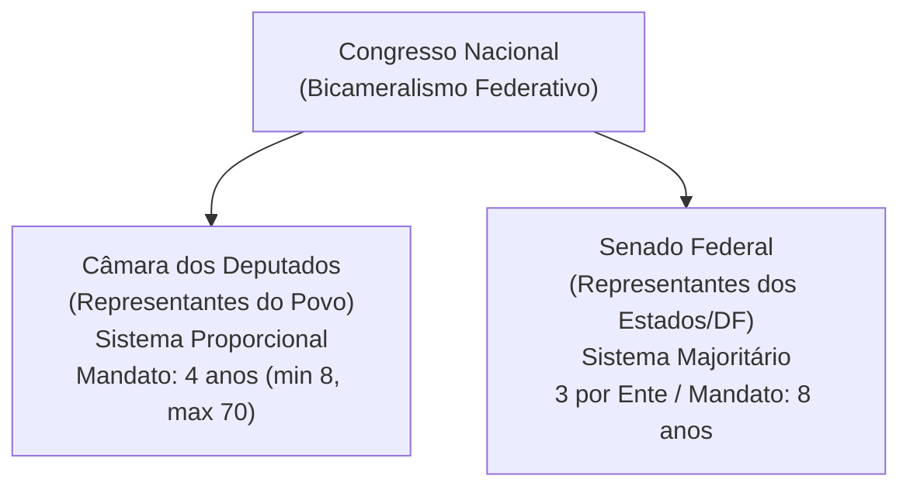
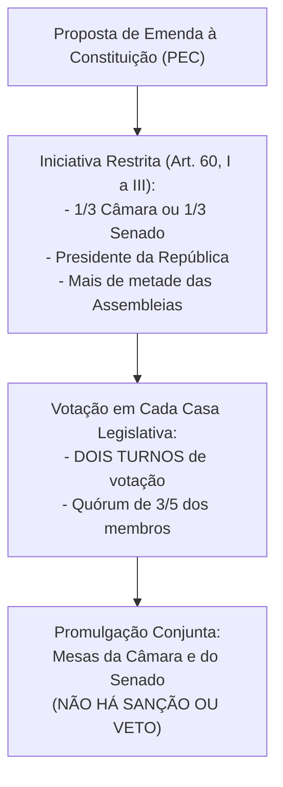
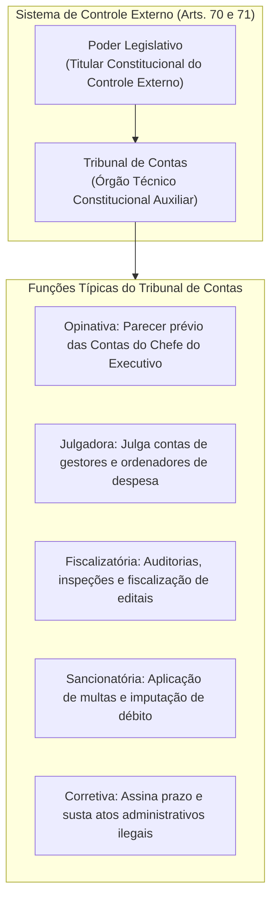
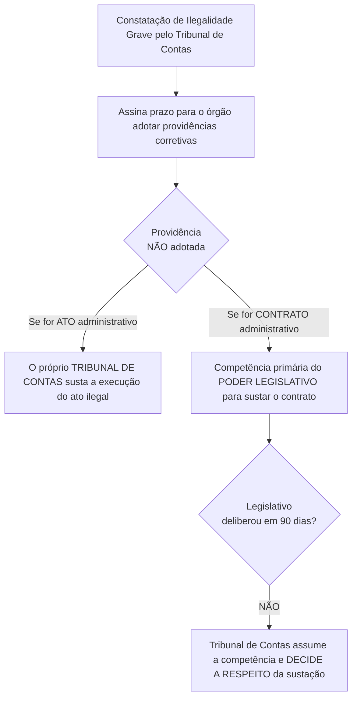

# 04 - Poder Legislativo, Processo Legislativo e Controle Externo (Arts. 70 a 75 da CF/88)

> **Matéria:** Noções de Direito Constitucional  
> **Cargo:** A01 – Técnico de Controle Externo – Especialidade: Técnico Administrativo  
> **Arquivo:** `04_poder_legislativo_processo_legislativo_e_fiscalizacao_tce.md`  
> **Status:** 🟢 Teoria Aprofundada + 5 Questões FCC Comentadas (A a E)

---

## 📌 Ementa / Itens do Edital

- Do Poder Legislativo: estrutura bicameral federal (Câmara dos Deputados e Senado Federal) e unicameral estadual/distrital/municipal.
- Atribuições do Congresso Nacional e competências privativas da Câmara dos Deputados (Art. 51) e do Senado Federal (Art. 52).
- Estatuto dos congressistas: imunidade material (inviolabilidade civil e penal) e imunidade formal/processual (prisão e prerrogativa de foro - Art. 53).
- Do processo legislativo (Artigos 59 a 69 da CF/88):
    - Emendas à Constituição (Art. 60): iniciativa restrita, rito qualificado de aprovação, inexistência de sanção/veto e limitações circunstanciais e materiais (cláusulas pétreas);
    - Leis Complementares vs. Leis Ordinárias (quórum e reserva de matéria);
    - Medidas Provisórias (Art. 62): pressupostos constitucionais, prazos e vedações temáticas absolutas.
- Da fiscalização contábil, financeira, orçamentária, operacional e patrimonial (Artigos 70 a 75 da CF/88):
    - Controle externo titularizado pelo Poder Legislativo com auxílio do Tribunal de Contas;
    - Competências do Tribunal de Contas (Art. 71 da CF/88);
    - Duplo regime de contas: Contas de Governo (parecer prévio opinativo) vs. Contas de Gestão/Ordenadores de Despesa (julgamento técnico definitivo);
    - Julgamento das contas de Prefeito Municipal (Art. 31, § 2º e Tema 835 do STF);
    - Sustação de atos administrativos ilegais vs. sustação de contratos administrativos (Art. 71, X e §§ 1º e 2º);
    - Eficácia de título executivo extrajudicial das decisões do Tribunal de Contas (Art. 71, § 3º da CF/88);
    - Princípio da simetria constitucional (Art. 75 da CF/88) e o Ministério Público de Contas (Art. 130 da CF/88).

---

## 🧭 Sumário
1. [Estrutura Bicameral e Atribuições das Casas Legislativas](#1-estrutura-bicameral-e-atribuições-das-casas-legislativas)
    - 1.1 [Modelo Bicameral Federal e Unicameral Estadual/Municipal](#11-modelo-bicameral-federal-e-unicameral-estadualmunicipal)
    - 1.2 [Repartição de Competências no Congresso Nacional](#12-repartição-de-competências-no-congresso-nacional)
    - 1.3 [Estatuto dos Congressistas e Imunidades Parlamentares](#13-estatuto-dos-congressistas-e-imunidades-parlamentares)
2. [O Processo Legislativo Constitucional](#2-o-processo-legislativo-constitucional)
    - 2.1 [Emendas à Constituição (Art. 60) e Limitações ao Poder de Reforma](#21-emendas-à-constituição-art-60-e-limitações-ao-poder-de-reforma)
    - 2.2 [Leis Complementares versus Leis Ordinárias](#22-leis-complementares-versus-leis-ordinárias)
    - 2.3 [Medidas Provisórias (Art. 62): Prazos e Vedações Temáticas](#23-medidas-provisórias-art-62-prazos-e-vedações-temáticas)
3. [Fiscalização e Controle Externo pelos Tribunais de Contas (Arts. 70 a 75)](#3-fiscalização-e-controle-externo-pelos-tribunais-de-contas-arts-70-a-75)
    - 3.1 [Abrangência e Critérios da Fiscalização Financeira](#31-abrangência-e-critérios-da-fiscalização-financeira)
    - 3.2 [O Julgamento de Contas Públicas: Contas de Governo versus Contas de Gestão](#32-o-julgamento-de-contas-públicas-contas-de-governo-versus-contas-de-gestão)
    - 3.3 [Sustação de Atos Ilegais versus Sustação de Contratos Administrativos](#33-sustação-de-atos-ilegais-versus-sustação-de-contratos-administrativos)
    - 3.4 [Eficácia das Decisões Condenatórias e Título Executivo Extrajudicial](#34-eficácia-das-decisões-condenatórias-e-título-executivo-extrajudicial)
    - 3.5 [Simetria Federativa (Art. 75) e o Ministério Público de Contas (Art. 130)](#35-simetria-federativa-art-75-e-o-ministério-público-de-contas-art-130)
4. [Fontes Oficiais & Jurisprudenciais Recomendadas](#4-fontes-oficiais--jurisprudenciais-recomendadas)
5. [Questões Comentadas no Padrão FCC (Justificadas de A a E)](#5-questões-comentadas-no-padrão-fcc-justificadas-de-a-a-e)

---

## 📖 Conteúdo Teórico Aprofundado

### 1. Estrutura Bicameral e Atribuições das Casas Legislativas

O Poder Legislativo da União é exercido pelo Congresso Nacional, que se compõe da Câmara dos Deputados e do Senado Federal (modelo bicameral federativo):

- **Câmara dos Deputados (Art. 45):** Representa o **povo brasileiro**. Os deputados são eleitos pelo sistema eleitoral proporcional, para mandato de **4 anos** (uma legislatura). O número total de deputados por Estado e DF é proporcional à população, com piso mínimo de **8** e teto máximo de **70 deputados**.
- **Senado Federal (Art. 46):** Representa os **Estados e o Distrito Federal**. Cada unidade federada elege **3 senadores**, pelo sistema majoritário, com mandato de **8 anos** (duas legislaturas). A representação é renovada de quatro em quatro anos, alternadamente, por **um terço (1/3)** e **dois terços (2/3)**.

#### 1.1 Modelo Bicameral Federal e Unicameral Estadual/Municipal
Enquanto na esfera federal vigora o bicameralismo, nos demais entes da Federação o Poder Legislativo adota compulsoriamente a estrutura **unicameral**:

- **Estados-Membros:** Assembleias Legislativas, compostas por Deputados Estaduais (art. 27);
- **Distrito Federal:** Câmara Legislativa do Distrito Federal, composta por Deputados Distritais (art. 32, § 2º);
- **Municípios:** Câmaras Municipais, compostas por Vereadores (art. 29, IV).

#### 1.2 Repartição de Competências no Congresso Nacional
É fundamental distinguir os três tipos de atribuições legislativas federais:

1. **Competências com Sanção Presidencial (Art. 48):** Matérias deliberadas pelo Congresso Nacional que geram leis e demandam envio ao Presidente da República para sanção ou veto (ex.: sistema tributário, planos orçamentários, criação e extinção de cargos públicos).
2. **Competências Exclusivas do Congresso Nacional sem Sanção (Art. 49):** Deliberadas em sessão conjunta ou separada e formalizadas por **Decreto Legislativo**, sem qualquer interferência presidencial (ex.: sustar atos normativos do Executivo que exorbitem do poder regulamentar; autorizar o Presidente a declarar guerra ou celebrar a paz; julgar anualmente as contas prestadas pelo Presidente da República).
3. **Competências Privativas de Cada Casa (Arts. 51 e 52):** Formalizadas por **Resolução**, sem envio ao Presidente:
    - *Câmara dos Deputados (Art. 51, I):* Autorizar, por **dois terços** de seus membros, a instauração de processo contra o Presidente e o Vice-Presidente da República e os Ministros de Estado.
    - *Senado Federal (Art. 52, I e II):* Processar e julgar o Presidente e Vice-Presidente nos **crimes de responsabilidade**, bem como os Ministros do STF, os membros do CNJ e CNMP, o Procurador-Geral da República e o Advogado-Geral da União; sabatinar e aprovar a escolha de magistrados, Ministros do TCU e chefes de missão diplomática; suspender a execução, no todo ou em parte, de lei declarada inconstitucional por decisão definitiva do STF em controle difuso.

#### 1.3 Estatuto dos Congressistas e Imunidades Parlamentares
O art. 53 da Constituição consagra o plexo de garantias institucionais dos membros do Congresso Nacional:

- **Imunidade Material (Real ou Substantiva):** Os Deputados e Senadores são invioláveis, civil e penalmente, por quaisquer de suas opiniões, palavras e votos. Exige conexão (nexo de causalidade) com o desempenho das funções parlamentares, sendo absoluta quando manifestada dentro do recinto do parlamento.
- **Imunidade Formal (Processual) quanto à Prisão (Art. 53, § 2º):** Desde a expedição do diploma, os membros do Congresso Nacional **não poderão ser presos**, salvo em flagrante de crime inafiançável. Nesse caso, os autos serão remetidos dentro de vinte e quatro horas à Casa respectiva, para que, pelo voto da maioria de seus membros, resolva sobre a prisão.
- **Foro por Prerrogativa de Função (Art. 53, § 1º):** Os Deputados e Senadores serão submetidos a julgamento perante o STF desde a expedição do diploma. Conforme tese firmada pelo STF na AP 937 e reafirmada pelo plenário, o foro especial aplica-se apenas aos crimes cometidos durante o exercício do mandato e relacionados com as funções parlamentares.

---

### 2. O Processo Legislativo Constitucional

#### 2.1 Emendas à Constituição (Art. 60) e Limitações ao Poder de Reforma
As Emendas Constitucionais manifestam o exercício do **Poder Constituinte Derivado Reformador**, sujeitando-se a limites formais e materiais rigorosos.

> 🚨 **ALERTA DE PROVA / PEGADINHA FCC:**  
> 1. **Iniciativa Popular de PEC:** NÃO existe iniciativa popular para propor Emenda à Constituição! A iniciativa popular no Brasil (art. 61, § 2º) é restrita a projetos de **lei ordinária** e **lei complementar**.  
> 2. **Sanção e Veto Presidencial:** O Presidente da República **NÃO sanciona nem veta** Emendas à Constituição. Uma vez aprovada por 3/5 em dois turnos na Câmara e no Senado, a PEC é promulgada diretamente pelas Mesas da Câmara dos Deputados e do Senado Federal.  
> 3. **Cláusulas Pétreas (Art. 60, § 4º):** Não será objeto de deliberação a proposta de emenda tendente a abolir:
>    - I - a forma federativa de Estado;
>    - II - o voto direto, secreto, universal e periódico;
>    - III - a separação dos Poderes;
>    - IV - os direitos e garantias individuais.

- **Limitações Circunstanciais (Art. 60, § 1º):** A Constituição não poderá ser emendada na vigência de intervenção federal, de estado de defesa ou de estado de sítio.
- **Princípio da Irrepetibilidade (Art. 60, § 5º):** A matéria constante de proposta de emenda rejeitada ou havida por prejudicada não pode ser objeto de nova proposta na mesma sessão legislativa (ano parlamentar).

#### 2.2 Leis Complementares versus Leis Ordinárias
- **Lei Complementar:** Exige quórum de aprovação de **maioria absoluta** em ambas as Casas Legislativas (metade mais um do total de membros da Casa). Aplica-se às matérias expressa e taxativamente reservadas pela Constituição Federal (ex.: Código Tributário Nacional, LRF, competências da Defensoria Pública).
- **Lei Ordinária:** Exige quórum de aprovação de **maioria simples (ou relativa)**, isto é, a maioria dos votos dos presentes na sessão, desde que presente a maioria absoluta dos membros. Possui campo de atuação residual (todas as matérias que a Constituição não reservou expressamente a outra espécie normativa).
- Não há hierarquia formal entre Lei Complementar e Lei Ordinária no direito brasileiro (STF); a distinção reside no quórum qualificado e na reserva material de competência temática.

#### 2.3 Medidas Provisórias (Art. 62): Prazos e Vedações Temáticas
- **Requisitos Constitucionais:** Adotadas pelo Presidente da República em casos de **relevância e urgência**, com força de lei imediata.
- **Vigência:** Vigoram por **60 dias**, prorrogáveis uma única vez por mais 60 dias (prazo total máximo de **120 dias**). Se não forem apreciadas em até **45 dias** da publicação, entram em regime de urgência, ficando sobrestadas (trancadas) todas as demais deliberações legislativas da Casa.
- **Vedações Materiais Categóricas (Art. 62, § 1º):** É terminantemente vedada a edição de Medidas Provisórias sobre:
    - Nacionalidade, cidadania, direitos políticos, partidos políticos e direito eleitoral;
    - Direito penal, processual penal e processual civil;
    - Organização do Poder Judiciário e do Ministério Público, a carreira e a garantia de seus membros;
    - Planos plurianuais (PPA), diretrizes orçamentárias (LDO), orçamento anual (LOA) e créditos adicionais (ressalvada a abertura de **créditos extraordinários** para despesas urgentes e imprevistas decorrentes de guerra, calamidade pública ou comoção interna - Art. 167, § 3º);
    - Detenção ou sequestro de bens, poupança ou qualquer outro ativo financeiro;
    - Matéria reservada a **Lei Complementar**.

---

### 3. Fiscalização e Controle Externo pelos Tribunais de Contas (Arts. 70 a 75)

#### 3.1 Abrangência e Critérios da Fiscalização Financeira
Conforme o art. 70 da CF/88, a fiscalização contábil, financeira, orçamentária, operacional e patrimonial da Administração Pública e de qualquer entidade que utilize recursos públicos será exercida pelo Congresso Nacional (ou Assembleia Legislativa estadual), mediante **controle externo**, e pelos sistemas de **controle interno** de cada Poder.
- **Aspectos Controlados:**
    - *Legalidade:* Conformidade com as leis e a Constituição.
    - *Legitimidade:* Atendimento ao interesse público e à moralidade administrativa.
    - *Economicidade:* Relação custo-benefício e eficiência na alocação dos recursos públicos.
    - *Aplicação de Subvenções e Renúncia de Receitas:* Verificação de benefícios fiscais, isenções, incentivos e repasses voluntários.

#### 3.2 O Julgamento de Contas Públicas: Contas de Governo versus Contas de Gestão

Esta distinção conceitual é uma das favoritas da FCC para cargos de tribunais de contas:

| Critério de Comparação | Contas de Governo (Art. 71, I) | Contas de Gestão / Ordenador (Art. 71, II) | Contas do Prefeito Municipal (Tema 835/STF) |
| :--- | :--- | :--- | :--- |
| **Responsável** | Chefe do Poder Executivo (Presidente, Governador, Prefeito) agindo como gestor político geral | Todos os demais administradores, secretários de Estado, presidentes de estatais e ordenadores de despesas | Prefeito Municipal (inclusive quando atua na ordenação direta de despesas) |
| **Papel do Tribunal de Contas** | Emite **Parecer Prévio** (opinativo) no prazo constitucional de 60 dias | **Julga definitivamente** as contas em decisão técnica e administrativa | Emite **Parecer Prévio** sobre todas as contas do Prefeito |
| **Quem Proferirá o Julgamento?** | O **Poder Legislativo** competente (Congresso, Assembleia ou Câmara de Vereadores) | O próprio **Tribunal de Contas** | Exclusivamente a **Câmara Municipal de Vereadores** |
| **Quórum para Afastar Parecer** | No Município, exige-se quórum qualificado de **2/3 dos Vereadores** para derrubar o parecer do Tribunal de Contas (Art. 31, § 2º) | Inaplicável (o TC profere acórdão definitivo, sem parecer submetido ao parlamento) | O parecer do TC só deixa de prevalecer por deliberação de **2/3 dos membros da Câmara Municipal** |

> 🚨 **ALERTA DE PROVA / PEGADINHA FCC (TEMA 835 DA REPERCUSSÃO GERAL DO STF):**  
> *"Para os fins do art. 1º, inciso I, alínea 'g', da Lei Complementar nº 64/1990 (Lei da Ficha Limpa), a apreciação das contas de prefeitos, tanto as de governo quanto as de gestão, será exercida pelas Câmaras Municipais, com o auxílio dos Tribunais de Contas competentes, cujo parecer prévio somente deixará de prevalecer por decisão de 2/3 dos vereadores."*  
> Portanto, mesmo que o Prefeito tenha agido como ordenador direto de despesas e o Tribunal de Contas tenha emitido parecer pela rejeição das contas, o Prefeito só se torna inelegível se a Câmara Municipal julgar e mantiver a rejeição dessas contas!

#### 3.3 Sustação de Atos Ilegais versus Sustação de Contratos Administrativos

A Constituição Federal estabelece uma distinção procedimental nítida entre atos administrativos e contratos administrativos:

> ⭐ **IMPORTANTE:**  
> O Tribunal de Contas **tem poder para sustar diretamente atos administrativos ilegais**, mas **NÃO tem competência primária para sustar contratos administrativos**. A sustação originária do contrato compete ao Poder Legislativo. O TC só ganha competência subsidiária caso o Congresso/Assembleia não tome providências no prazo de **90 dias**!

#### 3.4 Eficácia das Decisões Condenatórias e Título Executivo Extrajudicial
- **Natureza Jurídica:** As decisões dos Tribunais de Contas que imputam débito (dever de ressarcir o erário) ou cominam multa possuem **eficácia de título executivo extrajudicial** (art. 71, § 3º).
- **Cobrança Judicial:** O Tribunal de Contas não executa suas próprias decisões. A certidão de crédito/julgamento é encaminhada à **Procuradoria-Geral do Estado** (ou Procuradoria do Município lesado), que promove o ajuizamento de **Ação de Execução Fiscal** perante as Varas da Fazenda Pública.
- **Prescritibilidade:** O STF fixou (Tema 899 de Repercussão Geral) que a pretensão de ressarcimento ao erário fundada em decisão de Tribunal de Contas é **prescritível** no prazo quinquenal (5 anos), aplicando-se a Lei nº 9.873/1999 e o Decreto 20.910/1932.

#### 3.5 Simetria Federativa (Art. 75) e o Ministério Público de Contas (Art. 130)
- **Princípio da Simetria Constitucional (Art. 75):** As normas relativas à organização, composição e fiscalização do Tribunal de Contas da União aplicam-se, no que couber, à organização, composição e fiscalização dos Tribunais de Contas dos Estados (TCE-GO) e do Distrito Federal, bem como aos Tribunais e Conselhos de Contas dos Municípios.
- **Ministério Público de Contas (Art. 130):** Órgão ministerial especializado que atua privativamente perante o respectivo Tribunal de Contas. Seus membros gozam das mesmas garantias de vitaliciedade, inamovibilidade e irredutibilidade de vencimentos conferidas aos membros do Ministério Público comum, integrando a estrutura do Tribunal com autonomia funcional.

---

## 🌐 Fontes Oficiais & Jurisprudenciais Recomendadas

- [Constituição Federal de 1988 - Artigos 44 a 75 (Poder Legislativo e Fiscalização Contábil)](https://www.planalto.gov.br/ccivil_03/constituicao/constituicao.htm#art44)
    - Estrutura completa do Congresso Nacional, processo legislativo e competências dos Tribunais de Contas.
- [Supremo Tribunal Federal - Tema 835 de Repercussão Geral (Julgamento das Contas de Prefeito)](https://portal.stf.jus.br/jurisprudencia/repercussaoGeral/tema.asp?num=835)
    - Competência da Câmara de Vereadores para julgamento de contas de gestão e de governo do Chefe do Executivo municipal.
- [Supremo Tribunal Federal - Tema 899 de Repercussão Geral (Prescritibilidade da Execução de Decisões do TC)](https://portal.stf.jus.br/)
    - Fixação do prazo quinquenal para cobrança de títulos executivos extrajudiciais oriundos de Tribunais de Contas.
- [Supremo Tribunal Federal - Tema 445 de Repercussão Geral (Prazo Decadencial de Aposentadoria no TC)](https://portal.stf.jus.br/)
    - Prazo de 5 anos para que o Tribunal de Contas aprecie a legalidade do ato concessivo de aposentadoria ou pensão.

---

## 📝 Questões Comentadas no Padrão FCC (Justificadas de A a E)

### Questão 1 (FCC - Adaptada / Analista de Controle Externo - TCE-GO)
A Câmara Municipal de determinado município goiano recebeu o parecer prévio conclusivo emitido pelo Tribunal de Contas do Estado recomendando, de forma unânime e fundamentada, a rejeição das contas anuais prestadas pelo Prefeito Municipal relativas ao exercício financeiro anterior, diante da constatação de descumprimento dos limites constitucionais de aplicação em educação e saúde. Submetido o parecer a deliberação em plenário, 60% dos vereadores votaram pela aprovação das contas do Chefe do Executivo.

Nos termos do artigo 31, § 2º da Constituição Federal de 1988 e da jurisprudência consolidada do Supremo Tribunal Federal sobre o julgamento das contas municipais:

* **A)** As contas foram aprovadas, uma vez que o parecer prévio do Tribunal de Contas possui natureza meramente opinativa e somente deixará de prevalecer por decisão de dois terços dos membros da Câmara Municipal.
* **B)** As contas foram rejeitadas, haja vista que o parecer do Tribunal de Contas que conclui pela rejeição de contas possui eficácia jurisdicional definitiva e impositiva perante os órgãos municipais.
* **C)** O parecer prévio do Tribunal de Contas somente deixaria de prevalecer por decisão unânime de todos os vereadores componentes do parlamento municipal.
* **D)** As contas foram rejeitadas, pois a maioria simples de votos de 60% não alcançou o quórum qualificado constitucional de dois terços (2/3) necessário para derrubar a conclusão do parecer prévio do Tribunal de Contas.
* **E)** Caberá ao Presidente do Tribunal de Justiça do Estado de Goiás desempatar a votação e proferir a decisão terminativa sobre as contas do Chefe do Executivo.

> **Comentário Detalhado:**
> - **A) Incorreta:** O parecer prévio do Tribunal de Contas recomendou a **rejeição** das contas. Para rejeitar essa conclusão técnica e aprovar as contas do prefeito, a Câmara Municipal precisava alcançar o quórum qualificado de **dois terços** (66,66%) dos vereadores. Tendo obtido apenas 60% dos votos favoráveis, a votação não conseguiu derrubar o parecer prévio.  
> - **B) Incorreta:** O parecer prévio não possui natureza jurisdicional definitiva impositiva sobre o julgamento político das contas de prefeito, sendo atribuída a competência julgadora à Câmara de Vereadores.  
> - **C) Incorreta:** A Constituição exige quórum qualificado de dois terços dos membros da Câmara Municipal (art. 31, § 2º), e não voto unânime.  
> - **D) CORRETA:** Pelo art. 31, § 2º, da CF/88, o parecer prévio emitido pelo Tribunal de Contas sobre as contas anuais do Prefeito somente deixará de prevalecer por decisão de dois terços dos membros da Câmara Municipal. Como a votação pela aprovação atingiu apenas 60% dos votos (insuficiente para atingir 2/3), o parecer do Tribunal de Contas prevaleceu e as contas foram formalmente rejeitadas.  
> - **E) Incorreta:** O Poder Judiciário não intervém como árbitro ou voto de desempate no julgamento político de contas do Legislativo municipal.
> 
> **Gabarito: D**

---

### Questão 2 (FCC - Adaptada / Técnico de Controle Externo - TCE-GO)
O Plenário do Tribunal de Contas do Estado de Goiás, ao julgar irregular a prestação de contas de determinado dirigente de entidade pública autárquica estadual em virtude de sobrepreço comprovado em contratação emergencial de serviços de tecnologia, imputou-lhe o dever de ressarcir o erário no valor de R$ 400.000,00 e cominou-lhe multa punitiva de R$ 40.000,00. Regularmente notificado, o responsável não recolheu os valores devidos e não interpôs recursos regimentais.

Diante do regramento inserto no artigo 71, § 3º da Constituição Federal de 1988 (aplicável aos Tribunais de Contas estaduais por força do art. 75):

* **A)** A decisão condenatória do Tribunal de Contas possui eficácia de título executivo extrajudicial, sendo cobrada perante o Poder Judiciário mediante ação de execução fiscal promovida pela Procuradoria-Geral do Estado.
* **B)** O Tribunal de Contas possui competência jurisdicional plena para deflagrar, em sua própria Secretaria de Execuções, a expropriação forçada de bens do devedor.
* **C)** A Administração Pública estadual deverá propor Ação Ordinária de Cobrança perante a Vara da Fazenda Pública para demonstrar a liquidez e a certeza da obrigação em primeira instância.
* **D)** A eficácia da condenação depende de prévia ratificação e homologação por decreto do Governador do Estado para constituir a dívida ativa.
* **E)** O débito imputado prescreve compulsoriamente no prazo de noventa dias contados do encerramento da sessão plenária de julgamento.

> **Comentário Detalhado:**
> - **A) CORRETA:** Conforme o art. 71, § 3º, da CF/88, as decisões dos Tribunais de Contas que resultem em imputação de débito ou aplicação de multa possuem eficácia de título executivo extrajudicial. Como a Corte de Contas não executa suas próprias decisões no Judiciário, o título é encaminhado à Procuradoria-Geral do Estado para cobrança judicial mediante processo de Execução Fiscal.  
> - **B) Incorreta:** Os Tribunais de Contas não integram o Poder Judiciário e não possuem jurisdição executiva coercitiva de penhora e expropriação patrimonial.  
> - **C) Incorreta:** Sendo a decisão um título executivo extrajudicial líquido, certo e exigível por força de mandamento constitucional, descabe o ajuizamento de ação ordinária de conhecimento prévio.  
> - **D) Incorreta:** A decisão do Tribunal de Contas é autônoma e autoexecutável no plano jurídico, não exigindo homologação de Governador de Estado.  
> - **E) Incorreta:** A pretensão executória de ressarcimento fundada em decisão de Tribunal de Contas prescreve em 5 anos (Tema 899 do STF), e não em 90 dias.
> 
> **Gabarito: A**

---

### Questão 3 (FCC - Adaptada / Analista Legislativo)
Acerca do processo legislativo federal disciplinado na Constituição Federal de 1988, notadamente em relação às propostas de emenda à Constituição (PEC) e às medidas provisórias (MP), analise as afirmativas a seguir:

I. A Constituição poderá ser emendada mediante proposta de um terço, no mínimo, dos membros da Câmara dos Deputados ou do Senado Federal, do Presidente da República ou de mais da metade das Assembleias Legislativas das unidades da Federação.  
II. Não será admitida Proposta de Emenda à Constituição proposta por iniciativa popular de cidadãos, ainda que subscrita por mais de um por cento do eleitorado nacional.  
III. É admitida a edição de medida provisória sobre matéria relativa a direito processual civil e direito eleitoral, desde que configurados os pressupostos formais de relevância e urgência.  

Está correto o que se afirma em:

* **A)** I e II, apenas.
* **B)** II e III, apenas.
* **C)** I e III, apenas.
* **D)** I, apenas.
* **E)** I, II e III.

> **Comentário Detalhado:**
> - **A) CORRETA:**  
>   - *Item I (Verdadeiro):* Reproduz fielmente os legitimados constitucionais para propor PEC previstos no art. 60, I a III, da CF/88.  
>   - *Item II (Verdadeiro):* No ordenamento jurídico brasileiro, a iniciativa popular (art. 61, § 2º) é restrita a projetos de lei ordinária e lei complementar, não se admitindo iniciativa popular para propor emenda à Constituição Federal.  
>   - *Item III (Falso):* O art. 62, § 1º, I, "a" e "b", veda terminantemente a edição de medidas provisórias sobre direito eleitoral e direito processual civil, mesmo com relevância e urgência.  
> - **B) Incorreta:** O item III é falso.  
> - **C) Incorreta:** O item III é falso e o item II é verdadeiro.  
> - **D) Incorreta:** O item II também é verdadeiro.  
> - **E) Incorreta:** O item III é manifestamente falso.
> 
> **Gabarito: A**

---

### Questão 4 (FCC - Adaptada / Auditor de Controle Externo)
Durante fiscalização de rotina em órgão da administração direta estadual, a equipe de auditoria do Tribunal de Contas constatou irregularidade formal insanável em contrato administrativo de prestação de serviços continuados de vigilância, bem como ilegalidade flagrante em ato administrativo unilateral de designação de servidor comissionado. Diante disso, o Tribunal assinou prazo de trinta dias para que o Secretário de Estado responsável adotasse as providências necessárias ao exato cumprimento da lei, o qual, contudo, permaneceu inerte.

De acordo com o sistema de competências do controle externo estabelecido no artigo 71, incisos IX e X e §§ 1º e 2º da CF/88:

* **A)** O Tribunal de Contas tem competência direta e imediata para decretar a anulação do contrato administrativo e afastar o Secretário de Estado de suas atribuições ministeriais.
* **B)** O próprio Tribunal de Contas sustará a execução do ato impugnado; já no caso do contrato, o ato de sustação será adotado diretamente pelo Poder Legislativo, que solicitará, de imediato, ao Poder Executivo as medidas cabíveis.
* **C)** A sustação do ato administrativo e do contrato administrativo compete privativamente ao Poder Judiciário mediante ajuizamento de ação civil pública pelo Ministério Público Estadual.
* **D)** Se o Poder Executivo não sustar o contrato administrativo no prazo de quinze dias, o ato convalidar-se-á compulsoriamente por decurso de prazo.
* **E)** O Tribunal de Contas não pode adotar qualquer medida sobre atos já aperfeiçoados, cabendo-lhe apenas comunicar o fato à Ouvidoria Geral.

> **Comentário Detalhado:**
> - **A) Incorreta:** O Tribunal de Contas não tem competência originária direta para anular ou sustar contrato administrativo, nem competência administrativa para destituir secretários de Estado.  
> - **B) CORRETA:** Pelo art. 71, X, da CF/88, se não atendido o prazo de correção, o Tribunal de Contas sustará a execução do ato impugnado; todavia, no caso de contrato, o ato de sustação será adotado diretamente pelo Poder Legislativo (art. 71, § 1º). Apenas se o Poder Legislativo ou o Executivo não deliberarem em 90 dias é que a competência supletiva de sustação passa ao Tribunal de Contas (§ 2º).  
> - **C) Incorreta:** Trata-se de competência expressa de controle externo atribuída pela própria Constituição ao Legislativo e ao Tribunal de Contas.  
> - **D) Incorreta:** O prazo legal do § 2º do art. 71 é de 90 dias, após o qual o Tribunal de Contas decidirá a respeito da sustação, não havendo convalidação automática da ilicitude.  
> - **E) Incorreta:** O Tribunal de Contas possui poderes constitucionais sancionatórios e corretivos de alta relevância, e não mera atribuição informativa.
> 
> **Gabarito: B**

---

### Questão 5 (FCC - Adaptada / Procuradoria Legislativa)
No que tange às competências privativas das Casas Legislativas no âmbito do Congresso Nacional e às imunidades parlamentares previstas no texto constitucional, assinale a afirmativa correta:

* **A)** Compete privativamente à Câmara dos Deputados processar e julgar os Ministros do Supremo Tribunal Federal e o Procurador-Geral da República nos crimes de responsabilidade.
* **B)** A aprovação da escolha de Ministros do Tribunal de Contas da União indicados pelo Presidente da República compete privativamente ao Senado Federal, após arguição pública.
* **C)** Os Deputados e Senadores podem ser presos preventivamente a qualquer tempo desde a diplomação por determinação fundamentada de juiz de primeiro grau.
* **D)** As imunidades de Deputados ou Senadores subsistem durante o estado de sítio, não podendo ser suspensas sob nenhuma circunstância pelo voto parlamentar.
* **E)** Compete exclusivamente ao Congresso Nacional, com necessária sanção do Presidente da República, fixar a remuneração de seus próprios membros ao final de cada legislatura.

> **Comentário Detalhado:**
> - **A) Incorreta:** Processar e julgar Ministros do STF e o PGR por crimes de responsabilidade é competência privativa do **Senado Federal** (art. 52, II, da CF/88).  
> - **B) CORRETA:** Conforme o art. 52, III, alínea "b", da CF/88, compete privativamente ao Senado Federal aprovar previamente, por voto secreto, após arguição pública, a escolha de Ministros do Tribunal de Contas da União indicados pelo Presidente da República.  
> - **C) Incorreta:** Desde a expedição do diploma, os membros do Congresso Nacional não podem ser submetidos à prisão preventiva ordinária, admitindo-se a prisão unicamente em flagrante de crime inafiançável (art. 53, § 2º).  
> - **D) Incorreta:** Conforme o art. 53, § 8º, as imunidades persistem no estado de sítio, mas podem ser suspensas pelo voto de dois terços dos membros da Casa respectiva quanto a atos praticados fora do recinto do parlamento incompatíveis com a medida.  
> - **E) Incorreta:** A remuneração parlamentar é fixada pelo Congresso Nacional sem sanção do Executivo (art. 49, VII).
> 
> **Gabarito: B**
