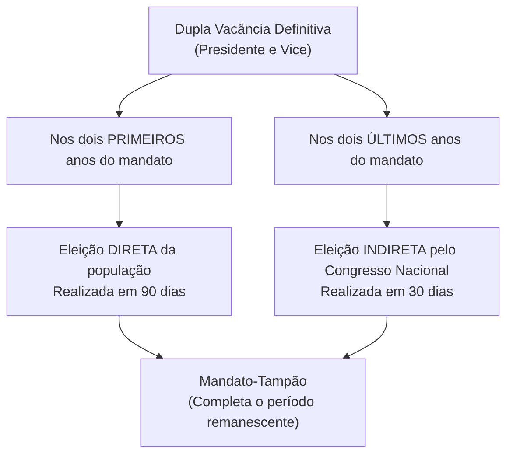
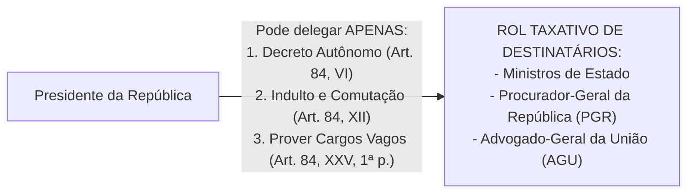

# 05 - Poder Executivo, Poder Judiciário e Funções Essenciais à Justiça

> **Matéria:** Noções de Direito Constitucional  
> **Cargo:** A01 – Técnico de Controle Externo – Especialidade: Técnico Administrativo  
> **Arquivo:** `05_poder_executivo_poder_judiciario_e_funcoes_essenciais.md`  
> **Status:** 🟢 Teoria Aprofundada + 5 Questões FCC Comentadas (A a E)

---

## 📌 Ementa / Itens do Edital

- Do Poder Executivo: eleição, posse, impedimento, vacância e sucessão presidencial;
- Atribuições e prerrogativas do Presidente da República (Artigo 84 da CF/88): competências indelegáveis e competências privativas delegáveis (decretos autônomos, indulto e provimento de cargos vagos);
- Responsabilidade do Presidente da República (Artigos 85 e 86 da CF/88):
    - Crimes comuns vs. crimes de responsabilidade (*impeachment*);
    - Juízo prévio de admissibilidade pela Câmara dos Deputados (quórum qualificado de 2/3);
    - Competência de julgamento pelo STF e pelo Senado Federal (presidido pelo Presidente do STF);
    - Imunidades presidenciais: imunidade prisional temporária e cláusula de irresponsabilidade relativa por atos estranhos ao mandato;
- Do Poder Judiciário: disposições gerais, estatuto e garantias da magistratura (vitaliciedade, inamovibilidade e irredutibilidade) e vedações expressas (quarentena de saída);
- Do Supremo Tribunal Federal (STF - Artigos 101 a 103-A da CF/88): composição (11 Ministros), nomeação, sabatina pelo Senado Federal, competências originárias e recursais, e o regime das Súmulas Vinculantes (Art. 103-A);
- Do Conselho Nacional de Justiça (CNJ - Artigo 103-B da CF/88): organização, composição (15 membros) e limites de atuação (natureza estritamente administrativa, orçamentária e correcional, sem competência jurisdicional);
- Do Superior Tribunal de Justiça (STJ - Artigos 104 e 105 da CF/88): composição (no mínimo 33 Ministros), uniformização da lei federal infraconstitucional e o filtro da relevância no Recurso Especial (EC nº 125/2022);
- Das Funções Essenciais à Justiça:
    - Ministério Público (Artigos 127 a 130-A da CF/88): princípios institucionais, autonomia, garantias, vedações e o Conselho Nacional do Ministério Público (CNMP);
    - Advocacia Pública (Artigos 131 e 132 da CF/88): AGU e Procuradorias Estaduais (PGE-GO);
    - Advocacia Privada (Artigo 133 da CF/88): indispensabilidade e inviolabilidade profissional;
    - Defensoria Pública (Artigos 134 e 135 da CF/88): assistência jurídica aos hipossuficientes e autonomia institucional expressa.

---

## 🧭 Sumário

1. [Poder Executivo: Estrutura, Atribuições e Responsabilidade](#1-poder-executivo-estrutura-atribuicoes-e-responsabilidade)
    1. [Dupla Vacância dos Cargos Presidenciais (Art. 81 da CF/88)](#11-dupla-vacancia-dos-cargos-presidenciais-art-81-da-cf88)
    2. [Atribuições Delegáveis do Presidente da República (Art. 84, Parágrafo Único)](#12-atribuicoes-delegaveis-do-presidente-da-republica-art-84-paragrafo-unico)
    3. [Responsabilidade do Presidente da República e Imunidades (Arts. 85 e 86)](#13-responsabilidade-do-presidente-da-republica-e-imunidades-arts-85-e-86)
    4. [Teste 154](#Teste-154)
    5. [Teste 155](#Teste-155)
    6. [Teste 156](#Teste-156)
    7. [Teste 157](#Teste-157)
2. [Poder Judiciário: Estrutura Orgânica, CNJ e Súmula Vinculante](#2-poder-judiciario-estrutura-organica-cnj-e-sumula-vinculante)
    1. [Garantias e Vedações dos Magistrados (Art. 95 da CF/88)](#21-garantias-e-vedacoes-dos-magistrados-art-95-da-cf88)
    2. [Conselho Nacional de Justiça (CNJ - Art. 103-B)](#22-conselho-nacional-de-justica-cnj-art-103-b)
    3. [Supremo Tribunal Federal e o Regime da Súmula Vinculante (Art. 103-A)](#23-supremo-tribunal-federal-e-o-regime-da-sumula-vinculante-art-103-a)
    4. [Superior Tribunal de Justiça e o Filtro de Relevância (Arts. 104 e 105)](#24-superior-tribunal-de-justica-e-o-filtro-de-relevancia-arts-104-e-105)
    5. [Teste 158](#Teste-158)
    6. [Teste 159](#Teste-159)
    7. [Teste 160](#Teste-160)
    8. [Teste 161](#Teste-161)
3. [Funções Essenciais à Justiça](#3-funcoes-essenciais-a-justica)
    1. [Ministério Público e o CNMP (Arts. 127 a 130-A)](#31-ministerio-publico-e-o-cnmp-arts-127-a-130-a)
    2. [Advocacia Pública (Arts. 131 e 132)](#32-advocacia-publica-arts-131-e-132)
    3. [Defensoria Pública (Arts. 134 e 135)](#33-defensoria-publica-arts-134-e-135)
    4. [Advocacia Privada (Art. 133)](#34-advocacia-privada-art-133)
    5. [Teste 162](#Teste-162)
    6. [Teste 163](#Teste-163)
    7. [Teste 164](#Teste-164)
4. [🌐 Fontes Oficiais & Jurisprudenciais Recomendadas](#fontes-oficiais-jurisprudenciais-recomendadas)

---

## 1. Poder Executivo: Estrutura, Atribuições e Responsabilidade

### 1.1 Dupla Vacância dos Cargos Presidenciais (Art. 81 da CF/88)
Ocorrendo a vacância definitiva tanto do cargo de Presidente quanto de Vice-Presidente da República, aplicam-se regras distintas a depender do momento do mandato:

- **Primeiros 2 anos do mandato:** Ocorrendo a vacância definitiva de ambos os cargos na primeira metade da legislatura, far-se-á eleição **direta** noventa dias depois de aberta a última vaga.
- **Últimos 2 anos do mandato:** Se a dupla vacância definitiva ocorrer na segunda metade da legislatura (3º ou 4º ano do mandato), a eleição para ambos os cargos será feita **indireta**, trinta dias depois da última vaga, pelo **Congresso Nacional**, na forma da lei.
- Em qualquer das hipóteses de eleição extraordinária, os eleitos deverão completar o período remanescente de seus antecessores (*mandato-tampão* - art. 81, § 2º).

### 1.2 Atribuições Delegáveis do Presidente da República (Art. 84, Parágrafo Único)
O art. 84 fixa as competências privativas do Presidente da República. Em regra, são privativas e indelegáveis. Todavia, a Constituição autoriza a **delegação de apenas TRÊS matérias específicas**:

1. **Art. 84, VI:** Dispor, mediante **decreto autônomo**, sobre:
    - *a)* Organização e funcionamento da administração federal, quando não implicar aumento de despesa nem criação ou extinção de órgãos públicos;
    - *b)* Extinção de funções ou cargos públicos, quando vagos;

2. **Art. 84, XII:** Conceder **indulto e comutar penas**, com audiência, se necessário, dos órgãos instituídos em lei;
3. **Art. 84, XXV, primeira parte:** **Prover** cargos públicos federais, na forma da lei.

> 🚨 **ALERTA DE PROVA / PEGADINHA FCC:**  
>
> - **Extinção de Órgãos Públicos:** O Presidente NÃO pode criar nem extinguir Ministérios ou órgãos públicos por decreto! A criação e extinção de órgãos públicos exige expressamente **lei formal ordinária** (art. 88 da CF/88). O decreto autônomo serve exclusivamente para organizar órgãos existentes sem gerar custos ou extinguir cargos vagos.  
> - **Extinção de Cargos Públicos Ocupados:** Depende obrigatoriamente de lei formal. Por decreto autônomo, o Chefe do Executivo só pode extinguir cargos e funções quando estiverem **vagos**!

### 1.3 Responsabilidade do Presidente da República e Imunidades (Arts. 85 e 86)
O Presidente da República responde perante o STF por crimes comuns e perante o Senado Federal por crimes de responsabilidade (*impeachment*).

| Aspecto Procedimental | Crime Comum (Penal) | Crime de Responsabilidade (*Impeachment*) |
| :--- | :--- | :--- |
| **Juízo de Admissibilidade** | **Câmara dos Deputados** (quórum de 2/3 dos membros) | **Câmara dos Deputados** (quórum de 2/3 dos membros) |
| **Órgão Julgador Competente** | **Supremo Tribunal Federal (STF)** | **Senado Federal** (sob presidência do Presidente do STF) |
| **Instauração do Processo** | Recebimento da denúncia ou queixa pelo STF | Deliberação do Plenário do Senado Federal por maioria simples |
| **Afastamento Preventivo** | Fica suspenso de suas funções por até 180 dias | Fica suspenso de suas funções por até 180 dias |
| **Sanção Constitucional** | Penas privativas de liberdade / multas criminais | **Perda do cargo** + **inabilitação por 8 anos** para qualquer função pública (quórum de 2/3 do Senado) |
| **Imunidade Prisional (Art. 86, § 3º)** | **Não pode ser preso**, na vigência do mandato, senão após sentença penal condenatória transitada em julgado | Inaplicável medida penal coercitiva |
| **Irresponsabilidade Relativa (Art. 86, § 4º)** | **Não pode ser responsabilizado por atos estranhos ao exercício de suas funções** na vigência do mandato | Aplicável a atos conexos ao exercício funcional |

---

### Teste 154
**(FGV – TRT – Analista Judiciário - Tecnologia da Informação – 2024)**
A Assembleia Legislativa do Estado Alfa recebeu projeto de lei, 
encaminhado pelo Tribunal de Justiça do Estado, com o objetivo 
de regulamentar o pagamento de horas extraordinárias aos 
magistrados vinculados ao referido Tribunal. 
A Comissão de Constituição e Justiça, ao analisar o referido 
projeto, concluiu corretamente que

* **A)** o Estado Alfa tem competência legislativa para suplementar a 
legislação federal nessa temática.
* **B)** a matéria deveria ser disciplinada na Constituição Estadual, em 
simetria com o paradigma federal.
* **C)** por dizer respeito a matéria afeta aos magistrados, era 
necessária a apresentação de projeto de lei complementar.
* **D)** o Tribunal de Justiça carece de legitimidade para apresentar a 
proposição, e a Assembleia de competência para apreciá-la.
* **E)** se os servidores públicos do respectivo Estado fizerem jus ao 
referido pagamento, o respectivo regime jurídico deve ser 
aplicado subsidiariamente aos magistrados.

---

> **Comentário Detalhado:**
>
> - **A)** Incorreta. Discrepa das diretrizes normativas e jurisprudenciais aplicáveis ao tema objeto do item.
> - **B)** Correta. Representa com precisão a disciplina do tema e o entendimento pacificado adotado pela banca (FGV).
> - **C)** Incorreta. Discrepa das diretrizes normativas e jurisprudenciais aplicáveis ao tema objeto do item.
> - **D)** Incorreta. Discrepa das diretrizes normativas e jurisprudenciais aplicáveis ao tema objeto do item.
> - **E)** Incorreta. Discrepa das diretrizes normativas e jurisprudenciais aplicáveis ao tema objeto do item.
>
> **Gabarito: B**

---
### Teste 155
**(FGV – TRT – Analista Judiciário - Tecnologia da Informação – 2024)**
Em uma situação concreta submetida à apreciação do Tribunal de 
Contas do Estado de Goiás, argumentou o ordenador de despesa 
de determinada estrutura estatal de poder que agira conforme a 
interpretação mais adequada do preceito constitucional X. Assim 
entendia porque, ao analisar o significante interpretado, deparou-
se com uma pluralidade de significados que lhe poderiam ser 
atribuídos, influenciados por distintos vetores axiológicos 
presentes no ambiente sociopolítico, o que o levou a resolver a 
conflitualidade intrínseca que se apresentava nesse plano, e a 
atribuir o significado mais adequado aos distintos aspectos afetos 
ao caso concreto.  
A análise da linha argumentativa apresentada pelo ordenador de 
despesa permite afirmar corretamente que, consoante os 
balizamentos prevalecentes na realidade brasileira a respeito da 
interpretação constitucional

* **A)** ao enveredar na própria atividade de criação do direito, 
usurpou uma atividade que é própria do Poder Legislativo.
* **B)** a encampação de significados, amparado s por vetores 
axiológicos, transmuda a interpretação, de atividade 
essencialmente cognoscitiva, em atividade inventiva, o que é 
vedado ao intérprete.
* **C)** vetores axiológicos, embora concorram para o surgimento da 
Constituição formal, fruto do processo cons tituinte, não 
podem incursionar na definição da própria normatividade 
constitucional.
* **D)** houve influência do pensamento problemático, mas não foi 
desconsiderada a constatação de que a norma é obtida a partir 
de um processo intelectivo conduzido pelo intér prete, que 
promove a interação entre o texto e o contexto.
* **E)** ao privilegiar aspectos do problema concreto, o ordenador de 
despesa desconsiderou que a Constituição somente se 
harmoniza com a unicidade significativa, não podendo 
apresentar variações de significado em situações concretas.

---

> **Comentário Detalhado:**
>
> - **A)** Correta. Representa com precisão a disciplina do tema e o entendimento pacificado adotado pela banca (FGV).
> - **B)** Incorreta. Discrepa das diretrizes normativas e jurisprudenciais aplicáveis ao tema objeto do item.
> - **C)** Incorreta. Discrepa das diretrizes normativas e jurisprudenciais aplicáveis ao tema objeto do item.
> - **D)** Incorreta. Discrepa das diretrizes normativas e jurisprudenciais aplicáveis ao tema objeto do item.
> - **E)** Incorreta. Discrepa das diretrizes normativas e jurisprudenciais aplicáveis ao tema objeto do item.
>
> **Gabarito: A**

---
### Teste 156
**(FCC – TRT-2 – Analista Judiciário - Tecnologia da Informação – 2014)**  
Entre as atribuições conferidas pelo texto constitucional ao Presidente da República está o poder de "conceder indulto e comutar penas" (art. 84, XII). O exercício dessa atribuição presidencial não é cabível, nos termos da Constituição Federal, para beneficiar os condenados pela prática das infrações criminais de:

* **A)** terrorismo, racismo, crimes hediondos e ação de grupos armados contra a ordem constitucional.
* **B)** tortura, racismo, crimes hediondos e tráfico ilícito de entorpecentes e drogas afins.
* **C)** terrorismo, tortura, crimes hediondos e tráfico ilícito de entorpecentes e drogas afins.
* **D)** terrorismo, tortura, ação de grupos armados contra a ordem constitucional e tráfico ilícito de drogas.
* **E)** terrorismo, tortura, racismo, estelionato previdenciário e crimes contra a administração pública.

---

> **Comentário Detalhado:**
>
> - **A)** **Incorreto**. O racismo e a ação de grupos armados são crimes inafiançáveis e imprescritíveis (art. 5º, XLII e XLIV), mas a vedação de graça/indulto não incide expressamente sobre eles.
> - **B)** **Incorreto**. O racismo não consta da vedação de graça ou anistia do inciso XLIII.
> - **C)** **Correto**. Nos termos do art. 5º, XLIII, da Constituição Federal: "a lei considerará crimes inafiançáveis e insuscetíveis de graça ou anistia a prática da tortura, o tráfico ilícito de entorpecentes e drogas afins, o terrorismo e os definidos como crimes hediondos, por eles respondendo os mandantes, os executores e os que, podendo evitá-los, se omitirem". Conforme pacífica jurisprudência do STF, a vedação da graça alcança também o indulto coletivo (que é espécie do gênero graça em sentido amplo).
> - **D)** **Incorreto**. Ação de grupos armados é imprescritível e inafiançável, mas a vedação de indulto refere-se a tortura, tráfico, terrorismo e hediondos (o grupo 3T + H).
> - **E)** **Incorreto**. O racismo não integra a cláusula de vedação de graça/anistia do art. 5º, XLIII.
>
> **Gabarito: C**

### Teste 157
**(FCC – TRT – Analista Judiciário - Tecnologia da Informação – 2009)**
Será considerado inelegível, nos termos da Constituição 
da República,

* **A)** o Governador de Estado no exercício de seu pri-
meiro mandato que, pretendendo a reeleição, não 
renunciar até seis meses antes do pleito.
* **B)** o Deputado Federal no exercício de segundo man-
dato consecutivo que pretenda reeleger-se.
* **C)** quem tenha sido condenado criminalmente por de-
cisão judicial, mesmo que ainda não transitada em 
julgado, enquanto durarem seus efeitos.
* **D)** brasileiro naturalizado que queira candidatar-se a 
uma vaga no Senado Federal.
* **E)** o filho adotado de Governador do Estado que pre-
tenda candidatar-se a Prefeito da Capital do Estado. 
Caderno de Prova ’E05’, Tipo 001

8 TCEGO-Conhecimentos Gerais1

---

> **Comentário Detalhado:**
>
> - **A)** Correta. Representa com precisão a disciplina do tema e o entendimento pacificado adotado pela banca (FCC).
> - **B)** Incorreta. Discrepa das diretrizes normativas e jurisprudenciais aplicáveis ao tema objeto do item.
> - **C)** Incorreta. Discrepa das diretrizes normativas e jurisprudenciais aplicáveis ao tema objeto do item.
> - **D)** Incorreta. Discrepa das diretrizes normativas e jurisprudenciais aplicáveis ao tema objeto do item.
> - **E)** Incorreta. Discrepa das diretrizes normativas e jurisprudenciais aplicáveis ao tema objeto do item.
>
> **Gabarito: A**

---
### Teste 158
**(FCC – TRT – Analista Judiciário - Tecnologia da Informação – 2009)**
Vagando os cargos de Presidente e Vice-Presidente da 
República,

* **A)** será chamado ao exercício da Presidência o Pre-
sidente da Câmara dos Deputados, que deverá com-
pletar o período de mandato de seus antecessores.
* **B)** será realizada eleição pelo Congresso Nacional, trin-
ta dias depois da última vaga, caso a vacância 
ocorra nos últimos dois anos do período presiden-
cial.
* **C)** deverá ser convocado plebiscito para decidir quanto 
à necessidade de realização de nova eleição.
* **D)** caberá ao Tribunal Superior Eleitoral dar posse aos 
candidatos segundos colocados no pleito em que 
eleitos os antecessores.
* **E)** não há solução prevista expressamente na Cons-
tituição da República para a sucessão, cabendo ao 
Congresso Nacional dispor sobre a matéria. 
_________________________________________________________

---

> **Comentário Detalhado:**
>
> - **A)** Incorreta. Discrepa das diretrizes normativas e jurisprudenciais aplicáveis ao tema objeto do item.
> - **B)** Correta. Representa com precisão a disciplina do tema e o entendimento pacificado adotado pela banca (FCC).
> - **C)** Incorreta. Discrepa das diretrizes normativas e jurisprudenciais aplicáveis ao tema objeto do item.
> - **D)** Incorreta. Discrepa das diretrizes normativas e jurisprudenciais aplicáveis ao tema objeto do item.
> - **E)** Incorreta. Discrepa das diretrizes normativas e jurisprudenciais aplicáveis ao tema objeto do item.
>
> **Gabarito: B**

---
### Teste 159
**(FGV – TJ-MT – Analista Judiciário - Tecnologia da Informação – 2024)**  
Determinado órgão, em âmbito nacional, tem a competência de controlar a atuação administrativa e financeira do Poder Judiciário e o cumprimento dos deveres funcionais dos juízes, além de outras atribuições que lhe forem conferidas pelo Estatuto da Magistratura.  
Nesse cenário, considerando as disposições da Constituição Federal de 1988, está-se diante de uma competência do:

* **A)** Tribunal Superior do Trabalho.
* **B)** Conselho Nacional de Justiça.
* **C)** Superior Tribunal de Justiça.
* **D)** Tribunal Superior Eleitoral.
* **E)** Supremo Tribunal Federal.

---

> **Comentário Detalhado:**
>
> - **A)** **Incorreto**. O TST é órgão de cúpula da Justiça do Trabalho, com atribuições essencialmente jurisdicionais.
> - **B)** **Correto**. Conforme o art. 103-B, § 4º, da Constituição Federal: "Compete ao Conselho o controle da atuação administrativa e financeira do Poder Judiciário e do cumprimento dos deveres funcionais dos juízes, cabendo-lhe, além de outras atribuições que lhe forem conferidas pelo Estatuto da Magistratura...". O CNJ não possui competência jurisdicional, atuando exclusivamente como órgão de controle administrativo e correcional.
> - **C)** **Incorreto**. O STJ é tribunal jurisdicional responsável pela uniformização da legislação infraconstitucional federal.
> - **D)** **Incorreto**. O TSE coordena a jurisdição eleitoral em nível nacional.
> - **E)** **Incorreto**. O STF é o guardião da Constituição e cúpula jurisdicional máxima do Estado brasileiro.
>
> **Gabarito: B**

### Teste 160
**(FGV – TJ-RR – Analista Judiciário - Suporte e Infraestrutura de TI – 2024)**  
O Conselho Nacional de Justiça compõe-se de 15 (quinze) membros com mandato de 2 (dois) anos, admitida 1 (uma) recondução. As opções a seguir apresentam membros que participam da composição constitucional desse Conselho, à exceção de uma. Assinale-a:

* **A)** Um juiz de Tribunal Regional Federal, indicado pelo Superior Tribunal de Justiça.
* **B)** Um juiz de Tribunal Regional do Trabalho, indicado pelo Tribunal Superior do Trabalho.
* **C)** Dois cidadãos de notável saber jurídico e reputação ilibada, indicados pela Câmara e pelo Senado.
* **D)** Um juiz de Tribunal Regional Eleitoral, indicado privativamente pelo Supremo Tribunal Federal.
* **E)** Um membro do Ministério Público estadual, escolhido pelo Procurador-Geral da República.

---

> **Comentário Detalhado:**
>
> - **A)** **Incorreto**. É membro integrante expressamente previsto no art. 103-B, V, da CF/88.
> - **B)** **Incorreto**. É membro integrante expressamente previsto no art. 103-B, VIII, da CF/88.
> - **C)** **Incorreto**. Membros previstos no art. 103-B, XIII, da CF/88 (um indicado pela Câmara dos Deputados e um pelo Senado Federal).
> - **D)** **Correto**. O art. 103-B da Constituição Federal NÃO contempla na composição do CNJ a figura de juiz de Tribunal Regional Eleitoral (TRE). A composição conta com: o Presidente do STF, 1 Ministro do STJ, 1 Ministro do TST, 1 Desembargador de TJ, 1 Juiz de Direito estadual, 1 Juiz de TRF, 1 Juiz federal, 1 Juiz de TRT, 1 Juiz do trabalho, 1 membro do MPU, 1 membro do MPE, 2 advogados indicados pelo CFOAB e 2 cidadãos indicados pelo Congresso Nacional. Logo, esta é a única opção que traz membro inexistente no colegiado.
> - **E)** **Incorreto**. É membro integrante expressamente previsto no art. 103-B, XI, da CF/88.
>
> **Gabarito: D**

### Teste 161
**(FCC – TRT – Analista Judiciário - Tecnologia da Informação – 2009)**
Considere as seguintes af irmações sobre a proposta or-
çamentária do Ministério Público: 

 I. O Ministério Público elaborará sua proposta orça-
mentária dentro dos limites estabelecidos na lei de 
diretrizes orçamentárias e, caso encaminhada em 
desacordo com esses limites, caberá ao Poder Exe-
cutivo proceder aos ajustes necessários para fins 
de consolidação da proposta orçamentária anual. 

 II. Se o Ministério Público não encaminhar a respecti-
va proposta orçamentária dentro do prazo estabe-
lecido na lei de diretrizes orçamentárias, o Poder 
Executivo considerará, para fins de consolidação da 
proposta orçamentária anual, os valores aprovados 
na lei orçamentária vigente, ajustados de acordo 
com os limites estipulados na lei de diretrizes 
orçamentárias. 

 III. Durante a execução orçamentária do exercício, não 
poderá haver a realização de despesas ou a as-
sunção de obrigações que extrapolem os limites 
estabelecidos na lei de diretrizes orçamentárias, 
exceto se previamente autorizadas, mediante a 
abertura de créditos suplementares ou especiais.  
Está correto o que se afirma em

* **A)** I, apenas.
* **B)** II, apenas.
* **C)** III, apenas.
* **D)** I e II, apenas.
* **E)** I, II e III.

---

> **Comentário Detalhado:**
>
> - **A)** Incorreta. Discrepa das diretrizes normativas e jurisprudenciais aplicáveis ao tema objeto do item.
> - **B)** Incorreta. Discrepa das diretrizes normativas e jurisprudenciais aplicáveis ao tema objeto do item.
> - **C)** Incorreta. Discrepa das diretrizes normativas e jurisprudenciais aplicáveis ao tema objeto do item.
> - **D)** Correta. Representa com precisão a disciplina do tema e o entendimento pacificado adotado pela banca (FCC).
> - **E)** Incorreta. Discrepa das diretrizes normativas e jurisprudenciais aplicáveis ao tema objeto do item.
>
> **Gabarito: D**

---
### Teste 162
**(FGV – TRT – Analista Judiciário - Tecnologia da Informação – 2024)**
Maria, estagiária em um escritório de advocacia, foi incumbida, 
por um advoga do sênior, da obrigação de verificar as causas de 
natureza cível de competência originária do Tribunal de Justiça do 
Estado Alfa, de modo a identificar se competiria a esse órgão 
processar e julgar mandado de segurança a ser impetrado contra 
autoridade estadual. 
Ao analisar a sistemática vigente, Maria concluiu corretamente 
que deveria pesquisar

* **A)** no Código de Processo Civil.
* **B)** na Constituição da República.
* **C)** na Constituição do Estado Alfa.
* **D)** na lei de organização e divisão judiciária.
* **E)** em resolução do Conselho Nacional de Justiça. 

Noções de Direito Administrativo

---

> **Comentário Detalhado:**
>
> - **A)** Correta. Representa com precisão a disciplina do tema e o entendimento pacificado adotado pela banca (FGV).
> - **B)** Incorreta. Discrepa das diretrizes normativas e jurisprudenciais aplicáveis ao tema objeto do item.
> - **C)** Incorreta. Discrepa das diretrizes normativas e jurisprudenciais aplicáveis ao tema objeto do item.
> - **D)** Incorreta. Discrepa das diretrizes normativas e jurisprudenciais aplicáveis ao tema objeto do item.
> - **E)** Incorreta. Discrepa das diretrizes normativas e jurisprudenciais aplicáveis ao tema objeto do item.
>
> **Gabarito: A**

---
### Teste 163
**(FGV – TRT – Analista Judiciário - Tecnologia da Informação – 2024)**
Maria, estagiária em um escritório de advocacia, foi incumbida, 
por um advoga do sênior, da obrigação de verificar as causas de 
natureza cível de competência originária do Tribunal de Justiça do 
Estado Alfa, de modo a identificar se competiria a esse órgão 
processar e julgar mandado de segurança a ser impetrado contra 
autoridade estadual. 
Ao analisar a sistemática vigente, Maria concluiu corretamente 
que deveria pesquisar

* **A)** no Código de Processo Civil.
* **B)** na Constituição da República.
* **C)** na Constituição do Estado Alfa.
* **D)** na lei de organização e divisão judiciária.
* **E)** em resolução do Conselho Nacional de Justiça. 

Noções de Direito Administrativo

---

> **Comentário Detalhado:**
>
> - **A)** Correta. Representa com precisão a disciplina do tema e o entendimento pacificado adotado pela banca (FGV).
> - **B)** Incorreta. Discrepa das diretrizes normativas e jurisprudenciais aplicáveis ao tema objeto do item.
> - **C)** Incorreta. Discrepa das diretrizes normativas e jurisprudenciais aplicáveis ao tema objeto do item.
> - **D)** Incorreta. Discrepa das diretrizes normativas e jurisprudenciais aplicáveis ao tema objeto do item.
> - **E)** Incorreta. Discrepa das diretrizes normativas e jurisprudenciais aplicáveis ao tema objeto do item.
>
> **Gabarito: A**

---
### Teste 164
**(FGV – TRT – Analista Judiciário - Tecnologia da Informação – 2024)**
Maria, estagiária em um escritório de advocacia, foi incumbida, 
por um advogado sênior, da obrigação de verificar as causas de 
natureza cível de competência originária do Tribunal de Justiça do 
Estado Alfa, de modo a identificar se compet iria a esse órgão 
processar e julgar mandado de segurança a ser impetrado contra 
autoridade estadual. 
Ao analisar a sistemática vigente, Maria concluiu corretamente 
que deveria pesquisar

* **A)** no Código de Processo Civil.
* **B)** na Constituição da República.
* **C)** na Constituição do Estado Alfa.
* **D)** na lei de organização e divisão judiciária.
* **E)** em resolução do Conselho Nacional de Justiça. 

Noções de Direito Administrativo

---

> **Comentário Detalhado:**
>
> - **A)** Correta. Representa com precisão a disciplina do tema e o entendimento pacificado adotado pela banca (FGV).
> - **B)** Incorreta. Discrepa das diretrizes normativas e jurisprudenciais aplicáveis ao tema objeto do item.
> - **C)** Incorreta. Discrepa das diretrizes normativas e jurisprudenciais aplicáveis ao tema objeto do item.
> - **D)** Incorreta. Discrepa das diretrizes normativas e jurisprudenciais aplicáveis ao tema objeto do item.
> - **E)** Incorreta. Discrepa das diretrizes normativas e jurisprudenciais aplicáveis ao tema objeto do item.
>
> **Gabarito: A**

---
