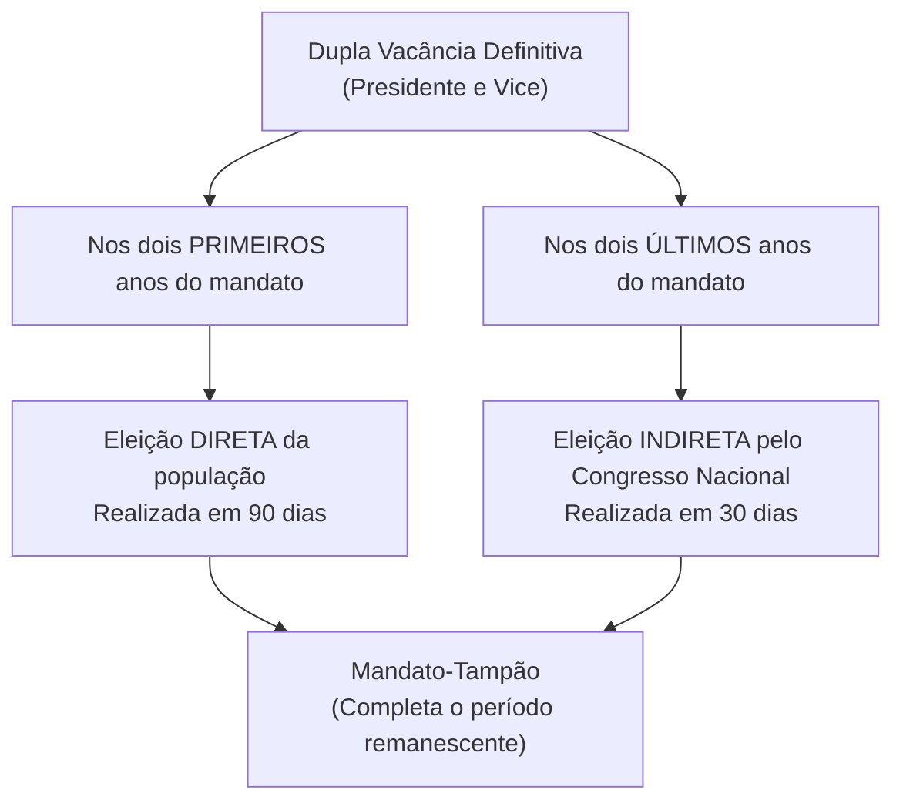
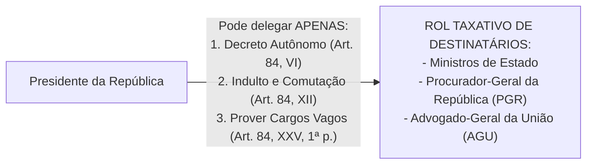

# 05 - Poder Executivo, Poder Judiciário e Funções Essenciais à Justiça

> **Matéria:** Noções de Direito Constitucional  
> **Cargo:** A01 – Técnico de Controle Externo – Especialidade: Técnico Administrativo  
> **Arquivo:** `05_poder_executivo_poder_judiciario_e_funcoes_essenciais.md`  
> **Status:** 🟢 Teoria Aprofundada + 5 Questões FCC Comentadas (A a E)

---

## 📌 Ementa / Itens do Edital

- Do Poder Executivo: eleição, posse, impedimento, vacância e sucessão presidencial;
- Atribuições e prerrogativas do Presidente da República (Artigo 84 da CF/88): competências indelegáveis e competências privativas delegáveis (decretos autônomos, indulto e provimento de cargos vagos);
- Responsabilidade do Presidente da República (Artigos 85 e 86 da CF/88):
    - Crimes comuns vs. crimes de responsabilidade (*impeachment*);
    - Juízo prévio de admissibilidade pela Câmara dos Deputados (quórum qualificado de 2/3);
    - Competência de julgamento pelo STF e pelo Senado Federal (presidido pelo Presidente do STF);
    - Imunidades presidenciais: imunidade prisional temporária e cláusula de irresponsabilidade relativa por atos estranhos ao mandato;
- Do Poder Judiciário: disposições gerais, estatuto e garantias da magistratura (vitaliciedade, inamovibilidade e irredutibilidade) e vedações expressas (quarentena de saída);
- Do Supremo Tribunal Federal (STF - Artigos 101 a 103-A da CF/88): composição (11 Ministros), nomeação, sabatina pelo Senado Federal, competências originárias e recursais, e o regime das Súmulas Vinculantes (Art. 103-A);
- Do Conselho Nacional de Justiça (CNJ - Artigo 103-B da CF/88): organização, composição (15 membros) e limites de atuação (natureza estritamente administrativa, orçamentária e correcional, sem competência jurisdicional);
- Do Superior Tribunal de Justiça (STJ - Artigos 104 e 105 da CF/88): composição (no mínimo 33 Ministros), uniformização da lei federal infraconstitucional e o filtro da relevância no Recurso Especial (EC nº 125/2022);
- Das Funções Essenciais à Justiça:
    - Ministério Público (Artigos 127 a 130-A da CF/88): princípios institucionais, autonomia, garantias, vedações e o Conselho Nacional do Ministério Público (CNMP);
    - Advocacia Pública (Artigos 131 e 132 da CF/88): AGU e Procuradorias Estaduais (PGE-GO);
    - Advocacia Privada (Artigo 133 da CF/88): indispensabilidade e inviolabilidade profissional;
    - Defensoria Pública (Artigos 134 e 135 da CF/88): assistência jurídica aos hipossuficientes e autonomia institucional expressa.

---

## 🧭 Sumário

1. [Poder Executivo: Estrutura, Atribuições e Responsabilidade](#1-poder-executivo-estrutura-atribuicoes-e-responsabilidade)
    1. [Dupla Vacância dos Cargos Presidenciais (Art. 81 da CF/88)](#11-dupla-vacancia-dos-cargos-presidenciais-art-81-da-cf88)
    2. [Atribuições Delegáveis do Presidente da República (Art. 84, Parágrafo Único)](#12-atribuicoes-delegaveis-do-presidente-da-republica-art-84-paragrafo-unico)
    3. [Responsabilidade do Presidente da República e Imunidades (Arts. 85 e 86)](#13-responsabilidade-do-presidente-da-republica-e-imunidades-arts-85-e-86)
    4. [Teste 154](#Teste-154)
    5. [Teste 155](#Teste-155)
    6. [Teste 156](#Teste-156)
    7. [Teste 157](#Teste-157)
2. [Poder Judiciário: Estrutura Orgânica, CNJ e Súmula Vinculante](#2-poder-judiciario-estrutura-organica-cnj-e-sumula-vinculante)
    1. [Garantias e Vedações dos Magistrados (Art. 95 da CF/88)](#21-garantias-e-vedacoes-dos-magistrados-art-95-da-cf88)
    2. [Conselho Nacional de Justiça (CNJ - Art. 103-B)](#22-conselho-nacional-de-justica-cnj-art-103-b)
    3. [Supremo Tribunal Federal e o Regime da Súmula Vinculante (Art. 103-A)](#23-supremo-tribunal-federal-e-o-regime-da-sumula-vinculante-art-103-a)
    4. [Superior Tribunal de Justiça e o Filtro de Relevância (Arts. 104 e 105)](#24-superior-tribunal-de-justica-e-o-filtro-de-relevancia-arts-104-e-105)
    5. [Teste 158](#Teste-158)
    6. [Teste 159](#Teste-159)
    7. [Teste 160](#Teste-160)
    8. [Teste 161](#Teste-161)
3. [Funções Essenciais à Justiça](#3-funcoes-essenciais-a-justica)
    1. [Ministério Público e o CNMP (Arts. 127 a 130-A)](#31-ministerio-publico-e-o-cnmp-arts-127-a-130-a)
    2. [Advocacia Pública (Arts. 131 e 132)](#32-advocacia-publica-arts-131-e-132)
    3. [Defensoria Pública (Arts. 134 e 135)](#33-defensoria-publica-arts-134-e-135)
    4. [Advocacia Privada (Art. 133)](#34-advocacia-privada-art-133)
    5. [Teste 162](#Teste-162)
    6. [Teste 163](#Teste-163)
    7. [Teste 164](#Teste-164)
4. [🌐 Fontes Oficiais & Jurisprudenciais Recomendadas](#fontes-oficiais-jurisprudenciais-recomendadas)

---

## 1. Poder Executivo: Estrutura, Atribuições e Responsabilidade

### 1.1 Dupla Vacância dos Cargos Presidenciais (Art. 81 da CF/88)
Ocorrendo a vacância definitiva tanto do cargo de Presidente quanto de Vice-Presidente da República, aplicam-se regras distintas a depender do momento do mandato:

- **Primeiros 2 anos do mandato:** Ocorrendo a vacância definitiva de ambos os cargos na primeira metade da legislatura, far-se-á eleição **direta** noventa dias depois de aberta a última vaga.
- **Últimos 2 anos do mandato:** Se a dupla vacância definitiva ocorrer na segunda metade da legislatura (3º ou 4º ano do mandato), a eleição para ambos os cargos será feita **indireta**, trinta dias depois da última vaga, pelo **Congresso Nacional**, na forma da lei.
- Em qualquer das hipóteses de eleição extraordinária, os eleitos deverão completar o período remanescente de seus antecessores (*mandato-tampão* - art. 81, § 2º).

### 1.2 Atribuições Delegáveis do Presidente da República (Art. 84, Parágrafo Único)
O art. 84 fixa as competências privativas do Presidente da República. Em regra, são privativas e indelegáveis. Todavia, a Constituição autoriza a **delegação de apenas TRÊS matérias específicas**:

1. **Art. 84, VI:** Dispor, mediante **decreto autônomo**, sobre:
    - *a)* Organização e funcionamento da administração federal, quando não implicar aumento de despesa nem criação ou extinção de órgãos públicos;
    - *b)* Extinção de funções ou cargos públicos, quando vagos;

2. **Art. 84, XII:** Conceder **indulto e comutar penas**, com audiência, se necessário, dos órgãos instituídos em lei;
3. **Art. 84, XXV, primeira parte:** **Prover** cargos públicos federais, na forma da lei.

> 🚨 **ALERTA DE PROVA / PEGADINHA FCC:**  
>
> - **Extinção de Órgãos Públicos:** O Presidente NÃO pode criar nem extinguir Ministérios ou órgãos públicos por decreto! A criação e extinção de órgãos públicos exige expressamente **lei formal ordinária** (art. 88 da CF/88). O decreto autônomo serve exclusivamente para organizar órgãos existentes sem gerar custos ou extinguir cargos vagos.  
> - **Extinção de Cargos Públicos Ocupados:** Depende obrigatoriamente de lei formal. Por decreto autônomo, o Chefe do Executivo só pode extinguir cargos e funções quando estiverem **vagos**!

### 1.3 Responsabilidade do Presidente da República e Imunidades (Arts. 85 e 86)
O Presidente da República responde perante o STF por crimes comuns e perante o Senado Federal por crimes de responsabilidade (*impeachment*).

| Aspecto Procedimental | Crime Comum (Penal) | Crime de Responsabilidade (*Impeachment*) |
| :--- | :--- | :--- |
| **Juízo de Admissibilidade** | **Câmara dos Deputados** (quórum de 2/3 dos membros) | **Câmara dos Deputados** (quórum de 2/3 dos membros) |
| **Órgão Julgador Competente** | **Supremo Tribunal Federal (STF)** | **Senado Federal** (sob presidência do Presidente do STF) |
| **Instauração do Processo** | Recebimento da denúncia ou queixa pelo STF | Deliberação do Plenário do Senado Federal por maioria simples |
| **Afastamento Preventivo** | Fica suspenso de suas funções por até 180 dias | Fica suspenso de suas funções por até 180 dias |
| **Sanção Constitucional** | Penas privativas de liberdade / multas criminais | **Perda do cargo** + **inabilitação por 8 anos** para qualquer função pública (quórum de 2/3 do Senado) |
| **Imunidade Prisional (Art. 86, § 3º)** | **Não pode ser preso**, na vigência do mandato, senão após sentença penal condenatória transitada em julgado | Inaplicável medida penal coercitiva |
| **Irresponsabilidade Relativa (Art. 86, § 4º)** | **Não pode ser responsabilizado por atos estranhos ao exercício de suas funções** na vigência do mandato | Aplicável a atos conexos ao exercício funcional |

---

### Teste 154
**(Questão Inédita / Simulada Estilo FCC – Nível: Controle Externo / TI)**  
O art. 84, VI, da Constituição Federal autoriza o Presidente da República a dispor, mediante decreto autônomo, sobre determinadas matérias de organização administrativa. A respeito dos limites dessa competência regulamentar executiva, é correto afirmar que o decreto autônomo:

* **A)** pode criar órgãos públicos e secretarias de Estado desde que a medida não importe aumento de despesa pública.
* **B)** pode dispor sobre a organização e funcionamento da administração federal sem criar despesas nem órgãos.
* **C)** autoriza a extinção de cargos e funções públicas mesmo quando estes estiverem formalmente ocupados por servidores.
* **D)** permite instituir ou majorar tributos de competência privativa da União em caso de comprovada urgência fiscal.
* **E)** constitui ato infralegal submetido a prévia aprovação vinculante pelo Congresso Nacional por decreto legislativo.

---

> **Comentário Detalhado:**
>
> - **A)** **Incorreto**. Conforme a alínea 'a' do art. 84, VI, da CF/88, o decreto autônomo não pode criar nem extinguir órgãos públicos (a criação e extinção de ministérios e órgãos públicos depende de lei - art. 88 da CF/88).
> - **B)** **Correto**. O art. 84, VI, 'a', da CF/88 (redação da EC nº 32/2001) autoriza decreto autônomo para "organização e funcionamento da administração federal, quando não implicar aumento de despesa nem criação ou extinção de órgãos públicos".
> - **C)** **Incorreto**. Conforme a alínea 'b' do mesmo dispositivo, o decreto autônomo só pode extinguir funções ou cargos públicos "quando vagos". Estando ocupados, a extinção exige lei formal.
> - **D)** **Incorreto**. Matéria tributária submete-se ao princípio da estrita legalidade (art. 150, I, CF/88).
> - **E)** **Incorreto**. O decreto autônomo retira seu fundamento de validade diretamente da Constituição, prescindindo de chancela parlamentar prévia.
>
> **Gabarito: B**

### Teste 155
**(Questão Inédita / Simulada Estilo FCC – Nível: Controle Externo / TI)**  
Vagando simultaneamente os cargos de Presidente e Vice-Presidente da República:

* **A)** será chamado ao exercício definitivo da Presidência o Presidente da Câmara dos Deputados para cumprir todo o mandato restante.
* **B)** será realizada eleição pelo Congresso Nacional, trinta dias depois da última vaga, se a vacância ocorrer nos últimos dois anos.
* **C)** deverá ser convocado plebiscito nacional em sessenta dias para decidir sobre a realização de nova eleição geral.
* **D)** caberá ao Tribunal Superior Eleitoral diplomar imediatamente os candidatos que obtiveram a segunda colocação no pleito anterior.
* **E)** haverá nova eleição direta noventa dias após aberta a última vaga, independentemente do ano do mandato em que ocorrer a vacância.

---

> **Comentário Detalhado:**
>
> - **A)** **Incorreto**. O Presidente da Câmara, do Senado e do STF são chamados sucessivamente apenas para o exercício provisório da Presidência (substituição), até que novos mandatários sejam eleitos (art. 80 c/c art. 81 da CF/88).
> - **B)** **Correto**. Nos expressos termos do art. 81, § 1º, da Constituição Federal: "Ocorrendo a vacância nos últimos dois anos do período presidencial, a eleição para ambos os cargos será feita trinta dias depois da última vaga, pelo Congresso Nacional, na forma da lei" (eleição indireta). Se a dupla vacância ocorrer nos dois primeiros anos de mandato, a eleição será feita noventa dias depois da abertura da última vaga, pelo voto direto da população (art. 81, caput).
> - **C)** **Incorreto**. A Constituição fixa a realização imperativa de eleições diretas ou indiretas, sem previsão de plebiscito prévio.
> - **D)** **Incorreto**. A ordem constitucional não prevê assunção de segundos colocados para mandato presidencial vago.
> - **E)** **Incorreto**. A eleição direta aos 90 dias só se aplica quando a vacância se dá nos primeiros dois anos do período.
>
> **Gabarito: B**

### Teste 156
**(FCC – TRT-2 – Analista Judiciário - Tecnologia da Informação – 2014)**  
Entre as atribuições conferidas pelo texto constitucional ao Presidente da República está o poder de "conceder indulto e comutar penas" (art. 84, XII). O exercício dessa atribuição presidencial não é cabível, nos termos da Constituição Federal, para beneficiar os condenados pela prática das infrações criminais de:

* **A)** terrorismo, racismo, crimes hediondos e ação de grupos armados contra a ordem constitucional.
* **B)** tortura, racismo, crimes hediondos e tráfico ilícito de entorpecentes e drogas afins.
* **C)** terrorismo, tortura, crimes hediondos e tráfico ilícito de entorpecentes e drogas afins.
* **D)** terrorismo, tortura, ação de grupos armados contra a ordem constitucional e tráfico ilícito de drogas.
* **E)** terrorismo, tortura, racismo, estelionato previdenciário e crimes contra a administração pública.

---

> **Comentário Detalhado:**
>
> - **A)** **Incorreto**. O racismo e a ação de grupos armados são crimes inafiançáveis e imprescritíveis (art. 5º, XLII e XLIV), mas a vedação de graça/indulto não incide expressamente sobre eles.
> - **B)** **Incorreto**. O racismo não consta da vedação de graça ou anistia do inciso XLIII.
> - **C)** **Correto**. Nos termos do art. 5º, XLIII, da Constituição Federal: "a lei considerará crimes inafiançáveis e insuscetíveis de graça ou anistia a prática da tortura, o tráfico ilícito de entorpecentes e drogas afins, o terrorismo e os definidos como crimes hediondos, por eles respondendo os mandantes, os executores e os que, podendo evitá-los, se omitirem". Conforme pacífica jurisprudência do STF, a vedação da graça alcança também o indulto coletivo (que é espécie do gênero graça em sentido amplo).
> - **D)** **Incorreto**. Ação de grupos armados é imprescritível e inafiançável, mas a vedação de indulto refere-se a tortura, tráfico, terrorismo e hediondos (o grupo 3T + H).
> - **E)** **Incorreto**. O racismo não integra a cláusula de vedação de graça/anistia do art. 5º, XLIII.
>
> **Gabarito: C**

### Teste 157
**(Questão Inédita / Simulada Estilo FCC – Nível: Controle Externo / TI)**  
A responsabilidade política e penal do Presidente da República é disciplinada no art. 86 da Constituição Federal. De acordo com as normas constitucionais vigentes e a jurisprudência do STF, é correto afirmar:

* **A)** Admitida a acusação por dois terços da Câmara dos Deputados, o Presidente será submetido a julgamento no STF ou Senado.
* **B)** O Presidente ficará suspenso de suas funções a partir do momento em que for protocolada a denúncia popular perante a Mesa.
* **C)** Compete ao Supremo Tribunal Federal processar e julgar o Presidente da República nos crimes de responsabilidade política.
* **D)** Se o julgamento não estiver concluído em noventa dias, cessará o afastamento do Presidente e extinguir-se-á o processo penal.
* **E)** O Presidente da República pode ser preso cautelarmente antes de sentença condenatória irrecorrível nos crimes comuns funcionais.

---

> **Comentário Detalhado:**
>
> - **A)** **Correto**. O art. 86, caput, da CF/88 determina: "Admitida a acusação contra o Presidente da República, por dois terços da Câmara dos Deputados, será ele submetido a julgamento perante o Supremo Tribunal Federal, nas infrações penais comuns, ou perante o Senado Federal, nos crimes de responsabilidade".
> - **B)** **Incorreto**. O afastamento dá-se apenas após a instauração do processo pelo Senado (em crimes de responsabilidade) ou recebimento da denúncia/queixa pelo STF (crimes comuns) - art. 86, § 1º, CF/88.
> - **C)** **Incorreto**. Nos crimes de responsabilidade, o julgamento compete ao Senado Federal (art. 52, I c/c art. 86).
> - **D)** **Incorreto**. Decorrido o prazo de cento e oitenta dias sem conclusão, cessará o afastamento do Presidente, prosseguindo o processo regularmente (art. 86, § 2º, CF/88).
> - **E)** **Incorreto**. O art. 86, § 3º, da CF/88 preconiza expressamente que "enquanto não sobrevier sentença condenatória, nas infrações comuns, o Presidente da República não estará sujeito a prisão" (imunidade prisional formal cautelar).
>
> **Gabarito: A**

### Teste 158
**(Questão Inédita / Simulada Estilo FCC – Nível: Controle Externo / TI)**  
A Constituição Federal de 1988 assegura aos magistrados um sólido conjunto de garantias institucionais inerentes ao livre exercício da função jurisdicional (art. 95). A respeito da vitaliciedade dos juízes, é correto afirmar que:

* **A)** é adquirida no ato da posse perante o Tribunal de Justiça, vedada qualquer fase prévia de estágio probatório.
* **B)** no primeiro grau, adquire-se após dois anos de exercício, dependendo a perda do cargo de sentença judicial transitada.
* **C)** pode ser revogada por decisão administrativa da maioria absoluta do respectivo Tribunal de Justiça em processo disciplinar.
* **D)** não impede a perda do cargo público por decisão discricionária motivada do Governador do Estado federado.
* **E)** é garantia conferida exclusivamente aos Ministros dos Tribunais Superiores que compõem a cúpula do Poder Judiciário.

---

> **Comentário Detalhado:**
>
> - **A)** **Incorreto**. Para os juízes togados que ingressam por concurso de provas e títulos no primeiro grau, a vitaliciedade exige o interstício de dois anos de efetivo exercício (art. 95, I, CF/88).
> - **B)** **Correto**. Conforme o art. 95, I, da CF/88: os juízes gozam de "vitaliciedade, que, no primeiro grau, só será adquirida após dois anos de exercício, dependendo a perda do cargo, nesse período, de deliberação do tribunal a que o juiz estiver vinculado, e, nos demais casos, de sentença judicial transitada em julgado".
> - **C)** **Incorreto**. Após adquirir a vitaliciedade, o magistrado só perde o cargo por sentença judicial transitada em julgado (a esfera administrativa do Tribunal pode aplicar apenas aposentadoria compulsória ou disponibilidade com vencimentos proporcionais).
> - **D)** **Incorreto**. O Chefe do Poder Executivo não tem ingerência alguma sobre a perda de cargo de magistrados.
> - **E)** **Incorreto**. A garantia abrange todos os juízes togados regularmente vitaliciados da magistratura nacional.
>
> **Gabarito: B**

### Teste 159
**(FGV – TJ-MT – Analista Judiciário - Tecnologia da Informação – 2024)**  
Determinado órgão, em âmbito nacional, tem a competência de controlar a atuação administrativa e financeira do Poder Judiciário e o cumprimento dos deveres funcionais dos juízes, além de outras atribuições que lhe forem conferidas pelo Estatuto da Magistratura.  
Nesse cenário, considerando as disposições da Constituição Federal de 1988, está-se diante de uma competência do:

* **A)** Tribunal Superior do Trabalho.
* **B)** Conselho Nacional de Justiça.
* **C)** Superior Tribunal de Justiça.
* **D)** Tribunal Superior Eleitoral.
* **E)** Supremo Tribunal Federal.

---

> **Comentário Detalhado:**
>
> - **A)** **Incorreto**. O TST é órgão de cúpula da Justiça do Trabalho, com atribuições essencialmente jurisdicionais.
> - **B)** **Correto**. Conforme o art. 103-B, § 4º, da Constituição Federal: "Compete ao Conselho o controle da atuação administrativa e financeira do Poder Judiciário e do cumprimento dos deveres funcionais dos juízes, cabendo-lhe, além de outras atribuições que lhe forem conferidas pelo Estatuto da Magistratura...". O CNJ não possui competência jurisdicional, atuando exclusivamente como órgão de controle administrativo e correcional.
> - **C)** **Incorreto**. O STJ é tribunal jurisdicional responsável pela uniformização da legislação infraconstitucional federal.
> - **D)** **Incorreto**. O TSE coordena a jurisdição eleitoral em nível nacional.
> - **E)** **Incorreto**. O STF é o guardião da Constituição e cúpula jurisdicional máxima do Estado brasileiro.
>
> **Gabarito: B**

### Teste 160
**(FGV – TJ-RR – Analista Judiciário - Suporte e Infraestrutura de TI – 2024)**  
O Conselho Nacional de Justiça compõe-se de 15 (quinze) membros com mandato de 2 (dois) anos, admitida 1 (uma) recondução. As opções a seguir apresentam membros que participam da composição constitucional desse Conselho, à exceção de uma. Assinale-a:

* **A)** Um juiz de Tribunal Regional Federal, indicado pelo Superior Tribunal de Justiça.
* **B)** Um juiz de Tribunal Regional do Trabalho, indicado pelo Tribunal Superior do Trabalho.
* **C)** Dois cidadãos de notável saber jurídico e reputação ilibada, indicados pela Câmara e pelo Senado.
* **D)** Um juiz de Tribunal Regional Eleitoral, indicado privativamente pelo Supremo Tribunal Federal.
* **E)** Um membro do Ministério Público estadual, escolhido pelo Procurador-Geral da República.

---

> **Comentário Detalhado:**
>
> - **A)** **Incorreto**. É membro integrante expressamente previsto no art. 103-B, V, da CF/88.
> - **B)** **Incorreto**. É membro integrante expressamente previsto no art. 103-B, VIII, da CF/88.
> - **C)** **Incorreto**. Membros previstos no art. 103-B, XIII, da CF/88 (um indicado pela Câmara dos Deputados e um pelo Senado Federal).
> - **D)** **Correto**. O art. 103-B da Constituição Federal NÃO contempla na composição do CNJ a figura de juiz de Tribunal Regional Eleitoral (TRE). A composição conta com: o Presidente do STF, 1 Ministro do STJ, 1 Ministro do TST, 1 Desembargador de TJ, 1 Juiz de Direito estadual, 1 Juiz de TRF, 1 Juiz federal, 1 Juiz de TRT, 1 Juiz do trabalho, 1 membro do MPU, 1 membro do MPE, 2 advogados indicados pelo CFOAB e 2 cidadãos indicados pelo Congresso Nacional. Logo, esta é a única opção que traz membro inexistente no colegiado.
> - **E)** **Incorreto**. É membro integrante expressamente previsto no art. 103-B, XI, da CF/88.
>
> **Gabarito: D**

### Teste 161
**(Questão Inédita / Simulada Estilo FCC – Nível: Controle Externo / TI)**  
O art. 103-A da Constituição Federal confere ao Supremo Tribunal Federal a competência para editar súmulas com efeito vinculante em relação aos demais órgãos do Poder Judiciário e à administração pública. A respeito da súmula vinculante, é correto afirmar:

* **A)** A aprovação de enunciado de súmula vinculante exige o quórum de maioria simples dos membros presentes no Plenário do STF.
* **B)** O enunciado possui eficácia vinculante em relação aos demais órgãos do Poder Judiciário e à Administração Pública direta e indireta.
* **C)** A súmula vinculante vincula o Poder Legislativo no exercício de sua função típica de elaboração das normas legais.
* **D)** Qualquer pessoa física tem legitimidade ativa autônoma perante o STF para propor a edição ou revisão de súmula vinculante.
* **E)** Contra ato administrativo que contrarie súmula vinculante cabe apelação hierárquica perante o Conselho Nacional de Justiça.

---

> **Comentário Detalhado:**
>
> - **A)** **Incorreto**. A edição, revisão ou cancelamento de súmula vinculante exige decisão tomada por dois terços dos membros do Supremo Tribunal Federal (quórum qualificado de pelo menos 8 Ministros - art. 103-A, caput, CF/88).
> - **B)** **Correto**. O art. 103-A, caput, da CF/88 expressa: "O Supremo Tribunal Federal poderá, de ofício ou por provocação, mediante decisão de dois terços dos seus membros, após reiteradas decisões sobre matéria constitucional, aprovar súmula que, a partir de sua publicação na imprensa oficial, terá efeito vinculante em relação aos demais órgãos do Poder Judiciário e à administração pública direta e indireta, nas esferas federal, estadual e municipal...".
> - **C)** **Incorreto**. A súmula vinculante não vincula o Poder Legislativo em sua função legislativa típica (princípio da não fossilização do direito).
> - **D)** **Incorreto**. A legitimação para propor a edição de súmula vinculante é idêntica à dos legitimados para a ação direta de inconstitucionalidade (art. 103 da CF/88), além de outros entes fixados na Lei nº 11.417/2006 (como o Defensor Público-Geral e os Tribunais).
> - **E)** **Incorreto**. Caberá reclamação constitucional perante o próprio Supremo Tribunal Federal (art. 103-A, § 3º, CF/88).
>
> **Gabarito: B**

### Teste 162
**(Questão Inédita / Simulada Estilo FCC – Nível: Controle Externo / TI)**  
O Ministério Público é instituição permanente, essencial à função jurisdicional do Estado, incumbindo-lhe a defesa da ordem jurídica, do regime democrático e dos interesses sociais e individuais indisponíveis. A respeito dos seus princípios institucionais, é correto afirmar:

* **A)** A unidade, a indivisibilidade e a independência funcional são princípios institucionais do Ministério Público.
* **B)** A destituição do Procurador-Geral de Justiça pelo Governador dispensa prévia autorização da Assembleia Legislativa.
* **C)** O Ministério Público subordina-se funcionalmente ao Ministério da Justiça e Segurança Pública no plano federal.
* **D)** A criação e extinção de cargos nos Ministérios Públicos estaduais decorre de decreto autônomo do Governador.
* **E)** Aos membros do Ministério Público é expressamente permitida a prática da advocacia privada no âmbito civil.

---

> **Comentário Detalhado:**
>
> - **A)** **Correto**. Nos termos literais do art. 127, § 1º, da Constituição Federal: "São princípios institucionais do Ministério Público a unidade, a indivisibilidade e a independência funcional".
> - **B)** **Incorreto**. A destituição do Procurador-Geral de Justiça dos Estados antes do término do mandato depende de deliberação da maioria absoluta do Poder Legislativo estadual (art. 128, § 4º, CF/88).
> - **C)** **Incorreto**. O Ministério Público possui autonomia funcional, administrativa e financeira constitucional (art. 127, § 2º, CF/88), não mantendo subordinação a nenhum dos Poderes ou Ministérios.
> - **D)** **Incorreto**. A criação e extinção de cargos e serviços auxiliares do MP é veiculada por lei formal de iniciativa privativa do Procurador-Geral (art. 127, § 2º, CF/88).
> - **E)** **Incorreto**. O art. 128, § 5º, II, 'a', veda expressamente aos membros do Ministério Público o exercício da advocacia.
>
> **Gabarito: A**

### Teste 163
**(Questão Inédita / Simulada Estilo FCC – Nível: Controle Externo / TI)**  
Acerca do regime constitucional conferido às Funções Essenciais à Justiça, em especial à Defensoria Pública (art. 134 da CF/88), analise as prerrogativas e garantias asseguradas pela ordem constitucional. É correto afirmar que:

* **A)** Às Defensorias Públicas são asseguradas a autonomia funcional, administrativa e a iniciativa de sua proposta orçamentária.
* **B)** A Defensoria Pública subordina-se hierarquicamente à Procuradoria-Geral do respectivo Estado da Federação.
* **C)** O cargo de Defensor Público-Geral é privativo de membro vitalício oriundo do Ministério Público estadual.
* **D)** A assistência jurídica integral aos hipossuficientes pode ser extinta por lei ordinária estadual autorizativa.
* **E)** As Defensorias Públicas não gozam de legitimidade para a propositura de Ação Civil Pública na tutela de interesses difusos e coletivos.

---

> **Comentário Detalhado:**
>
> - **A)** **Correto**. O art. 134, § 2º, da CF/88 (inserido pela EC nº 45/2004 e complementado pela EC nº 74/2013 e EC nº 80/2014) confere às Defensorias Públicas Estaduais e da União autonomia funcional e administrativa, bem como a iniciativa de sua proposta orçamentária dentro dos limites fixados na LDO.
> - **B)** **Incorreto**. A Defensoria Pública é instituição autônoma e independente, sem relação de subordinação com Procuradorias de Estado ou órgãos executivos.
> - **C)** **Incorreto**. O Defensor Público-Geral é escolhido dentre os membros integrantes da carreira da respectiva Defensoria Pública.
> - **D)** **Incorreto**. A assistência jurídica aos hipossuficientes é dever estatal indeclinável e garantia fundamental (art. 5º, LXXIV, CF/88).
> - **E)** **Incorreto**. A Defensoria Pública possui ampla legitimidade ativa para promover ação civil pública na tutela de direitos individuais homogêneos, difusos e coletivos (art. 134 da CF/88 e Tema 607 do STF).
>
> **Gabarito: A**

### Teste 164
**(Questão Inédita / Simulada Estilo FCC – Nível: Controle Externo / TI)**  
A respeito da Advocacia Pública disciplinada nos artigos 131 e 132 da Constituição Federal, analise as competências conferidas à Advocacia-Geral da União e às Procuradorias dos Estados e do Distrito Federal. É correto afirmar que:

* **A)** A representação judicial da União nas execuções de dívida ativa de natureza tributária compete privativamente à CGU.
* **B)** Os Procuradores dos Estados e do DF exercem a representação judicial e a consultoria jurídica das unidades federadas.
* **C)** O Advogado-Geral da União deve ser nomeado exclusivamente dentre os membros que integram a carreira da AGU.
* **D)** A atividade de consultoria jurídica dos órgãos do Poder Executivo estadual pode ser exercida por servidores comissionados sem concurso.
* **E)** O regime constitucional veda aos Estados federados a instituição de quadro de procuradores para a cobrança da dívida ativa estadual.

---

> **Comentário Detalhado:**
>
> - **A)** **Incorreto**. Conforme o art. 131, § 3º, da CF/88, na execução da dívida ativa de natureza tributária, a representação da União cabe privativamente à Procuradoria-Geral da Fazenda Nacional (PGFN).
> - **B)** **Correto**. O art. 132 da Constituição Federal dispõe: "Os Procuradores dos Estados e do Distrito Federal, organizados em carreira, na qual o ingresso dependerá de concurso público de provas e títulos, com a participação da Ordem dos Advogados do Brasil em todas as suas fases, exercerão a representação judicial e a consultoria jurídica das respectivas unidades federadas".
> - **C)** **Incorreto**. O Advogado-Geral da União é de livre nomeação pelo Presidente da República dentre cidadãos maiores de 35 anos, de notável saber jurídico e reputação ilibada (art. 131, § 1º, CF/88), não precisando ser da carreira.
> - **D)** **Incorreto**. Conforme jurisprudência pacífica do STF (ADI 4.261 e Tema 1.098), a consultoria jurídica e a representação do Estado são atividades exclusivas e privativas dos Procuradores do Estado concursados, sendo inconstitucional a criação de órgãos jurídicos paralelos com cargos em comissão.
> - **E)** **Incorreto**. A cobrança da dívida ativa estadual insere-se nas atribuições nucleares das Procuradorias-Gerais dos Estados.
>
> **Gabarito: B**

