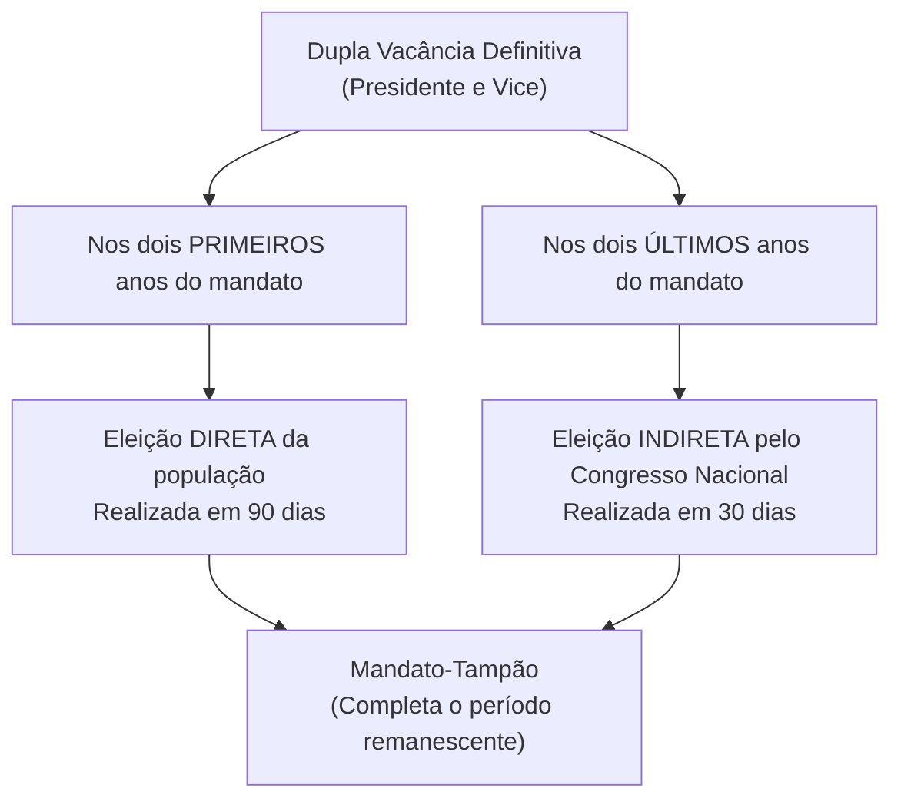
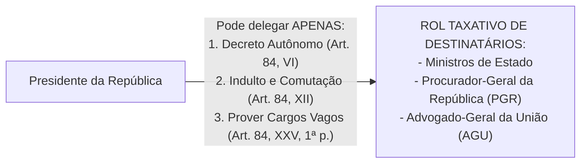
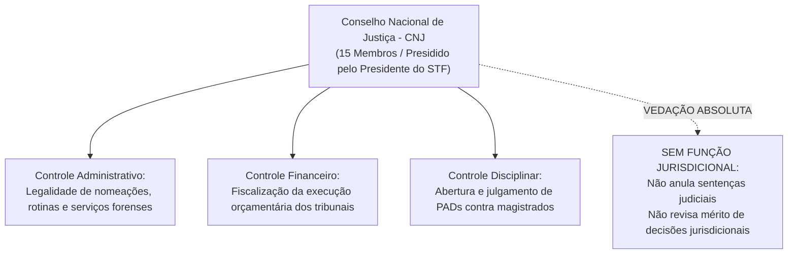
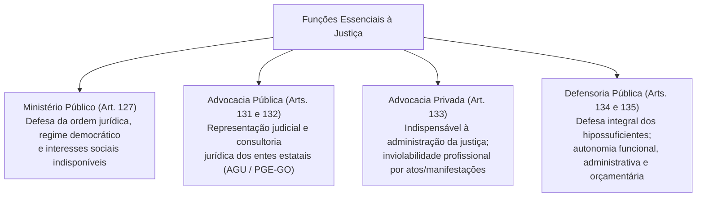

# 05 - Poder Executivo, Poder Judiciário e Funções Essenciais à Justiça

> **Matéria:** Noções de Direito Constitucional  
> **Cargo:** A01 – Técnico de Controle Externo – Especialidade: Técnico Administrativo  
> **Arquivo:** `05_poder_executivo_poder_judiciario_e_funcoes_essenciais.md`  
> **Status:** 🟢 Teoria Aprofundada + 5 Questões FCC Comentadas (A a E)

---

## 📌 Ementa / Itens do Edital

- Do Poder Executivo: eleição, posse, impedimento, vacância e sucessão presidencial;
- Atribuições e prerrogativas do Presidente da República (Artigo 84 da CF/88): competências indelegáveis e competências privativas delegáveis (decretos autônomos, indulto e provimento de cargos vagos);
- Responsabilidade do Presidente da República (Artigos 85 e 86 da CF/88):
    - Crimes comuns vs. crimes de responsabilidade (*impeachment*);
    - Juízo prévio de admissibilidade pela Câmara dos Deputados (quórum qualificado de 2/3);
    - Competência de julgamento pelo STF e pelo Senado Federal (presidido pelo Presidente do STF);
    - Imunidades presidenciais: imunidade prisional temporária e cláusula de irresponsabilidade relativa por atos estranhos ao mandato;
- Do Poder Judiciário: disposições gerais, estatuto e garantias da magistratura (vitaliciedade, inamovibilidade e irredutibilidade) e vedações expressas (quarentena de saída);
- Do Supremo Tribunal Federal (STF - Artigos 101 a 103-A da CF/88): composição (11 Ministros), nomeação, sabatina pelo Senado Federal, competências originárias e recursais, e o regime das Súmulas Vinculantes (Art. 103-A);
- Do Conselho Nacional de Justiça (CNJ - Artigo 103-B da CF/88): organização, composição (15 membros) e limites de atuação (natureza estritamente administrativa, orçamentária e correcional, sem competência jurisdicional);
- Do Superior Tribunal de Justiça (STJ - Artigos 104 e 105 da CF/88): composição (no mínimo 33 Ministros), uniformização da lei federal infraconstitucional e o filtro da relevância no Recurso Especial (EC nº 125/2022);
- Das Funções Essenciais à Justiça:
    - Ministério Público (Artigos 127 a 130-A da CF/88): princípios institucionais, autonomia, garantias, vedações e o Conselho Nacional do Ministério Público (CNMP);
    - Advocacia Pública (Artigos 131 e 132 da CF/88): AGU e Procuradorias Estaduais (PGE-GO);
    - Advocacia Privada (Artigo 133 da CF/88): indispensabilidade e inviolabilidade profissional;
    - Defensoria Pública (Artigos 134 e 135 da CF/88): assistência jurídica aos hipossuficientes e autonomia institucional expressa.

---

## 🧭 Sumário

1. [Poder Executivo: Estrutura, Atribuições e Responsabilidade](#1-poder-executivo-estrutura-atribuicoes-e-responsabilidade)
    1. [Dupla Vacância dos Cargos Presidenciais (Art. 81 da CF/88)](#11-dupla-vacancia-dos-cargos-presidenciais-art-81-da-cf88)
    2. [Atribuições Delegáveis do Presidente da República (Art. 84, Parágrafo Único)](#12-atribuicoes-delegaveis-do-presidente-da-republica-art-84-paragrafo-unico)
    3. [Responsabilidade do Presidente da República e Imunidades (Arts. 85 e 86)](#13-responsabilidade-do-presidente-da-republica-e-imunidades-arts-85-e-86)
    4. [Teste 154](#Teste-154)
    5. [Teste 155](#Teste-155)
    6. [Teste 156](#Teste-156)
    7. [Teste 157](#Teste-157)
2. [Poder Judiciário: Estrutura Orgânica, CNJ e Súmula Vinculante](#2-poder-judiciario-estrutura-organica-cnj-e-sumula-vinculante)
    1. [Garantias e Vedações dos Magistrados (Art. 95 da CF/88)](#21-garantias-e-vedacoes-dos-magistrados-art-95-da-cf88)
    2. [Conselho Nacional de Justiça (CNJ - Art. 103-B)](#22-conselho-nacional-de-justica-cnj-art-103-b)
    3. [Supremo Tribunal Federal e o Regime da Súmula Vinculante (Art. 103-A)](#23-supremo-tribunal-federal-e-o-regime-da-sumula-vinculante-art-103-a)
    4. [Superior Tribunal de Justiça e o Filtro de Relevância (Arts. 104 e 105)](#24-superior-tribunal-de-justica-e-o-filtro-de-relevancia-arts-104-e-105)
    5. [Teste 158](#Teste-158)
    6. [Teste 159](#Teste-159)
    7. [Teste 160](#Teste-160)
    8. [Teste 161](#Teste-161)
3. [Funções Essenciais à Justiça](#3-funcoes-essenciais-a-justica)
    1. [Ministério Público e o CNMP (Arts. 127 a 130-A)](#31-ministerio-publico-e-o-cnmp-arts-127-a-130-a)
    2. [Advocacia Pública (Arts. 131 e 132)](#32-advocacia-publica-arts-131-e-132)
    3. [Defensoria Pública (Arts. 134 e 135)](#33-defensoria-publica-arts-134-e-135)
    4. [Advocacia Privada (Art. 133)](#34-advocacia-privada-art-133)
    5. [Teste 162](#Teste-162)
    6. [Teste 163](#Teste-163)
    7. [Teste 164](#Teste-164)
4. [🌐 Fontes Oficiais & Jurisprudenciais Recomendadas](#fontes-oficiais-jurisprudenciais-recomendadas)

---

## 1. Poder Executivo: Estrutura, Atribuições e Responsabilidade

### 1.1 Dupla Vacância dos Cargos Presidenciais (Art. 81 da CF/88)
Ocorrendo a vacância definitiva tanto do cargo de Presidente quanto de Vice-Presidente da República, aplicam-se regras distintas a depender do momento do mandato:

- **Primeiros 2 anos do mandato:** Ocorrendo a vacância definitiva de ambos os cargos na primeira metade da legislatura, far-se-á eleição **direta** noventa dias depois de aberta a última vaga.
- **Últimos 2 anos do mandato:** Se a dupla vacância definitiva ocorrer na segunda metade da legislatura (3º ou 4º ano do mandato), a eleição para ambos os cargos será feita **indireta**, trinta dias depois da última vaga, pelo **Congresso Nacional**, na forma da lei.
- Em qualquer das hipóteses de eleição extraordinária, os eleitos deverão completar o período remanescente de seus antecessores (*mandato-tampão* - art. 81, § 2º).

### 1.2 Atribuições Delegáveis do Presidente da República (Art. 84, Parágrafo Único)
O art. 84 fixa as competências privativas do Presidente da República. Em regra, são privativas e indelegáveis. Todavia, a Constituição autoriza a **delegação de apenas TRÊS matérias específicas**:

1. **Art. 84, VI:** Dispor, mediante **decreto autônomo**, sobre:
    - *a)* Organização e funcionamento da administração federal, quando não implicar aumento de despesa nem criação ou extinção de órgãos públicos;
    - *b)* Extinção de funções ou cargos públicos, quando vagos;

2. **Art. 84, XII:** Conceder **indulto e comutar penas**, com audiência, se necessário, dos órgãos instituídos em lei;
3. **Art. 84, XXV, primeira parte:** **Prover** cargos públicos federais, na forma da lei.

> 🚨 **ALERTA DE PROVA / PEGADINHA FCC:**  
>
> - **Extinção de Órgãos Públicos:** O Presidente NÃO pode criar nem extinguir Ministérios ou órgãos públicos por decreto! A criação e extinção de órgãos públicos exige expressamente **lei formal ordinária** (art. 88 da CF/88). O decreto autônomo serve exclusivamente para organizar órgãos existentes sem gerar custos ou extinguir cargos vagos.  
> - **Extinção de Cargos Públicos Ocupados:** Depende obrigatoriamente de lei formal. Por decreto autônomo, o Chefe do Executivo só pode extinguir cargos e funções quando estiverem **vagos**!

### 1.3 Responsabilidade do Presidente da República e Imunidades (Arts. 85 e 86)
O Presidente da República responde perante o STF por crimes comuns e perante o Senado Federal por crimes de responsabilidade (*impeachment*).

| Aspecto Procedimental | Crime Comum (Penal) | Crime de Responsabilidade (*Impeachment*) |
| :--- | :--- | :--- |
| **Juízo de Admissibilidade** | **Câmara dos Deputados** (quórum de 2/3 dos membros) | **Câmara dos Deputados** (quórum de 2/3 dos membros) |
| **Órgão Julgador Competente** | **Supremo Tribunal Federal (STF)** | **Senado Federal** (sob presidência do Presidente do STF) |
| **Instauração do Processo** | Recebimento da denúncia ou queixa pelo STF | Deliberação do Plenário do Senado Federal por maioria simples |
| **Afastamento Preventivo** | Fica suspenso de suas funções por até 180 dias | Fica suspenso de suas funções por até 180 dias |
| **Sanção Constitucional** | Penas privativas de liberdade / multas criminais | **Perda do cargo** + **inabilitação por 8 anos** para qualquer função pública (quórum de 2/3 do Senado) |
| **Imunidade Prisional (Art. 86, § 3º)** | **Não pode ser preso**, na vigência do mandato, senão após sentença penal condenatória transitada em julgado | Inaplicável medida penal coercitiva |
| **Irresponsabilidade Relativa (Art. 86, § 4º)** | **Não pode ser responsabilizado por atos estranhos ao exercício de suas funções** na vigência do mandato | Aplicável a atos conexos ao exercício funcional |

---

### Teste 154
**(FCC - Analista de Controle Externo / TCE-GO)**
O art. 84, VI, da Constituição Federal, com a redação dada pela Emenda Constitucional nº 32/2001, introduziu no direito constitucional brasileiro a figura do decreto autônomo presidencial.

Conforme a disciplina constitucional vigente, o Chefe do Poder Executivo pode dispor mediante decreto sobre:

* **A)** Criação e extinção de ministérios e órgãos públicos da administração direta e indireta.
* **B)** Organização e funcionamento da administração federal, quando não implicar aumento de despesa nem criação ou extinção de órgãos públicos; e extinção de funções ou cargos públicos, quando vagos.
* **C)** Definição de novos crimes e cominação de penas disciplinares privativas de liberdade.
* **D)** Concessão de anistia e indulto para infrações funcionais apuradas em processos de contas pelo Tribunal de Contas.
* **E)** Instituição e majoração discricionária de tributos sem autorização legislativa formal.

---

> **Comentário Detalhado:**
>
> - **A)** Incorreta. A criação e extinção de órgãos públicos e ministérios exige **obrigatoriamente lei formal** de iniciativa privativa do Presidente (art. 48, XI e art. 84, VI, 'a', parte final).
> - **B)** Correta. O art. 84, VI, da CF/88 consagra categoricamente as duas únicas hipóteses constitucionais admitidas de **decreto autônomo**: 'a' - organização e funcionamento da administração federal, quando não implicar aumento de despesa nem criação ou extinção de órgãos públicos; 'b' - extinção de funções ou cargos públicos, **quando vagos**.
> - **C)** Incorreta. Matéria penal e criação de penas submetem-se ao princípio da reserva legal absoluta (art. 5º, XXXIX).
> - **D)** Incorreta. O indulto presidencial (art. 84, XII) destina-se a condenações penais comuns, e não a sanções de ressarcimento impostas por Cortes de Contas.
> - **E)** Incorreta. Instituição de tributos exige estrita legalidade tributária (art. 150, I).
>
> **Gabarito: B**

---

### Teste 155
**(FCC - Adaptada / Analista de Controle Externo)**
Na hipótese de ocorrer a vacância simultânea e definitiva dos cargos de Presidente e de Vice-Presidente da República no terceiro ano do mandato presidencial:

* **A)** Assumirá definitivamente a Presidência o Presidente da Câmara dos Deputados até a conclusão regular do quadriênio.
* **B)** Serão convocadas eleições diretas no prazo de noventa dias contados da abertura da última vaga para mandato de quatro anos completos.
* **C)** A eleição para ambos os cargos será realizada trinta dias depois da última vaga, pelo Congresso Nacional, na forma da lei, para cumprimento do restante do mandato.
* **D)** O Presidente do Supremo Tribunal Federal governará o país em comissão até a posse dos novos mandatários eleitos pelo sufrágio universal.
* **E)** Haverá intervenção militar provisória até que o Colégio Eleitoral estadual convoque novo plebiscito presidencial.

---

> **Comentário Detalhado:**
>
> - **A) Incorreta:** O Presidente da Câmara figura apenas na linha de substituição temporária (art. 80), não assumindo mandato em caráter definitivo em caso de dupla vacância.  
> - **B) Incorreta:** Eleições diretas em 90 dias só ocorrem se a dupla vacância acontecer nos **dois primeiros anos** do mandato (art. 81, *caput*).  
> - **C) CORRETA:** Nos termos do art. 81, § 1º, da CF/88, ocorrendo a vacância nos **últimos dois anos do mandato** (caso do enunciado, que citou o terceiro ano), a eleição para ambos os cargos será feita **trinta dias depois da última vaga, pelo Congresso Nacional (eleição indireta)**, cabendo aos eleitos completar o período dos antecessores (*mandato-tampão* - art. 81, § 2º).  
> - **D) Incorreta:** O Presidente do STF é apenas o último na linha sucessória temporária de substituição interina do cargo enquanto não se conclui a nova eleição.  
> - **E) Incorreta:** A solução constitucional para a vacância é integralmente civil e parlamentar, consoante as regras do art. 81.
> 
> **Gabarito: C**

---

### Teste 156
**(FCC - Adaptada / Analista Judiciário - TRT)**
A respeito das atribuições constitucionais do Presidente da República e da possibilidade de delegação de competências, consoante o disposto expressamente na Constituição Federal de 1988:

* **A)** O Presidente da República pode delegar a competência para a criação ou extinção de Ministérios e órgãos da administração pública ao Ministro de Estado da respectiva pasta.
* **B)** É delegável ao Procurador-Geral da República e ao Advogado-Geral da União a atribuição privativa de conceder indulto e comutar penas.
* **C)** A decretação de intervenção federal e a celebração de tratados de paz com nações estrangeiras podem ser delegadas ao Ministro de Estado da Justiça e Segurança Pública.
* **D)** O provimento e a extinção de cargos públicos federais ocupados podem ser livremente delegados ao Advogado-Geral da União mediante portaria ministerial.
* **E)** As atribuições privativas do Presidente da República são personalíssimas e indelegáveis sob qualquer hipótese, em observância estrita ao princípio da separação dos poderes.

---

> **Comentário Detalhado:**
>
> - **A) Incorreta:** A criação e a extinção de Ministérios e órgãos públicos dependem obrigatoriamente de lei formal (art. 88 da CF/88), sendo matéria indelegável.  
> - **B) CORRETA:** De acordo com o art. 84, parágrafo único, da CF/88, o Presidente da República poderá delegar as atribuições mencionadas nos incisos VI (decreto autônomo), XII (conceder indulto e comutar penas) e XXV, primeira parte (prover cargos públicos federais vagos), aos Ministros de Estado, ao **Procurador-Geral da República** ou ao **Advogado-Geral da União**.  
> - **C) Incorreta:** Decretar e executar intervenção federal (art. 84, X) e celebrar a paz (art. 84, XX) são competências indelegáveis e exclusivas do Presidente da República.  
> - **D) Incorreta:** A delegação do inciso XXV é expressamente restrita ao **provimento** de cargos públicos (primeira parte). A extinção de cargos ocupados depende de lei ordinária e jamais pode ser delegada.  
> - **E) Incorreta:** O parágrafo único do art. 84 admite a delegação taxativa de três incisos aos destinatários indicados na própria Carta Magna.
> 
> **Gabarito: B**

---

### Teste 157
**(FGV - Auditor de Controle Externo / TCE-SC)**
A responsabilidade do Presidente da República é disciplinada nos arts. 85 e 86 da Constituição Federal de 1988, diferenciando os crimes comuns dos crimes de responsabilidade.

Sobre o rito constitucional de responsabilização do Chefe do Poder Executivo, assinale a afirmativa correta.

* **A)** O Presidente da República somente pode ser submetido a julgamento por crime comum ou de responsabilidade após a admissão da acusação por dois terços dos membros da Câmara dos Deputados.
* **B)** Admitida a acusação por crime comum, o Presidente da República será processado e julgado perante o Senado Federal.
* **C)** No julgamento por crime de responsabilidade, a condenação pelo Senado Federal exige voto da maioria simples dos senadores presentes à sessão.
* **D)** O Presidente da República, na vigência de seu mandato, pode ser responsabilizado por atos estranhos ao exercício de suas funções na esfera criminal.
* **E)** A admissão da acusação pela Câmara dos Deputados suspende o Presidente da República de suas funções imediatamente, antes mesmo da instauração formal do processo pelo órgão julgador competente.

---

> **Comentário Detalhado:**
>
> - **A)** Correta. O art. 86, caput, da CF/88 estabelece o juízo político prévio de admissibilidade: *"Se admitida a acusação contra o Presidente da República, por **dois terços da Câmara dos Deputados**, será ele submetido a julgamento perante o Supremo Tribunal Federal, nas infrações penais comuns, ou perante o Senado Federal, nos crimes de responsabilidade"*.
> - **B)** Incorreta. Por crimes penais comuns o julgamento realiza-se perante o **Supremo Tribunal Federal** (art. 86 e art. 102, I, 'b').
> - **C)** Incorreta. A condenação no Senado por crime de responsabilidade exige quórum qualificado de **dois terços dos votos** (art. 52, parágrafo único), operando a perda do cargo e a inabilitação por oito anos.
> - **D)** Incorreta. O art. 86, § 4º, consagra a imunidade penal temporária relativa: *"O Presidente da República, na vigência de seu mandato, não pode ser responsabilizado por atos estranhos ao exercício de suas funções"*.
> - **E)** Incorreta. A suspensão de funções opera-se apenas após a instauração formal do processo pelo STF (crime comum) ou após a instauração pelo Senado Federal (crime de responsabilidade), e não pela mera votação na Câmara (art. 86, § 1º).
>
> **Gabarito: A**

---

## 2. Poder Judiciário: Estrutura Orgânica, CNJ e Súmula Vinculante

### 2.1 Garantias e Vedações dos Magistrados (Art. 95 da CF/88)
- **Garantias Constitucionais:**
    - *Vitaliciedade:* Em primeiro grau, só é adquirida após **2 (dois) anos de efetivo exercício** (no período inicial de 2 anos, a perda do cargo dá-se por deliberação do tribunal respectivo; após os 2 anos, exige-se sentença judicial transitada em julgado).
    - *Inamovibilidade:* O juiz não pode ser removido compulsoriamente, salvo por motivo de interesse público, fundamentado em decisão tomada pela maioria absoluta do tribunal ou do Conselho Nacional de Justiça (CNJ).
    - *Irredutibilidade de Subsídio:* Remuneração protegida contra reduções nominais arbitrárias, sujeita ao teto constitucional e aos tributos gerais.
- **Vedações Constitucionais:**
    - Exercer, ainda que em disponibilidade, outro cargo ou função, salvo **uma de magistério**;
    - Receber, a qualquer título ou sob qualquer pretexto, custas ou participação em processo;
    - Dedicar-se a **atividade político-partidária**;
    - Receber auxílios ou contribuições de pessoas físicas ou entidades públicas/privadas;
    - Exercer a advocacia no juízo ou tribunal do qual se afastou antes de decorridos **3 (três) anos** do afastamento do cargo por aposentadoria ou exoneração (*quarentena de saída* - Art. 95, parágrafo único, V).

### 2.2 Conselho Nacional de Justiça (CNJ - Art. 103-B)
O CNJ compõe-se de **15 membros**, com mandato de **2 anos**, admitida **uma única recondução**, presidido pelo Presidente do Supremo Tribunal Federal.

> 🚨 **ALERTA DE PROVA / PEGADINHA FCC:**  
> O CNJ **NÃO tem competência jurisdicional**! O CNJ não pode anular sentença de juiz, não pode apreciar recursos contra decisões judiciais e não pode revogar liminares concedidas em processos judiciais. Qualquer questão da FCC que afirme que o CNJ "reformou a sentença de primeiro grau por contrariar a lei" está redondamente incorreta! O controle jurisdicional pertence exclusivamente às instâncias recursais (TJ, TRF, STJ, STF).

### 2.3 Supremo Tribunal Federal e o Regime da Súmula Vinculante (Art. 103-A)
- **Composição do STF:** 11 Ministros, escolhidos dentre cidadãos com mais de 35 e menos de 70 anos de idade, de notável saber jurídico e reputação ilibada, nomeados pelo Presidente da República após aprovação pela maioria absoluta do Senado Federal.
- **Aprovação e Cancelamento de Súmula Vinculante:** O STF pode, de ofício ou por provocação, mediante decisão de **dois terços (2/3) dos seus membros (8 votos)**, aprovar, revisar ou cancelar enunciado de súmula vinculante, após reiteradas decisões sobre matéria constitucional.
- **Eficácia Vinculante:** Vincula todos os demais órgãos do Poder Judiciário e a **Administração Pública direta e indireta, nas esferas federal, estadual e municipal**.
- **Limitações do Efeito Vinculante:**
    - O próprio STF não é vinculado (pode cancelar ou alterar suas súmulas).
    - O **Poder Legislativo em sua atividade legiferante típica NÃO é vinculado**! O Congresso Nacional pode aprovar lei com conteúdo diametralmente oposto ao estabelecido em súmula vinculante (*legiferação reativa*), sem que isso configure desobediência.
- **Instrumento Processual de Defesa:** Contra ato administrativo ou decisão judicial que contrariar a súmula vinculante ou aplicá-la indevidamente, cabe **Reclamação Constitucional** diretamente ao STF (Art. 103-A, § 3º).

### 2.4 Superior Tribunal de Justiça e o Filtro de Relevância (Arts. 104 e 105)
- **Composição do STJ:** No mínimo 33 Ministros, nomeados pelo Presidente da República após aprovação por maioria absoluta do Senado Federal, entre brasileiros com mais de 35 e menos de 70 anos.
- **Papel Constitucional:** Guardião da integridade da legislação federal infraconstitucional e uniformizador da interpretação das leis federais.
- **Filtro de Relevância no Recurso Especial (EC nº 125/2022):** No Recurso Especial (REsp), o recorrente deve demonstrar a relevância das questões de direito federal infraconstitucional discutidas no caso, para que o Tribunal examine a admissão do recurso, somente podendo ser recusado pela manifestação de dois terços dos membros do órgão competente para o julgamento.

---

### Teste 158
**(FCC - Analista Judiciário - Área Judiciária)**
A Constituição Federal de 1988 assegura garantias institucionais e funcionais indispensáveis à independência dos membros do Poder Judiciário (art. 95).

A respeito das garantias dos magistrados, assinale a afirmativa correta.

* **A)** A vitaliciedade é adquirida pelo juiz concursado imediatamente após a cerimônia de posse no cargo.
* **B)** A vitaliciedade, no primeiro grau de jurisdição, só será adquirida após dois anos de efetivo exercício, dependendo a perda do cargo, nesse período, de deliberação do tribunal a que o juiz estiver vinculado, e, após o biênio, exclusivamente de sentença judicial transitada em julgado.
* **C)** A inamovibilidade dos magistrados é absoluta, sendo vedada a remoção compulsória por motivo de interesse público fundamentado.
* **D)** Os magistrados podem exercer livremente a atividade político-partidária e a advocacia privada durante as férias e licenças funcionais.
* **E)** A irredutibilidade de subsídio autoriza o magistrado a receber remuneração superior ao teto constitucional dos Ministros do STF.

---

> **Comentário Detalhado:**
>
> - **A)** Incorreta. No primeiro grau, a vitaliciedade exige o estágio probatório bienal (2 anos).
> - **B)** Correta. O art. 95, I, da CF/88 estatui categoricamente: a vitaliciedade *"no primeiro grau, só será adquirida após **dois anos de exercício**, dependendo a perda do cargo, nesse período, de deliberação do tribunal a que o juiz estiver vinculado, e, após o biênio, **somente por sentença judicial transitada em julgado**"*. (Observação: para os que ingressam pelo quinto constitucional nos tribunais, a vitaliciedade é imediata com a posse).
> - **C)** Incorreta. A inamovibilidade admite exceção por motivo de interesse público, fundada em decisão por voto da maioria absoluta do respectivo tribunal ou do CNJ, com ampla defesa (art. 95, II c/c art. 93, VIII).
> - **D)** Incorreta. A CF veda aos juízes expressamente a dedicação a atividade político-partidária (art. 95, parágrafo único, III) e a advocacia.
> - **E)** Incorreta. A irredutibilidade submete-se estritamente ao teto constitucional do art. 37, XI.
>
> **Gabarito: B**

---

### Teste 159
**(FCC - Adaptada / Técnico Judiciário - Área Administrativa)**
Sobre a estrutura e as atribuições do Conselho Nacional de Justiça (CNJ), com esteio nas normas da Constituição Federal de 1988 e na jurisprudência vinculante do Supremo Tribunal Federal, é correto afirmar:

* **A)** É órgão de cúpula recursal do Poder Judiciário, possuindo competência para reformar decisões de mérito proferidas por Tribunais de Justiça que contrariem a jurisprudência pacífica.
* **B)** É composto por quinze membros, com mandato de dois anos, admitida uma recondução, e presidido pelo Ministro Presidente do Supremo Tribunal Federal.
* **C)** Detém competência privativa para propor projetos de lei orçamentária e emendas à Constituição que tratem do estatuto da magistratura nacional.
* **D)** Seus atos e decisões em sede de fiscalização administrativa e disciplinar são imunes ao controle jurisdicional do Supremo Tribunal Federal.
* **E)** É composto exclusivamente por magistrados togados de carreira, sendo vedada a nomeação de advogados e membros do Ministério Público em seu colegiado.

---

> **Comentário Detalhado:**
>
> - **A) Incorreta:** O CNJ não exerce qualquer atividade jurisdicional ou recursal típica, não possuindo poder para cassar ou reformar decisões judiciais de mérito (art. 103-B, § 4º).  
> - **B) CORRETA:** Reproduz a literalidade do art. 103-B da CF/88: o Conselho Nacional de Justiça compõe-se de 15 membros com mandato de dois anos, admitida uma única recondução, sob a presidência do Presidente do STF.  
> - **C) Incorreta:** O CNJ não possui iniciativa privativa para deflagrar Propostas de Emenda à Constituição (art. 60) nem leis que disciplinem o estatuto da magistratura (atribuição do STF - art. 93).  
> - **D) Incorreta:** Compete ao STF processar e julgar, originariamente, as ações contra o CNJ (art. 102, I, "r", da CF/88).  
> - **E) Incorreta:** O CNJ possui composição heterogênea que inclui 2 membros do Ministério Público, 2 advogados indicados pelo Conselho Federal da OAB e 2 cidadãos indicados pelo Congresso Nacional (art. 103-B).
> 
> **Gabarito: B**

---

### Teste 160
**(FCC - Adaptada / Analista de Gestão Pública)**
O Supremo Tribunal Federal aprovou enunciado de Súmula Vinculante versando sobre critérios de nomeação para cargos em comissão na Administração Pública. Meses após a publicação do verbete sumular no Diário Oficial, a Assembleia Legislativa de determinado Estado aprovou lei ordinária cujo texto contraria expressamente o entendimento consolidado na referida Súmula Vinculante.

À luz do artigo 103-A da Constituição Federal de 1988 e da doutrina constitucional brasileira:

* **A)** A lei estadual é nula de pleno direito no próprio ato de votação legislativa, tendo em vista que a Súmula Vinculante vincula diretamente o Poder Legislativo no exercício de sua atividade típica de elaboração das leis.
* **B)** O Governador do Estado e os órgãos da Administração Pública estadual ficam vinculados à Súmula Vinculante, mas o Poder Legislativo, em sua função legiferante típica, não se submete ao efeito vinculante do enunciado.
* **C)** O STF deverá determinar a dissolução compulsória da Mesa Diretora da Assembleia Legislativa por crime de desobediência a provimento sumular.
* **D)** Qualquer Deputado Estadual pode ajuizar Reclamação Constitucional para anular os debates legislativos em plenário com fundamento no efeito vinculante da súmula.
* **E)** A Súmula Vinculante produz efeitos apenas no âmbito dos órgãos do Poder Judiciário, não gerando obrigações para a administração direta dos Estados.

---

> **Comentário Detalhado:**
>
> - **A) Incorreta:** A Súmula Vinculante não atinge o Poder Legislativo em sua função legislativa típica (*efeito não fossilizante* do ordenamento). O parlamento é livre para inovar legislativamente mesmo contra súmulas vinculantes.  
> - **B) CORRETA:** O art. 103-A da CF/88 estabelece que a Súmula Vinculante terá efeito vinculante em relação aos demais órgãos do Poder Judiciário e à **Administração Pública direta e indireta, nas esferas federal, estadual e municipal**. Ela não vincula o Legislativo em sua atividade típica de legislar nem vincula o próprio STF.  
> - **C) Incorreta:** Não há previsão constitucional de dissolução de mesa legislativa pelo STF por atividade legiferante.  
> - **D) Incorreta:** Não cabe Reclamação Constitucional contra processo legislativo em trâmite sob alegação de contrariedade a Súmula Vinculante (jurisprudência pacífica do STF).  
> - **E) Incorreta:** O art. 103-A obriga expressamente toda a Administração Pública de todos os entes federados (União, Estados, DF e Municípios).
> 
> **Gabarito: B**

---

### Teste 161
**(FGV - Analista Jurídico de Controle Externo / TCE-GO)**
O art. 103-A da Constituição Federal, inserido pela Emenda Constitucional nº 45/2004, autoriza o Supremo Tribunal Federal a editar súmulas vinculantes.

Sobre os requisitos de aprovação, objeto e efeitos da Súmula Vinculante, assinale a afirmativa correta.

* **A)** A Súmula Vinculante pode ser aprovada por maioria simples dos Ministros do Supremo Tribunal Federal, vinculando o Congresso Nacional em sua função típica legislativa.
* **B)** O STF poderá, de ofício ou por provocação, mediante decisão de dois terços dos seus membros, após reiteradas decisões sobre matéria constitucional, aprovar súmula que terá efeito vinculante em relação aos demais órgãos do Poder Judiciário e à administração pública direta e indireta, nas esferas federal, estadual e municipal.
* **C)** A Súmula Vinculante vincula o próprio Supremo Tribunal Federal, impedindo que a Corte altere ou cancele seus enunciados em julgamentos futuros.
* **D)** Do ato administrativo ou decisão judicial que contrariar a súmula vinculante aplicável caberá recurso ordinário ao Tribunal de Justiça local.
* **E)** É dispensada a existência de reiteradas decisões anteriores para a edição de enunciado de súmula vinculante.

---

> **Comentário Detalhado:**
>
> - **A)** Incorreta. Exige-se quórum qualificado de **dois terços (8 Ministros)**. Ademais, a súmula vinculante **não vincula o Poder Legislativo** em sua atividade típica de legislar (para evitar o indesejado 'fóssil normativo' ou 'engessamento do legislador').
> - **B)** Correta. O art. 103-A da CF/88 estabelece que o STF poderá, de ofício ou por provocação, mediante decisão de **2/3 dos seus membros**, após reiteradas decisões sobre matéria constitucional, editar súmula com efeito vinculante em relação aos demais órgãos do Poder Judiciário e a toda a **administração pública direta e indireta**, nas esferas federal, estadual e municipal.
> - **C)** Incorreta. O STF pode, pelo mesmo quórum qualificado, revisar ou cancelar enunciados de súmula vinculante (art. 103-A, caput).
> - **D)** Incorreta. O instrumento constitucional cabível contra ato administrativo ou decisão que afronte súmula vinculante é a **Reclamação Constitucional** perante o próprio STF (art. 103-A, § 3º).
> - **E)** Incorreta. É pressuposto constitucional obrigatório a existência de controvérsia atual e reiteradas decisões colegiadas sobre a matéria.
>
> **Gabarito: B**

---

## 3. Funções Essenciais à Justiça

### 3.1 Ministério Público e o CNMP (Arts. 127 a 130-A)
- **Princípios Institucionais:** Unidade, indivisibilidade e independência funcional.
- **Autonomia Constitucional:** O Ministério Público é dotado de autonomia funcional, administrativa e iniciativa de sua proposta orçamentária dentro dos limites da LDO.
- **Chefia Institucional:**
    - *Ministério Público da União (PGR):* Escolhido pelo Presidente da República dentre integrantes da carreira maiores de 35 anos, após aprovação por **maioria absoluta do Senado Federal**, para mandato de 2 anos, permitidas reconduções.
    - *Ministério Público dos Estados (PGJ):* Escolhido pelo Governador a partir de lista tríplice formada pelos integrantes da carreira, para mandato de 2 anos, permitida uma única recondução consecutiva.
- **Conselho Nacional do Ministério Público (CNMP - Art. 130-A):** Órgão de controle administrativo, financeiro e disciplinar do Ministério Público, composto por **14 membros** e presidido pelo Procurador-Geral da República.

### 3.2 Advocacia Pública (Arts. 131 e 132)
Incumbe privativamente aos Procuradores do Estado (PGE-GO) e do DF a representação judicial e a consultoria jurídica das respectivas unidades federadas. O ingresso depende de concurso público de provas e títulos, com a **participação obrigatória da Ordem dos Advogados do Brasil em todas as suas fases**.

### 3.3 Defensoria Pública (Arts. 134 e 135)
Instituição essencial incumbida da promoção dos direitos humanos e da orientação jurídica e defesa integral e gratuita dos necessitados. Possui **autonomia funcional, administrativa e orçamentária expressa**, não se subordinando a nenhuma Secretaria de Estado ou Ministério.

### 3.4 Advocacia Privada (Art. 133)
O advogado é indispensável à administração da justiça, sendo inviolável por seus atos e manifestações no exercício da profissão, nos limites da lei.

---

### Teste 162
**(FCC - Procurador do Estado / Adaptada)**
O Ministério Público é instituição permanente, essencial à função jurisdicional do Estado, incumbindo-lhe a defesa da ordem jurídica, do regime democrático e dos interesses sociais e individuais indisponíveis (art. 127, caput, da CF/88).

São princípios institucionais expressos do Ministério Público positivados no art. 127, § 1º, da Constituição Federal:

* **A)** A unidade, a indivisibilidade e a independência funcional.
* **B)** A hierarquia funcional rígida, a publicidade restrita e a descentralização decisória.
* **C)** A subordinação administrativa ao Ministério da Justiça e a solidariedade orçamentária.
* **D)** A presunção de legalidade, a tipicidade e a subsidiariedade penal.
* **E)** A intranscendência, a colegialidade estrita e a rotatividade partidária.

---

> **Comentário Detalhado:**
>
> - **A)** Correta. O art. 127, § 1º, da Constituição Federal consagra categoricamente a tríade de princípios institucionais do Ministério Público: a **unidade** (os membros integram um só corpo sob a mesma direção institucional), a **indivisibilidade** (um membro pode substituir outro no mesmo processo sem quebra de continuidade funcional) e a **independência funcional** (cada membro atua com autonomia de convicção jurídica respaldada na lei e na Constituição, não se submetendo a ordens de mérito de chefias).
> - **B)** Incorreta. No âmbito funcional não há hierarquia sobre a convicção jurídica dos membros do MP; existe apenas chefia na esfera administrativa.
> - **C)** Incorreta. O MP goza de **autonomia funcional, administrativa e financeira**, não sendo subordinado ao Poder Executivo ou ao Ministério da Justiça (art. 127, § 2º).
> - **D)** Incorreta. São atributos do ato administrativo ou princípios do direito processual penal.
> - **E)** Incorreta. Princípios alheios à estrutura do parquet.
>
> **Gabarito: A**

---

### Teste 163
**(FCC - Adaptada / Oficial de Defensoria Pública)**
Acerca do regime constitucional conferido às Funções Essenciais à Justiça na Constituição Federal de 1988, analise as proposições a seguir:

I. São princípios institucionais do Ministério Público a unidade, a indivisibilidade e a independência funcional.  

II. À Defensoria Pública é assegurada a autonomia funcional e administrativa e a iniciativa de sua proposta orçamentária dentro dos limites estabelecidos na lei de diretrizes orçamentárias.  

III. O ingresso nas carreiras da Advocacia Pública dos Estados depende de concurso público de provas e títulos, com a participação facultativa da Ordem dos Advogados do Brasil em sua comissão examinadora.  

Está correto o que se afirma em:

* **A)** I e II, apenas.
* **B)** II e III, apenas.
* **C)** I e III, apenas.
* **D)** I, apenas.
* **E)** I, II e III.

---

> **Comentário Detalhado:**
>
> - **A) CORRETA:**  
>     - *Item I (Verdadeiro):* O art. 127, § 1º, da CF/88 prescreve: *"São princípios institucionais do Ministério Público a unidade, a indivisibilidade e a independência funcional."*  
>     - *Item II (Verdadeiro):* A autonomia funcional, administrativa e orçamentária da Defensoria Pública está expressamente prevista nos §§ 2º e 3º do art. 134 da CF/88.  
>     - *Item III (Falso):* Conforme o art. 132 da CF/88, o ingresso na carreira de Procurador do Estado dá-se mediante concurso público de provas e títulos, **com a participação obrigatória** (e não facultativa) da Ordem dos Advogados do Brasil em todas as suas fases.  
> - **B) Incorreta:** O item III é falso.  
> - **C) Incorreta:** O item III é falso e o item II é verdadeiro.  
> - **D) Incorreta:** O item II também é verdadeiro.  
> - **E) Incorreta:** O item III é falso.
> 
> **Gabarito: A**

---

### Teste 164
**(FGV - Analista de Controle Externo / Auditoria)**
A respeito das Funções Essenciais à Justiça disciplinadas nos arts. 131 a 135 da Constituição Federal, compare as atribuições e o regime constitucional da Advocacia Pública e da Defensoria Pública.

Assinale a afirmativa correta.

* **A)** A Advocacia-Geral da União (AGU) e as Procuradorias dos Estados (PGEs) têm como missão institucional prestar assistência jurídica integral e gratuita aos cidadãos comprovadamente hipossuficientes.
* **B)** A Defensoria Pública é instituição permanente, essencial à função jurisdicional do Estado, incumbindo-lhe, como expressão e instrumento do regime democrático, fundamentalmente, a orientação jurídica, a promoção dos direitos humanos e a defesa, em todos os graus, judicial e extrajudicial, dos direitos individuais e coletivos, de forma integral e gratuita, aos necessitados.
* **C)** Os Procuradores do Estado e os Defensores Públicos podem ser nomeados pelo Chefe do Poder Executivo em comissão, sem necessidade de concurso público de provas e títulos.
* **D)** A Advocacia Pública não possui competência para exercer atividades de consultoria e assessoramento jurídico ao Poder Executivo, limitando-se à representação em juízo.
* **E)** A Defensoria Pública é administrativamente subordinada à Secretaria Estadual de Segurança Pública.

---

> **Comentário Detalhado:**
>
> - **A)** Incorreta. A assistência jurídica aos necessitados/hipossuficientes é missão privativa da **Defensoria Pública** (art. 134 da CF/88). A Advocacia Pública (AGU e PGEs) exerce a representação judicial e a consultoria jurídica das respectivas unidades federadas (pessoas jurídicas de direito público).
> - **B)** Correta. Trata-se da definição literal do art. 134, caput, da Constituição Federal de 1988 (com a redação dada pela EC nº 80/2014), que consagra a estatura e missão fundamental da **Defensoria Pública** como defensora dos vulneráveis e promotora dos direitos humanos.
> - **C)** Incorreta. O ingresso nas carreiras da Advocacia Pública (art. 131, § 2º e art. 132) e da Defensoria Pública (art. 134, § 1º) depende obrigatoriamente de **concurso público de provas e títulos**, com a participação da OAB.
> - **D)** Incorreta. A Advocacia Pública exerce expressamente as atividades de **consultoria e assessoramento jurídico** do Poder Executivo (art. 131).
> - **E)** Incorreta. Às Defensorias Públicas Estaduais são asseguradas expressamente **autonomia funcional e administrativa** e a iniciativa para elaboração de sua proposta orçamentária (art. 134, § 2º, EC 45/04).
>
> **Gabarito: B**

---

## 🌐 Fontes Oficiais & Jurisprudenciais Recomendadas

* [Constituição Federal de 1988 - Arts. 76 a 91 (Poder Executivo)](https://www.planalto.gov.br/ccivil_03/constituicao/constituicao.htm#art76) - Eleição, posse, atribuições privativas do Presidente da República e responsabilidade política/crime de responsabilidade.
* [Constituição Federal de 1988 - Arts. 92 a 126 (Poder Judiciário)](https://www.planalto.gov.br/ccivil_03/constituicao/constituicao.htm#art92) - Órgãos do Poder Judiciário, garantias da magistratura, competências do STF, STJ e Tribunais Regionais.
* [Constituição Federal de 1988 - Arts. 127 a 135 (Funções Essenciais à Justiça)](https://www.planalto.gov.br/ccivil_03/constituicao/constituicao.htm#art127) - Ministério Público (princípios institucionais e garantias), Advocacia Pública e Defensoria Pública.
* [Constituição do Estado de Goiás - Título IV (Da Organização dos Poderes)](https://legisla.casacivil.go.gov.br/constituicao-estadual) - Organização do Poder Executivo, Judiciário e Ministério Público junto ao Tribunal de Contas de Goiás.
* [STF Súmula Vinculante 13 (Vedação ao Nepotismo nos Poderes da República)](https://portal.stf.jus.br/jurisprudencia/sumarios/sumulavinculante.asp?seq=13) - Aplicação uniforme da proibição de nepotismo nos Poderes Executivo, Legislativo e Judiciário.
* MENDES, Gilmar Ferreira; BRANCO, Paulo Gustavo Gonet. **Curso de Direito Constitucional**. 19. ed. São Paulo: SaraivaJur, 2024. (Cap. 12 - O Poder Executivo; Cap. 13 - O Poder Judiciário; Cap. 14 - As Funções Essenciais à Justiça).
* MORAES, Alexandre de. **Direito Constitucional**. 40. ed. São Paulo: Atlas, 2024. (Cap. 8 - Poder Executivo; Cap. 9 - Poder Judiciário; Cap. 10 - Funções Essenciais).
* DI PIETRO, Maria Sylvia Zanella. **Direito Administrativo**. 37. ed. Rio de Janeiro: Forense, 2024. (Cap. 2 - Regime Jurídico-Administrativo e Separação dos Poderes).
