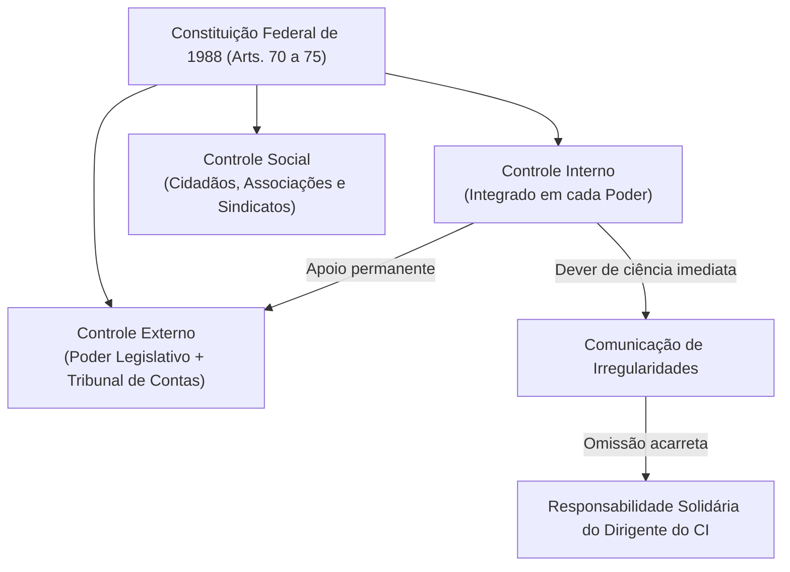
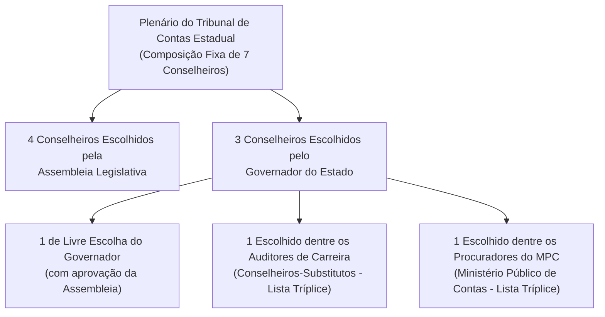

# 01 - Sistema Constitucional de Controle e Jurisdição dos Tribunais de Contas

> **Matéria:** Noções de Controle Externo  
> **Cargo:** A01 – Técnico de Controle Externo – Especialidade: Técnico Administrativo  
> **Arquivo:** `01_sistema_constitucional_e_jurisdicao_dos_tcs.md`  
> **Status:** 🟢 Teoria Aprofundada + 5 Questões FCC Comentadas (A a E)

---

## 📌 Ementa / Itens do Edital

- Sistema constitucional de controle da Administração Pública: controle interno e controle externo;
- Relação e integração harmônica entre os sistemas de controle interno e externo;
- Dever de comunicação imediata sob pena de responsabilidade solidária (Artigo 74, § 1º, da CF/88);
- Tribunais de Contas: natureza jurídica, autonomia institucional, funcional, administrativa e orçamentária;
- O modelo federal e o princípio da simetria constitucional (Artigo 75 da CF/88);
- Composição e nomeação de membros dos Tribunais de Contas Estaduais (Artigos 73 e 75 da CF/88);
- Jurisdição dos Tribunais de Contas: abrangência subjetiva e objetiva; gestores públicos e particulares que guardem, arrecadem, gerenciem ou administrem verbas públicas;
- Competências constitucionais dos Tribunais de Contas:
    - Apreciação de contas do Chefe do Poder Executivo (parecer prévio opinativo e político-constitucional);
    - Julgamento técnico das contas dos administradores e demais responsáveis por recursos públicos (contas de gestão);
    - Fiscalização de atos de admissão de pessoal e concessão de benefícios previdenciários (atos complexos, Súmula Vinculante nº 3 e Tema 445 do STF);
    - Fixação de prazo para adoção de providências saneadoras e sustação direta de atos administrativos ilegais;
    - Sustação de contratos administrativos (competência privativa do Poder Legislativo com atuação subsidiária do TC);
- Eficácia das decisões dos Tribunais de Contas: imputação de débito e multa com força de título executivo extrajudicial (Artigo 71, § 3º, da CF/88);
- Limites da jurisdição de contas, prescrição da pretensão punitiva/ressarcitória (Tema 899 do STF) e independência das instâncias civil, penal e administrativa.

---

## 🧭 Sumário

1. [O Modelo Constitucional de Controle e a Responsabilidade Solidária](#1-o-modelo-constitucional-de-controle-e-a-responsabilidade-solidaria)
    1. [Sistemas de Controle Externo, Interno e Social](#11-sistemas-de-controle-externo-interno-e-social)
    2. [O Dever de Comunicação do Controle Interno e Sanção de Solidariedade (Art. 74, § 1º)](#12-o-dever-de-comunicacao-do-controle-interno-e-sancao-de-solidariedade-art-74-1o)
2. [Natureza Jurídica, Autonomia e Princípio da Simetria (Art. 75)](#2-natureza-juridica-autonomia-e-principio-da-simetria-art-75)
    1. [Natureza Jurídica e Autonomias dos Tribunais de Contas](#21-natureza-juridica-e-autonomias-dos-tribunais-de-contas)
    2. [O Princípio da Simetria Constitucional Federativa e a Composição dos TCEs](#22-o-principio-da-simetria-constitucional-federativa-e-a-composicao-dos-tces)
    3. [Teste 165](#Teste-165)
    4. [Teste 166](#Teste-166)
3. [Competências Constitucionais: Julgamento Técnico versus Parecer Prévio](#3-competencias-constitucionais-julgamento-tecnico-versus-parecer-previo)
    1. [Contas de Governo versus Contas de Gestão](#31-contas-de-governo-versus-contas-de-gestao)
    2. [O Julgamento das Contas de Prefeito Municipal (Tema 835 do STF)](#32-o-julgamento-das-contas-de-prefeito-municipal-tema-835-do-stf)
    3. [Teste 167](#Teste-167)
4. [Registro de Atos de Admissão e Benefícios Previdenciários (Art. 71, III)](#4-registro-de-atos-de-admissao-e-beneficios-previdenciarios-art-71-iii)
    1. [Teste 168](#Teste-168)
    2. [Teste 169](#Teste-169)
5. [Sustação de Atos Ilegais versus Sustação de Contratos Administrativos](#5-sustacao-de-atos-ilegais-versus-sustacao-de-contratos-administrativos)
    1. [Teste 170](#Teste-170)
    2. [Teste 171](#Teste-171)
6. [Eficácia Executiva e Prescritibilidade (Art. 71, § 3º e Tema 899 do STF)](#6-eficacia-executiva-e-prescritibilidade-art-71-3o-e-tema-899-do-stf)
    1. [Teste 172](#Teste-172)
    2. [Teste 173](#Teste-173)
7. [Jurisdição Ampla e Independência das Instâncias](#7-jurisdicao-ampla-e-independencia-das-instancias)
    1. [Teste 174](#Teste-174)
    2. [Teste 175](#Teste-175)
8. [🌐 Fontes Oficiais & Jurisprudenciais Recomendadas](#fontes-oficiais-jurisprudenciais-recomendadas)

---

## 1. O Modelo Constitucional de Controle e a Responsabilidade Solidária

O controle dos recursos públicos no Brasil é tripartite e integrado:

1. **Controle Externo:** Exercido pelo **Poder Legislativo** com o **auxílio técnico-constitucional do Tribunal de Contas** competente (TCU na União, TCE nos Estados e DF, TCMs onde existentes).
2. **Controle Interno:** Mantido de forma **integrada** por cada um dos Poderes (Executivo, Legislativo e Judiciário) e pelo Ministério Público.
3. **Controle Social:** Exercido diretamente pela sociedade civil mediante instrumentos de transparência e cidadania (art. 74, § 2º).

### 1.1 Sistemas de Controle Externo, Interno e Social
- O **Controle Externo** possui titularidade política no Poder Legislativo, sendo operacionalizado na plenitude técnica pelo Tribunal de Contas, órgão constitucional independente de controle da legitimidade, legalidade, economicidade, aplicação de subvenções e renúncia de receitas públicas.
- O **Controle Interno** atua no seio de cada estrutura orgânica para avaliar o cumprimento das metas do PPA, comprovar a legalidade da gestão orçamentária e apoiar o controle externo no exercício de sua missão institucional (art. 74, I a IV).
- O **Controle Social** assegura a qualquer cidadão, partido político, associação ou sindicato legitimidade para denunciar irregularidades perante o Tribunal de Contas (art. 74, § 2º).

### 1.2 O Dever de Comunicação do Controle Interno e Sanção de Solidariedade (Art. 74, § 1º)
- Os responsáveis pelo controle interno, ao tomarem conhecimento de qualquer irregularidade ou ilegalidade no órgão, **devem dar ciência imediata ao Tribunal de Contas competente**.
- **Sanção por Omissão:** Se o titular do controle interno silenciar dolosa ou culposamente, responderá **pessoal e solidariamente** com o gestor ímprobo pelo dano apurado e pelas sanções cominadas pelo Tribunal de Contas.

---

## 2. Natureza Jurídica, Autonomia e Princípio da Simetria (Art. 75)

### 2.1 Natureza Jurídica e Autonomias dos Tribunais de Contas
- Os Tribunais de Contas são **órgãos estatais independentes**, de extração estritamente constitucional.
- **Não integram a estrutura hierárquica do Poder Legislativo**, tampouco do Poder Executivo ou do Judiciário. Exercem magistratura técnica de contas especializada dotada de autogoverno.
- Possuem **autonomia administrativa, funcional, orçamentária e financeira**, além de quadro próprio de servidores públicos efetivos e poder de iniciativa reservada para suas leis orgânicas.

### 2.2 O Princípio da Simetria Constitucional Federativa e a Composição dos TCEs
O art. 75 da Carta Magna estabelece que as normas constitucionais federais sobre fiscalização financeira e organização do Tribunal de Contas da União aplicam-se compulsoriamente aos Tribunais de Contas dos Estados, do Distrito Federal e dos Municípios:

- **Composição dos Tribunais de Contas Estaduais (TCE-GO):**
    - O plenário é composto por **7 Conselheiros** (ao contrário do TCU, que possui 9 Ministros).
    - Regra constitucional de escolha e indicação (Art. 73, § 2º c/c Art. 75):
    - **4 Conselheiros** indicados e eleitos pela **Assembleia Legislativa**;
    - **3 Conselheiros** indicados pelo **Governador do Estado**, com prévia aprovação da Assembleia Legislativa, sendo:
        - 1 de livre escolha do Governador;
        - 1 obrigatoriamente escolhido dentre os **Auditores de Controle Externo (Conselheiros-Substitutos)**, a partir de lista tríplice de antiguidade e merecimento;
        - 1 obrigatoriamente escolhido dentre os **Procuradores do Ministério Público de Contas**, a partir de lista tríplice de antiguidade e merecimento.

---

### Teste 165
**(FGV – TRT – Analista Judiciário - Tecnologia da Informação – 2024)**  
Em um Tribunal de Contas Estadual havia sete conselheiros, sendo quatro nomeados pela Assembleia Legislativa e três nomeados pelo Governador do Estado com aprovação do parlamento estadual. Surgida vaga de conselheiro reservada ao Poder Executivo estadual, o Governador pretende nomear membro do Ministério Público de Contas para ocupar a respectiva vaga.  
À luz do modelo constitucional de composição dos Tribunais de Contas dos Estados (art. 73, § 2º c/c art. 75 da CF/88), a pretensão governamental:

* **A)** mostra-se plenamente viável desde que haja aprovação prévia por maioria simples da Assembleia Legislativa.
* **B)** não se mostra juridicamente possível por ser a vaga privativa de auditores concursados do próprio Tribunal.
* **C)** é admitida de imediato, assegurando-se a alternância com a vaga destinada aos auditores de carreira.
* **D)** depende de emenda constitucional prévia para criar o cargo no âmbito do respectivo Tribunal de Contas.
* **E)** é legítima desde que a vaga corresponda à cota destinada a membros do Ministério Público junto ao Tribunal.

---

> **Comentário Detalhado:**
>
> - **A)** **Incorreto**. A aprovação da escolha pelo Poder Legislativo exige quórum de maioria absoluta dos parlamentares (art. 73, § 2º c/c art. 75, CF/88).
> - **B)** **Incorreto**. Dentre as três vagas de livre e técnica indicação do Governador, uma é privativa de auditores (conselheiros-substitutos) e uma é privativa de membros do Ministério Público junto ao Tribunal de Contas.
> - **C)** **Incorreto**. A vaga técnica do MPC é titularizada especificamente pela respectiva carreira, em lista tríplice de antiguidade e merecimento, não havendo confusão aleatória com a vaga dos auditores.
> - **D)** **Incorreto**. A regra decorre diretamente do modelo federal de reprodução obrigatória pelo constituinte estadual (art. 75 da CF/88 e Súmula Vinculante correspondente).
> - **E)** **Correto**. Conforme o art. 75, parágrafo único, c/c art. 73, § 2º, I, da Constituição Federal, os Tribunais de Contas dos Estados são compostos por 7 conselheiros: 4 escolhidos pela Assembleia Legislativa e 3 pelo Governador do Estado (com aprovação da Assembleia), sendo estes 3 necessariamente: 1 de livre escolha e 2 escolhidos alternadamente entre auditores e membros do Ministério Público junto ao Tribunal, indicados em lista tríplice segundo critérios de antiguidade e merecimento. Logo, a nomeação governamental é válida se referida à vaga constitucional do MPC.
>
> **Gabarito: E**

### Teste 166
**(FGV – TRT – Analista Judiciário - Tecnologia da Informação – 2024)**  
A NBASP 50 - Princípios de Atividades Jurisdicionais dos Tribunais de Contas desenvolve princípios fundamentais aplicáveis às Cortes que exercem função judicante sobre a responsabilidade de gestores. Considere as seguintes afirmativas:

I. O Tribunal de Contas deve ser dotado de garantias legais e institucionais que assegurem independência e autonomia a seus membros.  
II. O exercício da competência sancionatória dos Tribunais de Contas deve respeitar o contraditório, a ampla defesa e o devido processo legal.  
III. As decisões definitivas dos Tribunais de Contas que imputem débito ou multa possuem eficácia de título executivo judicial.  

Está correto o que se afirma em:

* **A)** I, apenas.
* **B)** I e II, apenas.
* **C)** I e III, apenas.
* **D)** II e III, apenas.
* **E)** I, II e III.

---

> **Comentário Detalhado:**
>
> - **A)** **Incorreto**. O item II também está inteiramente correto nos termos da NBASP 50 e da CF/88.
> - **B)** **Correto**. O item I expressa princípio basilar da Declaração de Lima, do art. 73 da CF/88 e da NBASP 50 (autonomia orgânica, funcional e independência dos membros com garantias de magistratura). O item II reproduz garantia elementar da processualística do controle externo e princípio jurisdicional da NBASP 50 (devido processo legal sancionatório com contraditório e ampla defesa). Já o item III está incorreto porque o art. 71, § 3º, da CF/88 confere às decisões condenatórias do Tribunal de Contas eficácia de "título executivo extrajudicial", e não título judicial.
> - **C)** **Incorreto**. O item III padece de erro técnico grave (título extrajudicial).
> - **D)** **Incorreto**. O item I é verdadeiro e o item III é falso.
> - **E)** **Incorreto**. O item III inviabiliza a afirmativa global.
>
> **Gabarito: B**

### Teste 167
**(Questão Inédita / Simulada Estilo FCC – Nível: Controle Externo / TI)**  
Certo Tribunal de Contas, no âmbito de sua competência fiscalizatória, realizou uma Tomada de Contas Especial para apurar eventuais danos causados ao patrimônio público em decorrência de irregularidades graves na execução de convênio com repasse de verbas públicas firmado pelo Município. Ao final da instrução processual, apurou-se a responsabilidade direta do Prefeito na má aplicação dos recursos repassados.  
Considerando a jurisprudência vinculante do Supremo Tribunal Federal (Temas 157 e 835) e o regime de controle externo, é correto afirmar que:

* **A)** o Tribunal de Contas não possui competência jurídica para instaurar tomada de contas especial sobre convênios.
* **B)** o Tribunal de Contas pode julgar as contas do convênio e imputar débito condenatório com força de título executivo.
* **C)** a condenação pecuniária aplicada pelo Tribunal de Contas a prefeito depende de homologação pela Câmara de Vereadores.
* **D)** a competência para julgar a tomada de contas decorrente de repasses voluntários transfere-se para a União.
* **E)** o prefeito goza de imunidade patrimonial administrativa enquanto estiver no exercício regular do mandato eletivo.

---

> **Comentário Detalhado:**
>
> - **A)** **Incorreto**. A Tomada de Contas Especial é instrumento legítimo do Tribunal de Contas para apurar responsabilidade por dano ao erário (art. 71, II, CF/88).
> - **B)** **Correto**. O STF pacificou o entendimento de que a competência exclusiva da Câmara de Vereadores refere-se às contas anuais de governo e de gestão prestadas pelo Prefeito (para fins de inelegibilidade da LC 64/90). Todavia, no tocante à fiscalização de recursos específicos repassados por convênio ou tomada de contas especial por desvio de verbas, o Tribunal de Contas detém competência plena para julgar as contas e imputar débito ou multa, gerando título executivo extrajudicial (art. 71, II e § 3º, CF/88).
> - **C)** **Incorreto**. O título executivo condenatório emitido pelo TC independe de ratificação pela Câmara de Vereadores.
> - **D)** **Incorreto**. Sendo recursos estaduais, a competência é do Tribunal de Contas do Estado.
> - **E)** **Incorreto**. Não há imunidade patrimonial para reparação de prejuízos causados ao erário.
>
> **Gabarito: B**

### Teste 168
**(FCC – TRT – Analista Judiciário - Tecnologia da Informação – 2009)**  
Sobre as disposições constitucionais referentes ao controle externo das entidades públicas (art. 71 da CF/88), é correto afirmar:

* **A)** O Tribunal de Contas tem competência para apreciar a legalidade de atos de admissão de pessoal a qualquer título.
* **B)** O parecer prévio emitido sobre as contas do Governador deixará de prevalecer por decisão de dois terços da Assembleia.
* **C)** As decisões dos Tribunais de Contas que resultem em imputação de débito ou multa têm eficácia de título executivo judicial.
* **D)** A sustação de contratos administrativos irregulares é competência originária e direta do próprio Tribunal de Contas.
* **E)** O controle externo exercido pelo Tribunal de Contas restringe-se exclusivamente aos aspectos contábil e de legalidade.

---

> **Comentário Detalhado:**
>
> - **A)** **Incorreto**. O art. 71, III, da CF/88 excepciona expressamente da apreciação do Tribunal de Contas as nomeações para cargo de provimento em comissão.
> - **B)** **Correto**. Conforme o modelo federal reproduzido no âmbito estadual (art. 71, I c/c art. 31, § 2º e art. 75 da CF/88), o parecer prévio emitido pelo Tribunal de Contas sobre as contas gerais prestadas anualmente pelo Chefe do Poder Executivo somente deixará de prevalecer por deliberação de dois terços dos membros do Poder Legislativo.
> - **C)** **Incorreto**. As decisões condenatórias têm eficácia de título executivo extrajudicial (art. 71, § 3º, CF/88).
> - **D)** **Incorreto**. No caso de contrato, o ato de sustação é adotado diretamente pelo Congresso Nacional / Assembleia Legislativa; somente se o Legislativo não efetivar a medida em 90 dias é que o Tribunal de Contas decidirá a respeito (art. 71, §§ 1º e 2º, CF/88).
> - **E)** **Incorreto**. O controle externo abrange a fiscalização contábil, financeira, orçamentária, operacional e patrimonial, sob os aspectos da legalidade, legitimidade e economicidade (art. 70, caput, CF/88).
>
> **Gabarito: B**

### Teste 169
**(Questão Inédita / Simulada Estilo FCC – Nível: Controle Externo / TI)**  
A respeito da natureza jurídica e do alcance da jurisdição própria dos Tribunais de Contas no ordenamento jurídico brasileiro, analise as seguintes afirmações:

* **A)** A jurisdição dos Tribunais de Contas abrange apenas as autoridades do Executivo, excluindo o Judiciário e Legislativo.
* **B)** Os Tribunais de Contas possuem natureza de órgãos auxiliares subordinados hierarquicamente ao Poder Legislativo respectivo.
* **C)** A jurisdição dos Tribunais de Contas alcança qualquer pessoa física que utilize, guarde ou administre bens públicos.
* **D)** As Cortes de Contas integram a estrutura orgânica do Poder Judiciário, exercendo função tipicamente contenciosa judicial.
* **E)** O controle financeiro exercido pelo Tribunal de Contas sobre fundações estatais prescinde de comprovação de recursos do Tesouro.

---

> **Comentário Detalhado:**
>
> - **A)** **Incorreto**. A jurisdição dos TCs é de estatura constitucional e abrange todos os administradores e responsáveis de todos os Poderes (Executivo, Legislativo e Judiciário), bem como do Ministério Público e Defensoria.
> - **B)** **Incorreto**. Os Tribunais de Contas são órgãos constitucionais autônomos e independentes; não mantêm qualquer subordinação hierárquica em relação ao Poder Legislativo.
> - **C)** **Correto**. O art. 70, parágrafo único, da CF/88 estabelece: "Prestará contas qualquer pessoa física ou jurídica, pública ou privada, que utilize, arrecade, guarde, gerencie ou administre dinheiros, bens e valores públicos ou pelos quais a União responda, ou que, em nome desta, assuma obrigações de natureza pecuniária".
> - **D)** **Incorreto**. Os Tribunais de Contas não integram o Poder Judiciário; suas decisões têm natureza administrativa-especial.
> - **E)** **Incorreto**. A fiscalização abrange recursos públicos estatais de qualquer origem nos entes controlados.
>
> **Gabarito: C**

### Teste 170
**(Questão Inédita / Simulada Estilo FCC – Nível: Controle Externo / TI)**  
Em razão da prática de ato danoso ao erário apurado em regular processo de auditoria, o Tribunal de Contas do Estado aplicou multa e imputou débito de ressarcimento a determinado gestor público que gerenciava verbas estaduais. Intimado regularmente, o responsável não efetuou o recolhimento das quantias nem interpôs recurso no prazo regimental.  
Sobre a cobrança das quantias imputadas e a eficácia executiva do acórdão condenatório, é correto afirmar que:

* **A)** o Tribunal de Contas deve ajuizar a competente execução fiscal perante a Vara da Fazenda Pública competente.
* **B)** a decisão do Tribunal de Contas tem eficácia de título executivo extrajudicial, cabendo a cobrança à Fazenda Pública.
* **C)** o acórdão condenatório deve ser submetido a prévia homologação pelo Tribunal de Justiça do Estado federado.
* **D)** a execução do valor da multa prescreve no prazo improrrogável de dois anos contados do trânsito administrativo.
* **E)** a decisão do Tribunal de Contas impede em definitivo a propositura de ação de improbidade administrativa pelo Ministério Público.

---

> **Comentário Detalhado:**
>
> - **A)** **Incorreto**. Conforme a Súmula 643 do STF: "O Ministério Público junto ao Tribunal de Contas não tem legitimidade para propor a execução judicial de suas decisões, cabendo-a à Fazenda Pública". O próprio Tribunal de Contas também não executa judicialmente seus títulos.
> - **B)** **Correto**. Conforme o art. 71, § 3º, da CF/88: "As decisões do Tribunal de que resulte imputação de débito ou multa terão eficácia de título executivo". Trata-se de título executivo extrajudicial, cuja cobrança em juízo (execução fiscal) compete à Procuradoria do Estado / Fazenda Pública titular do crédito público.
> - **C)** **Incorreto**. A eficácia do título executivo do Tribunal de Contas é imediata e independe de qualquer homologação judicial.
> - **D)** **Incorreto**. O prazo prescricional para cobrança judicial é de 5 anos (decreto 20.910/32 e Tema 899 do STF).
> - **E)** **Incorreto**. A jurisdição de controle do Tribunal de Contas é autônoma e não obsta a atuação do MP na seara da improbidade administrativa (art. 37, § 4º, CF/88).
>
> **Gabarito: B**

### Teste 171
**(Questão Inédita / Simulada Estilo FCC – Nível: Controle Externo / TI)**  
No exercício da fiscalização contábil, financeira e orçamentária, os Tribunais de Contas deparam-se com atos administrativos e contratos irregulares praticados pelo Poder Executivo. A respeito dos procedimentos de sustação de atos e contratos, é correto afirmar:

* **A)** A sustação de ato administrativo ilegal compete diretamente ao Tribunal de Contas se o órgão não adotar providências.
* **B)** A rescisão e sustação de contratos administrativos é ato de competência direta e imediata do próprio Tribunal de Contas.
* **C)** O Tribunal de Contas pode decretar a prisão administrativa do agente responsável que descumprir ordem de anulação de ato.
* **D)** O Poder Legislativo estadual não possui competência para sustar atos ou contratos expedidos pela administração pública direta.
* **E)** A sustação de contrato administrativo dispensa a comunicação tempestiva à autoridade máxima do Poder Executivo estadual.

---

> **Comentário Detalhado:**
>
> - **A)** **Correto**. Conforme o art. 71, X, da CF/88: cabe ao Tribunal de Contas "sustar, se não atendido, a execução do ato impugnado, comunicando a decisão à Câmara dos Deputados e ao Senado Federal" (no plano estadual, à Assembleia Legislativa). Portanto, para ATOS administrativos, o próprio Tribunal de Contas efetiva a sustação se o órgão não sanar a ilegalidade no prazo fixado.
> - **B)** **Incorreto**. Para CONTRATOS administrativos, o ato de sustação cabe ao Congresso Nacional/Assembleia (art. 71, § 1º). Apenas se o parlamento for omisso em 90 dias é que o TC decidirá a respeito (art. 71, § 2º).
> - **C)** **Incorreto**. Tribunais de Contas não detêm competência para decretar privação de liberdade.
> - **D)** **Incorreto**. O Legislativo tem expressa competência para sustar contratos administrativos (art. 71, § 1º, CF/88).
> - **E)** **Incorreto**. A Constituição exige imediata comunicação e solicitação de medidas ao Chefe do Executivo.
>
> **Gabarito: A**

### Teste 172
**(Questão Inédita / Simulada Estilo FCC – Nível: Controle Externo / TI)**  
A Constituição do Estado de Goiás e a Lei Orgânica do TCE-GO asseguram ao Tribunal de Contas do Estado prerrogativas institucionais indispensáveis ao pleno exercício de sua missão fiscalizatória. A respeito da autonomia do Tribunal de Contas, é correto afirmar que:

* **A)** possui iniciativa de lei reservada para a criação e extinção de seus cargos e fixação de vencimentos.
* **B)** seus conselheiros possuem prerrogativas e subsídios equiparados aos membros da Assembleia Legislativa estadual.
* **C)** sua proposta orçamentária anual é elaborada privativamente pela Secretaria da Fazenda e Planejamento estadual.
* **D)** suas decisões administrativas submetem-se a recurso ordinário dotado de efeito suspensivo perante o Governador do Estado.
* **E)** suas contas anuais de gestão orçamentária e financeira são apreciadas privativamente pelo Ministério Público do Estado.

---

> **Comentário Detalhado:**
>
> - **A)** **Correto**. Por expressa aplicação do princípio da simetria constitucional (art. 73 c/c art. 96, II, da CF/88 e disposições da Constituição do Estado de Goiás): o Tribunal de Contas possui autonomia administrativa e financeira, cabendo-lhe privativamente propor ao Poder Legislativo a criação e a extinção de seus cargos e serviços auxiliares, bem como a fixação dos respectivos vencimentos.
> - **B)** **Incorreto**. Conforme o art. 73, § 3º, c/c art. 75 da CF/88, os conselheiros têm as mesmas garantias, prerrogativas, impedimentos, vencimentos e vantagens dos Desembargadores do Tribunal de Justiça estadual, e não dos parlamentares.
> - **C)** **Incorreto**. O Tribunal de Contas elabora sua própria proposta orçamentária dentro dos limites fixados na LDO.
> - **D)** **Incorreto**. Não existe recurso hierárquico das decisões do Tribunal de Contas para o Governador.
> - **E)** **Incorreto**. A fiscalização das contas do próprio Tribunal de Contas compete à Assembleia Legislativa (art. 75 c/c art. 71, CF/88).
>
> **Gabarito: A**

### Teste 173
**(Questão Inédita / Simulada Estilo FCC – Nível: Controle Externo / TI)**  
No âmbito dos Tribunais de Contas, a figura dos Auditores (atualmente denominados Conselheiros Substitutos pela jurisprudência e legislação nacional) exerce atribuições fundamentais na instrução e julgamento de processos de contas. A respeito do seu estatuto constitucional, é correto afirmar:

* **A)** Os Auditores são nomeados em comissão pelo Presidente da Corte dentre pessoas com formação de nível médio.
* **B)** Quando em substituição a Conselheiro, o Auditor terá as mesmas garantias e impedimentos do titular do cargo.
* **C)** No exercício das funções ordinárias de judicatura, o Auditor não detém as garantias inerentes à magistratura togado.
* **D)** A investidura no cargo de Auditor prescinde de aprovação em concurso público se houver lista tríplice corporativa.
* **E)** Os Conselheiros Substitutos são subordinados administrativamente aos Procuradores do Ministério Público de Contas.

---

> **Comentário Detalhado:**
>
> - **A)** **Incorreto**. O ingresso no cargo de Auditor de Tribunal de Contas é feito obrigatoriamente por concurso público de provas e títulos, exigindo curso superior (art. 73, § 4º, CF/88).
> - **B)** **Correto**. O art. 73, § 4º, da Constituição Federal dispõe expressamente: "O auditor, quando em substituição a Ministro, terá as mesmas garantias e impedimentos do titular e, no exercício das demais atribuições da judicatura, as de juiz de Tribunal Regional Federal" (no plano estadual, de juiz de direito de entrância final).
> - **C)** **Incorreto**. No exercício das funções de judicatura fora da substituição, o Auditor tem as garantias de juiz togado.
> - **D)** **Incorreto**. O concurso público é imperativo constitucional intransponível.
> - **E)** **Incorreto**. Auditores e Ministério Público de Contas são órgãos com atribuições autônomas e independentes.
>
> **Gabarito: B**

### Teste 174
**(FGV – TRT – Analista Judiciário - Tecnologia da Informação – 2024)**  
A Lei nº 16.168, de 11 de dezembro de 2007, estabelece a Lei Orgânica do Tribunal de Contas do Estado de Goiás (LOTCE-GO), disciplinando sua jurisdição, competência e processo. À luz da LOTCE-GO, é correto afirmar que:

* **A)** os responsáveis por contas de gestão que causarem prejuízo ao erário respondem solidariamente com seus subordinados.
* **B)** a decisão do Tribunal de Contas que julgar regulares com ressalva as contas confere quitação irrestrita ao responsável.
* **C)** o Tribunal de Contas é órgão subordinado administrativamente à Mesa Diretora da Assembleia Legislativa goiana.
* **D)** as certidões emitidas pelo TCE-GO sobre imputação de débito dependem de cobrança privativa pelo próprio Tribunal.
* **E)** a fiscalização contábil exercida pelo TCE-GO alcança apenas os recursos oriundos do Tesouro do Estado de Goiás.

---

> **Comentário Detalhado:**
>
> - **A)** **Correto**. Nos termos da LOTCE-GO (Lei Estadual nº 16.168/2007) e do art. 71, II, da CF/88, aqueles que derem causa a perda, extravio ou outra irregularidade de que resulte dano ao erário público estadual respondem civilmente pelo dever de ressarcimento, caracterizando-se a responsabilidade solidária de todos os agentes públicos que concorreram para a consumação do ato lesivo.
> - **B)** **Incorreto**. As contas julgadas regulares com ressalva conferem quitação com determinação de providências (quitação condicionada/parcial, e não plena).
> - **C)** **Incorreto**. O TCE-GO possui autonomia funcional e orçamentária constitucional.
> - **D)** **Incorreto**. A execução do título cabe à Fazenda Pública / Procuradoria-Geral do Estado.
> - **E)** **Incorreto**. Alcança recursos estaduais, fundos, convênios e quaisquer valores geridos por entidades sujeitas à sua jurisdição.
>
> **Gabarito: A**

### Teste 175
**(Questão Inédita / Simulada Estilo FCC – Nível: Controle Externo / TI)**  
O Supremo Tribunal Federal, ao julgar os Temas 897 e 899 de Repercussão Geral, fixou teses de grande impacto sobre a prescritibilidade das sanções e do ressarcimento ao erário nos Tribunais de Contas. De acordo com a jurisprudência vinculante do STF, é correto afirmar:

* **A)** As ações de ressarcimento ao erário fundadas em decisões dos Tribunais de Contas são absolutamente imprescritíveis.
* **B)** É prescritível a pretensão de ressarcimento ao erário fundada em decisão de Tribunal de Contas no prazo de cinco anos.
* **C)** Apenas as multas administrativas prescrevem, mantendo-se a imprescritibilidade eterna para a imputação de débito.
* **D)** O prazo prescricional para o Tribunal de Contas julgar processo administrativo é de dez anos contados da ocorrência.
* **E)** A prescrição intercorrente é manifestamente inaplicável aos processos que tramitam perante o controle externo.

---

> **Comentário Detalhado:**
>
> - **A)** **Incorreto**. No julgamento do Tema 899 (RE 636.886/AL), o STF assentou que é prescritível a pretensão de ressarcimento ao erário fundada em decisão de Tribunal de Contas.
> - **B)** **Correto**. Tese fixada pelo STF no Tema 899 de Repercussão Geral: "É prescritível a pretensão de ressarcimento ao erário fundada em decisão de Tribunal de Contas". Aplica-se o prazo quinquenal (5 anos) do Decreto nº 20.910/1932 e da Lei nº 9.873/1999 para a cobrança executiva do débito imputado pelo Tribunal de Contas. A imprescritibilidade do art. 37, § 5º, da CF/88 (Tema 897) restringe-se a ações de ressarcimento fundadas na prática de atos dolosos tipificados na Lei de Improbidade Administrativa reconhecidos pelo Poder Judiciário.
> - **C)** **Incorreto**. Tanto as multas quanto as pretensões de ressarcimento decorrentes de títulos de Cortes de Contas prescrevem.
> - **D)** **Incorreto**. O prazo da pretensão punitiva e fiscalizatória orienta-se pela prescrição quinquenal da Lei 9.873/1999 (como regulamentado pelo STF na ADI 5.509 e na Resolução ATRICON nº 03/2023).
> - **E)** **Incorreto**. Aplica-se a prescrição intercorrente nos processos administrativos de contas que fiquem paralisados por mais de 3 anos pendentes de despacho ou julgamento.
>
> **Gabarito: B**

