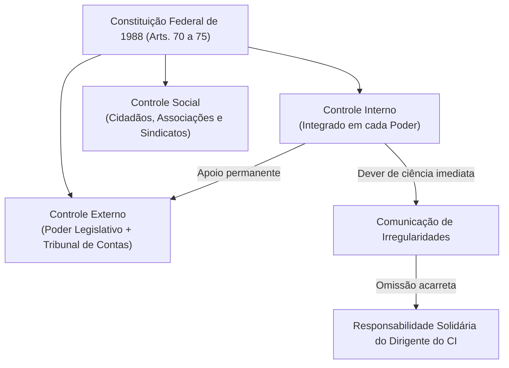
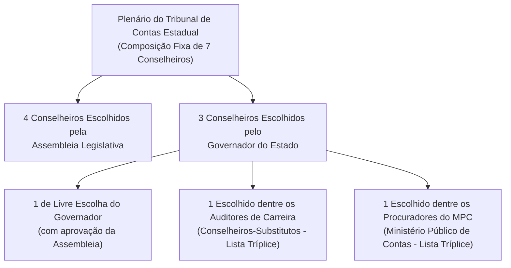
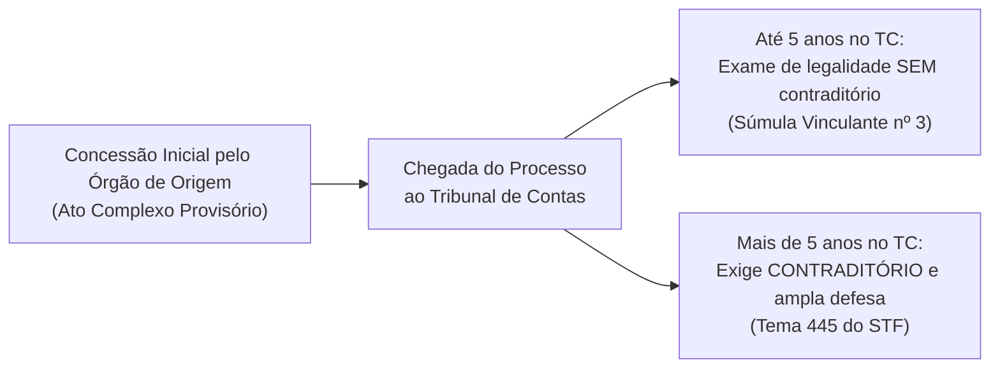
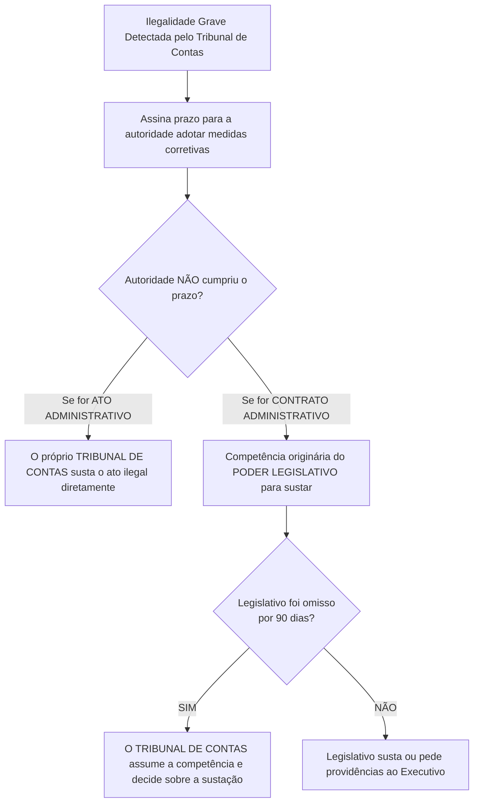

# 01 - Sistema Constitucional de Controle e Jurisdição dos Tribunais de Contas

> **Matéria:** Noções de Controle Externo  
> **Cargo:** A01 – Técnico de Controle Externo – Especialidade: Técnico Administrativo  
> **Arquivo:** `01_sistema_constitucional_e_jurisdicao_dos_tcs.md`  
> **Status:** 🟢 Teoria Aprofundada + 5 Questões FCC Comentadas (A a E)

---

## 📌 Ementa / Itens do Edital

- Sistema constitucional de controle da Administração Pública: controle interno e controle externo;
- Relação e integração harmônica entre os sistemas de controle interno e externo;
- Dever de comunicação imediata sob pena de responsabilidade solidária (Artigo 74, § 1º, da CF/88);
- Tribunais de Contas: natureza jurídica, autonomia institucional, funcional, administrativa e orçamentária;
- O modelo federal e o princípio da simetria constitucional (Artigo 75 da CF/88);
- Composição e nomeação de membros dos Tribunais de Contas Estaduais (Artigos 73 e 75 da CF/88);
- Jurisdição dos Tribunais de Contas: abrangência subjetiva e objetiva; gestores públicos e particulares que guardem, arrecadem, gerenciem ou administrem verbas públicas;
- Competências constitucionais dos Tribunais de Contas:
    - Apreciação de contas do Chefe do Poder Executivo (parecer prévio opinativo e político-constitucional);
    - Julgamento técnico das contas dos administradores e demais responsáveis por recursos públicos (contas de gestão);
    - Fiscalização de atos de admissão de pessoal e concessão de benefícios previdenciários (atos complexos, Súmula Vinculante nº 3 e Tema 445 do STF);
    - Fixação de prazo para adoção de providências saneadoras e sustação direta de atos administrativos ilegais;
    - Sustação de contratos administrativos (competência privativa do Poder Legislativo com atuação subsidiária do TC);
- Eficácia das decisões dos Tribunais de Contas: imputação de débito e multa com força de título executivo extrajudicial (Artigo 71, § 3º, da CF/88);
- Limites da jurisdição de contas, prescrição da pretensão punitiva/ressarcitória (Tema 899 do STF) e independência das instâncias civil, penal e administrativa.

---

## 🧭 Sumário

1. [O Modelo Constitucional de Controle e a Responsabilidade Solidária](#1-o-modelo-constitucional-de-controle-e-a-responsabilidade-solidaria)
    1. [Sistemas de Controle Externo, Interno e Social](#11-sistemas-de-controle-externo-interno-e-social)
    2. [O Dever de Comunicação do Controle Interno e Sanção de Solidariedade (Art. 74, § 1º)](#12-o-dever-de-comunicacao-do-controle-interno-e-sancao-de-solidariedade-art-74-1o)
2. [Natureza Jurídica, Autonomia e Princípio da Simetria (Art. 75)](#2-natureza-juridica-autonomia-e-principio-da-simetria-art-75)
    1. [Natureza Jurídica e Autonomias dos Tribunais de Contas](#21-natureza-juridica-e-autonomias-dos-tribunais-de-contas)
    2. [O Princípio da Simetria Constitucional Federativa e a Composição dos TCEs](#22-o-principio-da-simetria-constitucional-federativa-e-a-composicao-dos-tces)
    3. [Teste 165](#Teste-165)
    4. [Teste 166](#Teste-166)
3. [Competências Constitucionais: Julgamento Técnico versus Parecer Prévio](#3-competencias-constitucionais-julgamento-tecnico-versus-parecer-previo)
    1. [Contas de Governo versus Contas de Gestão](#31-contas-de-governo-versus-contas-de-gestao)
    2. [O Julgamento das Contas de Prefeito Municipal (Tema 835 do STF)](#32-o-julgamento-das-contas-de-prefeito-municipal-tema-835-do-stf)
    3. [Teste 167](#Teste-167)
4. [Registro de Atos de Admissão e Benefícios Previdenciários (Art. 71, III)](#4-registro-de-atos-de-admissao-e-beneficios-previdenciarios-art-71-iii)
    1. [Teste 168](#Teste-168)
    2. [Teste 169](#Teste-169)
5. [Sustação de Atos Ilegais versus Sustação de Contratos Administrativos](#5-sustacao-de-atos-ilegais-versus-sustacao-de-contratos-administrativos)
    1. [Teste 170](#Teste-170)
    2. [Teste 171](#Teste-171)
6. [Eficácia Executiva e Prescritibilidade (Art. 71, § 3º e Tema 899 do STF)](#6-eficacia-executiva-e-prescritibilidade-art-71-3o-e-tema-899-do-stf)
    1. [Teste 172](#Teste-172)
    2. [Teste 173](#Teste-173)
7. [Jurisdição Ampla e Independência das Instâncias](#7-jurisdicao-ampla-e-independencia-das-instancias)
    1. [Teste 174](#Teste-174)
    2. [Teste 175](#Teste-175)
8. [🌐 Fontes Oficiais & Jurisprudenciais Recomendadas](#fontes-oficiais-jurisprudenciais-recomendadas)

---

## 1. O Modelo Constitucional de Controle e a Responsabilidade Solidária

O controle dos recursos públicos no Brasil é tripartite e integrado:

1. **Controle Externo:** Exercido pelo **Poder Legislativo** com o **auxílio técnico-constitucional do Tribunal de Contas** competente (TCU na União, TCE nos Estados e DF, TCMs onde existentes).
2. **Controle Interno:** Mantido de forma **integrada** por cada um dos Poderes (Executivo, Legislativo e Judiciário) e pelo Ministério Público.
3. **Controle Social:** Exercido diretamente pela sociedade civil mediante instrumentos de transparência e cidadania (art. 74, § 2º).

### 1.1 Sistemas de Controle Externo, Interno e Social
- O **Controle Externo** possui titularidade política no Poder Legislativo, sendo operacionalizado na plenitude técnica pelo Tribunal de Contas, órgão constitucional independente de controle da legitimidade, legalidade, economicidade, aplicação de subvenções e renúncia de receitas públicas.
- O **Controle Interno** atua no seio de cada estrutura orgânica para avaliar o cumprimento das metas do PPA, comprovar a legalidade da gestão orçamentária e apoiar o controle externo no exercício de sua missão institucional (art. 74, I a IV).
- O **Controle Social** assegura a qualquer cidadão, partido político, associação ou sindicato legitimidade para denunciar irregularidades perante o Tribunal de Contas (art. 74, § 2º).

### 1.2 O Dever de Comunicação do Controle Interno e Sanção de Solidariedade (Art. 74, § 1º)
- Os responsáveis pelo controle interno, ao tomarem conhecimento de qualquer irregularidade ou ilegalidade no órgão, **devem dar ciência imediata ao Tribunal de Contas competente**.
- **Sanção por Omissão:** Se o titular do controle interno silenciar dolosa ou culposamente, responderá **pessoal e solidariamente** com o gestor ímprobo pelo dano apurado e pelas sanções cominadas pelo Tribunal de Contas.

---

## 2. Natureza Jurídica, Autonomia e Princípio da Simetria (Art. 75)

### 2.1 Natureza Jurídica e Autonomias dos Tribunais de Contas
- Os Tribunais de Contas são **órgãos estatais independentes**, de extração estritamente constitucional.
- **Não integram a estrutura hierárquica do Poder Legislativo**, tampouco do Poder Executivo ou do Judiciário. Exercem magistratura técnica de contas especializada dotada de autogoverno.
- Possuem **autonomia administrativa, funcional, orçamentária e financeira**, além de quadro próprio de servidores públicos efetivos e poder de iniciativa reservada para suas leis orgânicas.

### 2.2 O Princípio da Simetria Constitucional Federativa e a Composição dos TCEs
O art. 75 da Carta Magna estabelece que as normas constitucionais federais sobre fiscalização financeira e organização do Tribunal de Contas da União aplicam-se compulsoriamente aos Tribunais de Contas dos Estados, do Distrito Federal e dos Municípios:

- **Composição dos Tribunais de Contas Estaduais (TCE-GO):**
    - O plenário é composto por **7 Conselheiros** (ao contrário do TCU, que possui 9 Ministros).
    - Regra constitucional de escolha e indicação (Art. 73, § 2º c/c Art. 75):
    - **4 Conselheiros** indicados e eleitos pela **Assembleia Legislativa**;
    - **3 Conselheiros** indicados pelo **Governador do Estado**, com prévia aprovação da Assembleia Legislativa, sendo:
        - 1 de livre escolha do Governador;
        - 1 obrigatoriamente escolhido dentre os **Auditores de Controle Externo (Conselheiros-Substitutos)**, a partir de lista tríplice de antiguidade e merecimento;
        - 1 obrigatoriamente escolhido dentre os **Procuradores do Ministério Público de Contas**, a partir de lista tríplice de antiguidade e merecimento.

---

### Teste 165
**(FGV - Auditor de Controle Externo / TCE-GO)**
O art. 70 da Constituição Federal de 1988 estabelece que a fiscalização contábil, financeira, orçamentária, operacional e patrimonial da União e das entidades da administração direta e indireta será exercida pelo Congresso Nacional, mediante controle externo, e pelo sistema de controle interno de cada Poder.

A respeito dos aspectos fiscalizados pelo controle externo (cinco dimensões do controle), assinale a afirmativa correta.

* **A)** A fiscalização limita-se ao estrito exame da legalidade formal dos atos administrativos, sendo vedado ao Tribunal de Contas perquirir a economicidade ou a legitimidade das despesas públicas.
* **B)** A fiscalização contábil, financeira, orçamentária, operacional e patrimonial abrange a legalidade, a legitimidade, a economicidade, a aplicação das subvenções e a renúncia de receitas.
* **C)** O controle patrimonial exercido pelo Tribunal de Contas restringe-se a bens imóveis de valor superior a dez milhões de reais.
* **D)** A renúncia de receitas fiscais promovida pelo Chefe do Poder Executivo fica imune ao controle externo dos Tribunais de Contas.
* **E)** As empresas públicas exploradoras de atividade econômica não se sujeitam à fiscalização operacional ou financeira das Cortes de Contas.

---

> **Comentário Detalhado:**
>
> - **A)** Incorreta. O controle externo moderno no Brasil superou a visão reducionista da mera legalidade estrita; avalia a **legitimidade, a economicidade, a eficiência e a eficácia** dos gastos públicos.
> - **B)** Correta. O art. 70, caput, da CF/88 consagra categoricamente o alcance amplo da auditoria governamental: fiscalização contábil, financeira, orçamentária, operacional e patrimonial, abrangendo expressamente a legalidade, a legitimidade, a **economicidade**, a aplicação das subvenções e a renúncia de receitas públicas.
> - **C)** Incorreta. A fiscalização patrimonial alcança a universalidade dos bens públicos (móveis, imóveis e intangíveis) pertencentes ao ente federado.
> - **D)** Incorreta. A fiscalização da renúncia de receitas (isenções, anistias e incentivos fiscais) é competência constitucional expressa do Tribunal de Contas (art. 70, caput).
> - **E)** Incorreta. Todas as empresas estatais da Administração Indireta sujeitam-se ao controle externo (art. 70, caput c/c art. 71, II).
>
> **Gabarito: B**

---

### Teste 166
**(FCC - Adaptada / Analista de Controle Externo - TCE-GO)**
A Constituição do Estado de Goiás prevê a organização e o funcionamento do Tribunal de Contas do Estado (TCE-GO). Em consonância com o princípio da simetria constitucional federativa insculpido no artigo 75 da Constituição da República de 1988, o plenário do TCE-GO é composto por:

* **A)** Nove Ministros, nomeados pelo Governador do Estado com aprovação do Senado Federal.
* **B)** Sete Conselheiros, sendo quatro escolhidos pela Assembleia Legislativa e três pelo Governador do Estado com aprovação da Assembleia, cabendo a este indicar um dentre auditores e outro dentre membros do Ministério Público de Contas.
* **C)** Onze Desembargadores de Contas, eleitos pelo voto secreto dos servidores efetivos do órgão e homologados pelo Poder Judiciário.
* **D)** Cinco Conselheiros titulares e cinco suplentes, todos de livre nomeação e exoneração do Governador do Estado.
* **E)** Sete Conselheiros, todos eleitos pelo Tribunal de Justiça a partir de lista sêxtupla de juristas e contadores públicos.

---

> **Comentário Detalhado:**
>
> - **A) Incorreta:** O TCU compõe-se de nove Ministros (art. 73 da CF), mas os Tribunais de Contas Estaduais possuem sete Conselheiros. Além disso, a aprovação é da Assembleia Legislativa estadual, não do Senado.  
> - **B) CORRETA:** Em virtude do princípio da simetria constitucional (art. 75 c/c art. 73, § 2º, da CF/88 e art. 27 da CE-GO), os TCEs possuem 7 Conselheiros: 4 indicados pela Assembleia Legislativa e 3 pelo Governador (aprovados pela Assembleia), devendo o Governador escolher alternadamente 1 auditor de controle externo (Conselheiro-Substituto) e 1 membro do Ministério Público de Contas, a partir de listas tríplices de merecimento e antiguidade.  
> - **C) Incorreta:** Os membros dos TCs denominam-se Conselheiros nos Estados e não são eleitos por voto funcional de servidores.  
> - **D) Incorreta:** A nomeação segue o modelo constitucional híbrido de 7 membros vitalícios, sendo vedada a livre exoneração pelo Governador.  
> - **E) Incorreta:** O Tribunal de Justiça não possui assento na escolha do corpo deliberativo dos Tribunais de Contas.
> 
> **Gabarito: B**

---

## 3. Competências Constitucionais: Julgamento Técnico versus Parecer Prévio

### 3.1 Contas de Governo versus Contas de Gestão

| Aspecto Diferenciador | Contas de Governo (Chefe do Executivo) | Contas de Gestão (Ordenadores de Despesa e Administradores) |
| :--- | :--- | :--- |
| **Prestadas por quem?** | Chefe do Poder Executivo (Presidente, Governador, Prefeito) | Secretários de Estado, Diretores de Autarquias, Fundações, Estatais, Comissões de Licitação |
| **Objeto de Análise** | Diretrizes macrofiscais, cumprimento dos índices constitucionais de Saúde e Educação, cumprimento da LRF e metas orçamentárias | Atos concretos e individualizados de gestão financeira: empenho, liquidação, pagamento, licitações, convênios |
| **Papel do Tribunal de Contas** | Emite **Parecer Prévio** (ato técnico-consultivo opinativo) no prazo de 60 dias | **Julga em caráter definitivo** as contas (regulares, regulares com ressalva ou irregulares) |
| **Quem Proferirá o Julgamento?** | O **Poder Legislativo** (Congresso, Assembleia Legislativa ou Câmara de Vereadores) | O próprio **Tribunal de Contas** |
| **Efeito da Rejeição** | Julgamento político de contas do governante | Condenação pessoal com imputação de débito, multa pecuniária e inabilitação para funções públicas |

### 3.2 O Julgamento das Contas de Prefeito Municipal (Tema 835 do STF)
> 🚨 **ALERTA DE PROVA / PEGADINHA FCC (TEMA 835 DO STF - CONTAS DE PREFEITO):**  
> *"Para os fins do art. 1º, inciso I, alínea 'g', da LC nº 64/1990 (Lei da Ficha Limpa), a apreciação das contas de prefeitos, tanto as de governo quanto as de gestão (ordenador de despesas), compete exclusivamente às Câmaras Municipais, com o auxílio dos Tribunais de Contas, cujo parecer prévio somente deixará de prevalecer por decisão de dois terços dos vereadores."*  
> Portanto, mesmo que o Prefeito de um município goiano tenha assinado cheques e efetuado contratações diretas ilegais (ordenador), o Tribunal de Contas **não o julga de forma definitiva**: emite parecer prévio, e o julgamento que gera inelegibilidade pertence com exclusividade à Câmara Municipal!

---

### Teste 167
**(FCC - Analista de Controle Externo / TCE-GO)**
No modelo de controle externo desenhado pela Constituição da República de 1988, a competência para julgar as contas públicas divide-se com base na natureza das funções exercidas pelo responsável.

Sobre a distinção entre o julgamento das contas dos administradores públicos e a apreciação das contas prestadas pelo Chefe do Poder Executivo, assinale a afirmativa correta.

* **A)** As contas de gestão prestadas pelos administradores e demais responsáveis por dinheiros, bens e valores públicos são julgadas em definitivo pelo próprio Tribunal de Contas (art. 71, II, CF/88).
* **B)** As contas anuais prestadas pelo Presidente da República, pelos Governadores e pelos Prefeitos são julgadas em caráter final pelo Tribunal de Contas por decisão colegiada de seu Plenário.
* **C)** O parecer prévio emitido pelo Tribunal de Contas sobre as contas do Governador do Estado vincula compulsoriamente a Assembleia Legislativa.
* **D)** O Poder Legislativo julga definitivamente as contas de gestão de todos os secretários de Estado e diretores de autarquias estaduais.
* **E)** O Tribunal de Contas não pode emitir parecer desfavorável à aprovação das contas do Chefe do Executivo sem autorização prévia da mesa diretora do parlamento.

---

> **Comentário Detalhado:**
>
> - **A)** Correta. O art. 71, II, da CF/88 estabelece que compete privativamente ao Tribunal de Contas: *"julgar as contas dos administradores e demais responsáveis por dinheiros, bens e valores públicos da administração direta e indireta [...] e as contas daqueles que derem causa a perda, extravio ou outra irregularidade de que resulte prejuízo ao erário público"*. Trata-se de julgamento técnico de contas de gestão emitido com força definitiva na esfera administrativa.
> - **B)** Incorreta. As contas anuais dos Chefes do Poder Executivo (contas de governo) são **apreciadas** pelo Tribunal de Contas mediante **parecer prévio** técnico-opinativo (art. 71, I), cabendo o **julgamento político exclusivo ao respectivo Poder Legislativo** (Congresso Nacional, Assembleia Legislativa ou Câmara Municipal).
> - **C)** Incorreta. O parecer prévio não vincula a Assembleia Legislativa; constitui subsídio técnico para a deliberação política dos deputados estaduais.
> - **D)** Incorreta. Contas de secretários e dirigentes autárquicos (contas de gestão) são julgadas diretamente pelo Tribunal de Contas, e não pelo Legislativo.
> - **E)** Incorreta. O Tribunal de Contas atua com plena independência técnico-institucional na emissão de seus pareceres prévios.
>
> **Gabarito: A**

---

## 4. Registro de Atos de Admissão e Benefícios Previdenciários (Art. 71, III)

- **Ato Administrativo Complexo:** A concessão inicial de aposentadoria, reforma e pensão, bem como a nomeação de servidor em concurso público, constitui ato complexo: só se aperfeiçoa definitivamente no mundo jurídico após o registro de legalidade concedido pelo Tribunal de Contas.
- **Súmula Vinculante nº 3 do STF:**  
  *"Nos processos perante o Tribunal de Contas da União asseguram-se o contraditório e a ampla defesa quando da decisão puder resultar anulação ou revogação de ato administrativo que beneficie o interessado, **excetuada a apreciação da legalidade do ato de concessão inicial de aposentadoria, reforma e pensão**."*
- **Tema 445 do STF (Prazo Decadencial de 5 Anos):**  
  O STF fixou tese vinculante estabelecendo que os Tribunais de Contas dispõem do prazo de **5 (cinco) anos** para apreciar a legalidade da concessão inicial de aposentadoria, contados da chegada do processo ao órgão fiscalizador. Decorrido esse prazo de cinco anos sem julgamento, o ato considera-se tacitamente estabilizado e passa a ser obrigatória a intimação do servidor para exercício do contraditório e da ampla defesa antes de qualquer glosa!

---

### Teste 168
**(FCC - Adaptada / TCE-AP - Técnico de Controle Externo)**
Sobre a relação entre os sistemas de controle interno e externo e a atuação fiscalizatória dos Tribunais de Contas, assinale a opção correta:

* **A)** Os responsáveis pelo controle interno que tomarem conhecimento de qualquer ilegalidade apurada na gestão e não derem imediata ciência ao Tribunal de Contas competente serão responsabilizados solidariamente pelo fato.
* **B)** O parecer prévio emitido pelo Tribunal de Contas sobre as contas anuais prestadas pelo Chefe do Poder Executivo ostenta caráter terminativo e vinculante para o Poder Legislativo competente.
* **C)** A apreciação da legalidade dos atos de concessão inicial de aposentadoria perante o Tribunal de Contas depende de prévia citação do servidor jubilado para apresentação de defesa técnica, mesmo quando realizada dentro do prazo de cinco anos da chegada do processo ao Tribunal.
* **D)** O Tribunal de Contas integra formalmente a estrutura orgânica do Poder Judiciário, razão pela qual suas decisões sobre prestação de contas fazem coisa julgada material oponível à revisão judicial.
* **E)** A competência fiscalizatória dos Tribunais de Contas limita-se ao exame da estrita legalidade formal, sendo-lhe expressamente vedada a avaliação da economicidade ou legitimidade dos gastos públicos.

---

> **Comentário Detalhado:**
>
> - **A) CORRETA:** O art. 74, § 1º, da CF/88 é categórico: *"Os responsáveis pelo controle interno, ao tomarem conhecimento de qualquer irregularidade ou ilegalidade, dela darão ciência ao Tribunal de Contas da União, sob pena de responsabilidade solidária."*  
> - **B) Incorreta:** O parecer prévio sobre contas de governo é de natureza eminentemente opinativa; a decisão final e o julgamento pertencem ao Poder Legislativo.  
> - **C) Incorreta:** Nos termos da Súmula Vinculante nº 3 do STF, no exame da concessão inicial de aposentadoria dispensa-se a oportunidade de contraditório prévio, salvo se o processo permanecer sem decisão no Tribunal por mais de cinco anos (Tema 445 do STF).  
> - **D) Incorreta:** O Tribunal de Contas é órgão constitucional autônomo e não integra o Poder Judiciário. Suas decisões produzem coisa julgada administrativa, mas a legalidade do processo administrativo pode ser submetida ao crivo do Judiciário (art. 5º, XXXV).  
> - **E) Incorreta:** O art. 70 da CF/88 inclui expressamente a fiscalização contábil, financeira, orçamentária, operacional e patrimonial quanto à legalidade, **legitimidade e economicidade**.
> 
> **Gabarito: A**

---

### Teste 169
**(FGV - Auditor de Controle Externo / TCE-SC)**
O Tribunal de Contas, no exercício de sua competência para apreciar, para fins de registro, a legalidade dos atos de concessão inicial de aposentadoria de servidor público estadual (art. 71, III, c/c art. 75 da CF/88), recebeu o processo administrativo encaminhado pelo órgão de origem.

Considerando a tese fixada pelo Supremo Tribunal Federal no Tema nº 445 de Repercussão Geral (RE 636.553), o Tribunal de Contas:

* **A)** Tem o prazo improrrogável de dois anos, contado da data do pedido de aposentadoria protocolado pelo servidor no órgão de origem, para negar o registro.
* **B)** Dispõe do prazo de cinco anos, a contar da chegada do processo à Corte de Contas, para apreciar a legalidade do ato de concessão de aposentadoria, reforma ou pensão; decorrido esse prazo sem manifestação, opera-se a estabilização da situação do beneficiário e o registro tácito do ato concessivo.
* **C)** Fica impedido de recusar o registro caso a concessão de aposentadoria tenha sido respaldada em certidão por tempo de contribuição fraudulenta.
* **D)** Deve assegurar o contraditório e a ampla defesa ao servidor nos primeiros cinco anos da tramitação do processo dentro do Tribunal de Contas (Súmula Vinculante nº 3).
* **E)** Pode anular a aposentadoria a qualquer tempo, mesmo após trinta anos da concessão, ante a imprescritibilidade absoluta dos atos administrativos nulos.

---

> **Comentário Detalhado:**
>
> - **A)** Incorreta. O termo a quo não é o protocolo originário no órgão de origem, mas sim a **chegada formal do processo ao Tribunal de Contas**, e o prazo é de 5 anos.
> - **B)** Correta. Tese de repercussão geral fixada pelo STF no **Tema 445** (RE 636.553): *"Em atenção aos princípios da segurança jurídica e da confiança legítima, os Tribunais de Contas estão sujeitos ao prazo de 5 anos para o julgamento da legalidade do ato de concessão inicial de aposentadoria, reforma ou pensão, a contar da chegada do processo à respectiva Corte de Contas, em atenção ao art. 1º do Decreto 20.910/1932. Passado esse prazo sem finalização do processo, o ato considerar-se-á definitivamente registrado"*.
> - **C)** Incorreta. Hipóteses de comprovada má-fé afastam a estabilização decadencial.
> - **D)** Incorreta. Nos termos da Súmula Vinculante nº 3 do STF, no exame de registro inicial de aposentadoria, pensão e reforma, **não é obrigatório o contraditório prévio** perante o TC nos primeiros 5 anos, por se tratar de ato complexo em formação.
> - **E)** Incorreta. O STF baniu a tese da anulação perpétua de aposentadorias por violar frontalmente a segurança jurídica e a dignidade humana.
>
> **Gabarito: B**

---

## 5. Sustação de Atos Ilegais versus Sustação de Contratos Administrativos

> ⭐ **IMPORTANTE:**  
> A sustação direta e imediata de **contratos administrativos** é prerrogativa originária do **Poder Legislativo**. O Tribunal de Contas não pode sustar diretamente um contrato na primeira intervenção; ele comunica a Casa Legislativa e apenas decidirá sobre a sustação caso o parlamento e o Executivo permaneçam inertes por **noventa dias** (Art. 71, § 2º da CF/88).

---

### Teste 170
**(FCC - Adaptada / TCE-RS - Auditor de Controle Externo)**
Em matéria de fiscalização contábil, financeira e orçamentária da Administração Pública, à luz da disciplina traçada na Constituição Federal de 1988 e do princípio da simetria constitucional, é correto afirmar:

* **A)** A sustação de contrato administrativo eivado de ilegalidade grave deve ser determinada de imediato pelo próprio Tribunal de Contas, mediante medida cautelar unilateral, independentemente de prévia provocação ou comunicação ao Poder Legislativo.
* **B)** A decisão do Tribunal de Contas de que resulte imputação de débito ou penalidade pecuniária de multa possui eficácia de título executivo judicial, cabendo à Secretaria-Geral do próprio Tribunal a sua execução forçada perante a vara cível competente.
* **C)** No caso de irregularidade insanável em ato administrativo não contratual, verificado o desatendimento do prazo assinado para a adoção das providências cabíveis, o próprio Tribunal de Contas sustará a execução do ato impugnado.
* **D)** O sistema de controle interno instituído no âmbito do Poder Executivo detém a competência constitucional exclusiva para julgar em caráter definitivo as contas dos ordenadores de despesas públicas.
* **E)** As pessoas jurídicas de direito privado que recebem recursos públicos estaduais mediante parceria ou termo de colaboração não se submetem à jurisdição do Tribunal de Contas, cabendo a fiscalização unicamente ao órgão repassador originário.

---

> **Comentário Detalhado:**
>
> - **A) Incorreta:** Conforme o art. 71, § 1º, da CF/88, no caso de contrato administrativo, o ato de sustação deve ser adotado primariamente pelo Poder Legislativo, que solicitará ao Poder Executivo as providências cabíveis. O Tribunal de Contas só ganha competência subsidiária se o Legislativo for omisso por noventa dias.  
> - **B) Incorreta:** O art. 71, § 3º, confere eficácia de **título executivo extrajudicial** (e não judicial). Além disso, a cobrança dá-se pela Fazenda Pública estadual (PGE) e não pela Secretaria do Tribunal.  
> - **C) CORRETA:** De acordo com o art. 71, X, da CF/88, compete ao Tribunal de Contas: *"sustar, se não atendido, a execução do ato impugnado, comunicando a decisão à Câmara dos Deputados e ao Senado Federal"* (ou à Assembleia Legislativa estadual).  
> - **D) Incorreta:** O controle interno auxilia e apoia o controle externo (art. 74, IV), mas não tem atribuição jurisdicional para proferir julgamento definitivo de contas de gestão. O julgamento técnico definitivo é privativo do Tribunal de Contas (art. 71, II).  
> - **E) Incorreta:** O art. 70, parágrafo único, estabelece que qualquer pessoa física ou jurídica, pública ou privada, que utilize, guarde, arrecade ou gerencie recursos públicos está sujeita à jurisdição do Tribunal de Contas.
> 
> **Gabarito: C**

---

### Teste 171
**(FCC - Procurador do Estado / Adaptada)**
Durante auditoria em procedimento licitatório de grande vulto deflagrado por empresa pública estadual para a construção de uma usina termoelétrica, a equipe técnica do Tribunal de Contas constatou indícios veementes de direcionamento do certame e risco iminente de dano de difícil reparação ao erário.

Diante desse cenário e com fulcro no poder cautelar implícito reconhecido pelo Supremo Tribunal Federal, o Tribunal de Contas pode:

* **A)** Decretar diretamente e de ofício a prisão temporária de todos os membros da comissão de licitação.
* **B)** Determinar cautelarmente a suspensão do procedimento licitatório até a deliberação final sobre o mérito das irregularidades apontadas.
* **C)** Expropriar compulsoriamente o patrimônio das empresas licitantes participantes da disputa.
* **D)** Anular unilateralmente contratos já assinados sem prévia notificação da autoridade administrativa.
* **E)** Substituir o edital de licitação pelo seu próprio modelo regulamentar e declarar vencedora a segunda colocada.

---

> **Comentário Detalhado:**
>
> - **A)** Incorreta. O Tribunal de Contas não tem competência jurisdicional penal nem poderes para decretar prisão preventiva ou temporária.
> - **B)** Correta. Jurisprudência consolidada do STF (MS 24.510, Rel. Min. Ellen Gracie): a outorga constitucional de competência fiscalizatória e decisória aos Tribunais de Contas importa no deferimento implícito dos meios necessários à sua efetivação (**Teoria dos Poderes Implícitos**), incluindo a prerrogativa de **expedir medidas cautelares** para suspender procedimentos licitatórios irregulares que ameacem o erário público antes da assinatura de contratos lesivos.
> - **C)** Incorreta. Desapropriação ou expropriação é competência privativa do Poder Executivo (art. 5º, XXIV da CF/88).
> - **D)** Incorreta. Nos termos do art. 71, § 1º, da CF/88, em caso de contrato, o ato de sustação é adotado diretamente pelo Congresso Nacional/Assembleia Legislativa e, se este não deliberar em noventa dias, pelo próprio Tribunal.
> - **E)** Incorreta. O Tribunal de Contas exerce controle de legalidade e legitimidade; não atua como administrador ativo para gerir licitações ou substituir editais.
>
> **Gabarito: B**

---

## 6. Eficácia Executiva e Prescritibilidade (Art. 71, § 3º e Tema 899 do STF)

- **Título Executivo Extrajudicial:** As decisões dos Tribunais de Contas que resultem em imputação de débito ou cominação de multa pecuniária ostentam eficácia de **título executivo extrajudicial**.
- **Ajuizamento:** O crédito não é cobrado diretamente pelo Tribunal de Contas em juízo, pois o Tribunal não possui personalidade jurídica própria nem capacidade processual para executar créditos da Fazenda Pública. A cobrança é deflagrada pela **Procuradoria-Geral do Estado (PGE)** perante as Varas da Fazenda Pública, por meio de Ação de Execução Fiscal.
- **Tema 899 do STF:** É **prescritível** a pretensão de ressarcimento ao erário fundada em decisão de Tribunal de Contas, incidindo o prazo prescricional de **5 (cinco) anos**.

---

### Teste 172
**(FCC - Adaptada / Auditor Governamental)**
Acórdão condenatório proferido pelo Tribunal de Contas imputou débito de R$ 300.000,00 e cominou multa de R$ 30.000,00 a ex-secretário municipal que desviou verbas do erário. O acórdão transitou em julgado administrativamente no Tribunal de Contas. Passados seis anos da decisão definitiva sem qualquer providência de cobrança por parte dos órgãos públicos, a Procuradoria do Município ajuizou execução fiscal contra o devedor. O executado opôs embargos alegando prescrição da pretensão de ressarcimento.

Com fundamento no Tema 899 da Repercussão Geral fixado pelo Supremo Tribunal Federal:

* **A)** A pretensão de ressarcimento ao erário fundada em decisão de Tribunal de Contas é imprescritível por força do artigo 37, § 5º da Constituição Federal.
* **B)** O prazo prescricional para execução do título de Tribunal de Contas é decadencial de vinte anos, conforme o Código Civil de 1916.
* **C)** É prescritível a pretensão de ressarcimento ao erário fundada em decisão de Tribunal de Contas, aplicando-se o prazo prescricional de cinco anos previsto no Decreto nº 20.910/1932 e na Lei nº 9.873/1999.
* **D)** As decisões dos Tribunais de Contas não possuem eficácia de título executivo, sendo obrigatório o ajuizamento de ação civil pública prévia.
* **E)** A prescrição somente se opera se o Tribunal de Contas anular seu próprio acórdão de ofício mediante requerimento do Ministério Público de Contas.

---

> **Comentário Detalhado:**
>
> - **A) Incorreta:** A tese da imprescritibilidade fixada pelo STF no Tema 897 aplica-se estritamente às ações de ressarcimento decorrentes de **atos dolosos de improbidade administrativa** ajuizadas pelo Ministério Público/Fazenda. No caso específico de execuções de títulos executivos oriundos de **Tribunais de Contas**, o STF fixou tese diversa no Tema 899.  
> - **B) Incorreta:** O prazo não é vintenário nem disciplinado pelo antigo Código Civil, mas quinquenal (5 anos).  
> - **C) CORRETA:** Conforme a tese fixada pelo STF no **Tema 899 de Repercussão Geral (RE 636.886)**: *"É prescritível a pretensão de ressarcimento ao erário fundada em decisão de Tribunal de Contas."* Aplica-se o prazo prescricional de **cinco anos** das dívidas ativas da Fazenda Pública.  
> - **D) Incorreta:** O art. 71, § 3º, da CF/88 outorga expressamente eficácia de título executivo às decisões do Tribunal de Contas.  
> - **E) Incorreta:** A prescrição é matéria de ordem pública apreciada judicialmente nos embargos à execução, prescindindo de autotutela anulatória no TC.
> 
> **Gabarito: C**

---

### Teste 173
**(FGV - Analista de Controle Externo / TCE-GO)**
O art. 71, § 3º, da Constituição Federal estabelece que as decisões do Tribunal de Contas de que resulte imputação de débito ou multa terão eficácia de título executivo.

Sobre a prescrição da pretensão de ressarcimento ao erário fundada em decisões de Tribunal de Contas, consoante tese fixada pelo Supremo Tribunal Federal no Tema nº 899 de Repercussão Geral (RE 636.886), assinale a afirmativa correta.

* **A)** A pretensão de ressarcimento ao erário fundada em acórdão condenatório de Tribunal de Contas é absolutamente imprescritível, em virtude do art. 37, § 5º, da Constituição Federal.
* **B)** É prescritível a pretensão de ressarcimento ao erário fundada em decisão de Tribunal de Contas, aplicando-se o prazo prescricional quinquenal (cinco anos) previsto na Lei nº 6.830/1980 (Lei de Execução Fiscal).
* **C)** O prazo prescricional para execução da decisão do Tribunal de Contas é de dez anos, regulado pelas regras gerais do Código Civil.
* **D)** A prescrição da cobrança do débito impede a emissão de certidão de débitos pelo Tribunal de Contas.
* **E)** A execução fiscal do título emitido pelo Tribunal de Contas deve ser proposta perante o Tribunal de Justiça em competência originária.

---

> **Comentário Detalhado:**
>
> - **A)** Incorreta. A imprescritibilidade do art. 37, § 5º, da CF/88 restringe-se às ações de ressarcimento decorrentes de **atos dolosos de improbidade administrativa julgados judicialmente** (Tema 897/STF). Não se aplica às decisões de Tribunais de Contas.
> - **B)** Correta. O STF fixou a seguinte tese vinculante no **Tema 899 de Repercussão Geral** (RE 636.886): *"É prescritível a pretensão de ressarcimento ao erário fundada em decisão de Tribunal de Contas"*. O prazo aplicável à execução fiscal da dívida ativa é de **5 (cinco) anos**, em consonância com a Lei de Execução Fiscal e o Decreto nº 20.910/1932.
> - **C)** Incorreta. O prazo do Código Civil não se aplica às execuções de dívidas públicas fazendárias.
> - **D)** Incorreta. O foco do julgamento foi a pretensão executória patrimonial da Fazenda Pública.
> - **E)** Incorreta. A execução fiscal tramita na primeira instância da Justiça Comum perante as Varas da Fazenda Pública.
>
> **Gabarito: B**

---

## 7. Jurisdição Ampla e Independência das Instâncias

- **Jurisdição Subjetiva Ampla (Art. 70, parágrafo único):** Prestará contas qualquer pessoa física ou jurídica, pública ou privada, que utilize, arrecade, guarde, gerencie ou administre dinheiros, bens e valores públicos ou pelos quais o Estado responda, ou que, em nome deste, assuma obrigações de natureza pecuniária.
- **Terceiro Setor:** Organizações Sociais (OS), OSCIPs e entidades conveniadas submetem-se plenamente à jurisdição do Tribunal de Contas quanto aos recursos públicos repassados.
- **Independência das Instâncias:** O processo no Tribunal de Contas é autônomo. A decisão absolutória no Tribunal de Contas não vincula nem impede a propositura de Ação Civil Pública de Improbidade Administrativa ou ação penal, salvo caso haja no juízo criminal sentença definitiva reconhecendo a **inexistência material do fato** ou a **negativa de autoria**.

---

### Teste 174
**(FCC - Adaptada / Analista Jurídico de Controle)**
Determinada organização social (OS) celebrou contrato de gestão com a Secretaria de Saúde do Estado de Goiás para operacionalização de hospital público regional, recebendo expressivo montante de recursos estaduais. Uma auditoria interna identificou pagamentos a fornecedores fantasmas sem a respectiva entrega de insumos farmacêuticos. O Tribunal de Contas do Estado instaurou processo de tomada de contas especial e intimou o diretor da entidade privada para apresentar defesa.

Em sede preliminar, o gestor privado alegou incompetência absoluta do Tribunal de Contas, afirmando que pessoas jurídicas de direito privado não integram a Administração Pública e, por isso, estão imunes ao controle externo exercido pelo órgão fiscalizador.

Considerando o texto da Constituição Federal de 1988 e a jurisprudência dominante:

* **A)** A preliminar deve ser acolhida, visto que o Tribunal de Contas possui jurisdição exclusiva sobre agentes públicos estatutários e bens integrantes do patrimônio da administração direta.
* **B)** A preliminar deve ser rejeitada, pois qualquer pessoa física ou jurídica, de direito público ou privado, que utilize, arrecade, guarde, gerencie ou administre dinheiros, bens e valores públicos responde perante o Tribunal de Contas.
* **C)** O Tribunal de Contas somente teria competência caso houvesse cláusula expressa no contrato de gestão renunciando à imunidade jurisdicional privada.
* **D)** A competência para apurar desvios praticados por particulares conveniados é exclusiva da Delegacia de Polícia Civil, vedada qualquer apuração administrativa por contas.
* **E)** A jurisdição do Tribunal de Contas sobre particulares restringe-se aos casos de desapropriação indireta e concessão de serviços postais.

---

> **Comentário Detalhado:**
>
> - **A) Incorreta:** A jurisdição de contas orienta-se pela natureza dos recursos públicos gerenciados e pelo dever de prestar contas, e não pela natureza jurídica civil do gestor.  
> - **B) CORRETA:** O parágrafo único do art. 70 da CF/88 prescreve solenemente: *"Prestará contas qualquer pessoa física ou jurídica, pública ou privada, que utilize, arrecade, guarde, gerencie ou administre dinheiros, bens e valores públicos ou pelos quais a União [ou o Estado] responda, ou que, em nome desta, assuma obrigações de natureza pecuniária."* Assim, a OS e seus dirigentes sujeitam-se amplamente à jurisdição do TCE.  
> - **C) Incorreta:** A competência constitucional de controle externo é impositiva e cogente de ordem pública, prescindindo de previsão contratual permissiva.  
> - **D) Incorreta:** A apuração criminal pela Polícia não anula a jurisdição técnica e reparatória do Tribunal de Contas (independência de instâncias).  
> - **E) Incorreta:** A regra alcança qualquer entidade privada gerindo verbas estatais.
> 
> **Gabarito: B**

---

### Teste 175
**(FCC - Auditor Governamental / Controle Externo)**
A respeito da independência das instâncias e da jurisdição ampla dos Tribunais de Contas, considere que determinado gestor público foi absolvido em ação penal instaurada perante a Justiça Estadual pela suposta prática de peculato, sob o fundamento de insuficiência de provas para a condenação (art. 386, VII, do CPP).

Nessa hipótese, a decisão penal absolutória por falta de provas:

* **A)** Impede compulsoriamente o Tribunal de Contas de condenar o gestor em tomada de contas especial, operando coisa julgada material vinculante para a Corte de Contas.
* **B)** Não vincula o Tribunal de Contas nem impede a condenação do gestor ao ressarcimento do dano e à aplicação de multa pelo Tribunal de Contas, tendo em vista o princípio da independência e autonomia das instâncias administrativa e penal.
* **C)** Obriga o Tribunal de Contas a anular todos os acórdãos condenatórios já proferidos sobre o mesmo fato.
* **D)** Transfere a competência decisória sobre o processo de controle externo para o juízo da vara criminal estadual.
* **E)** Só permitirá a cobrança do débito se a absolvição penal for reformada pelo Supremo Tribunal Federal em grau de recurso extraordinário.

---

> **Comentário Detalhado:**
>
> - **A)** Incorreta. No ordenamento brasileiro vigora o postulado da **independência das instâncias**. A sentença absolutória criminal por falta ou insuficiência de provas (art. 386, VII, CPP) não faz coisa julgada na esfera civil ou administrativa, não vinculando o Tribunal de Contas.
> - **B)** Correta. As únicas hipóteses em que a sentença penal absolutória vincula as esferas administrativa e controladora dos Tribunais de Contas são: (1) a declaração inequívoca da **inexistência material do fato** (art. 386, I, CPP); e (2) a comprovação cabal de **negativa de autoria** (art. 386, IV, CPP). A absolvição por falta de provas ou atipicidade penal não impede que o Tribunal de Contas apure a ilicitude financeira, impute débito e aplique sanções administrativas.
> - **C)** Incorreta. O acórdão do TC mantém plena validade e higidez jurídica.
> - **D)** Incorreta. O juízo criminal não absorve a competência fiscalizatória das Cortes de Contas.
> - **E)** Incorreta. A execução do título do TC prossegue de forma autônoma.
>
> **Gabarito: B**

---

## 🌐 Fontes Oficiais & Jurisprudenciais Recomendadas

* [Constituição Federal de 1988 - Arts. 70 a 75 (Controle Externo)](https://www.planalto.gov.br/ccivil_03/constituicao/constituicao.htm#art70) - Fiscalização contábil, financeira, orçamentária, operacional e patrimonial da administração pública direta e indireta.
* [Constituição do Estado de Goiás - Seção V (Do Tribunal de Contas do Estado)](https://legisla.casacivil.go.gov.br/constituicao-estadual) - Competências institucionais privativas do TCE-GO na fiscalização do erário estadual.
* [Lei Estadual nº 16.168/2007 (Lei Orgânica do TCE-GO)](https://legisla.casacivil.go.gov.br/pesquisa_legislacao/86708/lei-16168) - Estabelece a jurisdição, as competências e a organização do Tribunal de Contas do Estado de Goiás.
* [TCE-GO - Competências Institucionais e Jurisdição](https://portal.tce.go.gov.br/competencias) - Portal institucional do TCE-GO detalhando sua competência julgadora, opinativa e fiscalizatória.
* [STF Súmula Vinculante 3 (Contraditório nos Tribunais de Contas)](https://portal.stf.jus.br/jurisprudencia/sumarios/sumulavinculante.asp?seq=3) - Garante ampla defesa e contraditório nos processos de contas perante as Cortes de Contas.
* CHAVES, Francisco Eduardo Carrilho. **Controle Externo da Gestão Pública**. 3. ed. Niterói: Impetus, 2016. (Cap. 1 - Teoria Geral do Controle; Cap. 2 - O Controle Externo Constitucional).
* ZYMLER, Benjamin. **Direito Administrativo e Controle**. 3. ed. Belo Horizonte: Fórum, 2015. (Cap. 1 e 2 - Competências e Jurisdição das Cortes de Contas).
* DI PIETRO, Maria Sylvia Zanella. **Direito Administrativo**. 37. ed. Rio de Janeiro: Forense, 2024. (Cap. 17 - Controle da Administração Pública: Controle Legislativo e Tribunais de Contas).
