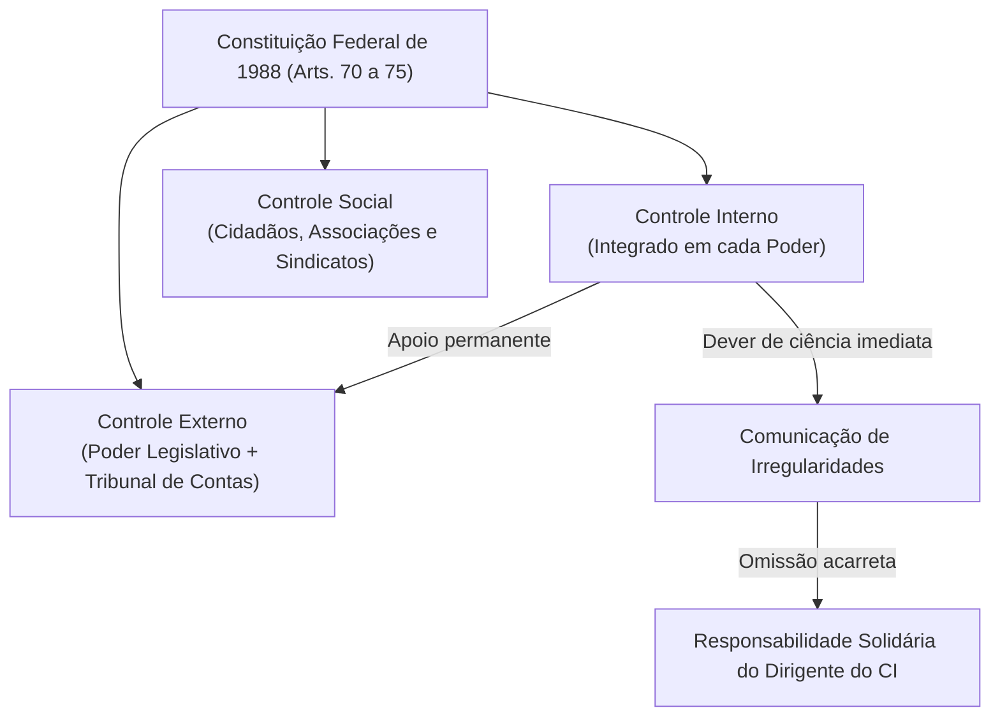
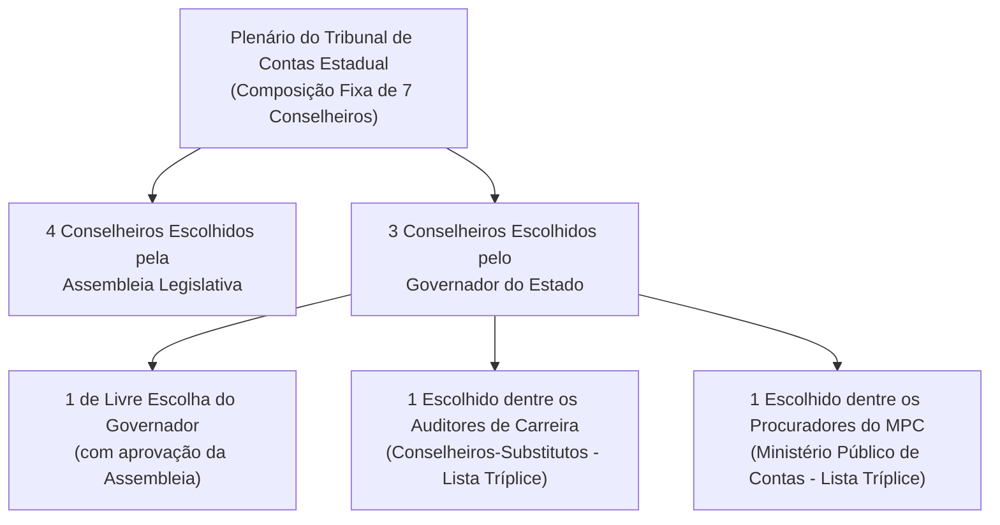

# 01 - Sistema Constitucional de Controle e Jurisdição dos Tribunais de Contas

> **Matéria:** Noções de Controle Externo  
> **Cargo:** A01 – Técnico de Controle Externo – Especialidade: Técnico Administrativo  
> **Arquivo:** `01_sistema_constitucional_e_jurisdicao_dos_tcs.md`  
> **Status:** 🟢 Teoria Aprofundada + 5 Questões FCC Comentadas (A a E)

---

## 📌 Ementa / Itens do Edital

- Sistema constitucional de controle da Administração Pública: controle interno e controle externo;
- Relação e integração harmônica entre os sistemas de controle interno e externo;
- Dever de comunicação imediata sob pena de responsabilidade solidária (Artigo 74, § 1º, da CF/88);
- Tribunais de Contas: natureza jurídica, autonomia institucional, funcional, administrativa e orçamentária;
- O modelo federal e o princípio da simetria constitucional (Artigo 75 da CF/88);
- Composição e nomeação de membros dos Tribunais de Contas Estaduais (Artigos 73 e 75 da CF/88);
- Jurisdição dos Tribunais de Contas: abrangência subjetiva e objetiva; gestores públicos e particulares que guardem, arrecadem, gerenciem ou administrem verbas públicas;
- Competências constitucionais dos Tribunais de Contas:
    - Apreciação de contas do Chefe do Poder Executivo (parecer prévio opinativo e político-constitucional);
    - Julgamento técnico das contas dos administradores e demais responsáveis por recursos públicos (contas de gestão);
    - Fiscalização de atos de admissão de pessoal e concessão de benefícios previdenciários (atos complexos, Súmula Vinculante nº 3 e Tema 445 do STF);
    - Fixação de prazo para adoção de providências saneadoras e sustação direta de atos administrativos ilegais;
    - Sustação de contratos administrativos (competência privativa do Poder Legislativo com atuação subsidiária do TC);
- Eficácia das decisões dos Tribunais de Contas: imputação de débito e multa com força de título executivo extrajudicial (Artigo 71, § 3º, da CF/88);
- Limites da jurisdição de contas, prescrição da pretensão punitiva/ressarcitória (Tema 899 do STF) e independência das instâncias civil, penal e administrativa.

---

## 🧭 Sumário

1. [O Modelo Constitucional de Controle e a Responsabilidade Solidária](#1-o-modelo-constitucional-de-controle-e-a-responsabilidade-solidaria)
    1. [Sistemas de Controle Externo, Interno e Social](#11-sistemas-de-controle-externo-interno-e-social)
    2. [O Dever de Comunicação do Controle Interno e Sanção de Solidariedade (Art. 74, § 1º)](#12-o-dever-de-comunicacao-do-controle-interno-e-sancao-de-solidariedade-art-74-1o)
2. [Natureza Jurídica, Autonomia e Princípio da Simetria (Art. 75)](#2-natureza-juridica-autonomia-e-principio-da-simetria-art-75)
    1. [Natureza Jurídica e Autonomias dos Tribunais de Contas](#21-natureza-juridica-e-autonomias-dos-tribunais-de-contas)
    2. [O Princípio da Simetria Constitucional Federativa e a Composição dos TCEs](#22-o-principio-da-simetria-constitucional-federativa-e-a-composicao-dos-tces)
    3. [Teste 165](#Teste-165)
    4. [Teste 166](#Teste-166)
3. [Competências Constitucionais: Julgamento Técnico versus Parecer Prévio](#3-competencias-constitucionais-julgamento-tecnico-versus-parecer-previo)
    1. [Contas de Governo versus Contas de Gestão](#31-contas-de-governo-versus-contas-de-gestao)
    2. [O Julgamento das Contas de Prefeito Municipal (Tema 835 do STF)](#32-o-julgamento-das-contas-de-prefeito-municipal-tema-835-do-stf)
    3. [Teste 167](#Teste-167)
4. [Registro de Atos de Admissão e Benefícios Previdenciários (Art. 71, III)](#4-registro-de-atos-de-admissao-e-beneficios-previdenciarios-art-71-iii)
    1. [Teste 168](#Teste-168)
    2. [Teste 169](#Teste-169)
5. [Sustação de Atos Ilegais versus Sustação de Contratos Administrativos](#5-sustacao-de-atos-ilegais-versus-sustacao-de-contratos-administrativos)
    1. [Teste 170](#Teste-170)
    2. [Teste 171](#Teste-171)
6. [Eficácia Executiva e Prescritibilidade (Art. 71, § 3º e Tema 899 do STF)](#6-eficacia-executiva-e-prescritibilidade-art-71-3o-e-tema-899-do-stf)
    1. [Teste 172](#Teste-172)
    2. [Teste 173](#Teste-173)
7. [Jurisdição Ampla e Independência das Instâncias](#7-jurisdicao-ampla-e-independencia-das-instancias)
    1. [Teste 174](#Teste-174)
    2. [Teste 175](#Teste-175)
8. [🌐 Fontes Oficiais & Jurisprudenciais Recomendadas](#fontes-oficiais-jurisprudenciais-recomendadas)

---

## 1. O Modelo Constitucional de Controle e a Responsabilidade Solidária

O controle dos recursos públicos no Brasil é tripartite e integrado:

1. **Controle Externo:** Exercido pelo **Poder Legislativo** com o **auxílio técnico-constitucional do Tribunal de Contas** competente (TCU na União, TCE nos Estados e DF, TCMs onde existentes).
2. **Controle Interno:** Mantido de forma **integrada** por cada um dos Poderes (Executivo, Legislativo e Judiciário) e pelo Ministério Público.
3. **Controle Social:** Exercido diretamente pela sociedade civil mediante instrumentos de transparência e cidadania (art. 74, § 2º).

### 1.1 Sistemas de Controle Externo, Interno e Social
- O **Controle Externo** possui titularidade política no Poder Legislativo, sendo operacionalizado na plenitude técnica pelo Tribunal de Contas, órgão constitucional independente de controle da legitimidade, legalidade, economicidade, aplicação de subvenções e renúncia de receitas públicas.
- O **Controle Interno** atua no seio de cada estrutura orgânica para avaliar o cumprimento das metas do PPA, comprovar a legalidade da gestão orçamentária e apoiar o controle externo no exercício de sua missão institucional (art. 74, I a IV).
- O **Controle Social** assegura a qualquer cidadão, partido político, associação ou sindicato legitimidade para denunciar irregularidades perante o Tribunal de Contas (art. 74, § 2º).

### 1.2 O Dever de Comunicação do Controle Interno e Sanção de Solidariedade (Art. 74, § 1º)
- Os responsáveis pelo controle interno, ao tomarem conhecimento de qualquer irregularidade ou ilegalidade no órgão, **devem dar ciência imediata ao Tribunal de Contas competente**.
- **Sanção por Omissão:** Se o titular do controle interno silenciar dolosa ou culposamente, responderá **pessoal e solidariamente** com o gestor ímprobo pelo dano apurado e pelas sanções cominadas pelo Tribunal de Contas.

---

## 2. Natureza Jurídica, Autonomia e Princípio da Simetria (Art. 75)

### 2.1 Natureza Jurídica e Autonomias dos Tribunais de Contas
- Os Tribunais de Contas são **órgãos estatais independentes**, de extração estritamente constitucional.
- **Não integram a estrutura hierárquica do Poder Legislativo**, tampouco do Poder Executivo ou do Judiciário. Exercem magistratura técnica de contas especializada dotada de autogoverno.
- Possuem **autonomia administrativa, funcional, orçamentária e financeira**, além de quadro próprio de servidores públicos efetivos e poder de iniciativa reservada para suas leis orgânicas.

### 2.2 O Princípio da Simetria Constitucional Federativa e a Composição dos TCEs
O art. 75 da Carta Magna estabelece que as normas constitucionais federais sobre fiscalização financeira e organização do Tribunal de Contas da União aplicam-se compulsoriamente aos Tribunais de Contas dos Estados, do Distrito Federal e dos Municípios:

- **Composição dos Tribunais de Contas Estaduais (TCE-GO):**
    - O plenário é composto por **7 Conselheiros** (ao contrário do TCU, que possui 9 Ministros).
    - Regra constitucional de escolha e indicação (Art. 73, § 2º c/c Art. 75):
    - **4 Conselheiros** indicados e eleitos pela **Assembleia Legislativa**;
    - **3 Conselheiros** indicados pelo **Governador do Estado**, com prévia aprovação da Assembleia Legislativa, sendo:
        - 1 de livre escolha do Governador;
        - 1 obrigatoriamente escolhido dentre os **Auditores de Controle Externo (Conselheiros-Substitutos)**, a partir de lista tríplice de antiguidade e merecimento;
        - 1 obrigatoriamente escolhido dentre os **Procuradores do Ministério Público de Contas**, a partir de lista tríplice de antiguidade e merecimento.

---

### Teste 165
**(FGV – TCE-GO – Analista de Controle Externo – 2024)**  
A NBASP 10 traz os princípios que devem ser observados pelo institucional, o que tem impactos na imparcialidade e na credibilidade das conclusões de seus trabalhos e relatórios. Assinale a opção que indica o princípio que afirma que os Tribunais de Contas devem operar sem sofrer ingerência por parte da Administração Pública sobre o desempenho das suas funções.

* **A)** Independência dos Tribunais de Contas para o desempenho de suas competências.
* **B)** Acesso irrestrito a informações.
* **C)** Prevenção ao conflito de interesses.
* **D)** Previsão legal da independência dos Tribunais de Contas.
* **E)** Cooperação interinstitucional sem prejuízo da independência e da autonomia. TRIBUNAL DE CONTAS DO ESTADO DE GOIÁS FGV CONHECIMENTO ANALISTA DE CONTROLE EXTERNO - CIENCIAS CONTABEIS – MANHÃ TIPO BRANCA – PÁGINA 13

---

> **Comentário Detalhado:**
>
> - **A)** Correta. A NBASP 10 (baseada na Declaração do México - ISSAI 10 da INTOSAI) estabelece os 8 pilares da independência dos Tribunais de Contas, abrangendo a independência funcional, autonomia financeira, orçamentária e administrativa, bem como imunidade funcional de seus membros e corpo técnico.
> - **B)** Incorreta. A independência institucional não exime o Tribunal do dever de prestar contas e manter transparência pública.
> - **C)** Incorreta. O controle externo não se subordina a orientações executivas de governança.
> - **D)** Incorreta. A NBASP 10 exige independência operacional para eleger o escopo e calendário das auditorias.
> - **E)** Incorreta. A dotação orçamentária própria integra a garantia de autonomia do Tribunal.
>
> **Gabarito: A**

---

### Teste 166
**(FGV – TRT / TCE – 2024)**  
A Declaração de Lima é considerada a Carta Magna da auditoria

governamental, uma vez que lançou as bases do controle público.

Sobre a Declaração de Lima, analise os itens a seguir:

I. O principal objetivo da Declaração de Lima é defender a

necessidade de uma fiscalização independente do setor

público.

II. Dada a importância histórica e institucional global deste

documento, a Declaração de Lima foi oficialmente integrada à

estrutura da NBASP.

III. A Declaração de Lima se fundamenta no Estado de Direito e na

Democracia, premissas para uma fiscalização do setor público

dependente.

Está correto o que se afirma em

* **A)** I, apenas.
* **B)** I e II, apenas.
* **C)** I e III, apenas.
* **D)** II e III, apenas.
* **E)** I, II e III.

---

> **Comentário Detalhado:**
>
> - **A)** Incorreta. A Declaração de Lima consagra o controle externo prévio, concomitante e posterior.
> - **B)** Correta. Adotada no IX Congresso da INTOSAI em 1977, a Declaração de Lima (ISSAI 1) é reconhecida internacionalmente como a Carta Magna da auditoria governamental, fundamentando as diretrizes de independência das Entidades Fiscalizadoras Superiores (EFS) e dos Tribunais de Contas frente aos órgãos auditados.
> - **C)** Incorreta. A Declaração defende a ampla publicidade dos relatórios e conclusões de auditoria.
> - **D)** Incorreta. A atuação dos auditores exige livre acesso a informações, registros e instalações físicas.
> - **E)** Incorreta. A Declaração reconhece expressamente o papel pedagógico e corretivo do controle público.
>
> **Gabarito: B**

---

### Teste 167
**(FGV – TRT – Analista Judiciário - Tecnologia da Informação – 2024)**
Em um Tribunal de Contas Estadual havia sete conselheiros, sendo 
quatro nomeados pela Assembleia Legislativa e três pelo 
Governador do Estado. Ocorre que o decano da Corte de Contas 
se aposentou, conselheiro este que havia sido indicado pela 
Assembleia Legislativa, liberando sua vaga. Ocorre que, por razões 
históricas, as três indicações realizadas pelos Governadores à 
época foram de livre escolha, tendo sido preenchidas por 
membros da sociedade local, até então estranhos ao quadro de 
pessoal do Tribunal de Contas. 
A par da situação, o Governador questionou a Procuradoria -Geral 
quanto a possibilidade de ele nomear um dentre os membr os do 
Ministério Público junto à Corte de Contas de modo a garantir a 
sua representatividade no Plenário, em observância ao prescrito 
na Carta Magna. 
Qual das alternativas apresenta parecer condizente à Súmula 653 
e ao tema de repercussão geral 652, ambos do Supremo Tribunal 
Federal:

* **A)** Se mostra plenamente possível, haja vista a necessidade de 
salvaguardar as regras da Constituição Federal.
* **B)** Não se mostra possível a nomeação do membro do Ministério 
Público junto à Corte de Contas pelo Governador, contudo em 
observância da regra Constitucional deve a Assembleia 
Legislativa indicar um dos membros do parquet de contas.
* **C)** A situação é possível, contudo, há precedência para a 
ocupação da vaga por um dentre os auditores-substitutos, pela 
ordem prescrita no texto constitucional.
* **D)** A situação é possível desde que o texto da Constituição 
Estadual seja emendado de modo a modificar a divisão 
proporcional das indicações entre os Poderes Legislativo e 
Executivo.
* **E)** É inconstitucional a nomeação, pelo Governador, de membro 
do Ministério Público junto à Corte de Contas para 
preenchimento de cargo vago de conselheiro quando se tratar 
de vaga reservada à escolha da Assembleia Legislativa.

---

> **Comentário Detalhado:**
>
> - **A)** Incorreta. Discrepa das diretrizes normativas e jurisprudenciais aplicáveis ao tema objeto do item.
> - **B)** Incorreta. Discrepa das diretrizes normativas e jurisprudenciais aplicáveis ao tema objeto do item.
> - **C)** Incorreta. Discrepa das diretrizes normativas e jurisprudenciais aplicáveis ao tema objeto do item.
> - **D)** Incorreta. Discrepa das diretrizes normativas e jurisprudenciais aplicáveis ao tema objeto do item.
> - **E)** Correta. Representa com precisão a disciplina do tema e o entendimento pacificado adotado pela banca (FGV).
>
> **Gabarito: E**

---
### Teste 168
**(FCC – TRT – Analista Judiciário - Tecnologia da Informação – 2009)**  
Sobre as disposições constitucionais referentes ao controle externo das entidades públicas (art. 71 da CF/88), é correto afirmar:

* **A)** O Tribunal de Contas tem competência para apreciar a legalidade de atos de admissão de pessoal a qualquer título.
* **B)** O parecer prévio emitido sobre as contas do Governador deixará de prevalecer por decisão de dois terços da Assembleia.
* **C)** As decisões dos Tribunais de Contas que resultem em imputação de débito ou multa têm eficácia de título executivo judicial.
* **D)** A sustação de contratos administrativos irregulares é competência originária e direta do próprio Tribunal de Contas.
* **E)** O controle externo exercido pelo Tribunal de Contas restringe-se exclusivamente aos aspectos contábil e de legalidade.

---

> **Comentário Detalhado:**
>
> - **A)** **Incorreto**. O art. 71, III, da CF/88 excepciona expressamente da apreciação do Tribunal de Contas as nomeações para cargo de provimento em comissão.
> - **B)** **Correto**. Conforme o modelo federal reproduzido no âmbito estadual (art. 71, I c/c art. 31, § 2º e art. 75 da CF/88), o parecer prévio emitido pelo Tribunal de Contas sobre as contas gerais prestadas anualmente pelo Chefe do Poder Executivo somente deixará de prevalecer por deliberação de dois terços dos membros do Poder Legislativo.
> - **C)** **Incorreto**. As decisões condenatórias têm eficácia de título executivo extrajudicial (art. 71, § 3º, CF/88).
> - **D)** **Incorreto**. No caso de contrato, o ato de sustação é adotado diretamente pelo Congresso Nacional / Assembleia Legislativa; somente se o Legislativo não efetivar a medida em 90 dias é que o Tribunal de Contas decidirá a respeito (art. 71, §§ 1º e 2º, CF/88).
> - **E)** **Incorreto**. O controle externo abrange a fiscalização contábil, financeira, orçamentária, operacional e patrimonial, sob os aspectos da legalidade, legitimidade e economicidade (art. 70, caput, CF/88).
>
> **Gabarito: B**

### Teste 169
**(FGV – TRT – Analista Judiciário - Tecnologia da Informação – 2024)**
Certo Tribunal de Contas, no âmbito de sua competência, realizou 
uma tomada de contas especial, para fins de verificar a 
regularidade no cumprimento de determinado convênio 
interfederativo de repasse de verbas e promover a 
responsabilização pessoal dos envolvidos, dentre os quais o 
prefeito do Município Alfa.  
Considerando as disposições constitucionais acerca do controle 
exercido pelas Cortes de Contas e a orientação do Supremo 
Tribunal Federal acerca do tema, é correto afirmar que, em relação 
à mencionada tomada de contas especial

* **A)** não é possível que o Tribunal de Contas aprecie condutas e 
gastos realizados pelo prefeito, considerando que a 
Constituição determina que o julgamento das contas do Chefe 
do Poder Executivo deve ser realizado pela respectiva Casa 
Legislativa.
* **B)** cabe ao Tribunal de Contas apenas apreciar a regularidade dos 
gastos realizados pelo prefeito, mediante a elaboração de 
parecer, cuja conclusão apenas deixa de prevalecer pela 
votação de 2/3 (dois terços) da Câmara de Vereadores.
* **C)** deve aplicar as sanções pertinen tes ao prefeito, em 
decorrência da apuração de irregularidades no convênio em 
questão, considerando ser o órgão responsável pelo 
julgamento anual das contas do Chefe do Poder Executivo.
* **D)** não pode ser compreendida como atribuição autônoma do 
penalidade ao Chefe do Poder Executivo, em decorrência de 
irregularidades no convênio em questão, deve ser submetida 
à apreciação da Casa Legislativa.
* **E)** pode promover a condenação administrativa do Chefe do 
Poder Executivo, quando identificada a responsabilidade 
pessoal em face de irregularidades no cumprimento do 
convênio em questão, sem necessidade de posterior 
julgamento ou aprovação do ato pelo respectivo Poder 
Legislativo.

---

> **Comentário Detalhado:**
>
> - **A)** Incorreta. Discrepa das diretrizes normativas e jurisprudenciais aplicáveis ao tema objeto do item.
> - **B)** Correta. Representa com precisão a disciplina do tema e o entendimento pacificado adotado pela banca (FGV).
> - **C)** Incorreta. Discrepa das diretrizes normativas e jurisprudenciais aplicáveis ao tema objeto do item.
> - **D)** Incorreta. Discrepa das diretrizes normativas e jurisprudenciais aplicáveis ao tema objeto do item.
> - **E)** Incorreta. Discrepa das diretrizes normativas e jurisprudenciais aplicáveis ao tema objeto do item.
>
> **Gabarito: B**

---
### Teste 170
**(FGV – TCE-GO – Analista de Controle Externo - Controle Externo – 2024)**
A NBASP 50 - Princípios de Atividades Jurisdicionais dos Tribunais 
de Contas desenvolve doze princípios adequados ao contexto 
especifico das atividades jurisdicionais dos Tribunais de Contas.  
Nesse contexto, analise os itens a seguir: 
I. O Tribunal de Con tas deve garantir que as pessoas 
responsáveis perante ele sejam submetidas a um julgamento 
justo, garantido por procedimentos legais.  
II. Qualquer julgamento do Tribunal de Contas deve ser aberto a 
objeções e reconsideração e estar sujeito a revisão ou 
anulação em conformidade com a legislação nacional. 
III. Uma pessoa pode ser condenada pela mesma irregularidade a 
várias sanções da mesma natureza impostas pelo Tribunal de 
Contas.  
Está correto o que se afirma em

* **A)** I, apenas.
* **B)** I e II, apenas.
* **C)** I e III, apenas.
* **D)** II e III, apenas.
* **E)** I, II e III.

---

> **Comentário Detalhado:**
>
> - **A)** Incorreta. Discrepa das diretrizes normativas e jurisprudenciais aplicáveis ao tema objeto do item.
> - **B)** Correta. Representa com precisão a disciplina do tema e o entendimento pacificado adotado pela banca (FGV).
> - **C)** Incorreta. Discrepa das diretrizes normativas e jurisprudenciais aplicáveis ao tema objeto do item.
> - **D)** Incorreta. Discrepa das diretrizes normativas e jurisprudenciais aplicáveis ao tema objeto do item.
> - **E)** Incorreta. Discrepa das diretrizes normativas e jurisprudenciais aplicáveis ao tema objeto do item.
>
> **Gabarito: B**

---
### Teste 171
**(FGV – TRT – Analista Judiciário - Tecnologia da Informação – 2024)**
Em um Tribunal de Contas Estadual havia sete conselheiros, sendo 
quatro nomeados pela Assembleia Legislativa e três pelo 
Governador do Estado. Ocorre que o decano da Corte de Contas 
se aposentou, conselheiro este que havia sido indicado pela 
Assembleia Legislativa, liberando sua vaga. Ocorre que, por razões 
históricas, as três indicações realizadas pelos Governadores à 
época foram de livre escolha, tendo sido preenchidas por 
membros da sociedade local, até então estranhos ao quadro de 
pessoal do Tribunal de Contas. 
A par da situação, o Governador questionou a Procuradoria -Geral 
quanto a possibilidade de ele nomear um dentre os membr os do 
Ministério Público junto à Corte de Contas de modo a garantir a 
sua representatividade no Plenário, em observância ao prescrito 
na Carta Magna. 
Qual das alternativas apresenta parecer condizente à Súmula 653 
e ao tema de repercussão geral 652, ambos do Supremo Tribunal 
Federal:

* **A)** Se mostra plenamente possível, haja vista a necessidade de 
salvaguardar as regras da Constituição Federal.
* **B)** Não se mostra possível a nomeação do membro do Ministério 
Público junto à Corte de Contas pelo Governador, contudo em 
observância da regra Constitucional deve a Assembleia 
Legislativa indicar um dos membros do parquet de contas.
* **C)** A situação é possível, contudo, há precedência para a 
ocupação da vaga por um dentre os auditores-substitutos, pela 
ordem prescrita no texto constitucional.
* **D)** A situação é possível desde que o texto da Constituição 
Estadual seja emendado de modo a modificar a divisão 
proporcional das indicações entre os Poderes Legislativo e 
Executivo.
* **E)** É inconstitucional a nomeação, pelo Governador, de membro 
do Ministério Público junto à Corte de Contas para 
preenchimento de cargo vago de conselheiro quando se tratar 
de vaga reservada à escolha da Assembleia Legislativa.

---

> **Comentário Detalhado:**
>
> - **A)** Incorreta. Discrepa das diretrizes normativas e jurisprudenciais aplicáveis ao tema objeto do item.
> - **B)** Incorreta. Discrepa das diretrizes normativas e jurisprudenciais aplicáveis ao tema objeto do item.
> - **C)** Incorreta. Discrepa das diretrizes normativas e jurisprudenciais aplicáveis ao tema objeto do item.
> - **D)** Incorreta. Discrepa das diretrizes normativas e jurisprudenciais aplicáveis ao tema objeto do item.
> - **E)** Correta. Representa com precisão a disciplina do tema e o entendimento pacificado adotado pela banca (FGV).
>
> **Gabarito: E**

---
### Teste 172
**(FGV – TRT – Analista Judiciário - Tecnologia da Informação – 2024)**
Certo Tribunal de Contas, no âmbito de sua competência, realizou 
uma tomada de contas especial, para fins de verificar a 
regularidade no cumprimento de determinado convênio 
interfederativo de repasse de verbas e promover a 
responsabilização pessoal dos envolvidos, dentre os quais o 
prefeito do Município Alfa.  
Considerando as disposições constitucionais acerca do controle 
exercido pelas Cortes de Contas e a orientação do Supremo 
Tribunal Federal acerca do tema, é correto afirmar que, em relação 
à mencionada tomada de contas especial

* **A)** não é possível que o Tribunal de Contas aprecie condutas e 
gastos realizados pelo prefeito, considerando que a 
Constituição determina que o julgamento das contas do Chefe 
do Poder Executivo deve ser realizado pela respectiva Casa 
Legislativa.
* **B)** cabe ao Tribunal de Contas apenas apreciar a regularidade dos 
gastos realizados pelo prefeito, mediante a elaboração de 
parecer, cuja conclusão apenas deixa de preval ecer pela 
votação de 2/3 (dois terços) da Câmara de Vereadores.
* **C)** deve aplicar as sanções pertinentes ao prefeito, em 
decorrência da apuração de irregularidades no convênio em 
questão, considerando ser o órgão responsável pelo 
julgamento anual das contas do Chefe do Poder Executivo.
* **D)** não pode ser compreendida como atribuição autônoma do 
penalidade ao Chefe do Poder Executivo, em decorrência de 
irregularidades no convênio em questão, deve ser submeti da 
à apreciação da Casa Legislativa.
* **E)** pode promover a condenação administrativa do Chefe do 
Poder Executivo, quando identificada a responsabilidade 
pessoal em face de irregularidades no cumprimento do 
convênio em questão, sem necessidade de posterior 
julgamento ou aprovação do ato pelo respectivo Poder 
Legislativo.

---

> **Comentário Detalhado:**
>
> - **A)** Incorreta. Discrepa das diretrizes normativas e jurisprudenciais aplicáveis ao tema objeto do item.
> - **B)** Correta. Representa com precisão a disciplina do tema e o entendimento pacificado adotado pela banca (FGV).
> - **C)** Incorreta. Discrepa das diretrizes normativas e jurisprudenciais aplicáveis ao tema objeto do item.
> - **D)** Incorreta. Discrepa das diretrizes normativas e jurisprudenciais aplicáveis ao tema objeto do item.
> - **E)** Incorreta. Discrepa das diretrizes normativas e jurisprudenciais aplicáveis ao tema objeto do item.
>
> **Gabarito: B**

---
### Teste 173
**(FGV – TRT – Analista Judiciário - Tecnologia da Informação – 2024)**
A NBASP 50 - Princípios de Atividades Jurisdicionais dos Tribunais 
de Contas desenvolve doze princípios adequados ao contexto 
especifico das atividades jurisdicionais dos Tribunais de Contas.  
Nesse contexto, analise os itens a seguir: 
I. O Tribunal de Con tas deve garantir que as pessoas 
responsáveis perante ele sejam submetidas a um julgamento 
justo, garantido por procedimentos legais.  
II. Qualquer julgamento do Tribunal de Contas deve ser aberto a 
objeções e reconsideração e estar sujeito a revisão ou 
anulação em conformidade com a legislação nacional. 
III. Uma pessoa pode ser condenada pela mesma irregularidade a 
várias sanções da mesma natureza impostas pelo Tribunal de 
Contas.  
Está correto o que se afirma em

* **A)** I, apenas.
* **B)** I e II, apenas.
* **C)** I e III, apenas.
* **D)** II e III, apenas.
* **E)** I, II e III.

---

> **Comentário Detalhado:**
>
> - **A)** Incorreta. Discrepa das diretrizes normativas e jurisprudenciais aplicáveis ao tema objeto do item.
> - **B)** Correta. Representa com precisão a disciplina do tema e o entendimento pacificado adotado pela banca (FGV).
> - **C)** Incorreta. Discrepa das diretrizes normativas e jurisprudenciais aplicáveis ao tema objeto do item.
> - **D)** Incorreta. Discrepa das diretrizes normativas e jurisprudenciais aplicáveis ao tema objeto do item.
> - **E)** Incorreta. Discrepa das diretrizes normativas e jurisprudenciais aplicáveis ao tema objeto do item.
>
> **Gabarito: B**

---
### Teste 174
**(FGV – TRT – Analista Judiciário - Tecnologia da Informação – 2024)**  
A Lei nº 16.168, de 11 de dezembro de 2007, estabelece a Lei Orgânica do Tribunal de Contas do Estado de Goiás (LOTCE-GO), disciplinando sua jurisdição, competência e processo. À luz da LOTCE-GO, é correto afirmar que:

* **A)** os responsáveis por contas de gestão que causarem prejuízo ao erário respondem solidariamente com seus subordinados.
* **B)** a decisão do Tribunal de Contas que julgar regulares com ressalva as contas confere quitação irrestrita ao responsável.
* **C)** o Tribunal de Contas é órgão subordinado administrativamente à Mesa Diretora da Assembleia Legislativa goiana.
* **D)** as certidões emitidas pelo TCE-GO sobre imputação de débito dependem de cobrança privativa pelo próprio Tribunal.
* **E)** a fiscalização contábil exercida pelo TCE-GO alcança apenas os recursos oriundos do Tesouro do Estado de Goiás.

---

> **Comentário Detalhado:**
>
> - **A)** **Correto**. Nos termos da LOTCE-GO (Lei Estadual nº 16.168/2007) e do art. 71, II, da CF/88, aqueles que derem causa a perda, extravio ou outra irregularidade de que resulte dano ao erário público estadual respondem civilmente pelo dever de ressarcimento, caracterizando-se a responsabilidade solidária de todos os agentes públicos que concorreram para a consumação do ato lesivo.
> - **B)** **Incorreto**. As contas julgadas regulares com ressalva conferem quitação com determinação de providências (quitação condicionada/parcial, e não plena).
> - **C)** **Incorreto**. O TCE-GO possui autonomia funcional e orçamentária constitucional.
> - **D)** **Incorreto**. A execução do título cabe à Fazenda Pública / Procuradoria-Geral do Estado.
> - **E)** **Incorreto**. Alcança recursos estaduais, fundos, convênios e quaisquer valores geridos por entidades sujeitas à sua jurisdição.
>
> **Gabarito: A**

### Teste 175
**(FGV – TRT – Analista Judiciário - Tecnologia da Informação – 2024)**
Em um Tribunal de Contas Estadual havia sete conselheiros, sendo 
quatro nomeados pela Assembleia Legislativa e três pelo 
Governador do Estado. Ocorre que o decano da Corte de Contas 
se aposentou, conselheiro este que havia sido indicado pela 
Assembleia Legislativa, liberando sua vaga. Ocorre que, por razões 
históricas, as três indicações realizadas pelos Governadores à 
época foram de livre escolha, tendo sido preenchidas por 
membros da sociedade local, até então estranhos ao quadro de 
pessoal do Tribunal de Contas. 
A par da situação, o Governador questionou a Procuradoria -Geral 
quanto a possibilidade de ele nomear um dentre os membr os do 
Ministério Público junto à Corte de Contas de modo a garantir a 
sua representatividade no Plenário, em observância ao prescrito 
na Carta Magna. 
Qual das alternativas apresenta parecer condizente à Súmula 653 
e ao tema de repercussão geral 652, ambos do Supremo Tribunal 
Federal:

* **A)** Se mostra plenamente possível, haja vista a necessidade de 
salvaguardar as regras da Constituição Federal.
* **B)** Não se mostra possível a nomeação do membro do Ministério 
Público junto à Corte de Contas pelo Governador, contudo em 
observância da regra Constitucional deve a Assembleia 
Legislativa indicar um dos membros do parquet de contas.
* **C)** A situação é possível, contudo, há precedência para a 
ocupação da vaga por um dentre os auditores-substitutos, pela 
ordem prescrita no texto constitucional.
* **D)** A situação é possível desde que o texto da Constituição 
Estadual seja emendado de modo a modificar a divisão 
proporcional das indicações entre os Poderes Legislativo e 
Executivo.
* **E)** É inconstitucional a nomeação, pelo Governador, de membro 
do Ministério Público junto à Corte de Contas para 
preenchimento de cargo vago de conselheiro quando se tratar 
de vaga reservada à escolha da Assembleia Legislativa.

---

> **Comentário Detalhado:**
>
> - **A)** Incorreta. Discrepa das diretrizes normativas e jurisprudenciais aplicáveis ao tema objeto do item.
> - **B)** Incorreta. Discrepa das diretrizes normativas e jurisprudenciais aplicáveis ao tema objeto do item.
> - **C)** Incorreta. Discrepa das diretrizes normativas e jurisprudenciais aplicáveis ao tema objeto do item.
> - **D)** Incorreta. Discrepa das diretrizes normativas e jurisprudenciais aplicáveis ao tema objeto do item.
> - **E)** Correta. Representa com precisão a disciplina do tema e o entendimento pacificado adotado pela banca (FGV).
>
> **Gabarito: E**

---
