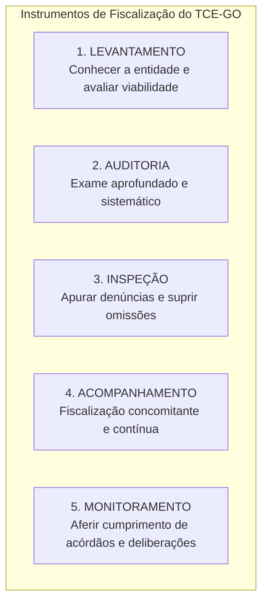
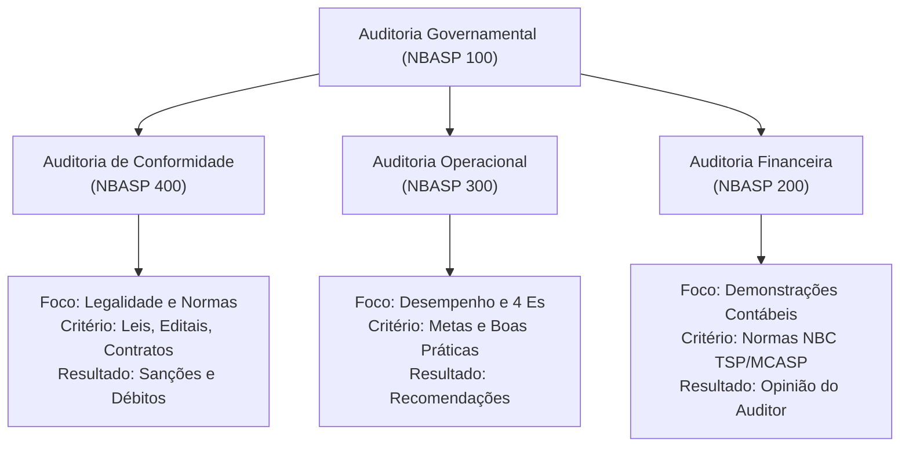
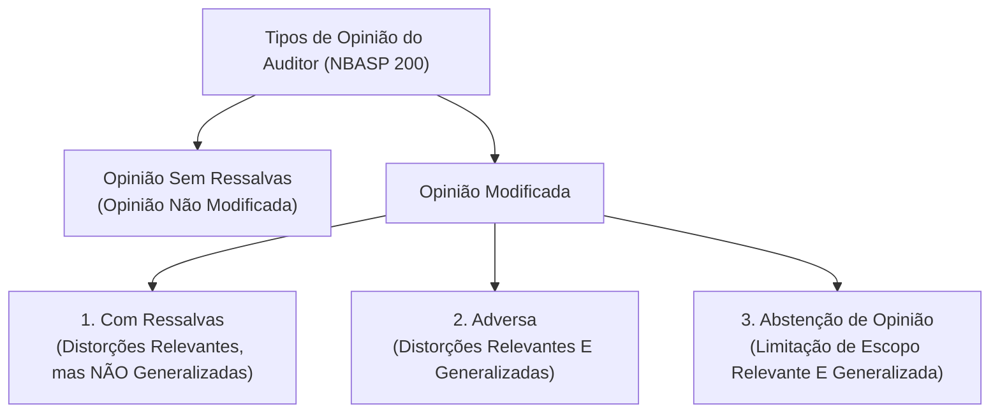

# 02 - Instrumentos de Fiscalização, Tipos de Auditoria e Normas NBASP / INTOSAI

> **Matéria:** Noções de Controle Externo  
> **Cargo:** A01 – Técnico de Controle Externo – Especialidade: Técnico Administrativo  
> **Arquivo:** `02_instrumentos_e_tipos_de_auditoria_governamental_nbasp.md`  
> **Status:** 🟢 Teoria Aprofundada + 5 Questões FCC Comentadas (A a E)

---

## 📌 Ementa / Itens do Edital

- Instrumentos de fiscalização do controle externo: levantamento, auditoria, inspeção, acompanhamento e monitoramento (conceitos, distinções operacionais e hipóteses de cabimento);
- Tipologia da auditoria governamental segundo as normas técnicas:
    - Auditoria de Conformidade (legalidade, legitimidade, regularidade formal e cumprimento normativo);
    - Auditoria Operacional / de Desempenho (avaliação dos 4 Es: economicidade, eficiência, eficácia e efetividade);
    - Auditoria Financeira (exame das demonstrações contábeis e tipos de opinião do auditor);
- Estrutura das Normas Internacionais das Entidades Fiscalizadoras Superiores (INTOSAI) e Declaração de Lima;
- Normas Brasileiras de Auditoria do Setor Público (NBASP) emitidas pelo Instituto Rui Barbosa (IRB):
    - **NBASP 100:** Princípios Fundamentais de Auditoria do Setor Público (as três partes da auditoria, objeto e critérios);
    - **NBASP 200:** Princípios de Auditoria Financeira;
    - **NBASP 300:** Princípios de Auditoria Operacional;
    - **NBASP 400:** Princípios de Auditoria de Conformidade;
- Postura profissional e conduta ética do auditor de controle externo: independência, integridade, ceticismo profissional, julgamento profissional, devido zelo e sigilo funcional;
- Matrizes metodológicas: Matriz de Planejamento e Matriz de Achados de Auditoria.

---

## 🧭 Sumário
1. [Os Cinco Instrumentos de Fiscalização do Controle Externo](#1-os-cinco-instrumentos-de-fiscalização-do-controle-externo)
    - 1.1 [Conceito e Finalidade Prática de Cada Instrumento](#11-conceito-e-finalidade-prática-de-cada-instrumento)
    - 1.2 [Diferença Prática entre Inspeção e Monitoramento](#12-diferença-prática-entre-inspeção-e-monitoramento)
2. [Tipologia das Auditorias Governamentais (Normas NBASP / INTOSAI)](#2-tipologia-das-auditorias-governamentais-normas-nbasp--intosai)
    - 2.1 [Auditoria de Conformidade (NBASP 400)](#21-auditoria-de-conformidade-nbasp-400)
    - 2.2 [Auditoria Operacional ou de Desempenho e os 4 Es (NBASP 300)](#22-auditoria-operacional-ou-de-desempenho-e-os-4-es-nbasp-300)
    - 2.3 [Auditoria Financeira e os Tipos de Opinião do Auditor (NBASP 200)](#23-auditoria-financeira-e-os-tipos-de-opinião-do-auditor-nbasp-200)
3. [Estrutura Normativa NBASP / INTOSAI e as Três Partes da Auditoria](#3-estrutura-normativa-nbasp--intosai-e-as-três-partes-da-auditoria)
4. [Postura e Conduta Profissional do Auditor (NBASP 100)](#4-postura-e-conduta-profissional-do-auditor-nbasp-100)
5. [Matrizes Metodológicas de Trabalho: Planejamento e Achados](#5-matrizes-metodológicas-de-trabalho-planejamento-e-achados)
6. [Fontes Oficiais & Normativas Recomendadas](#6-fontes-oficiais--normativas-recomendadas)
7. [Questões Comentadas no Padrão FCC (Justificadas de A a E)](#7-questões-comentadas-no-padrão-fcc-justificadas-de-a-a-e)

---

## 📖 Conteúdo Teórico Aprofundado

### 1. Os Cinco Instrumentos de Fiscalização do Controle Externo

A Lei Orgânica do Tribunal de Contas do Estado de Goiás (Lei Estadual nº 16.168/2007) e o seu Regimento Interno estruturam a atuação fiscalizatória externa em **cinco instrumentos operacionais fundamentais**:

#### 1.1 Conceito e Finalidade Prática de Cada Instrumento

| Instrumento | Conceito & Finalidade | Quando é Utilizado na Prática? |
| :--- | :--- | :--- |
| **Levantamento** | Utilizado para conhecer a organização, o funcionamento dos órgãos públicos, mapear sistemas de informação e **avaliar a viabilidade da realização de futuras fiscalizações**. | Fase exploratória prévia; elaboração do Plano Anual de Fiscalização do Tribunal. |
| **Auditoria** | Instrumento formal e abrangente destinado a examinar a legalidade, legitimidade e economicidade de atos, contratos, demonstrações contábeis e programas de governo. | Fiscalização planejada de grande porte (conformidade, operacional ou financeira). |
| **Inspeção** | Destinada a suprir omissões ou lacunas de informações, esclarecer dúvidas pontuais em processos em andamento ou **apurar denúncias e representações de caráter urgente**. | Atuação pontual, corretiva e de resposta a denúncias de irregularidades. |
| **Acompanhamento** | Utilizado para fiscalizar tempestivamente a gestão, de forma **concomitante e periódica**, ao longo de um determinado período. | Grandes obras públicas em execução, repasses contínuos e editais de licitação em andamento. |
| **Monitoramento** | Destinado especificamente a verificar o **cumprimento das deliberações** (determinações e recomendações) expedidas pelo Tribunal e os resultados gerados. | Etapa pós-auditoria; fiscaliza se o órgão cumpriu os prazos e providências do acórdão. |

#### 1.2 Diferença Prática entre Inspeção e Monitoramento
> 🚨 **ALERTA DE PROVA / PEGADINHA FCC:**  
> A banca FCC frequentemente permuta as finalidades da **Inspeção** e do **Monitoramento**:  
>
> - Se o enunciado mencionar *"apurar fatos noticiados em representação de vereador ou denúncia popular urgente"*, o instrumento próprio e adequado é a **INSPEÇÃO**!  
> - Se o enunciado descrever *"verificar se a Secretaria de Educação adotou as providências e determinações exaradas em acórdão anterior do Tribunal"*, o instrumento correto é o **MONITORAMENTO**!

---

### 2. Tipologia das Auditorias Governamentais (Normas NBASP / INTOSAI)

Conforme a **NBASP 100** (Princípios Fundamentais de Auditoria do Setor Público), emitida pelo Instituto Rui Barbosa (IRB) em convergência com as normas da INTOSAI, existem três tipos clássicos de auditoria governamental:

#### 2.1 Auditoria de Conformidade (NBASP 400)
- **Foco:** Avaliar se as atividades, transações financeiras e atos administrativos cumprem a legislação e a regulamentação aplicável.
- **Critérios:** Normas jurídicas positivadas (Lei nº 14.133/2021, LRF, Constituição, decretos e termos contratuais).
- **Desfecho:** Identificação de irregularidades, infrações à norma legal e danos ao erário, culminando em relatórios com propostas de imputação de débito e cominação de multas.

#### 2.2 Auditoria Operacional ou de Desempenho e os 4 Es (NBASP 300)
- **Foco:** Avaliar o desempenho de programas, projetos e órgãos públicos sob a perspectiva dos **4 Es da Administração Pública**:
    1. **Economicidade:** Minimização dos custos dos recursos empregados na realização de uma atividade, sem comprometer a qualidade (*comprar bem e pelo preço justo*).
    2. **Eficiência:** Relação técnica entre os insumos empregados (*inputs*) e os produtos, obras ou serviços gerados (*outputs*) - maximizar entregas com o menor dispêndio de recursos.
    3. **Eficácia:** Grau de alcance dos objetivos e metas formais estabelecidos no planejamento governamental (*atingir o percentual previsto no PPA/LOA*).
    4. **Efetividade:** Impacto social real e duradouro alcançado sobre a população-alvo e o meio ambiente (*transformação positiva na realidade dos cidadãos*).
- **Desfecho:** Emissão preponderante de **recomendações pedagógicas de melhoria de gestão**, reservando-se as determinações apenas para obrigações legais vinculadas.

> ⭐ **IMPORTANTE (EFICÁCIA vs. EFETIVIDADE NA BANCA FCC):**  
> - Uma campanha pública de vacinação que vacinou 100% das crianças estipuladas na meta física foi **EFICAZ**.  
> - Se, apesar de vacinadas, a taxa de internações pela doença permaneceu alta devido à perda de refrigeração do lote de vacinas, o programa **NÃO FOI EFETIVO**!  
> - A eficácia afere a entrega física da meta; a efetividade afere a alteração concreta da realidade socioeconômica.

#### 2.3 Auditoria Financeira e os Tipos de Opinião do Auditor (NBASP 200)
A auditoria financeira destina-se a emitir uma **opinião independente** sobre se as demonstrações contábeis e financeiras refletem fidedignamente a posição patrimonial e orçamentária do órgão público.

| Tipo de Opinião | Relevância da Distorção / Incerteza | A Distorção é Generalizada (*Pervasive*)? | Significado Prático |
| :--- | :--- | :--- | :--- |
| **Opinião Sem Ressalvas** | Não há distorções relevantes | Não | Demonstrações contábeis estão adequadas e fidedignas. |
| **Opinião Com Ressalvas** | Relevante | **NÃO** | Há distorções específicas relevantes, mas o conjunto das demonstrações ainda é confiável. |
| **Opinião Adversa** | Relevante | **SIM** | As demonstrações contábeis contêm erros tão graves e disseminados que não merecem fé pública. |
| **Abstenção de Opinião** | Relevante (Incerteza) | **SIM** | O auditor não conseguiu obter evidências suficientes por sonegação de dados ou extravio total de registros. |

---

### 3. Estrutura Normativa NBASP / INTOSAI e as Três Partes da Auditoria

A INTOSAI (*International Organization of Supreme Audit Institutions*) e o Instituto Rui Barbosa (IRB) estruturam as normas em níveis hierárquicos:

- **Nível 1:** Princípios Fundamentais - **Declaração de Lima (ISSAI 1 / NBASP 1)**, considerada a Carta Magna da independência das Entidades Fiscalizadoras Superiores.
- **Nível 2:** Pré-requisitos Institucionais para o funcionamento dos Tribunais de Contas (independência, código de ética e controle de qualidade).
- **Nível 3:** Princípios Fundamentais de Auditoria do Setor Público (NBASP 100, 200, 300 e 400).
- **As Três Partes Envolvidas na Auditoria Pública:**
    1. O **Auditor:** Tribunal de Contas e sua equipe técnica de controle externo;
    2. A **Parte Responsável:** O gestor público ou entidade auditada encarregada da gestão dos recursos;
    3. Os **Usuários Previstos:** A sociedade civil (cidadãos) e os órgãos de representação política (Poder Legislativo).

---

### 4. Postura e Conduta Profissional do Auditor (NBASP 100)

1. **Ceticismo Profissional:** Atitude mental que inclui postura permanente de questionamento, alerta a condições que possam indicar possíveis distorções por erro ou fraude, e avaliação crítica da confiabilidade dos documentos apresentados pelo gestor.
2. **Julgamento Profissional:** Aplicação do conhecimento técnico, treinamento prático e discernimento ético do auditor na interpretação das normas e ponderação das evidências colhidas.
3. **Independência e Imparcialidade:** O auditor deve atuar isento de quaisquer pressões políticas, partidárias ou interesses particulares que possam comprometer seu relatório.
4. **Devido Zelo e Sigilo:** Obrigação de aplicar as melhores práticas técnicas com cautela e resguardar confidencialidade sobre dados sob sigilo legal.

---

### 5. Matrizes Metodológicas de Trabalho: Planejamento e Achados

A moderna auditoria governamental dos Tribunais de Contas opera com base em duas matrizes estruturantes:

- **Matriz de Planejamento:** Elaborada na fase preliminar; define as questões de auditoria, as informações requeridas, as fontes de consulta, os procedimentos de coleta/análise e as limitações de escopo.
- **Matriz de Achados:** Elaborada na fase de execução; estrutura a constatação do auditor dividida em:
    - *Achado:* O fato relevante identificado;
    - *Situação Encontrada:* O que realmente ocorreu na prática (evidência fática);
    - *Critério:* O que deveria ter ocorrido (norma legal, índice técnico ou boa prática);
    - *Causa:* O motivo raiz pelo qual a situação divergiu do critério;
    - *Efeito / Impacto:* A consequência danosa ou risco gerado para a sociedade e o erário;
    - *Proposta de Encaminhamento:* Determinação ou recomendação corretiva a ser submetida ao Plenário.

---

## 🌐 Fontes Oficiais & Normativas Recomendadas

- [Instituto Rui Barbosa (IRB) - Normas Brasileiras de Auditoria do Setor Público (NBASP)](https://irbcontas.org.br/nbasp/)
    - Textos integrais das NBASP 100, 200, 300 e 400 convergentes com o modelo INTOSAI.
- [Declaração de Lima sobre Diretrizes para Preceitos de Auditoria (ISSAI 1)](https://www.issai.org/)
    - Documento fundamental da INTOSAI sobre independência e prerrogativas das Entidades de Fiscalização.
- [Lei Estadual nº 16.168/2007 (Lei Orgânica do TCE-GO)](https://legisla.casacivil.go.gov.br/)
    - Definição dos instrumentos de controle externo no âmbito do Estado de Goiás.
- [Manual de Auditoria Operacional do Tribunal de Contas da União (TCU)](https://portal.tcu.gov.br/)
    - Metodologia de elaboração de matriz de planejamento e matriz de achados.

---

## 📝 Questões Comentadas no Padrão FCC (Justificadas de A a E)

### Questão 1 (FCC - Adaptada / TCE-PI - Auditor de Controle Externo)
De acordo com as Normas Brasileiras de Auditoria do Setor Público (NBASP 100 e 300) e as disposições que regem a fiscalização dos Tribunais de Contas, o instrumento formal destinado especificamente a verificar o cumprimento de deliberações anteriores do Tribunal e os resultados práticos delas decorrentes denomina-se:

* **A)** Levantamento.
* **B)** Auditoria de Conformidade.
* **C)** Inspeção.
* **D)** Monitoramento.
* **E)** Acompanhamento.

> **Comentário Detalhado:**
> - **A) Incorreta:** O levantamento serve para mapear processos e conhecer o funcionamento das entidades para planejar fiscalizações futuras.  
> - **B) Incorreta:** A auditoria de conformidade avalia a legalidade e regularidade dos atos administrativos e contratos em face da lei.  
> - **C) Incorreta:** A inspeção tem a finalidade de suprir omissões pontuais em processos ou apurar denúncias e representações de natureza urgente.  
> - **D) CORRETA:** O **Monitoramento** é o instrumento regimental e normativo expressamente concebido para aferir o cumprimento das deliberações (determinações e recomendações) exaradas pelo Tribunal de Contas em seus acórdãos e decisões monocráticas.  
> - **E) Incorreta:** O acompanhamento é a fiscalização exercida de forma contínua e concomitante ao longo de um determinado período (ex.: grandes obras em andamento).
> 
> **Gabarito: D**

---

### Questão 2 (FCC - Adaptada / TCE-RO - Auditor de Controle Externo)
Em auditoria operacional realizada sobre programa estadual de saneamento básico, a equipe de auditoria do Tribunal de Contas constatou que as obras da rede de esgoto sanitário foram concluídas integralmente dentro do cronograma físico e orçamentário, cobrindo cem por cento da população-alvo prevista no edital. Todavia, a taxa de internações hospitalares infantis por doenças de veiculação hídrica na comunidade beneficiada permaneceu inalterada devido à contaminação prévia dos mananciais de captação de água domiciliar.

Sob a ótica dos princípios da auditoria de desempenho público consagrados na NBASP 300:

* **A)** O programa governamental foi eficiente e eficaz, porém não alcançou a efetividade social esperada.
* **B)** O programa governamental demonstrou elevada efetividade, contudo violou o princípio da eficiência técnica.
* **C)** Restou violado o princípio da economicidade, configurando crime tipificado contra as finanças públicas estaduais.
* **D)** O programa governamental foi manifestamente ineficaz, na medida em que falhou na entrega física das redes de saneamento.
* **E)** O achado de auditoria configura distorção relevante em auditoria financeira, impondo emissão de parecer com abstenção de opinião.

> **Comentário Detalhado:**
> - **A) CORRETA:** O programa foi **eficiente** (entregou a infraestrutura otimizando insumos e respeitando os custos e prazos orçados) e **eficaz** (atingiu 100% da meta física estipulada no planejamento), porém **não foi efetivo**, pois o impacto final transformador na saúde pública (redução das internações por doenças hídricas) não se concretizou.  
> - **B) Incorreta:** A efetividade social foi expressamente frustrada e a eficiência foi plenamente alcançada na execução da obra.  
> - **C) Incorreta:** O custo respeitou o orçamento previsto, não havendo demonstração de sobrepreço, antieconomicidade ou crime fiscal.  
> - **D) Incorreta:** O programa foi eficaz no cumprimento de sua meta física direta (conclusão de 100% da rede de esgoto prevista).  
> - **E) Incorreta:** Trata-se de exame de desempenho de política pública em sede de auditoria operacional, e não de análise contábil de auditoria financeira.
> 
> **Gabarito: A**

---

### Questão 3 (FCC - Adaptada / Analista de Controle Externo - Auditoria)
Durante os trabalhos de campo de uma auditoria financeira realizada pelo Tribunal de Contas no balanço geral consolidado de uma grande autarquia estadual, os auditores detectaram que os registros patrimoniais e os estoques de medicamentos continham erros contábeis materiais gravíssimos e omissões generalizadas em praticamente todas as contas do ativo circulante e não circulante. Constatou-se que as demonstrações não representavam a posição financeira real da entidade.

De acordo com as normas da NBASP 200 (Auditoria Financeira), a equipe de auditoria deve propor a emissão de:

* **A)** Opinião Sem Ressalvas (Não Modificada).
* **B)** Opinião Com Ressalvas.
* **C)** Opinião Adversa.
* **D)** Abstenção de Opinião.
* **E)** Recomendações operacionais, arquivando-se o processo por falta de interesse de agir.

> **Comentário Detalhado:**
> - **A) Incorreta:** A opinião sem ressalvas é emitida quando as demonstrações estão adequadas e livres de distorções relevantes.  
> - **B) Incorreta:** A opinião com ressalvas aplica-se quando as distorções são relevantes, porém **não generalizadas** (isto é, limitadas a itens contábeis isolados).  
> - **C) CORRETA:** Conforme a NBASP 200, quando o auditor obtém evidência apropriada e suficiente e conclui que as distorções são **relevantes e generalizadas** (*pervasive*) para as demonstrações contábeis como um todo, deve expressar uma **Opinião Adversa**.  
> - **D) Incorreta:** A abstenção de opinião decorre da impossibilidade de obter evidências suficientes (limitação grave de escopo), enquanto no enunciado os auditores obtiveram evidências e constataram os erros disseminados.  
> - **E) Incorreta:** Em auditoria financeira, o dever formal do auditor é emitir opinião técnica sobre as contas públicas.
> 
> **Gabarito: C**

---

### Questão 4 (FCC - Adaptada / Técnico de Controle Externo)
Ao desempenhar suas atividades de fiscalização in loco em órgão público jurisdicionado, o auditor de controle externo mantém atitude constante de questionamento sobre a autenticidade e validade das evidências fornecidas pelos servidores locais, mantendo-se alerta para situações que possam indicar fraude ou erro deliberado na emissão de certidões.

Essa postura profissional exigida pelas normas NBASP 100 denomina-se:

* **A)** Julgamento Discricionário.
* **B)** Ceticismo Profissional.
* **C)** Imparcialidade Política.
* **D)** Desconfiança Presuntiva Vinculada.
* **E)** Reserva Mental Processual.

> **Comentário Detalhado:**
> - **A) Incorreta:** O julgamento profissional é a aplicação do saber técnico, não se confundindo com o conceito de mente questionadora.  
> - **B) CORRETA:** Conforme a NBASP 100, o **Ceticismo Profissional** é a postura que inclui uma mente questionadora, o permanente estado de alerta para circunstâncias indicativas de fraude ou erro e a avaliação crítica de todas as evidências obtidas ao longo da auditoria.  
> - **C) Incorreta:** Imparcialidade política refere-se à independência e neutralidade partidária do servidor.  
> - **D) Incorreta:** O ceticismo profissional não se confunde com "desconfiança presuntiva", que é termo inexistente nas normas técnicas.  
> - **E) Incorreta:** Conceito estranho à auditoria governamental.
> 
> **Gabarito: B**

---

### Questão 5 (FCC - Adaptada / Analista de Gestão Pública)
Na metodologia de auditoria governamental aplicada pelos Tribunais de Contas, a ferramenta estruturada que consolida as conclusões do auditor mediante a descrição do fato relevante apurado, o confronto entre a situação encontrada e o critério normativo, a identificação da causa, o apontamento dos efeitos gerados e a formulação da proposta de encaminhamento é denominada:

* **A)** Matriz de Riscos Pré-Contratual.
* **B)** Matriz de Planejamento de Amostragem.
* **C)** Matriz de Achados.
* **D)** Termo Circunstanciado de Ocorrência.
* **E)** Nota de Empenho Ordinário.

> **Comentário Detalhado:**
> - **A) Incorreta:** A matriz de riscos é instrumento contratual da Lei 14.133/2021 para alocação de encargos entre as partes.  
> - **B) Incorreta:** A matriz de planejamento é elaborada antes da execução e contém questões de auditoria e métodos de coleta.  
> - **C) CORRETA:** A **Matriz de Achados** é a ferramenta consagrada que estrutura cada achado de auditoria a partir de seus elementos essenciais: situação encontrada, critério legal/técnico, causa primária, efeitos/consequências e a respectiva proposta de deliberação ao colegiado.  
> - **D) Incorreta:** O TCO é instrumento do direito processual penal (Lei 9.099/1995).  
> - **E) Incorreta:** A nota de empenho é o estágio inicial da despesa orçamentária (Lei 4.320/1964).
> 
> **Gabarito: C**
